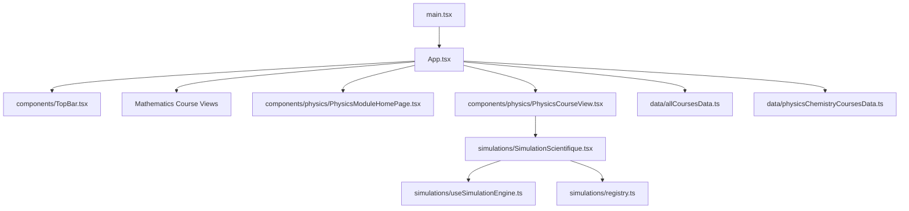
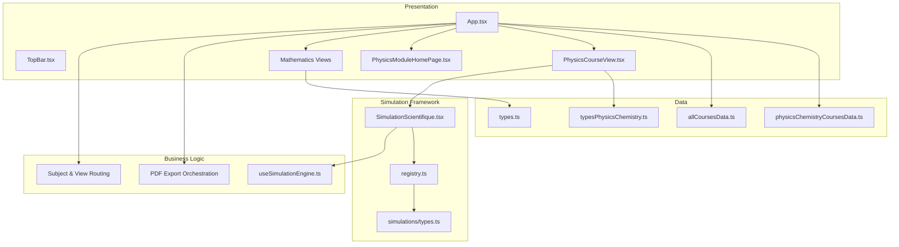
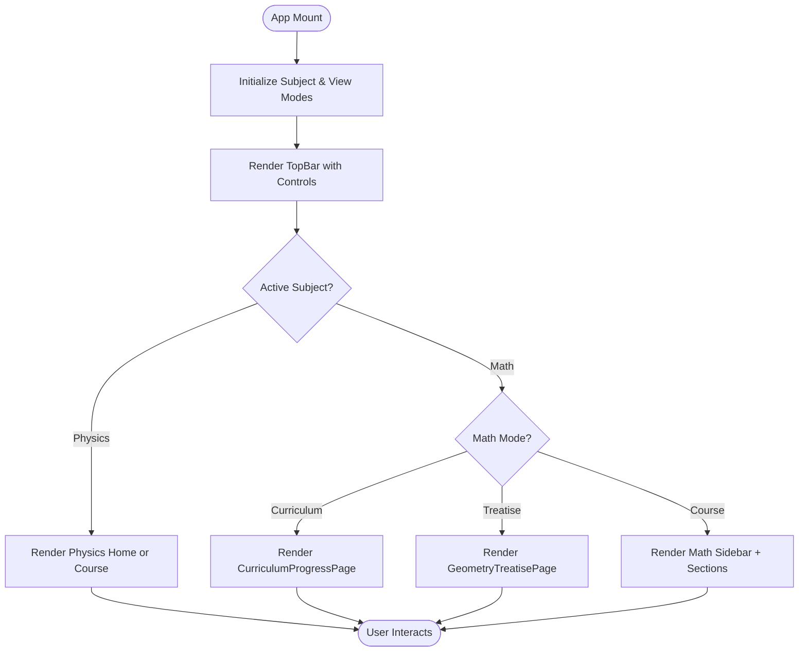
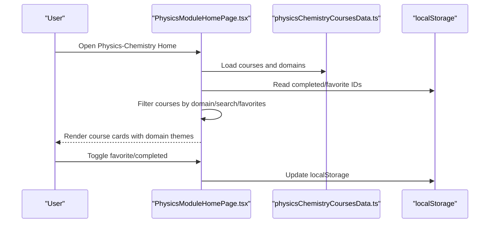
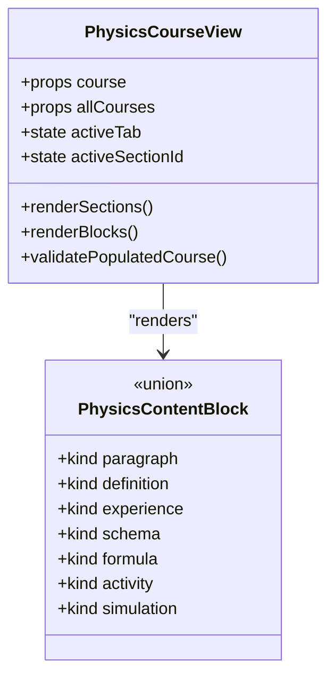
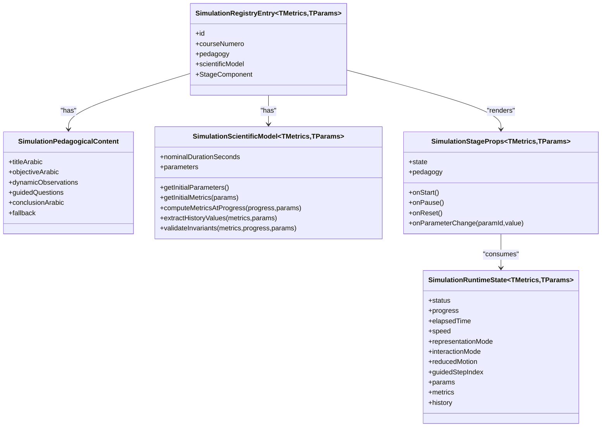
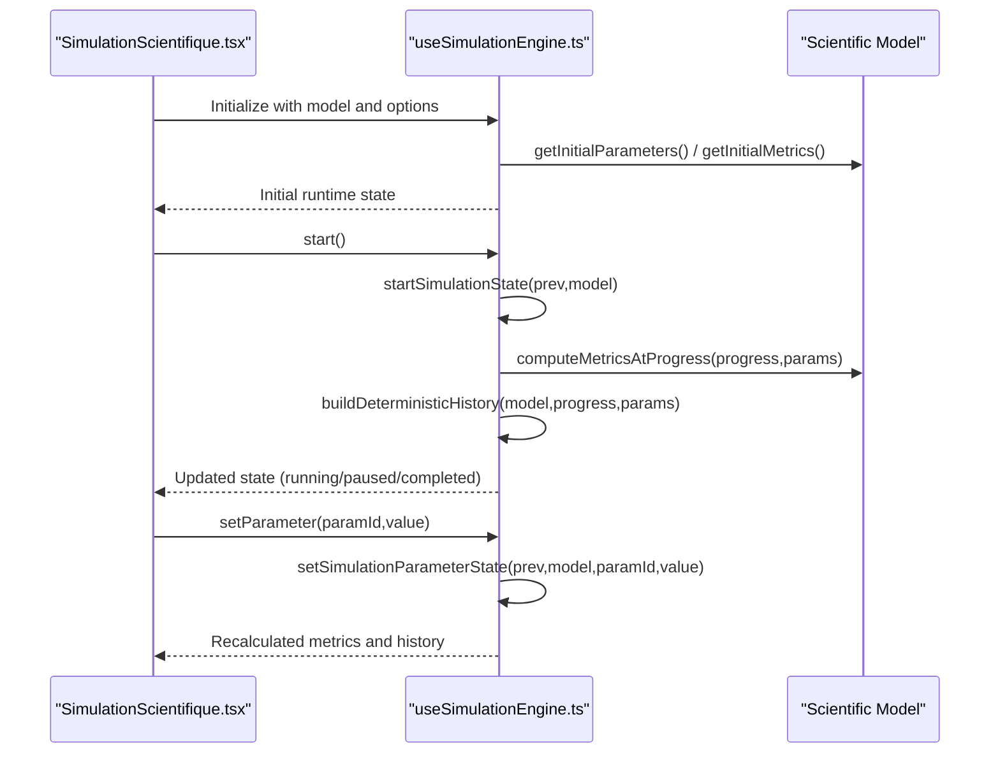
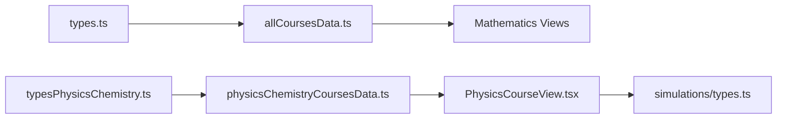
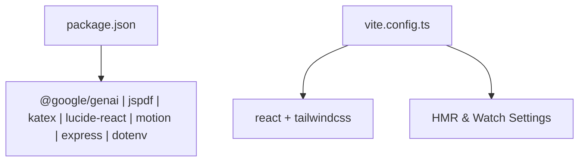

# Architecture Overview

<cite>
**Referenced Files in This Document**
- [main.tsx](file://src/main.tsx)
- [App.tsx](file://src/App.tsx)
- [package.json](file://package.json)
- [vite.config.ts](file://vite.config.ts)
- [types.ts](file://src/types.ts)
- [allCoursesData.ts](file://src/data/allCoursesData.ts)
- [typesPhysicsChemistry.ts](file://src/typesPhysicsChemistry.ts)
- [physicsChemistryCoursesData.ts](file://src/data/physicsChemistryCoursesData.ts)
- [TopBar.tsx](file://src/components/TopBar.tsx)
- [PhysicsModuleHomePage.tsx](file://src/components/physics/PhysicsModuleHomePage.tsx)
- [PhysicsCourseView.tsx](file://src/components/physics/PhysicsCourseView.tsx)
- [registry.ts](file://src/components/physics/simulations/registry.ts)
- [types.ts](file://src/components/physics/simulations/types.ts)
- [useSimulationEngine.ts](file://src/components/physics/simulations/useSimulationEngine.ts)
- [SimulationScientifique.tsx](file://src/components/physics/simulations/SimulationScientifique.tsx)
</cite>

## Table of Contents
1. [Introduction](#introduction)
2. [Project Structure](#project-structure)
3. [Core Components](#core-components)
4. [Architecture Overview](#architecture-overview)
5. [Detailed Component Analysis](#detailed-component-analysis)
6. [Dependency Analysis](#dependency-analysis)
7. [Performance Considerations](#performance-considerations)
8. [Troubleshooting Guide](#troubleshooting-guide)
9. [Conclusion](#conclusion)

## Introduction
Cours 3AM is a React-based educational platform that delivers interactive lessons for two subjects: Mathematics and Physics-Chemistry at the 3AM level. The application uses a component-based architecture with local state management, data-driven content models, and a dedicated simulation framework for Physics-Chemistry. It supports RTL Arabic UI, responsive layouts, PDF export, and domain-specific theming.

The system boundary includes:
- Browser runtime (React + Vite build).
- Local storage for user progress and preferences.
- Optional external integration points such as Google GenAI and PDF generation libraries.

## Project Structure
At a high level, the project follows a feature-oriented layout under `src`:
- `src/main.tsx` bootstraps the React app.
- `src/App.tsx` orchestrates subject routing, global UI state, and module selection.
- `src/components` contains UI components, including a dedicated `physics` subfolder for Physics-Chemistry features.
- `src/data` holds course data models and datasets for both subjects.
- `src/utils` provides cross-cutting utilities like PDF export helpers.
- Build configuration lives in `vite.config.ts`, and dependencies are declared in `package.json`.

**Diagram sources**
- [main.tsx:1-11](file://src/main.tsx#L1-L11)
- [App.tsx:23-436](file://src/App.tsx#L23-L436)
- [TopBar.tsx:48-115](file://src/components/TopBar.tsx#L48-L115)
- [PhysicsModuleHomePage.tsx:36-93](file://src/components/physics/PhysicsModuleHomePage.tsx#L36-L93)
- [PhysicsCourseView.tsx:85-113](file://src/components/physics/PhysicsCourseView.tsx#L85-L113)
- [SimulationScientifique.tsx:1-14](file://src/components/physics/simulations/SimulationScientifique.tsx#L1-L14)
- [useSimulationEngine.ts:1-17](file://src/components/physics/simulations/useSimulationEngine.ts#L1-L17)
- [registry.ts:1-31](file://src/components/physics/simulations/registry.ts#L1-L31)
- [allCoursesData.ts:1-200](file://src/data/allCoursesData.ts#L1-L200)
- [physicsChemistryCoursesData.ts:1-12](file://src/data/physicsChemistryCoursesData.ts#L1-L12)

**Section sources**
- [main.tsx:1-11](file://src/main.tsx#L1-L11)
- [App.tsx:23-436](file://src/App.tsx#L23-L436)
- [package.json:1-42](file://package.json#L1-L42)
- [vite.config.ts:1-23](file://vite.config.ts#L1-L23)

## Core Components
- Application shell (`App.tsx`) manages:
  - Active subject switcher between Mathematics and Physics-Chemistry.
  - View modes (course, curriculum, treatise) for Mathematics.
  - Physics-Chemistry home and course views.
  - PDF export orchestration for both subjects.
  - Global UI flags (sidebar, fullscreen, export status).
- Top-level navigation (`TopBar.tsx`) exposes:
  - Subject switching controls.
  - Course selector triggers.
  - Curriculum and treatise toggles.
  - Export actions and physics-specific navigation.
- Physics-Chemistry modules:
  - `PhysicsModuleHomePage.tsx` lists courses, filters by domain, favorites, and search.
  - `PhysicsCourseView.tsx` renders structured lesson blocks, sections, and simulations.
- Simulation framework:
  - `SimulationScientifique.tsx` composes pedagogy, scientific model, and stage rendering.
  - `useSimulationEngine.ts` drives animation loop, state transitions, and accessibility.
  - `registry.ts` centralizes registered simulations with metadata and stage components.
  - `types.ts` defines the simulation contracts, runtime state, and registry entry shape.

**Section sources**
- [App.tsx:23-436](file://src/App.tsx#L23-L436)
- [TopBar.tsx:48-115](file://src/components/TopBar.tsx#L48-L115)
- [PhysicsModuleHomePage.tsx:36-93](file://src/components/physics/PhysicsModuleHomePage.tsx#L36-L93)
- [PhysicsCourseView.tsx:85-113](file://src/components/physics/PhysicsCourseView.tsx#L85-L113)
- [SimulationScientifique.tsx:138-170](file://src/components/physics/simulations/SimulationScientifique.tsx#L138-L170)
- [useSimulationEngine.ts:309-479](file://src/components/physics/simulations/useSimulationEngine.ts#L309-L479)
- [registry.ts:32-81](file://src/components/physics/simulations/registry.ts#L32-L81)
- [types.ts:17-50](file://src/components/physics/simulations/types.ts#L17-L50)

## Architecture Overview
The platform separates concerns into layers:
- Presentation layer: React components for UI and layout.
- Business logic layer: State transitions, validation, and orchestration within components and hooks.
- Data layer: Static course datasets and typed models.
- Simulation layer: A decoupled framework combining declarative pedagogy, deterministic scientific models, and render stages.

**Diagram sources**
- [App.tsx:23-436](file://src/App.tsx#L23-L436)
- [TopBar.tsx:48-115](file://src/components/TopBar.tsx#L48-L115)
- [PhysicsModuleHomePage.tsx:36-93](file://src/components/physics/PhysicsModuleHomePage.tsx#L36-L93)
- [PhysicsCourseView.tsx:85-113](file://src/components/physics/PhysicsCourseView.tsx#L85-L113)
- [useSimulationEngine.ts:309-479](file://src/components/physics/simulations/useSimulationEngine.ts#L309-L479)
- [registry.ts:32-81](file://src/components/physics/simulations/registry.ts#L32-L81)
- [types.ts:17-50](file://src/components/physics/simulations/types.ts#L17-L50)
- [allCoursesData.ts:1-200](file://src/data/allCoursesData.ts#L1-L200)
- [physicsChemistryCoursesData.ts:1-12](file://src/data/physicsChemistryCoursesData.ts#L1-L12)
- [types.ts:70-146](file://src/types.ts#L70-L146)
- [typesPhysicsChemistry.ts:338-395](file://src/typesPhysicsChemistry.ts#L338-L395)

## Detailed Component Analysis

### Application Shell and Subject Switching
`App.tsx` is the root orchestrator:
- Maintains `activeSubject` to route between Mathematics and Physics-Chemistry.
- Manages view modes for Mathematics (course, curriculum, treatise).
- Holds independent state for Physics-Chemistry (home/course mode, selected course, completed/favorite IDs).
- Provides handlers for selecting courses, toggling completion/favorites, exporting PDFs, and toggling fullscreen.
- Renders `TopBar`, then conditionally renders either Physics-Chemistry or Mathematics views.

**Diagram sources**
- [App.tsx:23-436](file://src/App.tsx#L23-L436)

**Section sources**
- [App.tsx:23-436](file://src/App.tsx#L23-L436)

### Physics-Chemistry Module Home Page
`PhysicsModuleHomePage.tsx` provides:
- Domain filtering, search, favorites filter.
- Progress statistics computed from completed courses.
- Course cards styled with domain theme tokens.
- Actions to toggle completion and favorites, and to export individual course PDFs.

**Diagram sources**
- [PhysicsModuleHomePage.tsx:36-93](file://src/components/physics/PhysicsModuleHomePage.tsx#L36-L93)
- [physicsChemistryCoursesData.ts:1-12](file://src/data/physicsChemistryCoursesData.ts#L1-L12)

**Section sources**
- [PhysicsModuleHomePage.tsx:36-93](file://src/components/physics/PhysicsModuleHomePage.tsx#L36-L93)

### Physics-Chemistry Course View
`PhysicsCourseView.tsx` renders:
- Structured sections with multiple block types (paragraphs, definitions, experiments, schemas, formulas, activities, etc.).
- Discovery activities and guided corrections.
- Integration with the simulation framework via `SimulationScientifique`.
- Domain-themed styling and progression indicators.
- Validation guards ensuring populated courses have non-empty sections.

**Diagram sources**
- [PhysicsCourseView.tsx:85-113](file://src/components/physics/PhysicsCourseView.tsx#L85-L113)
- [typesPhysicsChemistry.ts:306-332](file://src/typesPhysicsChemistry.ts#L306-L332)

**Section sources**
- [PhysicsCourseView.tsx:85-113](file://src/components/physics/PhysicsCourseView.tsx#L85-L113)
- [typesPhysicsChemistry.ts:306-332](file://src/typesPhysicsChemistry.ts#L306-L332)

### Simulation Framework Architecture
The simulation framework enforces strict separation:
- Pedagogical content: declarative objectives, questions, observations, and conclusions.
- Scientific model: pure functions computing metrics deterministically over normalized progress.
- Runtime state: encapsulates status, progress, parameters, metrics, history, and interaction modes.
- Stage component: renders the visual scene based on current state and pedagogy.
- Registry: central mapping of simulation IDs to entries containing pedagogy, model, and stage component.

**Diagram sources**
- [types.ts:207-289](file://src/components/physics/simulations/types.ts#L207-L289)
- [registry.ts:32-81](file://src/components/physics/simulations/registry.ts#L32-L81)

**Section sources**
- [types.ts:17-50](file://src/components/physics/simulations/types.ts#L17-L50)
- [types.ts:207-289](file://src/components/physics/simulations/types.ts#L207-L289)
- [registry.ts:32-81](file://src/components/physics/simulations/registry.ts#L32-L81)

### Simulation Engine Hook Flow
`useSimulationEngine.ts` implements:
- Deterministic state transitions for start, pause, reset, speed changes, parameter updates, and progress jumps.
- Animation loop using `requestAnimationFrame`, pausing when out of viewport or reduced motion is preferred.
- History building for dynamic graphs based on scientific model outputs.

**Diagram sources**
- [useSimulationEngine.ts:100-128](file://src/components/physics/simulations/useSimulationEngine.ts#L100-L128)
- [useSimulationEngine.ts:133-165](file://src/components/physics/simulations/useSimulationEngine.ts#L133-L165)
- [useSimulationEngine.ts:221-252](file://src/components/physics/simulations/useSimulationEngine.ts#L221-L252)
- [useSimulationEngine.ts:309-479](file://src/components/physics/simulations/useSimulationEngine.ts#L309-L479)

**Section sources**
- [useSimulationEngine.ts:100-128](file://src/components/physics/simulations/useSimulationEngine.ts#L100-L128)
- [useSimulationEngine.ts:133-165](file://src/components/physics/simulations/useSimulationEngine.ts#L133-L165)
- [useSimulationEngine.ts:221-252](file://src/components/physics/simulations/useSimulationEngine.ts#L221-L252)
- [useSimulationEngine.ts:309-479](file://src/components/physics/simulations/useSimulationEngine.ts#L309-L479)

### Data Models and Separation of Concerns
- Mathematics data model (`types.ts` and `allCoursesData.ts`) defines structured lessons with sections, discovery activities, exercises, vocabulary, and summaries.
- Physics-Chemistry data model (`typesPhysicsChemistry.ts` and `physicsChemistryCoursesData.ts`) defines rich pedagogical blocks, trilingual terms, schemas, formulas, activities, and applications.
- UI components consume these models without embedding business logic; state transitions remain in components/hooks.
- Simulation framework isolates scientific computation from rendering, enabling testability and reproducibility.

**Diagram sources**
- [types.ts:70-146](file://src/types.ts#L70-L146)
- [allCoursesData.ts:1-200](file://src/data/allCoursesData.ts#L1-L200)
- [typesPhysicsChemistry.ts:338-395](file://src/typesPhysicsChemistry.ts#L338-L395)
- [physicsChemistryCoursesData.ts:1-12](file://src/data/physicsChemistryCoursesData.ts#L1-L12)
- [types.ts:17-50](file://src/components/physics/simulations/types.ts#L17-L50)

**Section sources**
- [types.ts:70-146](file://src/types.ts#L70-L146)
- [allCoursesData.ts:1-200](file://src/data/allCoursesData.ts#L1-L200)
- [typesPhysicsChemistry.ts:338-395](file://src/typesPhysicsChemistry.ts#L338-L395)
- [physicsChemistryCoursesData.ts:1-12](file://src/data/physicsChemistryCoursesData.ts#L1-L12)

## Dependency Analysis
External dependencies relevant to architecture:
- `@google/genai`: potential integration point for AI-assisted features.
- `jspdf` and `modern-screenshot`: PDF export and screenshot capture utilities.
- `katex`: LaTeX rendering for mathematical and chemical expressions.
- `lucide-react`: iconography across UI components.
- `motion`: animations for interactive elements.
- `express` and `dotenv`: server-side tooling and environment variables (not used directly in client code shown here).

Build-time configuration:
- Vite plugin setup for React and Tailwind CSS.
- HMR and file watching controlled by environment variable.

**Diagram sources**
- [package.json:13-27](file://package.json#L13-L27)
- [vite.config.ts:6-20](file://vite.config.ts#L6-L20)

**Section sources**
- [package.json:13-27](file://package.json#L13-L27)
- [vite.config.ts:6-20](file://vite.config.ts#L6-L20)

## Performance Considerations
- Animation loop optimization:
  - Uses `requestAnimationFrame` with delta time calculation.
  - Pauses automatically when the simulation container is not visible (IntersectionObserver).
  - Respects `prefers-reduced-motion` to minimize animations for accessibility.
- Deterministic history building:
  - Samples up to 20 steps for graphing to balance performance and fidelity.
- Rendering efficiency:
  - Simulation drawer opens only on demand, reducing initial render cost.
  - Domain-themed components avoid heavy computations during list rendering.

[No sources needed since this section provides general guidance]

## Troubleshooting Guide
Common issues and resolutions:
- Empty or invalid Physics-Chemistry sections:
  - Validation guards throw explicit errors for populated courses with missing or empty sections.
- Simulation initialization failures:
  - Fallback static view displays key values and equations if interactive simulation cannot initialize.
- PDF export interruptions:
  - Export flow sets status messages and handles errors gracefully, resetting state after completion or failure.
- Local storage errors:
  - Completion and favorite toggles wrap storage operations in try/catch to prevent crashes.

**Section sources**
- [PhysicsCourseView.tsx:65-83](file://src/components/physics/PhysicsCourseView.tsx#L65-L83)
- [SimulationScientifique.tsx:45-108](file://src/components/physics/simulations/SimulationScientifique.tsx#L45-L108)
- [App.tsx:116-195](file://src/App.tsx#L116-L195)
- [App.tsx:66-88](file://src/App.tsx#L66-L88)

## Conclusion
Cours 3AM employs a clear, layered architecture:
- High-level routing and state orchestration in `App.tsx`.
- Feature-specific components for Mathematics and Physics-Chemistry.
- A robust simulation framework separating pedagogy, scientific models, and rendering.
- Strong typing and data-driven content models ensure maintainability and extensibility.
- Cross-cutting concerns like internationalization, theming, and responsive design are integrated throughout the UI layer.

[No sources needed since this section summarizes without analyzing specific files]