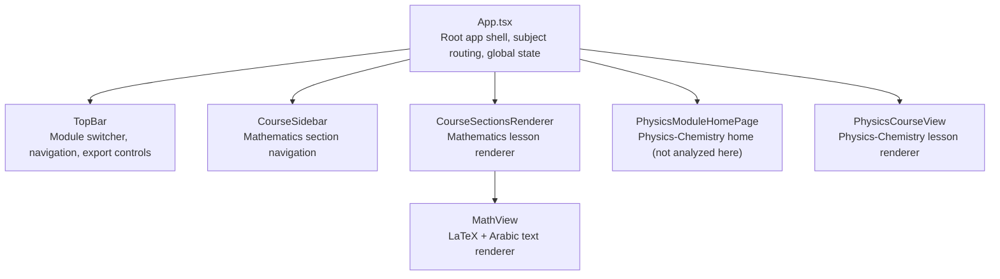
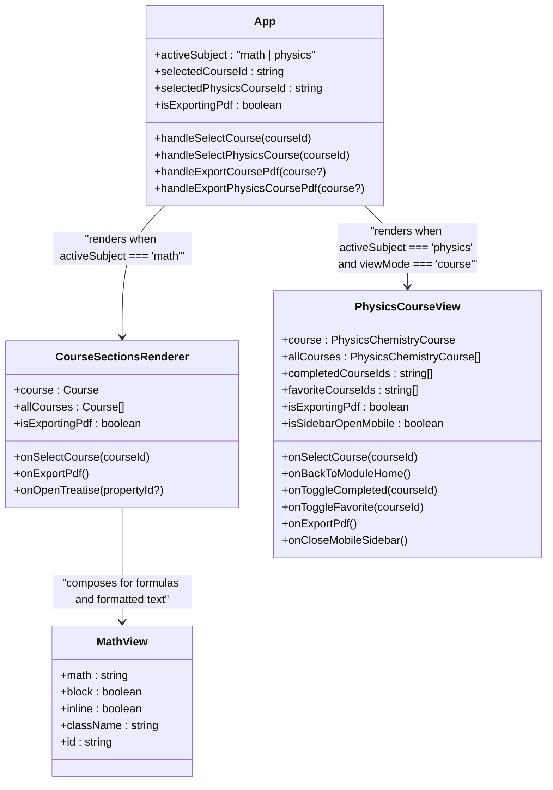
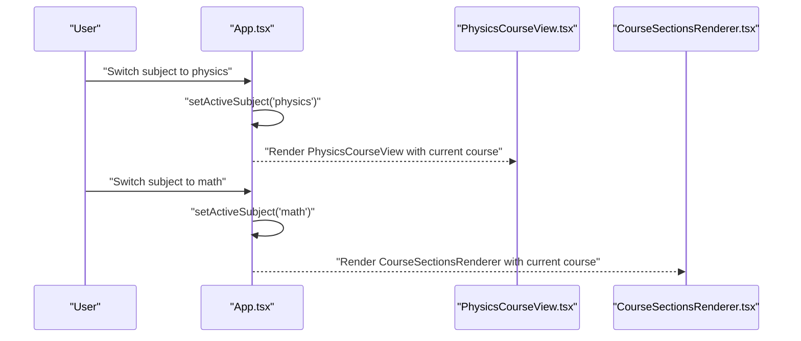
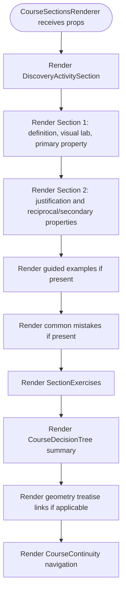
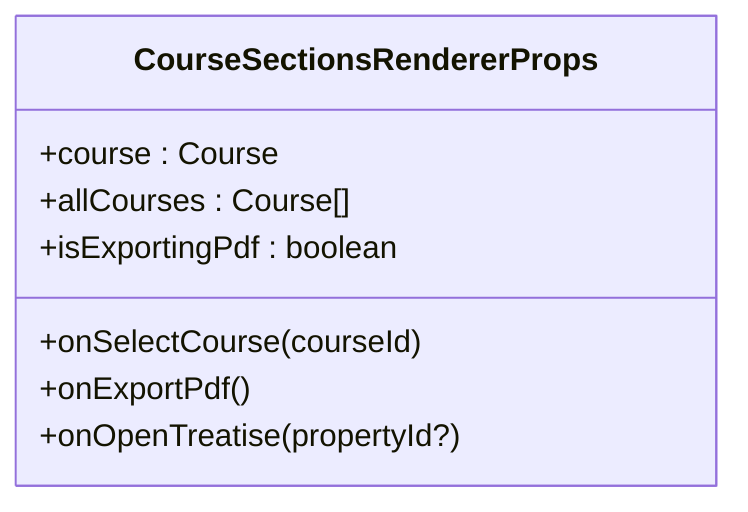
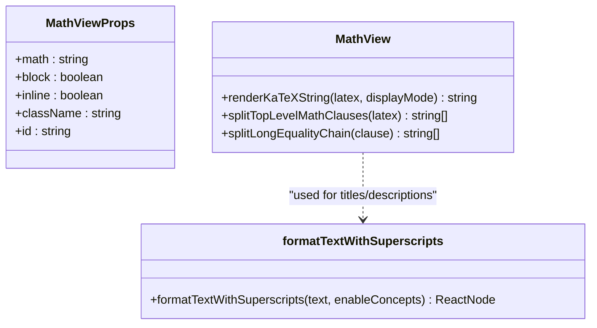
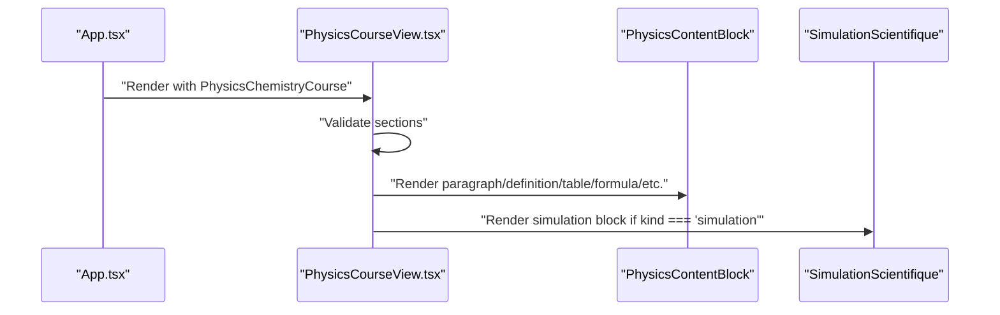
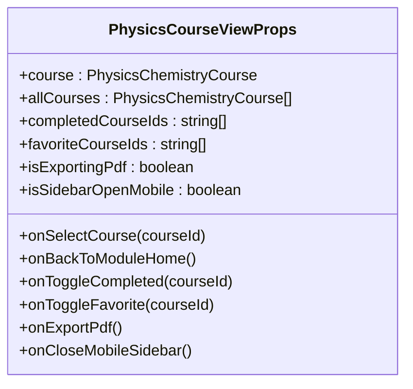
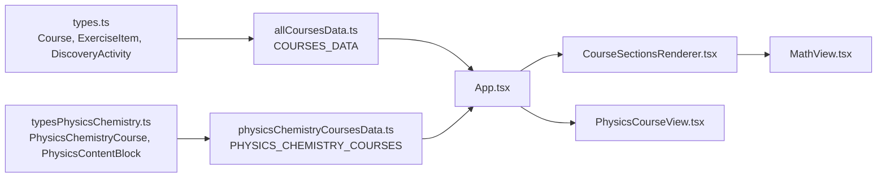

# Component Hierarchy

<cite>
**Referenced Files in This Document**   
- [App.tsx](file://src/App.tsx)
- [CourseSectionsRenderer.tsx](file://src/components/CourseSectionsRenderer.tsx)
- [MathView.tsx](file://src/components/MathView.tsx)
- [PhysicsCourseView.tsx](file://src/components/physics/PhysicsCourseView.tsx)
- [types.ts](file://src/types.ts)
- [typesPhysicsChemistry.ts](file://src/typesPhysicsChemistry.ts)
- [allCoursesData.ts](file://src/data/allCoursesData.ts)
- [physicsChemistryCoursesData.ts](file://src/data/physicsChemistryCoursesData.ts)
</cite>

## Table of Contents
1. [Introduction](#introduction)
2. [Project Structure](#project-structure)
3. [Core Components](#core-components)
4. [Architecture Overview](#architecture-overview)
5. [Detailed Component Analysis](#detailed-component-analysis)
6. [Dependency Analysis](#dependency-analysis)
7. [Performance Considerations](#performance-considerations)
8. [Troubleshooting Guide](#troubleshooting-guide)
9. [Conclusion](#conclusion)

## Introduction
This document explains the React component hierarchy for the course application, focusing on how the root `App` component routes between two subject areas: Mathematics and Physics-Chemistry. It then details the parent-child relationships among `CourseSectionsRenderer`, `MathView`, and `PhysicsCourseView`, documents their prop interfaces, state management patterns, event handling, composition patterns, lifecycle behavior, and performance considerations. The goal is to help developers understand where new domain-specific components should be integrated and how to extend the existing hierarchy safely.

## Project Structure
At a high level, the application is organized by subject area:
- Mathematics 3AM uses a structured lesson model defined in `types.ts` and rendered through `CourseSectionsRenderer`.
- Physics-Chemistry 3AM uses a richer block-based model defined in `typesPhysicsChemistry.ts` and rendered through `PhysicsCourseView`.
- `App.tsx` is the top-level router that switches between these two subject areas and manages shared UI state such as module selection, PDF export progress, sidebar visibility, and fullscreen mode.

**Diagram sources**
- [App.tsx:23-433](file://src/App.tsx#L23-L433)
- [CourseSectionsRenderer.tsx:135-739](file://src/components/CourseSectionsRenderer.tsx#L135-L739)
- [MathView.tsx:350-579](file://src/components/MathView.tsx#L350-L579)
- [PhysicsCourseView.tsx:100-463](file://src/components/physics/PhysicsCourseView.tsx#L100-L463)

**Section sources**
- [App.tsx:23-433](file://src/App.tsx#L23-L433)

## Core Components
The core components relevant to this hierarchy are:
- `App`: Root container, subject router, and global state owner.
- `CourseSectionsRenderer`: Mathematics lesson content renderer.
- `MathView`: Mathematical formula and mixed Arabic/LaTeX text renderer.
- `PhysicsCourseView`: Physics-Chemistry lesson content renderer.

These components follow a clear pattern:
- `App` owns cross-cutting state and passes down callbacks.
- Subject-specific view components own local UI state and render domain-specific sections.
- Shared rendering utilities like `MathView` are composed inside domain renderers.

**Section sources**
- [App.tsx:23-433](file://src/App.tsx#L23-L433)
- [CourseSectionsRenderer.tsx:36-43](file://src/components/CourseSectionsRenderer.tsx#L36-L43)
- [MathView.tsx:6-12](file://src/components/MathView.tsx#L6-L12)
- [PhysicsCourseView.tsx:85-98](file://src/components/physics/PhysicsCourseView.tsx#L85-L98)

## Architecture Overview
The application uses a subject-based architecture rather than a single monolithic course renderer. Mathematics and Physics-Chemistry have different data models, so they are rendered by separate components with distinct prop contracts.

**Diagram sources**
- [App.tsx:23-433](file://src/App.tsx#L23-L433)
- [CourseSectionsRenderer.tsx:36-43](file://src/components/CourseSectionsRenderer.tsx#L36-L43)
- [MathView.tsx:6-12](file://src/components/MathView.tsx#L6-L12)
- [PhysicsCourseView.tsx:85-98](file://src/components/physics/PhysicsCourseView.tsx#L85-L98)

**Section sources**
- [App.tsx:23-433](file://src/App.tsx#L23-L433)

## Detailed Component Analysis

### App: Subject Router and Global State Owner
`App` is the entry point for the user interface. It:
- Tracks the active subject (`math` or `physics`).
- Manages Mathematics course selection, section navigation, curriculum/treatise views, and PDF export state.
- Manages Physics-Chemistry course selection, completion/favorite tracking, and PDF export state.
- Renders either the Physics-Chemistry home page, the Physics-Chemistry course view, the Mathematics curriculum/treatise pages, or the Mathematics course layout.

Key responsibilities:
- Routing between subject areas via `activeSubject`.
- Routing between Mathematics views via `viewMode` (`course`, `curriculum`, `treatise`).
- Routing between Physics-Chemistry views via `physicsViewMode` (`home`, `course`).
- Providing shared callbacks for selecting courses, toggling completion/favorites, exporting PDFs, opening modals, and controlling the mobile sidebar.

**Diagram sources**
- [App.tsx:23-433](file://src/App.tsx#L23-L433)

#### Prop Interfaces and Data Flow
- Mathematics data comes from `COURSES_DATA` in `allCoursesData.ts` and conforms to the `Course` type in `types.ts`.
- Physics-Chemistry data comes from `PHYSICS_CHEMISTRY_COURSES` in `physicsChemistryCoursesData.ts` and conforms to `PhysicsChemistryCourse` in `typesPhysicsChemistry.ts`.
- `App` selects the current course by ID and passes it down to the appropriate renderer.

**Section sources**
- [App.tsx:23-433](file://src/App.tsx#L23-L433)
- [types.ts:70-146](file://src/types.ts#L70-L146)
- [typesPhysicsChemistry.ts:338-395](file://src/typesPhysicsChemistry.ts#L338-L395)
- [allCoursesData.ts:3-200](file://src/data/allCoursesData.ts#L3-L200)
- [physicsChemistryCoursesData.ts:1-800](file://src/data/physicsChemistryCoursesData.ts#L1-L800)

### CourseSectionsRenderer: Mathematics Lesson Renderer
`CourseSectionsRenderer` renders a Mathematics lesson according to the `Course` data model. It:
- Owns local tab state (`cours`, `video`, `quiz`, `exercices`, `defis`).
- Tracks whether the discovery activity is completed using `localStorage`.
- Builds numbered properties based on the course’s primary and secondary formulas.
- Composes reusable subcomponents such as `DiscoveryActivitySection`, `StepByStepExample`, `CommonMistakeBox`, `SectionExercises`, `CourseDecisionTree`, and `MathView`.

Parent-child relationship:
- Parent: `App` passes `currentCourse`, `COURSES_DATA`, and callbacks.
- Children: `CourseSectionsRenderer` composes multiple domain-specific and generic UI components.

**Diagram sources**
- [CourseSectionsRenderer.tsx:135-739](file://src/components/CourseSectionsRenderer.tsx#L135-L739)

#### Prop Interface

**Diagram sources**
- [CourseSectionsRenderer.tsx:36-43](file://src/components/CourseSectionsRenderer.tsx#L36-L43)

#### State Management Patterns
- Local UI state: `activeTab` controls which section/tab is visible.
- Persistent unlock state: `unlockedMathDiscoveryIds` is stored in `localStorage` under a dedicated key and triggers a custom DOM event when updated.
- Scroll-driven progress: `App` computes scroll position and updates `progressPercentage`; `CourseSectionsRenderer` does not compute scroll but reacts to tab clicks by scrolling into view.

#### Event Handling
- Tab switching calls `handleTabClick`, which updates `activeTab` and scrolls to relevant sections.
- Completing the discovery activity marks the course as unlocked and scrolls to the concept section.
- Prerequisite course links call `onSelectCourse(prevC.id)` to navigate to earlier lessons.

**Section sources**
- [CourseSectionsRenderer.tsx:135-739](file://src/components/CourseSectionsRenderer.tsx#L135-L739)

### MathView: Formula and Mixed Text Renderer
`MathView` is a reusable utility component used by `CourseSectionsRenderer` and other parts of the Mathematics renderer. Its purpose is to render:
- Pure LaTeX expressions.
- Plain Arabic/French text.
- Mixed Arabic text and LaTeX commands.
- Superscript formatting for power expressions.
- Clickable fundamental concept highlights.

It exposes:
- A component interface for rendering math blocks inline or as blocks.
- A helper function `formatTextWithSuperscripts` for formatting titles and descriptions with superscripts.

**Diagram sources**
- [MathView.tsx:6-12](file://src/components/MathView.tsx#L6-L12)
- [MathView.tsx:129-195](file://src/components/MathView.tsx#L129-L195)
- [MathView.tsx:197-348](file://src/components/MathView.tsx#L197-L348)
- [MathView.tsx:350-579](file://src/components/MathView.tsx#L350-L579)

#### Composition Pattern
`CourseSectionsRenderer` uses `MathView` indirectly through formatted titles and property rows. For example, titles use `formatTextWithSuperscripts`, while property statements use `NumberedPropertyRow`, which internally relies on mathematical rendering.

**Section sources**
- [MathView.tsx:6-12](file://src/components/MathView.tsx#L6-L12)
- [MathView.tsx:129-195](file://src/components/MathView.tsx#L129-L195)
- [MathView.tsx:350-579](file://src/components/MathView.tsx#L350-L579)

### PhysicsCourseView: Physics-Chemistry Lesson Renderer
`PhysicsCourseView` renders a Physics-Chemistry lesson according to the `PhysicsChemistryCourse` data model. It:
- Owns local tab state (`all`, `lesson`, `activities`, `summary`).
- Tracks discovery unlock state via `localStorage`.
- Validates populated courses to ensure sections contain valid content.
- Renders domain-themed sidebars, section navigation, exercises, simulations, and summaries.
- Integrates with the simulation engine through `SimulationScientifique`.

Parent-child relationship:
- Parent: `App` passes the current `PhysicsChemistryCourse`, all courses, completion/favorite lists, and callbacks.
- Children: `PhysicsCourseView` composes many domain-specific blocks such as definitions, observations, experiments, explanations, schemas, tables, formulas, examples, activities, common mistakes, and simulations.

**Diagram sources**
- [PhysicsCourseView.tsx:100-463](file://src/components/physics/PhysicsCourseView.tsx#L100-L463)

#### Prop Interface

**Diagram sources**
- [PhysicsCourseView.tsx:85-98](file://src/components/physics/PhysicsCourseView.tsx#L85-L98)

#### State Management and Lifecycle
- Local state includes `activeTab`, `activeSectionId`, `unlockedDiscoveryIds`, and accordion state for deeper content.
- `useEffect` synchronizes discovery unlock state to `localStorage`.
- `useEffect` listens to PDF-related window events to expand content during export/print.
- Validation throws explicit errors if a published course has empty sections or invalid blocks.

**Section sources**
- [PhysicsCourseView.tsx:100-463](file://src/components/physics/PhysicsCourseView.tsx#L100-L463)

## Dependency Analysis
The dependency graph shows how data types flow from data files into components, and how components depend on each other.

**Diagram sources**
- [types.ts:70-146](file://src/types.ts#L70-L146)
- [typesPhysicsChemistry.ts:338-395](file://src/typesPhysicsChemistry.ts#L338-L395)
- [allCoursesData.ts:3-200](file://src/data/allCoursesData.ts#L3-L200)
- [physicsChemistryCoursesData.ts:1-800](file://src/data/physicsChemistryCoursesData.ts#L1-L800)
- [App.tsx:23-433](file://src/App.tsx#L23-L433)
- [CourseSectionsRenderer.tsx:135-739](file://src/components/CourseSectionsRenderer.tsx#L135-L739)
- [MathView.tsx:350-579](file://src/components/MathView.tsx#L350-L579)
- [PhysicsCourseView.tsx:100-463](file://src/components/physics/PhysicsCourseView.tsx#L100-L463)

**Section sources**
- [App.tsx:23-433](file://src/App.tsx#L23-L433)
- [CourseSectionsRenderer.tsx:135-739](file://src/components/CourseSectionsRenderer.tsx#L135-L739)
- [MathView.tsx:350-579](file://src/components/MathView.tsx#L350-L579)
- [PhysicsCourseView.tsx:100-463](file://src/components/physics/PhysicsCourseView.tsx#L100-L463)

## Performance Considerations
- **Local vs global state**: `App` holds global state for subject routing and shared UI flags, while `CourseSectionsRenderer` and `PhysicsCourseView` keep local UI state. This reduces unnecessary re-renders across unrelated parts of the tree.
- **LocalStorage persistence**: Both Mathematics and Physics-Chemistry discovery unlock states are persisted in `localStorage`. Reads happen once during initialization; writes happen only when state changes.
- **Scroll-driven progress**: `App` attaches a passive scroll listener and computes progress percentage. This is efficient because it avoids heavy computations inside child components.
- **Math rendering**: `MathView` uses memoization (`useMemo`) for concept keyword matching and splits long equations intelligently to avoid overly wide layouts.
- **Conditional rendering**: Components render only when needed, such as tabs being shown after discovery completion in Mathematics and sections being revealed after discovery completion in Physics-Chemistry.

[No sources needed since this section provides general guidance]

## Troubleshooting Guide
Common issues and how to diagnose them:

- **Mathematics discovery tab not appearing**: Check whether `unlockedMathDiscoveryIds` contains the current course ID. If not, complete the discovery activity to unlock the tabs.
- **Physics-Chemistry sections locked**: If only the first section is visible, complete the discovery activity to reveal additional sections and the summary.
- **Empty or invalid Physics-Chemistry sections**: `PhysicsCourseView` validates sections and throws an error if a published course has no blocks or only empty blocks. Inspect the course data file for missing or malformed sections.
- **PDF export not starting**: Ensure `isExportingPdf` is false before triggering export. `App` guards against concurrent exports and sets status messages accordingly.
- **Scroll navigation not working**: Verify that target section IDs exist in the DOM and that `scrollIntoView` is called after state updates.

**Section sources**
- [CourseSectionsRenderer.tsx:143-174](file://src/components/CourseSectionsRenderer.tsx#L143-L174)
- [PhysicsCourseView.tsx:114-153](file://src/components/physics/PhysicsCourseView.tsx#L114-L153)
- [PhysicsCourseView.tsx:178-186](file://src/components/physics/PhysicsCourseView.tsx#L178-L186)
- [App.tsx:116-195](file://src/App.tsx#L116-L195)

## Conclusion
The component hierarchy is intentionally split by subject area. `App` acts as the root router and state owner, while `CourseSectionsRenderer` and `PhysicsCourseView` are domain-specific renderers with distinct data models and prop contracts. `MathView` is a reusable utility for mathematical and mixed-language rendering, composed inside the Mathematics renderer. New components should follow the same patterns:
- Keep subject-specific logic inside the corresponding renderer.
- Use typed props for strict contracts.
- Prefer local state for UI-only concerns and lift state only when sharing across siblings.
- Persist important user progress in `localStorage` with safe read/write patterns.
- Compose small, focused components rather than expanding large renderers.

This structure supports scalability: adding new Mathematics lessons means extending `CourseSectionsRenderer` and its children, while adding new Physics-Chemistry lessons means extending `PhysicsCourseView` and its block renderers.

[No sources needed since this section summarizes without analyzing specific files]