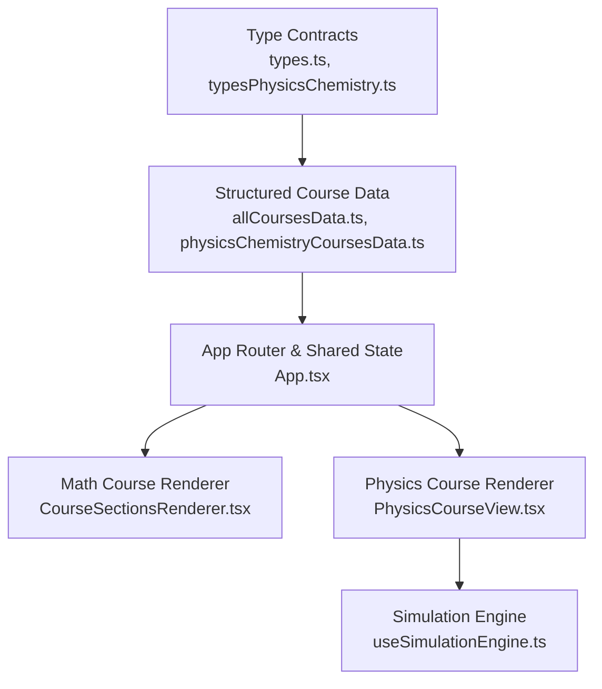
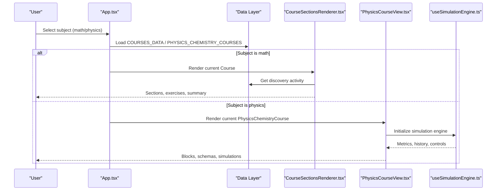
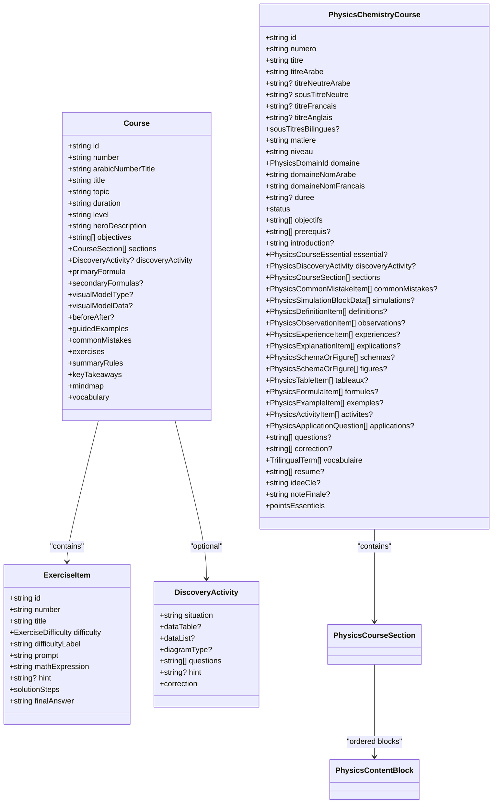
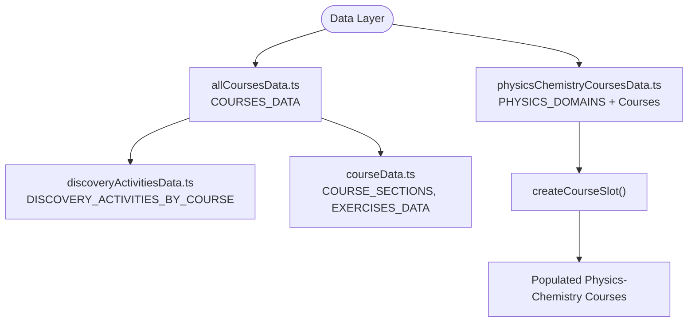
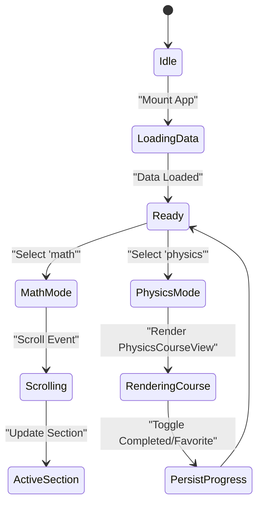
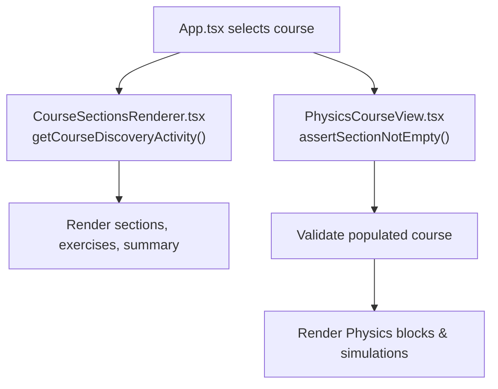
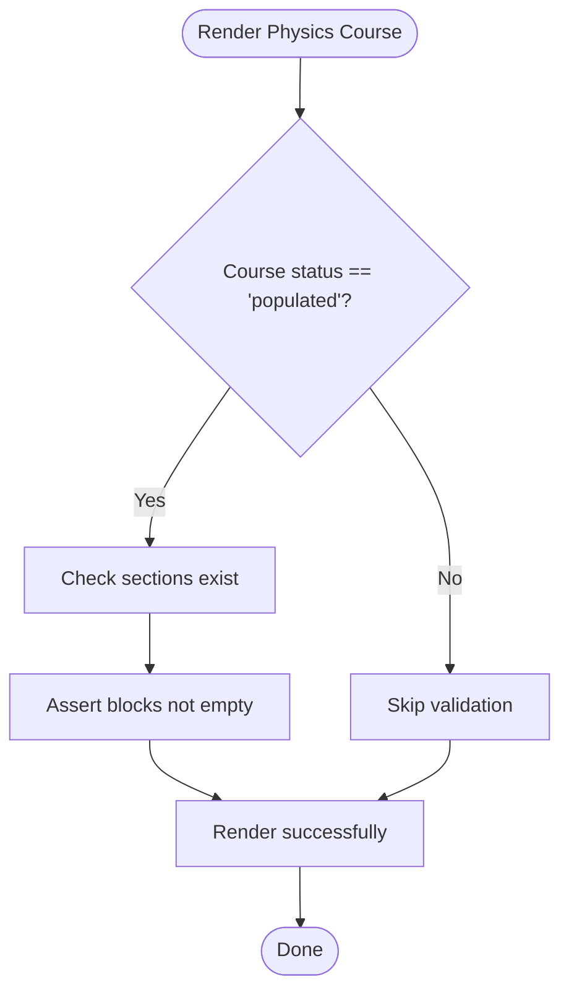
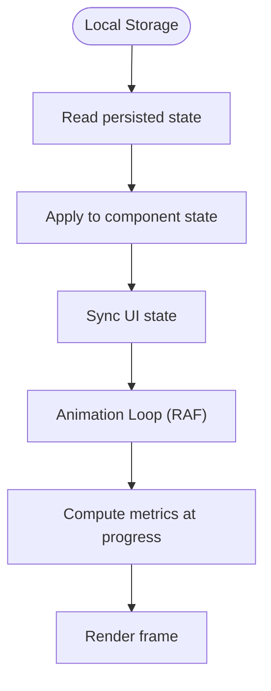
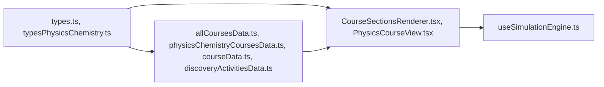

# Data Flow Patterns

<cite>
**Referenced Files in This Document**   
- [types.ts](file://src/types.ts)
- [typesPhysicsChemistry.ts](file://src/typesPhysicsChemistry.ts)
- [courseData.ts](file://src/data/courseData.ts)
- [allCoursesData.ts](file://src/data/allCoursesData.ts)
- [physicsChemistryCoursesData.ts](file://src/data/physicsChemistryCoursesData.ts)
- [discoveryActivitiesData.ts](file://src/data/discoveryActivitiesData.ts)
- [App.tsx](file://src/App.tsx)
- [CourseSectionsRenderer.tsx](file://src/components/CourseSectionsRenderer.tsx)
- [PhysicsCourseView.tsx](file://src/components/physics/PhysicsCourseView.tsx)
- [useSimulationEngine.ts](file://src/components/physics/simulations/useSimulationEngine.ts)
</cite>

## Table of Contents
1. [Introduction](#introduction)
2. [Project Structure](#project-structure)
3. [Core Components](#core-components)
4. [Architecture Overview](#architecture-overview)
5. [Detailed Component Analysis](#detailed-component-analysis)
6. [Dependency Analysis](#dependency-analysis)
7. [Performance Considerations](#performance-considerations)
8. [Troubleshooting Guide](#troubleshooting-guide)
9. [Conclusion](#conclusion)

## Introduction
This document explains how data flows through the Cours 3AM platform from structured course data sources to UI components. It focuses on:
- The type contracts defined in `types.ts` and `typesPhysicsChemistry.ts`.
- The structured data layer for Mathematics and Physics-Chemistry courses.
- State management using React hooks and local storage for progress tracking.
- Data transformation pipelines, validation patterns, error handling strategies.
- Caching, synchronization, and performance considerations for large course datasets.

The goal is to make the architecture understandable for both technical and non-technical readers while providing concrete code-level references.

## Project Structure
At a high level, the application separates concerns into:
- Type definitions that define data contracts.
- Structured data files containing course content.
- A top-level app component managing module routing and shared state.
- View components rendering course content and physics simulations.
- Simulation engine logic with deterministic state transitions.

**Diagram sources**
- [types.ts:1-147](file://src/types.ts#L1-L147)
- [typesPhysicsChemistry.ts:1-397](file://src/typesPhysicsChemistry.ts#L1-L397)
- [allCoursesData.ts:1-800](file://src/data/allCoursesData.ts#L1-L800)
- [physicsChemistryCoursesData.ts:1-200](file://src/data/physicsChemistryCoursesData.ts#L1-L200)
- [App.tsx:1-436](file://src/App.tsx#L1-L436)
- [CourseSectionsRenderer.tsx:1-740](file://src/components/CourseSectionsRenderer.tsx#L1-L740)
- [PhysicsCourseView.tsx:1-200](file://src/components/physics/PhysicsCourseView.tsx#L1-L200)
- [useSimulationEngine.ts:118-479](file://src/components/physics/simulations/useSimulationEngine.ts#L118-L479)

**Section sources**
- [types.ts:1-147](file://src/types.ts#L1-L147)
- [typesPhysicsChemistry.ts:1-397](file://src/typesPhysicsChemistry.ts#L1-L397)
- [allCoursesData.ts:1-800](file://src/data/allCoursesData.ts#L1-L800)
- [physicsChemistryCoursesData.ts:1-200](file://src/data/physicsChemistryCoursesData.ts#L1-L200)
- [App.tsx:1-436](file://src/App.tsx#L1-L436)
- [CourseSectionsRenderer.tsx:1-740](file://src/components/CourseSectionsRenderer.tsx#L1-L740)
- [PhysicsCourseView.tsx:1-200](file://src/components/physics/PhysicsCourseView.tsx#L1-L200)
- [useSimulationEngine.ts:118-479](file://src/components/physics/simulations/useSimulationEngine.ts#L118-L479)

## Core Components
- **Type Contracts**:
  - `types.ts` defines core Mathematics course structures such as `Course`, `ExerciseItem`, `DiscoveryActivity`, and related metadata.
  - `typesPhysicsChemistry.ts` defines Physics-Chemistry domain models including `PhysicsChemistryCourse`, `PhysicsContentBlock`, `PhysicsSchemaOrFigure`, and more.
- **Data Layer**:
  - `allCoursesData.ts` contains the full array of Mathematics courses (`COURSES_DATA`).
  - `physicsChemistryCoursesData.ts` provides domain metadata and course slots or populated courses for Physics-Chemistry.
  - `courseData.ts` provides reusable section and exercise data fragments used by specific modules.
  - `discoveryActivitiesData.ts` provides discovery activities aligned with Mathematics lessons.
- **UI Rendering**:
  - `CourseSectionsRenderer.tsx` renders Mathematics course sections, handles discovery completion, prerequisite linking, and tabbed navigation.
  - `PhysicsCourseView.tsx` renders Physics-Chemistry courses, validates populated content, manages discovery unlock state, and integrates simulation blocks.
- **State Management**:
  - `App.tsx` orchestrates module selection, PDF export workflows, scroll-based progress tracking, and persistence of completed/favorite courses via local storage.
  - `useSimulationEngine.ts` encapsulates deterministic simulation runtime state transitions and animation loop control.

**Section sources**
- [types.ts:1-147](file://src/types.ts#L1-L147)
- [typesPhysicsChemistry.ts:1-397](file://src/typesPhysicsChemistry.ts#L1-L397)
- [allCoursesData.ts:1-800](file://src/data/allCoursesData.ts#L1-L800)
- [physicsChemistryCoursesData.ts:1-200](file://src/data/physicsChemistryCoursesData.ts#L1-L200)
- [courseData.ts:1-135](file://src/data/courseData.ts#L1-L135)
- [discoveryActivitiesData.ts:1-200](file://src/data/discoveryActivitiesData.ts#L1-L200)
- [CourseSectionsRenderer.tsx:1-740](file://src/components/CourseSectionsRenderer.tsx#L1-L740)
- [PhysicsCourseView.tsx:1-200](file://src/components/physics/PhysicsCourseView.tsx#L1-L200)
- [App.tsx:1-436](file://src/App.tsx#L1-L436)
- [useSimulationEngine.ts:118-479](file://src/components/physics/simulations/useSimulationEngine.ts#L118-L479)

## Architecture Overview
The data flow follows a clear pipeline:
1. **Types define contracts**: All components consume strongly-typed data structures.
2. **Data layer exports structured arrays**: Courses are exported as plain data objects conforming to the types.
3. **App routes and manages global state**: Module switching, selected course IDs, view modes, and persistent user progress.
4. **Components render data**: Each view component consumes course data and transforms it into UI sections.
5. **Simulations run deterministically**: Physics simulations use a hook-driven engine with pure state transition functions.

**Diagram sources**
- [App.tsx:23-114](file://src/App.tsx#L23-L114)
- [allCoursesData.ts:1-800](file://src/data/allCoursesData.ts#L1-L800)
- [physicsChemistryCoursesData.ts:1-200](file://src/data/physicsChemistryCoursesData.ts#L1-L200)
- [CourseSectionsRenderer.tsx:135-174](file://src/components/CourseSectionsRenderer.tsx#L135-L174)
- [PhysicsCourseView.tsx:100-200](file://src/components/physics/PhysicsCourseView.tsx#L100-L200)
- [useSimulationEngine.ts:309-479](file://src/components/physics/simulations/useSimulationEngine.ts#L309-L479)

## Detailed Component Analysis

### Type Contracts: Mathematics vs Physics-Chemistry
- **Mathematics Types**:
  - `Course`: Central model for a lesson, including objectives, sections, formulas, guided examples, common mistakes, exercises, vocabulary, and mindmap.
  - `ExerciseItem`: Defines difficulty levels, prompts, solution steps, and final answers.
  - `DiscoveryActivity`: Structured four-phase discovery template with situation, data tables/lists, guided questions, hints, and correction.
- **Physics-Chemistry Types**:
  - `PhysicsChemistryCourse`: Comprehensive model covering domain metadata, essential concepts, discovery activities, sections, collections (definitions, observations, experiments, etc.), vocabulary, key points, and status.
  - `PhysicsContentBlock`: Discriminated union allowing flexible ordering of pedagogical blocks like paragraphs, bullets, quotes, discovery, definition, bilingual box, observation, experience, explanation, schema, table, formula, example, activity, common mistakes, simulation, and callout.
  - Supporting types include `TrilingualTerm`, `PhysicsDefinitionItem`, `PhysicsObservationItem`, `PhysicsExperienceItem`, `PhysicsExplanationItem`, `PhysicsSchemaOrFigure`, `PhysicsTableItem`, `PhysicsFormulaItem`, `PhysicsExampleItem`, `PhysicsActivityItem`, `PhysicsApplicationQuestion`, `PhysicsDiscoveryActivity`, `PhysicsCourseEssential`, `PhysicsCommonMistakeItem`, and `PhysicsCourseSection`.

**Diagram sources**
- [types.ts:1-147](file://src/types.ts#L1-L147)
- [typesPhysicsChemistry.ts:1-397](file://src/typesPhysicsChemistry.ts#L1-L397)

**Section sources**
- [types.ts:1-147](file://src/types.ts#L1-L147)
- [typesPhysicsChemistry.ts:1-397](file://src/typesPhysicsChemistry.ts#L1-L397)

### Data Layer: Structured Course Files
- **Mathematics Data**:
  - `allCoursesData.ts` exports `COURSES_DATA`, an array of `Course` objects with rich pedagogical structure.
  - `courseData.ts` exports reusable `COURSE_SECTIONS` and `EXERCISES_DATA` fragments.
  - `discoveryActivitiesData.ts` maps each Mathematics course to a `DiscoveryActivity` following the fixed four-phase template.
- **Physics-Chemistry Data**:
  - `physicsChemistryCoursesData.ts` exports domain metadata (`PHYSICS_DOMAINS`) and course creation helpers plus populated courses.
  - Uses `PhysicsChemistryCourse` and supporting types to ensure strict structure and multi-language support.

**Diagram sources**
- [allCoursesData.ts:1-800](file://src/data/allCoursesData.ts#L1-L800)
- [physicsChemistryCoursesData.ts:1-200](file://src/data/physicsChemistryCoursesData.ts#L1-L200)
- [discoveryActivitiesData.ts:1-200](file://src/data/discoveryActivitiesData.ts#L1-L200)
- [courseData.ts:1-135](file://src/data/courseData.ts#L1-L135)

**Section sources**
- [allCoursesData.ts:1-800](file://src/data/allCoursesData.ts#L1-L800)
- [physicsChemistryCoursesData.ts:1-200](file://src/data/physicsChemistryCoursesData.ts#L1-L200)
- [discoveryActivitiesData.ts:1-200](file://src/data/discoveryActivitiesData.ts#L1-L200)
- [courseData.ts:1-135](file://src/data/courseData.ts#L1-L135)

### State Management: Hooks and Local Storage
- **App-Level State**:
  - Tracks active subject (`math`/`physics`), selected course IDs, view modes, sidebar state, fullscreen mode, and PDF export status.
  - Persists Physics-Chemistry completed and favorite course IDs using local storage keys `pc_3am_completed_courses` and `pc_3am_favorites`.
  - Computes scroll-based progress percentage for Mathematics courses and updates active section based on scroll position.
- **Component-Level State**:
  - `CourseSectionsRenderer.tsx` tracks unlocked discovery IDs per course using `math_3am_discovery_unlocked_v1` in local storage.
  - `PhysicsCourseView.tsx` tracks unlocked discovery IDs using `pc_3am_discovery_unlocked_v1` and manages tabs, accordion states, and PDF preparation events.

**Diagram sources**
- [App.tsx:23-114](file://src/App.tsx#L23-L114)
- [App.tsx:197-231](file://src/App.tsx#L197-L231)
- [CourseSectionsRenderer.tsx:143-174](file://src/components/CourseSectionsRenderer.tsx#L143-L174)
- [PhysicsCourseView.tsx:118-153](file://src/components/physics/PhysicsCourseView.tsx#L118-L153)

**Section sources**
- [App.tsx:23-114](file://src/App.tsx#L23-L114)
- [App.tsx:197-231](file://src/App.tsx#L197-L231)
- [CourseSectionsRenderer.tsx:143-174](file://src/components/CourseSectionsRenderer.tsx#L143-L174)
- [PhysicsCourseView.tsx:118-153](file://src/components/physics/PhysicsCourseView.tsx#L118-L153)

### Data Transformation Pipelines
- **Mathematics Pipeline**:
  - `App.tsx` selects a course from `COURSES_DATA` and passes it to `CourseSectionsRenderer.tsx`.
  - `CourseSectionsRenderer.tsx` retrieves the corresponding discovery activity via `getCourseDiscoveryActivity(course)` and renders sections accordingly.
  - Prerequisite mapping links previous lessons to current ones, enabling clickable navigation.
- **Physics-Chemistry Pipeline**:
  - `App.tsx` selects a course from `PHYSICS_CHEMISTRY_COURSES` and passes it to `PhysicsCourseView.tsx`.
  - `PhysicsCourseView.tsx` validates populated courses and asserts non-empty sections before rendering.
  - Domain theme tokens are applied based on the course domain, and simulation blocks are integrated where applicable.

**Diagram sources**
- [App.tsx:59-64](file://src/App.tsx#L59-L64)
- [CourseSectionsRenderer.tsx:152-174](file://src/components/CourseSectionsRenderer.tsx#L152-L174)
- [PhysicsCourseView.tsx:178-186](file://src/components/physics/PhysicsCourseView.tsx#L178-L186)

**Section sources**
- [App.tsx:59-64](file://src/App.tsx#L59-L64)
- [CourseSectionsRenderer.tsx:152-174](file://src/components/CourseSectionsRenderer.tsx#L152-L174)
- [PhysicsCourseView.tsx:178-186](file://src/components/physics/PhysicsCourseView.tsx#L178-L186)

### Error Handling Strategies
- **Physics-Chemistry Validation**:
  - `PhysicsCourseView.tsx` throws explicit errors if a populated course has no sections or empty blocks, ensuring data integrity before rendering.
- **PDF Export Errors**:
  - `App.tsx` wraps PDF export calls in try/catch blocks, setting user-facing status messages and logging errors to console.
- **Storage Access Errors**:
  - Both `CourseSectionsRenderer.tsx` and `PhysicsCourseView.tsx` wrap local storage reads/writes in try/catch to ignore storage errors gracefully.

**Diagram sources**
- [PhysicsCourseView.tsx:178-186](file://src/components/physics/PhysicsCourseView.tsx#L178-L186)
- [App.tsx:116-195](file://src/App.tsx#L116-L195)
- [CourseSectionsRenderer.tsx:155-165](file://src/components/CourseSectionsRenderer.tsx#L155-L165)
- [PhysicsCourseView.tsx:147-153](file://src/components/physics/PhysicsCourseView.tsx#L147-L153)

**Section sources**
- [PhysicsCourseView.tsx:178-186](file://src/components/physics/PhysicsCourseView.tsx#L178-L186)
- [App.tsx:116-195](file://src/App.tsx#L116-L195)
- [CourseSectionsRenderer.tsx:155-165](file://src/components/CourseSectionsRenderer.tsx#L155-L165)
- [PhysicsCourseView.tsx:147-153](file://src/components/physics/PhysicsCourseView.tsx#L147-L153)

### Data Validation Patterns
- **Type Safety**:
  - TypeScript interfaces enforce structure across all data layers.
- **Runtime Validation**:
  - Physics-Chemistry courses assert non-empty sections and valid block content.
- **Discovery Activity Template Compliance**:
  - Mathematics discovery activities follow a fixed four-phase structure enforced by the `DiscoveryActivity` type and usage patterns.

**Section sources**
- [types.ts:1-147](file://src/types.ts#L1-L147)
- [typesPhysicsChemistry.ts:1-397](file://src/typesPhysicsChemistry.ts#L1-L397)
- [PhysicsCourseView.tsx:65-83](file://src/components/physics/PhysicsCourseView.tsx#L65-L83)
- [discoveryActivitiesData.ts:1-200](file://src/data/discoveryActivitiesData.ts#L1-L200)

### Caching Strategies, Synchronization, and Performance Optimization
- **Local Storage Caching**:
  - Progress and preferences are cached in local storage under specific keys for persistence across sessions.
- **Synchronization**:
  - Scroll-based progress tracking synchronizes UI state with actual page position.
  - Custom events (`math-discovery-unlocked-change`, `course-pdf-prepare`, `course-pdf-done`) coordinate state changes between components.
- **Performance Optimization**:
  - Simulation engine uses `requestAnimationFrame` with delta-time calculations for smooth animations.
  - Reduced motion support ensures accessibility and performance on constrained devices.
  - Deterministic state transitions avoid unnecessary recomputations and enable testability.

**Diagram sources**
- [App.tsx:42-57](file://src/App.tsx#L42-L57)
- [CourseSectionsRenderer.tsx:143-165](file://src/components/CourseSectionsRenderer.tsx#L143-L165)
- [PhysicsCourseView.tsx:118-153](file://src/components/physics/PhysicsCourseView.tsx#L118-L153)
- [useSimulationEngine.ts:382-405](file://src/components/physics/simulations/useSimulationEngine.ts#L382-L405)

**Section sources**
- [App.tsx:42-57](file://src/App.tsx#L42-L57)
- [CourseSectionsRenderer.tsx:143-165](file://src/components/CourseSectionsRenderer.tsx#L143-L165)
- [PhysicsCourseView.tsx:118-153](file://src/components/physics/PhysicsCourseView.tsx#L118-L153)
- [useSimulationEngine.ts:382-405](file://src/components/physics/simulations/useSimulationEngine.ts#L382-L405)

## Dependency Analysis
The application exhibits clear separation between data, types, and presentation:
- **Types** are consumed by both data files and UI components.
- **Data files** depend only on types and do not import UI logic.
- **UI components** depend on data and types but not on each other’s internal state.
- **Simulation engine** is isolated and can be tested independently.

**Diagram sources**
- [types.ts:1-147](file://src/types.ts#L1-L147)
- [typesPhysicsChemistry.ts:1-397](file://src/typesPhysicsChemistry.ts#L1-L397)
- [allCoursesData.ts:1-800](file://src/data/allCoursesData.ts#L1-L800)
- [physicsChemistryCoursesData.ts:1-200](file://src/data/physicsChemistryCoursesData.ts#L1-L200)
- [courseData.ts:1-135](file://src/data/courseData.ts#L1-L135)
- [discoveryActivitiesData.ts:1-200](file://src/data/discoveryActivitiesData.ts#L1-L200)
- [CourseSectionsRenderer.tsx:1-740](file://src/components/CourseSectionsRenderer.tsx#L1-L740)
- [PhysicsCourseView.tsx:1-200](file://src/components/physics/PhysicsCourseView.tsx#L1-L200)
- [useSimulationEngine.ts:118-479](file://src/components/physics/simulations/useSimulationEngine.ts#L118-L479)

**Section sources**
- [types.ts:1-147](file://src/types.ts#L1-L147)
- [typesPhysicsChemistry.ts:1-397](file://src/typesPhysicsChemistry.ts#L1-L397)
- [allCoursesData.ts:1-800](file://src/data/allCoursesData.ts#L1-L800)
- [physicsChemistryCoursesData.ts:1-200](file://src/data/physicsChemistryCoursesData.ts#L1-L200)
- [courseData.ts:1-135](file://src/data/courseData.ts#L1-L135)
- [discoveryActivitiesData.ts:1-200](file://src/data/discoveryActivitiesData.ts#L1-L200)
- [CourseSectionsRenderer.tsx:1-740](file://src/components/CourseSectionsRenderer.tsx#L1-L740)
- [PhysicsCourseView.tsx:1-200](file://src/components/physics/PhysicsCourseView.tsx#L1-L200)
- [useSimulationEngine.ts:118-479](file://src/components/physics/simulations/useSimulationEngine.ts#L118-L479)

## Performance Considerations
- **Large Dataset Handling**:
  - Courses are loaded as static arrays; consider lazy loading or pagination if dataset grows significantly.
  - Use memoization for expensive computations within components if needed.
- **Simulation Performance**:
  - The simulation engine throttles updates using `requestAnimationFrame` and respects reduced motion preferences.
  - History building is deterministic and avoids redundant recalculations.
- **Storage I/O**:
  - Local storage operations are wrapped in try/catch to prevent blocking UI on failures.
- **Rendering Optimization**:
  - Components render only necessary sections based on active tabs and discovery completion state.

[No sources needed since this section provides general guidance]

## Troubleshooting Guide
- **Empty Physics-Chemistry Sections**:
  - If a populated course lacks sections or contains empty blocks, an explicit error is thrown during rendering.
- **PDF Export Failures**:
  - Check console logs for export errors and verify that the correct course is selected before export.
- **Local Storage Issues**:
  - If progress or preferences are not persisting, check browser storage permissions and inspect stored keys.
- **Simulation Not Animating**:
  - Verify that the simulation engine is initialized and that `requestAnimationFrame` is not blocked by reduced motion settings.

**Section sources**
- [PhysicsCourseView.tsx:178-186](file://src/components/physics/PhysicsCourseView.tsx#L178-L186)
- [App.tsx:116-195](file://src/App.tsx#L116-L195)
- [CourseSectionsRenderer.tsx:155-165](file://src/components/CourseSectionsRenderer.tsx#L155-L165)
- [PhysicsCourseView.tsx:147-153](file://src/components/physics/PhysicsCourseView.tsx#L147-L153)
- [useSimulationEngine.ts:382-405](file://src/components/physics/simulations/useSimulationEngine.ts#L382-L405)

## Conclusion
The Cours 3AM platform implements a robust data flow architecture with clear type contracts, structured data layers, and well-separated UI components. State management leverages React hooks and local storage for persistence, while validation and error handling ensure data integrity. The simulation engine provides deterministic, performant animations suitable for educational content. For large datasets, consider lazy loading and memoization strategies to maintain responsiveness.

[No sources needed since this section summarizes without analyzing specific files]