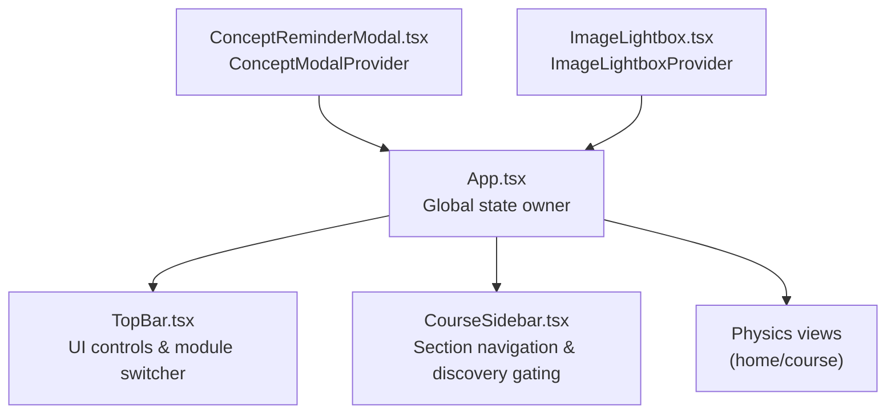
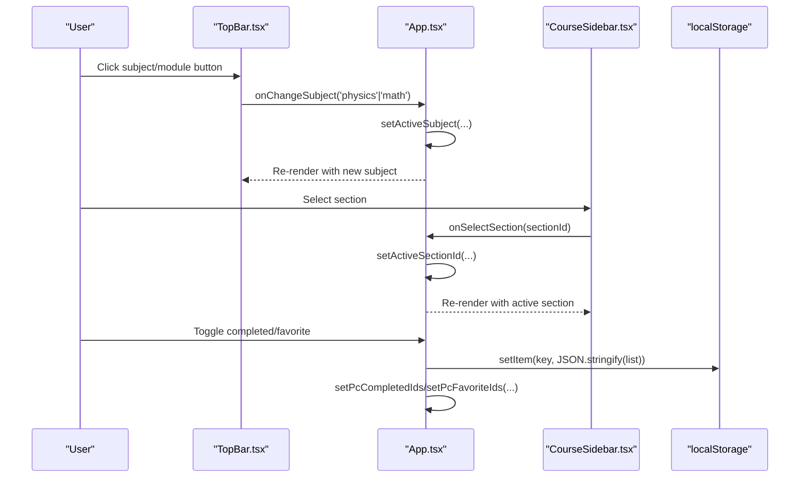
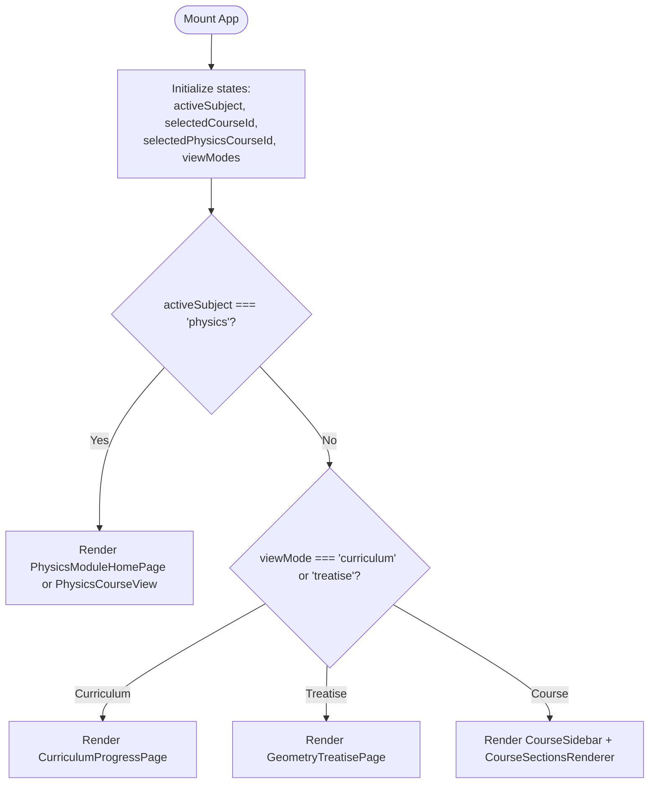
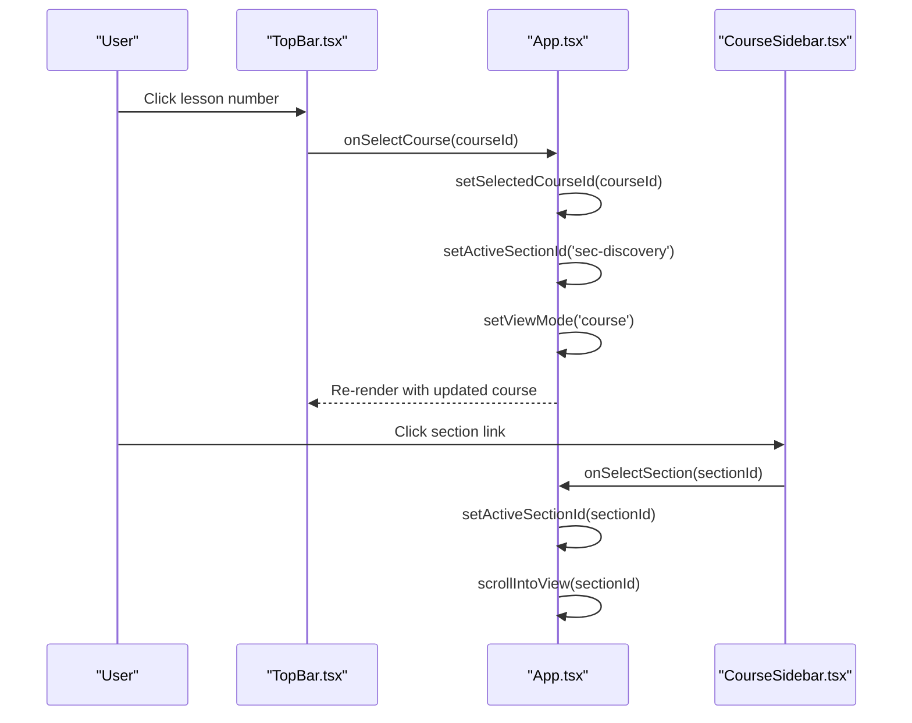
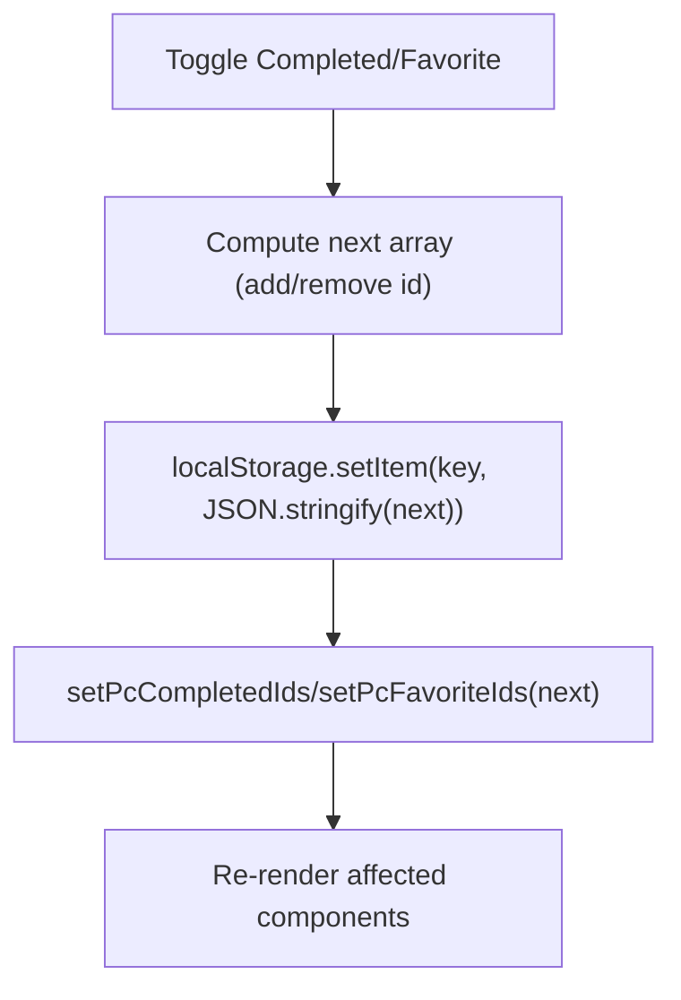
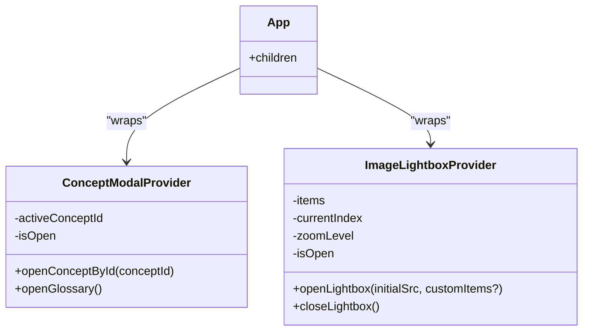
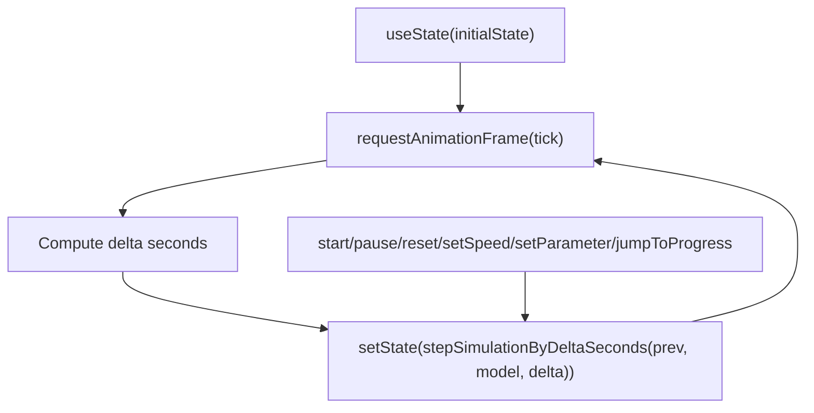
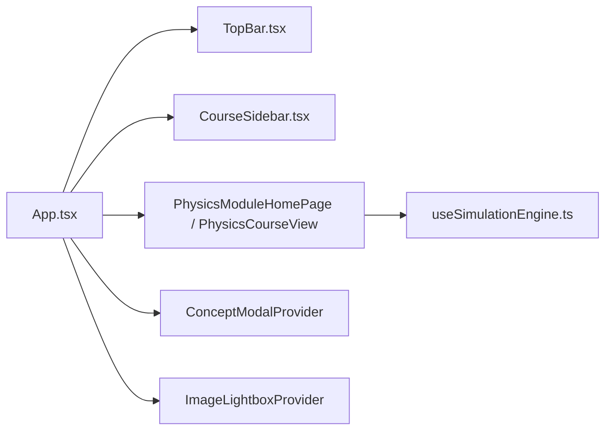

# State Management

<cite>
**Referenced Files in This Document**
- [App.tsx](file://src/App.tsx)
- [main.tsx](file://src/main.tsx)
- [ConceptReminderModal.tsx](file://src/components/ConceptReminderModal.tsx)
- [ImageLightbox.tsx](file://src/components/ImageLightbox.tsx)
- [TopBar.tsx](file://src/components/TopBar.tsx)
- [CourseSidebar.tsx](file://src/components/CourseSidebar.tsx)
- [useSimulationEngine.ts](file://src/components/physics/simulations/useSimulationEngine.ts)
</cite>

## Table of Contents
1. [Introduction](#introduction)
2. [Project Structure](#project-structure)
3. [Core Components](#core-components)
4. [Architecture Overview](#architecture-overview)
5. [Detailed Component Analysis](#detailed-component-analysis)
6. [Dependency Analysis](#dependency-analysis)
7. [Performance Considerations](#performance-considerations)
8. [Troubleshooting Guide](#troubleshooting-guide)
9. [Conclusion](#conclusion)

## Introduction
This document explains the state management architecture of the application with a focus on how React’s useState and useContext patterns are used to manage global and local state across components. It covers:
- Global subject selection between Mathematics and Physics-Chemistry modules
- Course navigation state for both modules
- User progress tracking and persistence using localStorage
- Synchronization between parent and child components via props and context
- Efficient re-rendering strategies and performance considerations

The goal is to provide a clear, code-grounded understanding of how state flows through the app, how it persists user preferences, and how complex interactions remain responsive.

## Project Structure
At a high level:
- The root App component owns most application-wide state (subject, view modes, selected courses, UI flags).
- Child components receive state and handlers as props or access shared state via Context providers.
- Two dedicated Contexts encapsulate cross-cutting concerns: concept modal behavior and image lightbox behavior.
- LocalStorage is used to persist user progress and preferences for both modules.

**Diagram sources**
- [App.tsx:23-433](file://src/App.tsx#L23-L433)
- [TopBar.tsx:47-386](file://src/components/TopBar.tsx#L47-L386)
- [CourseSidebar.tsx:24-282](file://src/components/CourseSidebar.tsx#L24-L282)
- [ConceptReminderModal.tsx:378-591](file://src/components/ConceptReminderModal.tsx#L378-L591)
- [ImageLightbox.tsx:135-459](file://src/components/ImageLightbox.tsx#L135-L459)

**Section sources**
- [App.tsx:23-433](file://src/App.tsx#L23-L433)
- [main.tsx:7-11](file://src/main.tsx#L7-L11)

## Core Components
This section outlines the primary stateful components and their responsibilities.

- App.tsx
  - Owns top-level state: activeSubject, selected course IDs, view modes, UI flags, and physics-specific completion/favorites lists.
  - Persists physics completion and favorites to localStorage.
  - Computes derived values like currentCourse and currentPhysicsCourse.
  - Provides event handlers to child components via props.

- TopBar.tsx
  - Purely presentational; receives state and callbacks from App.
  - Emits events for subject switching, course selection, PDF export, fullscreen toggle, and navigation actions.

- CourseSidebar.tsx
  - Manages local state for unlocked discovery activities and listens to a custom window event to sync with other parts of the app.
  - Uses localStorage to persist unlocked discovery IDs.
  - Controls visibility of sections based on discovery completion.

- ConceptReminderModal.tsx
  - Provides a Context for opening concept modals and glossary navigation.
  - Encapsulates modal open/close state and active concept selection.

- ImageLightbox.tsx
  - Provides a Context for opening/closing the lightbox and navigating images.
  - Manages gallery items, current index, zoom state, and keyboard shortcuts.

- useSimulationEngine.ts
  - Custom hook that manages simulation runtime state using useState and refs.
  - Drives animation frames and exposes controlled setters for speed, parameters, and representation modes.

**Section sources**
- [App.tsx:23-433](file://src/App.tsx#L23-L433)
- [TopBar.tsx:47-386](file://src/components/TopBar.tsx#L47-L386)
- [CourseSidebar.tsx:24-282](file://src/components/CourseSidebar.tsx#L24-L282)
- [ConceptReminderModal.tsx:15-591](file://src/components/ConceptReminderModal.tsx#L15-L591)
- [ImageLightbox.tsx:19-530](file://src/components/ImageLightbox.tsx#L19-L530)
- [useSimulationEngine.ts:308-479](file://src/components/physics/simulations/useSimulationEngine.ts#L308-L479)

## Architecture Overview
The application follows a unidirectional data flow pattern:
- Parent components hold state and pass down handlers.
- Children trigger updates by calling handlers provided by parents.
- Cross-cutting features (concept modal, image lightbox) are exposed via Context Providers.
- Persistent state is stored in localStorage and initialized into React state at startup.

**Diagram sources**
- [App.tsx:66-95](file://src/App.tsx#L66-L95)
- [App.tsx:225-231](file://src/App.tsx#L225-L231)
- [TopBar.tsx:96-127](file://src/components/TopBar.tsx#L96-L127)
- [CourseSidebar.tsx:107-127](file://src/components/CourseSidebar.tsx#L107-L127)

## Detailed Component Analysis

### Global Subject Selection and Module Routing
- Active subject state determines whether the app renders Math or Physics-Chemistry views.
- Switching subjects resets UI flags and scrolls to the top for consistent UX.
- Derived values compute the current course object based on selected IDs.

Key behaviors:
- Subject change handler updates activeSubject and closes mobile sidebar.
- View mode toggles between course, curriculum, and geometry treatise views.
- Physics module has its own viewMode ('home' | 'course').

**Diagram sources**
- [App.tsx:23-64](file://src/App.tsx#L23-L64)
- [App.tsx:307-418](file://src/App.tsx#L307-L418)

**Section sources**
- [App.tsx:23-64](file://src/App.tsx#L23-L64)
- [App.tsx:307-418](file://src/App.tsx#L307-L418)

### Course Navigation State
- Math module:
  - selectedCourseId drives currentCourse and sections.
  - activeSectionId tracks scroll position and highlights the current section.
  - handleSelectCourse sets selectedCourseId, resets activeSectionId, switches to course view, and scrolls to top.
- Physics module:
  - selectedPhysicsCourseId drives currentPhysicsCourse.
  - handleSelectPhysicsCourse sets selectedPhysicsCourseId, switches to course view, and scrolls to top.

**Diagram sources**
- [App.tsx:109-114](file://src/App.tsx#L109-L114)
- [App.tsx:225-231](file://src/App.tsx#L225-L231)
- [TopBar.tsx:310-336](file://src/components/TopBar.tsx#L310-L336)
- [CourseSidebar.tsx:107-127](file://src/components/CourseSidebar.tsx#L107-L127)

**Section sources**
- [App.tsx:109-114](file://src/App.tsx#L109-L114)
- [App.tsx:225-231](file://src/App.tsx#L225-L231)
- [TopBar.tsx:310-336](file://src/components/TopBar.tsx#L310-L336)
- [CourseSidebar.tsx:107-127](file://src/components/CourseSidebar.tsx#L107-L127)

### User Progress Tracking and Persistence
- Physics-Chemistry module:
  - pcCompletedIds and pcFavoriteIds are persisted to localStorage under dedicated keys.
  - Toggling completion or favorite updates the array and writes to localStorage immediately.
- Math module:
  - Discovery unlock state is persisted under a separate key.
  - CourseSidebar listens to a custom window event to synchronize unlocked IDs across components.

Persistence patterns:
- Initialization reads from localStorage and falls back to empty arrays on error.
- Updates use functional setState to ensure correct previous-state handling.
- Error handling wraps storage operations to avoid breaking the UI.

**Diagram sources**
- [App.tsx:42-57](file://src/App.tsx#L42-L57)
- [App.tsx:66-88](file://src/App.tsx#L66-L88)
- [CourseSidebar.tsx:39-59](file://src/components/CourseSidebar.tsx#L39-L59)

**Section sources**
- [App.tsx:42-57](file://src/App.tsx#L42-L57)
- [App.tsx:66-88](file://src/App.tsx#L66-L88)
- [CourseSidebar.tsx:39-59](file://src/components/CourseSidebar.tsx#L39-L59)

### Context-Based State Sharing
- ConceptModalProvider:
  - Exposes openConceptById and openGlossary via Context.
  - Manages activeConceptId and isOpen state.
  - Renders a modal overlay when open.
- ImageLightboxProvider:
  - Exposes openLightbox and closeLightbox via Context.
  - Manages gallery items, currentIndex, zoomLevel, and keyboard navigation.
  - Collects DOM images dynamically and merges with default gallery.

**Diagram sources**
- [ConceptReminderModal.tsx:378-591](file://src/components/ConceptReminderModal.tsx#L378-L591)
- [ImageLightbox.tsx:135-459](file://src/components/ImageLightbox.tsx#L135-L459)
- [App.tsx:234-242](file://src/App.tsx#L234-L242)

**Section sources**
- [ConceptReminderModal.tsx:15-591](file://src/components/ConceptReminderModal.tsx#L15-L591)
- [ImageLightbox.tsx:19-530](file://src/components/ImageLightbox.tsx#L19-L530)
- [App.tsx:234-242](file://src/App.tsx#L234-L242)

### Simulation Engine State Management
- useSimulationEngine manages simulation runtime state:
  - Initializes state from model and options.
  - Uses requestAnimationFrame loop to step simulation based on delta time.
  - Exposes methods to start, pause, reset, set speed, set parameters, and jump to progress.
  - Integrates reduced motion preference detection.

**Diagram sources**
- [useSimulationEngine.ts:308-479](file://src/components/physics/simulations/useSimulationEngine.ts#L308-L479)

**Section sources**
- [useSimulationEngine.ts:308-479](file://src/components/physics/simulations/useSimulationEngine.ts#L308-L479)

## Dependency Analysis
- App depends on:
  - Data modules for courses and curriculum.
  - UI components for rendering and interaction.
  - Utilities for PDF export.
- TopBar and CourseSidebar depend on props passed from App.
- Context Providers wrap App to expose shared functionality.
- Simulation engine is isolated within physics simulations and does not couple to global app state.

**Diagram sources**
- [App.tsx:23-433](file://src/App.tsx#L23-L433)
- [TopBar.tsx:47-386](file://src/components/TopBar.tsx#L47-L386)
- [CourseSidebar.tsx:24-282](file://src/components/CourseSidebar.tsx#L24-L282)
- [useSimulationEngine.ts:308-479](file://src/components/physics/simulations/useSimulationEngine.ts#L308-L479)

**Section sources**
- [App.tsx:23-433](file://src/App.tsx#L23-L433)
- [TopBar.tsx:47-386](file://src/components/TopBar.tsx#L47-L386)
- [CourseSidebar.tsx:24-282](file://src/components/CourseSidebar.tsx#L24-L282)
- [useSimulationEngine.ts:308-479](file://src/components/physics/simulations/useSimulationEngine.ts#L308-L479)

## Performance Considerations
- Functional setState for arrays ensures correct previous-state handling and avoids stale closures.
- useCallback is used for handlers to prevent unnecessary re-renders of child components receiving callbacks.
- Scroll listeners are attached with passive: true to improve scrolling performance.
- Simulation engine uses requestAnimationFrame and throttles delta computation to maintain smooth animations while minimizing overhead.
- Context usage is limited to focused features (concept modal, image lightbox), reducing broad re-renders.

Recommendations:
- Consider memoizing expensive computations (e.g., derived course sections) with useMemo where appropriate.
- Avoid passing large objects as props without memoization; prefer stable references or split contexts if needed.
- Debounce frequent state updates (e.g., scroll-based progress) if they cause excessive re-renders.

[No sources needed since this section provides general guidance]

## Troubleshooting Guide
Common issues and debugging techniques:
- localStorage errors:
  - Wrap getItem/setItem in try/catch to prevent crashes.
  - Validate JSON parsing and fallback to defaults.
- Event listener leaks:
  - Ensure removeEventListener is called in cleanup functions.
- Stale state in async operations:
  - Use functional setState to reference previous state reliably.
- Unnecessary re-renders:
  - Verify handlers are wrapped in useCallback.
  - Check prop drilling and consider splitting contexts if necessary.

**Section sources**
- [App.tsx:42-57](file://src/App.tsx#L42-L57)
- [App.tsx:66-88](file://src/App.tsx#L66-L88)
- [CourseSidebar.tsx:48-59](file://src/components/CourseSidebar.tsx#L48-L59)

## Conclusion
The application employs a straightforward yet effective state management strategy:
- Centralized state in App for global concerns (subject, navigation, UI flags).
- Local state in components for feature-specific concerns (modals, lightbox, simulation engine).
- Context for cross-cutting features to share state and actions.
- localStorage for persistent user progress and preferences.
- Careful use of hooks and event handling to maintain responsiveness and performance.

This approach scales well for the current feature set and can be extended with more granular contexts or state libraries if complexity grows further.