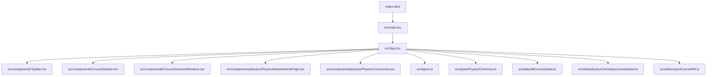
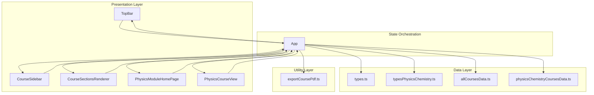
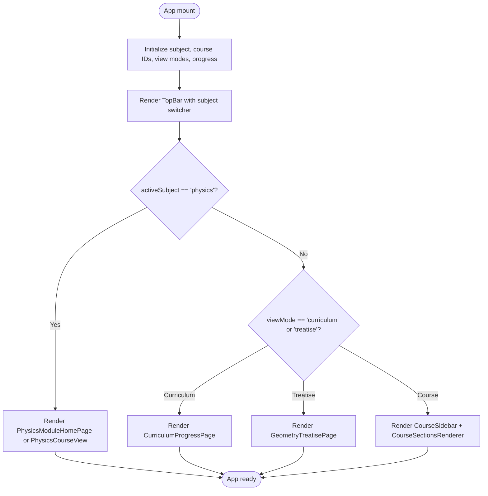
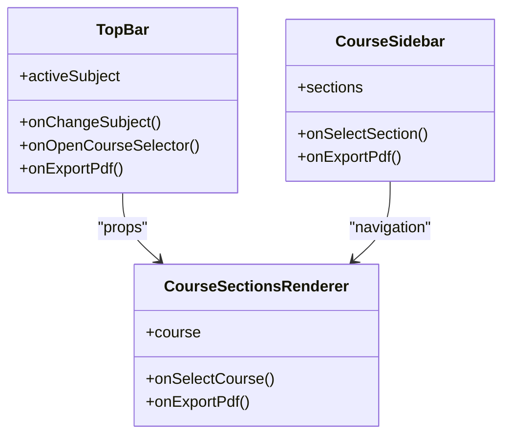
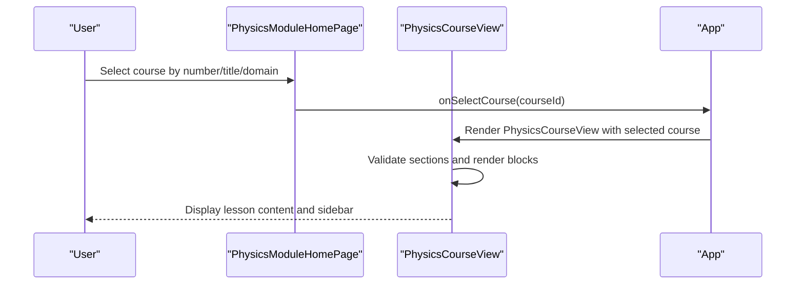
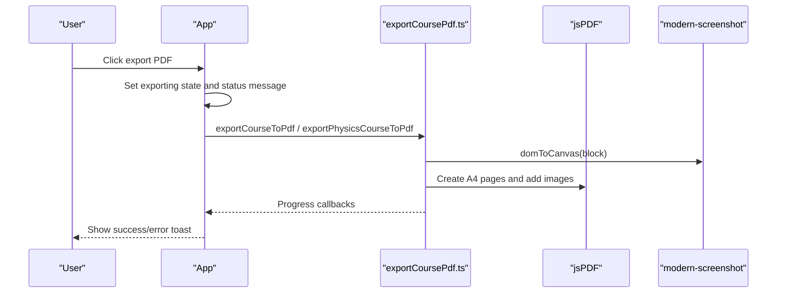
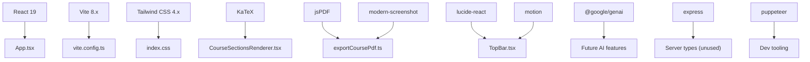

# System Architecture

<cite>
**Referenced Files in This Document**
- [package.json](file://package.json)
- [vite.config.ts](file://vite.config.ts)
- [tsconfig.json](file://tsconfig.json)
- [index.html](file://index.html)
- [src/main.tsx](file://src/main.tsx)
- [src/App.tsx](file://src/App.tsx)
- [src/types.ts](file://src/types.ts)
- [src/typesPhysicsChemistry.ts](file://src/typesPhysicsChemistry.ts)
- [src/data/allCoursesData.ts](file://src/data/allCoursesData.ts)
- [src/data/physicsChemistryCoursesData.ts](file://src/data/physicsChemistryCoursesData.ts)
- [src/components/TopBar.tsx](file://src/components/TopBar.tsx)
- [src/components/CourseSidebar.tsx](file://src/components/CourseSidebar.tsx)
- [src/components/CourseSectionsRenderer.tsx](file://src/components/CourseSectionsRenderer.tsx)
- [src/components/physics/PhysicsModuleHomePage.tsx](file://src/components/physics/PhysicsModuleHomePage.tsx)
- [src/components/physics/PhysicsCourseView.tsx](file://src/components/physics/PhysicsCourseView.tsx)
- [src/utils/exportCoursePdf.ts](file://src/utils/exportCoursePdf.ts)
</cite>

## Table of Contents
1. [Introduction](#introduction)
2. [Project Structure](#project-structure)
3. [Core Components](#core-components)
4. [Architecture Overview](#architecture-overview)
5. [Detailed Component Analysis](#detailed-component-analysis)
6. [Dependency Analysis](#dependency-analysis)
7. [Performance Considerations](#performance-considerations)
8. [Troubleshooting Guide](#troubleshooting-guide)
9. [Conclusion](#conclusion)

## Introduction
This document describes the system architecture of the Cours 3AM application, an interactive educational platform for Mathematics and Physics-Chemistry at the third-year middle-school level. The application uses a React component-based architecture with Vite as the build tool, TypeScript for type safety, Tailwind CSS for styling, jsPDF for PDF export, and Google GenAI as an available integration dependency.

The system supports two subject modules:
- Mathematics 3AM: structured lessons with discovery activities, guided examples, common mistakes, exercises, summaries, geometry treatise links, and curriculum navigation.
- Physics-Chemistry 3AM: domain-themed courses (matter, energy, electricity, optics) with rich pedagogical blocks, simulations, trilingual terminology, and progress tracking.

App.tsx is the central orchestrator that switches between subjects, manages view modes, handles PDF export flows, and renders either the Physics-Chemistry module or the Mathematics course layout.

## Project Structure
At a high level, the project follows a feature-oriented structure under `src`:
- `src/main.tsx` boots the React application.
- `src/App.tsx` owns global state, subject switching, and content routing.
- `src/components` contains UI components for both subjects.
- `src/data` holds structured course data for Mathematics and Physics-Chemistry.
- `src/utils` provides cross-cutting utilities such as PDF export.
- Configuration files include `vite.config.ts`, `tsconfig.json`, and `package.json`.

**Diagram sources**
- [index.html:1-1](file://index.html#L1-L1)
- [src/main.tsx:1-12](file://src/main.tsx#L1-L12)
- [src/App.tsx:1-436](file://src/App.tsx#L1-L436)
- [src/components/TopBar.tsx:1-386](file://src/components/TopBar.tsx#L1-L386)
- [src/components/CourseSidebar.tsx:1-282](file://src/components/CourseSidebar.tsx#L1-L282)
- [src/components/CourseSectionsRenderer.tsx:1-740](file://src/components/CourseSectionsRenderer.tsx#L1-L740)
- [src/components/physics/PhysicsModuleHomePage.tsx:1-764](file://src/components/physics/PhysicsModuleHomePage.tsx#L1-L764)
- [src/components/physics/PhysicsCourseView.tsx:1-800](file://src/components/physics/PhysicsCourseView.tsx#L1-L800)
- [src/types.ts:1-147](file://src/types.ts#L1-L147)
- [src/typesPhysicsChemistry.ts:1-397](file://src/typesPhysicsChemistry.ts#L1-L397)
- [src/data/allCoursesData.ts:1-800](file://src/data/allCoursesData.ts#L1-L800)
- [src/data/physicsChemistryCoursesData.ts:1-800](file://src/data/physicsChemistryCoursesData.ts#L1-L800)
- [src/utils/exportCoursePdf.ts:1-800](file://src/utils/exportCoursePdf.ts#L1-L800)

**Section sources**
- [src/main.tsx:1-12](file://src/main.tsx#L1-L12)
- [src/App.tsx:1-436](file://src/App.tsx#L1-L436)
- [package.json:1-42](file://package.json#L1-L42)
- [vite.config.ts:1-23](file://vite.config.ts#L1-L23)
- [tsconfig.json:1-28](file://tsconfig.json#L1-L28)

## Core Components
- Application bootstrap: `main.tsx` creates the React root and mounts `App` inside StrictMode.
- Subject orchestration: `App.tsx` maintains active subject (`math` or `physics`), current course selection, view modes, progress, fullscreen, and PDF export status. It renders:
  - Top bar with subject switcher and actions.
  - Physics-Chemistry home page or course view when `activeSubject === 'physics'`.
  - Mathematics curriculum, geometry treatise, or main course layout otherwise.
- Mathematics UI:
  - `TopBar.tsx` exposes subject switching, course selector, curriculum/treatise toggles, and PDF export buttons.
  - `CourseSidebar.tsx` shows section navigation, previous/next lesson controls, and references to curriculum/treatise/PDF export.
  - `CourseSectionsRenderer.tsx` renders structured lesson sections, visual discovery labs, properties, guided examples, common mistakes, exercises, and summary decision trees.
- Physics-Chemistry UI:
  - `PhysicsModuleHomePage.tsx` provides domain filtering, favorites/completed tracking, search, and course cards.
  - `PhysicsCourseView.tsx` renders physics-specific content blocks, sidebar navigation, domain theme tokens, and simulation integrations.
- Data layer:
  - `allCoursesData.ts` defines Mathematics courses with sections, formulas, examples, vocabulary, and exercises.
  - `physicsChemistryCoursesData.ts` defines Physics-Chemistry domains and structured course models.
- Types:
  - `types.ts` defines Mathematics course types including sections, exercises, vocabulary, and discovery activity.
  - `typesPhysicsChemistry.ts` defines Physics-Chemistry course model, block types, schemas, tables, formulas, and essential items.
- Utilities:
  - `exportCoursePdf.ts` implements advanced pagination and slicing logic using jsPDF and modern-screenshot for both Mathematics and Physics-Chemistry courses.

**Section sources**
- [src/main.tsx:1-12](file://src/main.tsx#L1-L12)
- [src/App.tsx:1-436](file://src/App.tsx#L1-L436)
- [src/components/TopBar.tsx:1-386](file://src/components/TopBar.tsx#L1-L386)
- [src/components/CourseSidebar.tsx:1-282](file://src/components/CourseSidebar.tsx#L1-L282)
- [src/components/CourseSectionsRenderer.tsx:1-740](file://src/components/CourseSectionsRenderer.tsx#L1-L740)
- [src/components/physics/PhysicsModuleHomePage.tsx:1-764](file://src/components/physics/PhysicsModuleHomePage.tsx#L1-L764)
- [src/components/physics/PhysicsCourseView.tsx:1-800](file://src/components/physics/PhysicsCourseView.tsx#L1-L800)
- [src/types.ts:1-147](file://src/types.ts#L1-L147)
- [src/typesPhysicsChemistry.ts:1-397](file://src/typesPhysicsChemistry.ts#L1-L397)
- [src/data/allCoursesData.ts:1-800](file://src/data/allCoursesData.ts#L1-L800)
- [src/data/physicsChemistryCoursesData.ts:1-800](file://src/data/physicsChemistryCoursesData.ts#L1-L800)
- [src/utils/exportCoursePdf.ts:1-800](file://src/utils/exportCoursePdf.ts#L1-L800)

## Architecture Overview
The system follows a layered component architecture:
- Presentation layer: React components render user interfaces for both subjects.
- State orchestration: App-level state drives subject switching, view mode transitions, and shared features like PDF export.
- Data layer: Static data structures define course content; types enforce consistency across components.
- Utility layer: Cross-cutting concerns like PDF generation are isolated in utility modules.

**Diagram sources**
- [src/App.tsx:1-436](file://src/App.tsx#L1-L436)
- [src/components/TopBar.tsx:1-386](file://src/components/TopBar.tsx#L1-L386)
- [src/components/CourseSidebar.tsx:1-282](file://src/components/CourseSidebar.tsx#L1-L282)
- [src/components/CourseSectionsRenderer.tsx:1-740](file://src/components/CourseSectionsRenderer.tsx#L1-L740)
- [src/components/physics/PhysicsModuleHomePage.tsx:1-764](file://src/components/physics/PhysicsModuleHomePage.tsx#L1-L764)
- [src/components/physics/PhysicsCourseView.tsx:1-800](file://src/components/physics/PhysicsCourseView.tsx#L1-L800)
- [src/types.ts:1-147](file://src/types.ts#L1-L147)
- [src/typesPhysicsChemistry.ts:1-397](file://src/typesPhysicsChemistry.ts#L1-L397)
- [src/data/allCoursesData.ts:1-800](file://src/data/allCoursesData.ts#L1-L800)
- [src/data/physicsChemistryCoursesData.ts:1-800](file://src/data/physicsChemistryCoursesData.ts#L1-L800)
- [src/utils/exportCoursePdf.ts:1-800](file://src/utils/exportCoursePdf.ts#L1-L800)

## Detailed Component Analysis

### App Orchestrator
App.tsx manages:
- Active subject selection (`math` vs `physics`).
- Mathematics course selection, section navigation, progress percentage, and view modes (`course`, `curriculum`, `treatise`).
- Physics-Chemistry course selection, completed/favorite tracking, and view modes (`home`, `course`).
- Fullscreen toggle and scroll-to-top behavior.
- PDF export flows for both subjects, coordinating UI state before invoking utility functions.

**Diagram sources**
- [src/App.tsx:23-436](file://src/App.tsx#L23-L436)

**Section sources**
- [src/App.tsx:1-436](file://src/App.tsx#L1-L436)

### Mathematics Module
- TopBar: Provides subject switching, course selector, curriculum/treatise toggles, and PDF export button for Mathematics.
- CourseSidebar: Displays section navigation, unlocks discovery completion, and offers previous/next lesson navigation.
- CourseSectionsRenderer: Renders structured sections including discovery activity, definitions, visual labs, properties, guided examples, common mistakes, exercises, and summary decision trees.

**Diagram sources**
- [src/components/TopBar.tsx:1-386](file://src/components/TopBar.tsx#L1-L386)
- [src/components/CourseSidebar.tsx:1-282](file://src/components/CourseSidebar.tsx#L1-L282)
- [src/components/CourseSectionsRenderer.tsx:1-740](file://src/components/CourseSectionsRenderer.tsx#L1-L740)

**Section sources**
- [src/components/TopBar.tsx:1-386](file://src/components/TopBar.tsx#L1-L386)
- [src/components/CourseSidebar.tsx:1-282](file://src/components/CourseSidebar.tsx#L1-L282)
- [src/components/CourseSectionsRenderer.tsx:1-740](file://src/components/CourseSectionsRenderer.tsx#L1-L740)

### Physics-Chemistry Module
- PhysicsModuleHomePage: Domain filtering, favorites/completed tracking, search, and course cards with domain themes.
- PhysicsCourseView: Renders physics-specific content blocks, sidebar navigation, domain theme tokens, and simulation integrations. Includes strict validation for populated courses.

**Diagram sources**
- [src/components/physics/PhysicsModuleHomePage.tsx:1-764](file://src/components/physics/PhysicsModuleHomePage.tsx#L1-L764)
- [src/components/physics/PhysicsCourseView.tsx:1-800](file://src/components/physics/PhysicsCourseView.tsx#L1-L800)
- [src/App.tsx:307-346](file://src/App.tsx#L307-L346)

**Section sources**
- [src/components/physics/PhysicsModuleHomePage.tsx:1-764](file://src/components/physics/PhysicsModuleHomePage.tsx#L1-L764)
- [src/components/physics/PhysicsCourseView.tsx:1-800](file://src/components/physics/PhysicsCourseView.tsx#L1-L800)

### PDF Export Flow
Both Mathematics and Physics-Chemistry courses support PDF export via `exportCoursePdf.ts`. The flow coordinates UI state, ensures the correct course is visible, and invokes the utility function with progress callbacks.

**Diagram sources**
- [src/App.tsx:116-195](file://src/App.tsx#L116-L195)
- [src/utils/exportCoursePdf.ts:1-800](file://src/utils/exportCoursePdf.ts#L1-L800)

**Section sources**
- [src/App.tsx:116-195](file://src/App.tsx#L116-L195)
- [src/utils/exportCoursePdf.ts:1-800](file://src/utils/exportCoursePdf.ts#L1-L800)

## Dependency Analysis
External dependencies and their roles:
- React 19 and react-dom: Core UI framework and rendering.
- Vite: Build tool and development server.
- @vitejs/plugin-react: React plugin for Vite.
- @tailwindcss/vite and tailwindcss: Styling pipeline.
- katex and @types/katex: LaTeX math rendering.
- jspdf: PDF generation.
- modern-screenshot: DOM-to-canvas conversion for PDF slicing.
- lucide-react: Icon library.
- motion: Animation library.
- express and @types/express: Server-side Express types (available but not used in frontend).
- puppeteer: Browser automation (dev dependency).
- tsx and esbuild: Development/build tools.
- dotenv: Environment variable loading.
- @google/genai: Google GenAI integration dependency (available for future AI features).

**Diagram sources**
- [package.json:1-42](file://package.json#L1-L42)
- [vite.config.ts:1-23](file://vite.config.ts#L1-L23)
- [src/components/CourseSectionsRenderer.tsx:1-740](file://src/components/CourseSectionsRenderer.tsx#L1-L740)
- [src/utils/exportCoursePdf.ts:1-800](file://src/utils/exportCoursePdf.ts#L1-L800)
- [src/components/TopBar.tsx:1-386](file://src/components/TopBar.tsx#L1-L386)

**Section sources**
- [package.json:1-42](file://package.json#L1-L42)
- [vite.config.ts:1-23](file://vite.config.ts#L1-L23)

## Performance Considerations
- Vite configuration enables HMR control via `DISABLE_HMR` environment variable, allowing file watching to be disabled during agent edits to reduce CPU usage.
- React StrictMode is enabled during development for better error detection.
- Tailwind CSS is integrated via the Vite plugin for efficient style processing.
- PDF export uses optimized canvas slicing and JPEG compression to balance quality and performance.
- Large datasets (Mathematics and Physics-Chemistry courses) are loaded as static data; consider lazy loading if the dataset grows significantly.

[No sources needed since this section provides general guidance]

## Troubleshooting Guide
Common issues and resolutions:
- Physics-Chemistry course validation errors: Populated courses must have non-empty sections; empty sections throw explicit errors during rendering.
- PDF export failures: Ensure the target course is visible and rendered before export; check console logs for jsPDF or modern-screenshot errors.
- HMR flickering during agent edits: Disable HMR by setting `DISABLE_HMR=true` in the environment to prevent file watching overhead.
- Math discovery unlock state: If section unlocking does not persist, verify localStorage availability and error handling in the component.

**Section sources**
- [src/components/physics/PhysicsCourseView.tsx:61-83](file://src/components/physics/PhysicsCourseView.tsx#L61-L83)
- [src/utils/exportCoursePdf.ts:511-800](file://src/utils/exportCoursePdf.ts#L511-L800)
- [vite.config.ts:14-20](file://vite.config.ts#L14-L20)

## Conclusion
The Cours 3AM system architecture combines a clear separation of concerns with a robust React component-based design. App.tsx orchestrates subject switching and content rendering, while specialized components handle Mathematics and Physics-Chemistry modules. The data layer provides structured course content, and utilities like PDF export ensure reliable output. With Vite, Tailwind CSS, and key dependencies like jsPDF and Google GenAI, the system is well-positioned for scalability, maintainability, and future enhancements.

[No sources needed since this section summarizes without analyzing specific files]