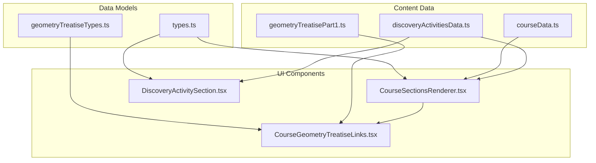
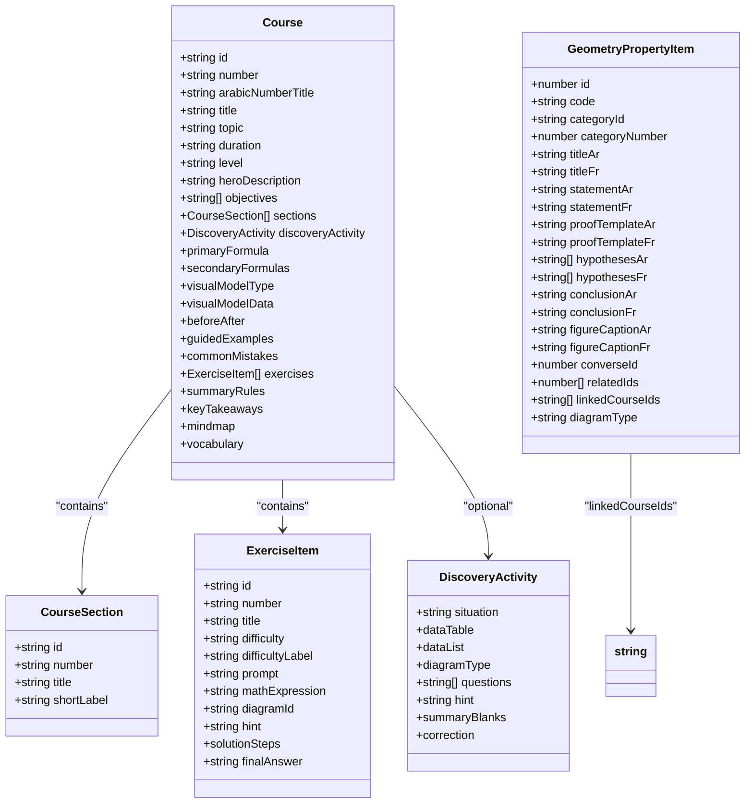
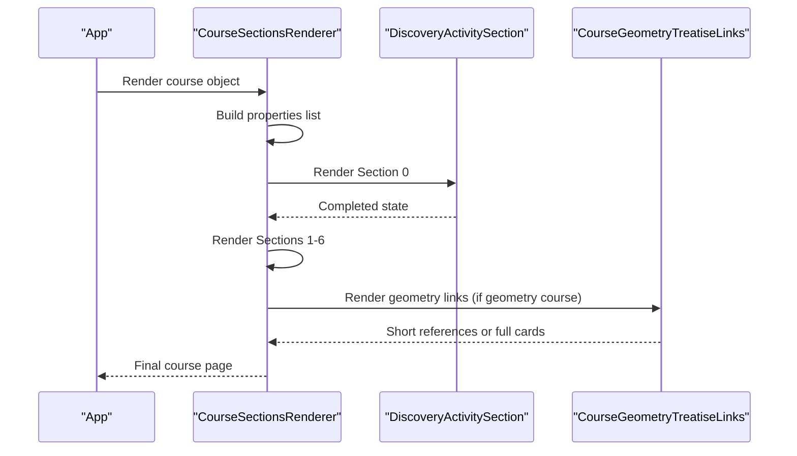
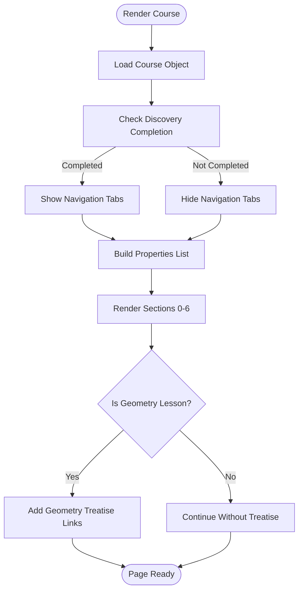
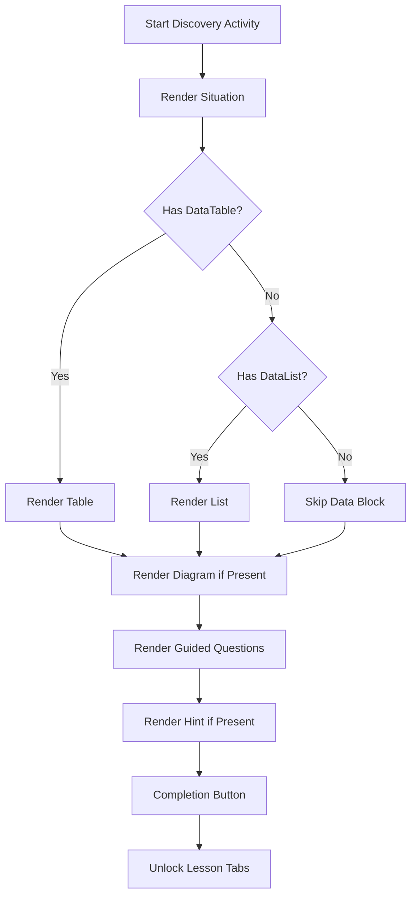
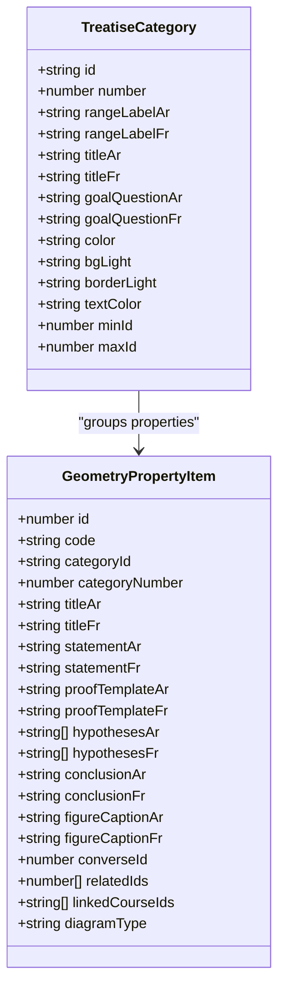
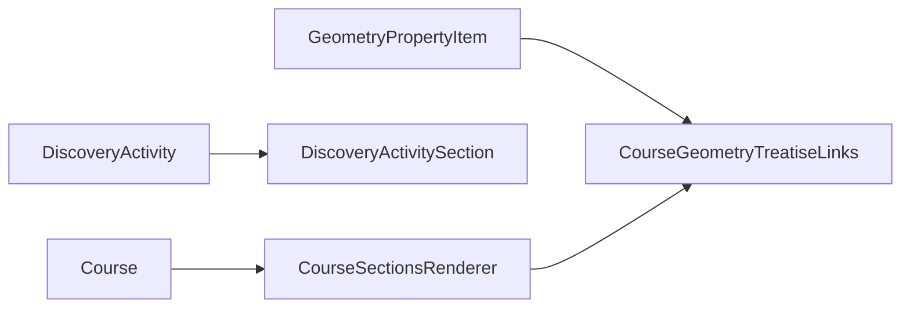
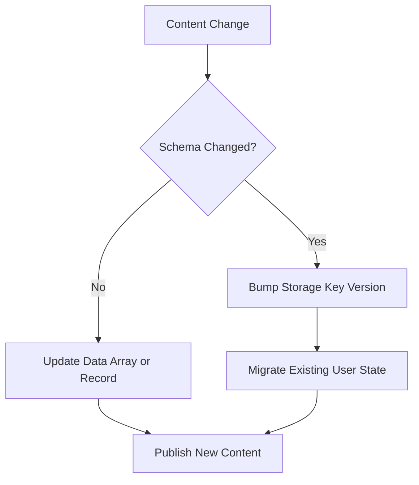
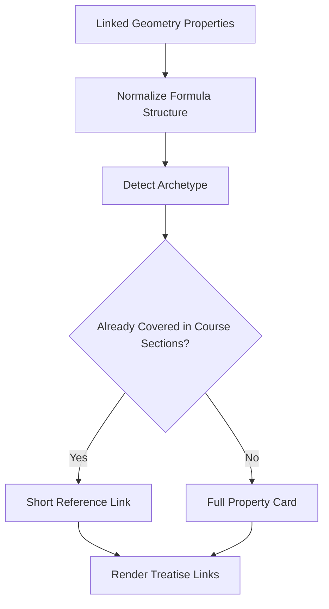
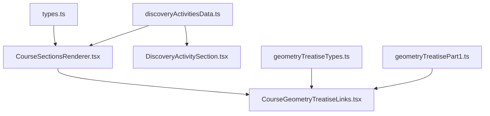

# Content Management System

<cite>
**Referenced Files in This Document**   
- [types.ts](file://src/types.ts)
- [courseData.ts](file://src/data/courseData.ts)
- [discoveryActivitiesData.ts](file://src/data/discoveryActivitiesData.ts)
- [geometryTreatiseTypes.ts](file://src/data/geometryTreatiseTypes.ts)
- [geometryTreatisePart1.ts](file://src/data/geometryTreatisePart1.ts)
- [CourseSectionsRenderer.tsx](file://src/components/CourseSectionsRenderer.tsx)
- [DiscoveryActivitySection.tsx](file://src/components/DiscoveryActivitySection.tsx)
- [CourseGeometryTreatiseLinks.tsx](file://src/components/CourseGeometryTreatiseLinks.tsx)
</cite>

## Table of Contents
1. [Introduction](#introduction)
2. [Project Structure](#project-structure)
3. [Core Components](#core-components)
4. [Architecture Overview](#architecture-overview)
5. [Detailed Component Analysis](#detailed-component-analysis)
6. [Dependency Analysis](#dependency-analysis)
7. [Performance Considerations](#performance-considerations)
8. [Troubleshooting Guide](#troubleshooting-guide)
9. [Conclusion](#conclusion)
10. [Appendices](#appendices)

## Introduction
This document explains the content management system used to structure mathematics course content, discovery activities, and a geometry treatise reference system. It focuses on:
- How courses are modeled and rendered.
- How discovery activities are defined and integrated into lessons.
- How geometry properties are organized, linked to lessons, and visualized.
- The relationship between data models and UI components.
- Data validation patterns, versioning strategies, and extension points for adding new content.

The system is designed so that authors can add new lessons, define guided discovery activities, and link geometry properties without changing rendering logic.

## Project Structure
At a high level, the system separates:
- **Data models**: TypeScript interfaces describing courses, exercises, discovery activities, and geometry properties.
- **Content data**: Arrays and records containing lesson sections, exercises, discovery activities, and geometry property definitions.
- **UI components**: React components that render structured course pages, discovery activities, and geometry treatise links.

**Diagram sources**
- [types.ts:1-147](file://src/types.ts#L1-L147)
- [geometryTreatiseTypes.ts:1-207](file://src/data/geometryTreatiseTypes.ts#L1-L207)
- [courseData.ts:1-135](file://src/data/courseData.ts#L1-L135)
- [discoveryActivitiesData.ts:1-800](file://src/data/discoveryActivitiesData.ts#L1-L800)
- [geometryTreatisePart1.ts:1-200](file://src/data/geometryTreatisePart1.ts#L1-L200)
- [CourseSectionsRenderer.tsx:1-740](file://src/components/CourseSectionsRenderer.tsx#L1-L740)
- [DiscoveryActivitySection.tsx:1-550](file://src/components/DiscoveryActivitySection.tsx#L1-L550)
- [CourseGeometryTreatiseLinks.tsx:1-553](file://src/components/CourseGeometryTreatiseLinks.tsx#L1-L553)

**Section sources**
- [types.ts:1-147](file://src/types.ts#L1-L147)
- [geometryTreatiseTypes.ts:1-207](file://src/data/geometryTreatiseTypes.ts#L1-L207)
- [courseData.ts:1-135](file://src/data/courseData.ts#L1-L135)
- [discoveryActivitiesData.ts:1-800](file://src/data/discoveryActivitiesData.ts#L1-L800)
- [geometryTreatisePart1.ts:1-200](file://src/data/geometryTreatisePart1.ts#L1-L200)
- [CourseSectionsRenderer.tsx:1-740](file://src/components/CourseSectionsRenderer.tsx#L1-L740)
- [DiscoveryActivitySection.tsx:1-550](file://src/components/DiscoveryActivitySection.tsx#L1-L550)
- [CourseGeometryTreatiseLinks.tsx:1-553](file://src/components/CourseGeometryTreatiseLinks.tsx#L1-L553)

## Core Components
The core data model is the `Course` interface. It defines the complete shape of a lesson, including metadata, objectives, sections, discovery activity, formulas, guided examples, common mistakes, exercises, summary rules, key takeaways, mind map, and vocabulary.

Key responsibilities:
- `Course`: Represents one lesson with all its content blocks.
- `CourseSection`: Defines ordered sections like objectives, concept, exercises, etc.
- `ExerciseItem`: Describes practice problems with difficulty, prompt, math expression, steps, and final answer.
- `DiscoveryActivity`: Defines the mandatory exploration phase before the main lesson.
- `GeometryPropertyItem`: Defines geometry properties with statements, hypotheses, conclusions, proof templates, and diagram captions.

**Diagram sources**
- [types.ts:1-147](file://src/types.ts#L1-L147)
- [geometryTreatiseTypes.ts:1-207](file://src/data/geometryTreatiseTypes.ts#L1-L207)

**Section sources**
- [types.ts:1-147](file://src/types.ts#L1-L147)
- [geometryTreatiseTypes.ts:1-207](file://src/data/geometryTreatiseTypes.ts#L1-L207)

## Architecture Overview
The application renders a course page through `CourseSectionsRenderer`. It composes multiple sections:
- Section 0: Discovery activity.
- Section 1: Definition, visual model, and primary formula.
- Section 2: Mathematical justification and reciprocal or secondary properties.
- Section 3: Guided examples.
- Section 4: Common mistakes.
- Section 5: Exercises and challenges.
- Section 6: Summary decision tree.
- End-of-course: Geometry treatise links for geometry lessons.

**Diagram sources**
- [CourseSectionsRenderer.tsx:135-740](file://src/components/CourseSectionsRenderer.tsx#L135-L740)
- [DiscoveryActivitySection.tsx:363-485](file://src/components/DiscoveryActivitySection.tsx#L363-L485)
- [CourseGeometryTreatiseLinks.tsx:294-553](file://src/components/CourseGeometryTreatiseLinks.tsx#L294-L553)

**Section sources**
- [CourseSectionsRenderer.tsx:135-740](file://src/components/CourseSectionsRenderer.tsx#L135-L740)

## Detailed Component Analysis

### Course Data Model and Rendering
The `Course` type is the central contract for lesson content. It includes:
- Metadata: `id`, `number`, `title`, `topic`, `duration`, `level`.
- Pedagogical structure: `objectives`, `sections`, `guidedExamples`, `commonMistakes`, `exercises`, `summaryRules`, `keyTakeaways`, `mindmap`.
- Conceptual content: `primaryFormula`, optional `secondaryFormulas`, `vocabulary`.
- Visual model configuration: `visualModelType`, `visualModelData`, and optional `beforeAfter`.

`CourseSectionsRenderer` uses this model to:
- Unlock navigation tabs after completing the discovery activity.
- Map each course to prerequisite courses.
- Render interactive visual labs based on `course.id`.
- Build numbered properties lists for Sections 1 and 2.
- Render guided examples, common mistakes, exercises, and summary decision trees.
- Attach geometry treatise links at the end of geometry lessons.

**Diagram sources**
- [CourseSectionsRenderer.tsx:135-740](file://src/components/CourseSectionsRenderer.tsx#L135-L740)

**Section sources**
- [types.ts:70-147](file://src/types.ts#L70-L147)
- [CourseSectionsRenderer.tsx:135-740](file://src/components/CourseSectionsRenderer.tsx#L135-L740)

### Discovery Activities Framework
Discovery activities follow a strict four-time template:
1. Concrete situation in one sentence without naming the property.
2. Raw data to calculate, presented as a table or list.
3. Guided questions in strict order: Q1 calculation/observation, Q2 interpretation, optional help hint.
4. A fill-in-the-blank summary is no longer displayed immediately; instead, the correction appears only in the exercises section.

The `DiscoveryActivity` type enforces this structure. The `DiscoveryActivitySection` component renders:
- Situation text.
- Data table or list.
- Optional geometric schematic diagram.
- Numbered guided questions.
- Optional hint.
- Completion button that unlocks the rest of the lesson.

**Diagram sources**
- [types.ts:35-68](file://src/types.ts#L35-L68)
- [DiscoveryActivitySection.tsx:363-485](file://src/components/DiscoveryActivitySection.tsx#L363-L485)

**Section sources**
- [types.ts:35-68](file://src/types.ts#L35-L68)
- [discoveryActivitiesData.ts:1-800](file://src/data/discoveryActivitiesData.ts#L1-L800)
- [DiscoveryActivitySection.tsx:1-550](file://src/components/DiscoveryActivitySection.tsx#L1-L550)

### Geometry Treatise Reference System
The geometry treatise system organizes 69 geometry properties into categories. Each property includes:
- Identifier and code.
- Category linkage.
- Arabic and French titles, statements, hypotheses, conclusions, and proof templates.
- Figure captions.
- Optional converse ID, related IDs, and linked course IDs.
- Diagram type.

Categories group properties by pedagogical goal, such as proving a point is a midpoint, proving parallel lines, proving perpendicularity, identifying quadrilaterals, calculating segment lengths, determining angle measures, and using notable triangle lines.

**Diagram sources**
- [geometryTreatiseTypes.ts:1-207](file://src/data/geometryTreatiseTypes.ts#L1-L207)
- [geometryTreatisePart1.ts:1-200](file://src/data/geometryTreatisePart1.ts#L1-L200)

**Section sources**
- [geometryTreatiseTypes.ts:1-207](file://src/data/geometryTreatiseTypes.ts#L1-L207)
- [geometryTreatisePart1.ts:1-200](file://src/data/geometryTreatisePart1.ts#L1-L200)

### Relationship Between Data Structures and UI Components
- `Course` drives `CourseSectionsRenderer`.
- `DiscoveryActivity` drives `DiscoveryActivitySection`.
- `GeometryPropertyItem` and `TREATISE_CATEGORIES` drive `CourseGeometryTreatiseLinks`.
- `CourseSectionsRenderer` computes which properties belong to a lesson and passes them to `CourseGeometryTreatiseLinks`.
- `CourseGeometryTreatiseLinks` normalizes mathematical formulas to detect structural duplicates and decides whether to show a short reference or a full property card.

**Diagram sources**
- [CourseSectionsRenderer.tsx:135-740](file://src/components/CourseSectionsRenderer.tsx#L135-L740)
- [DiscoveryActivitySection.tsx:363-485](file://src/components/DiscoveryActivitySection.tsx#L363-L485)
- [CourseGeometryTreatiseLinks.tsx:294-553](file://src/components/CourseGeometryTreatiseLinks.tsx#L294-L553)

**Section sources**
- [CourseSectionsRenderer.tsx:135-740](file://src/components/CourseSectionsRenderer.tsx#L135-L740)
- [CourseGeometryTreatiseLinks.tsx:294-553](file://src/components/CourseGeometryTreatiseLinks.tsx#L294-L553)

### Data Validation Patterns
Validation is primarily enforced through TypeScript types:
- `Course` requires essential fields like `id`, `title`, `objectives`, `sections`, `primaryFormula`, and `exercises`.
- `DiscoveryActivity` requires `situation`, `questions`, and `correction.questionAnswers`.
- `GeometryPropertyItem` requires identifiers, bilingual statements, hypotheses, conclusions, and diagram metadata.

Additional runtime checks include:
- Checking whether a course is a geometry lesson before rendering treatise links.
- Ensuring discovery completion before unlocking navigation tabs.
- Normalizing LaTeX and text formulas to compare mathematical structure rather than variable names.

**Section sources**
- [types.ts:1-147](file://src/types.ts#L1-L147)
- [CourseSectionsRenderer.tsx:176-184](file://src/components/CourseSectionsRenderer.tsx#L176-L184)
- [CourseGeometryTreatiseLinks.tsx:35-62](file://src/components/CourseGeometryTreatiseLinks.tsx#L35-L62)

### Content Versioning Strategies
Versioning is implemented through:
- Stable identifiers: `Course.id`, `ExerciseItem.id`, `GeometryPropertyItem.id`, and `code`.
- Local storage keys for user progress, such as `math_3am_discovery_unlocked_v1`.
- Explicit version suffixes in storage keys to allow migration when the schema changes.
- Structured arrays and records that can be extended without breaking existing references.

**Diagram sources**
- [CourseSectionsRenderer.tsx:4-5](file://src/components/CourseSectionsRenderer.tsx#L4-L5)
- [types.ts:1-147](file://src/types.ts#L1-L147)

**Section sources**
- [CourseSectionsRenderer.tsx:4-5](file://src/components/CourseSectionsRenderer.tsx#L4-L5)
- [types.ts:1-147](file://src/types.ts#L1-L147)

### Adding New Course Content
To add a new lesson:
1. Define a new entry in the course dataset with a unique `id`, `number`, `title`, `objectives`, `sections`, `primaryFormula`, and `exercises`.
2. Optionally add a `discoveryActivity` following the `DiscoveryActivity` type.
3. If the lesson is geometry-related, add relevant `GeometryPropertyItem` entries and link them via `linkedCourseIds`.
4. Ensure `CourseSectionsRenderer` recognizes the course for prerequisites, visual labs, and geometry treatment links.

Concrete example pattern:
- A lesson about fractions uses `COURSE_SECTIONS` and `EXERCISES_DATA`.
- A geometry lesson uses geometry-specific visual labs and links to geometry properties.

**Section sources**
- [courseData.ts:1-135](file://src/data/courseData.ts#L1-L135)
- [types.ts:70-147](file://src/types.ts#L70-L147)
- [CourseSectionsRenderer.tsx:135-740](file://src/components/CourseSectionsRenderer.tsx#L135-L740)

### Implementing Discovery Activities
To implement a new discovery activity:
1. Create an entry in `DISCOVERY_ACTIVITIES_BY_COURSE` keyed by the course identifier.
2. Provide a concrete situation, data table or list, guided questions, optional hint, and correction answers.
3. For geometry activities, set `diagramType` to match one of the supported schematic diagrams.
4. The renderer will display the activity in Section 0 and show the correction only in the exercises section.

**Section sources**
- [discoveryActivitiesData.ts:1-800](file://src/data/discoveryActivitiesData.ts#L1-L800)
- [types.ts:35-68](file://src/types.ts#L35-L68)
- [DiscoveryActivitySection.tsx:363-485](file://src/components/DiscoveryActivitySection.tsx#L363-L485)

### How the Geometry Treatise Reference System Works
The geometry treatise system works in three stages:
1. **Linking**: Each geometry property has `linkedCourseIds`, connecting it to specific lessons.
2. **Matching**: The system compares the normalized mathematical structure of course properties with annex properties to detect duplicates.
3. **Rendering**: Duplicate structures become short references pointing to the relevant section; structurally new properties become full cards with statement, hypotheses, diagram, proof template, and conclusion.

**Diagram sources**
- [CourseGeometryTreatiseLinks.tsx:35-62](file://src/components/CourseGeometryTreatiseLinks.tsx#L35-L62)
- [CourseGeometryTreatiseLinks.tsx:84-162](file://src/components/CourseGeometryTreatiseLinks.tsx#L84-L162)
- [CourseGeometryTreatiseLinks.tsx:250-292](file://src/components/CourseGeometryTreatiseLinks.tsx#L250-L292)
- [CourseGeometryTreatiseLinks.tsx:294-553](file://src/components/CourseGeometryTreatiseLinks.tsx#L294-L553)

**Section sources**
- [CourseGeometryTreatiseLinks.tsx:35-62](file://src/components/CourseGeometryTreatiseLinks.tsx#L35-L62)
- [CourseGeometryTreatiseLinks.tsx:84-162](file://src/components/CourseGeometryTreatiseLinks.tsx#L84-L162)
- [CourseGeometryTreatiseLinks.tsx:250-292](file://src/components/CourseGeometryTreatiseLinks.tsx#L250-L292)
- [CourseGeometryTreatiseLinks.tsx:294-553](file://src/components/CourseGeometryTreatiseLinks.tsx#L294-L553)

## Dependency Analysis
The main dependencies are:
- `CourseSectionsRenderer` depends on `types.Course`, `discoveryActivitiesData.getCourseDiscoveryActivity`, and geometry treatise links.
- `DiscoveryActivitySection` depends on `types.DiscoveryActivity`.
- `CourseGeometryTreatiseLinks` depends on `geometryTreatiseTypes.GeometryPropertyItem`, `geometryTreatisePart1`, and formula normalization utilities.

**Diagram sources**
- [types.ts:1-147](file://src/types.ts#L1-L147)
- [discoveryActivitiesData.ts:1-800](file://src/data/discoveryActivitiesData.ts#L1-L800)
- [geometryTreatiseTypes.ts:1-207](file://src/data/geometryTreatiseTypes.ts#L1-L207)
- [geometryTreatisePart1.ts:1-200](file://src/data/geometryTreatisePart1.ts#L1-L200)
- [CourseSectionsRenderer.tsx:1-740](file://src/components/CourseSectionsRenderer.tsx#L1-L740)
- [DiscoveryActivitySection.tsx:1-550](file://src/components/DiscoveryActivitySection.tsx#L1-L550)
- [CourseGeometryTreatiseLinks.tsx:1-553](file://src/components/CourseGeometryTreatiseLinks.tsx#L1-L553)

**Section sources**
- [CourseSectionsRenderer.tsx:1-740](file://src/components/CourseSectionsRenderer.tsx#L1-L740)
- [DiscoveryActivitySection.tsx:1-550](file://src/components/DiscoveryActivitySection.tsx#L1-L550)
- [CourseGeometryTreatiseLinks.tsx:1-553](file://src/components/CourseGeometryTreatiseLinks.tsx#L1-L553)

## Performance Considerations
- Rendering is component-driven and data-driven, minimizing re-renders by keeping content in static data files.
- Discovery completion state is stored locally to avoid repeated computation.
- Formula normalization runs once per property during link generation, not on every render.
- SVG diagrams are lightweight and reused by type.

[No sources needed since this section provides general guidance]

## Troubleshooting Guide
Common issues and resolutions:
- **Navigation tabs do not appear**: Ensure the discovery activity is completed. The renderer stores completion state under a versioned key.
- **Geometry treatise links missing**: Verify the course is recognized as a geometry lesson and that `linkedCourseIds` include the course identifier.
- **Duplicate property cards appear**: Check formula normalization and archetype detection; duplicate structures should collapse to short references.
- **Discovery correction shows too early**: Correction must only appear in the exercises section, not directly after the activity.

**Section sources**
- [CourseSectionsRenderer.tsx:144-174](file://src/components/CourseSectionsRenderer.tsx#L144-L174)
- [CourseSectionsRenderer.tsx:176-184](file://src/components/CourseSectionsRenderer.tsx#L176-L184)
- [CourseGeometryTreatiseLinks.tsx:307-319](file://src/components/CourseGeometryTreatiseLinks.tsx#L307-L319)
- [DiscoveryActivitySection.tsx:487-549](file://src/components/DiscoveryActivitySection.tsx#L487-L549)

## Conclusion
The content management system provides a structured, extensible way to author mathematics lessons. Courses are modeled explicitly, discovery activities enforce a guided learning flow, and the geometry treatise system connects classroom content with a comprehensive reference of 69 properties. By separating data from rendering and enforcing types, the system supports safe extensions, clear versioning, and consistent visualization.

[No sources needed since this section summarizes without analyzing specific files]

## Appendices

### Appendix A: Example Course Content Structure
A typical course includes:
- Header metadata.
- Discovery activity.
- Vocabulary and visual model.
- Primary and secondary formulas.
- Guided examples.
- Common mistakes.
- Exercises.
- Summary decision tree.
- Geometry treatise links for geometry lessons.

**Section sources**
- [types.ts:70-147](file://src/types.ts#L70-L147)
- [courseData.ts:1-135](file://src/data/courseData.ts#L1-L135)
- [CourseSectionsRenderer.tsx:470-736](file://src/components/CourseSectionsRenderer.tsx#L470-L736)

### Appendix B: Example Discovery Activity Pattern
An example discovery activity follows:
- Situation describing a real-world or conceptual scenario.
- Data table showing measurements or calculations.
- Two guided questions leading from observation to interpretation.
- Optional hint guiding reasoning without giving the answer.
- Correction answers shown only in the exercises section.

**Section sources**
- [discoveryActivitiesData.ts:16-53](file://src/data/discoveryActivitiesData.ts#L16-L53)
- [types.ts:35-68](file://src/types.ts#L35-L68)
- [DiscoveryActivitySection.tsx:363-485](file://src/components/DiscoveryActivitySection.tsx#L363-L485)

### Appendix C: Geometry Property Example
A geometry property example includes:
- Title in Arabic and French.
- Statement in both languages.
- Hypotheses and conclusion.
- Proof template for writing formal proofs.
- Figure caption for diagrams.
- Optional converse and related properties.
- Linked course identifiers.

**Section sources**
- [geometryTreatisePart1.ts:1-200](file://src/data/geometryTreatisePart1.ts#L1-L200)
- [geometryTreatiseTypes.ts:22-43](file://src/data/geometryTreatiseTypes.ts#L22-L43)