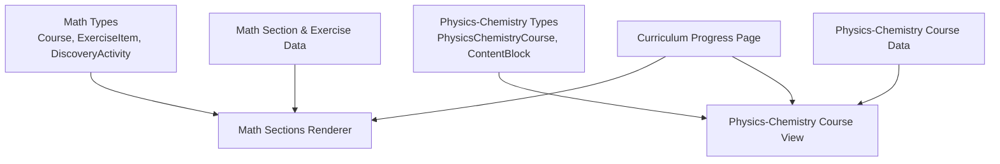
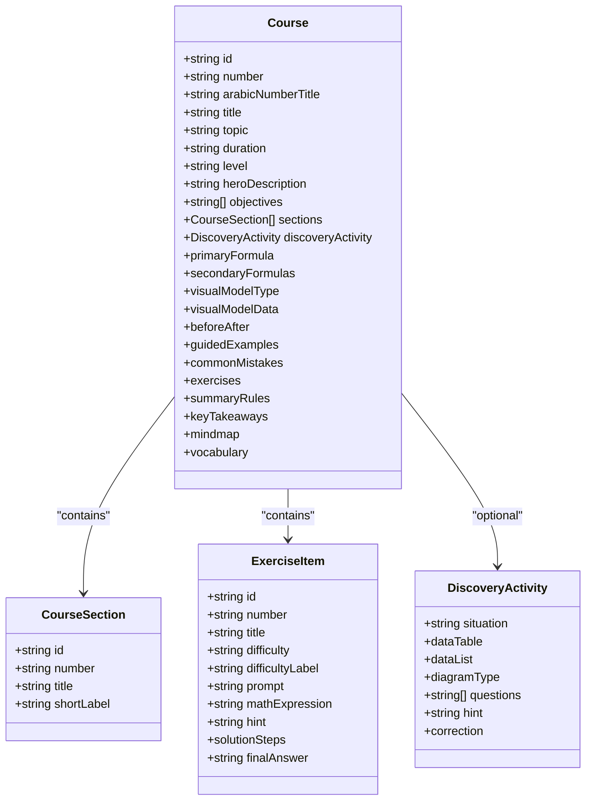
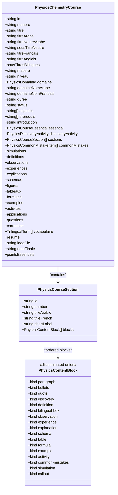
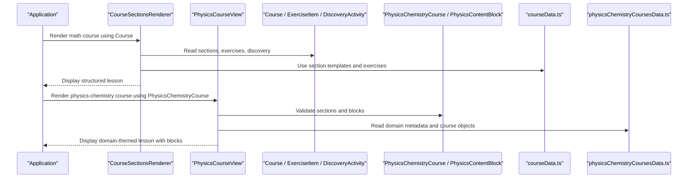
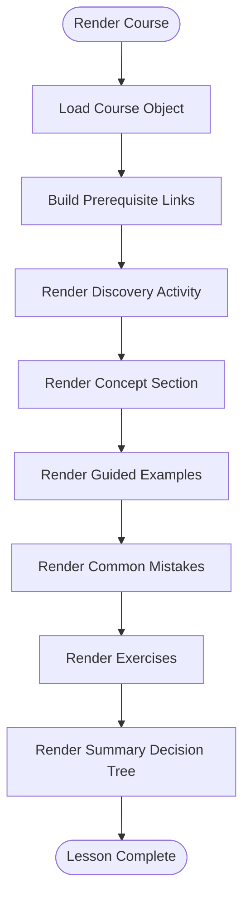
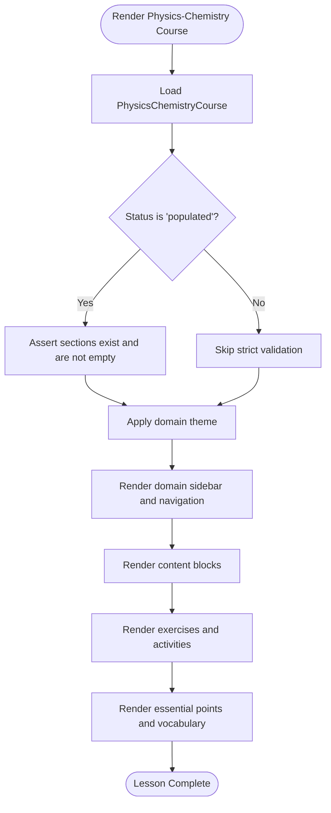
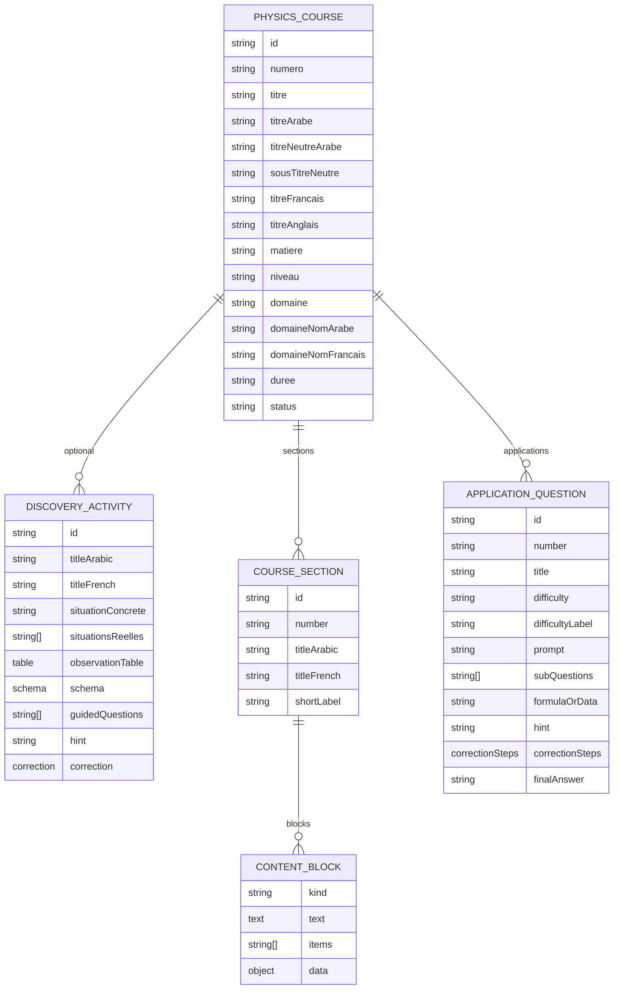
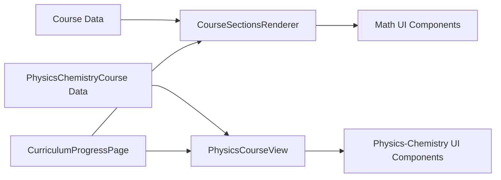
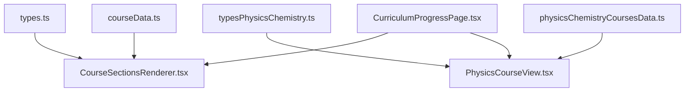

# Course Data Organization

<cite>
**Referenced Files in This Document**   
- [types.ts](file://src/types.ts)
- [typesPhysicsChemistry.ts](file://src/typesPhysicsChemistry.ts)
- [courseData.ts](file://src/data/courseData.ts)
- [physicsChemistryCoursesData.ts](file://src/data/physicsChemistryCoursesData.ts)
- [CourseSectionsRenderer.tsx](file://src/components/CourseSectionsRenderer.tsx)
- [PhysicsCourseView.tsx](file://src/components/physics/PhysicsCourseView.tsx)
- [PhysicsChemistryBlocks.tsx](file://src/components/physics/PhysicsChemistryBlocks.tsx)
- [CurriculumProgressPage.tsx](file://src/components/CurriculumProgressPage.tsx)
</cite>

## Table of Contents
1. [Introduction](#introduction)
2. [Project Structure](#project-structure)
3. [Core Components](#core-components)
4. [Architecture Overview](#architecture-overview)
5. [Detailed Component Analysis](#detailed-component-analysis)
6. [Dependency Analysis](#dependency-analysis)
7. [Performance Considerations](#performance-considerations)
8. [Troubleshooting Guide](#troubleshooting-guide)
9. [Conclusion](#conclusion)
10. [Appendices](#appendices)

## Introduction
This document explains the course data organization system used by the application, focusing on two parallel subject tracks:

- Mathematics courses, modeled through a shared `Course` interface and related types.
- Physics-Chemistry courses, modeled through a richer `PhysicsChemistryCourse` type and a flexible block-based content model.

The system organizes each course into sections, subsections, and learning activities such as guided examples, exercises, discovery activities, definitions, schemas, tables, formulas, and simulations. It also supports metadata, multilingual labels, domain-specific theming, validation rules, and UI rendering components that consume these models.

## Project Structure
At a high level, the relevant parts of the repository are organized as follows:

- Type definitions for mathematics courses live in a shared types file.
- Type definitions for physics-chemistry courses live in a dedicated physics-chemistry types file.
- Mathematics course section templates and exercise data live in a data file.
- Physics-chemistry course data, including full course objects and domain metadata, lives in a large data file.
- The mathematics renderer consumes the `Course` model and renders structured sections.
- The physics-chemistry view consumes the `PhysicsChemistryCourse` model and renders blocks inside sections.
- A curriculum progress page connects official curriculum items to implemented courses.

**Diagram sources**
- [types.ts:70-146](file://src/types.ts#L70-L146)
- [typesPhysicsChemistry.ts:338-395](file://src/typesPhysicsChemistry.ts#L338-L395)
- [courseData.ts:3-15](file://src/data/courseData.ts#L3-L15)
- [physicsChemistryCoursesData.ts:14-43](file://src/data/physicsChemistryCoursesData.ts#L14-L43)
- [CourseSectionsRenderer.tsx:36-43](file://src/components/CourseSectionsRenderer.tsx#L36-L43)
- [PhysicsCourseView.tsx:85-98](file://src/components/physics/PhysicsCourseView.tsx#L85-L98)
- [CurriculumProgressPage.tsx:23-27](file://src/components/CurriculumProgressPage.tsx#L23-L27)

**Section sources**
- [types.ts:1-146](file://src/types.ts#L1-L146)
- [typesPhysicsChemistry.ts:1-397](file://src/typesPhysicsChemistry.ts#L1-L397)
- [courseData.ts:1-135](file://src/data/courseData.ts#L1-L135)
- [physicsChemistryCoursesData.ts:1-92](file://src/data/physicsChemistryCoursesData.ts#L1-L92)
- [CourseSectionsRenderer.tsx:1-43](file://src/components/CourseSectionsRenderer.tsx#L1-L43)
- [PhysicsCourseView.tsx:1-98](file://src/components/physics/PhysicsCourseView.tsx#L1-L98)
- [CurriculumProgressPage.tsx:1-84](file://src/components/CurriculumProgressPage.tsx#L1-L84)

## Core Components
The core data models define how course content is structured and validated before rendering.

### Mathematics Course Model
The mathematics track uses a single `Course` interface with rich pedagogical fields:

- Identification and navigation: `id`, `number`, `arabicNumberTitle`, `title`, `topic`.
- Metadata: `duration`, `level`, `heroDescription`, `objectives`.
- Structural sections: `sections` as an array of `CourseSection`.
- Discovery activity: optional `DiscoveryActivity`.
- Core math concepts: `primaryFormula`, optional `secondaryFormulas`, optional visual model configuration.
- Learning aids: `beforeAfter`, `guidedExamples`, `commonMistakes`, `exercises`, `summaryRules`, `keyTakeaways`, `mindmap`, `vocabulary`.

Key relationships:
- `Course` contains multiple `CourseSection` entries.
- `Course.exercises` contains `ExerciseItem` entries.
- `Course.discoveryActivity` follows the `DiscoveryActivity` shape.

**Diagram sources**
- [types.ts:1-68](file://src/types.ts#L1-L68)
- [types.ts:70-146](file://src/types.ts#L70-L146)

**Section sources**
- [types.ts:1-146](file://src/types.ts#L1-L146)

### Physics-Chemistry Course Model
The physics-chemistry track uses a more expressive model designed for scientific pedagogy:

- Identification and metadata: `id`, `numero`, titles in Arabic/French/English, neutral titles, subject, level, domain, duration, status.
- Pedagogical structure: `objectives`, optional prerequisites, introduction, essential summary, discovery activity, `sections`, common mistakes, simulations.
- Organized collections: definitions, observations, experiments, explanations, schemas/figures, tables, formulas, examples, activities, applications, questions, correction, vocabulary, resume, key insight, final note, essential points.
- Section model: `PhysicsCourseSection` has an identifier, number, bilingual titles, optional short label, and an ordered list of `PhysicsContentBlock`.
- Block model: `PhysicsContentBlock` is a discriminated union supporting paragraphs, bullets, quotes, discovery, definition, bilingual box, observation, experience, explanation, schema, table, formula, example, activity, common mistakes, simulation, and callout.

**Diagram sources**
- [typesPhysicsChemistry.ts:325-332](file://src/typesPhysicsChemistry.ts#L325-L332)
- [typesPhysicsChemistry.ts:306-323](file://src/typesPhysicsChemistry.ts#L306-L323)
- [typesPhysicsChemistry.ts:338-395](file://src/typesPhysicsChemistry.ts#L338-L395)

**Section sources**
- [typesPhysicsChemistry.ts:5-10](file://src/typesPhysicsChemistry.ts#L5-L10)
- [typesPhysicsChemistry.ts:12-18](file://src/typesPhysicsChemistry.ts#L12-L18)
- [typesPhysicsChemistry.ts:20-29](file://src/typesPhysicsChemistry.ts#L20-L29)
- [typesPhysicsChemistry.ts:31-36](file://src/typesPhysicsChemistry.ts#L31-L36)
- [typesPhysicsChemistry.ts:38-61](file://src/typesPhysicsChemistry.ts#L38-L61)
- [typesPhysicsChemistry.ts:63-69](file://src/typesPhysicsChemistry.ts#L63-L69)
- [typesPhysicsChemistry.ts:71-166](file://src/typesPhysicsChemistry.ts#L71-L166)
- [typesPhysicsChemistry.ts:168-176](file://src/typesPhysicsChemistry.ts#L168-L176)
- [typesPhysicsChemistry.ts:178-194](file://src/typesPhysicsChemistry.ts#L178-L194)
- [typesPhysicsChemistry.ts:196-206](file://src/typesPhysicsChemistry.ts#L196-L206)
- [typesPhysicsChemistry.ts:208-222](file://src/typesPhysicsChemistry.ts#L208-L222)
- [typesPhysicsChemistry.ts:224-240](file://src/typesPhysicsChemistry.ts#L224-L240)
- [typesPhysicsChemistry.ts:242-262](file://src/typesPhysicsChemistry.ts#L242-L262)
- [typesPhysicsChemistry.ts:264-291](file://src/typesPhysicsChemistry.ts#L264-L291)
- [typesPhysicsChemistry.ts:293-300](file://src/typesPhysicsChemistry.ts#L293-L300)
- [typesPhysicsChemistry.ts:306-323](file://src/typesPhysicsChemistry.ts#L306-L323)
- [typesPhysicsChemistry.ts:325-332](file://src/typesPhysicsChemistry.ts#L325-L332)
- [typesPhysicsChemistry.ts:338-395](file://src/typesPhysicsChemistry.ts#L338-L395)

## Architecture Overview
The application renders two main course experiences:

1. **Mathematics courses**: Rendered by `CourseSectionsRenderer`, which reads a `Course` object and renders discovery activities, definitions, visual labs, properties, guided examples, common mistakes, exercises, summaries, and decision trees.
2. **Physics-Chemistry courses**: Rendered by `PhysicsCourseView`, which reads a `PhysicsChemistryCourse` object, validates populated courses, and renders domain-themed sections containing typed content blocks.

**Diagram sources**
- [CourseSectionsRenderer.tsx:36-43](file://src/components/CourseSectionsRenderer.tsx#L36-L43)
- [PhysicsCourseView.tsx:85-98](file://src/components/physics/PhysicsCourseView.tsx#L85-L98)
- [types.ts:70-146](file://src/types.ts#L70-L146)
- [typesPhysicsChemistry.ts:338-395](file://src/typesPhysicsChemistry.ts#L338-L395)
- [courseData.ts:3-15](file://src/data/courseData.ts#L3-L15)
- [physicsChemistryCoursesData.ts:14-43](file://src/data/physicsChemistryCoursesData.ts#L14-L43)

**Section sources**
- [CourseSectionsRenderer.tsx:135-153](file://src/components/CourseSectionsRenderer.tsx#L135-L153)
- [PhysicsCourseView.tsx:100-186](file://src/components/physics/PhysicsCourseView.tsx#L100-L186)

## Detailed Component Analysis

### Mathematics Course Data Model and Rendering
The mathematics model centers on `Course`, which groups:

- Section metadata via `CourseSection`.
- Exercises via `ExerciseItem`.
- Discovery activities via `DiscoveryActivity`.
- Core formulas and visual models.
- Guided examples, common mistakes, summaries, mindmaps, and vocabulary.

Rendering behavior:
- The renderer builds prerequisite links based on a map of course dependencies.
- It renders a discovery activity first, then concept sections, guided examples, common mistakes, exercises, and a summary decision tree.
- Visual discovery labs are selected by course ID.

**Diagram sources**
- [CourseSectionsRenderer.tsx:135-153](file://src/components/CourseSectionsRenderer.tsx#L135-L153)
- [CourseSectionsRenderer.tsx:483-515](file://src/components/CourseSectionsRenderer.tsx#L483-L515)
- [CourseSectionsRenderer.tsx:650-715](file://src/components/CourseSectionsRenderer.tsx#L650-L715)

**Section sources**
- [types.ts:70-146](file://src/types.ts#L70-L146)
- [courseData.ts:3-15](file://src/data/courseData.ts#L3-L15)
- [courseData.ts:17-134](file://src/data/courseData.ts#L17-L134)
- [CourseSectionsRenderer.tsx:47-133](file://src/components/CourseSectionsRenderer.tsx#L47-L133)
- [CourseSectionsRenderer.tsx:194-233](file://src/components/CourseSectionsRenderer.tsx#L194-L233)
- [CourseSectionsRenderer.tsx:483-715](file://src/components/CourseSectionsRenderer.tsx#L483-L715)

### Physics-Chemistry Course Data Model and Rendering
The physics-chemistry model is intentionally richer:

- Each course declares its domain (`matter`, `energy`, `electricity`, `optics`, or `general`).
- Courses can be marked `awaiting_content` or `populated`.
- Sections contain ordered `PhysicsContentBlock` entries.
- The renderer enforces strict validation for populated courses: sections must exist and contain valid non-empty blocks.
- The renderer maps block kinds to specialized UI components such as definitions, tables, formulas, schemas, activities, simulations, and callouts.

**Diagram sources**
- [typesPhysicsChemistry.ts:338-395](file://src/typesPhysicsChemistry.ts#L338-L395)
- [PhysicsCourseView.tsx:61-83](file://src/components/physics/PhysicsCourseView.tsx#L61-L83)
- [PhysicsCourseView.tsx:178-186](file://src/components/physics/PhysicsCourseView.tsx#L178-L186)
- [PhysicsCourseView.tsx:260-400](file://src/components/physics/PhysicsCourseView.tsx#L260-L400)

**Section sources**
- [typesPhysicsChemistry.ts:306-323](file://src/typesPhysicsChemistry.ts#L306-L323)
- [typesPhysicsChemistry.ts:325-332](file://src/typesPhysicsChemistry.ts#L325-L332)
- [typesPhysicsChemistry.ts:338-395](file://src/typesPhysicsChemistry.ts#L338-L395)
- [PhysicsCourseView.tsx:61-83](file://src/components/physics/PhysicsCourseView.tsx#L61-L83)
- [PhysicsCourseView.tsx:178-186](file://src/components/physics/PhysicsCourseView.tsx#L178-L186)
- [PhysicsCourseView.tsx:260-400](file://src/components/physics/PhysicsCourseView.tsx#L260-L400)

### Concrete Data Structure Hierarchy Example
A concrete example from the physics-chemistry dataset shows how a course is composed:

- Course-level metadata includes identifiers, titles, domain, status, objectives, and collections.
- The course includes a discovery activity with real-world situations, observation tables, guided questions, hints, and corrections.
- The course includes multiple sections, each with numbered blocks such as paragraphs, definitions, schemas, tables, and common mistakes.
- The course includes application questions with step-by-step corrections and essential summary points.

**Diagram sources**
- [typesPhysicsChemistry.ts:208-240](file://src/typesPhysicsChemistry.ts#L208-L240)
- [typesPhysicsChemistry.ts:242-262](file://src/typesPhysicsChemistry.ts#L242-L262)
- [typesPhysicsChemistry.ts:325-332](file://src/typesPhysicsChemistry.ts#L325-L332)
- [typesPhysicsChemistry.ts:338-395](file://src/typesPhysicsChemistry.ts#L338-L395)
- [physicsChemistryCoursesData.ts:98-152](file://src/data/physicsChemistryCoursesData.ts#L98-L152)
- [physicsChemistryCoursesData.ts:154-495](file://src/data/physicsChemistryCoursesData.ts#L154-L495)
- [physicsChemistryCoursesData.ts:498-694](file://src/data/physicsChemistryCoursesData.ts#L498-L694)

**Section sources**
- [physicsChemistryCoursesData.ts:98-152](file://src/data/physicsChemistryCoursesData.ts#L98-L152)
- [physicsChemistryCoursesData.ts:154-495](file://src/data/physicsChemistryCoursesData.ts#L154-L495)
- [physicsChemistryCoursesData.ts:498-694](file://src/data/physicsChemistryCoursesData.ts#L498-L694)

### Field Definitions and Validation Rules
#### Mathematics Fields
- Required identification fields: `id`, `number`, `title`, `arabicNumberTitle`, `topic`.
- Optional pedagogical fields: `discoveryActivity`, `visualModelType`, `visualModelData`, `beforeAfter`, `guidedExamples`, `commonMistakes`, `exercises`, `summaryRules`, `keyTakeaways`, `mindmap`, `vocabulary`.
- Exercise validation: each exercise has a difficulty enum, solution steps, and a final answer.

#### Physics-Chemistry Fields
- Domain classification: `domaine` is a constrained type with values like `matter`, `energy`, `electricity`, `optics`, `general`.
- Status field: `status` controls whether a course is `awaiting_content` or `populated`.
- Section validation: populated courses must have at least one section, and each section must contain at least one valid non-empty block.
- Block validation: paragraphs require non-empty text; bullets require non-empty items; quotes require non-empty text; common mistakes require non-empty items.

**Section sources**
- [types.ts:8-26](file://src/types.ts#L8-L26)
- [types.ts:70-146](file://src/types.ts#L70-L146)
- [typesPhysicsChemistry.ts:5-10](file://src/typesPhysicsChemistry.ts#L5-L10)
- [typesPhysicsChemistry.ts:338-395](file://src/typesPhysicsChemistry.ts#L338-L395)
- [PhysicsCourseView.tsx:61-83](file://src/components/physics/PhysicsCourseView.tsx#L61-L83)
- [PhysicsCourseView.tsx:178-186](file://src/components/physics/PhysicsCourseView.tsx#L178-L186)

### How New Course Content Can Be Added
#### Adding a Mathematics Course
To add a new mathematics course:

1. Define a new `Course` object with required identification and metadata fields.
2. Add `CourseSection` entries if you want explicit section ordering beyond the default renderer sections.
3. Add `ExerciseItem` entries for practice problems.
4. Optionally add a `DiscoveryActivity`, guided examples, common mistakes, vocabulary, and visual model data.
5. Register the course in the application’s course collection so it appears in selectors and progression tracking.

#### Adding a Physics-Chemistry Course
To add a new physics-chemistry course:

1. Create a `PhysicsChemistryCourse` object with identifiers, titles, domain, status, objectives, and collections.
2. Add a discovery activity if the course should begin with a guided exploration.
3. Add `PhysicsCourseSection` entries with ordered `PhysicsContentBlock` entries.
4. Use appropriate block kinds: `paragraph`, `bullets`, `definition`, `schema`, `table`, `formula`, `example`, `activity`, `simulation`, `callout`, etc.
5. Populate application questions, essential points, vocabulary, and other collections as needed.
6. Set `status` to `awaiting_content` while drafting and `populated` when ready for strict validation.

**Section sources**
- [types.ts:70-146](file://src/types.ts#L70-L146)
- [typesPhysicsChemistry.ts:306-323](file://src/typesPhysicsChemistry.ts#L306-L323)
- [typesPhysicsChemistry.ts:325-332](file://src/typesPhysicsChemistry.ts#L325-L332)
- [typesPhysicsChemistry.ts:338-395](file://src/typesPhysicsChemistry.ts#L338-L395)
- [physicsChemistryCoursesData.ts:49-92](file://src/data/physicsChemistryCoursesData.ts#L49-L92)

### How Course Metadata Is Managed
Metadata is managed through typed fields rather than ad-hoc strings:

- Mathematics courses use `topic`, `level`, `duration`, `heroDescription`, and `objectives`.
- Physics-chemistry courses use `matiere`, `niveau`, `domaine`, `domaineNomArabe`, `domaineNomFrancais`, `duree`, `status`, `prerequis`, `introduction`, `resume`, `ideeCle`, and `noteFinale`.
- Domain metadata for physics-chemistry is centralized in a domain registry that provides Arabic and French names and descriptions.

**Section sources**
- [types.ts:70-146](file://src/types.ts#L70-L146)
- [typesPhysicsChemistry.ts:338-395](file://src/typesPhysicsChemistry.ts#L338-L395)
- [physicsChemistryCoursesData.ts:14-43](file://src/data/physicsChemistryCoursesData.ts#L14-L43)

### How the Data Structure Supports Different Subject Areas
The mathematics model emphasizes arithmetic, fractions, powers, geometry, and problem-solving workflows. The physics-chemistry model emphasizes scientific phenomena, experimental observations, chemical equations, energy chains, and interactive simulations.

- Mathematics sections are often rendered with a fixed pedagogical flow: discovery, concept, justification, guided examples, common mistakes, exercises, and summary.
- Physics-chemistry sections are fully flexible through `PhysicsContentBlock`, allowing authors to follow exact curriculum order and wording while still being constrained by TypeScript types.

**Section sources**
- [CourseSectionsRenderer.tsx:483-715](file://src/components/CourseSectionsRenderer.tsx#L483-L715)
- [typesPhysicsChemistry.ts:306-323](file://src/typesPhysicsChemistry.ts#L306-L323)

### Data Versioning Strategies
The current codebase does not include an explicit version field on `Course` or `PhysicsChemistryCourse`. However, several patterns support safe evolution:

- Stable identifiers: both models use stable `id` fields for navigation and linking.
- Status field: physics-chemistry courses use `status` to distinguish draft vs published content.
- Strict validation for published content: populated physics-chemistry courses throw errors if sections are missing or empty.
- Local storage keys: discovery unlock state uses versioned keys such as `math_3am_discovery_unlocked_v1` and `pc_3am_discovery_unlocked_v1`.

Recommended future strategy:
- Add a `version` field to both course models.
- Introduce migration helpers when changing section layouts or block shapes.
- Keep backward-compatible defaults for optional fields during transitions.

**Section sources**
- [types.ts:70-146](file://src/types.ts#L70-L146)
- [typesPhysicsChemistry.ts:338-395](file://src/typesPhysicsChemistry.ts#L338-L395)
- [CourseSectionsRenderer.tsx:144-165](file://src/components/CourseSectionsRenderer.tsx#L144-L165)
- [PhysicsCourseView.tsx:118-153](file://src/components/physics/PhysicsCourseView.tsx#L118-L153)
- [PhysicsCourseView.tsx:178-186](file://src/components/physics/PhysicsCourseView.tsx#L178-L186)

### Content Localization Support
Localization is supported through multilingual fields:

- Mathematics vocabulary supports Arabic, French, and optional English meanings.
- Physics-chemistry terms support Arabic, French, and optional English, plus explanations and symbols/formulas.
- Physics-chemistry course titles support Arabic, French, and English, along with bilingual subtitles.
- Many UI components render Arabic and French labels explicitly.

**Section sources**
- [types.ts:28-33](file://src/types.ts#L28-L33)
- [typesPhysicsChemistry.ts:12-18](file://src/typesPhysicsChemistry.ts#L12-L18)
- [typesPhysicsChemistry.ts:338-395](file://src/typesPhysicsChemistry.ts#L338-L395)
- [physicsChemistryCoursesData.ts:154-171](file://src/data/physicsChemistryCoursesData.ts#L154-L171)

### Relationship Between Data Structures and UI Rendering Components
The data structures drive component selection and rendering logic:

- Mathematics renderer selects visual discovery labs by course ID and renders predefined sections.
- Physics-chemistry renderer switches on `block.kind` to render specific components such as definitions, tables, formulas, schemas, activities, simulations, and callouts.
- Domain metadata drives theming, icons, and sidebar navigation in the physics-chemistry view.
- Curriculum progress pages connect official curriculum items to implemented courses and allow opening linked lessons.

**Diagram sources**
- [CourseSectionsRenderer.tsx:194-233](file://src/components/CourseSectionsRenderer.tsx#L194-L233)
- [PhysicsCourseView.tsx:260-400](file://src/components/physics/PhysicsCourseView.tsx#L260-L400)
- [PhysicsChemistryBlocks.tsx:378-412](file://src/components/physics/PhysicsChemistryBlocks.tsx#L378-L412)
- [CurriculumProgressPage.tsx:469-502](file://src/components/CurriculumProgressPage.tsx#L469-L502)

**Section sources**
- [CourseSectionsRenderer.tsx:194-233](file://src/components/CourseSectionsRenderer.tsx#L194-L233)
- [PhysicsCourseView.tsx:260-400](file://src/components/physics/PhysicsCourseView.tsx#L260-L400)
- [PhysicsChemistryBlocks.tsx:378-412](file://src/components/physics/PhysicsChemistryBlocks.tsx#L378-L412)
- [CurriculumProgressPage.tsx:469-502](file://src/components/CurriculumProgressPage.tsx#L469-L502)

## Dependency Analysis
The main dependencies between data and UI layers are:

- `types.ts` defines shared mathematics types consumed by the math renderer and data files.
- `typesPhysicsChemistry.ts` defines physics-chemistry types consumed by the physics-chemistry data and view.
- `courseData.ts` provides reusable section templates and exercise data for mathematics.
- `physicsChemistryCoursesData.ts` provides domain metadata and full course objects for physics-chemistry.
- `CourseSectionsRenderer.tsx` depends on `Course` and related types.
- `PhysicsCourseView.tsx` depends on `PhysicsChemistryCourse` and related types.
- `CurriculumProgressPage.tsx` bridges curriculum items to implemented courses.

**Diagram sources**
- [types.ts:70-146](file://src/types.ts#L70-L146)
- [typesPhysicsChemistry.ts:338-395](file://src/typesPhysicsChemistry.ts#L338-L395)
- [courseData.ts:1-15](file://src/data/courseData.ts#L1-L15)
- [physicsChemistryCoursesData.ts:1-43](file://src/data/physicsChemistryCoursesData.ts#L1-L43)
- [CourseSectionsRenderer.tsx:1-43](file://src/components/CourseSectionsRenderer.tsx#L1-L43)
- [PhysicsCourseView.tsx:1-35](file://src/components/physics/PhysicsCourseView.tsx#L1-L35)
- [CurriculumProgressPage.tsx:1-27](file://src/components/CurriculumProgressPage.tsx#L1-L27)

**Section sources**
- [types.ts:70-146](file://src/types.ts#L70-L146)
- [typesPhysicsChemistry.ts:338-395](file://src/typesPhysicsChemistry.ts#L338-L395)
- [courseData.ts:1-15](file://src/data/courseData.ts#L1-L15)
- [physicsChemistryCoursesData.ts:1-43](file://src/data/physicsChemistryCoursesData.ts#L1-L43)
- [CourseSectionsRenderer.tsx:1-43](file://src/components/CourseSectionsRenderer.tsx#L1-L43)
- [PhysicsCourseView.tsx:1-35](file://src/components/physics/PhysicsCourseView.tsx#L1-L35)
- [CurriculumProgressPage.tsx:1-27](file://src/components/CurriculumProgressPage.tsx#L1-L27)

## Performance Considerations
- Rendering large physics-chemistry courses benefits from lazy evaluation of sections and tabs. The physics-chemistry view computes active sections and tabs without re-rendering unrelated content unnecessarily.
- Mathematics rendering builds prerequisite links and visual lab mappings once per course.
- Local storage usage for discovery unlock state is minimal but should remain guarded against storage errors.
- PDF export preparation triggers UI state changes to ensure all content is visible during export.

[No sources needed since this section provides general guidance]

## Troubleshooting Guide
Common issues and their likely causes:

- **Empty section error in physics-chemistry courses**: If a course is marked `populated`, the renderer throws an error when a section has no blocks or only empty blocks. Fix by adding valid content blocks to the section.
- **Missing sections in populated physics-chemistry courses**: The renderer requires at least one section for published courses. Add sections before marking the course as populated.
- **Discovery activity not unlocking**: Check local storage keys and event listeners for discovery unlock state. Ensure the completion handler updates state and scrolls to the next section.
- **Curriculum item not linking to a course**: Verify that the curriculum item has `implemented` set to true and a valid `linkedCourseId`.

**Section sources**
- [PhysicsCourseView.tsx:61-83](file://src/components/physics/PhysicsCourseView.tsx#L61-L83)
- [PhysicsCourseView.tsx:178-186](file://src/components/physics/PhysicsCourseView.tsx#L178-L186)
- [CourseSectionsRenderer.tsx:144-174](file://src/components/CourseSectionsRenderer.tsx#L144-L174)
- [CurriculumProgressPage.tsx:469-502](file://src/components/CurriculumProgressPage.tsx#L469-L502)

## Conclusion
The course data organization system provides two complementary models:

- A concise, structured `Course` model for mathematics, optimized for arithmetic, fractions, powers, and geometry workflows.
- A rich, flexible `PhysicsChemistryCourse` model for science education, built around domain-aware sections and typed content blocks.

Both models emphasize clear identification, structured sections, discovery-driven learning, exercises, summaries, and multilingual support. The physics-chemistry model adds strong validation, domain theming, and extensible block types that map directly to UI components. With stable identifiers, status fields, and careful validation, the system supports safe content authoring, localization, and progressive enhancement toward robust versioning and migration strategies.

[No sources needed since this section summarizes without analyzing specific files]

## Appendices

### Appendix A: Mathematics Section Template Reference
The mathematics section template defines standard sections such as objectives, core idea, fraction operations, negative fractions, guided examples, common mistakes, exercises, summary, key takeaways, and mindmap.

**Section sources**
- [courseData.ts:3-15](file://src/data/courseData.ts#L3-L15)

### Appendix B: Physics-Chemistry Domain Registry
The physics-chemistry domain registry defines domains with Arabic and French names and descriptions, enabling consistent labeling and theming across courses.

**Section sources**
- [physicsChemistryCoursesData.ts:14-43](file://src/data/physicsChemistryCoursesData.ts#L14-L43)