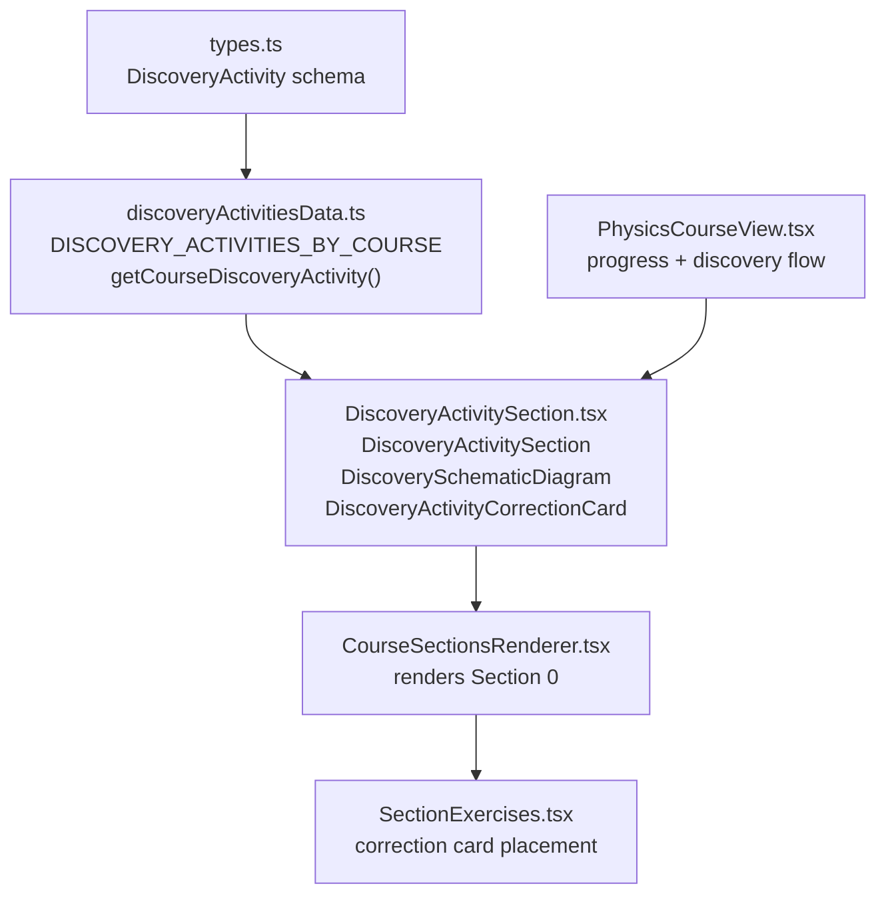
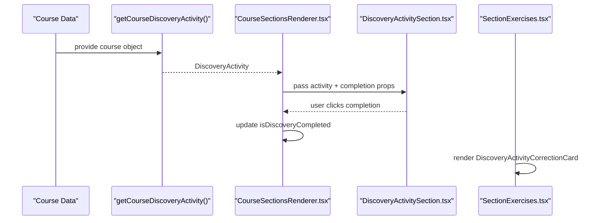
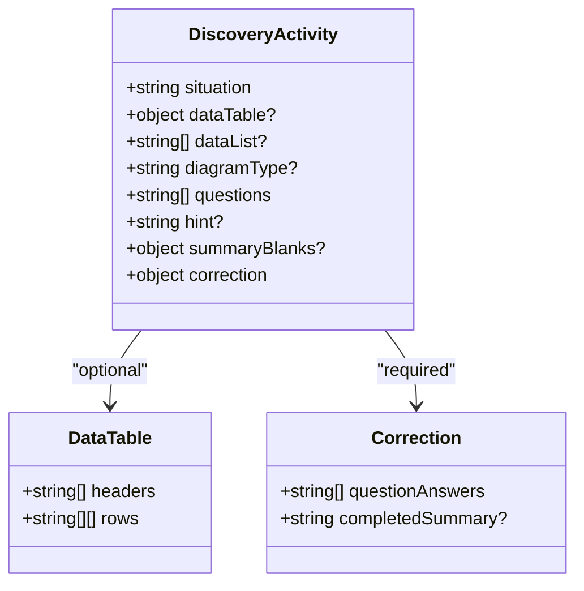
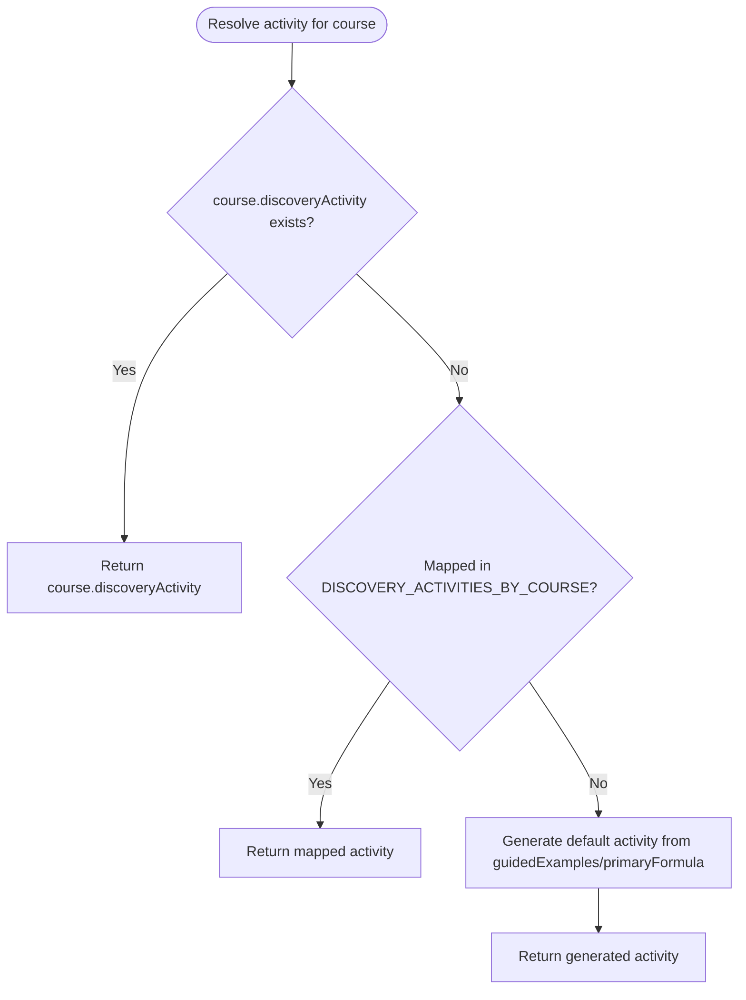
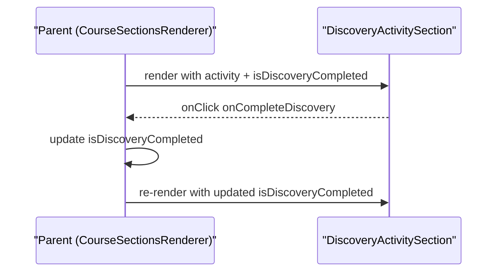
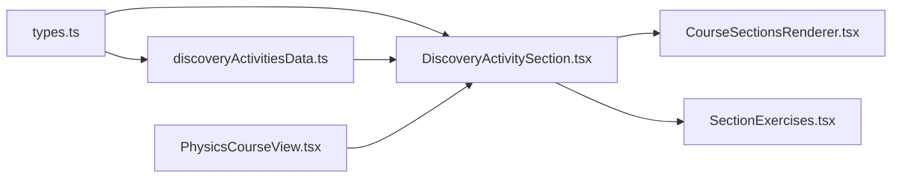

# Discovery Activities Framework

<cite>
**Referenced Files in This Document**
- [types.ts](file://src/types.ts)
- [discoveryActivitiesData.ts](file://src/data/discoveryActivitiesData.ts)
- [DiscoveryActivitySection.tsx](file://src/components/DiscoveryActivitySection.tsx)
- [CourseSectionsRenderer.tsx](file://src/components/CourseSectionsRenderer.tsx)
- [SectionExercises.tsx](file://src/components/SectionExercises.tsx)
- [PhysicsCourseView.tsx](file://src/components/physics/PhysicsCourseView.tsx)
</cite>

## Table of Contents
1. [Introduction](#introduction)
2. [Project Structure](#project-structure)
3. [Core Components](#core-components)
4. [Architecture Overview](#architecture-overview)
5. [Detailed Component Analysis](#detailed-component-analysis)
6. [Dependency Analysis](#dependency-analysis)
7. [Performance Considerations](#performance-considerations)
8. [Troubleshooting Guide](#troubleshooting-guide)
9. [Conclusion](#conclusion)

## Introduction
This document explains the discovery activities framework used to structure, define, and render discovery-based learning activities. The framework centers on a data-driven model for “Section 0” activities that guide learners through concrete situations, tabular or list data, guided questions, optional hints, and correction cards. It also documents how these activities integrate with course sections, progress tracking, and assessment areas.

The key goals are:
- Explain the activity data model, including activity types, parameters, and interactive elements.
- Show how activities are defined and rendered by `DiscoveryActivitySection`.
- Clarify the relationship between activity data and the rendering component, including props, state, and user interaction handling.
- Provide guidance on customization options, progress tracking integration, and assessment capabilities.

## Project Structure
The discovery activities framework spans three main layers:
- Data layer: defines the activity schema and provides per-course activity content.
- Rendering layer: renders Section 0 discovery activities and their correction cards.
- Integration layer: connects activities to course navigation, completion state, and exercises.

**Diagram sources**
- [types.ts:35-68](file://src/types.ts#L35-L68)
- [discoveryActivitiesData.ts:12-12](file://src/data/discoveryActivitiesData.ts#L12-L12)
- [DiscoveryActivitySection.tsx:363-485](file://src/components/DiscoveryActivitySection.tsx#L363-L485)
- [CourseSectionsRenderer.tsx:485-489](file://src/components/CourseSectionsRenderer.tsx#L485-L489)
- [SectionExercises.tsx:1-11](file://src/components/SectionExercises.tsx#L1-L11)
- [PhysicsCourseView.tsx:225-237](file://src/components/physics/PhysicsCourseView.tsx#L225-L237)

**Section sources**
- [types.ts:35-68](file://src/types.ts#L35-L68)
- [discoveryActivitiesData.ts:12-12](file://src/data/discoveryActivitiesData.ts#L12-L12)
- [DiscoveryActivitySection.tsx:363-485](file://src/components/DiscoveryActivitySection.tsx#L363-L485)
- [CourseSectionsRenderer.tsx:485-489](file://src/components/CourseSectionsRenderer.tsx#L485-L489)
- [SectionExercises.tsx:1-11](file://src/components/SectionExercises.tsx#L1-L11)
- [PhysicsCourseView.tsx:225-237](file://src/components/physics/PhysicsCourseView.tsx#L225-L237)

## Core Components
- Activity data model: `DiscoveryActivity` defines the shape of each discovery activity, including situation text, optional table/list data, diagram type, guided questions, hint, obsolete summary blanks, and correction answers.
- Activity registry: `DISCOVERY_ACTIVITIES_BY_COURSE` maps course identifiers to specific activities.
- Activity resolver: `getCourseDiscoveryActivity(course)` returns the activity for a course, falling back to auto-generated content when not explicitly provided.
- Rendering components:
  - `DiscoveryActivitySection`: renders Section 0 (النشاط الاستكشافي), including situation, data table/list, optional geometric diagrams, guided questions, hint, and completion button.
  - `DiscoverySchematicDiagram`: renders simple SVG diagrams for geometry-related activities.
  - `DiscoveryActivityCorrectionCard`: renders the correction card for guided questions, shown only in the exercises/corrections area.

**Section sources**
- [types.ts:35-68](file://src/types.ts#L35-L68)
- [discoveryActivitiesData.ts:12-12](file://src/data/discoveryActivitiesData.ts#L12-L12)
- [discoveryActivitiesData.ts:843-873](file://src/data/discoveryActivitiesData.ts#L843-L873)
- [DiscoveryActivitySection.tsx:11-351](file://src/components/DiscoveryActivitySection.tsx#L11-L351)
- [DiscoveryActivitySection.tsx:363-485](file://src/components/DiscoveryActivitySection.tsx#L363-L485)
- [DiscoveryActivitySection.tsx:492-549](file://src/components/DiscoveryActivitySection.tsx#L492-L549)

## Architecture Overview
The discovery activities framework follows a clear separation of concerns:
- Data definition and mapping live in `discoveryActivitiesData.ts`, using the `DiscoveryActivity` schema from `types.ts`.
- Rendering is handled by `DiscoveryActivitySection.tsx`, which consumes the activity data and exposes UI interactions.
- Course integration occurs in `CourseSectionsRenderer.tsx` and `PhysicsCourseView.tsx`, where the activity is resolved and passed into the renderer along with completion state callbacks.
- Correction cards are placed in the exercises section via `SectionExercises.tsx`.

**Diagram sources**
- [discoveryActivitiesData.ts:843-873](file://src/data/discoveryActivitiesData.ts#L843-L873)
- [CourseSectionsRenderer.tsx:485-489](file://src/components/CourseSectionsRenderer.tsx#L485-L489)
- [DiscoveryActivitySection.tsx:363-485](file://src/components/DiscoveryActivitySection.tsx#L363-L485)
- [SectionExercises.tsx:1-11](file://src/components/SectionExercises.tsx#L1-L11)

## Detailed Component Analysis

### Activity Data Model
The `DiscoveryActivity` interface defines the core structure:
- `situation`: introductory scenario text.
- `dataTable` or `dataList`: structured data for observation and calculation.
- `diagramType`: optional geometry diagram identifier.
- `questions`: ordered guided questions.
- `hint`: optional hint text.
- `summaryBlanks`: marked obsolete; retained for compatibility.
- `correction`: contains `questionAnswers` and optional `completedSummary`.

**Diagram sources**
- [types.ts:35-68](file://src/types.ts#L35-L68)

**Section sources**
- [types.ts:35-68](file://src/types.ts#L35-L68)

### Activity Registry and Resolver
- `DISCOVERY_ACTIVITIES_BY_COURSE` maps course IDs to fully defined activities.
- `getCourseDiscoveryActivity(course)` resolves the activity:
  - If the course has an inline `discoveryActivity`, use it.
  - Else if mapped in the registry, return the mapped activity.
  - Else generate a default activity based on the course’s first guided example and primary formula.

**Diagram sources**
- [discoveryActivitiesData.ts:843-873](file://src/data/discoveryActivitiesData.ts#L843-L873)

**Section sources**
- [discoveryActivitiesData.ts:12-12](file://src/data/discoveryActivitiesData.ts#L12-L12)
- [discoveryActivitiesData.ts:843-873](file://src/data/discoveryActivitiesData.ts#L843-L873)

### Rendering: DiscoveryActivitySection
`DiscoveryActivitySection` renders Section 0 with:
- A title block.
- Situation paragraph.
- Data presentation: table or list, plus optional geometric diagram.
- Guided questions.
- Optional hint box.
- Completion control: button to mark discovery complete, or status message.

Props:
- `activity`: the `DiscoveryActivity` instance.
- `isDiscoveryCompleted`: boolean indicating whether the learner has completed the discovery.
- `onCompleteDiscovery`: callback invoked when the learner marks the discovery complete.

State management:
- The component itself does not manage completion state; it receives `isDiscoveryCompleted` and emits `onCompleteDiscovery`.
- Parent components (e.g., `CourseSectionsRenderer.tsx`) manage the actual state and pass it down.

User interaction handling:
- Clicking the completion button triggers `onCompleteDiscovery`, allowing the parent to update state and reveal subsequent sections.

**Diagram sources**
- [DiscoveryActivitySection.tsx:363-485](file://src/components/DiscoveryActivitySection.tsx#L363-L485)
- [CourseSectionsRenderer.tsx:485-489](file://src/components/CourseSectionsRenderer.tsx#L485-L489)

**Section sources**
- [DiscoveryActivitySection.tsx:363-485](file://src/components/DiscoveryActivitySection.tsx#L363-L485)
- [CourseSectionsRenderer.tsx:485-489](file://src/components/CourseSectionsRenderer.tsx#L485-L489)

### Geometric Diagrams: DiscoverySchematicDiagram
For geometry-focused activities, `DiscoverySchematicDiagram` renders simple SVG figures corresponding to `diagramType` values such as:
- `thales-nested`
- `converse-pythagoras`
- `pythagoras-squares`
- `circumcircle-right`
- `median-rectangle`
- `midsegment-triangle`
- `congruent-triangles`

These diagrams follow consistent visual tokens and labels aligned with the application’s design system.

**Section sources**
- [DiscoveryActivitySection.tsx:11-351](file://src/components/DiscoveryActivitySection.tsx#L11-L351)

### Correction Card: DiscoveryActivityCorrectionCard
The correction card is intended to be displayed only in the corrections/exercises area, never immediately after the activity. It:
- Shows a header with a toggle button.
- Renders ordered answers for guided questions.
- Uses local state to manage open/closed visibility.

Integration point:
- `SectionExercises.tsx` imports and renders this card when a discovery activity is present.

**Section sources**
- [DiscoveryActivitySection.tsx:492-549](file://src/components/DiscoveryActivitySection.tsx#L492-L549)
- [SectionExercises.tsx:1-11](file://src/components/SectionExercises.tsx#L1-L11)

### Course Integration and Progress Tracking
- `CourseSectionsRenderer.tsx` passes the resolved discovery activity into `DiscoveryActivitySection`, along with completion state and callback.
- `PhysicsCourseView.tsx` extracts the discovery activity from the course or its blocks and participates in progress logic (e.g., unlocking sections upon completion).

Completion behavior:
- When the learner completes the discovery, the parent updates `isDiscoveryCompleted`, which can unlock further sections and navigation shortcuts.

**Section sources**
- [CourseSectionsRenderer.tsx:485-489](file://src/components/CourseSectionsRenderer.tsx#L485-L489)
- [PhysicsCourseView.tsx:225-237](file://src/components/physics/PhysicsCourseView.tsx#L225-L237)

## Dependency Analysis
The framework exhibits low coupling between data and rendering:
- `types.ts` defines the contract (`DiscoveryActivity`).
- `discoveryActivitiesData.ts` implements the contract and provides resolvers.
- `DiscoveryActivitySection.tsx` depends only on the contract and utility formatting functions.
- Course renderers depend on both data and rendering components to wire up the experience.

**Diagram sources**
- [types.ts:35-68](file://src/types.ts#L35-L68)
- [discoveryActivitiesData.ts:12-12](file://src/data/discoveryActivitiesData.ts#L12-L12)
- [DiscoveryActivitySection.tsx:363-485](file://src/components/DiscoveryActivitySection.tsx#L363-L485)
- [CourseSectionsRenderer.tsx:485-489](file://src/components/CourseSectionsRenderer.tsx#L485-L489)
- [SectionExercises.tsx:1-11](file://src/components/SectionExercises.tsx#L1-L11)
- [PhysicsCourseView.tsx:225-237](file://src/components/physics/PhysicsCourseView.tsx#L225-L237)

**Section sources**
- [types.ts:35-68](file://src/types.ts#L35-L68)
- [discoveryActivitiesData.ts:12-12](file://src/data/discoveryActivitiesData.ts#L12-L12)
- [DiscoveryActivitySection.tsx:363-485](file://src/components/DiscoveryActivitySection.tsx#L363-L485)
- [CourseSectionsRenderer.tsx:485-489](file://src/components/CourseSectionsRenderer.tsx#L485-L489)
- [SectionExercises.tsx:1-11](file://src/components/SectionExercises.tsx#L1-L11)
- [PhysicsCourseView.tsx:225-237](file://src/components/physics/PhysicsCourseView.tsx#L225-L237)

## Performance Considerations
- Rendering overhead: `DiscoveryActivitySection` iterates over `dataTable.rows` and `questions`; keep these arrays reasonably sized to avoid unnecessary re-renders.
- Diagram rendering: SVG diagrams are lightweight but should be used only when necessary (`diagramType` present).
- State updates: Completion state is managed at the parent level; minimize prop drilling and avoid redundant re-renders by memoizing derived values where appropriate.

[No sources needed since this section provides general guidance]

## Troubleshooting Guide
Common issues and resolutions:
- Missing activity data: Ensure `getCourseDiscoveryActivity` resolves correctly; verify course ID mapping in `DISCOVERY_ACTIVITIES_BY_COURSE` or inline `course.discoveryActivity`.
- No completion button: Confirm that `onCompleteDiscovery` is provided by the parent; without it, the completion UI is hidden.
- Correction card not visible: Place `DiscoveryActivityCorrectionCard` inside the exercises/corrections section; it should not appear directly after the activity.
- Geometry diagram not showing: Verify that `diagramType` matches one of the supported values and that the activity includes the field.

**Section sources**
- [discoveryActivitiesData.ts:843-873](file://src/data/discoveryActivitiesData.ts#L843-L873)
- [DiscoveryActivitySection.tsx:363-485](file://src/components/DiscoveryActivitySection.tsx#L363-L485)
- [DiscoveryActivitySection.tsx:492-549](file://src/components/DiscoveryActivitySection.tsx#L492-L549)

## Conclusion
The discovery activities framework provides a structured, data-driven approach to defining and rendering discovery-based learning experiences. By separating the activity schema, data registry, and rendering logic, the system remains extensible and maintainable. Course integration points enable seamless progress tracking and assessment alignment, while the correction card ensures proper placement of feedback within the exercises area.

[No sources needed since this section summarizes without analyzing specific files]