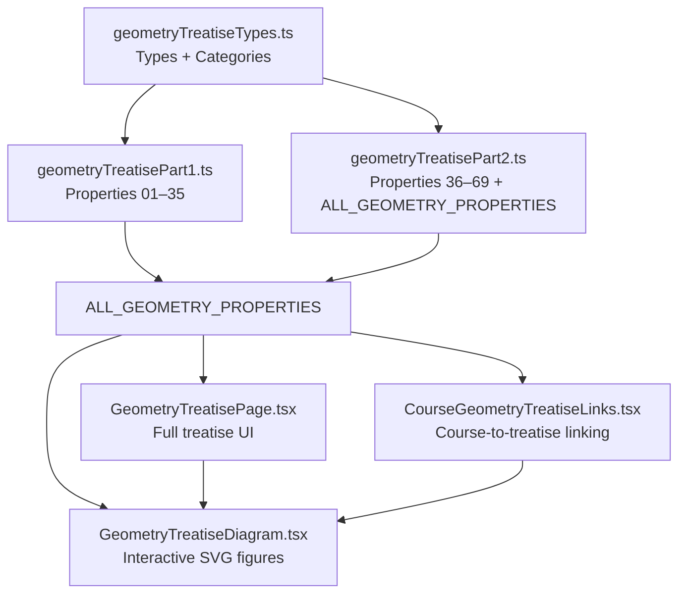
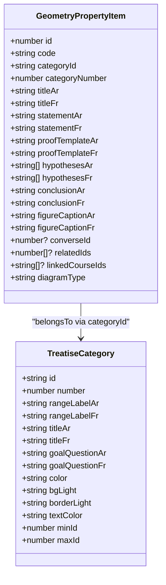
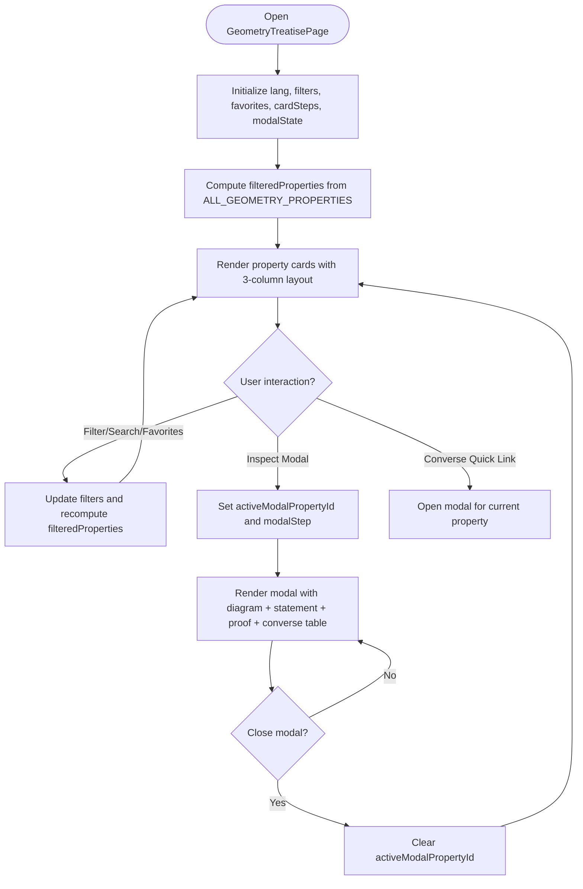
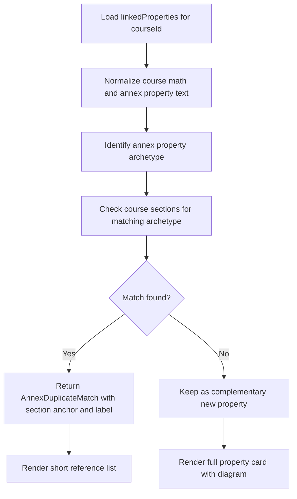
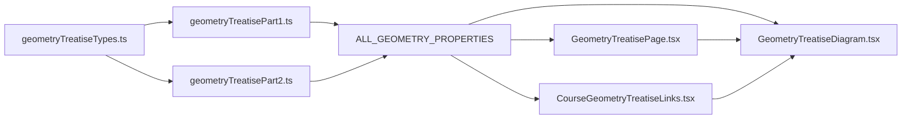

# Geometry Treatise Reference System

<cite>
**Referenced Files in This Document**
- [GeometryTreatisePage.tsx](file://src/components/GeometryTreatisePage.tsx)
- [GeometryTreatiseDiagram.tsx](file://src/components/GeometryTreatiseDiagram.tsx)
- [geometryTreatiseTypes.ts](file://src/data/geometryTreatiseTypes.ts)
- [geometryTreatisePart1.ts](file://src/data/geometryTreatisePart1.ts)
- [geometryTreatisePart2.ts](file://src/data/geometryTreatisePart2.ts)
- [CourseGeometryTreatiseLinks.tsx](file://src/components/CourseGeometryTreatiseLinks.tsx)
</cite>

## Table of Contents
1. [Introduction](#introduction)
2. [Project Structure](#project-structure)
3. [Core Components](#core-components)
4. [Architecture Overview](#architecture-overview)
5. [Detailed Component Analysis](#detailed-component-analysis)
6. [Dependency Analysis](#dependency-analysis)
7. [Performance Considerations](#performance-considerations)
8. [Troubleshooting Guide](#troubleshooting-guide)
9. [Conclusion](#conclusion)
10. [Appendices](#appendices)

## Introduction
This document explains the geometry treatise reference system that powers an interactive, bilingual Arabic-French database of 69 secondary-school geometry properties and theorems. The system provides:
- A structured data model for geometric concepts, statements, hypotheses, conclusions, proof templates, figure captions, converse relationships, related properties, and links to course lessons.
- An interactive SVG-based diagram renderer that visualizes each property through a four-step progression: base shape, hypotheses, reasons, and conclusion.
- A page component that presents the full treatise with filtering, search, favorites, language switching, and detailed modal inspection.
- A course integration component that connects specific lesson content to the treatise by matching mathematical formula structures and showing short references or full cards depending on whether the same archetype is already covered in the lesson.

The goal is to support students and teachers in selecting the right geometric property for a proof, understanding its diagrammatic meaning, copying official proof templates, and exploring direct and converse relationships interactively.

## Project Structure
The geometry treatise system is organized into two main layers:
- Data layer: TypeScript types and arrays defining categories, properties, and their metadata.
- UI layer: React components for rendering the treatise page, diagrams, and course-linked sections.



**Diagram sources**
- [geometryTreatiseTypes.ts:1-207](file://src/data/geometryTreatiseTypes.ts#L1-L207)
- [geometryTreatisePart1.ts:1-735](file://src/data/geometryTreatisePart1.ts#L1-L735)
- [geometryTreatisePart2.ts:1-710](file://src/data/geometryTreatisePart2.ts#L1-L710)
- [GeometryTreatisePage.tsx:1-771](file://src/components/GeometryTreatisePage.tsx#L1-L771)
- [GeometryTreatiseDiagram.tsx:1-1159](file://src/components/GeometryTreatiseDiagram.tsx#L1-L1159)
- [CourseGeometryTreatiseLinks.tsx:1-553](file://src/components/CourseGeometryTreatiseLinks.tsx#L1-L553)

**Section sources**
- [geometryTreatiseTypes.ts:1-207](file://src/data/geometryTreatiseTypes.ts#L1-L207)
- [geometryTreatisePart1.ts:1-735](file://src/data/geometryTreatisePart1.ts#L1-L735)
- [geometryTreatisePart2.ts:1-710](file://src/data/geometryTreatisePart2.ts#L1-L710)
- [GeometryTreatisePage.tsx:1-771](file://src/components/GeometryTreatisePage.tsx#L1-L771)
- [GeometryTreatiseDiagram.tsx:1-1159](file://src/components/GeometryTreatiseDiagram.tsx#L1-L1159)
- [CourseGeometryTreatiseLinks.tsx:1-553](file://src/components/CourseGeometryTreatiseLinks.tsx#L1-L553)

## Core Components
The core of the system consists of:
- GeometryPropertyItem: the central data structure representing one geometry property or theorem.
- TREATISE_CATEGORIES: classification of properties into ten proof-oriented domains.
- GeometryTreatisePage: the main interactive page for browsing, filtering, searching, and inspecting properties.
- GeometryTreatiseDiagram: the reusable SVG renderer for property-specific geometric figures.
- CourseGeometryTreatiseLinks: the bridge between course lessons and the treatise, using structural formula matching.

Key responsibilities:
- Data definition and organization live in the data files.
- Rendering logic lives in the components.
- Linking logic lives in the course integration component.

**Section sources**
- [geometryTreatiseTypes.ts:22-43](file://src/data/geometryTreatiseTypes.ts#L22-L43)
- [geometryTreatiseTypes.ts:45-205](file://src/data/geometryTreatiseTypes.ts#L45-L205)
- [GeometryTreatisePage.tsx:28-61](file://src/components/GeometryTreatisePage.tsx#L28-L61)
- [GeometryTreatiseDiagram.tsx:4-22](file://src/components/GeometryTreatiseDiagram.tsx#L4-L22)
- [CourseGeometryTreatiseLinks.tsx:19-24](file://src/components/CourseGeometryTreatiseLinks.tsx#L19-L24)

## Architecture Overview
The architecture follows a clear separation between data and presentation:
- Data arrays define all 69 properties, grouped into parts and combined into a single list.
- The page component consumes the combined list and exposes filtering, search, favorites, and modal inspection.
- The diagram component renders property-specific SVGs based on propertyId and step state.
- The course component matches course formulas to property archetypes and shows either short references or full cards.

```mermaid
sequenceDiagram
participant User as "User"
participant Page as "GeometryTreatisePage"
participant Data as "ALL_GEOMETRY_PROPERTIES"
participant Diagram as "GeometryTreatiseDiagram"
participant Links as "CourseGeometryTreatiseLinks"
User->>Page : Open treatise page
Page->>Data : Filter by category, favorites, converse, search
Page-->>User : Render property cards
User->>Page : Click Inspect / Converse
Page->>Page : Set activeModalPropertyId and modalStep
Page->>Diagram : Render 4-step SVG for property
User->>Links : Open course section
Links->>Data : getPropertiesForCourse(courseId)
Links->>Links : Normalize and match formula archetypes
Links-->>User : Show short reference or full card
```

**Diagram sources**
- [GeometryTreatisePage.tsx:85-131](file://src/components/GeometryTreatisePage.tsx#L85-L131)
- [GeometryTreatisePage.tsx:476-487](file://src/components/GeometryTreatisePage.tsx#L476-L487)
- [GeometryTreatisePage.tsx:641-767](file://src/components/GeometryTreatisePage.tsx#L641-L767)
- [geometryTreatisePart2.ts:700-709](file://src/data/geometryTreatisePart2.ts#L700-L709)
- [CourseGeometryTreatiseLinks.tsx:250-292](file://src/components/CourseGeometryTreatiseLinks.tsx#L250-L292)

## Detailed Component Analysis

### Geometry Property Data Model
The geometry property model captures both mathematical and pedagogical information:
- Identification: id, code, categoryId, categoryNumber.
- Titles and statements in Arabic and French.
- Proof template in Arabic and French.
- Hypotheses and conclusion lists.
- Figure captions in Arabic and French.
- Relationships: converseId, relatedIds.
- Integration: linkedCourseIds.
- Diagram type hint: diagramType.



**Diagram sources**
- [geometryTreatiseTypes.ts:22-43](file://src/data/geometryTreatiseTypes.ts#L22-L43)
- [geometryTreatiseTypes.ts:5-20](file://src/data/geometryTreatiseTypes.ts#L5-L20)

**Section sources**
- [geometryTreatiseTypes.ts:22-43](file://src/data/geometryTreatiseTypes.ts#L22-L43)

### GeometryTreatisePage Component
GeometryTreatisePage is the primary user interface for the treatise. It manages:
- Language mode: Arabic, French, or bilingual.
- Category filter: ten proof domains plus “all”.
- Search query: supports numeric codes, IDs, and keywords in Arabic and French.
- Favorites: persisted in localStorage.
- Converse-only filter.
- Per-card step state: default step 4 (full coded diagram), user can navigate steps per card.
- Modal inspection: shows full property details, interactive diagram, and direct/converse comparison when available.
- Copy proof template: copies bilingual proof text to clipboard.

Rendering layout:
- Top bar with back navigation, title, and language switcher.
- Hero section explaining methodology and statistics.
- Decision filter grid for the ten proof domains.
- Three-column row per property:
  - Right column: property statement and hypotheses.
  - Middle column: interactive 4-step SVG diagram.
  - Left column: official proof template and conclusion.
- Modal overlay with detailed breakdown and converse comparator.



**Diagram sources**
- [GeometryTreatisePage.tsx:41-61](file://src/components/GeometryTreatisePage.tsx#L41-L61)
- [GeometryTreatisePage.tsx:85-131](file://src/components/GeometryTreatisePage.tsx#L85-L131)
- [GeometryTreatisePage.tsx:414-637](file://src/components/GeometryTreatisePage.tsx#L414-L637)
- [GeometryTreatisePage.tsx:641-767](file://src/components/GeometryTreatisePage.tsx#L641-L767)

**Section sources**
- [GeometryTreatisePage.tsx:28-61](file://src/components/GeometryTreatisePage.tsx#L28-L61)
- [GeometryTreatisePage.tsx:85-131](file://src/components/GeometryTreatisePage.tsx#L85-L131)
- [GeometryTreatisePage.tsx:414-637](file://src/components/GeometryTreatisePage.tsx#L414-L637)
- [GeometryTreatisePage.tsx:641-767](file://src/components/GeometryTreatisePage.tsx#L641-L767)

### GeometryTreatiseDiagram Component
GeometryTreatiseDiagram renders property-specific SVG figures with a four-step progression:
- Step 1: Base shape.
- Step 2: Hypotheses visible.
- Step 3: Reasons visible.
- Step 4: Conclusion visible.

It uses helper components for geometric marks:
- CrossPoint: small cross at points.
- TickMark: double or triple tick marks for equal segments.

The renderFigure function switches on propertyId to draw appropriate geometry:
- Segment midpoint cases.
- Perpendicular bisector cases.
- Right triangle inscribed in circle.
- Midsegment theorem.
- Parallel lines and transversals.
- Parallelogram, rhombus, rectangle, square variants.
- Circle tangent and radius.
- Pythagorean configurations.
- Median to hypotenuse.

```mermaid
flowchart TD
PropId["propertyId"] --> Switch["switch(propertyId)"]
Switch --> Case1["Cases 1,3,40: segment with midpoint O"]
Switch --> Case4["Cases 4,18,63: segment and perpendicular bisector"]
Switch --> Case5["Cases 5,22: right triangle inscribed in circle"]
Switch --> Case6["Cases 6,12,49: midsegment theorem"]
Switch --> Case7["Cases 7,15: parallel lines and perpendicular transversal"]
Switch --> Case8["Case 8: three parallel lines"]
Switch --> Case9["Cases 9,10: alternate interior / corresponding angles"]
Switch --> Case13["Case 13: symmetric lines wrt point"]
Switch --> Case14["Cases 14,50: Thalès butterfly configuration"]
Switch --> Case19["Case 19: circle tangent and radius"]
Switch --> Case20["Cases 20,51,56: right triangle ABC at A"]
Switch --> Case21["Cases 21,52: median to hypotenuse"]
Switch --> CasePar["Cases 2,11,23..29,43,54: parallelogram variants"]
Switch --> CaseRhombus["Cases 16,30,31,32,39,44: rhombus variants"]
Switch --> CaseRect["Cases 17,33..38,45: rectangle/square variants"]
Case1 --> DrawSVG["Draw SVG elements with showHyp/showReason/showConc"]
Case4 --> DrawSVG
Case5 --> DrawSVG
Case6 --> DrawSVG
Case7 --> DrawSVG
Case8 --> DrawSVG
Case9 --> DrawSVG
Case13 --> DrawSVG
Case14 --> DrawSVG
Case19 --> DrawSVG
Case20 --> DrawSVG
Case21 --> DrawSVG
CasePar --> DrawSVG
CaseRhombus --> DrawSVG
CaseRect --> DrawSVG
```



**Diagram sources**
- [GeometryTreatiseDiagram.tsx:23-39](file://src/components/GeometryTreatiseDiagram.tsx#L23-L39)
- [GeometryTreatiseDiagram.tsx:41-97](file://src/components/GeometryTreatiseDiagram.tsx#L41-L97)
- [GeometryTreatiseDiagram.tsx:100-800](file://src/components/GeometryTreatiseDiagram.tsx#L100-L800)

**Section sources**
- [GeometryTreatiseDiagram.tsx:4-22](file://src/components/GeometryTreatiseDiagram.tsx#L4-L22)
- [GeometryTreatiseDiagram.tsx:23-39](file://src/components/GeometryTreatiseDiagram.tsx#L23-L39)
- [GeometryTreatiseDiagram.tsx:41-97](file://src/components/GeometryTreatiseDiagram.tsx#L41-L97)
- [GeometryTreatiseDiagram.tsx:100-800](file://src/components/GeometryTreatiseDiagram.tsx#L100-L800)

### CourseGeometryTreatiseLinks Component
CourseGeometryTreatiseLinks integrates the treatise with individual courses:
- Retrieves properties linked to a course via linkedCourseIds.
- Normalizes mathematical formulas to structural archetypes independent of point labels.
- Matches annex properties to course body sections by comparing normalized formula structures.
- Shows short references for duplicates and full cards for complementary new properties.

Key functions:
- normalizeFormulaStructure: converts LaTeX/text formulas into structural signatures like LEN/LEN, LINE//LINE, LINE⊥LINE, LEN^2=LEN^2+LEN^2, LEN=LEN/2.
- getAnnexPropertyArchetype: identifies archetype such as THALES_DIRECT_3_RATIOS, PYTHAGORAS_CONVERSE_SQUARES, RIGHT_MEDIAN_DIRECT_HALF, etc.
- getCourseSectionArchetypes: detects which archetypes are present in course sections.
- matchAnnexPropertyToCourseBody: returns a short reference if the same archetype appears in the course body.



**Diagram sources**
- [CourseGeometryTreatiseLinks.tsx:35-62](file://src/components/CourseGeometryTreatiseLinks.tsx#L35-L62)
- [CourseGeometryTreatiseLinks.tsx:84-162](file://src/components/CourseGeometryTreatiseLinks.tsx#L84-L162)
- [CourseGeometryTreatiseLinks.tsx:168-229](file://src/components/CourseGeometryTreatiseLinks.tsx#L168-L229)
- [CourseGeometryTreatiseLinks.tsx:250-292](file://src/components/CourseGeometryTreatiseLinks.tsx#L250-L292)
- [CourseGeometryTreatiseLinks.tsx:294-553](file://src/components/CourseGeometryTreatiseLinks.tsx#L294-L553)

**Section sources**
- [CourseGeometryTreatiseLinks.tsx:19-24](file://src/components/CourseGeometryTreatiseLinks.tsx#L19-L24)
- [CourseGeometryTreatiseLinks.tsx:35-62](file://src/components/CourseGeometryTreatiseLinks.tsx#L35-L62)
- [CourseGeometryTreatiseLinks.tsx:84-162](file://src/components/CourseGeometryTreatiseLinks.tsx#L84-L162)
- [CourseGeometryTreatiseLinks.tsx:168-229](file://src/components/CourseGeometryTreatiseLinks.tsx#L168-L229)
- [CourseGeometryTreatiseLinks.tsx:250-292](file://src/components/CourseGeometryTreatiseLinks.tsx#L250-L292)
- [CourseGeometryTreatiseLinks.tsx:294-553](file://src/components/CourseGeometryTreatiseLinks.tsx#L294-L553)

## Dependency Analysis
The dependencies form a layered structure:
- Types define shared interfaces and categories.
- Part1 and Part2 define property arrays and combine them into ALL_GEOMETRY_PROPERTIES.
- GeometryTreatisePage depends on types and ALL_GEOMETRY_PROPERTIES.
- GeometryTreatiseDiagram depends on types and renders figures based on propertyId.
- CourseGeometryTreatiseLinks depends on ALL_GEOMETRY_PROPERTIES and implements structural matching.



**Diagram sources**
- [geometryTreatiseTypes.ts:1-207](file://src/data/geometryTreatiseTypes.ts#L1-L207)
- [geometryTreatisePart1.ts:1-735](file://src/data/geometryTreatisePart1.ts#L1-L735)
- [geometryTreatisePart2.ts:1-710](file://src/data/geometryTreatisePart2.ts#L1-L710)
- [GeometryTreatisePage.tsx:1-771](file://src/components/GeometryTreatisePage.tsx#L1-L771)
- [GeometryTreatiseDiagram.tsx:1-1159](file://src/components/GeometryTreatiseDiagram.tsx#L1-L1159)
- [CourseGeometryTreatiseLinks.tsx:1-553](file://src/components/CourseGeometryTreatiseLinks.tsx#L1-L553)

**Section sources**
- [geometryTreatiseTypes.ts:1-207](file://src/data/geometryTreatiseTypes.ts#L1-L207)
- [geometryTreatisePart1.ts:1-735](file://src/data/geometryTreatisePart1.ts#L1-L735)
- [geometryTreatisePart2.ts:1-710](file://src/data/geometryTreatisePart2.ts#L1-L710)
- [GeometryTreatisePage.tsx:1-771](file://src/components/GeometryTreatisePage.tsx#L1-L771)
- [GeometryTreatiseDiagram.tsx:1-1159](file://src/components/GeometryTreatiseDiagram.tsx#L1-L1159)
- [CourseGeometryTreatiseLinks.tsx:1-553](file://src/components/CourseGeometryTreatiseLinks.tsx#L1-L553)

## Performance Considerations
- Filtering and search are computed with useMemo to avoid unnecessary recalculations when filters change.
- Per-card step state is stored in a map keyed by propertyId, allowing independent step control without re-rendering unrelated cards.
- SVG rendering is conditional on step visibility flags, reducing DOM complexity for earlier steps.
- Formula normalization and archetype detection run once per property during course linking; results are cached implicitly by component state.

[No sources needed since this section provides general guidance]

## Troubleshooting Guide
Common issues and resolutions:
- No properties appear after filtering: reset filters to “all”, clear search query, and disable favorites/converse-only filters.
- Converse link not shown: ensure the property has a converseId defined in the data.
- Diagram does not render: verify propertyId exists in the diagram switch cases and that the property belongs to the correct category.
- Course link shows short reference instead of full card: check whether the normalized formula structure matches a course section archetype; if so, the system intentionally avoids duplication.
- Clipboard copy fails: browser may block clipboard access; allow permissions or test in a secure context.

**Section sources**
- [GeometryTreatisePage.tsx:85-115](file://src/components/GeometryTreatisePage.tsx#L85-L115)
- [GeometryTreatisePage.tsx:75-83](file://src/components/GeometryTreatisePage.tsx#L75-L83)
- [CourseGeometryTreatiseLinks.tsx:250-292](file://src/components/CourseGeometryTreatiseLinks.tsx#L250-L292)

## Conclusion
The geometry treatise reference system provides a comprehensive, interactive, and bilingual reference for secondary-school geometry proofs. Its data-driven design makes it easy to extend with new properties, while its diagram renderer and course integration enable practical exploration and teaching workflows. Students can select proof goals, visualize conditions and conclusions, copy official proof templates, and navigate between direct and converse properties. Teachers can connect course content to the treatise and highlight complementary properties not already covered in the lesson body.

[No sources needed since this section summarizes without analyzing specific files]

## Appendices

### How to Add a New Geometry Property
Steps:
1. Define the property in the appropriate part file:
   - Use geometryTreatisePart1.ts for properties up to 35.
   - Use geometryTreatisePart2.ts for properties 36–69.
2. Fill in all required fields:
   - id, code, categoryId, categoryNumber.
   - titleAr/titleFr, statementAr/statementFr.
   - proofTemplateAr/proofTemplateFr.
   - hypothesesAr/hypothesesFr, conclusionAr/conclusionFr.
   - figureCaptionAr/figureCaptionFr.
   - Optional: converseId, relatedIds, linkedCourseIds, diagramType.
3. If the property requires a unique diagram, add a case in GeometryTreatiseDiagram’s renderFigure switch.
4. Ensure the property is included in ALL_GEOMETRY_PROPERTIES (already handled by combining parts).
5. Test filtering, search, favorites, converse links, and course linkage.

**Section sources**
- [geometryTreatisePart1.ts:1-735](file://src/data/geometryTreatisePart1.ts#L1-L735)
- [geometryTreatisePart2.ts:1-710](file://src/data/geometryTreatisePart2.ts#L1-L710)
- [GeometryTreatiseDiagram.tsx:100-800](file://src/components/GeometryTreatiseDiagram.tsx#L100-L800)

### How Diagrams Are Constructed and Rendered
- Each propertyId maps to a specific SVG construction.
- Steps control visibility of hypotheses, reasons, and conclusions.
- Helper components standardize geometric marks.
- Colors distinguish base shapes, hypotheses, and conclusions.

**Section sources**
- [GeometryTreatiseDiagram.tsx:23-39](file://src/components/GeometryTreatiseDiagram.tsx#L23-L39)
- [GeometryTreatiseDiagram.tsx:41-97](file://src/components/GeometryTreatiseDiagram.tsx#L41-L97)
- [GeometryTreatiseDiagram.tsx:100-800](file://src/components/GeometryTreatiseDiagram.tsx#L100-L800)

### How Properties Are Interconnected
- converseId links direct and converse properties.
- relatedIds groups related theorems.
- linkedCourseIds connects properties to specific lessons.
- CourseGeometryTreatiseLinks matches formula structures to avoid duplicating proven content in lessons.

**Section sources**
- [geometryTreatiseTypes.ts:22-43](file://src/data/geometryTreatiseTypes.ts#L22-L43)
- [geometryTreatisePart2.ts:700-709](file://src/data/geometryTreatisePart2.ts#L700-L709)
- [CourseGeometryTreatiseLinks.tsx:250-292](file://src/components/CourseGeometryTreatiseLinks.tsx#L250-L292)