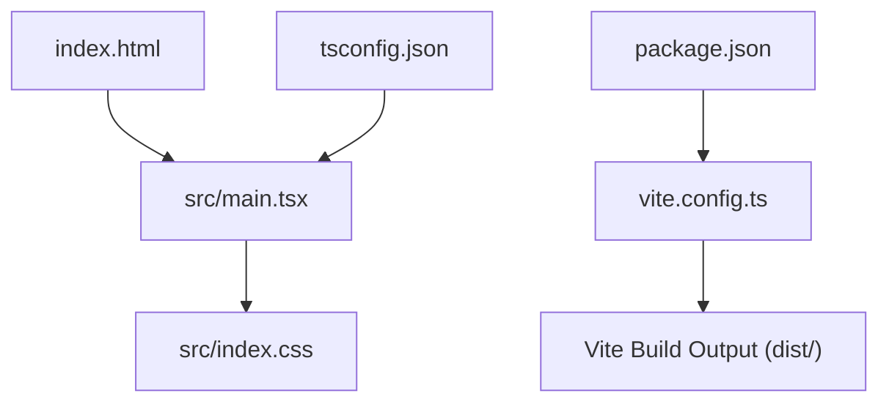
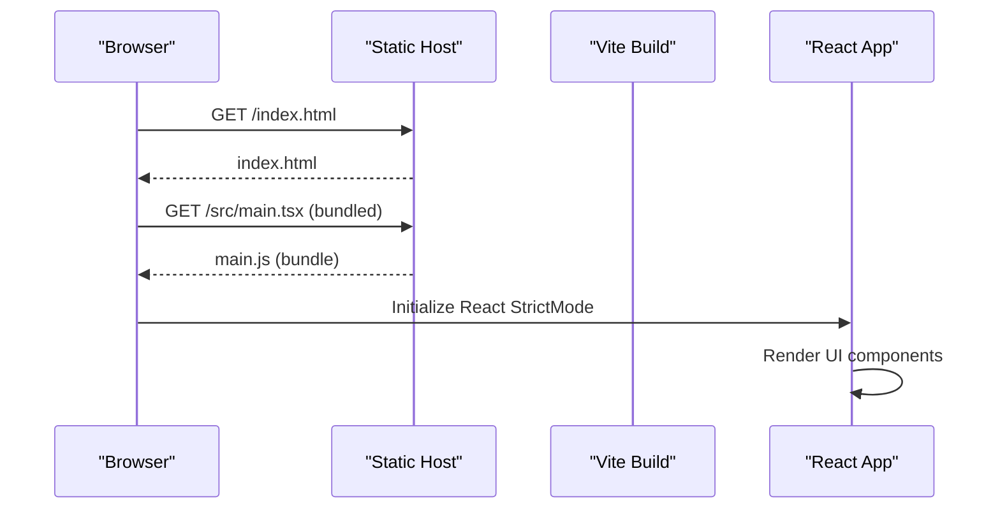
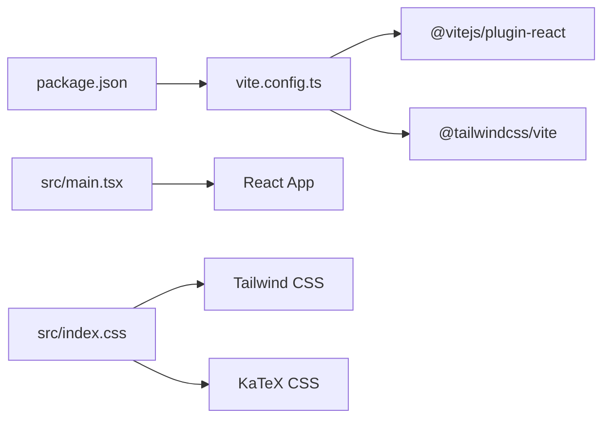

# Deployment Guide

<cite>
**Referenced Files in This Document**
- [package.json](file://package.json)
- [vite.config.ts](file://vite.config.ts)
- [index.html](file://index.html)
- [tsconfig.json](file://tsconfig.json)
- [src/main.tsx](file://src/main.tsx)
- [src/index.css](file://src/index.css)
- [.gitignore](file://.gitignore)
</cite>

## Table of Contents
1. [Introduction](#introduction)
2. [Project Structure](#project-structure)
3. [Core Components](#core-components)
4. [Architecture Overview](#architecture-overview)
5. [Detailed Component Analysis](#detailed-component-analysis)
6. [Dependency Analysis](#dependency-analysis)
7. [Performance Considerations](#performance-considerations)
8. [Troubleshooting Guide](#troubleshooting-guide)
9. [Conclusion](#conclusion)
10. [Appendices](#appendices)

## Introduction
This deployment guide explains how to build, optimize, and deploy the application for production using Vite. It covers environment variables, build configuration, hosting requirements, performance tuning, asset management, caching strategies, CDN integration, security considerations, error tracking setup, and maintenance procedures. The guidance is based on the repository’s current configuration and source files.

## Project Structure
The project is a React + TypeScript application built with Vite and styled with Tailwind CSS. Key entry points:
- HTML shell: index.html
- Application bootstrap: src/main.tsx
- Global styles: src/index.css
- Build tooling: vite.config.ts
- Scripts and dependencies: package.json
- TypeScript configuration: tsconfig.json

**Diagram sources**
- [index.html:1-22](file://index.html#L1-L22)
- [src/main.tsx:1-12](file://src/main.tsx#L1-L12)
- [src/index.css:1-137](file://src/index.css#L1-L137)
- [vite.config.ts:1-23](file://vite.config.ts#L1-L23)
- [package.json:1-42](file://package.json#L1-L42)
- [tsconfig.json:1-28](file://tsconfig.json#L1-L28)

**Section sources**
- [index.html:1-22](file://index.html#L1-L22)
- [src/main.tsx:1-12](file://src/main.tsx#L1-L12)
- [src/index.css:1-137](file://src/index.css#L1-L137)
- [vite.config.ts:1-23](file://vite.config.ts#L1-L23)
- [package.json:1-42](file://package.json#L1-L42)
- [tsconfig.json:1-28](file://tsconfig.json#L1-L28)

## Core Components
- Build system: Vite with React plugin and Tailwind CSS plugin.
- Entry point: index.html loads the module script from /src/main.tsx.
- Runtime bootstrap: src/main.tsx renders the React app into #root.
- Styling: Tailwind via @tailwindcss/vite; KaTeX CSS imported globally.
- TypeScript: Target ES2022, module resolution set to bundler, no emit.

Key responsibilities:
- vite.config.ts configures plugins, aliases, and dev server behavior (HMR disabled when DISABLE_HMR=true).
- package.json defines scripts for development, building, previewing, cleaning, and linting.
- index.html sets language/direction and loads fonts preconnects.
- src/index.css imports Tailwind and KaTeX styles and defines global theme tokens.

**Section sources**
- [vite.config.ts:1-23](file://vite.config.ts#L1-L23)
- [package.json:1-42](file://package.json#L1-L42)
- [index.html:1-22](file://index.html#L1-L22)
- [src/main.tsx:1-12](file://src/main.tsx#L1-L12)
- [src/index.css:1-137](file://src/index.css#L1-L137)
- [tsconfig.json:1-28](file://tsconfig.json#L1-L28)

## Architecture Overview
At runtime, the browser loads index.html, which includes a module script pointing to src/main.tsx. Vite bundles the React application and assets during build. Tailwind CSS is processed at build time via the Tailwind Vite plugin. KaTeX styles are included globally.

**Diagram sources**
- [index.html:16-18](file://index.html#L16-L18)
- [src/main.tsx:1-12](file://src/main.tsx#L1-L12)

## Detailed Component Analysis

### Build Configuration (Vite)
- Plugins: React and Tailwind CSS are enabled.
- Aliases: @ resolves to the project root.
- Dev server: HMR toggled by DISABLE_HMR env var; file watching disabled when DISABLE_HMR=true.

Production implications:
- Use npm/pnpm/yarn/bun scripts defined in package.json to build.
- The build outputs static assets suitable for any static host or CDN.

Optimization notes:
- Tailwind is processed at build time; unused styles are removed by default.
- KaTeX CSS is included globally; ensure only needed features are used to minimize bundle size.

**Section sources**
- [vite.config.ts:1-23](file://vite.config.ts#L1-L23)
- [package.json:6-11](file://package.json#L6-L11)

### Environment Variables
- Development-only control: DISABLE_HMR toggles Hot Module Replacement and file watching in vite.config.ts.
- No other environment variables are referenced in the analyzed files.

Recommended practices:
- Keep sensitive values out of the repo (.env* is ignored).
- For client-side variables, use Vite’s import.meta.env.* pattern if you add them later.

**Section sources**
- [vite.config.ts:14-20](file://vite.config.ts#L14-L20)
- [.gitignore:1-8](file://.gitignore#L1-L8)

### Production Optimization Settings
Current state:
- No explicit Vite optimization overrides (e.g., minify, chunkSplitting, rollupOptions) are present in vite.config.ts.
- Tailwind CSS is integrated via the Vite plugin, enabling tree-shaking of unused styles.
- KaTeX CSS is included globally; consider lazy-loading heavy math features if needed.

Recommendations:
- Configure output directory and base path if deploying under a subpath.
- Enable code splitting and vendor chunking for better caching.
- Compress assets (gzip/br) at the hosting layer.

[No sources needed since this section provides general guidance]

### Asset Management
- Fonts: Google Fonts are preconnected and loaded via link tags in index.html.
- Styles: Tailwind and KaTeX CSS are imported in src/index.css.
- Images and other static assets should be placed under public/ or imported in modules to benefit from bundling and hashing.

Best practices:
- Prefer importing assets in modules to leverage content hashing.
- Use responsive images and modern formats where supported.

**Section sources**
- [index.html:12-14](file://index.html#L12-L14)
- [src/index.css:1-2](file://src/index.css#L1-L2)

### Caching Strategies
- Static assets generated by Vite include content hashes, enabling long-term caching.
- Serve index.html with short cache times or no-cache to ensure users receive updated HTML.
- Configure your host to set Cache-Control headers for static assets (e.g., immutable, max-age=31536000).

[No sources needed since this section provides general guidance]

### CDN Integration Options
- Point your CDN origin to the dist/ folder produced by the build.
- Ensure the CDN serves index.html without rewriting paths unless configured accordingly.
- Preconnect to external domains (fonts, analytics) at the HTML level as already done for Google Fonts.

[No sources needed since this section provides general guidance]

### Security Considerations
- Content Security Policy (CSP): Restrict script and style sources to trusted origins.
- HTTPS: Enforce secure connections and HSTS.
- Sanitize user inputs and avoid eval-like patterns.
- Avoid exposing secrets in client bundles; keep API keys server-side.

[No sources needed since this section provides general guidance]

### Error Tracking Setup
- Add a client-side error tracking SDK (e.g., Sentry) and initialize it after app bootstrap in src/main.tsx.
- Capture unhandled promise rejections and window errors.
- Optionally integrate with your CI/CD to upload source maps for better stack traces.

[No sources needed since this section provides general guidance]

### Maintenance Procedures
- Regularly update dependencies and run type checks before builds.
- Monitor bundle sizes and performance metrics over time.
- Rotate secrets and review access permissions periodically.

[No sources needed since this section provides general guidance]

## Dependency Analysis
The build depends on Vite, React, Tailwind CSS, and KaTeX. The application uses TypeScript targeting ES2022.

**Diagram sources**
- [package.json:13-27](file://package.json#L13-L27)
- [vite.config.ts:1-8](file://vite.config.ts#L1-L8)
- [src/main.tsx:1-5](file://src/main.tsx#L1-L5)
- [src/index.css:1-2](file://src/index.css#L1-L2)

**Section sources**
- [package.json:13-27](file://package.json#L13-L27)
- [vite.config.ts:1-8](file://vite.config.ts#L1-L8)
- [src/main.tsx:1-5](file://src/main.tsx#L1-L5)
- [src/index.css:1-2](file://src/index.css#L1-L2)

## Performance Considerations
- Minification and compression: Enabled by Vite defaults; enable gzip/br at the host/CDN.
- Code splitting: Leverage dynamic imports for heavy features (e.g., PDF export, simulations).
- Font loading: Already using preconnect; consider font-display: swap for faster text rendering.
- Image optimization: Use modern formats and responsive sizing.
- Bundle analysis: Periodically analyze bundle size to identify large dependencies.

[No sources needed since this section provides general guidance]

## Troubleshooting Guide
Common issues and resolutions:
- HMR not working in development: Ensure DISABLE_HMR is not set to true unintentionally.
- Missing assets or broken paths: Verify base path and deployment subdirectory settings.
- KaTeX rendering issues: Confirm KaTeX CSS is included and that LTR direction rules apply to formulas.
- Type errors: Run the lint/type check script before building.

Operational tips:
- Use the preview script to validate the production build locally.
- Check console logs and network requests for failed asset loads.

**Section sources**
- [vite.config.ts:14-20](file://vite.config.ts#L14-L20)
- [package.json:6-11](file://package.json#L6-L11)
- [src/index.css:35-47](file://src/index.css#L35-L47)

## Conclusion
The application is a Vite-based React + TypeScript project with Tailwind CSS and KaTeX. Production builds generate static assets ready for hosting or CDN delivery. Follow the recommended optimizations, caching, and security practices outlined above to ensure reliable, fast, and secure deployments. Integrate error tracking and monitoring to maintain visibility in production.

[No sources needed since this section summarizes without analyzing specific files]

## Appendices

### Build Scripts Reference
- Development server: runs Vite with port and host options.
- Build: produces optimized static assets.
- Preview: serves the production build locally.
- Clean: removes build artifacts.
- Lint: runs TypeScript type checking.

**Section sources**
- [package.json:6-11](file://package.json#L6-L11)

### Environment Variables Reference
- DISABLE_HMR: Controls HMR and file watching in development.

**Section sources**
- [vite.config.ts:14-20](file://vite.config.ts#L14-L20)

### Hosting Requirements
- Static site hosting capable of serving index.html and hashed assets.
- Optional: CDN for global distribution and edge caching.
- HTTPS enforced at the host/CDN level.

[No sources needed since this section provides general guidance]