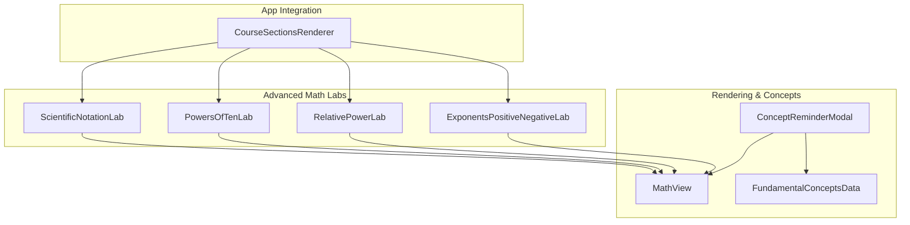
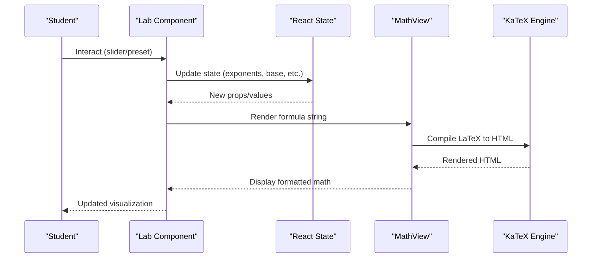
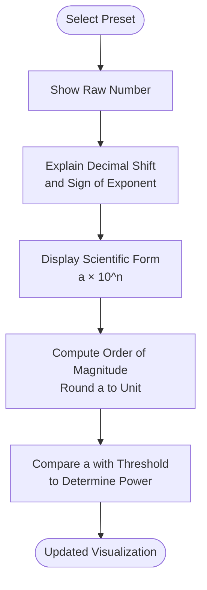
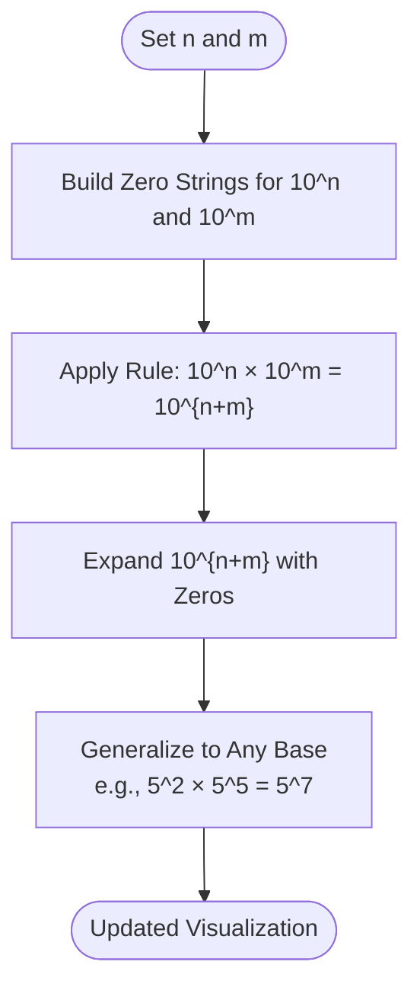
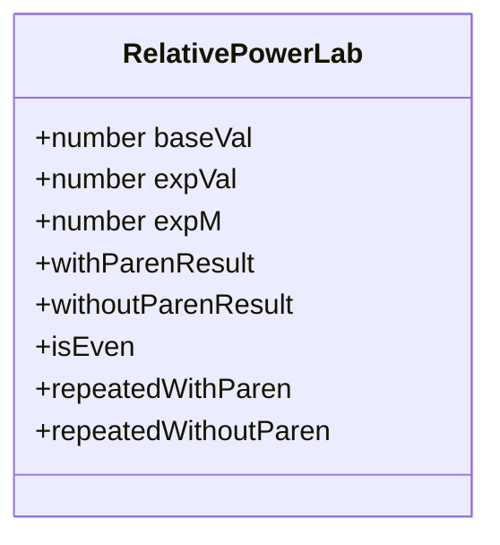
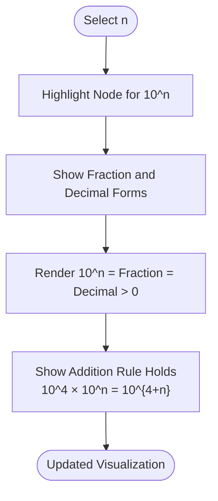
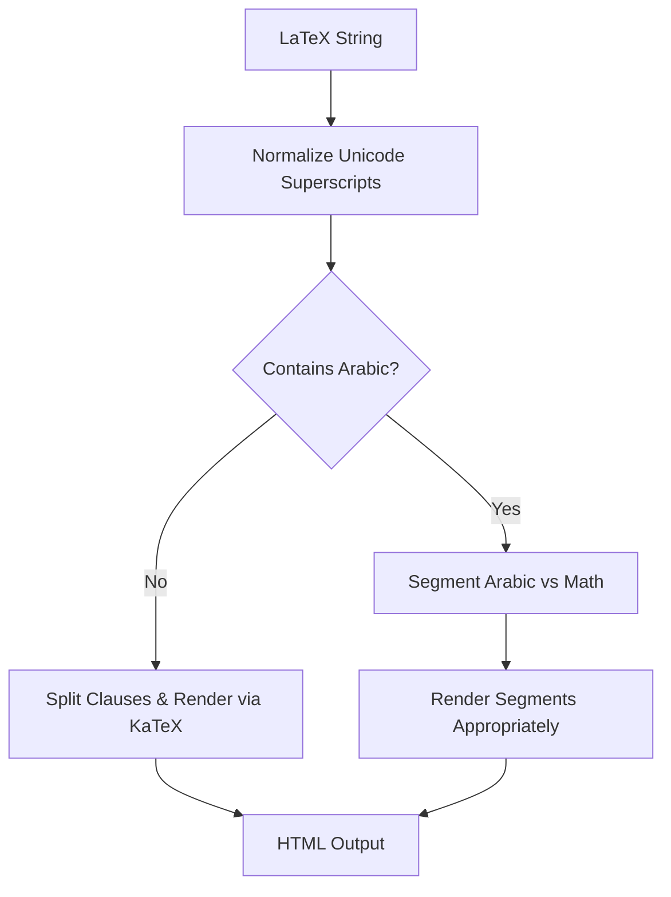
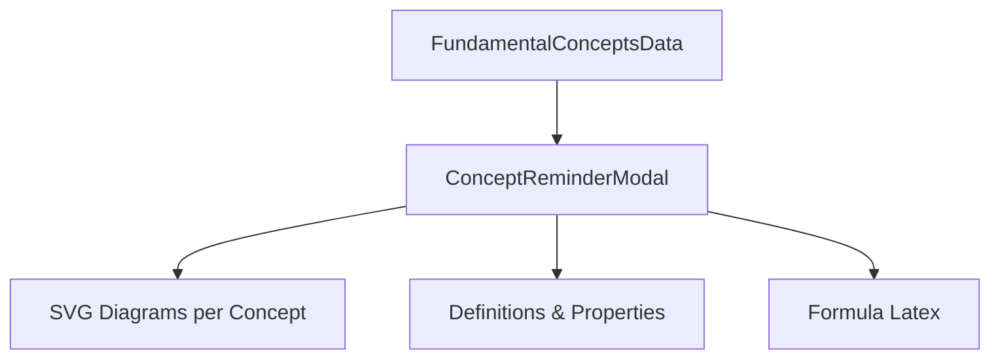
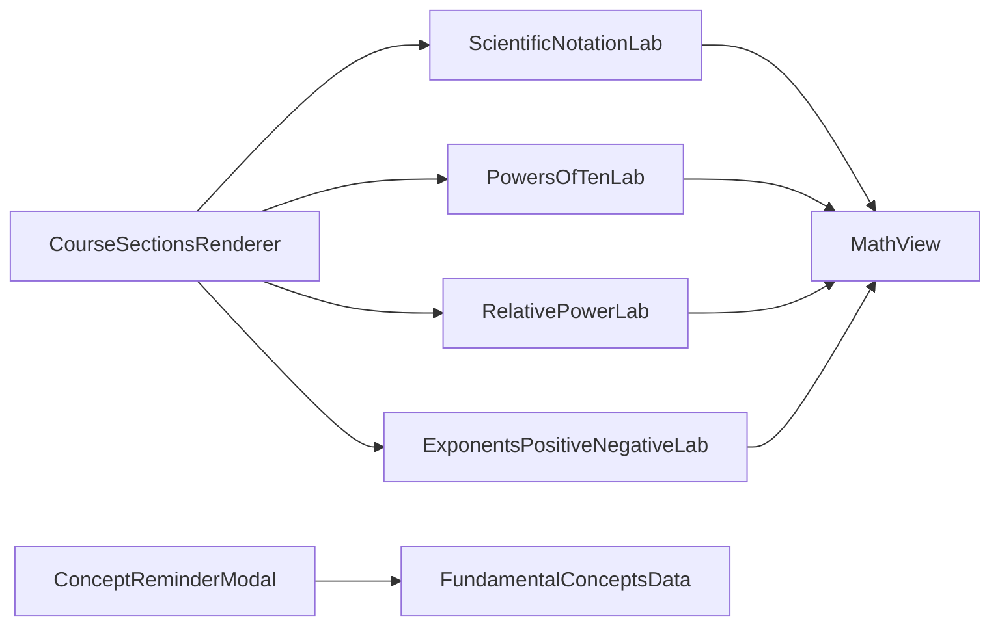

# Advanced Mathematics Concepts

<cite>
**Referenced Files in This Document**
- [ScientificNotationLab.tsx](file://src/components/ScientificNotationLab.tsx)
- [PowersOfTenLab.tsx](file://src/components/PowersOfTenLab.tsx)
- [RelativePowerLab.tsx](file://src/components/RelativePowerLab.tsx)
- [ExponentsPositiveNegativeLab.tsx](file://src/components/ExponentsPositiveNegativeLab.tsx)
- [MathView.tsx](file://src/components/MathView.tsx)
- [ConceptReminderModal.tsx](file://src/components/ConceptReminderModal.tsx)
- [fundamentalConceptsData.ts](file://src/data/fundamentalConceptsData.ts)
- [CourseSectionsRenderer.tsx](file://src/components/CourseSectionsRenderer.tsx)
</cite>

## Table of Contents
1. [Introduction](#introduction)
2. [Project Structure](#project-structure)
3. [Core Components](#core-components)
4. [Architecture Overview](#architecture-overview)
5. [Detailed Component Analysis](#detailed-component-analysis)
6. [Dependency Analysis](#dependency-analysis)
7. [Performance Considerations](#performance-considerations)
8. [Troubleshooting Guide](#troubleshooting-guide)
9. [Conclusion](#conclusion)
10. [Appendices](#appendices)

## Introduction
This document explains the advanced mathematics concept visualizations implemented in the project. It focuses on:
- Scientific notation tools and order-of-magnitude reasoning
- Exponent manipulation interfaces for positive, negative, and relative powers
- Powers of ten visualization and multiplication rules
- The mathematical computation engine that renders formulas and handles mixed Arabic/LaTeX content
- Visual representation systems for abstract mathematical ideas
- Interactive elements designed to help students understand advanced topics through guided exploration

The goal is to make complex numerical operations accessible via clear visuals, step-by-step breakdowns, and interactive controls.

## Project Structure
The advanced math features are implemented as React components under src/components. Each lab component provides an interactive UI with sliders or presets, while MathView centralizes LaTeX rendering and mixed-language text handling. Conceptual definitions and diagrams are provided by a shared data model and modal system.

**Diagram sources**
- [ScientificNotationLab.tsx:1-142](file://src/components/ScientificNotationLab.tsx#L1-L142)
- [PowersOfTenLab.tsx:1-147](file://src/components/PowersOfTenLab.tsx#L1-L147)
- [RelativePowerLab.tsx:1-176](file://src/components/RelativePowerLab.tsx#L1-L176)
- [ExponentsPositiveNegativeLab.tsx:1-165](file://src/components/ExponentsPositiveNegativeLab.tsx#L1-L165)
- [MathView.tsx:1-580](file://src/components/MathView.tsx#L1-L580)
- [ConceptReminderModal.tsx:1-200](file://src/components/ConceptReminderModal.tsx#L1-L200)
- [fundamentalConceptsData.ts:1-800](file://src/data/fundamentalConceptsData.ts#L1-L800)
- [CourseSectionsRenderer.tsx:1-57](file://src/components/CourseSectionsRenderer.tsx#L1-L57)

**Section sources**
- [ScientificNotationLab.tsx:1-142](file://src/components/ScientificNotationLab.tsx#L1-L142)
- [PowersOfTenLab.tsx:1-147](file://src/components/PowersOfTenLab.tsx#L1-L147)
- [RelativePowerLab.tsx:1-176](file://src/components/RelativePowerLab.tsx#L1-L176)
- [ExponentsPositiveNegativeLab.tsx:1-165](file://src/components/ExponentsPositiveNegativeLab.tsx#L1-L165)
- [MathView.tsx:1-580](file://src/components/MathView.tsx#L1-L580)
- [ConceptReminderModal.tsx:1-200](file://src/components/ConceptReminderModal.tsx#L1-L200)
- [fundamentalConceptsData.ts:1-800](file://src/data/fundamentalConceptsData.ts#L1-L800)
- [CourseSectionsRenderer.tsx:1-57](file://src/components/CourseSectionsRenderer.tsx#L1-L57)

## Core Components
- ScientificNotationLab: Demonstrates scientific notation and order of magnitude using preset examples and side-by-side comparisons between exact scientific form and nearest power of ten.
- PowersOfTenLab: Visualizes multiplication of powers of ten, showing how zeros accumulate and reinforcing the rule a^n × a^m = a^{n+m}.
- RelativePowerLab: Compares product of same-base powers and highlights the effect of parentheses on sign for (-a)^n versus -a^n.
- ExponentsPositiveNegativeLab: Presents a symmetric scale from negative to positive exponents, linking fractions, decimals, and powers of ten.
- MathView: Centralized renderer for LaTeX expressions, mixed Arabic/LaTeX text, superscript formatting, and robust error handling.
- ConceptReminderModal: Provides conceptual diagrams and definitions tied to fundamental concepts, enhancing understanding through visuals.
- FundamentalConceptsData: Authoritative source of definitions, properties, common confusions, and formulas for key mathematical ideas.

**Section sources**
- [ScientificNotationLab.tsx:1-142](file://src/components/ScientificNotationLab.tsx#L1-L142)
- [PowersOfTenLab.tsx:1-147](file://src/components/PowersOfTenLab.tsx#L1-L147)
- [RelativePowerLab.tsx:1-176](file://src/components/RelativePowerLab.tsx#L1-L176)
- [ExponentsPositiveNegativeLab.tsx:1-165](file://src/components/ExponentsPositiveNegativeLab.tsx#L1-L165)
- [MathView.tsx:1-580](file://src/components/MathView.tsx#L1-L580)
- [ConceptReminderModal.tsx:1-200](file://src/components/ConceptReminderModal.tsx#L1-L200)
- [fundamentalConceptsData.ts:1-800](file://src/data/fundamentalConceptsData.ts#L1-L800)

## Architecture Overview
The system follows a layered architecture:
- Presentation Layer: Lab components provide interactive UIs (sliders, presets, SVG scales).
- Rendering Layer: MathView processes LaTeX and mixed text, ensuring correct display across languages and contexts.
- Concept Layer: FundamentalConceptsData defines core concepts; ConceptReminderModal renders diagrams and explanations.
- Integration Layer: CourseSectionsRenderer composes lessons and includes the relevant labs.

**Diagram sources**
- [ScientificNotationLab.tsx:1-142](file://src/components/ScientificNotationLab.tsx#L1-L142)
- [PowersOfTenLab.tsx:1-147](file://src/components/PowersOfTenLab.tsx#L1-L147)
- [RelativePowerLab.tsx:1-176](file://src/components/RelativePowerLab.tsx#L1-L176)
- [ExponentsPositiveNegativeLab.tsx:1-165](file://src/components/ExponentsPositiveNegativeLab.tsx#L1-L165)
- [MathView.tsx:197-233](file://src/components/MathView.tsx#L197-L233)

## Detailed Component Analysis

### Scientific Notation Lab
Purpose:
- Teach conversion from large/small numbers to scientific notation a × 10^n.
- Explain order of magnitude by rounding a to the nearest integer and keeping 10^n.
- Provide multiple presets to illustrate different cases (positive/negative exponents, rounding behavior).

Key behaviors:
- Preset selection updates displayed raw number, coefficient a, exponent n, shift explanation, and order of magnitude.
- Side-by-side comparison shows exact scientific notation vs nearest power of ten.
- Uses MathView to render LaTeX expressions clearly.

Pedagogical approach:
- Stepwise presentation: decimal shift explanation → scientific notation → order of magnitude.
- Visual contrast between exact value and rounded magnitude helps students grasp approximation strategies.

**Diagram sources**
- [ScientificNotationLab.tsx:7-37](file://src/components/ScientificNotationLab.tsx#L7-L37)
- [ScientificNotationLab.tsx:51-103](file://src/components/ScientificNotationLab.tsx#L51-L103)

Implementation notes:
- Presets include label, raw LaTeX, coefficient a, exponent n, shift text, order of magnitude exponent, and comparison LaTeX.
- MathView renders both block and inline formulas with appropriate styling.

**Section sources**
- [ScientificNotationLab.tsx:1-142](file://src/components/ScientificNotationLab.tsx#L1-L142)

### Powers of Ten Lab
Purpose:
- Demonstrate multiplication of powers of ten and accumulation of zeros.
- Reinforce the rule a^n × a^m = a^{n+m} visually and symbolically.

Key behaviors:
- Two sliders control exponents n and m.
- Displays 10^n and 10^m with explicit zero strings.
- Shows combined result 10^{n+m} and full expansion with zeros.
- Extends the rule to any base (e.g., 5^2 × 5^5 = 5^7).

Pedagogical approach:
- Concrete visualization of zeros helps students connect symbolic rules with tangible counting.
- Generalization to other bases reinforces transferability of the rule.

**Diagram sources**
- [PowersOfTenLab.tsx:8-10](file://src/components/PowersOfTenLab.tsx#L8-L10)
- [PowersOfTenLab.tsx:24-85](file://src/components/PowersOfTenLab.tsx#L24-L85)

**Section sources**
- [PowersOfTenLab.tsx:1-147](file://src/components/PowersOfTenLab.tsx#L1-L147)

### Relative Power Lab
Purpose:
- Illustrate product of two powers with the same base.
- Clarify the impact of parentheses on sign: (-a)^n vs -a^n.

Key behaviors:
- Sliders control base a, first exponent n, second exponent m.
- Computes repeated multiplication forms for both parenthesized and non-parenthesized cases.
- Highlights even/odd exponent effects on sign.

Pedagogical approach:
- Side-by-side comparison makes the difference between applying the exponent to the sign versus outside the base explicit.
- Repeated multiplication visualization supports conceptual understanding of sign propagation.

**Diagram sources**
- [RelativePowerLab.tsx:5-14](file://src/components/RelativePowerLab.tsx#L5-L14)

**Section sources**
- [RelativePowerLab.tsx:1-176](file://src/components/RelativePowerLab.tsx#L1-L176)

### Exponents Positive Negative Lab
Purpose:
- Present a symmetric scale of powers of ten from negative to positive exponents.
- Connect fractional forms, decimal forms, and powers of ten.
- Show that exponent addition rules remain valid for negative exponents.

Key behaviors:
- Slider selects integer exponent n from -3 to 3.
- SVG scale displays nodes for each exponent with fraction and decimal representations.
- MathView displays equality chain including 10^n = fraction = decimal > 0.

Pedagogical approach:
- Visual symmetry around 10^0 = 1 anchors understanding of positive and negative directions.
- Explicit links between fraction, decimal, and exponential forms bridge multiple representations.

**Diagram sources**
- [ExponentsPositiveNegativeLab.tsx:7-17](file://src/components/ExponentsPositiveNegativeLab.tsx#L7-L17)
- [ExponentsPositiveNegativeLab.tsx:31-123](file://src/components/ExponentsPositiveNegativeLab.tsx#L31-L123)

**Section sources**
- [ExponentsPositiveNegativeLab.tsx:1-165](file://src/components/ExponentsPositiveNegativeLab.tsx#L1-L165)

### Mathematical Computation Engine: MathView
Responsibilities:
- Render LaTeX expressions using KaTeX.
- Normalize Unicode superscripts into proper LaTeX.
- Split long equality chains and top-level clauses for better layout.
- Handle mixed Arabic and math content intelligently.
- Provide safe fallbacks when KaTeX errors occur.

Key implementation patterns:
- Superscript mapping table converts Unicode superscripts to standard digits/signs.
- Clause splitting respects braces depth and logical arrows to avoid breaking formulas.
- Mixed language detection routes to either pure math rendering or Arabic text rendering.
- Error suppression hides technical parse errors and maintains readable output.

**Diagram sources**
- [MathView.tsx:14-28](file://src/components/MathView.tsx#L14-L28)
- [MathView.tsx:197-233](file://src/components/MathView.tsx#L197-L233)
- [MathView.tsx:239-348](file://src/components/MathView.tsx#L239-L348)
- [MathView.tsx:350-580](file://src/components/MathView.tsx#L350-L580)

**Section sources**
- [MathView.tsx:1-580](file://src/components/MathView.tsx#L1-L580)

### Conceptual Support: ConceptReminderModal and FundamentalConceptsData
Responsibilities:
- Define core mathematical concepts with bilingual definitions, properties, and common confusions.
- Provide dedicated SVG diagrams for each concept to reinforce understanding.
- Integrate clickable concept terms within text to open contextual reminders.

Key implementation patterns:
- Data-driven structure allows consistent presentation of definitions and formulas.
- Switch-based diagram rendering maps concept IDs to tailored SVG visuals.
- Interactive concept highlighting enhances learning by connecting terminology to definitions.

**Diagram sources**
- [fundamentalConceptsData.ts:1-800](file://src/data/fundamentalConceptsData.ts#L1-L800)
- [ConceptReminderModal.tsx:1-200](file://src/components/ConceptReminderModal.tsx#L1-L200)

**Section sources**
- [ConceptReminderModal.tsx:1-200](file://src/components/ConceptReminderModal.tsx#L1-L200)
- [fundamentalConceptsData.ts:1-800](file://src/data/fundamentalConceptsData.ts#L1-L800)

## Dependency Analysis
Component relationships:
- All lab components depend on MathView for formula rendering.
- ConceptReminderModal depends on FundamentalConceptsData for definitions and diagrams.
- CourseSectionsRenderer imports and integrates the lab components into course pages.

Potential coupling:
- Heavy reliance on MathView means changes to rendering logic affect all labs.
- Concept data structure changes require updates to modal rendering logic.

External dependencies:
- KaTeX library for LaTeX rendering.
- React state management for interactivity.

**Diagram sources**
- [CourseSectionsRenderer.tsx:1-57](file://src/components/CourseSectionsRenderer.tsx#L1-L57)
- [ScientificNotationLab.tsx:1-142](file://src/components/ScientificNotationLab.tsx#L1-L142)
- [PowersOfTenLab.tsx:1-147](file://src/components/PowersOfTenLab.tsx#L1-L147)
- [RelativePowerLab.tsx:1-176](file://src/components/RelativePowerLab.tsx#L1-L176)
- [ExponentsPositiveNegativeLab.tsx:1-165](file://src/components/ExponentsPositiveNegativeLab.tsx#L1-L165)
- [MathView.tsx:1-580](file://src/components/MathView.tsx#L1-L580)
- [ConceptReminderModal.tsx:1-200](file://src/components/ConceptReminderModal.tsx#L1-L200)
- [fundamentalConceptsData.ts:1-800](file://src/data/fundamentalConceptsData.ts#L1-L800)

**Section sources**
- [CourseSectionsRenderer.tsx:1-57](file://src/components/CourseSectionsRenderer.tsx#L1-L57)
- [ScientificNotationLab.tsx:1-142](file://src/components/ScientificNotationLab.tsx#L1-L142)
- [PowersOfTenLab.tsx:1-147](file://src/components/PowersOfTenLab.tsx#L1-L147)
- [RelativePowerLab.tsx:1-176](file://src/components/RelativePowerLab.tsx#L1-L176)
- [ExponentsPositiveNegativeLab.tsx:1-165](file://src/components/ExponentsPositiveNegativeLab.tsx#L1-L165)
- [MathView.tsx:1-580](file://src/components/MathView.tsx#L1-L580)
- [ConceptReminderModal.tsx:1-200](file://src/components/ConceptReminderModal.tsx#L1-L200)
- [fundamentalConceptsData.ts:1-800](file://src/data/fundamentalConceptsData.ts#L1-L800)

## Performance Considerations
- MathView uses memoization for Arabic detection and concept keyword processing to reduce re-renders.
- Clause splitting avoids unnecessary breaks in long formulas, improving readability and layout stability.
- Error suppression in KaTeX prevents performance penalties from frequent parse errors.
- Lab components use controlled inputs (sliders) with minimal state updates, ensuring responsive interactions.

[No sources needed since this section provides general guidance]

## Troubleshooting Guide
Common issues and resolutions:
- KaTeX parse errors: MathView suppresses bright red error spans and removes technical tooltips; verify LaTeX syntax and ensure Unicode superscripts are normalized.
- Mixed Arabic/LaTeX rendering: Ensure math segments are properly delimited; MathView splits Arabic blocks and math commands intelligently.
- Long equality chains wrapping poorly: MathView splits at middle top-level '=' for long chains; adjust input to keep clauses concise.
- Concept terms not clickable: Verify that keywords match those defined in FundamentalConceptsData and that the modal context is active.

**Section sources**
- [MathView.tsx:197-233](file://src/components/MathView.tsx#L197-L233)
- [MathView.tsx:239-348](file://src/components/MathView.tsx#L239-L348)
- [MathView.tsx:350-580](file://src/components/MathView.tsx#L350-L580)
- [ConceptReminderModal.tsx:1-200](file://src/components/ConceptReminderModal.tsx#L1-L200)
- [fundamentalConceptsData.ts:1-800](file://src/data/fundamentalConceptsData.ts#L1-L800)

## Conclusion
The advanced mathematics concept visualizations combine interactive UIs, robust LaTeX rendering, and rich conceptual support to make abstract topics accessible. By presenting scientific notation, exponent rules, and powers of ten through clear visuals and step-by-step explanations, the system helps students build intuition and confidence. The modular architecture ensures maintainability and extensibility for new visualizations.

[No sources needed since this section summarizes without analyzing specific files]

## Appendices

### Practical Examples for Implementing New Advanced Math Visualizations
- Use sliders or presets to drive state changes in lab components.
- Construct LaTeX strings dynamically based on current state values.
- Render formulas via MathView to ensure consistent typography and mixed-language support.
- Provide pedagogical commentary alongside visuals to guide student reasoning.
- Leverage FundamentalConceptsData to anchor new visualizations in established definitions and properties.

[No sources needed since this section provides general guidance]

### Handling Large Number Calculations
- Prefer scientific notation for very large or small numbers to maintain readability.
- Use order-of-magnitude approximations when exact precision is not required.
- Validate results against known bounds and typical magnitudes for the domain.

[No sources needed since this section provides general guidance]

### Creating Intuitive Interfaces for Complex Operations
- Break down complex operations into sequential steps with clear labels.
- Use color coding to differentiate components (base, exponent, result).
- Provide immediate feedback on user interactions (e.g., updated formulas and explanations).
- Include comparative views (e.g., with/without parentheses) to highlight subtle differences.

[No sources needed since this section provides general guidance]

### Pedagogical Approaches Used
- Multiple representations: symbolic (LaTeX), numeric (fractions/decimals), and visual (SVG scales).
- Guided discovery: interactive controls encourage exploration and pattern recognition.
- Concept anchoring: clickable terms link to definitions and diagrams for deeper understanding.
- Error awareness: common confusions are explicitly addressed to prevent misconceptions.

[No sources needed since this section provides general guidance]