# Algebra Visual Discovery Labs

<cite>
**Referenced Files in This Document**   
- [AlgebraVisualDiscoveryLab.tsx](file://src/components/AlgebraVisualDiscoveryLab.tsx)
- [NumberLineModel.tsx](file://src/components/NumberLineModel.tsx)
- [OperationPrioritiesLab.tsx](file://src/components/OperationPrioritiesLab.tsx)
- [VisualFractionModel.tsx](file://src/components/VisualFractionModel.tsx)
- [ExponentsPositiveNegativeLab.tsx](file://src/components/ExponentsPositiveNegativeLab.tsx)
- [PowersOfTenLab.tsx](file://src/components/PowersOfTenLab.tsx)
- [ScientificNotationLab.tsx](file://src/components/ScientificNotationLab.tsx)
- [MathView.tsx](file://src/components/MathView.tsx)
</cite>

## Table of Contents
1. [Introduction](#introduction)
2. [Project Structure](#project-structure)
3. [Core Components](#core-components)
4. [Architecture Overview](#architecture-overview)
5. [Detailed Component Analysis](#detailed-component-analysis)
6. [Dependency Analysis](#dependency-analysis)
7. [Performance Considerations](#performance-considerations)
8. [Troubleshooting Guide](#troubleshooting-guide)
9. [Conclusion](#conclusion)
10. [Appendices](#appendices)

## Introduction
This document explains the Algebra Visual Discovery Labs component system that transforms algebraic concepts into interactive visualizations. It focuses on:
- Number line models for addition and displacement
- Fraction operations, comparison, and common-denominator visualization
- Operation priority exercises with step-by-step breakdowns
- Exponent and scientific notation labs
- The shared architecture enabling dynamic mathematical visualization, state management, and user input handling

The goal is to help educators and developers understand how these components work together, how to extend them, and how to implement new algebra visualizations with consistent patterns.

## Project Structure
The relevant code lives under the React components directory. Each lab is a self-contained component that:
- Holds local state for inputs (sliders, buttons, toggles)
- Computes derived values from those inputs
- Renders SVG or HTML-based visuals
- Uses MathView for LaTeX rendering and bilingual text support

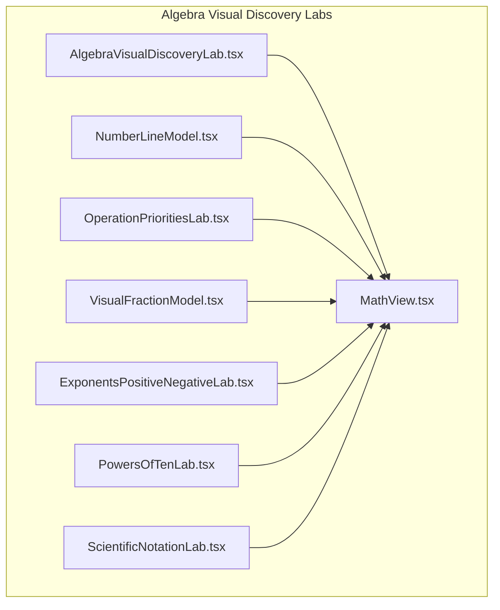

**Diagram sources**
- [AlgebraVisualDiscoveryLab.tsx:1-872](file://src/components/AlgebraVisualDiscoveryLab.tsx#L1-L872)
- [NumberLineModel.tsx:1-130](file://src/components/NumberLineModel.tsx#L1-L130)
- [OperationPrioritiesLab.tsx:1-109](file://src/components/OperationPrioritiesLab.tsx#L1-L109)
- [VisualFractionModel.tsx:1-86](file://src/components/VisualFractionModel.tsx#L1-L86)
- [ExponentsPositiveNegativeLab.tsx:1-165](file://src/components/ExponentsPositiveNegativeLab.tsx#L1-L165)
- [PowersOfTenLab.tsx:1-147](file://src/components/PowersOfTenLab.tsx#L1-L147)
- [ScientificNotationLab.tsx:1-142](file://src/components/ScientificNotationLab.tsx#L1-L142)
- [MathView.tsx:1-580](file://src/components/MathView.tsx#L1-L580)

**Section sources**
- [AlgebraVisualDiscoveryLab.tsx:1-872](file://src/components/AlgebraVisualDiscoveryLab.tsx#L1-L872)
- [MathView.tsx:1-580](file://src/components/MathView.tsx#L1-L580)

## Core Components
- AlgebraVisualDiscoveryLab: Central orchestrator for multiple lesson-specific visualizations, including number-line addition, division inverse check, reciprocal vs opposite, fraction division/multiplication, fraction comparison, and rational number sign/reduction.
- NumberLineModel: Standalone interactive number line demonstrating addition as movement.
- OperationPrioritiesLab: Stepwise operation priority tree using KaTeX-rendered steps.
- VisualFractionModel: Static visual model illustrating fraction addition with equal parts.
- ExponentsPositiveNegativeLab: Interactive scale showing positive/negative powers of ten.
- PowersOfTenLab: Interactive multiplication rule for powers of ten with zero accumulation.
- ScientificNotationLab: Preset-driven scientific notation and order-of-magnitude comparisons.
- MathView: Shared math renderer supporting LaTeX, Arabic/French mixed text, superscripts, and concept highlighting.

Key responsibilities:
- State management: Each component uses useState to manage sliders, toggles, and presets.
- Computation: Derived values are computed directly from state (e.g., sums, quotients, products).
- Visualization: SVG graphics and HTML layouts visualize mathematical ideas.
- Math rendering: MathView renders LaTeX expressions consistently across components.

**Section sources**
- [AlgebraVisualDiscoveryLab.tsx:1-872](file://src/components/AlgebraVisualDiscoveryLab.tsx#L1-L872)
- [NumberLineModel.tsx:1-130](file://src/components/NumberLineModel.tsx#L1-L130)
- [OperationPrioritiesLab.tsx:1-109](file://src/components/OperationPrioritiesLab.tsx#L1-L109)
- [VisualFractionModel.tsx:1-86](file://src/components/VisualFractionModel.tsx#L1-L86)
- [ExponentsPositiveNegativeLab.tsx:1-165](file://src/components/ExponentsPositiveNegativeLab.tsx#L1-L165)
- [PowersOfTenLab.tsx:1-147](file://src/components/PowersOfTenLab.tsx#L1-L147)
- [ScientificNotationLab.tsx:1-142](file://src/components/ScientificNotationLab.tsx#L1-L142)
- [MathView.tsx:1-580](file://src/components/MathView.tsx#L1-L580)

## Architecture Overview
The system follows a consistent pattern:
- Input layer: Sliders, buttons, toggles update component state.
- Computation layer: Pure functions compute results from state.
- Visualization layer: SVG/HTML render the current state visually.
- Math layer: MathView renders LaTeX expressions and supports bilingual content.

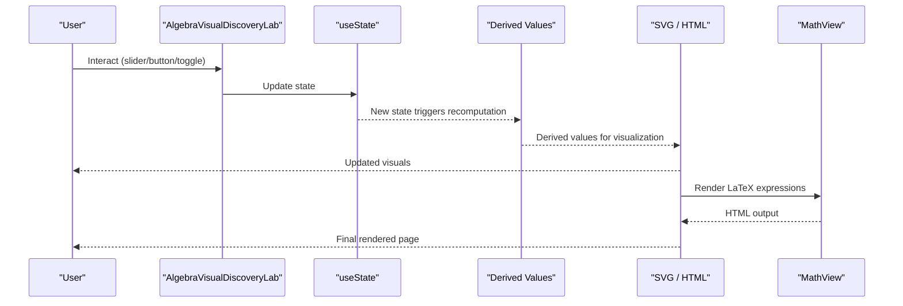

**Diagram sources**
- [AlgebraVisualDiscoveryLab.tsx:1-872](file://src/components/AlgebraVisualDiscoveryLab.tsx#L1-L872)
- [MathView.tsx:1-580](file://src/components/MathView.tsx#L1-L580)

## Detailed Component Analysis

### AlgebraVisualDiscoveryLab
Responsibilities:
- Lesson routing via courseId prop to switch between different visualizations.
- Local state for each lesson’s parameters (start value, step, divisors, fractions, modes).
- Real-time computation of results (sums, quotients, products, signs, reductions).
- Rich SVG diagrams with arrows, arcs, bars, and labels.
- Inline reading sections explaining the visual model.

Patterns:
- Conditional rendering based on courseId.
- Consistent layout: left column for visuals, right column for explanations.
- Interactive controls placed below visuals for clarity.

Examples:
- Lesson 01: Number-line addition with start and step values; unit jump arches and arrowheads illustrate displacement.
- Lesson 02: Division inverse check with quotient and sign logic.
- Lesson 03: Reciprocal vs Opposite comparison with product equals 1 and sum equals 0.
- Lessons 04 & 09: Fraction division transformed into multiplication by reciprocal.
- Lesson 05: Fraction comparison using segmented bars for same denominator, same numerator, and different denominators.
- Lessons 06 & 08: Common-denominator addition/subtraction with toggleable subdivision view.
- Lesson 07: Rational number sign positioning and reduction using GCD.

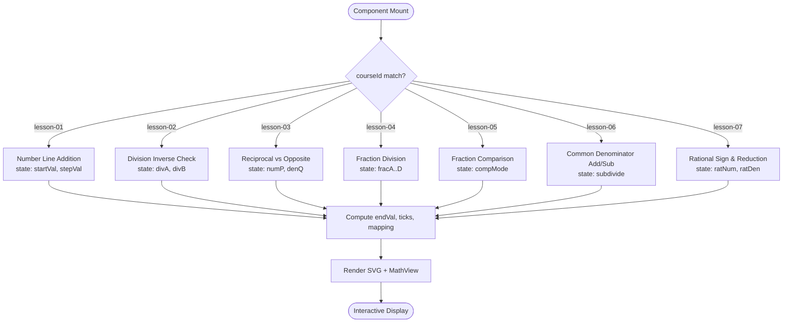

**Diagram sources**
- [AlgebraVisualDiscoveryLab.tsx:1-872](file://src/components/AlgebraVisualDiscoveryLab.tsx#L1-L872)

**Section sources**
- [AlgebraVisualDiscoveryLab.tsx:1-872](file://src/components/AlgebraVisualDiscoveryLab.tsx#L1-L872)

### NumberLineModel
Responsibilities:
- Interactive number line demonstrating addition as movement.
- State for start position and step size.
- Visual markers for start and end points.
- Equation summary using MathView.

Patterns:
- Simple state-driven updates.
- Clear visual feedback with badges and color-coded ticks.

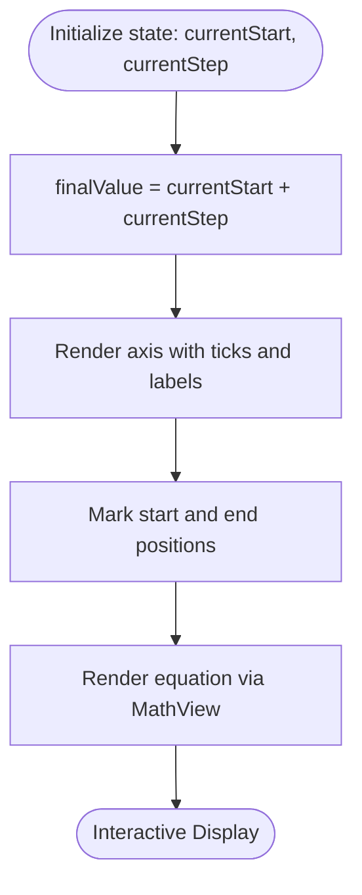

**Diagram sources**
- [NumberLineModel.tsx:1-130](file://src/components/NumberLineModel.tsx#L1-L130)

**Section sources**
- [NumberLineModel.tsx:1-130](file://src/components/NumberLineModel.tsx#L1-L130)

### OperationPrioritiesLab
Responsibilities:
- Stepwise breakdown of an expression following strict precedence rules.
- Stage selection UI to highlight active steps.
- LaTeX rendering for each stage.

Patterns:
- Array of stages with metadata (rule badge, LaTeX, active background).
- Controlled by stepIndex state.

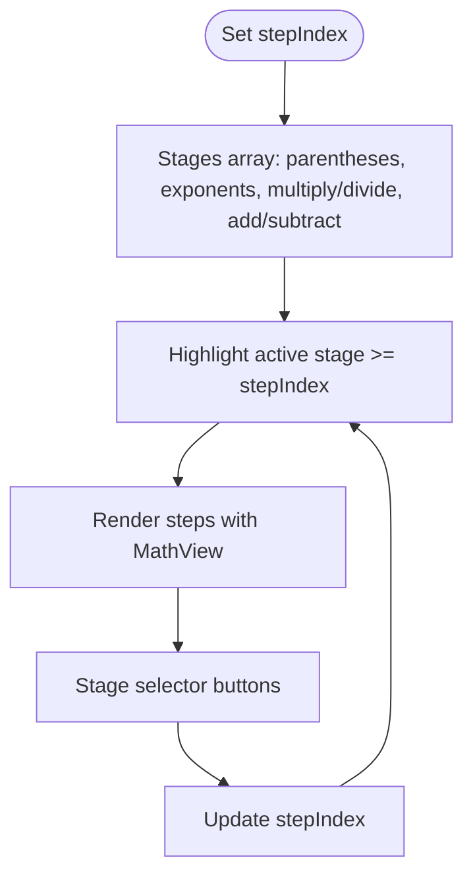

**Diagram sources**
- [OperationPrioritiesLab.tsx:1-109](file://src/components/OperationPrioritiesLab.tsx#L1-L109)

**Section sources**
- [OperationPrioritiesLab.tsx:1-109](file://src/components/OperationPrioritiesLab.tsx#L1-L109)

### VisualFractionModel
Responsibilities:
- Static visual representation of adding fractions with equal denominators.
- Color-coded blocks representing parts.
- LaTeX rendering for fractions.

Patterns:
- Fixed data structure for terms and result.
- Emphasizes conceptual understanding through visual counting.

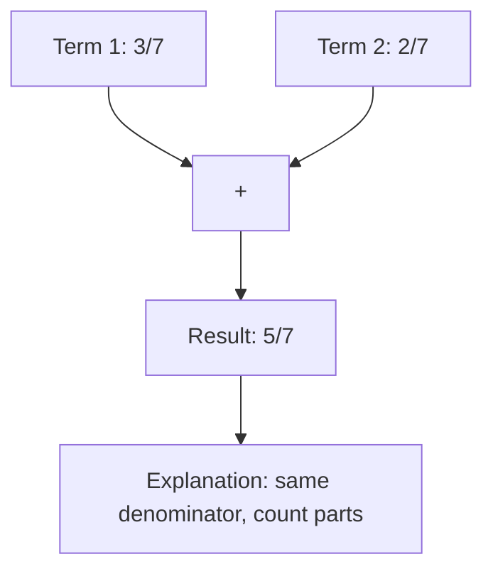

**Diagram sources**
- [VisualFractionModel.tsx:1-86](file://src/components/VisualFractionModel.tsx#L1-L86)

**Section sources**
- [VisualFractionModel.tsx:1-86](file://src/components/VisualFractionModel.tsx#L1-L86)

### ExponentsPositiveNegativeLab
Responsibilities:
- Interactive scale showing powers of ten from negative to positive.
- Selected exponent highlights corresponding fraction and decimal forms.
- LaTeX rendering for exponent rules.

Patterns:
- Slider-controlled exponent n.
- Predefined scale items with LaTeX and decimal representations.

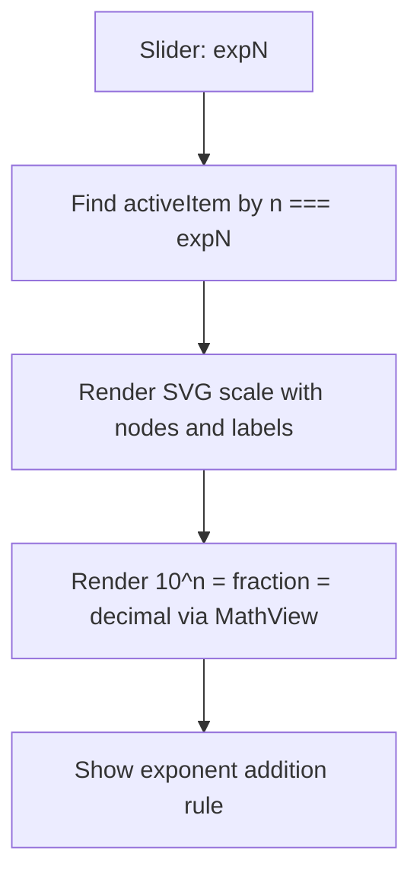

**Diagram sources**
- [ExponentsPositiveNegativeLab.tsx:1-165](file://src/components/ExponentsPositiveNegativeLab.tsx#L1-L165)

**Section sources**
- [ExponentsPositiveNegativeLab.tsx:1-165](file://src/components/ExponentsPositiveNegativeLab.tsx#L1-L165)

### PowersOfTenLab
Responsibilities:
- Demonstrates multiplication rule for powers of ten: 10^n × 10^m = 10^(n+m).
- Shows zero accumulation visually.
- Sliders control exponents n and m.

Patterns:
- Two-state inputs (expN, expM).
- String manipulation to build zeros for visual effect.
- LaTeX rendering for full chain of equality.

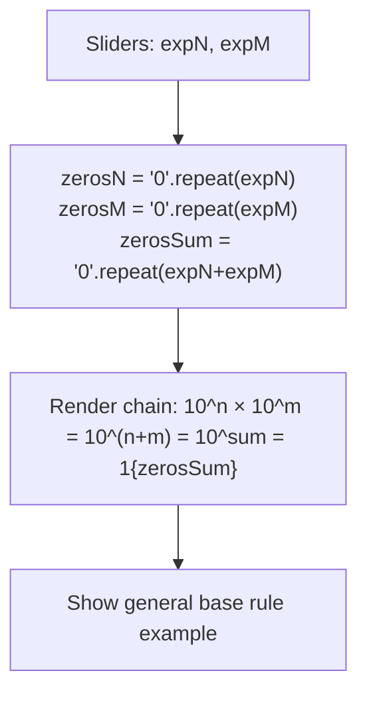

**Diagram sources**
- [PowersOfTenLab.tsx:1-147](file://src/components/PowersOfTenLab.tsx#L1-L147)

**Section sources**
- [PowersOfTenLab.tsx:1-147](file://src/components/PowersOfTenLab.tsx#L1-L147)

### ScientificNotationLab
Responsibilities:
- Preset-driven examples of large/small numbers converted to scientific notation.
- Compares exact scientific notation with order of magnitude.
- Buttons select among preset cases.

Patterns:
- Presets array with label, raw LaTeX, coefficient a, exponent n, shift text, and order exponent.
- Current preset drives displayed equations and comparisons.

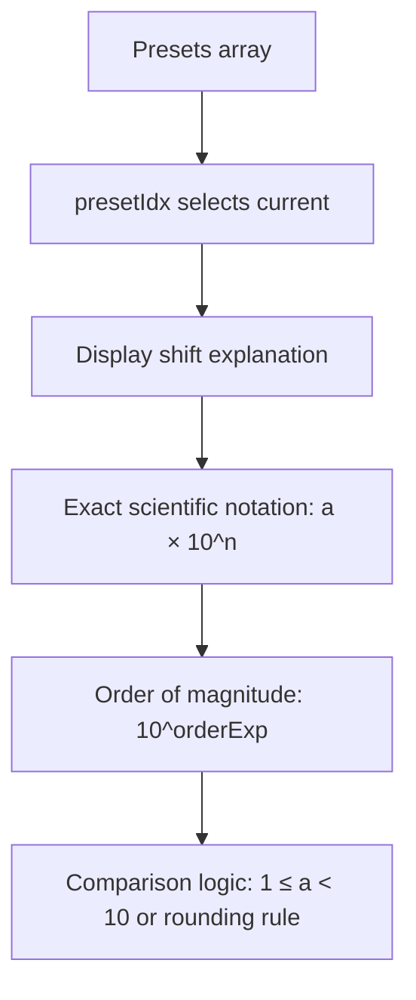

**Diagram sources**
- [ScientificNotationLab.tsx:1-142](file://src/components/ScientificNotationLab.tsx#L1-L142)

**Section sources**
- [ScientificNotationLab.tsx:1-142](file://src/components/ScientificNotationLab.tsx#L1-L142)

### MathView
Responsibilities:
- Renders LaTeX expressions using KaTeX.
- Handles pure math, pure Arabic text, and mixed Arabic/math content.
- Supports superscripts in plain text and concept highlighting.
- Splits long chains and clauses for better layout.

Patterns:
- Detection of Arabic characters to choose rendering path.
- Splitting top-level clauses and equality chains.
- Error suppression for KaTeX parse errors.

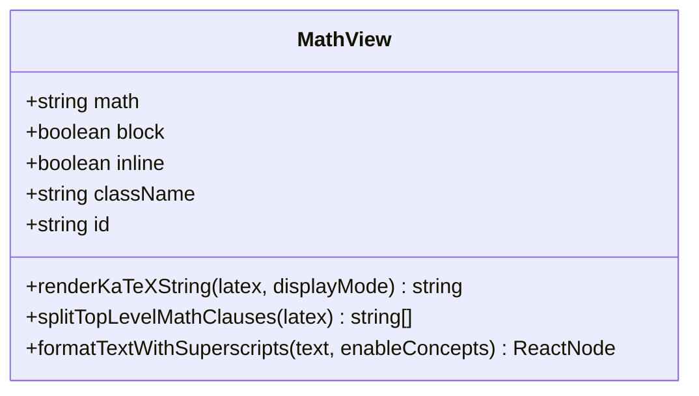

**Diagram sources**
- [MathView.tsx:1-580](file://src/components/MathView.tsx#L1-L580)

**Section sources**
- [MathView.tsx:1-580](file://src/components/MathView.tsx#L1-L580)

## Dependency Analysis
Components share dependencies and patterns:
- All labs depend on MathView for LaTeX rendering and bilingual support.
- AlgebraVisualDiscoveryLab composes multiple lesson-specific views and shares state patterns.
- NumberLineModel, OperationPrioritiesLab, VisualFractionModel, ExponentsPositiveNegativeLab, PowersOfTenLab, and ScientificNotationLab follow similar state-driven visualization patterns.

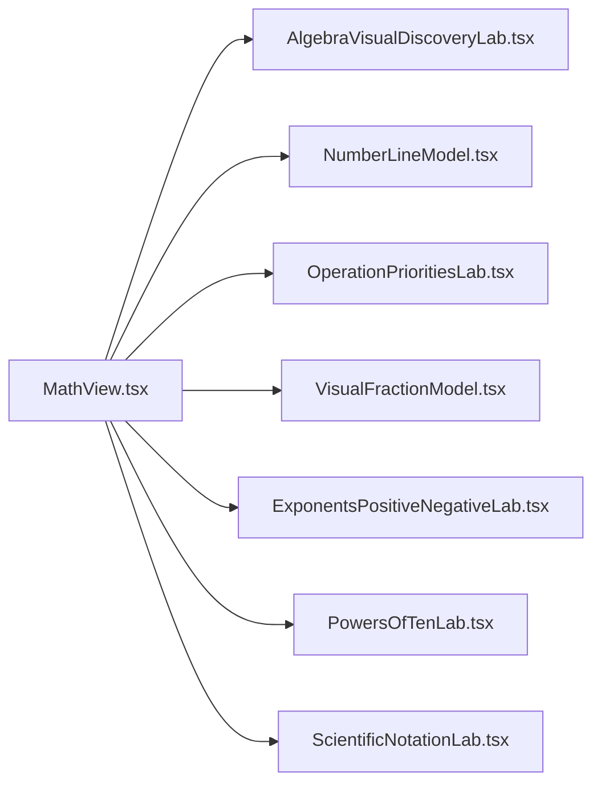

**Diagram sources**
- [MathView.tsx:1-580](file://src/components/MathView.tsx#L1-L580)
- [AlgebraVisualDiscoveryLab.tsx:1-872](file://src/components/AlgebraVisualDiscoveryLab.tsx#L1-L872)
- [NumberLineModel.tsx:1-130](file://src/components/NumberLineModel.tsx#L1-L130)
- [OperationPrioritiesLab.tsx:1-109](file://src/components/OperationPrioritiesLab.tsx#L1-L109)
- [VisualFractionModel.tsx:1-86](file://src/components/VisualFractionModel.tsx#L1-L86)
- [ExponentsPositiveNegativeLab.tsx:1-165](file://src/components/ExponentsPositiveNegativeLab.tsx#L1-L165)
- [PowersOfTenLab.tsx:1-147](file://src/components/PowersOfTenLab.tsx#L1-L147)
- [ScientificNotationLab.tsx:1-142](file://src/components/ScientificNotationLab.tsx#L1-L142)

**Section sources**
- [MathView.tsx:1-580](file://src/components/MathView.tsx#L1-L580)
- [AlgebraVisualDiscoveryLab.tsx:1-872](file://src/components/AlgebraVisualDiscoveryLab.tsx#L1-L872)

## Performance Considerations
- Rendering overhead: SVG-heavy components (e.g., AlgebraVisualDiscoveryLab) can be expensive if re-rendered frequently. Use memoization for static segments and minimize unnecessary re-renders.
- KaTeX rendering: MathView processes LaTeX strings; avoid excessive re-parsing by caching stable expressions where possible.
- State granularity: Keep related state grouped per lesson to reduce cross-lesson re-renders.
- Accessibility: Ensure keyboard navigation for sliders and buttons; provide clear labels and roles.

[No sources needed since this section provides general guidance]

## Troubleshooting Guide
Common issues and resolutions:
- KaTeX parse errors: MathView suppresses error spans and normalizes Unicode superscripts; verify LaTeX syntax and ensure proper escaping.
- Mixed Arabic/math rendering: MathView splits segments and chooses directionality; confirm that Arabic text does not contain unescaped math commands.
- Layout clipping: Long equality chains are split at top-level separators; adjust spacing or break chains manually if needed.
- SVG alignment: Ensure viewBox and coordinate mappings match expected ranges; validate tick counts and scaling factors.

**Section sources**
- [MathView.tsx:197-233](file://src/components/MathView.tsx#L197-L233)
- [MathView.tsx:285-348](file://src/components/MathView.tsx#L285-L348)
- [MathView.tsx:350-580](file://src/components/MathView.tsx#L350-L580)

## Conclusion
The Algebra Visual Discovery Labs system provides a cohesive set of interactive visualizations for core algebra concepts. By leveraging consistent state-driven patterns, SVG/HTML visuals, and MathView for robust LaTeX rendering, it enables engaging learning experiences. Educators can extend the system by following established patterns: define state, compute derived values, render visuals, and use MathView for expressions.

[No sources needed since this section summarizes without analyzing specific files]

## Appendices

### How to Implement a New Algebra Visualization
Follow these steps:
1. Define props and state:
   - Props: courseId or other identifiers if integrating into AlgebraVisualDiscoveryLab.
   - State: sliders, toggles, presets controlling inputs.
2. Compute derived values:
   - Pure functions calculate results from state (e.g., sums, quotients, products, reductions).
3. Build visuals:
   - Use SVG for geometric models (number lines, bars, scales).
   - Use HTML/CSS for structured layouts and cards.
4. Render math:
   - Use MathView for LaTeX expressions and bilingual text.
5. Provide explanations:
   - Include reading sections describing the visual model and underlying rules.
6. Test interactions:
   - Validate slider ranges, button presets, and toggles.
   - Ensure accessibility and responsive behavior.

Example references:
- Number line addition: [AlgebraVisualDiscoveryLab.tsx:40-314](file://src/components/AlgebraVisualDiscoveryLab.tsx#L40-L314), [NumberLineModel.tsx:1-130](file://src/components/NumberLineModel.tsx#L1-L130)
- Fraction comparison: [AlgebraVisualDiscoveryLab.tsx:597-695](file://src/components/AlgebraVisualDiscoveryLab.tsx#L597-L695)
- Operation priorities: [OperationPrioritiesLab.tsx:1-109](file://src/components/OperationPrioritiesLab.tsx#L1-L109)
- Powers of ten: [PowersOfTenLab.tsx:1-147](file://src/components/PowersOfTenLab.tsx#L1-L147)
- Scientific notation: [ScientificNotationLab.tsx:1-142](file://src/components/ScientificNotationLab.tsx#L1-L142)

**Section sources**
- [AlgebraVisualDiscoveryLab.tsx:40-314](file://src/components/AlgebraVisualDiscoveryLab.tsx#L40-L314)
- [NumberLineModel.tsx:1-130](file://src/components/NumberLineModel.tsx#L1-L130)
- [OperationPrioritiesLab.tsx:1-109](file://src/components/OperationPrioritiesLab.tsx#L1-L109)
- [PowersOfTenLab.tsx:1-147](file://src/components/PowersOfTenLab.tsx#L1-L147)
- [ScientificNotationLab.tsx:1-142](file://src/components/ScientificNotationLab.tsx#L1-L142)