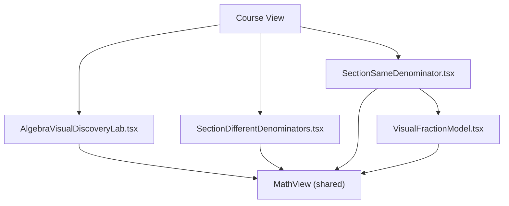
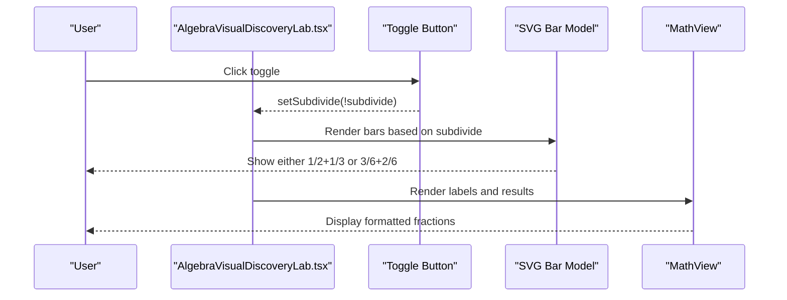
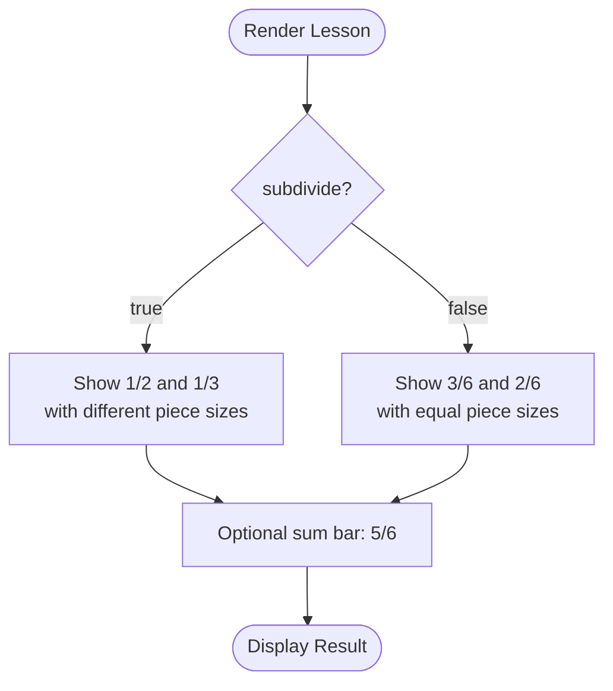
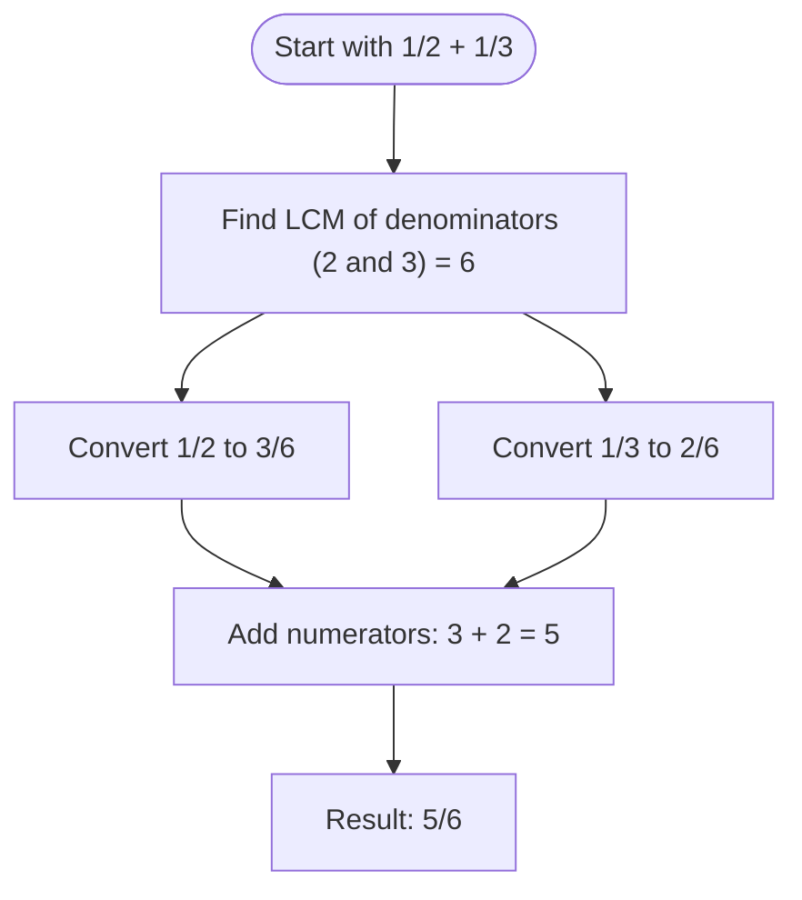
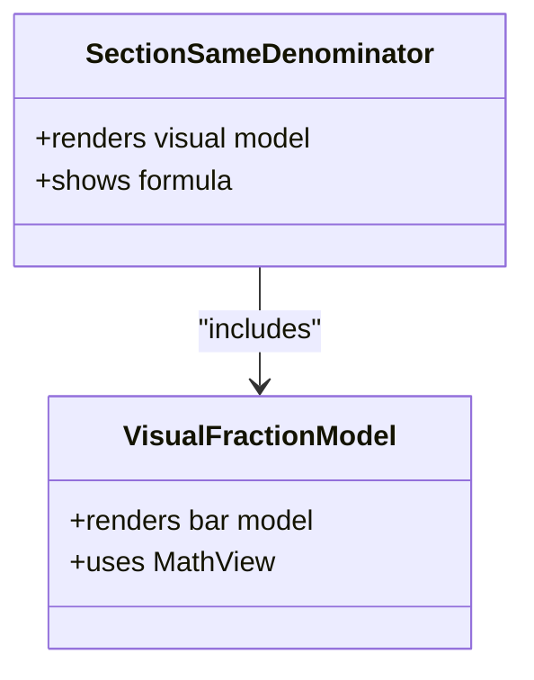
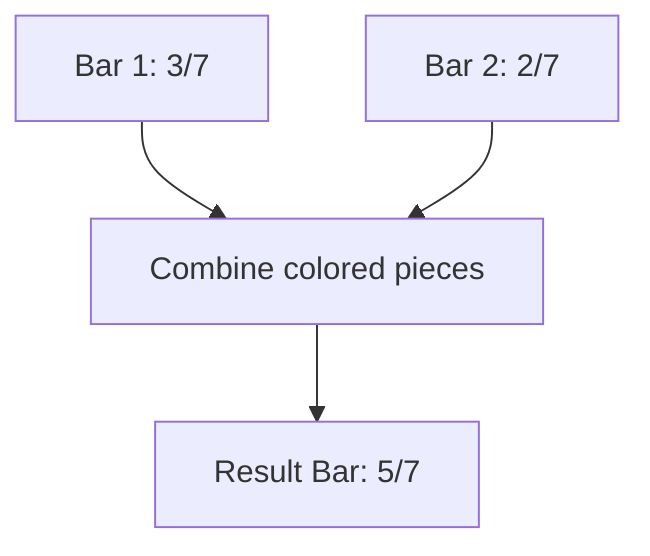
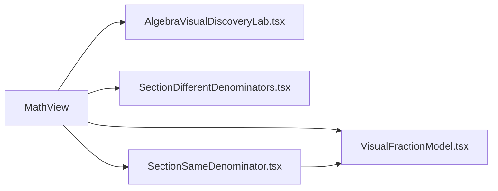

# Fraction Addition and Subtraction Visualization

<cite>
**Referenced Files in This Document**
- [AlgebraVisualDiscoveryLab.tsx](file://src/components/AlgebraVisualDiscoveryLab.tsx)
- [SectionDifferentDenominators.tsx](file://src/components/SectionDifferentDenominators.tsx)
- [SectionSameDenominator.tsx](file://src/components/SectionSameDenominator.tsx)
- [VisualFractionModel.tsx](file://src/components/VisualFractionModel.tsx)
</cite>

## Table of Contents
1. [Introduction](#introduction)
2. [Project Structure](#project-structure)
3. [Core Components](#core-components)
4. [Architecture Overview](#architecture-overview)
5. [Detailed Component Analysis](#detailed-component-analysis)
6. [Dependency Analysis](#dependency-analysis)
7. [Performance Considerations](#performance-considerations)
8. [Troubleshooting Guide](#troubleshooting-guide)
9. [Conclusion](#conclusion)

## Introduction
This document explains the fraction addition and subtraction visualization that demonstrates why common denominators are required before performing operations. It focuses on the dual-mode display for the conceptual problem 1/2 + 1/3 and its equivalent solved form 3/6 + 2/6, the bar model where different-sized pieces are subdivided into equal parts, and the toggle that switches between showing the original fractions and their unified-denominator equivalents. The pedagogical approach emphasizes that you cannot add halves and thirds directly because they represent different-sized pieces; only after converting to a common unit (sixths) can the operation be performed visually and mathematically.

## Project Structure
The relevant implementation is concentrated in four components:
- AlgebraVisualDiscoveryLab.tsx: Interactive visual discovery lab with a toggle between conceptual and solved forms for adding fractions with different denominators.
- SectionDifferentDenominators.tsx: Explanatory section about finding a common denominator and transforming fractions.
- SectionSameDenominator.tsx: Conceptual foundation for same-denominator addition and integration of the shared VisualFractionModel.
- VisualFractionModel.tsx: Reusable bar-model component illustrating how equal-sized pieces are added when denominators match.

**Diagram sources**
- [AlgebraVisualDiscoveryLab.tsx:700-776](file://src/components/AlgebraVisualDiscoveryLab.tsx#L700-L776)
- [SectionDifferentDenominators.tsx:1-104](file://src/components/SectionDifferentDenominators.tsx#L1-L104)
- [SectionSameDenominator.tsx:1-73](file://src/components/SectionSameDenominator.tsx#L1-L73)
- [VisualFractionModel.tsx:1-86](file://src/components/VisualFractionModel.tsx#L1-L86)

**Section sources**
- [AlgebraVisualDiscoveryLab.tsx:30-31](file://src/components/AlgebraVisualDiscoveryLab.tsx#L30-L31)
- [SectionDifferentDenominators.tsx:19-30](file://src/components/SectionDifferentDenominators.tsx#L19-L30)
- [SectionSameDenominator.tsx:6-44](file://src/components/SectionSameDenominator.tsx#L6-L44)
- [VisualFractionModel.tsx:4-82](file://src/components/VisualFractionModel.tsx#L4-L82)

## Core Components
- AlgebraVisualDiscoveryLab.tsx implements the interactive lesson for adding fractions with different denominators. It maintains a boolean state to toggle between two views:
  - Conceptual view: shows 1/2 and 1/3 as bars divided into different numbers of pieces.
  - Solved view: shows 3/6 and 2/6 as bars divided into six equal pieces, plus a combined sum bar of 5/6.
- SectionDifferentDenominators.tsx provides textual explanation and a Before/After transformation from 1/2 + 1/3 to 3/6 + 2/6, then to 5/6.
- SectionSameDenominator.tsx introduces the concept of equal-sized pieces and includes the reusable VisualFractionModel.
- VisualFractionModel.tsx renders a simple bar model for same-denominator addition using small rectangular segments.

Key behaviors:
- Toggle button switches between “before unification” and “after unification.”
- SVG-based bar models visualize piece subdivision and summation.
- Math rendering is delegated to MathView for consistent typography.

**Section sources**
- [AlgebraVisualDiscoveryLab.tsx:30-31](file://src/components/AlgebraVisualDiscoveryLab.tsx#L30-L31)
- [AlgebraVisualDiscoveryLab.tsx:710-716](file://src/components/AlgebraVisualDiscoveryLab.tsx#L710-L716)
- [AlgebraVisualDiscoveryLab.tsx:720-760](file://src/components/AlgebraVisualDiscoveryLab.tsx#L720-L760)
- [SectionDifferentDenominators.tsx:23-30](file://src/components/SectionDifferentDenominators.tsx#L23-L30)
- [SectionSameDenominator.tsx:6-44](file://src/components/SectionSameDenominator.tsx#L6-L44)
- [VisualFractionModel.tsx:14-82](file://src/components/VisualFractionModel.tsx#L14-L82)

## Architecture Overview
The visualization architecture separates concerns:
- Stateful interactive lesson: AlgebraVisualDiscoveryLab.tsx manages the toggle and renders SVG bars based on the current mode.
- Explanatory sections: SectionDifferentDenominators.tsx and SectionSameDenominator.tsx provide narrative and formulas.
- Shared visual primitives: VisualFractionModel.tsx encapsulates the bar model pattern for same-denominator cases.
- Math rendering: MathView is used across components to render mathematical expressions consistently.

**Diagram sources**
- [AlgebraVisualDiscoveryLab.tsx:30-31](file://src/components/AlgebraVisualDiscoveryLab.tsx#L30-L31)
- [AlgebraVisualDiscoveryLab.tsx:710-716](file://src/components/AlgebraVisualDiscoveryLab.tsx#L710-L716)
- [AlgebraVisualDiscoveryLab.tsx:720-760](file://src/components/AlgebraVisualDiscoveryLab.tsx#L720-L760)

## Detailed Component Analysis

### AlgebraVisualDiscoveryLab.tsx: Dual-Mode Fraction Addition Visualization
This component implements the core pedagogical demonstration:
- State: A boolean subdivide toggles between conceptual and solved modes.
- Conceptual mode: Displays two bars representing 1/2 and 1/3 with different segment sizes, making it clear that halves and thirds are not directly additive.
- Solved mode: Converts both fractions to sixths (3/6 and 2/6), aligning them on a common grid of six equal pieces, and shows a third bar combining the colored portions to produce 5/6.
- Toggle label: Switches text between “show before unification (1/2 + 1/3)” and “unify subdivisions into equal parts (3/6 + 2/6).”

**Diagram sources**
- [AlgebraVisualDiscoveryLab.tsx:710-716](file://src/components/AlgebraVisualDiscoveryLab.tsx#L710-L716)
- [AlgebraVisualDiscoveryLab.tsx:720-760](file://src/components/AlgebraVisualDiscoveryLab.tsx#L720-L760)

Implementation highlights:
- Toggle handler updates state and re-renders the SVG bars accordingly.
- Two rows of bars correspond to the first and second fractions; a third row shows the combined result in unified units.
- Labels explain the equivalence transformations and the final sum.

**Section sources**
- [AlgebraVisualDiscoveryLab.tsx:30-31](file://src/components/AlgebraVisualDiscoveryLab.tsx#L30-L31)
- [AlgebraVisualDiscoveryLab.tsx:710-716](file://src/components/AlgebraVisualDiscoveryLab.tsx#L710-L716)
- [AlgebraVisualDiscoveryLab.tsx:720-760](file://src/components/AlgebraVisualDiscoveryLab.tsx#L720-L760)

### SectionDifferentDenominators.tsx: Common Denominator Transformation
This section explains the algorithmic step of finding a common denominator and transforming fractions:
- Before/After box shows the transformation from 1/2 + 1/3 to 3/6 + 2/6 and then to 5/6.
- Text explains that the least common multiple of 2 and 3 is 6, and both fractions must be converted to equivalent fractions with denominator 6 before addition.

**Diagram sources**
- [SectionDifferentDenominators.tsx:23-30](file://src/components/SectionDifferentDenominators.tsx#L23-L30)

**Section sources**
- [SectionDifferentDenominators.tsx:19-30](file://src/components/SectionDifferentDenominators.tsx#L19-L30)

### SectionSameDenominator.tsx: Foundation for Equal-Sized Pieces
This section establishes the principle that when denominators are equal, the size of each piece is identical, so we only add or subtract numerators:
- Integrates VisualFractionModel to demonstrate equal-sized piece addition.
- Presents the base rule for same-denominator addition and subtraction.

**Diagram sources**
- [SectionSameDenominator.tsx:6-44](file://src/components/SectionSameDenominator.tsx#L6-L44)
- [VisualFractionModel.tsx:4-82](file://src/components/VisualFractionModel.tsx#L4-L82)

**Section sources**
- [SectionSameDenominator.tsx:6-44](file://src/components/SectionSameDenominator.tsx#L6-L44)
- [VisualFractionModel.tsx:14-82](file://src/components/VisualFractionModel.tsx#L14-L82)

### VisualFractionModel.tsx: Reusable Bar Model for Same-Denominator Addition
This component renders a simple bar model for adding fractions with the same denominator:
- Two input bars show selected portions of equal-sized pieces.
- A result bar combines the colored portions to illustrate the sum.
- Uses MathView to display the corresponding fractions.

**Diagram sources**
- [VisualFractionModel.tsx:14-82](file://src/components/VisualFractionModel.tsx#L14-L82)

**Section sources**
- [VisualFractionModel.tsx:14-82](file://src/components/VisualFractionModel.tsx#L14-L82)

## Dependency Analysis
- AlgebraVisualDiscoveryLab.tsx depends on MathView for rendering mathematical notation and uses internal state to control the visualization mode.
- SectionDifferentDenominators.tsx depends on MathView and BeforeAfterBox to present the transformation steps.
- SectionSameDenominator.tsx depends on MathView, FormulaBox, and VisualFractionModel to present concepts and examples.
- VisualFractionModel.tsx depends on MathView for rendering fractions.

**Diagram sources**
- [AlgebraVisualDiscoveryLab.tsx:1-2](file://src/components/AlgebraVisualDiscoveryLab.tsx#L1-L2)
- [SectionDifferentDenominators.tsx:1-4](file://src/components/SectionDifferentDenominators.tsx#L1-L4)
- [SectionSameDenominator.tsx:1-4](file://src/components/SectionSameDenominator.tsx#L1-L4)
- [VisualFractionModel.tsx:1-2](file://src/components/VisualFractionModel.tsx#L1-L2)

**Section sources**
- [AlgebraVisualDiscoveryLab.tsx:1-2](file://src/components/AlgebraVisualDiscoveryLab.tsx#L1-L2)
- [SectionDifferentDenominators.tsx:1-4](file://src/components/SectionDifferentDenominators.tsx#L1-L4)
- [SectionSameDenominator.tsx:1-4](file://src/components/SectionSameDenominator.tsx#L1-L4)
- [VisualFractionModel.tsx:1-2](file://src/components/VisualFractionModel.tsx#L1-L2)

## Performance Considerations
- Rendering efficiency: The SVG-based bar models generate a fixed number of rectangles per fraction, keeping performance predictable even on modest devices.
- State-driven updates: Toggling the mode triggers minimal re-renders by changing a single boolean state, avoiding unnecessary computations.
- Math rendering: Delegating to MathView ensures consistent typography without heavy custom layout logic.

[No sources needed since this section provides general guidance]

## Troubleshooting Guide
Common issues and resolutions:
- Toggle does not switch views: Ensure the subdivide state is updated via the toggle handler and that the conditional rendering branches are correctly implemented.
- Bars misaligned or incorrect counts: Verify the loop lengths and fill conditions for each bar row to ensure they match the intended denominators and numerators.
- Math labels not displaying: Confirm MathView is imported and used for all fraction labels and results.

**Section sources**
- [AlgebraVisualDiscoveryLab.tsx:30-31](file://src/components/AlgebraVisualDiscoveryLab.tsx#L30-L31)
- [AlgebraVisualDiscoveryLab.tsx:710-716](file://src/components/AlgebraVisualDiscoveryLab.tsx#L710-L716)
- [AlgebraVisualDiscoveryLab.tsx:720-760](file://src/components/AlgebraVisualDiscoveryLab.tsx#L720-L760)

## Conclusion
The visualization effectively teaches why common denominators are necessary for adding or subtracting fractions. By toggling between the conceptual representation of 1/2 + 1/3 and the solved representation of 3/6 + 2/6, learners see that halves and thirds are different-sized pieces and cannot be added directly. Converting to a common unit (sixths) makes the operation intuitive: equal-sized pieces can be counted and summed, producing 5/6. The supporting sections reinforce the algorithmic steps and foundational principles, while the reusable bar model offers a consistent visual language across lessons.

[No sources needed since this section summarizes without analyzing specific files]