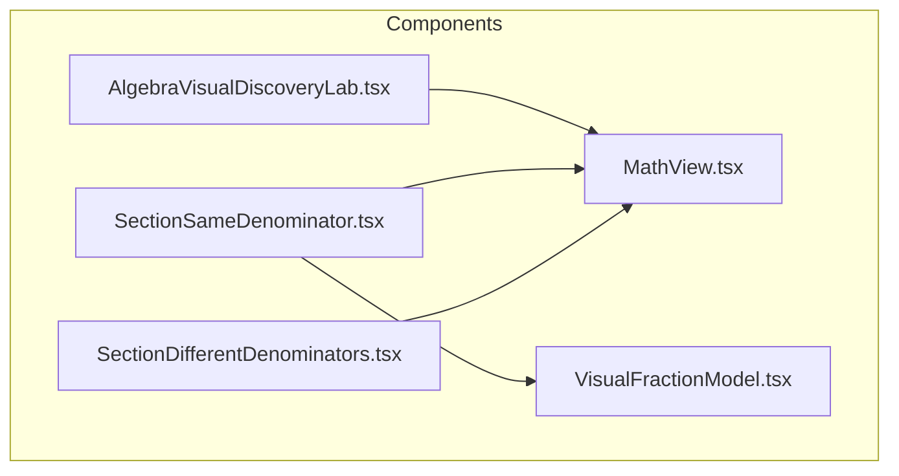
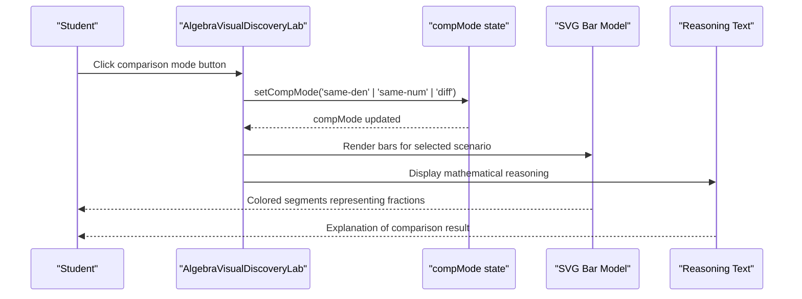
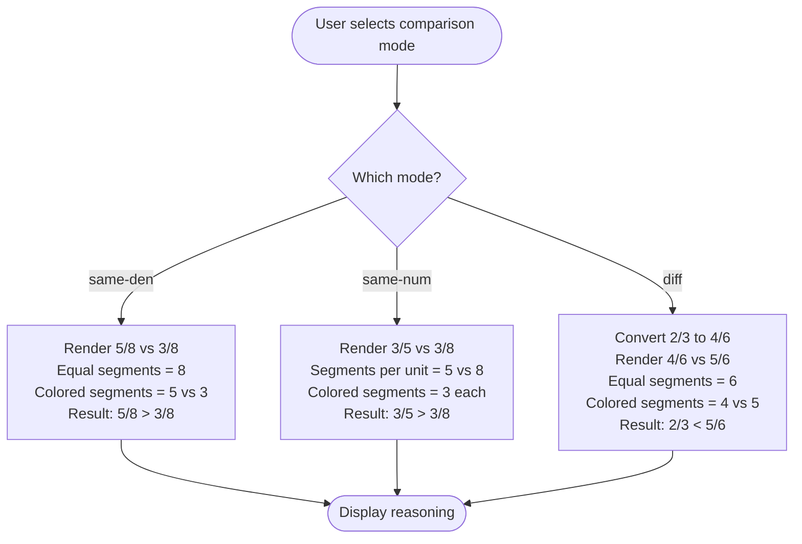
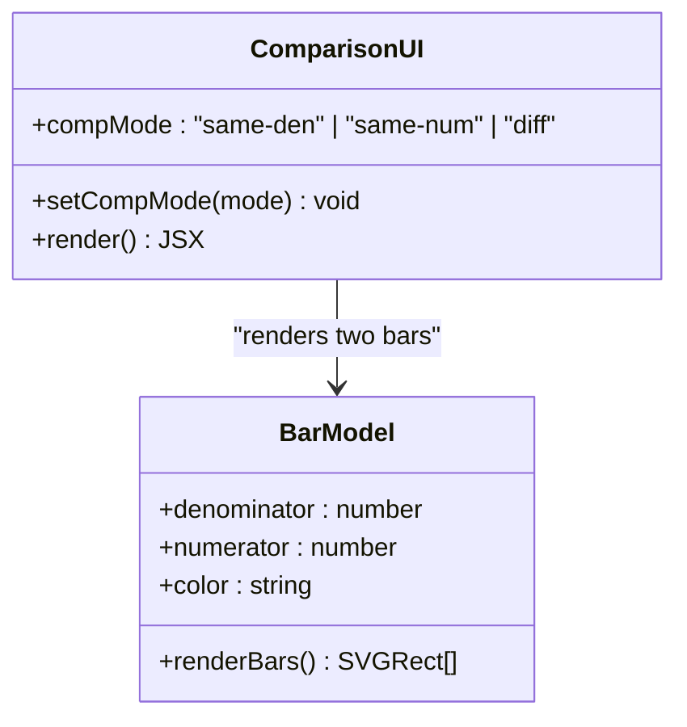
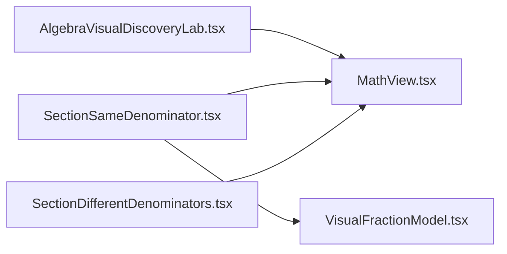

# Fraction Comparison Visualization

<cite>
**Referenced Files in This Document**
- [AlgebraVisualDiscoveryLab.tsx](file://src/components/AlgebraVisualDiscoveryLab.tsx)
- [MathView.tsx](file://src/components/MathView.tsx)
- [VisualFractionModel.tsx](file://src/components/VisualFractionModel.tsx)
- [SectionSameDenominator.tsx](file://src/components/SectionSameDenominator.tsx)
- [SectionDifferentDenominators.tsx](file://src/components/SectionDifferentDenominators.tsx)
</cite>

## Table of Contents
1. [Introduction](#introduction)
2. [Project Structure](#project-structure)
3. [Core Components](#core-components)
4. [Architecture Overview](#architecture-overview)
5. [Detailed Component Analysis](#detailed-component-analysis)
6. [Dependency Analysis](#dependency-analysis)
7. [Performance Considerations](#performance-considerations)
8. [Troubleshooting Guide](#troubleshooting-guide)
9. [Conclusion](#conclusion)

## Introduction
This document explains the fraction comparison visualization system that helps students understand three core scenarios:
- Same denominator: comparing 5/8 and 3/8
- Same numerator: comparing 3/5 and 3/8
- Different denominators: comparing 2/3 and 5/6

The system uses a bar model where each fraction is represented as colored segments within equal-length bars. It supports interactive mode switching between comparison types, adapting the visual representation to show why:
- Fractions with larger numerators are greater when denominators are equal
- Fractions with smaller denominators are greater when numerators are equal
- Finding common denominators enables direct comparison

## Project Structure
The relevant implementation lives under src/components and includes:
- An interactive lab component for fraction comparison with SVG-based bar models
- A reusable math renderer for LaTeX expressions
- Supporting components for visual fraction modeling and sectioned content

**Diagram sources**
- [AlgebraVisualDiscoveryLab.tsx:1-35](file://src/components/AlgebraVisualDiscoveryLab.tsx#L1-L35)
- [MathView.tsx:1-12](file://src/components/MathView.tsx#L1-L12)
- [VisualFractionModel.tsx:1-5](file://src/components/VisualFractionModel.tsx#L1-L5)
- [SectionSameDenominator.tsx:1-5](file://src/components/SectionSameDenominator.tsx#L1-L5)
- [SectionDifferentDenominators.tsx:1-5](file://src/components/SectionDifferentDenominators.tsx#L1-L5)

**Section sources**
- [AlgebraVisualDiscoveryLab.tsx:1-35](file://src/components/AlgebraVisualDiscoveryLab.tsx#L1-L35)
- [MathView.tsx:1-12](file://src/components/MathView.tsx#L1-L12)
- [VisualFractionModel.tsx:1-5](file://src/components/VisualFractionModel.tsx#L1-L5)
- [SectionSameDenominator.tsx:1-5](file://src/components/SectionSameDenominator.tsx#L1-L5)
- [SectionDifferentDenominators.tsx:1-5](file://src/components/SectionDifferentDenominators.tsx#L1-L5)

## Core Components
- AlgebraVisualDiscoveryLab: Provides the interactive comparison UI with three modes (same denominator, same numerator, different denominators). It renders SVG bar models and displays mathematical reasoning text.
- MathView: Renders LaTeX math expressions using KaTeX, handling mixed Arabic and math content and display formatting.
- VisualFractionModel: Demonstrates a static bar model for adding fractions with the same denominator.
- SectionSameDenominator: Presents conceptual explanation and formula for same-denominator operations.
- SectionDifferentDenominators: Explains common denominator conversion and shows examples.

Key responsibilities:
- State-driven rendering of comparison visuals based on selected mode
- Consistent bar model layout across all three scenarios
- Clear mathematical reasoning displayed alongside visuals

**Section sources**
- [AlgebraVisualDiscoveryLab.tsx:27-31](file://src/components/AlgebraVisualDiscoveryLab.tsx#L27-L31)
- [AlgebraVisualDiscoveryLab.tsx:603-680](file://src/components/AlgebraVisualDiscoveryLab.tsx#L603-L680)
- [MathView.tsx:350-424](file://src/components/MathView.tsx#L350-L424)
- [VisualFractionModel.tsx:4-85](file://src/components/VisualFractionModel.tsx#L4-L85)
- [SectionSameDenominator.tsx:6-44](file://src/components/SectionSameDenominator.tsx#L6-L44)
- [SectionDifferentDenominators.tsx:6-31](file://src/components/SectionDifferentDenominators.tsx#L6-L31)

## Architecture Overview
The comparison visualization is driven by a single state variable controlling which scenario to render. The UI updates the SVG bar model accordingly and provides explanatory text.

**Diagram sources**
- [AlgebraVisualDiscoveryLab.tsx:607-635](file://src/components/AlgebraVisualDiscoveryLab.tsx#L607-L635)
- [AlgebraVisualDiscoveryLab.tsx:638-680](file://src/components/AlgebraVisualDiscoveryLab.tsx#L638-L680)

## Detailed Component Analysis

### Interactive Comparison Modes
The component maintains a compMode state with three values:
- same-den: Compares 5/8 vs 3/8
- same-num: Compares 3/5 vs 3/8
- diff: Compares 2/3 vs 5/6

Each mode renders two rows of bars:
- Top row: first fraction
- Bottom row: second fraction
- Each bar is divided into equal segments according to the denominator
- Segments are colored to represent the numerator
- A conclusion line states the comparison result and reason

**Diagram sources**
- [AlgebraVisualDiscoveryLab.tsx:638-680](file://src/components/AlgebraVisualDiscoveryLab.tsx#L638-L680)

#### Same Denominator Scenario (5/8 vs 3/8)
- Both bars are divided into 8 equal parts
- First bar has 5 green segments; second bar has 3 indigo segments
- Conclusion: 5/8 > 3/8 because 5 > 3 when denominators are equal

Visual feedback:
- Equal-length bars emphasize equal unit size
- More colored segments indicate a larger value

Mathematical reasoning:
- When denominators are equal, compare numerators directly

**Section sources**
- [AlgebraVisualDiscoveryLab.tsx:639-651](file://src/components/AlgebraVisualDiscoveryLab.tsx#L639-L651)

#### Same Numerator Scenario (3/5 vs 3/8)
- First bar divided into 5 parts; second bar divided into 8 parts
- Both have 3 colored segments, but segment sizes differ
- Conclusion: 3/5 > 3/8 because fewer divisions mean larger individual parts

Visual feedback:
- Larger segment size in 3/5 compared to 3/8
- Equal number of colored segments highlights difference in part size

Mathematical reasoning:
- With equal numerators, the fraction with the smaller denominator is greater

**Section sources**
- [AlgebraVisualDiscoveryLab.tsx:653-665](file://src/components/AlgebraVisualDiscoveryLab.tsx#L653-L665)

#### Different Denominators Scenario (2/3 vs 5/6)
- Converts 2/3 to 4/6 to find a common denominator
- Both bars divided into 6 equal parts
- First bar has 4 purple segments; second bar has 5 green segments
- Conclusion: 2/3 < 5/6 after converting to equivalent fractions

Visual feedback:
- Common denominator allows direct comparison of colored segments
- Shows equivalence transformation visually

Mathematical reasoning:
- Find a common denominator to make parts comparable
- Compare numerators once denominators match

**Section sources**
- [AlgebraVisualDiscoveryLab.tsx:667-679](file://src/components/AlgebraVisualDiscoveryLab.tsx#L667-L679)

### Bar Model Rendering Logic
The bar model uses SVG rectangles to represent segments:
- Number of rectangles equals the denominator
- Colored rectangles equal the numerator
- Unfilled rectangles represent remaining parts
- Labels describe each fraction and its meaning

**Diagram sources**
- [AlgebraVisualDiscoveryLab.tsx:638-680](file://src/components/AlgebraVisualDiscoveryLab.tsx#L638-L680)

### Mathematical Expression Rendering
MathView handles LaTeX rendering:
- Supports pure math, Arabic text, and mixed content
- Uses KaTeX for high-quality math output
- Handles display and inline modes
- Integrates concept highlighting for educational terms

Usage in this system:
- Displays formulas and explanations alongside visuals
- Ensures consistent typography for mathematical notation

**Section sources**
- [MathView.tsx:350-424](file://src/components/MathView.tsx#L350-L424)

### Supporting Sections
- SectionSameDenominator: Introduces the concept of same-denominator operations and provides a formula box explaining addition/subtraction rules.
- SectionDifferentDenominators: Explains the process of finding common denominators and demonstrates conversions.

These sections complement the interactive visualization by providing conceptual background and worked examples.

**Section sources**
- [SectionSameDenominator.tsx:33-44](file://src/components/SectionSameDenominator.tsx#L33-L44)
- [SectionDifferentDenominators.tsx:19-31](file://src/components/SectionDifferentDenominators.tsx#L19-L31)

## Dependency Analysis
The main dependency relationships are:
- AlgebraVisualDiscoveryLab depends on MathView for rendering mathematical expressions
- SectionSameDenominator composes VisualFractionModel and MathView
- SectionDifferentDenominators uses MathView for displaying formulas

**Diagram sources**
- [AlgebraVisualDiscoveryLab.tsx:1-5](file://src/components/AlgebraVisualDiscoveryLab.tsx#L1-L5)
- [SectionSameDenominator.tsx:1-5](file://src/components/SectionSameDenominator.tsx#L1-L5)
- [SectionDifferentDenominators.tsx:1-5](file://src/components/SectionDifferentDenominators.tsx#L1-L5)

**Section sources**
- [AlgebraVisualDiscoveryLab.tsx:1-5](file://src/components/AlgebraVisualDiscoveryLab.tsx#L1-L5)
- [SectionSameDenominator.tsx:1-5](file://src/components/SectionSameDenominator.tsx#L1-L5)
- [SectionDifferentDenominators.tsx:1-5](file://src/components/SectionDifferentDenominators.tsx#L1-L5)

## Performance Considerations
- SVG rendering is lightweight and suitable for small numbers of segments
- React state updates trigger re-renders only for the active comparison mode
- MathView caches rendered HTML via useMemo for improved performance
- Avoid excessive dynamic segment counts to maintain responsiveness

[No sources needed since this section provides general guidance]

## Troubleshooting Guide
Common issues and resolutions:
- Incorrect segment count: Verify denominator and numerator values passed to bar rendering logic
- Misaligned labels: Ensure SVG text coordinates match bar positions
- Math rendering errors: Check LaTeX syntax in MathView inputs
- Mode switching not updating: Confirm compMode state is correctly set and used in conditional rendering

**Section sources**
- [AlgebraVisualDiscoveryLab.tsx:638-680](file://src/components/AlgebraVisualDiscoveryLab.tsx#L638-L680)
- [MathView.tsx:197-233](file://src/components/MathView.tsx#L197-L233)

## Conclusion
The fraction comparison visualization system effectively teaches core concepts through interactive bar models:
- Same denominator comparisons highlight the role of numerators
- Same numerator comparisons illustrate the impact of denominator size
- Different denominator comparisons demonstrate the necessity of common denominators

By combining visual feedback with clear mathematical reasoning, the system supports student understanding across multiple learning styles.

[No sources needed since this section summarizes without analyzing specific files]