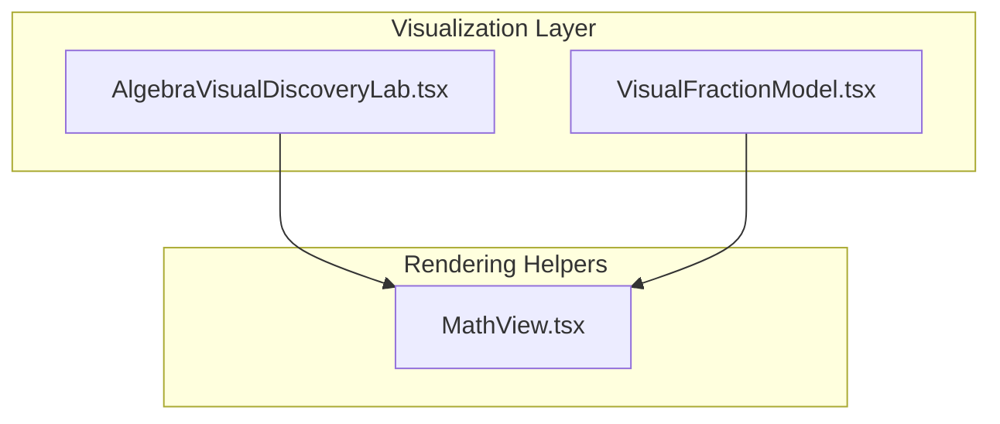
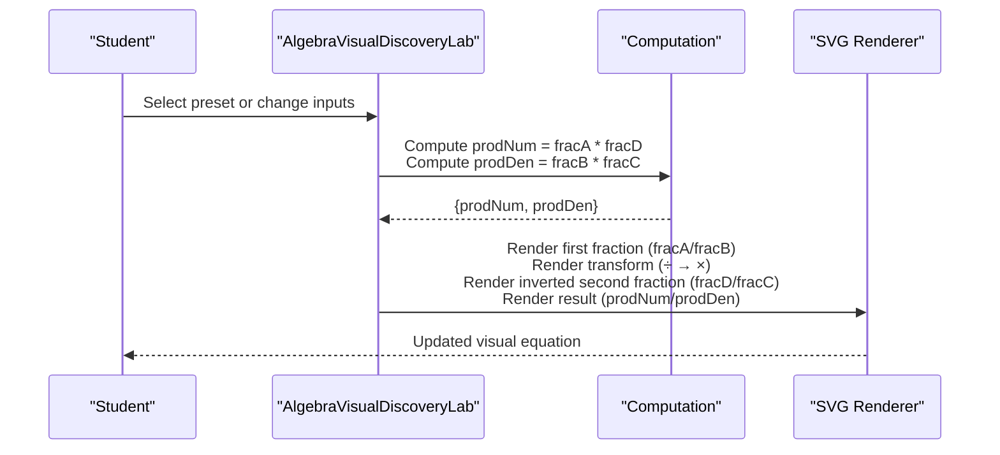
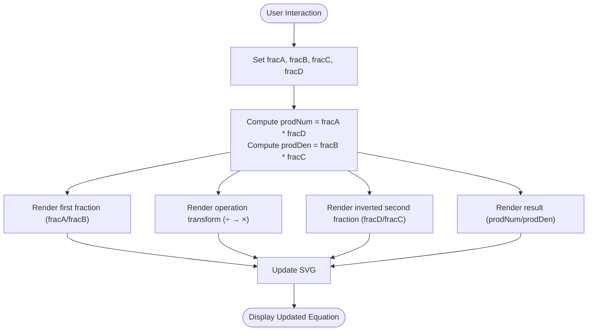
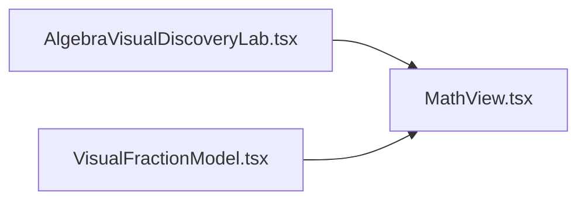

# Fraction Division and Multiplication Visualization

<cite>
**Referenced Files in This Document**
- [AlgebraVisualDiscoveryLab.tsx](file://src/components/AlgebraVisualDiscoveryLab.tsx)
- [VisualFractionModel.tsx](file://src/components/VisualFractionModel.tsx)
- [MathView.tsx](file://src/components/MathView.tsx)
</cite>

## Table of Contents
1. [Introduction](#introduction)
2. [Project Structure](#project-structure)
3. [Core Components](#core-components)
4. [Architecture Overview](#architecture-overview)
5. [Detailed Component Analysis](#detailed-component-analysis)
6. [Dependency Analysis](#dependency-analysis)
7. [Performance Considerations](#performance-considerations)
8. [Troubleshooting Guide](#troubleshooting-guide)
9. [Conclusion](#conclusion)

## Introduction
This document explains the fraction division and multiplication visualization component that demonstrates the mathematical principle a/b ÷ c/d = a/b × d/c. It focuses on how the system transforms a division operation into multiplication by the reciprocal, visually keeping the first fraction constant while inverting the second fraction. The documentation covers:
- Visual representation and color coding for different mathematical elements
- Interactive inputs for manipulating numerators and denominators to see real-time results
- Pedagogical approach to visualizing abstract fraction operations
- Error handling considerations for invalid inputs such as zero denominators
- Responsive design considerations for educational interfaces

## Project Structure
The relevant implementation is contained within the algebra visualization lab component, which renders an SVG-based diagram illustrating the transformation from division to multiplication by reciprocal. A separate static fraction model component illustrates basic fraction addition with same denominators and uses a math rendering helper.

**Diagram sources**
- [AlgebraVisualDiscoveryLab.tsx:1-25](file://src/components/AlgebraVisualDiscoveryLab.tsx#L1-L25)
- [VisualFractionModel.tsx:1-3](file://src/components/VisualFractionModel.tsx#L1-L3)

**Section sources**
- [AlgebraVisualDiscoveryLab.tsx:1-25](file://src/components/AlgebraVisualDiscoveryLab.tsx#L1-L25)
- [VisualFractionModel.tsx:1-3](file://src/components/VisualFractionModel.tsx#L1-L3)

## Core Components
- AlgebraVisualDiscoveryLab: Implements the interactive visualization for fraction division and multiplication, including state variables for the four fraction components (a, b, c, d), computed product numerator and denominator, and preset example buttons.
- VisualFractionModel: Provides a static visual model for adding fractions with the same denominator, using colored blocks and LaTeX-style math rendering.
- MathView: Renders mathematical expressions used across components.

Key responsibilities:
- AlgebraVisualDiscoveryLab manages the core pedagogical flow: keep the first fraction unchanged, convert the division operator to multiplication, invert the second fraction, and compute the result.
- VisualFractionModel supports foundational understanding of fractions through visual blocks and consistent denominators.

**Section sources**
- [AlgebraVisualDiscoveryLab.tsx:21-25](file://src/components/AlgebraVisualDiscoveryLab.tsx#L21-L25)
- [AlgebraVisualDiscoveryLab.tsx:507-549](file://src/components/AlgebraVisualDiscoveryLab.tsx#L507-L549)
- [VisualFractionModel.tsx:4-85](file://src/components/VisualFractionModel.tsx#L4-L85)

## Architecture Overview
The visualization follows a clear sequence: user selects or changes values; the component computes the product of the first numerator with the inverted second numerator and multiplies the first denominator with the original second denominator; the SVG updates to reflect the transformed operation and resulting fraction.

**Diagram sources**
- [AlgebraVisualDiscoveryLab.tsx:507-549](file://src/components/AlgebraVisualDiscoveryLab.tsx#L507-L549)

## Detailed Component Analysis

### AlgebraVisualDiscoveryLab: Fraction Division to Multiplication by Reciprocal
This component implements the pedagogical rule a/b ÷ c/d = a/b × d/c. It maintains state for the four components of the two fractions and computes the resulting numerator and denominator.

- State variables:
  - fracA, fracB represent the first fraction a/b.
  - fracC, fracD represent the second fraction c/d.
- Computation:
  - prodNum = fracA * fracD
  - prodDen = fracB * fracC
- Visual transformation:
  - First fraction remains unchanged.
  - Division symbol converts to multiplication.
  - Second fraction is inverted to d/c.
  - Result displays the computed product.

Color coding and labels:
- First fraction box: indigo border and background, labeled as the constant term.
- Operation circle: shows “÷ ⟶ ×” with explanatory text indicating conversion to multiplication.
- Inverted second fraction box: amber border and background, labeled as the reciprocal d/c.
- Result box: green border and background, showing the final fraction.

Interactive presets:
- Buttons provide examples like (3/4) ÷ (2/5), (10/9) ÷ (5/6), and (-4/7) ÷ (3/5). Clicking a button updates all four state variables simultaneously.

**Diagram sources**
- [AlgebraVisualDiscoveryLab.tsx:507-549](file://src/components/AlgebraVisualDiscoveryLab.tsx#L507-L549)

Pedagogical reading panel:
- Explains the three simultaneous stages: first fraction stays constant, division becomes multiplication, second fraction is replaced by its reciprocal.

Responsive layout:
- Uses a grid layout with left column for the SVG schema and right column for explanatory text.
- SVG dimensions are responsive via viewBox and max-height constraints.

Accessibility and clarity:
- Labels clearly identify each part of the transformation.
- Color contrasts distinguish the constant term, operation, reciprocal, and result.

**Section sources**
- [AlgebraVisualDiscoveryLab.tsx:21-25](file://src/components/AlgebraVisualDiscoveryLab.tsx#L21-L25)
- [AlgebraVisualDiscoveryLab.tsx:507-549](file://src/components/AlgebraVisualDiscoveryLab.tsx#L507-L549)
- [AlgebraVisualDiscoveryLab.tsx:552-577](file://src/components/AlgebraVisualDiscoveryLab.tsx#L552-L577)

### VisualFractionModel: Foundational Fraction Addition Model
While not directly implementing division, this component reinforces the concept of equal-sized parts and consistent denominators, which underpins understanding of fraction operations.

- Displays two fractions with the same denominator using colored blocks.
- Shows the sum visually and mathematically.
- Uses MathView to render LaTeX-style fractions.

This model helps students grasp why denominators must be aligned before combining fractions, supporting later learning of common denominators and reciprocals.

**Section sources**
- [VisualFractionModel.tsx:4-85](file://src/components/VisualFractionModel.tsx#L4-L85)

### MathView: Mathematical Expression Rendering
Used to display fractions and equations in a readable format across components.

**Section sources**
- [AlgebraVisualDiscoveryLab.tsx:1-2](file://src/components/AlgebraVisualDiscoveryLab.tsx#L1-L2)
- [VisualFractionModel.tsx:1-3](file://src/components/VisualFractionModel.tsx#L1-L3)

## Dependency Analysis
- AlgebraVisualDiscoveryLab depends on React state management and MathView for rendering mathematical expressions.
- VisualFractionModel also depends on MathView.
- Both components use Tailwind CSS classes for styling and responsiveness.

**Diagram sources**
- [AlgebraVisualDiscoveryLab.tsx:1-2](file://src/components/AlgebraVisualDiscoveryLab.tsx#L1-L2)
- [VisualFractionModel.tsx:1-3](file://src/components/VisualFractionModel.tsx#L1-L3)

**Section sources**
- [AlgebraVisualDiscoveryLab.tsx:1-2](file://src/components/AlgebraVisualDiscoveryLab.tsx#L1-L2)
- [VisualFractionModel.tsx:1-3](file://src/components/VisualFractionModel.tsx#L1-L3)

## Performance Considerations
- SVG rendering is lightweight and suitable for real-time updates when users interact with presets or inputs.
- Avoid excessive re-renders by limiting state updates to necessary variables (fracA, fracB, fracC, fracD).
- Keep preset arrays small to maintain performance on low-end devices.
- Use responsive SVG attributes (viewBox, max-height) to ensure efficient scaling across screen sizes.

[No sources needed since this section provides general guidance]

## Troubleshooting Guide
Common issues and recommendations:
- Zero denominators:
  - The current implementation does not explicitly validate for zero denominators. To prevent undefined behavior, add validation to reject or warn when fracB or fracC equals zero.
  - Display a friendly error message explaining that division by zero is undefined and suggest adjusting inputs.
- Negative values:
  - The component supports negative numerators and denominators; ensure sign handling is clear in the visual labels and result display.
- Preset selection:
  - If a preset leads to an invalid state (e.g., zero denominator), disable the corresponding button or show an inline warning.
- Accessibility:
  - Ensure color-coded elements have sufficient contrast and include descriptive labels for screen readers.
  - Provide keyboard navigation for preset buttons and any future input controls.

Implementation suggestions:
- Add input validation hooks around setFracA, setFracB, setFracC, setFracD to enforce non-zero denominators.
- Introduce an error state variable to display messages near the visualization.
- Enhance tooltips or captions for each colored region to improve accessibility.

[No sources needed since this section provides general guidance]

## Conclusion
The fraction division and multiplication visualization component effectively demonstrates the transformation a/b ÷ c/d = a/b × d/c through a clear, color-coded SVG diagram. It keeps the first fraction constant, converts the division operator to multiplication, and inverts the second fraction to its reciprocal, then computes and displays the result. While the current implementation lacks explicit validation for zero denominators, it provides a strong foundation for interactive learning. Adding robust input validation, enhanced accessibility, and optional sliders for direct manipulation would further strengthen the educational experience.

[No sources needed since this section summarizes without analyzing specific files]