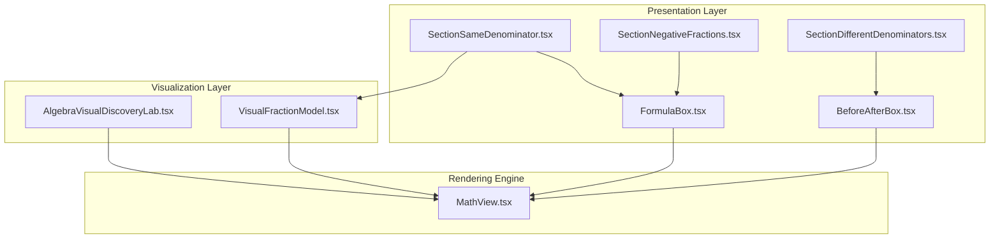
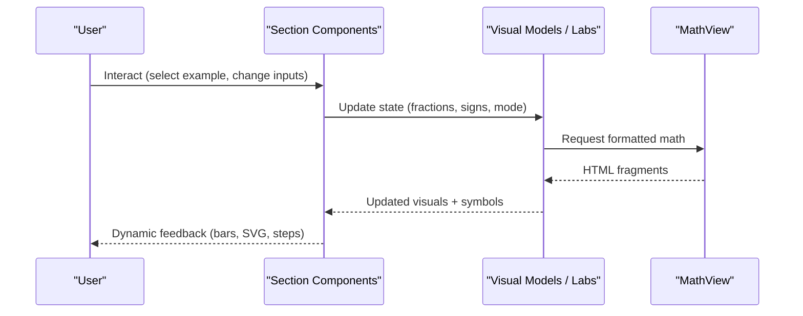
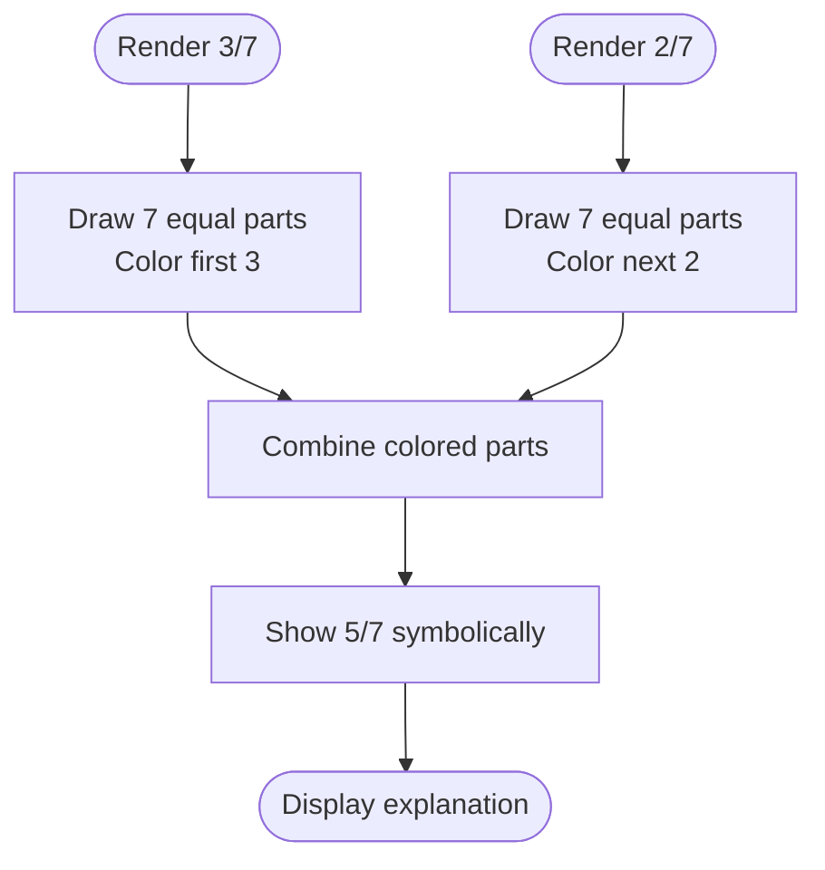
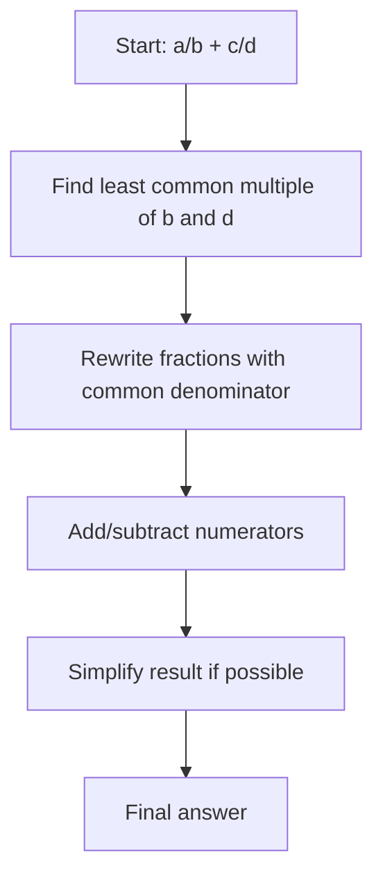
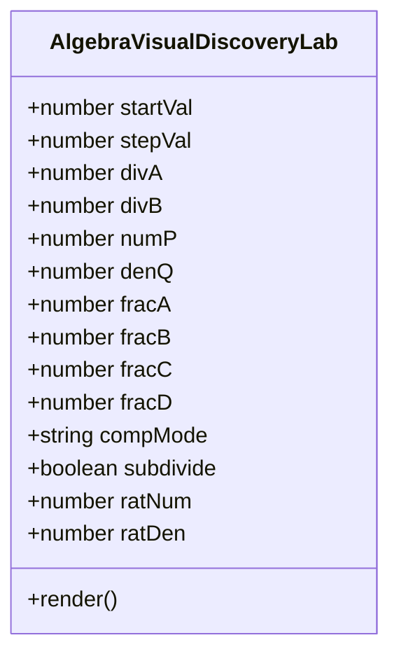
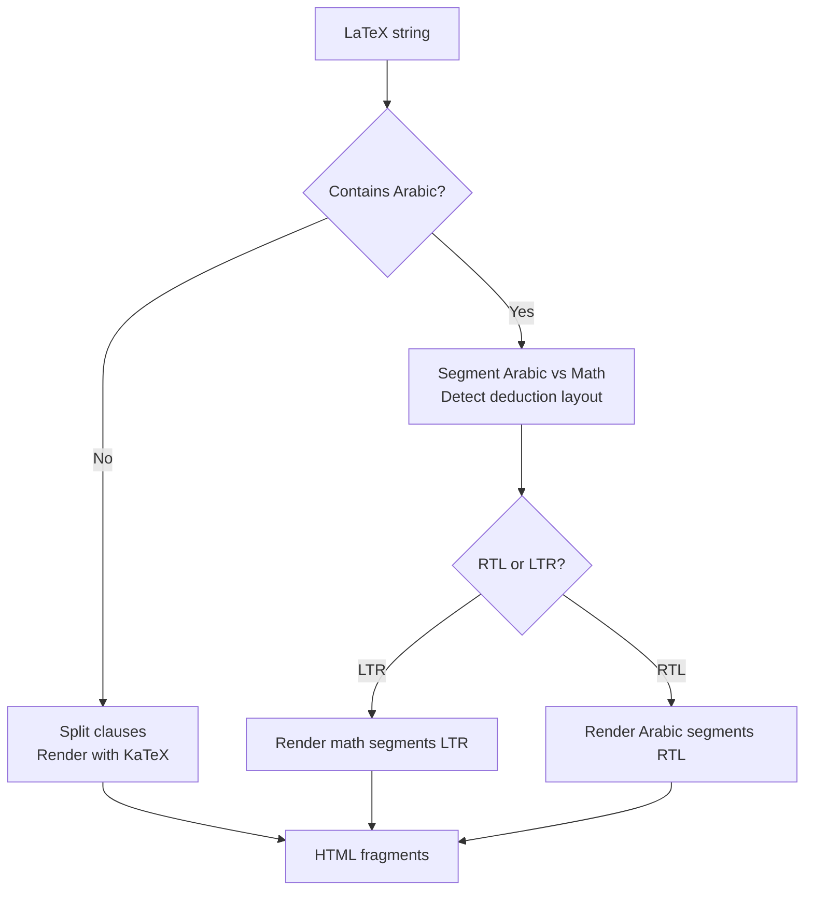
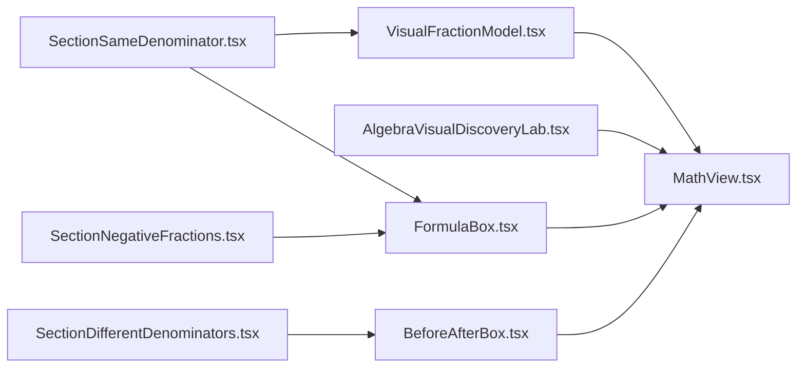

# Fraction Operations Visualization

<cite>
**Referenced Files in This Document**
- [VisualFractionModel.tsx](file://src/components/VisualFractionModel.tsx)
- [SectionSameDenominator.tsx](file://src/components/SectionSameDenominator.tsx)
- [SectionDifferentDenominators.tsx](file://src/components/SectionDifferentDenominators.tsx)
- [SectionNegativeFractions.tsx](file://src/components/SectionNegativeFractions.tsx)
- [MathView.tsx](file://src/components/MathView.tsx)
- [FormulaBox.tsx](file://src/components/FormulaBox.tsx)
- [BeforeAfterBox.tsx](file://src/components/BeforeAfterBox.tsx)
- [AlgebraVisualDiscoveryLab.tsx](file://src/components/AlgebraVisualDiscoveryLab.tsx)
</cite>

## Table of Contents
1. [Introduction](#introduction)
2. [Project Structure](#project-structure)
3. [Core Components](#core-components)
4. [Architecture Overview](#architecture-overview)
5. [Detailed Component Analysis](#detailed-component-analysis)
6. [Dependency Analysis](#dependency-analysis)
7. [Performance Considerations](#performance-considerations)
8. [Troubleshooting Guide](#troubleshooting-guide)
9. [Conclusion](#conclusion)
10. [Appendices](#appendices)

## Introduction
This document explains the fraction operations visualization system that demonstrates division, multiplication, comparison, and addition/subtraction through interactive visual models. It covers:
- Visualization modes: bar models, area-like SVG schemas, and symbolic representations.
- State management for multiple fraction inputs and real-time computation.
- Rendering engine for dynamic feedback using a math typesetting component.
- Pedagogical approach to visualizing abstract concepts.
- Error handling for invalid inputs and responsive design considerations.

The system is built from modular React components that compose visual bars, SVG diagrams, step-by-step transformation cards, and LaTeX-rendered formulas.

## Project Structure
The relevant code lives under src/components and focuses on:
- Visual model rendering (bar-based).
- Section-level pedagogy (same denominator, different denominators, negative fractions).
- Math rendering and formula presentation.
- Interactive algebra labs demonstrating division, multiplication, comparison, and reciprocal/opposite relationships.

**Diagram sources**
- [VisualFractionModel.tsx:1-85](file://src/components/VisualFractionModel.tsx#L1-L85)
- [SectionSameDenominator.tsx:1-73](file://src/components/SectionSameDenominator.tsx#L1-L73)
- [SectionDifferentDenominators.tsx:1-104](file://src/components/SectionDifferentDenominators.tsx#L1-L104)
- [SectionNegativeFractions.tsx:1-58](file://src/components/SectionNegativeFractions.tsx#L1-L58)
- [FormulaBox.tsx:1-88](file://src/components/FormulaBox.tsx#L1-L88)
- [BeforeAfterBox.tsx:1-410](file://src/components/BeforeAfterBox.tsx#L1-L410)
- [AlgebraVisualDiscoveryLab.tsx:1-200](file://src/components/AlgebraVisualDiscoveryLab.tsx#L1-L200)

**Section sources**
- [VisualFractionModel.tsx:1-85](file://src/components/VisualFractionModel.tsx#L1-L85)
- [SectionSameDenominator.tsx:1-73](file://src/components/SectionSameDenominator.tsx#L1-L73)
- [SectionDifferentDenominators.tsx:1-104](file://src/components/SectionDifferentDenominators.tsx#L1-L104)
- [SectionNegativeFractions.tsx:1-58](file://src/components/SectionNegativeFractions.tsx#L1-L58)
- [FormulaBox.tsx:1-88](file://src/components/FormulaBox.tsx#L1-L88)
- [BeforeAfterBox.tsx:1-410](file://src/components/BeforeAfterBox.tsx#L1-L410)
- [AlgebraVisualDiscoveryLab.tsx:1-200](file://src/components/AlgebraVisualDiscoveryLab.tsx#L1-L200)

## Core Components
- VisualFractionModel: Renders a bar model for adding two fractions with the same denominator, visually combining colored parts and showing the symbolic result.
- SectionSameDenominator: Presents the rule for same-denominator addition/subtraction and includes the visual model.
- SectionDifferentDenominators: Explains finding a common denominator and shows a before/transformation/result pipeline.
- SectionNegativeFractions: Covers sign rules for fractions and subtraction as addition of opposites.
- FormulaBox: Displays primary or secondary mathematical rules with conditions and notes.
- BeforeAfterBox: Provides a structured, multi-step “before → transformation → result” view with card and timeline layouts.
- MathView: Robust LaTeX renderer supporting mixed Arabic/LaTeX text, error resilience, and display modes.
- AlgebraVisualDiscoveryLab: Interactive labs for number line addition, division inverse check, reciprocal vs opposite, and fraction division/multiplication.

**Section sources**
- [VisualFractionModel.tsx:1-85](file://src/components/VisualFractionModel.tsx#L1-L85)
- [SectionSameDenominator.tsx:1-73](file://src/components/SectionSameDenominator.tsx#L1-L73)
- [SectionDifferentDenominators.tsx:1-104](file://src/components/SectionDifferentDenominators.tsx#L1-L104)
- [SectionNegativeFractions.tsx:1-58](file://src/components/SectionNegativeFractions.tsx#L1-L58)
- [FormulaBox.tsx:1-88](file://src/components/FormulaBox.tsx#L1-L88)
- [BeforeAfterBox.tsx:1-410](file://src/components/BeforeAfterBox.tsx#L1-L410)
- [MathView.tsx:1-580](file://src/components/MathView.tsx#L1-L580)
- [AlgebraVisualDiscoveryLab.tsx:1-200](file://src/components/AlgebraVisualDiscoveryLab.tsx#L1-L200)

## Architecture Overview
The system separates concerns into three layers:
- Presentation layer: Section components organize pedagogical content and compose reusable UI blocks.
- Visualization layer: Bar models and SVG schemas illustrate operations concretely.
- Rendering engine: MathView renders LaTeX safely and beautifully, integrating with both static and interactive views.

**Diagram sources**
- [SectionSameDenominator.tsx:1-73](file://src/components/SectionSameDenominator.tsx#L1-L73)
- [SectionDifferentDenominators.tsx:1-104](file://src/components/SectionDifferentDenominators.tsx#L1-L104)
- [SectionNegativeFractions.tsx:1-58](file://src/components/SectionNegativeFractions.tsx#L1-L58)
- [VisualFractionModel.tsx:1-85](file://src/components/VisualFractionModel.tsx#L1-L85)
- [AlgebraVisualDiscoveryLab.tsx:1-200](file://src/components/AlgebraVisualDiscoveryLab.tsx#L1-L200)
- [MathView.tsx:1-580](file://src/components/MathView.tsx#L1-L580)

## Detailed Component Analysis

### Bar Model for Same-Denominator Addition
VisualFractionModel renders two bar segments representing fractions with the same denominator, then combines them to show the sum. It also displays the corresponding symbolic form via MathView.

Key behaviors:
- Fixed denominator partitions are drawn as small rectangles.
- Colored segments represent numerators; combined result highlights both original parts.
- Symbolic representation updates alongside the visual.

**Diagram sources**
- [VisualFractionModel.tsx:14-78](file://src/components/VisualFractionModel.tsx#L14-L78)

**Section sources**
- [VisualFractionModel.tsx:1-85](file://src/components/VisualFractionModel.tsx#L1-L85)

### Rules and Examples: Same Denominator
SectionSameDenominator introduces the rule for adding/subtracting fractions with the same denominator and embeds the visual model.

Highlights:
- Primary formula box states the rule and condition.
- Direct example shows conceptual-to-symbolic flow.
- Visual model reinforces that the denominator remains unchanged.

**Section sources**
- [SectionSameDenominator.tsx:1-73](file://src/components/SectionSameDenominator.tsx#L1-L73)
- [FormulaBox.tsx:1-88](file://src/components/FormulaBox.tsx#L1-L88)
- [VisualFractionModel.tsx:1-85](file://src/components/VisualFractionModel.tsx#L1-L85)

### Different Denominators: Common Denominator Pipeline
SectionDifferentDenominators explains how to find a common denominator and apply it before adding or subtracting. It uses BeforeAfterBox to structure the process.

Highlights:
- Before/transformation/result pipeline clarifies each step.
- Two cases: one denominator is a multiple of the other, and general case.
- Simplification is shown after computation.

**Diagram sources**
- [SectionDifferentDenominators.tsx:23-99](file://src/components/SectionDifferentDenominators.tsx#L23-L99)
- [BeforeAfterBox.tsx:81-410](file://src/components/BeforeAfterBox.tsx#L81-L410)

**Section sources**
- [SectionDifferentDenominators.tsx:1-104](file://src/components/SectionDifferentDenominators.tsx#L1-L104)
- [BeforeAfterBox.tsx:1-410](file://src/components/BeforeAfterBox.tsx#L1-L410)

### Negative Fractions and Sign Rules
SectionNegativeFractions teaches sign placement and subtraction as addition of opposites.

Highlights:
- Rule for moving the negative sign to numerator or front of fraction.
- Example with simplification.
- Warning about converting subtraction to addition when subtracting negatives.

**Section sources**
- [SectionNegativeFractions.tsx:1-58](file://src/components/SectionNegativeFractions.tsx#L1-L58)
- [FormulaBox.tsx:1-88](file://src/components/FormulaBox.tsx#L1-L88)

### Interactive Algebra Lab: Division, Multiplication, Comparison
AlgebraVisualDiscoveryLab provides interactive SVG-based schemas for:
- Number line addition.
- Division inverse relationship.
- Reciprocal vs opposite.
- Fraction division converted to multiplication by reciprocal.
- Comparison modes (same denominator, same numerator, different).

State management:
- Multiple useState hooks manage independent inputs for each lesson.
- Buttons preset examples for quick exploration.
- SVG elements update reactively based on state.

**Diagram sources**
- [AlgebraVisualDiscoveryLab.tsx:8-35](file://src/components/AlgebraVisualDiscoveryLab.tsx#L8-L35)
- [AlgebraVisualDiscoveryLab.tsx:506-592](file://src/components/AlgebraVisualDiscoveryLab.tsx#L506-L592)

**Section sources**
- [AlgebraVisualDiscoveryLab.tsx:1-200](file://src/components/AlgebraVisualDiscoveryLab.tsx#L1-L200)
- [AlgebraVisualDiscoveryLab.tsx:316-410](file://src/components/AlgebraVisualDiscoveryLab.tsx#L316-L410)
- [AlgebraVisualDiscoveryLab.tsx:413-501](file://src/components/AlgebraVisualDiscoveryLab.tsx#L413-L501)
- [AlgebraVisualDiscoveryLab.tsx:503-592](file://src/components/AlgebraVisualDiscoveryLab.tsx#L503-L592)

### Mathematical Rendering Engine: MathView
MathView handles:
- Pure LaTeX without Arabic.
- Mixed Arabic and LaTeX.
- Splitting long expressions across clauses.
- Resilient KaTeX rendering with error suppression.
- Display vs inline modes and RTL/LTR direction control.

**Diagram sources**
- [MathView.tsx:350-580](file://src/components/MathView.tsx#L350-L580)
- [MathView.tsx:197-233](file://src/components/MathView.tsx#L197-L233)
- [MathView.tsx:285-348](file://src/components/MathView.tsx#L285-L348)

**Section sources**
- [MathView.tsx:1-580](file://src/components/MathView.tsx#L1-L580)

## Dependency Analysis
High-level dependencies:
- Section components depend on FormulaBox and BeforeAfterBox for structured presentations.
- VisualFractionModel depends on MathView for symbolic output.
- AlgebraVisualDiscoveryLab depends on MathView for displaying computed results and labels.
- All math-heavy components rely on MathView’s robust rendering.

**Diagram sources**
- [SectionSameDenominator.tsx:1-73](file://src/components/SectionSameDenominator.tsx#L1-L73)
- [SectionDifferentDenominators.tsx:1-104](file://src/components/SectionDifferentDenominators.tsx#L1-L104)
- [SectionNegativeFractions.tsx:1-58](file://src/components/SectionNegativeFractions.tsx#L1-L58)
- [VisualFractionModel.tsx:1-85](file://src/components/VisualFractionModel.tsx#L1-L85)
- [FormulaBox.tsx:1-88](file://src/components/FormulaBox.tsx#L1-L88)
- [BeforeAfterBox.tsx:1-410](file://src/components/BeforeAfterBox.tsx#L1-L410)
- [AlgebraVisualDiscoveryLab.tsx:1-200](file://src/components/AlgebraVisualDiscoveryLab.tsx#L1-L200)
- [MathView.tsx:1-580](file://src/components/MathView.tsx#L1-L580)

**Section sources**
- [SectionSameDenominator.tsx:1-73](file://src/components/SectionSameDenominator.tsx#L1-L73)
- [SectionDifferentDenominators.tsx:1-104](file://src/components/SectionDifferentDenominators.tsx#L1-L104)
- [SectionNegativeFractions.tsx:1-58](file://src/components/SectionNegativeFractions.tsx#L1-L58)
- [VisualFractionModel.tsx:1-85](file://src/components/VisualFractionModel.tsx#L1-L85)
- [FormulaBox.tsx:1-88](file://src/components/FormulaBox.tsx#L1-L88)
- [BeforeAfterBox.tsx:1-410](file://src/components/BeforeAfterBox.tsx#L1-L410)
- [AlgebraVisualDiscoveryLab.tsx:1-200](file://src/components/AlgebraVisualDiscoveryLab.tsx#L1-L200)
- [MathView.tsx:1-580](file://src/components/MathView.tsx#L1-L580)

## Performance Considerations
- MathView caches concept keyword matching and splits expressions efficiently to avoid re-parsing.
- KaTeX rendering is wrapped with error suppression to prevent UI crashes on malformed LaTeX.
- SVG-based visuals in AlgebraVisualDiscoveryLab compute derived values directly from state to minimize extra computations.
- BeforeAfterBox parses transformation steps once per render and supports two view modes without heavy reflows.

[No sources needed since this section provides general guidance]

## Troubleshooting Guide
Common issues and resolutions:
- KaTeX parse errors: MathView suppresses bright error colors and removes technical tooltips; ensure LaTeX strings are valid and avoid trailing backslashes.
- Mixed Arabic/LaTeX alignment: MathView detects deduction-style sequences and sets appropriate direction (LTR/RTL); verify that math commands are properly separated from Arabic text.
- Invalid fraction inputs: In AlgebraVisualDiscoveryLab, division by zero should be prevented at the input level; consider adding validation around divisor state setters.
- Long equations wrapping: MathView splits long equality chains and top-level separators; use \quad or explicit newlines to guide splitting where necessary.

**Section sources**
- [MathView.tsx:197-233](file://src/components/MathView.tsx#L197-L233)
- [MathView.tsx:285-348](file://src/components/MathView.tsx#L285-L348)
- [MathView.tsx:350-580](file://src/components/MathView.tsx#L350-L580)
- [AlgebraVisualDiscoveryLab.tsx:316-410](file://src/components/AlgebraVisualDiscoveryLab.tsx#L316-L410)

## Conclusion
The fraction operations visualization system combines concrete bar models, SVG schemas, and robust LaTeX rendering to make abstract arithmetic intuitive. Its modular architecture allows educators to extend visualizations easily, while its state-driven design ensures real-time feedback. The pedagogical flow—concept → rule → example → interpretation—supports deep understanding and reduces common mistakes.

[No sources needed since this section summarizes without analyzing specific files]

## Appendices

### How to Implement a New Fraction Operation Visualization
Steps:
- Add state variables for inputs in an appropriate component (e.g., AlgebraVisualDiscoveryLab).
- Compute derived values (common denominator, simplified result) from state.
- Create or extend a visual model:
  - For bar models: follow the pattern in VisualFractionModel to draw partitioned bars and color segments.
  - For SVG schemas: follow the patterns in AlgebraVisualDiscoveryLab to draw boxes, arrows, and labels.
- Use FormulaBox or BeforeAfterBox to present rules and step-by-step transformations.
- Render all symbolic outputs with MathView to ensure consistent typography and directionality.

**Section sources**
- [VisualFractionModel.tsx:1-85](file://src/components/VisualFractionModel.tsx#L1-L85)
- [AlgebraVisualDiscoveryLab.tsx:503-592](file://src/components/AlgebraVisualDiscoveryLab.tsx#L503-L592)
- [FormulaBox.tsx:1-88](file://src/components/FormulaBox.tsx#L1-L88)
- [BeforeAfterBox.tsx:1-410](file://src/components/BeforeAfterBox.tsx#L1-L410)
- [MathView.tsx:1-580](file://src/components/MathView.tsx#L1-L580)

### Handling Complex Mathematical Transformations in Real-Time
- Keep all intermediate steps visible using BeforeAfterBox to show before → transformation → result.
- Use MathView’s clause splitting to keep long derivations readable.
- Validate inputs to avoid undefined behavior (e.g., division by zero).
- Provide preset examples to demonstrate typical and edge cases.

**Section sources**
- [BeforeAfterBox.tsx:81-410](file://src/components/BeforeAfterBox.tsx#L81-L410)
- [MathView.tsx:285-348](file://src/components/MathView.tsx#L285-L348)
- [AlgebraVisualDiscoveryLab.tsx:506-592](file://src/components/AlgebraVisualDiscoveryLab.tsx#L506-L592)

### Creating Intuitive Learning Experiences
- Pair every symbolic rule with a concrete visual (bars or SVG).
- Highlight invariant properties (e.g., denominator stays constant in same-denominator addition).
- Emphasize sign rules and conversion strategies (subtraction as addition of opposites).
- Offer multiple interaction modes (cards vs timeline) to suit different learning preferences.

**Section sources**
- [SectionSameDenominator.tsx:1-73](file://src/components/SectionSameDenominator.tsx#L1-L73)
- [SectionNegativeFractions.tsx:1-58](file://src/components/SectionNegativeFractions.tsx#L1-L58)
- [BeforeAfterBox.tsx:117-143](file://src/components/BeforeAfterBox.tsx#L117-L143)