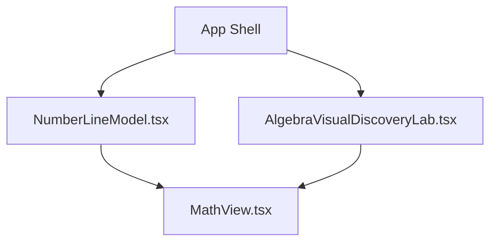
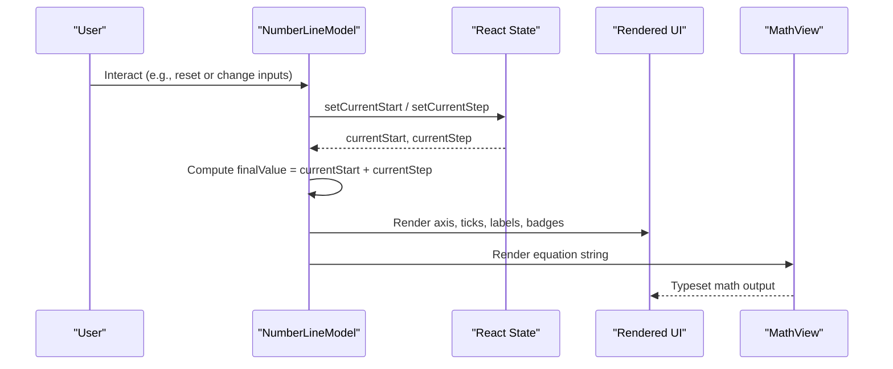
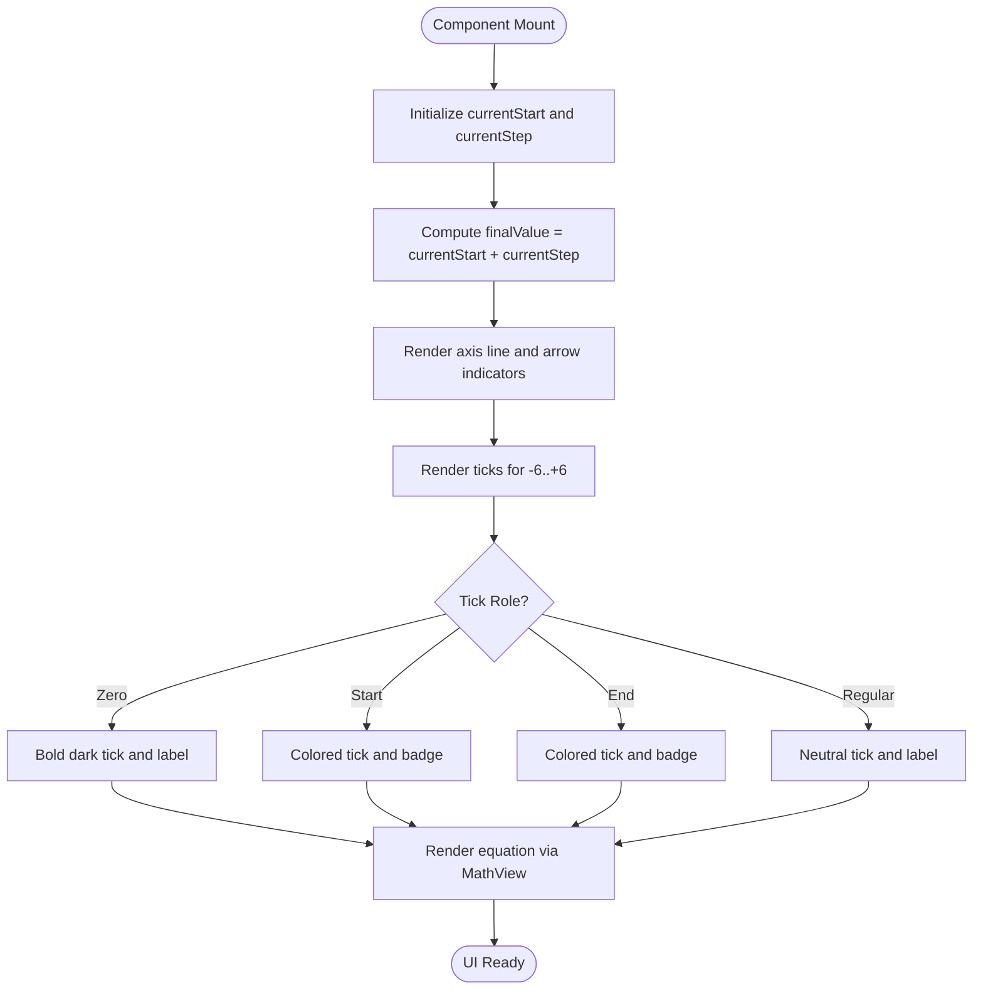
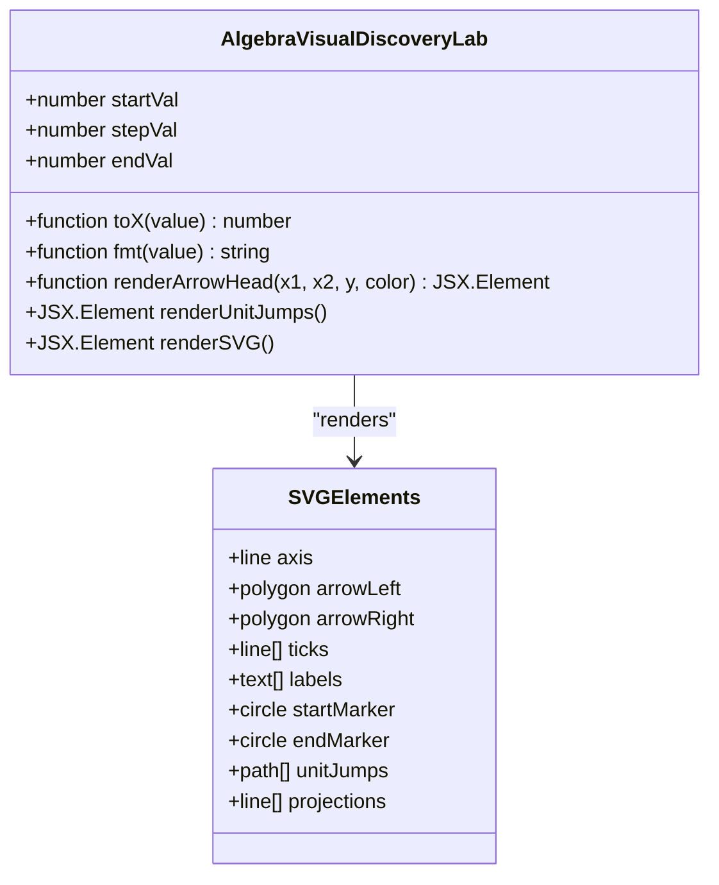
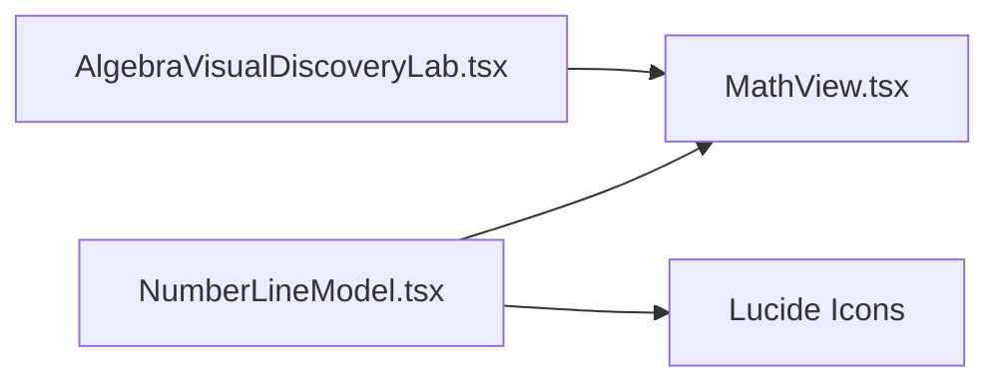

# Number Line Model Component

<cite>
**Referenced Files in This Document**
- [NumberLineModel.tsx](file://src/components/NumberLineModel.tsx)
- [AlgebraVisualDiscoveryLab.tsx](file://src/components/AlgebraVisualDiscoveryLab.tsx)
- [MathView.tsx](file://src/components/MathView.tsx)
</cite>

## Table of Contents
1. [Introduction](#introduction)
2. [Project Structure](#project-structure)
3. [Core Components](#core-components)
4. [Architecture Overview](#architecture-overview)
5. [Detailed Component Analysis](#detailed-component-analysis)
6. [Dependency Analysis](#dependency-analysis)
7. [Performance Considerations](#performance-considerations)
8. [Troubleshooting Guide](#troubleshooting-guide)
9. [Conclusion](#conclusion)

## Introduction
The Number Line Model component is an interactive educational visualization that represents rational number addition as movement along a number line. It helps learners connect arithmetic operations with spatial intuition: starting at a value, moving right for positive steps and left for negative steps, and landing on the final sum.

Two implementations exist in this repository:
- A lightweight HTML/CSS-based number line inside `NumberLineModel.tsx`.
- A richer SVG-based number line inside `AlgebraVisualDiscoveryLab.tsx` for Course 01, which includes unit-step arcs, arrowheads, projection lines, and explicit vector bands.

This document explains how both renderings work, how state drives visual updates, how coordinate transformation maps mathematical values to screen positions, and how to extend or customize these components for engaging mathematical explorations.

## Project Structure
The relevant files are located under `src/components`:
- `NumberLineModel.tsx`: A simple, accessible, CSS-driven number line with start/end badges and a rendered equation.
- `AlgebraVisualDiscoveryLab.tsx`: A full SVG-based number line model used for Course 01, including bidirectional arrows, unit jumps, and labeled vectors.
- `MathView.tsx`: A math rendering utility that displays LaTeX-like expressions using KaTeX, handling Arabic and mixed content.

**Diagram sources**
- [NumberLineModel.tsx:1-129](file://src/components/NumberLineModel.tsx#L1-L129)
- [AlgebraVisualDiscoveryLab.tsx:1-260](file://src/components/AlgebraVisualDiscoveryLab.tsx#L1-L260)
- [MathView.tsx:350-579](file://src/components/MathView.tsx#L350-L579)

**Section sources**
- [NumberLineModel.tsx:1-129](file://src/components/NumberLineModel.tsx#L1-L129)
- [AlgebraVisualDiscoveryLab.tsx:1-260](file://src/components/AlgebraVisualDiscoveryLab.tsx#L1-L260)
- [MathView.tsx:1-580](file://src/components/MathView.tsx#L1-L580)

## Core Components
- NumberLineModel: Renders a horizontal axis with evenly spaced integer ticks from -6 to +6, highlights the start and end points, and shows a computed addition expression through MathView.
- AlgebraVisualDiscoveryLab (Course 01): Renders an SVG number line with multiple bands:
  - Band for the second displacement b.
  - Vector from start to end with unit-step arcs.
  - Vertical projections to the main axis.
  - First vector from 0 to start.
  - Main graduated axis with tick marks and labels.
- MathView: Renders mathematical expressions, supports Arabic text, splits long formulas, and uses KaTeX for high-quality math typesetting.

Key responsibilities:
- State management for start and step values.
- Coordinate transformation from mathematical values to pixel coordinates.
- Rendering logic for arrows, ticks, labels, and badges.
- Accessibility and readability for educational content.

**Section sources**
- [NumberLineModel.tsx:5-129](file://src/components/NumberLineModel.tsx#L5-L129)
- [AlgebraVisualDiscoveryLab.tsx:8-260](file://src/components/AlgebraVisualDiscoveryLab.tsx#L8-L260)
- [MathView.tsx:350-579](file://src/components/MathView.tsx#L350-L579)

## Architecture Overview
The system follows a unidirectional data flow:
- User interactions update React state (`currentStart`, `currentStep`).
- Derived values compute the final result.
- The UI re-renders based on state, drawing ticks, labels, markers, and equations.

**Diagram sources**
- [NumberLineModel.tsx:5-129](file://src/components/NumberLineModel.tsx#L5-L129)
- [MathView.tsx:350-579](file://src/components/MathView.tsx#L350-L579)

## Detailed Component Analysis

### Lightweight HTML/CSS Number Line (NumberLineModel)
Responsibilities:
- Maintain `currentStart` and `currentStep` state.
- Compute `finalValue`.
- Render a horizontal axis with arrow indicators at both ends.
- Draw ticks for each integer from -6 to +6.
- Highlight zero, start, and end ticks with distinct styles.
- Show start and end badges above the corresponding ticks.
- Display a formatted addition equation via MathView.

Rendering details:
- Axis line: a thin horizontal bar with absolute-positioned arrow icons at left and right.
- Ticks: vertical divs whose height and color vary by role (zero, start/end, regular).
- Labels: monospace numbers with sign formatting; zero is bold and darker.
- Badges: small colored boxes indicating “Start” and “End” with numeric values.
- Equation: built from current state and passed to MathView for typesetting.

Coordinate mapping:
- Uses fixed integer points array rather than dynamic scaling.
- Spacing is handled by flexbox distribution across the container width.

Bidirectional movement:
- Positive step moves right; negative step moves left.
- Start and end markers reflect direction implicitly through their positions.

Accessibility considerations:
- Clear labels and badges improve understanding.
- MathView renders math in LTR context for correct symbol ordering.
- Semantic structure separates controls, explanation, visualization, and summary.

**Diagram sources**
- [NumberLineModel.tsx:5-129](file://src/components/NumberLineModel.tsx#L5-L129)

**Section sources**
- [NumberLineModel.tsx:5-129](file://src/components/NumberLineModel.tsx#L5-L129)

### Rich SVG-Based Number Line (AlgebraVisualDiscoveryLab, Course 01)
Responsibilities:
- Manage `startVal` and `stepVal` state.
- Compute `endVal`.
- Define a coordinate transform `toX(value)` mapping mathematical values to SVG x-coordinates.
- Format numbers with explicit signs.
- Render multiple visual bands:
  - Band showing the second displacement b.
  - Vector from start to end with dashed unit-step arcs.
  - Vertical projection lines connecting vector endpoints to the main axis.
  - First vector from 0 to start.
  - Main graduated axis with ticks and labels.
- Provide a final result block displaying the complete addition equality.

Coordinate transformation:
- `toX(v) = 260 + v * 28`
- This linear mapping centers the origin near the middle of the SVG viewBox and scales each unit to 28 pixels horizontally.

Arrowhead helper:
- `renderArrowHead(x1, x2, y, color)` draws a polygon arrowhead at the endpoint of a directed segment.
- Direction is determined by comparing x1 and x2.

Unit-step visualization:
- Generates an array of quadratic bezier paths representing individual unit jumps between consecutive integers from start to end.
- Arcs help students count the exact magnitude of the step value.

Bidirectional movement:
- Positive step: arc and arrow point right.
- Negative step: arc and arrow point left.
- Projection lines clearly connect vector endpoints to the main axis.

Rendering elements:
- Axis line with arrow polygons at both ends.
- Tick marks with varying stroke widths and colors for zero, start, and end.
- Text labels for each tick, formatted with explicit signs.
- Colored circles marking start and end points on the axis.

**Diagram sources**
- [AlgebraVisualDiscoveryLab.tsx:8-260](file://src/components/AlgebraVisualDiscoveryLab.tsx#L8-L260)

**Section sources**
- [AlgebraVisualDiscoveryLab.tsx:8-260](file://src/components/AlgebraVisualDiscoveryLab.tsx#L8-L260)

### Math Rendering Utility (MathView)
Responsibilities:
- Accept a math string and render it using KaTeX.
- Handle pure math, pure Arabic, and mixed Arabic/math content.
- Split long formulas into clauses for better layout.
- Normalize Unicode superscripts and escape errors gracefully.
- Support accessibility features like keyboard navigation for concept links.

Integration with number lines:
- Used to display the addition equation in both components.
- Ensures consistent typography and correct directional behavior for mathematical symbols.

**Section sources**
- [MathView.tsx:1-580](file://src/components/MathView.tsx#L1-L580)

## Dependency Analysis
- NumberLineModel depends on:
  - React state hooks for interactivity.
  - MathView for equation rendering.
  - Lucide icons for axis arrows and reset control.
- AlgebraVisualDiscoveryLab depends on:
  - React state hooks.
  - MathView for equation rendering.
  - Inline SVG primitives for rich visuals.
- Both components derive visual state from numerical inputs and produce deterministic outputs.

**Diagram sources**
- [NumberLineModel.tsx:1-129](file://src/components/NumberLineModel.tsx#L1-L129)
- [AlgebraVisualDiscoveryLab.tsx:1-260](file://src/components/AlgebraVisualDiscoveryLab.tsx#L1-L260)
- [MathView.tsx:1-580](file://src/components/MathView.tsx#L1-L580)

**Section sources**
- [NumberLineModel.tsx:1-129](file://src/components/NumberLineModel.tsx#L1-L129)
- [AlgebraVisualDiscoveryLab.tsx:1-260](file://src/components/AlgebraVisualDiscoveryLab.tsx#L1-L260)
- [MathView.tsx:1-580](file://src/components/MathView.tsx#L1-L580)

## Performance Considerations
- Lightweight HTML/CSS approach:
  - Minimal DOM nodes; fast re-renders for small ranges (-6 to +6).
  - Suitable for simple demonstrations and low-power devices.
- SVG approach:
  - More complex but offers precise control over geometry and animations.
  - Unit-step arcs and projections add overhead proportional to |step|.
  - For large step magnitudes, consider limiting visible unit arcs or batching updates.
- MathView:
  - KaTeX rendering can be expensive for very long formulas; split clauses when possible.
  - Avoid unnecessary re-renders by memoizing derived strings where appropriate.

Recommendations:
- Use the HTML/CSS version for quick prototypes and basic pedagogy.
- Use the SVG version when you need detailed unit-step visualization and clear vector semantics.
- Debounce user input if integrating sliders or draggable handles to reduce frequent re-renders.
- Keep the visible range bounded to prevent excessive DOM/SVG node creation.

[No sources needed since this section provides general guidance]

## Troubleshooting Guide
Common issues and resolutions:
- Numbers not aligned with expected positions:
  - Verify the coordinate transform function and scale factor.
  - Ensure the viewBox and container dimensions match expectations.
- Arrowheads pointing incorrectly:
  - Check direction logic based on start and end coordinates.
  - Confirm that x1 and x2 comparisons are correct for negative steps.
- Labels missing or misformatted:
  - Confirm sign formatting logic for positive and negative values.
  - Ensure MathView receives properly constructed LaTeX strings.
- Accessibility concerns:
  - Add descriptive aria-labels to interactive controls.
  - Ensure keyboard focus order matches visual hierarchy.
  - Provide alt text or titles for SVG elements where applicable.

**Section sources**
- [AlgebraVisualDiscoveryLab.tsx:50-72](file://src/components/AlgebraVisualDiscoveryLab.tsx#L50-L72)
- [MathView.tsx:197-233](file://src/components/MathView.tsx#L197-L233)

## Conclusion
The Number Line Model components provide two complementary ways to visualize rational number addition:
- A simple, accessible HTML/CSS visualization ideal for quick learning and minimal dependencies.
- A rich SVG visualization offering precise geometric control, unit-step arcs, and clear vector semantics.

Both approaches emphasize the relationship between mathematical calculations and visual representation, support bidirectional movement, and integrate with a robust math rendering utility. By extending these patterns, educators can create engaging, interactive explorations of number line arithmetic tailored to diverse learning needs.

[No sources needed since this section summarizes without analyzing specific files]