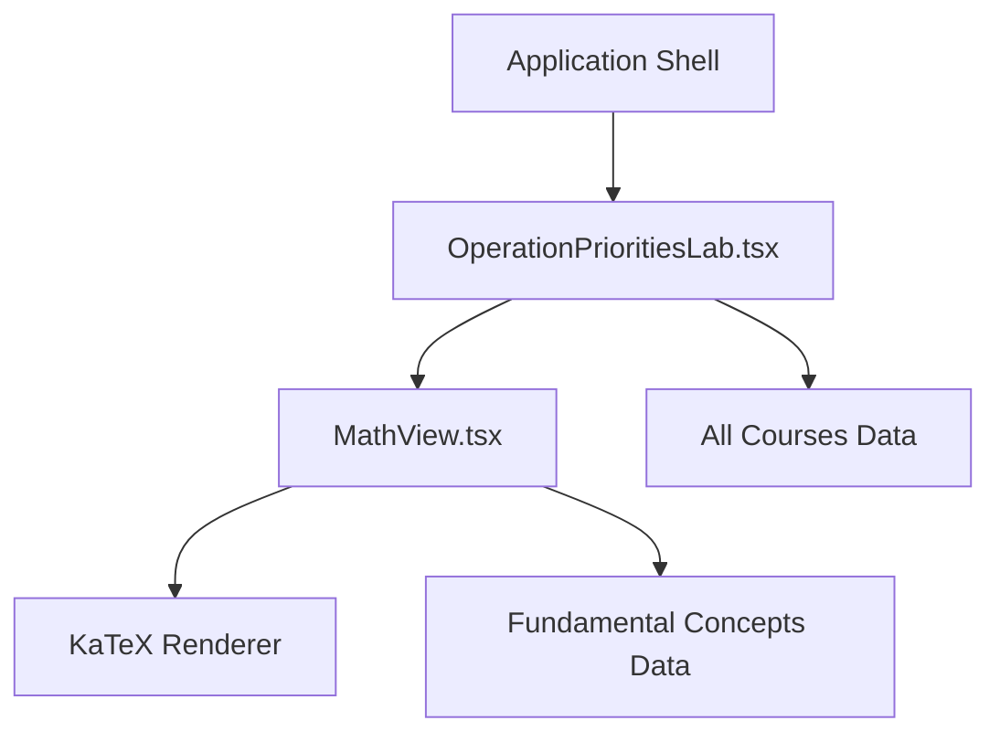
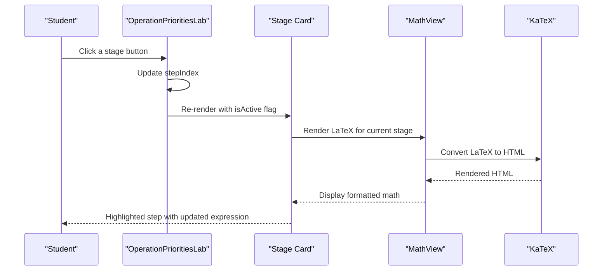
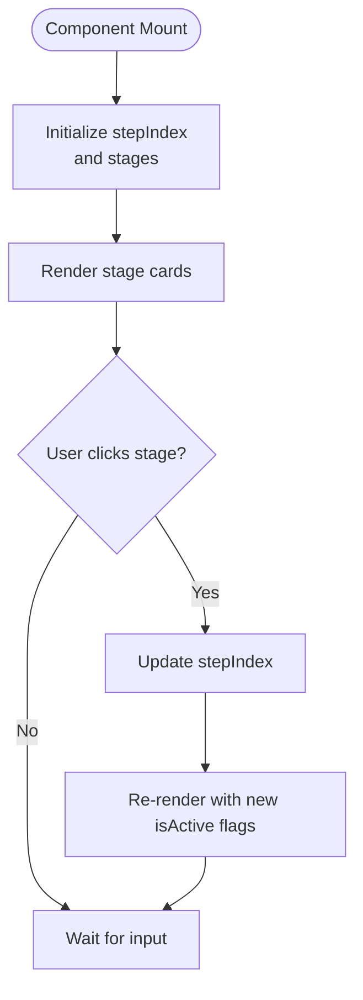
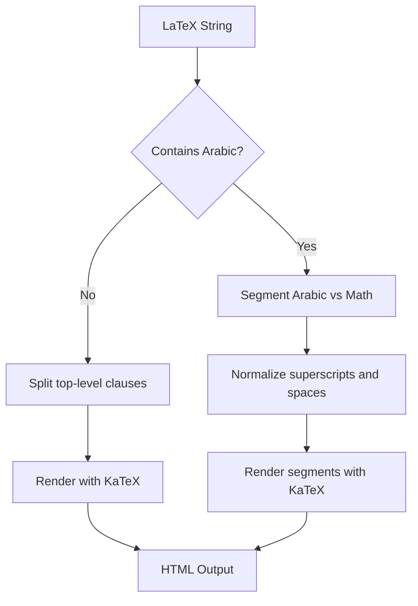
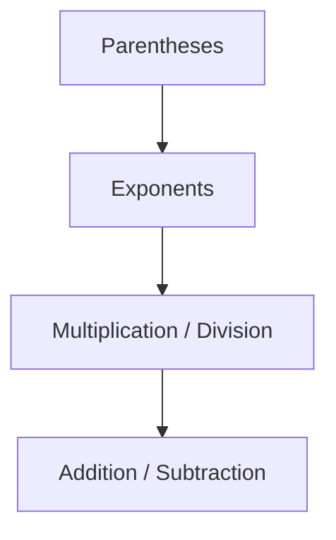
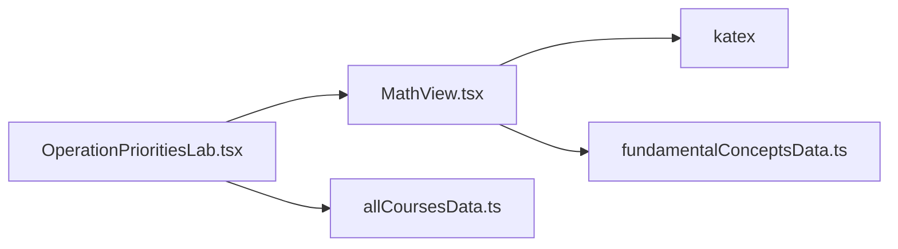

# Operation Priorities Interactive Lab

<cite>
**Referenced Files in This Document**
- [OperationPrioritiesLab.tsx](file://src/components/OperationPrioritiesLab.tsx)
- [MathView.tsx](file://src/components/MathView.tsx)
- [allCoursesData.ts](file://src/data/allCoursesData.ts)
- [fundamentalConceptsData.ts](file://src/data/fundamentalConceptsData.ts)
</cite>

## Table of Contents
1. [Introduction](#introduction)
2. [Project Structure](#project-structure)
3. [Core Components](#core-components)
4. [Architecture Overview](#architecture-overview)
5. [Detailed Component Analysis](#detailed-component-analysis)
6. [Dependency Analysis](#dependency-analysis)
7. [Performance Considerations](#performance-considerations)
8. [Troubleshooting Guide](#troubleshooting-guide)
9. [Conclusion](#conclusion)
10. [Appendices](#appendices)

## Introduction
The Operation Priorities Interactive Lab is a React-based educational component that helps students learn the mathematical order of operations, commonly known as PEMDAS or BODMAS. It presents a fixed example expression and walks through each evaluation stage: parentheses, exponents, multiplication/division, and finally addition/subtraction. The component uses visual highlighting to show which operation is performed at each step, and it includes an explanatory panel describing the priority ladder.

At present, the lab demonstrates a pre-defined four-stage evaluation rather than accepting arbitrary user expressions. It relies on KaTeX for rendering LaTeX math and integrates with the application’s concept reminder system through shared components.

## Project Structure
The lab lives under the components directory and depends on a general-purpose math renderer. Supporting data files define course-level formulas and fundamental concepts used elsewhere in the application.

**Diagram sources**
- [OperationPrioritiesLab.tsx:1-109](file://src/components/OperationPrioritiesLab.tsx#L1-L109)
- [MathView.tsx:1-580](file://src/components/MathView.tsx#L1-L580)
- [allCoursesData.ts:3068-3228](file://src/data/allCoursesData.ts#L3068-L3228)
- [fundamentalConceptsData.ts:368-382](file://src/data/fundamentalConceptsData.ts#L368-L382)

**Section sources**
- [OperationPrioritiesLab.tsx:1-109](file://src/components/OperationPrioritiesLab.tsx#L1-L109)
- [MathView.tsx:1-580](file://src/components/MathView.tsx#L1-L580)
- [allCoursesData.ts:3068-3228](file://src/data/allCoursesData.ts#L3068-L3228)
- [fundamentalConceptsData.ts:368-382](file://src/data/fundamentalConceptsData.ts#L368-L382)

## Core Components
- OperationPrioritiesLab: A React functional component that renders a four-step breakdown of a sample expression. It manages the active step index and highlights completed stages.
- MathView: A reusable math renderer that converts LaTeX strings into rendered HTML via KaTeX. It also handles mixed Arabic and math text, long equality chains, and concept keyword highlighting.

Key responsibilities:
- OperationPrioritiesLab focuses on presentation and interaction state for the staged evaluation.
- MathView focuses on robust math rendering and text processing.

**Section sources**
- [OperationPrioritiesLab.tsx:4-108](file://src/components/OperationPrioritiesLab.tsx#L4-L108)
- [MathView.tsx:350-579](file://src/components/MathView.tsx#L350-L579)

## Architecture Overview
The component architecture is simple and layered:
- UI layer: OperationPrioritiesLab composes cards, buttons, and math blocks.
- Rendering layer: MathView delegates to KaTeX for high-quality math output.
- Data layer: Course and concept data provide authoritative definitions and examples used across the app.

**Diagram sources**
- [OperationPrioritiesLab.tsx:77-90](file://src/components/OperationPrioritiesLab.tsx#L77-L90)
- [OperationPrioritiesLab.tsx:47-71](file://src/components/OperationPrioritiesLab.tsx#L47-L71)
- [MathView.tsx:197-233](file://src/components/MathView.tsx#L197-L233)

## Detailed Component Analysis

### OperationPrioritiesLab Component
This component defines a fixed set of stages representing the evaluation of a single expression. Each stage contains:
- A human-readable level label.
- A rule badge indicating the operation type.
- A LaTeX string showing the expression before and after applying the rule.
- Visual styling for active/inactive states.

State management:
- stepIndex controls which stage is highlighted.
- Buttons allow direct navigation to any stage.

Visual feedback:
- Completed stages are highlighted with distinct background colors.
- The current stage is emphasized with bold math rendering.

Pedagogical guidance:
- An adjacent panel explains why strict precedence matters and summarizes the priority ladder.

**Diagram sources**
- [OperationPrioritiesLab.tsx:5-32](file://src/components/OperationPrioritiesLab.tsx#L5-L32)
- [OperationPrioritiesLab.tsx:77-90](file://src/components/OperationPrioritiesLab.tsx#L77-L90)

Implementation notes:
- The component does not parse or evaluate arbitrary expressions; it displays predefined steps.
- Styling uses Tailwind utility classes to differentiate active and inactive stages.
- The explanation panel reinforces the conceptual priority order.

**Section sources**
- [OperationPrioritiesLab.tsx:4-108](file://src/components/OperationPrioritiesLab.tsx#L4-L108)

### MathView Component
MathView is a versatile math renderer with several important behaviors:
- Pure math without Arabic characters is split into clauses and rendered inline or block.
- Mixed Arabic and math content is segmented and rendered appropriately.
- Long equality chains are intelligently split to improve readability.
- Unicode superscripts and caret powers are normalized before KaTeX rendering.
- Concept keywords can be highlighted and linked to a concept modal.

**Diagram sources**
- [MathView.tsx:350-579](file://src/components/MathView.tsx#L350-L579)
- [MathView.tsx:197-233](file://src/components/MathView.tsx#L197-L233)
- [MathView.tsx:239-348](file://src/components/MathView.tsx#L239-L348)

Error handling:
- KaTeX errors are suppressed by removing error-specific styles and tooltips.
- Fallback behavior returns original LaTeX when rendering fails.

Educational integration:
- Concept keywords trigger a modal with definitions and rules, supporting interactive learning.

**Section sources**
- [MathView.tsx:1-580](file://src/components/MathView.tsx#L1-L580)

### Expression Parsing Logic and Priority Calculation
Current implementation status:
- There is no dynamic expression parser or evaluator in OperationPrioritiesLab.
- The staged evaluation is hardcoded as LaTeX strings.
- The priority rules are represented visually and textually rather than computed programmatically.

Priority representation:
- The priority ladder is defined in course data and reinforced in the lab’s explanation panel.
- Summary rules include parentheses, exponents, multiplication/division, and addition/subtraction.

**Diagram sources**
- [allCoursesData.ts:3068-3073](file://src/data/allCoursesData.ts#L3068-L3073)
- [allCoursesData.ts:3197-3218](file://src/data/allCoursesData.ts#L3197-L3218)
- [fundamentalConceptsData.ts:368-382](file://src/data/fundamentalConceptsData.ts#L368-L382)

To support custom operation priority rules:
- Introduce a configuration object mapping operators to numeric priorities.
- Implement a tokenizer that identifies numbers, operators, and grouping symbols.
- Build a precedence-aware evaluator (e.g., Shunting Yard algorithm) to compute intermediate results.
- Emit a sequence of transformation steps matching the configured priorities.
- Map each step to a LaTeX snippet for MathView rendering.

To handle complex nested expressions:
- Track brace depth during tokenization to respect nested parentheses.
- Support fraction bars as implicit grouping around numerator and denominator.
- Preserve left-to-right associativity for equal-priority operators.

**Section sources**
- [allCoursesData.ts:3068-3073](file://src/data/allCoursesData.ts#L3068-L3073)
- [allCoursesData.ts:3197-3218](file://src/data/allCoursesData.ts#L3197-L3218)
- [fundamentalConceptsData.ts:368-382](file://src/data/fundamentalConceptsData.ts#L368-L382)

### Visual Feedback Mechanisms
- Stage cards highlight completed steps using background and border color changes.
- Active steps render math in bold white text for emphasis.
- Buttons allow direct navigation to any stage, enabling exploratory learning.
- The explanation panel provides textual reinforcement of the priority ladder.

These mechanisms help students associate each visual cue with a specific operation rule, improving retention and understanding.

**Section sources**
- [OperationPrioritiesLab.tsx:47-71](file://src/components/OperationPrioritiesLab.tsx#L47-L71)
- [OperationPrioritiesLab.tsx:77-90](file://src/components/OperationPrioritiesLab.tsx#L77-L90)
- [OperationPrioritiesLab.tsx:96-103](file://src/components/OperationPrioritiesLab.tsx#L96-L103)

### Pedagogical Value and Integration
Interactive exploration:
- Students can click through stages to see how one operation transforms the expression.
- The visual progression supports discovery-based learning and reduces cognitive load.

Error detection and correction:
- While the current lab does not accept user input, future extensions could validate entered expressions and suggest corrections based on priority rules.
- Concept reminders can guide students toward correct interpretations of terms like “parentheses,” “exponents,” and “fraction bar.”

Integration with other tools:
- MathView is reused across the application, ensuring consistent math rendering.
- Fundamental concepts data provides a shared knowledge base for explanations and hints.

**Section sources**
- [MathView.tsx:1-580](file://src/components/MathView.tsx#L1-L580)
- [fundamentalConceptsData.ts:368-382](file://src/data/fundamentalConceptsData.ts#L368-L382)

## Dependency Analysis
The lab has minimal runtime dependencies:
- React state for step selection.
- MathView for rendering LaTeX.
- KaTeX for math rendering.
- Shared data modules for course and concept information.

**Diagram sources**
- [OperationPrioritiesLab.tsx:1-2](file://src/components/OperationPrioritiesLab.tsx#L1-L2)
- [MathView.tsx:1-4](file://src/components/MathView.tsx#L1-L4)
- [allCoursesData.ts:3068-3228](file://src/data/allCoursesData.ts#L3068-L3228)
- [fundamentalConceptsData.ts:368-382](file://src/data/fundamentalConceptsData.ts#L368-L382)

**Section sources**
- [OperationPrioritiesLab.tsx:1-109](file://src/components/OperationPrioritiesLab.tsx#L1-L109)
- [MathView.tsx:1-580](file://src/components/MathView.tsx#L1-L580)
- [allCoursesData.ts:3068-3228](file://src/data/allCoursesData.ts#L3068-L3228)
- [fundamentalConceptsData.ts:368-382](file://src/data/fundamentalConceptsData.ts#L368-L382)

## Performance Considerations
- MathView caches concept keyword patterns and splits clauses efficiently.
- KaTeX rendering is wrapped with error suppression to avoid UI disruption.
- The lab’s staged UI is lightweight and re-renders only on step changes.

Recommendations:
- Avoid unnecessary re-renders by memoizing expensive computations if dynamic parsing is added.
- Precompute transformation steps for common expressions to reduce runtime overhead.
- Use lazy loading for KaTeX if the app grows significantly.

[No sources needed since this section provides general guidance]

## Troubleshooting Guide
Common issues and resolutions:
- KaTeX parse errors: The renderer suppresses error styles and tooltips, falling back to raw LaTeX. Check the input LaTeX syntax.
- Mixed Arabic and math rendering: Ensure proper segmentation and normalization of spaces and superscripts.
- Concept keyword highlighting: Verify that keywords match the fundamental concepts data.

Debugging tips:
- Inspect the rendered HTML from MathView to confirm correct clause splitting.
- Validate LaTeX snippets used in stage cards.
- Cross-check priority rules against the course data summary.

**Section sources**
- [MathView.tsx:197-233](file://src/components/MathView.tsx#L197-L233)
- [MathView.tsx:239-348](file://src/components/MathView.tsx#L239-L348)
- [allCoursesData.ts:3197-3218](file://src/data/allCoursesData.ts#L3197-L3218)

## Conclusion
The Operation Priorities Interactive Lab provides a clear, visual walkthrough of the standard order of operations. It emphasizes pedagogical clarity through staged visualization and concise explanations. While it currently demonstrates a fixed example, its architecture supports future enhancements such as dynamic expression parsing, customizable priority rules, and richer interactive feedback. Integrating with MathView and shared concept data ensures consistency and extensibility across the application.

[No sources needed since this section summarizes without analyzing specific files]

## Appendices

### Appendix A: Priority Rules Reference
- Parentheses first, starting from innermost groups.
- Exponents next.
- Multiplication and division from left to right.
- Addition and subtraction from left to right.

These rules are documented in course data and reinforce the lab’s visual steps.

**Section sources**
- [allCoursesData.ts:3068-3073](file://src/data/allCoursesData.ts#L3068-L3073)
- [allCoursesData.ts:3197-3218](file://src/data/allCoursesData.ts#L3197-L3218)
- [fundamentalConceptsData.ts:368-382](file://src/data/fundamentalConceptsData.ts#L368-L382)