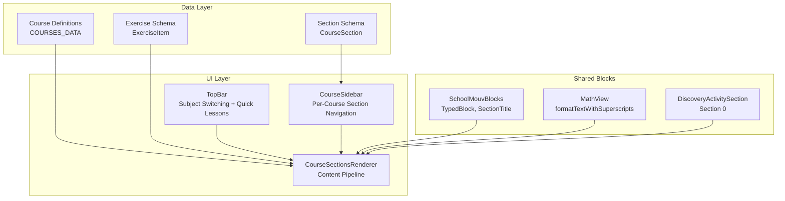
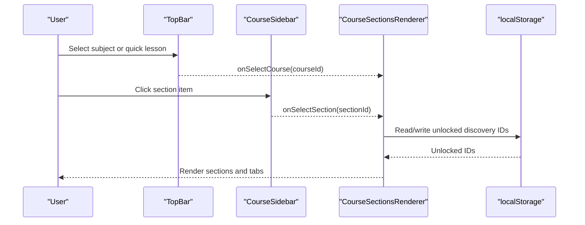
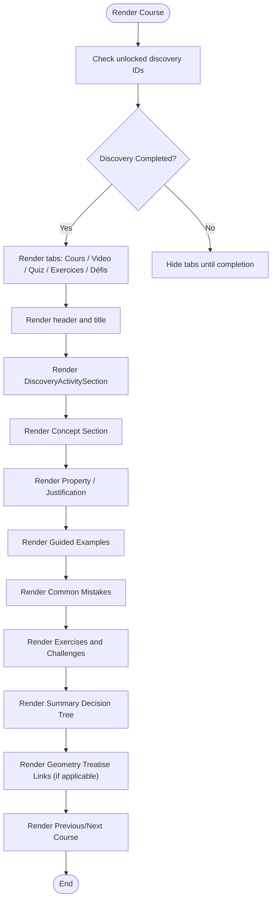
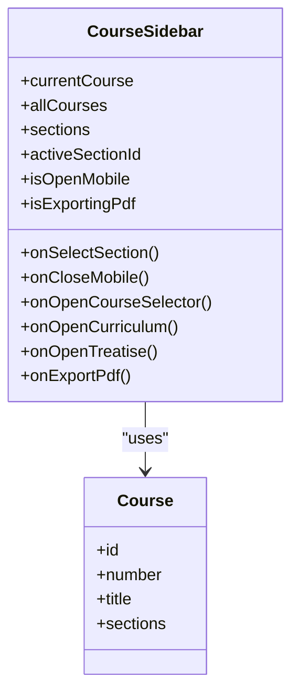
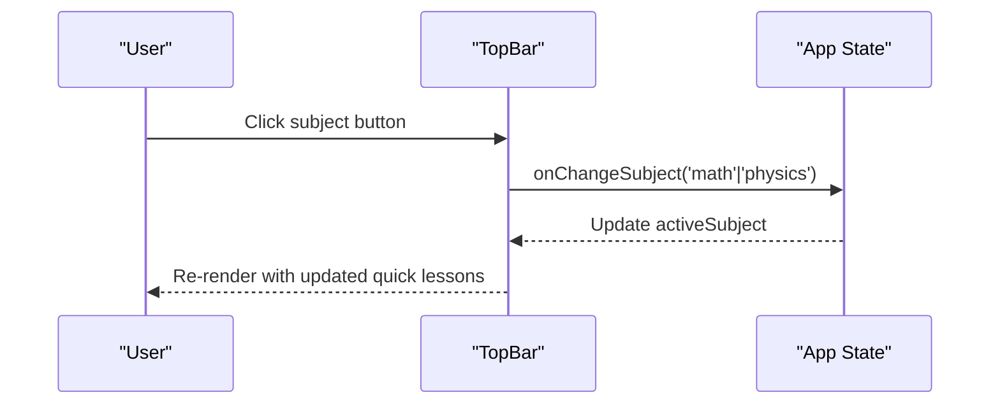
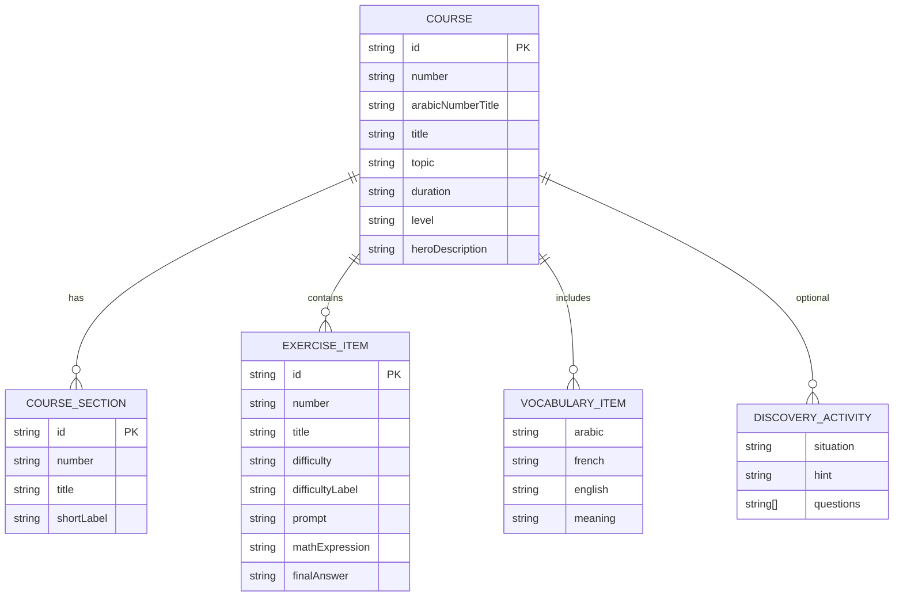
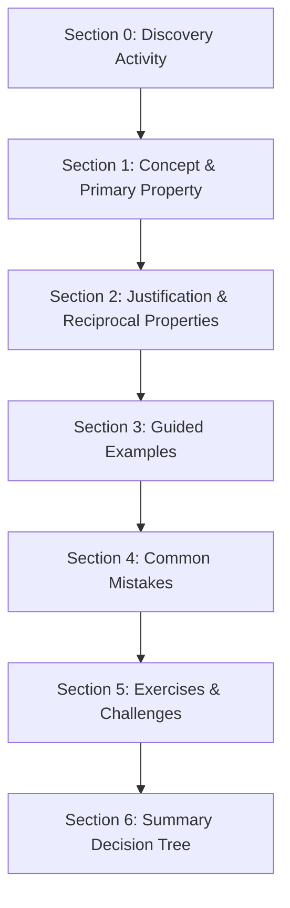
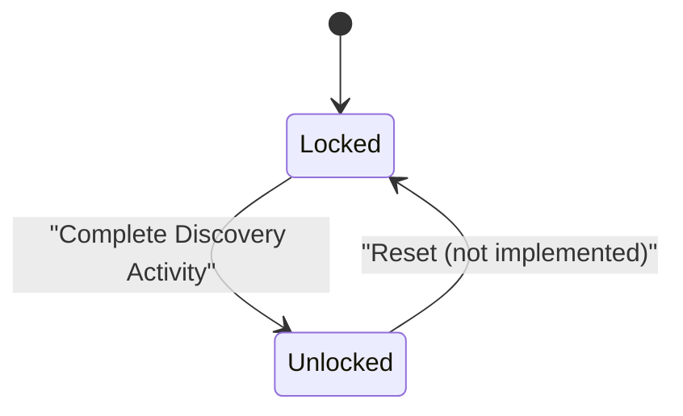
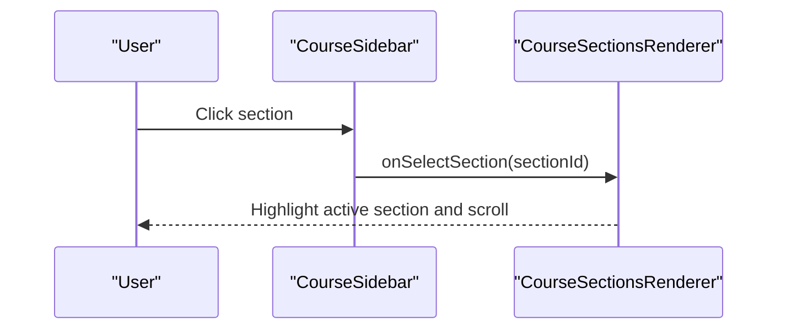
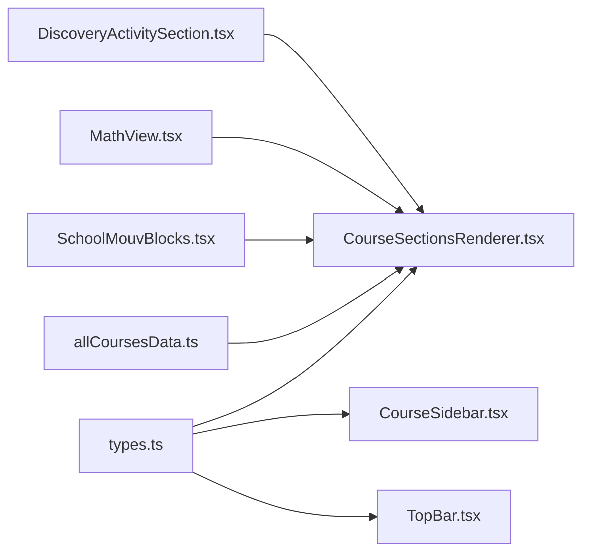

# Course Navigation and Structure

<cite>
**Referenced Files in This Document**
- [CourseSectionsRenderer.tsx](file://src/components/CourseSectionsRenderer.tsx)
- [CourseSidebar.tsx](file://src/components/CourseSidebar.tsx)
- [TopBar.tsx](file://src/components/TopBar.tsx)
- [types.ts](file://src/types.ts)
- [courseData.ts](file://src/data/courseData.ts)
- [allCoursesData.ts](file://src/data/allCoursesData.ts)
- [MathView.tsx](file://src/components/MathView.tsx)
- [DiscoveryActivitySection.tsx](file://src/components/DiscoveryActivitySection.tsx)
- [SchoolMouvBlocks.tsx](file://src/components/SchoolMouvBlocks.tsx)
</cite>

## Table of Contents
1. [Introduction](#introduction)
2. [Project Structure](#project-structure)
3. [Core Components](#core-components)
4. [Architecture Overview](#architecture-overview)
5. [Detailed Component Analysis](#detailed-component-analysis)
6. [Dependency Analysis](#dependency-analysis)
7. [Performance Considerations](#performance-considerations)
8. [Troubleshooting Guide](#troubleshooting-guide)
9. [Conclusion](#conclusion)
10. [Appendices](#appendices)

## Introduction
This document explains the course navigation and structure system for the mathematics module. It focuses on:
- How sections are rendered by the content renderer
- How navigation is provided through the sidebar and top bar
- The data model used to organize courses
- The rendering pipeline for different section types
- Progress tracking integration via discovery completion
- Extensibility patterns for adding new course content
- Responsive layout behavior across devices

The goal is to make it easy for developers to understand how components interact, how to add new sections, and how state flows between navigation and content.

## Project Structure
At a high level, the system consists of:
- Data layer: course definitions, sections, exercises, and curriculum metadata
- UI layer: top bar for subject switching and quick lesson navigation, sidebar for per-course section navigation, and a main content renderer that composes sections
- Shared building blocks: typed blocks, section titles, math text formatting, and discovery activity scaffolding

**Diagram sources**
- [allCoursesData.ts:3-200](file://src/data/allCoursesData.ts#L3-L200)
- [types.ts:1-147](file://src/types.ts#L1-L147)
- [TopBar.tsx:47-386](file://src/components/TopBar.tsx#L47-L386)
- [CourseSidebar.tsx:24-282](file://src/components/CourseSidebar.tsx#L24-L282)
- [CourseSectionsRenderer.tsx:135-740](file://src/components/CourseSectionsRenderer.tsx#L135-L740)
- [SchoolMouvBlocks.tsx:1-200](file://src/components/SchoolMouvBlocks.tsx#L1-L200)
- [MathView.tsx:129-195](file://src/components/MathView.tsx#L129-L195)
- [DiscoveryActivitySection.tsx:1-200](file://src/components/DiscoveryActivitySection.tsx#L1-L200)

**Section sources**
- [allCoursesData.ts:3-200](file://src/data/allCoursesData.ts#L3-L200)
- [types.ts:1-147](file://src/types.ts#L1-L147)
- [TopBar.tsx:47-386](file://src/components/TopBar.tsx#L47-L386)
- [CourseSidebar.tsx:24-282](file://src/components/CourseSidebar.tsx#L24-L282)
- [CourseSectionsRenderer.tsx:135-740](file://src/components/CourseSectionsRenderer.tsx#L135-L740)
- [SchoolMouvBlocks.tsx:1-200](file://src/components/SchoolMouvBlocks.tsx#L1-L200)
- [MathView.tsx:129-195](file://src/components/MathView.tsx#L129-L195)
- [DiscoveryActivitySection.tsx:1-200](file://src/components/DiscoveryActivitySection.tsx#L1-L200)

## Core Components
- CourseSectionsRenderer: Renders the full course card with sections, tabs, prerequisites, guided examples, common mistakes, exercises, summary decision tree, and geometry treatise links. It also manages local progress for unlocking quiz and video tabs after completing the discovery activity.
- CourseSidebar: Provides per-course section navigation, previous/next lesson navigation, PDF export, geometry treatise reference, curriculum view, and responsive mobile drawer behavior.
- TopBar: Provides subject switching (Mathematics vs Physics-Chemistry), current course identification, quick lesson switcher, PDF export, geometry treatise link, curriculum link, fullscreen toggle, and responsive mobile menu.

Key responsibilities:
- Rendering pipeline: Discovery Activity → Concept → Property/Justification → Guided Examples → Common Mistakes → Exercises → Summary Decision Tree
- Navigation state: Active tab within a course, active section in sidebar, current course selection from top bar or sidebar
- Progress integration: Local storage of completed discovery activities to unlock additional tabs and reveal more sidebar sections

**Section sources**
- [CourseSectionsRenderer.tsx:135-740](file://src/components/CourseSectionsRenderer.tsx#L135-L740)
- [CourseSidebar.tsx:24-282](file://src/components/CourseSidebar.tsx#L24-L282)
- [TopBar.tsx:47-386](file://src/components/TopBar.tsx#L47-L386)

## Architecture Overview
The architecture follows a unidirectional data flow:
- Data: COURSES_DATA defines each course’s structure, including sections, formulas, examples, exercises, and vocabulary.
- State: Components manage local UI state (active tab, unlocked discovery IDs). Cross-component communication uses props and events.
- Rendering: CourseSectionsRenderer composes multiple subcomponents to render sections based on course data.
- Navigation: TopBar and CourseSidebar coordinate course and section selection.

**Diagram sources**
- [TopBar.tsx:310-337](file://src/components/TopBar.tsx#L310-L337)
- [CourseSidebar.tsx:98-127](file://src/components/CourseSidebar.tsx#L98-L127)
- [CourseSectionsRenderer.tsx:143-174](file://src/components/CourseSectionsRenderer.tsx#L143-L174)

## Detailed Component Analysis

### CourseSectionsRenderer
Responsibilities:
- Manage internal tab state for cours/video/quiz/exercices/defis
- Unlock tabs after completing discovery activity
- Build properties list for Section 2 (justification and reciprocal properties)
- Render structured sections: concept, property, guided examples, common mistakes, exercises, summary decision tree
- Provide prerequisite links and geometry treatise links
- Integrate PDF export and continuity navigation

Rendering pipeline:
1. Header with course number/title
2. Quiz tab (only if discovery completed)
3. Discovery Activity Section (Section 0)
4. Concept section with vocabulary, visual lab, and primary property
5. Justification and optional reciprocal properties
6. Guided examples
7. Common mistakes
8. Exercises and challenges
9. Summary decision tree
10. Geometry treatise links (for geometry courses)
11. Previous/Next course continuity

Progress integration:
- Uses localStorage key to track unlocked discovery IDs
- Emits a custom event when unlocked IDs change so other components can react
- Scrolls to specific sections when switching tabs

Extensibility points:
- Add new visual labs by extending the switch mapping for course.id
- Add new properties by updating buildPropertiesList
- Add new section types by inserting new sections and corresponding subcomponents

Responsive behavior:
- Content card has max-width constraints and padding adjustments for small screens
- Tabs grid adapts to screen size
- Scroll-to-section logic ensures smooth navigation

**Diagram sources**
- [CourseSectionsRenderer.tsx:143-174](file://src/components/CourseSectionsRenderer.tsx#L143-L174)
- [CourseSectionsRenderer.tsx:342-351](file://src/components/CourseSectionsRenderer.tsx#L342-L351)
- [CourseSectionsRenderer.tsx:484-715](file://src/components/CourseSectionsRenderer.tsx#L484-L715)

**Section sources**
- [CourseSectionsRenderer.tsx:135-740](file://src/components/CourseSectionsRenderer.tsx#L135-L740)

### CourseSidebar
Responsibilities:
- Display per-course sections with active indicator
- Lock remaining sections until discovery activity is completed
- Provide previous/next course navigation
- Offer PDF export, geometry treatise reference, curriculum view, and course selector access
- Handle mobile drawer open/close and backdrop

Navigation state:
- Tracks active section id and highlights it
- Computes visible sections based on discovery completion
- Calculates previous/next course indices

Responsive behavior:
- Fixed position on desktop; slides in from right on mobile with backdrop
- Collapses to drawer mode with overlay

**Diagram sources**
- [CourseSidebar.tsx:24-282](file://src/components/CourseSidebar.tsx#L24-L282)
- [types.ts:70-146](file://src/types.ts#L70-L146)

**Section sources**
- [CourseSidebar.tsx:24-282](file://src/components/CourseSidebar.tsx#L24-L282)

### TopBar
Responsibilities:
- Subject switching between Mathematics and Physics-Chemistry
- Current course identification and quick lesson switcher
- PDF export button
- Geometry treatise reference and curriculum view buttons
- Fullscreen toggle
- Mobile menu toggle

Subject switching:
- Toggles activeSubject between 'math' and 'physics'
- Updates quick lesson switcher accordingly

Responsive behavior:
- Shows/hides elements based on screen size and view mode
- Collapses into compact controls on mobile

**Diagram sources**
- [TopBar.tsx:96-127](file://src/components/TopBar.tsx#L96-L127)
- [TopBar.tsx:310-381](file://src/components/TopBar.tsx#L310-L381)

**Section sources**
- [TopBar.tsx:47-386](file://src/components/TopBar.tsx#L47-L386)

### Data Model for Mathematics Courses
The Course type defines the complete structure for a mathematics course:
- Identification: id, number, arabicNumberTitle, title, topic, duration, level
- Hero and objectives: heroDescription, objectives
- Sections: array of CourseSection objects
- Discovery activity: optional structured activity with questions, hints, correction
- Formulas: primaryFormula and secondaryFormulas
- Visual model: type and data for interactive visualization
- Before/after transformation: optional pedagogical framing
- Guided examples: step-by-step examples with diagrams and steps
- Common mistakes: pitfalls and corrections
- Exercises: array of ExerciseItem with difficulty, prompt, solution steps
- Summary rules and key takeaways: concise references
- Mindmap: decision tree structure
- Vocabulary: bilingual terms with meanings

**Diagram sources**
- [types.ts:1-147](file://src/types.ts#L1-L147)

**Section sources**
- [types.ts:1-147](file://src/types.ts#L1-L147)
- [allCoursesData.ts:3-200](file://src/data/allCoursesData.ts#L3-L200)

### Rendering Pipeline for Different Section Types
The renderer composes sections in a fixed order:
- Section 0: Discovery Activity
- Section 1: Definition, visual reading, and primary property
- Section 2: Mathematical justification and optional reciprocal properties
- Section 3: Guided examples
- Section 4: Common mistakes
- Section 5: Exercises and challenges
- Section 6: Summary decision tree

Each section uses shared blocks:
- TypedBlock for definition/property/example/tip/remind
- SectionTitle for numbered headings
- MathView/formatTextWithSuperscripts for formatted math text

**Diagram sources**
- [CourseSectionsRenderer.tsx:484-715](file://src/components/CourseSectionsRenderer.tsx#L484-L715)
- [SchoolMouvBlocks.tsx:174-200](file://src/components/SchoolMouvBlocks.tsx#L174-L200)
- [MathView.tsx:129-195](file://src/components/MathView.tsx#L129-L195)

**Section sources**
- [CourseSectionsRenderer.tsx:484-715](file://src/components/CourseSectionsRenderer.tsx#L484-L715)
- [SchoolMouvBlocks.tsx:174-200](file://src/components/SchoolMouvBlocks.tsx#L174-L200)
- [MathView.tsx:129-195](file://src/components/MathView.tsx#L129-L195)

### Progress Tracking Integration
- Discovery completion unlocks:
  - Quiz tab in CourseSectionsRenderer
  - Additional sections in CourseSidebar beyond the first one
- Persistence:
  - Uses localStorage with a dedicated key
  - Emits a custom event to sync other components
- Behavior:
  - When discovery completes, the renderer scrolls to the concept section
  - Sidebar shows a locked message until completion

**Diagram sources**
- [CourseSectionsRenderer.tsx:143-174](file://src/components/CourseSectionsRenderer.tsx#L143-L174)
- [CourseSidebar.tsx:39-62](file://src/components/CourseSidebar.tsx#L39-L62)

**Section sources**
- [CourseSectionsRenderer.tsx:143-174](file://src/components/CourseSectionsRenderer.tsx#L143-L174)
- [CourseSidebar.tsx:39-62](file://src/components/CourseSidebar.tsx#L39-L62)

### Adding New Course Sections
To add a new section:
1. Define the section metadata in the course’s sections array (e.g., id, number, title, shortLabel)
2. Insert the section rendering block in CourseSectionsRenderer at the desired position
3. Use shared blocks like TypedBlock and SectionTitle for consistent styling
4. If the section requires interactive visuals, extend the visual lab mapping or create a new component
5. Update any prerequisite or navigation logic if needed

Example pattern:
- Add section metadata in course data
- Render section with SectionTitle and TypedBlock
- Integrate with existing sections (e.g., exercises, summary)

**Section sources**
- [allCoursesData.ts:20-27](file://src/data/allCoursesData.ts#L20-L27)
- [CourseSectionsRenderer.tsx:651-715](file://src/components/CourseSectionsRenderer.tsx#L651-L715)
- [SchoolMouvBlocks.tsx:174-200](file://src/components/SchoolMouvBlocks.tsx#L174-L200)

### Managing Navigation State
- Within a course:
  - Active tab state controls which content is shown (cours/video/quiz/exercices/defis)
  - handleTabClick updates state and scrolls to relevant sections
- Across courses:
  - onSelectCourse changes the current course
  - Sidebar computes previous/next courses and provides navigation buttons
- Between components:
  - TopBar emits onSelectCourse
  - Sidebar emits onSelectSection
  - Renderer consumes these callbacks to update UI

**Diagram sources**
- [CourseSidebar.tsx:107-127](file://src/components/CourseSidebar.tsx#L107-L127)
- [CourseSectionsRenderer.tsx:342-351](file://src/components/CourseSectionsRenderer.tsx#L342-L351)

**Section sources**
- [CourseSidebar.tsx:107-127](file://src/components/CourseSidebar.tsx#L107-L127)
- [CourseSectionsRenderer.tsx:342-351](file://src/components/CourseSectionsRenderer.tsx#L342-L351)

### Responsive Layouts
- TopBar:
  - Collapses controls on mobile
  - Shows/hides quick lesson switcher based on subject
- CourseSidebar:
  - Slides in from right on mobile with backdrop
  - Sticky on desktop
- CourseSectionsRenderer:
  - Content card adapts padding and width
  - Tabs grid adjusts for small screens
  - Scroll-to-section ensures visibility

**Section sources**
- [TopBar.tsx:73-386](file://src/components/TopBar.tsx#L73-L386)
- [CourseSidebar.tsx:71-282](file://src/components/CourseSidebar.tsx#L71-L282)
- [CourseSectionsRenderer.tsx:353-447](file://src/components/CourseSectionsRenderer.tsx#L353-L447)

## Dependency Analysis
Components depend on shared types and data:
- CourseSectionsRenderer depends on Course, CourseSection, ExerciseItem, and shared blocks
- CourseSidebar depends on Course and CourseSection
- TopBar depends on Course and physics-chemistry types
- MathView provides text formatting utilities used throughout

**Diagram sources**
- [types.ts:1-147](file://src/types.ts#L1-L147)
- [allCoursesData.ts:3-200](file://src/data/allCoursesData.ts#L3-L200)
- [CourseSectionsRenderer.tsx:1-35](file://src/components/CourseSectionsRenderer.tsx#L1-L35)
- [CourseSidebar.tsx:1-22](file://src/components/CourseSidebar.tsx#L1-L22)
- [TopBar.tsx:1-45](file://src/components/TopBar.tsx#L1-L45)
- [SchoolMouvBlocks.tsx:1-200](file://src/components/SchoolMouvBlocks.tsx#L1-L200)
- [MathView.tsx:1-200](file://src/components/MathView.tsx#L1-L200)
- [DiscoveryActivitySection.tsx:1-200](file://src/components/DiscoveryActivitySection.tsx#L1-L200)

**Section sources**
- [types.ts:1-147](file://src/types.ts#L1-L147)
- [allCoursesData.ts:3-200](file://src/data/allCoursesData.ts#L3-L200)
- [CourseSectionsRenderer.tsx:1-35](file://src/components/CourseSectionsRenderer.tsx#L1-L35)
- [CourseSidebar.tsx:1-22](file://src/components/CourseSidebar.tsx#L1-L22)
- [TopBar.tsx:1-45](file://src/components/TopBar.tsx#L1-L45)
- [SchoolMouvBlocks.tsx:1-200](file://src/components/SchoolMouvBlocks.tsx#L1-L200)
- [MathView.tsx:1-200](file://src/components/MathView.tsx#L1-L200)
- [DiscoveryActivitySection.tsx:1-200](file://src/components/DiscoveryActivitySection.tsx#L1-L200)

## Performance Considerations
- Avoid unnecessary re-renders by keeping state localized where possible
- Use memoization for expensive computations (e.g., building properties list)
- Defer heavy operations (like PDF export) behind user actions
- Minimize DOM queries by using refs or stable IDs for scrolling

[No sources needed since this section provides general guidance]

## Troubleshooting Guide
Common issues and resolutions:
- Tabs not appearing: Ensure discovery activity is completed; check localStorage for unlocked IDs
- Section not scrolling into view: Verify section IDs exist and handleTabClick triggers scroll
- Sidebar sections locked: Confirm discovery completion; check visibleSections logic
- Math text not formatted: Ensure formatTextWithSuperscripts is applied to titles and descriptions
- PDF export disabled: Check isExportingPdf prop and onExportPdf callback

**Section sources**
- [CourseSectionsRenderer.tsx:143-174](file://src/components/CourseSectionsRenderer.tsx#L143-L174)
- [CourseSidebar.tsx:39-62](file://src/components/CourseSidebar.tsx#L39-L62)
- [MathView.tsx:129-195](file://src/components/MathView.tsx#L129-L195)

## Conclusion
The course navigation and structure system provides a robust, extensible framework for delivering mathematics lessons. It combines clear data modeling, modular rendering, and responsive navigation to support both learning progression and user exploration. By following the documented patterns, developers can add new sections, integrate interactive visuals, and maintain consistent UX across devices.

[No sources needed since this section summarizes without analyzing specific files]

## Appendices
- Example: Adding a new course section
  - Define section metadata in course data
  - Render section in CourseSectionsRenderer using shared blocks
  - Update navigation if necessary

- Example: Managing navigation state
  - Use onSelectCourse and onSelectSection callbacks
  - Keep active tab and section state synchronized

- Example: Handling responsive layouts
  - Use Tailwind classes for adaptive grids and spacing
  - Implement mobile drawer for sidebar

[No sources needed since this section provides general guidance]