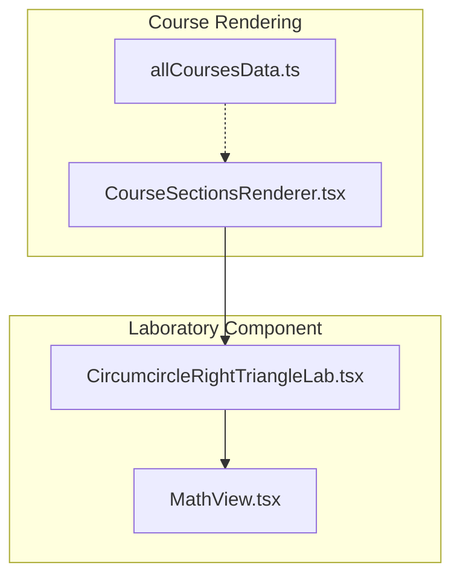
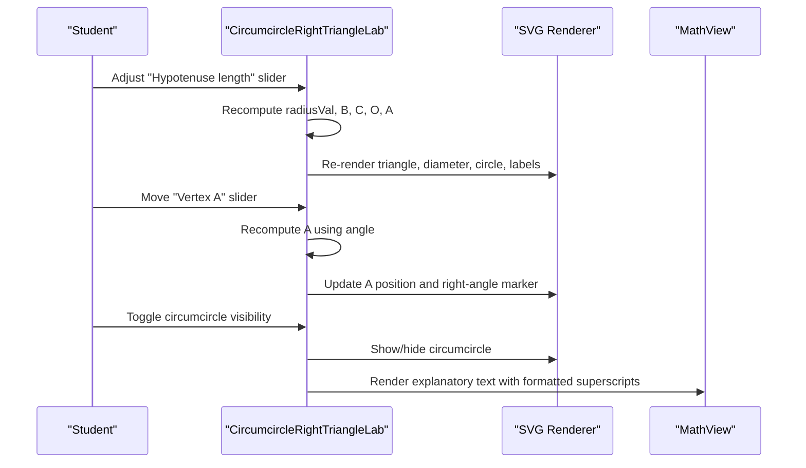
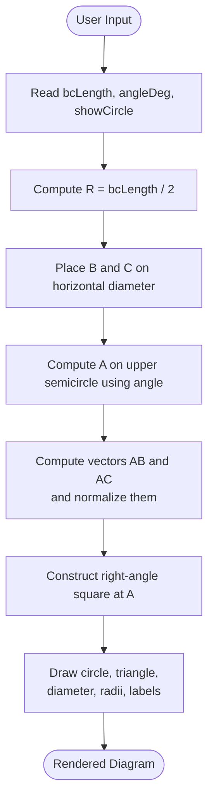
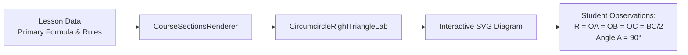
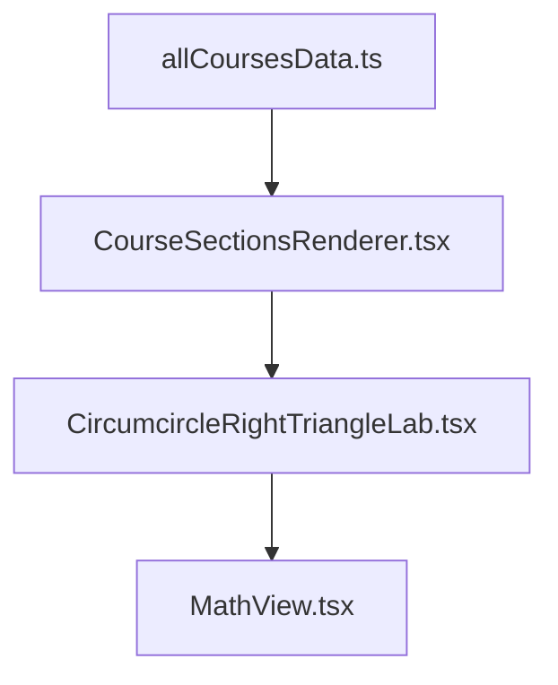

# Circumcircle Properties Laboratory

<cite>
**Referenced Files in This Document**
- [CircumcircleRightTriangleLab.tsx](file://src/components/CircumcircleRightTriangleLab.tsx)
- [MathView.tsx](file://src/components/MathView.tsx)
- [CourseSectionsRenderer.tsx](file://src/components/CourseSectionsRenderer.tsx)
- [allCoursesData.ts](file://src/data/allCoursesData.ts)
</cite>

## Table of Contents
1. [Introduction](#introduction)
2. [Project Structure](#project-structure)
3. [Core Components](#core-components)
4. [Architecture Overview](#architecture-overview)
5. [Detailed Component Analysis](#detailed-component-analysis)
6. [Dependency Analysis](#dependency-analysis)
7. [Performance Considerations](#performance-considerations)
8. [Troubleshooting Guide](#troubleshooting-guide)
9. [Conclusion](#conclusion)

## Introduction
The Circumcircle Properties Laboratory is an interactive educational component that helps students explore the circumcircle properties of right triangles. It visualizes how, for a right triangle ABC with the right angle at A:
- The hypotenuse BC is the diameter of the circumcircle.
- The circumcenter O is the midpoint of BC.
- The circumradius R equals OA = OB = OC and also equals half of BC.

Students can manipulate the length of the hypotenuse and move vertex A along the semicircle while observing that the right angle remains 90 degrees and the circumcircle always passes through all three vertices. The component combines geometric construction, mathematical explanation, and dynamic SVG visualization to make abstract geometry accessible.

## Project Structure
This laboratory is implemented as a single React component that renders an SVG diagram and accompanying explanatory text. It is integrated into the course renderer and uses shared math rendering utilities.

**Diagram sources**
- [CourseSectionsRenderer.tsx:18-225](file://src/components/CourseSectionsRenderer.tsx#L18-L225)
- [CircumcircleRightTriangleLab.tsx:1-262](file://src/components/CircumcircleRightTriangleLab.tsx#L1-L262)
- [MathView.tsx:129-195](file://src/components/MathView.tsx#L129-L195)
- [allCoursesData.ts:3450-3454](file://src/data/allCoursesData.ts#L3450-L3454)

**Section sources**
- [CourseSectionsRenderer.tsx:18-225](file://src/components/CourseSectionsRenderer.tsx#L18-L225)
- [CircumcircleRightTriangleLab.tsx:1-262](file://src/components/CircumcircleRightTriangleLab.tsx#L1-L262)
- [MathView.tsx:129-195](file://src/components/MathView.tsx#L129-L195)
- [allCoursesData.ts:3450-3454](file://src/data/allCoursesData.ts#L3450-L3454)

## Core Components
- Interactive Geometry Visualization: An SVG-based drawing of the right triangle ABC inscribed in its circumcircle (C), with highlighted elements such as the hypotenuse/diameter, radius segments, and right-angle marker.
- Stateful Controls: Sliders adjust the hypotenuse length and the position of vertex A on the circle; a toggle shows or hides the circumcircle.
- Mathematical Explanation Panel: Textual reading of the diagram, identifying BC as diameter, O as midpoint/circumcenter, and R as the constant distance from O to each vertex.
- Math Formatting Utility: Shared function for formatting superscripts and concept-linked text used by the lab’s explanations.

Key responsibilities:
- Compute coordinates for B, C, O, and A based on user inputs.
- Draw the circumcircle, triangle, diameter, radii, equality ticks, and labels.
- Provide invariant observations (angle A remains 90°, R equals half of BC).

**Section sources**
- [CircumcircleRightTriangleLab.tsx:4-262](file://src/components/CircumcircleRightTriangleLab.tsx#L4-L262)
- [MathView.tsx:129-195](file://src/components/MathView.tsx#L129-L195)

## Architecture Overview
The component follows a simple React pattern:
- State holds user-controlled parameters (hypotenuse length, angle for A, visibility of the circumcircle).
- Derived values compute geometry (coordinates, vectors, unit vectors, right-angle square points).
- JSX renders SVG elements bound to computed coordinates and state.
- Supporting text explains geometric roles and relationships.

**Diagram sources**
- [CircumcircleRightTriangleLab.tsx:6-213](file://src/components/CircumcircleRightTriangleLab.tsx#L6-L213)
- [MathView.tsx:129-195](file://src/components/MathView.tsx#L129-L195)

## Detailed Component Analysis

### Geometry Model and Coordinate Computation
The lab models a right triangle ABC with:
- Center O at a fixed SVG coordinate.
- Diameter BC horizontal, with B left and C right.
- Vertex A constrained to lie on the upper semicircle.

Core computations:
- Radius R is derived from the displayed hypotenuse length: R = BC / 2.
- Coordinates:
  - O = (cx, cy)
  - B = (cx − R, cy)
  - C = (cx + R, cy)
  - A = (cx + R·cos θ, cy − R·sin θ), where θ is computed from the user-controlled angle.
- Right-angle marker at A is constructed using normalized vectors along AB and AC.

Invariant properties demonstrated:
- Angle BAC remains 90°.
- OA = OB = OC = R.
- BC is the diameter of the circumcircle.

**Diagram sources**
- [CircumcircleRightTriangleLab.tsx:10-39](file://src/components/CircumcircleRightTriangleLab.tsx#L10-L39)

**Section sources**
- [CircumcircleRightTriangleLab.tsx:10-39](file://src/components/CircumcircleRightTriangleLab.tsx#L10-L39)

### Visual Representation Techniques
- Circumcircle (C): Dashed stroke with subtle fill to emphasize it as a reference circle.
- Triangle ABC: Filled polygon with rounded joins for clarity.
- Hypotenuse/Diameter [BC]: Thick solid line to highlight its role as diameter.
- Radius/Median [OA]: Dashed segment connecting O to A.
- Equality Ticks: Small marks on OB, OC, and OA indicating equal lengths.
- Labels: Vertices B, C, O, A are labeled; R values are shown near segments.

These techniques help students visually connect the algebraic facts (R = OA = OB = OC = BC/2) with the geometric picture.

**Section sources**
- [CircumcircleRightTriangleLab.tsx:63-179](file://src/components/CircumcircleRightTriangleLab.tsx#L63-L179)

### Interactive Controls and Student Exploration
Controls provided:
- Hypotenuse Length Slider: Adjusts BC from a minimum to maximum range, updating R accordingly.
- Vertex A Position Slider: Moves A along the semicircle, demonstrating that angle A stays 90° and the circumcircle still passes through A, B, and C.
- Circumcircle Visibility Toggle: Allows focusing on the triangle and diameter without the circle overlay.

Educational outcomes:
- Students observe that moving A does not change the right angle at A.
- Changing BC scales the circumcircle but preserves the relationship R = BC/2.
- Hiding/showing the circle helps isolate specific geometric features.

**Section sources**
- [CircumcircleRightTriangleLab.tsx:181-213](file://src/components/CircumcircleRightTriangleLab.tsx#L181-L213)

### Mathematical Explanations and Notation
The panel beside the diagram reads the figure and identifies:
- BC as the hypotenuse and diameter of the circumcircle.
- O as the midpoint of BC and the circumcenter.
- R as the constant distance from O to each vertex.

Text formatting leverages a utility that:
- Converts Unicode superscripts and caret expressions into proper HTML superscripts.
- Highlights fundamental concepts for clickable reminders.

This ensures that mathematical notation remains readable and consistent across the application.

**Section sources**
- [CircumcircleRightTriangleLab.tsx:218-256](file://src/components/CircumcircleRightTriangleLab.tsx#L218-L256)
- [MathView.tsx:129-195](file://src/components/MathView.tsx#L129-L195)

### Integration with Course Content
The lab is embedded within the course renderer and associated with lesson content about the circumcircle of a right triangle. The course data defines the primary formula and summary rules that align with the lab’s demonstrations:
- Direct property: For a right triangle, the hypotenuse is the diameter, the center is the midpoint, and R = BC/2.
- Converse property: If BC is a diameter and A lies on the circle, then angle BAC is 90°.

**Diagram sources**
- [allCoursesData.ts:3450-3454](file://src/data/allCoursesData.ts#L3450-L3454)
- [allCoursesData.ts:3586-3600](file://src/data/allCoursesData.ts#L3586-L3600)
- [CourseSectionsRenderer.tsx:244-267](file://src/components/CourseSectionsRenderer.tsx#L244-L267)
- [CourseSectionsRenderer.tsx:225-225](file://src/components/CourseSectionsRenderer.tsx#L225-L225)

**Section sources**
- [allCoursesData.ts:3450-3454](file://src/data/allCoursesData.ts#L3450-L3454)
- [allCoursesData.ts:3586-3600](file://src/data/allCoursesData.ts#L3586-L3600)
- [CourseSectionsRenderer.tsx:225-225](file://src/components/CourseSectionsRenderer.tsx#L225-L225)
- [CourseSectionsRenderer.tsx:244-267](file://src/components/CourseSectionsRenderer.tsx#L244-L267)

## Dependency Analysis
- Internal Dependencies:
  - CircumcircleRightTriangleLab depends on MathView for text formatting.
  - CourseSectionsRenderer imports and renders CircumcircleRightTriangleLab.
  - allCoursesData provides lesson metadata and formulas that contextualize the lab.
- Coupling:
  - The lab is loosely coupled to the renderer via a direct import.
  - MathView is reused across the app for consistent math typography.
- External Libraries:
  - React for component state and rendering.
  - KaTeX via MathView for LaTeX rendering elsewhere in the app.

**Diagram sources**
- [CourseSectionsRenderer.tsx:18-225](file://src/components/CourseSectionsRenderer.tsx#L18-L225)
- [CircumcircleRightTriangleLab.tsx:1-2](file://src/components/CircumcircleRightTriangleLab.tsx#L1-L2)
- [MathView.tsx:1-4](file://src/components/MathView.tsx#L1-L4)
- [allCoursesData.ts:3450-3454](file://src/data/allCoursesData.ts#L3450-L3454)

**Section sources**
- [CourseSectionsRenderer.tsx:18-225](file://src/components/CourseSectionsRenderer.tsx#L18-L225)
- [CircumcircleRightTriangleLab.tsx:1-2](file://src/components/CircumcircleRightTriangleLab.tsx#L1-L2)
- [MathView.tsx:1-4](file://src/components/MathView.tsx#L1-L4)
- [allCoursesData.ts:3450-3454](file://src/data/allCoursesData.ts#L3450-L3454)

## Performance Considerations
- Lightweight SVG Rendering: The diagram uses simple SVG primitives (circle, polygon, line, text), which are efficient for real-time updates.
- Minimal State: Only three state variables control the visualization, reducing re-render overhead.
- No Heavy Animations: Interactions update coordinates directly without animation frames, keeping responsiveness smooth.
- Scalability: The component is self-contained and can be reused multiple times without significant performance cost.

[No sources needed since this section provides general guidance]

## Troubleshooting Guide
Common issues and resolutions:
- Circle Not Visible: Ensure the circumcircle visibility toggle is enabled. The component conditionally renders the circle based on state.
- Triangle Looks Distorted: Verify that the hypotenuse slider is within the configured range and that the angle slider places A on the intended semicircle.
- Labels Overlapping: Adjust browser zoom or screen size; the SVG scales responsively within its container.
- Math Text Formatting: If superscripts appear incorrectly, confirm that the text formatting utility is available and functioning.

**Section sources**
- [CircumcircleRightTriangleLab.tsx:50-60](file://src/components/CircumcircleRightTriangleLab.tsx#L50-L60)
- [CircumcircleRightTriangleLab.tsx:181-213](file://src/components/CircumcircleRightTriangleLab.tsx#L181-L213)
- [MathView.tsx:129-195](file://src/components/MathView.tsx#L129-L195)

## Conclusion
The Circumcircle Properties Laboratory effectively bridges theory and visualization for right triangle circumcircles. By allowing students to manipulate the hypotenuse and vertex A, it reinforces key geometric invariants:
- The hypotenuse is the diameter of the circumcircle.
- The circumcenter is the midpoint of the hypotenuse.
- The circumradius equals half the hypotenuse and is equidistant from all vertices.

Through clear SVG visuals, concise explanations, and interactive controls, the component makes abstract geometry tangible and supports deeper understanding of Thales’ theorem and related properties.

[No sources needed since this section summarizes without analyzing specific files]