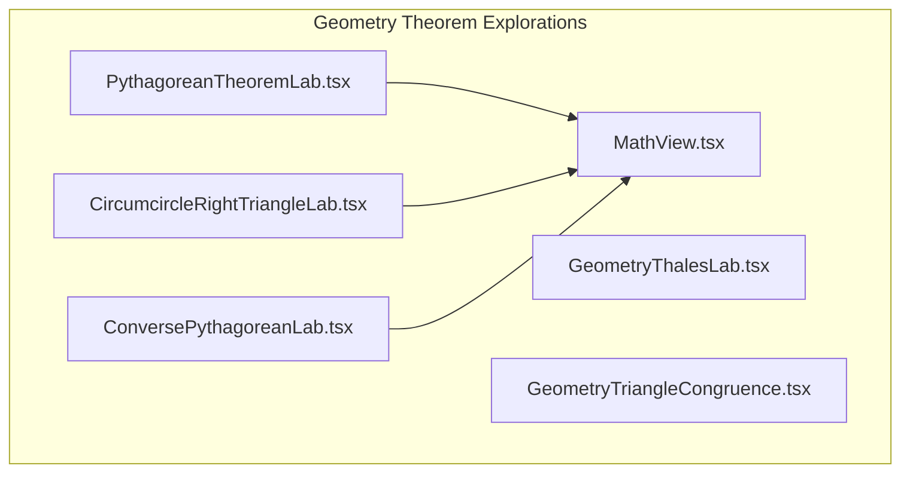
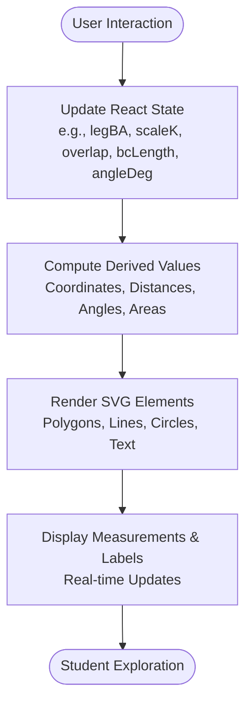
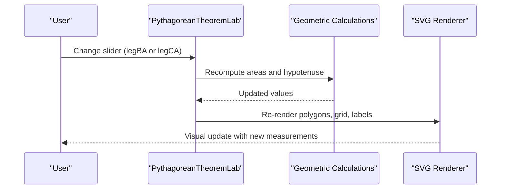
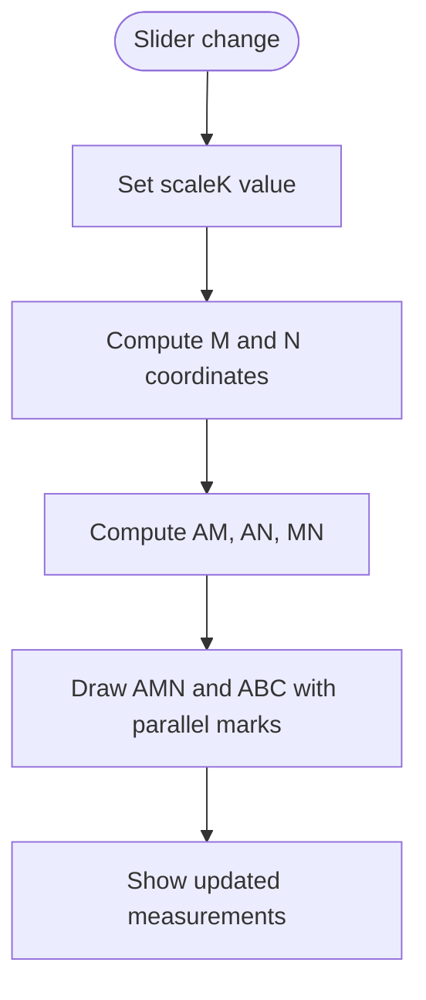
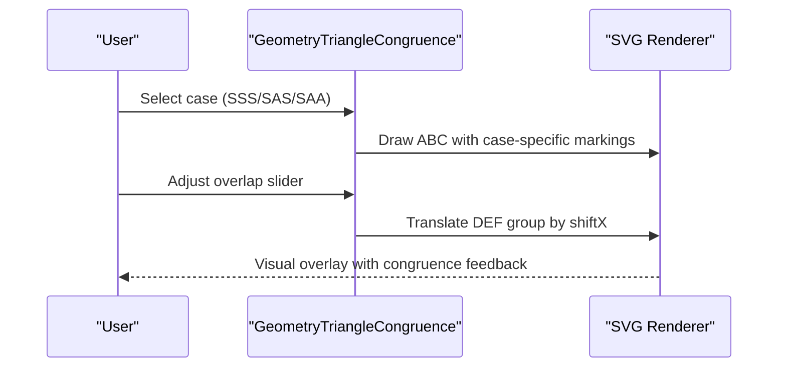
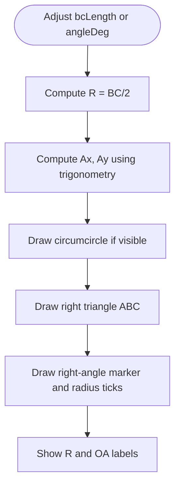
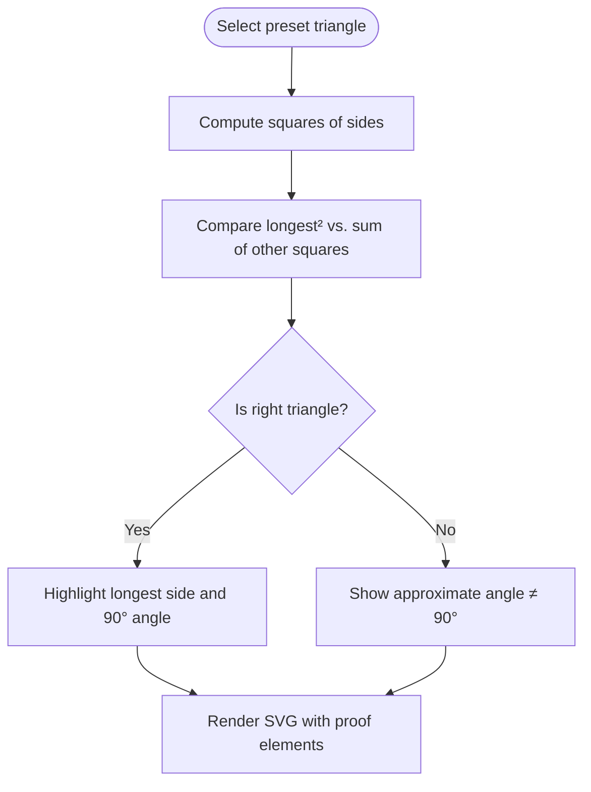
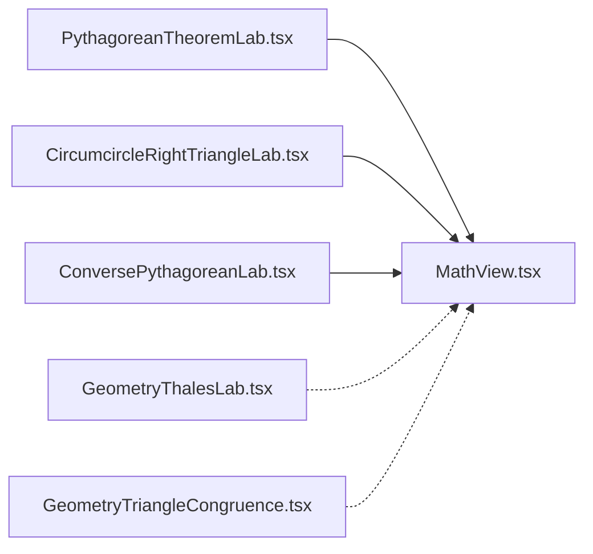

# Geometry Theorem Explorations

<cite>
**Referenced Files in This Document**
- [PythagoreanTheoremLab.tsx](file://src/components/PythagoreanTheoremLab.tsx)
- [GeometryThalesLab.tsx](file://src/components/GeometryThalesLab.tsx)
- [GeometryTriangleCongruence.tsx](file://src/components/GeometryTriangleCongruence.tsx)
- [CircumcircleRightTriangleLab.tsx](file://src/components/CircumcircleRightTriangleLab.tsx)
- [ConversePythagoreanLab.tsx](file://src/components/ConversePythagoreanLab.tsx)
- [MathView.tsx](file://src/components/MathView.tsx)
</cite>

## Table of Contents
1. [Introduction](#introduction)
2. [Project Structure](#project-structure)
3. [Core Components](#core-components)
4. [Architecture Overview](#architecture-overview)
5. [Detailed Component Analysis](#detailed-component-analysis)
6. [Dependency Analysis](#dependency-analysis)
7. [Performance Considerations](#performance-considerations)
8. [Troubleshooting Guide](#troubleshooting-guide)
9. [Conclusion](#conclusion)

## Introduction
This document explains the Geometry Theorem Explorations module: a set of interactive geometry theorem visualizations that help students explore mathematical relationships through manipulation. It covers:
- Pythagorean theorem lab with dynamic squares and grid tiles
- Thales’ theorem explorer with a parallel line slider
- Triangle congruence investigation with overlay animation and case tabs
- Circumcircle properties for right triangles with draggable vertex A
- Converse Pythagorean verification with preset triangles and step-by-step proof visualization

Each component uses React state to drive geometric calculations, SVG-based rendering for precise vector graphics, and sliders or buttons for real-time interaction. The shared MathView utility renders LaTeX-style math expressions and Arabic-friendly text formatting used across these components.

## Project Structure
The geometry explorations are implemented as independent React components under `src/components`. Each file encapsulates:
- Stateful parameters (lengths, angles, scale factors, active cases)
- Geometric computations (distances, coordinates, angles, areas)
- SVG drawing primitives (polygons, lines, circles, arcs, text labels)
- Interactive controls (range inputs, toggles, preset selectors)
- Supporting text panels explaining geometric reading and discovery

**Diagram sources**
- [PythagoreanTheoremLab.tsx:1-362](file://src/components/PythagoreanTheoremLab.tsx#L1-L362)
- [GeometryThalesLab.tsx:1-208](file://src/components/GeometryThalesLab.tsx#L1-L208)
- [GeometryTriangleCongruence.tsx:1-162](file://src/components/GeometryTriangleCongruence.tsx#L1-L162)
- [CircumcircleRightTriangleLab.tsx:1-262](file://src/components/CircumcircleRightTriangleLab.tsx#L1-L262)
- [ConversePythagoreanLab.tsx:1-395](file://src/components/ConversePythagoreanLab.tsx#L1-L395)
- [MathView.tsx:1-580](file://src/components/MathView.tsx#L1-L580)

**Section sources**
- [PythagoreanTheoremLab.tsx:1-362](file://src/components/PythagoreanTheoremLab.tsx#L1-L362)
- [GeometryThalesLab.tsx:1-208](file://src/components/GeometryThalesLab.tsx#L1-L208)
- [GeometryTriangleCongruence.tsx:1-162](file://src/components/GeometryTriangleCongruence.tsx#L1-L162)
- [CircumcircleRightTriangleLab.tsx:1-262](file://src/components/CircumcircleRightTriangleLab.tsx#L1-L262)
- [ConversePythagoreanLab.tsx:1-395](file://src/components/ConversePythagoreanLab.tsx#L1-L395)
- [MathView.tsx:1-580](file://src/components/MathView.tsx#L1-L580)

## Core Components
- PythagoreanTheoremLab: Interactive right triangle with three squares on its sides; supports toggling grid tiles and live area/hypotenuse updates.
- GeometryThalesLab: Demonstrates proportional segments when a line is parallel to the base; slider adjusts ratio k = AM/AB = AN/AC = MN/BC.
- GeometryTriangleCongruence: Two triangles ABC and DEF; user slides DEF over ABC to test overlay congruence; tabs switch between SSS, SAS, SAA markings.
- CircumcircleRightTriangleLab: Right triangle inscribed in a circle where hypotenuse is diameter; user changes hypotenuse length and moves vertex A along the semicircle.
- ConversePythagoreanLab: Preset triangles with side lengths; computes whether the triangle is right using converse Pythagoras; shows step-by-step proof elements.
- MathView: Shared math renderer supporting LaTeX via KaTeX, Arabic/French mixed text, superscript formatting, and concept highlighting.

**Section sources**
- [PythagoreanTheoremLab.tsx:12-362](file://src/components/PythagoreanTheoremLab.tsx#L12-L362)
- [GeometryThalesLab.tsx:9-208](file://src/components/GeometryThalesLab.tsx#L9-L208)
- [GeometryTriangleCongruence.tsx:3-162](file://src/components/GeometryTriangleCongruence.tsx#L3-L162)
- [CircumcircleRightTriangleLab.tsx:4-262](file://src/components/CircumcircleRightTriangleLab.tsx#L4-L262)
- [ConversePythagoreanLab.tsx:67-395](file://src/components/ConversePythagoreanLab.tsx#L67-L395)
- [MathView.tsx:1-580](file://src/components/MathView.tsx#L1-L580)

## Architecture Overview
All geometry labs follow a consistent pattern:
- State-driven parameters control geometry
- Pure functions compute derived values (coordinates, distances, angles, areas)
- SVG rendering draws shapes, markers, and labels
- UI controls update state and trigger re-rendering

[No sources needed since this diagram shows conceptual workflow, not actual code structure]

## Detailed Component Analysis

### Pythagorean Theorem Lab
This component visualizes the relationship between the squares built on the legs and the square on the hypotenuse of a right triangle.

Key behaviors:
- Interactive legs BA and CA via range sliders
- Computes areas BA², CA², BC² and hypotenuse BC
- Auto-scales geometry to fit the SVG canvas
- Draws outward squares on each side with optional grid tiles
- Highlights the right-angle marker at A and vertices
- Displays area labels inside each square

Geometric calculation engine:
- Area computation: BA² + CA² = BC²
- Hypotenuse: sqrt(BC²)
- Grid tile rendering only when n is integer and within bounds

Coordinate transformation:
- Computes pixel scaling based on total unit width/height
- Maps geometric units to SVG coordinates
- Positions squares outward from triangle edges

Visual feedback:
- Color-coded squares per side
- Optional grid overlay to visualize cm²
- Real-time text labels showing squared lengths and areas

**Diagram sources**
- [PythagoreanTheoremLab.tsx:12-362](file://src/components/PythagoreanTheoremLab.tsx#L12-L362)

**Section sources**
- [PythagoreanTheoremLab.tsx:12-362](file://src/components/PythagoreanTheoremLab.tsx#L12-L362)

### Thales’ Theorem Explorer
Demonstrates Thales’ theorem by moving a parallel line MN inside triangle ABC.

Key behaviors:
- Slider adjusts ratio k = AM/AB = AN/AC = MN/BC
- Computes positions of M and N using linear interpolation
- Displays dynamic segment lengths AM, AN, MN, and fixed BC
- Uses dashed lines to emphasize parallelism between MN and BC

Geometric calculation engine:
- Linear interpolation: M = A + k*(B - A), N = A + k*(C - A)
- Proportional lengths: am = AB*k, an = AC*k, mn = BC*k

Visual feedback:
- Small triangle AMN highlighted
- Parallel markers on MN and BC
- Live measurement labels near segments

**Diagram sources**
- [GeometryThalesLab.tsx:9-208](file://src/components/GeometryThalesLab.tsx#L9-L208)

**Section sources**
- [GeometryThalesLab.tsx:9-208](file://src/components/GeometryThalesLab.tsx#L9-L208)

### Triangle Congruence Investigation
Allows students to test triangle congruence by overlaying triangle DEF onto ABC.

Key behaviors:
- Tabs switch between SSS, SAS, SAA cases
- Slider controls overlap percentage to slide DEF toward ABC
- Markings indicate corresponding sides and angles per case
- At 100% overlap, displays congruence confirmation message

Geometric calculation engine:
- Horizontal shift computed from overlap percentage
- Case-specific tick marks and arc annotations drawn conditionally

Visual feedback:
- Dashed outline for DEF until fully overlapped
- Color-coded markings for equal sides and angles
- Dynamic status text indicating congruence state

**Diagram sources**
- [GeometryTriangleCongruence.tsx:3-162](file://src/components/GeometryTriangleCongruence.tsx#L3-L162)

**Section sources**
- [GeometryTriangleCongruence.tsx:3-162](file://src/components/GeometryTriangleCongruence.tsx#L3-L162)

### Circumcircle Properties
Explores the property that the hypotenuse of a right triangle is the diameter of its circumcircle.

Key behaviors:
- Slider adjusts hypotenuse length BC (and thus radius R)
- Slider moves vertex A along the upper semicircle
- Toggles visibility of circumcircle
- Draws right-angle marker at A and equality ticks for radii OA, OB, OC

Geometric calculation engine:
- Radius R = BC / 2
- Coordinates of A computed using trigonometry on the circle
- Unit vectors and square marker constructed for right-angle visualization

Visual feedback:
- Circle drawn with dashed stroke
- Highlighted hypotenuse as diameter
- Labels for R and OA = R
- Angle marker at A confirms 90°

**Diagram sources**
- [CircumcircleRightTriangleLab.tsx:4-262](file://src/components/CircumcircleRightTriangleLab.tsx#L4-L262)

**Section sources**
- [CircumcircleRightTriangleLab.tsx:4-262](file://src/components/CircumcircleRightTriangleLab.tsx#L4-L262)

### Converse Pythagorean Verification
Helps students verify whether a triangle is right-angled given its three side lengths.

Key behaviors:
- Preset triangles with predefined side lengths
- Step-by-step construction toggle (basic shape vs. proof elements)
- Computes sum of squares of legs vs. square of longest side
- Uses law of cosines to compute true angle for accurate SVG rendering
- Displays result: right triangle or not

Geometric calculation engine:
- sqLongest vs. sqSide1 + sqSide2 comparison
- Law of cosines: cos(angle) = (a² + b² - c²)/(2ab)
- Coordinate computation via circle intersection for accurate triangle shape

Visual feedback:
- Longest side highlighted in proof step
- Angle marker at top vertex showing 90° or approximate angle
- Side length labels and caption summarizing result

**Diagram sources**
- [ConversePythagoreanLab.tsx:67-395](file://src/components/ConversePythagoreanLab.tsx#L67-L395)

**Section sources**
- [ConversePythagoreanLab.tsx:67-395](file://src/components/ConversePythagoreanLab.tsx#L67-L395)

## Dependency Analysis
Common patterns across components:
- State management via useState for interactive parameters
- Pure geometric computations derived from state
- SVG rendering for precise vector graphics
- Conditional rendering based on state (e.g., showGridTiles, showCircle, activeCase)
- Use of MathView for formatted math expressions and Arabic-friendly text

Shared utilities:
- MathView provides LaTeX rendering via KaTeX and text formatting helpers
- Components import formatTextWithSuperscripts for displaying squared units and mathematical notation

**Diagram sources**
- [PythagoreanTheoremLab.tsx:1-362](file://src/components/PythagoreanTheoremLab.tsx#L1-L362)
- [CircumcircleRightTriangleLab.tsx:1-262](file://src/components/CircumcircleRightTriangleLab.tsx#L1-L262)
- [ConversePythagoreanLab.tsx:1-395](file://src/components/ConversePythagoreanLab.tsx#L1-L395)
- [MathView.tsx:1-580](file://src/components/MathView.tsx#L1-L580)

**Section sources**
- [PythagoreanTheoremLab.tsx:1-362](file://src/components/PythagoreanTheoremLab.tsx#L1-L362)
- [CircumcircleRightTriangleLab.tsx:1-262](file://src/components/CircumcircleRightTriangleLab.tsx#L1-L262)
- [ConversePythagoreanLab.tsx:1-395](file://src/components/ConversePythagoreanLab.tsx#L1-L395)
- [MathView.tsx:1-580](file://src/components/MathView.tsx#L1-L580)

## Performance Considerations
- SVG rendering is lightweight and scales well for simple geometric figures
- Avoid excessive grid tile generation; limit n and check integer constraints
- Use memoization for expensive computations if state changes frequently
- Keep slider ranges reasonable to prevent extreme coordinate values
- Toggle visibility of complex elements (e.g., circumcircle, grid tiles) to reduce render cost

[No sources needed since this section provides general guidance]

## Troubleshooting Guide
Common issues and resolutions:
- Grid tiles not appearing: Ensure n is integer and within allowed range; check showGridTiles toggle
- Incorrect angle display: Verify law of cosines clamping and radian conversion
- Overlap not aligning: Confirm shiftX calculation and transform translation
- Math rendering errors: Check LaTeX syntax and use MathView for safe rendering
- RTL/LTR text alignment: Use appropriate dir attributes and MathView for mixed content

**Section sources**
- [PythagoreanTheoremLab.tsx:55-101](file://src/components/PythagoreanTheoremLab.tsx#L55-L101)
- [ConversePythagoreanLab.tsx:80-104](file://src/components/ConversePythagoreanLab.tsx#L80-L104)
- [MathView.tsx:197-233](file://src/components/MathView.tsx#L197-L233)

## Conclusion
The Geometry Theorem Explorations module provides a cohesive set of interactive visualizations that make abstract geometric proofs tangible. By combining state-driven calculations, SVG rendering, and intuitive controls, students can explore relationships such as the Pythagorean theorem, Thales’ theorem, triangle congruence, and circumcircle properties in real time. The consistent architecture and shared utilities ensure maintainability and clarity across components.

[No sources needed since this section summarizes without analyzing specific files]