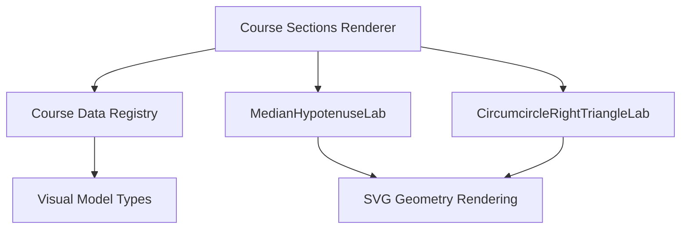
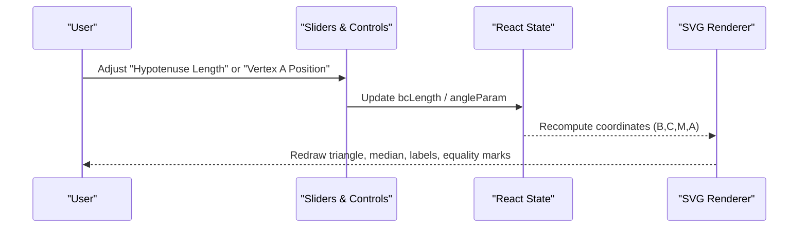
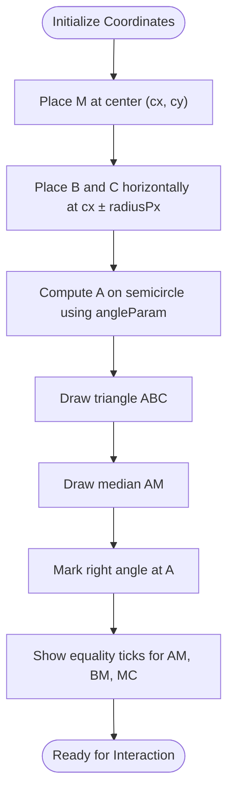
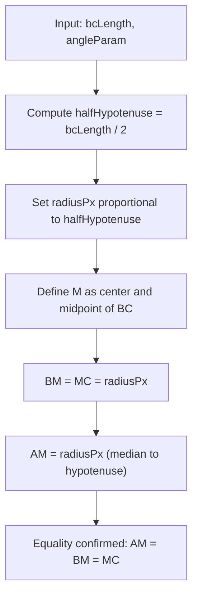
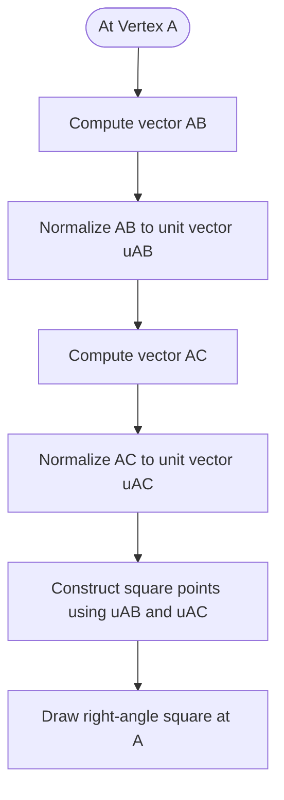
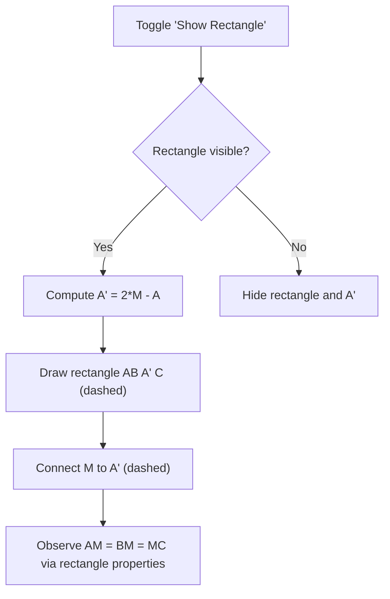
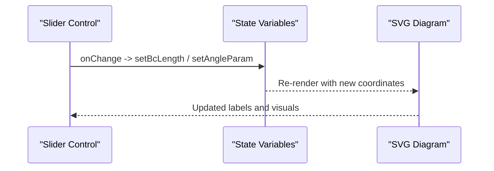
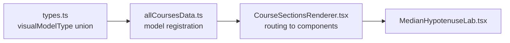

# Median to Hypotenuse Explorer

<cite>
**Referenced Files in This Document**
- [MedianHypotenuseLab.tsx](file://src/components/MedianHypotenuseLab.tsx)
- [CircumcircleRightTriangleLab.tsx](file://src/components/CircumcircleRightTriangleLab.tsx)
- [CourseSectionsRenderer.tsx](file://src/components/CourseSectionsRenderer.tsx)
- [allCoursesData.ts](file://src/data/allCoursesData.ts)
- [types.ts](file://src/types.ts)
</cite>

## Table of Contents
1. [Introduction](#introduction)
2. [Project Structure](#project-structure)
3. [Core Components](#core-components)
4. [Architecture Overview](#architecture-overview)
5. [Detailed Component Analysis](#detailed-component-analysis)
6. [Dependency Analysis](#dependency-analysis)
7. [Performance Considerations](#performance-considerations)
8. [Troubleshooting Guide](#troubleshooting-guide)
9. [Conclusion](#conclusion)

## Introduction
The Median to Hypotenuse Explorer is an interactive, visual learning component that demonstrates a fundamental property of right triangles: the median drawn from the right-angle vertex to the hypotenuse has length equal to half the hypotenuse. In this application, the explorer renders a right triangle ABC with the right angle at A, constructs the midpoint M of the hypotenuse BC, highlights the median AM, and visually confirms that AM equals BM and MC. The tool also provides a discovery aid by constructing a symmetric point A' across M to form a rectangle AB A' C, helping learners connect the median property to central symmetry and the circumcircle of a right triangle.

This documentation explains how the component computes coordinates, constructs geometric elements, displays real-time measurements, and supports pedagogical discovery through interactivity.

## Project Structure
The explorer is implemented as a React component that renders an SVG geometry diagram alongside explanatory text and interactive controls. It is integrated into the course renderer and registered via data-driven model types.

**Diagram sources**
- [CourseSectionsRenderer.tsx:18-20](file://src/components/CourseSectionsRenderer.tsx#L18-L20)
- [CourseSectionsRenderer.tsx:223-225](file://src/components/CourseSectionsRenderer.tsx#L223-L225)
- [allCoursesData.ts:3263](file://src/data/allCoursesData.ts#L3263)
- [types.ts:93](file://src/types.ts#L93)

**Section sources**
- [CourseSectionsRenderer.tsx:18-20](file://src/components/CourseSectionsRenderer.tsx#L18-L20)
- [CourseSectionsRenderer.tsx:223-225](file://src/components/CourseSectionsRenderer.tsx#L223-L225)
- [allCoursesData.ts:3263](file://src/data/allCoursesData.ts#L3263)
- [types.ts:93](file://src/types.ts#L93)

## Core Components
- MedianHypotenuseLab: Renders the right triangle ABC, constructs the midpoint M of BC, draws the median AM, marks the right angle at A, and shows equality tick marks for AM, BM, and MC. It includes sliders to change the hypotenuse length and the position of A along the semicircle, and a toggle to reveal a ghost rectangle AB A' C built by central symmetry about M.
- CircumcircleRightTriangleLab: Complements the median property by showing that the circumcenter O coincides with M and that OA = OB = OC = R = BC/2. This reinforces the theorem through the circumcircle perspective.

Key responsibilities:
- Compute coordinates for B, C, M, and A using a fixed center and radius.
- Normalize vectors to draw a right-angle marker at A.
- Highlight segments BM, MC, and AM with distinct colors and equality markers.
- Provide interactive controls for exploration and discovery.

**Section sources**
- [MedianHypotenuseLab.tsx:12-54](file://src/components/MedianHypotenuseLab.tsx#L12-L54)
- [CircumcircleRightTriangleLab.tsx:4-39](file://src/components/CircumcircleRightTriangleLab.tsx#L4-L39)

## Architecture Overview
The component follows a simple React state-driven architecture:
- State variables control the hypotenuse length (BC), the angular parameter determining A’s position on the semicircle, and whether the rectangle ghost is shown.
- Derived values compute M as the midpoint of BC and A using trigonometric placement on a circle centered at M.
- SVG rendering draws the triangle, median, right-angle marker, equality ticks, labels, and optional rectangle.
- Sliders update state and re-render the diagram instantly.

**Diagram sources**
- [MedianHypotenuseLab.tsx:14-16](file://src/components/MedianHypotenuseLab.tsx#L14-L16)
- [MedianHypotenuseLab.tsx:21-38](file://src/components/MedianHypotenuseLab.tsx#L21-L38)
- [MedianHypotenuseLab.tsx:190-223](file://src/components/MedianHypotenuseLab.tsx#L190-L223)

## Detailed Component Analysis

### Geometric Calculations and Coordinate System
The explorer uses a fixed coordinate system within the SVG viewBox:
- Center M is placed at (cx, cy).
- B and C are placed horizontally at cx ± radiusPx, forming a horizontal diameter BC.
- A is placed on the upper semicircle using an angular parameter converted to radians; its coordinates are computed via cosine and sine relative to M.
- The midpoint M is exactly the center of the circle, ensuring BM = MC = radiusPx.
- The median AM connects A to M.

These calculations ensure that:
- Triangle ABC is always right-angled at A (Thales’ theorem).
- AM = BM = MC = radiusPx, visually confirming the median-to-hypotenuse property.

**Diagram sources**
- [MedianHypotenuseLab.tsx:21-38](file://src/components/MedianHypotenuseLab.tsx#L21-L38)
- [MedianHypotenuseLab.tsx:107-121](file://src/components/MedianHypotenuseLab.tsx#L107-L121)
- [MedianHypotenuseLab.tsx:123-130](file://src/components/MedianHypotenuseLab.tsx#L123-L130)
- [MedianHypotenuseLab.tsx:132-149](file://src/components/MedianHypotenuseLab.tsx#L132-L149)

**Section sources**
- [MedianHypotenuseLab.tsx:21-38](file://src/components/MedianHypotenuseLab.tsx#L21-L38)

### Midpoint Determination and Distance Measurements
- Midpoint M is defined as the center of the circle, which is also the midpoint of BC.
- Distances BM and MC are both equal to the radius (half of BC).
- The median AM is drawn from A to M and highlighted with equality markers indicating AM = BM = MC.
- Labels display BM, MC, and AM lengths, all equal to half the hypotenuse value controlled by the slider.

**Diagram sources**
- [MedianHypotenuseLab.tsx:18-19](file://src/components/MedianHypotenuseLab.tsx#L18-L19)
- [MedianHypotenuseLab.tsx:116-121](file://src/components/MedianHypotenuseLab.tsx#L116-L121)
- [MedianHypotenuseLab.tsx:172-187](file://src/components/MedianHypotenuseLab.tsx#L172-L187)

**Section sources**
- [MedianHypotenuseLab.tsx:18-19](file://src/components/MedianHypotenuseLab.tsx#L18-L19)
- [MedianHypotenuseLab.tsx:116-121](file://src/components/MedianHypotenuseLab.tsx#L116-L121)
- [MedianHypotenuseLab.tsx:172-187](file://src/components/MedianHypotenuseLab.tsx#L172-L187)

### Right-Angle Construction at Vertex A
To visually confirm that angle BAC is 90 degrees:
- Vectors AB and AC are computed.
- Their unit vectors are derived by normalizing with their Euclidean lengths.
- A small square marker is constructed using these unit vectors to indicate perpendicularity at A.

**Diagram sources**
- [MedianHypotenuseLab.tsx:41-52](file://src/components/MedianHypotenuseLab.tsx#L41-L52)
- [MedianHypotenuseLab.tsx:123-130](file://src/components/MedianHypotenuseLab.tsx#L123-L130)

**Section sources**
- [MedianHypotenuseLab.tsx:41-52](file://src/components/MedianHypotenuseLab.tsx#L41-L52)
- [MedianHypotenuseLab.tsx:123-130](file://src/components/MedianHypotenuseLab.tsx#L123-L130)

### Rectangle Discovery Aid via Central Symmetry
The component offers a “ghost rectangle” feature:
- Point A' is computed as the reflection of A across M (central symmetry).
- When enabled, the rectangle AB A' C is drawn with dashed lines and a subtle fill.
- This helps students discover that AM = BM = MC by recognizing that diagonals of a rectangle bisect each other and are equal.

**Diagram sources**
- [MedianHypotenuseLab.tsx:16](file://src/components/MedianHypotenuseLab.tsx#L16)
- [MedianHypotenuseLab.tsx:36-38](file://src/components/MedianHypotenuseLab.tsx#L36-L38)
- [MedianHypotenuseLab.tsx:81-105](file://src/components/MedianHypotenuseLab.tsx#L81-L105)

**Section sources**
- [MedianHypotenuseLab.tsx:16](file://src/components/MedianHypotenuseLab.tsx#L16)
- [MedianHypotenuseLab.tsx:36-38](file://src/components/MedianHypotenuseLab.tsx#L36-L38)
- [MedianHypotenuseLab.tsx:81-105](file://src/components/MedianHypotenuseLab.tsx#L81-L105)

### Interactive Controls and Real-Time Feedback
- Sliders allow users to adjust the hypotenuse length (BC) and the position of A along the semicircle.
- As parameters change, the diagram updates immediately, preserving the right angle at A and the equality AM = BM = MC.
- Labels show current lengths, reinforcing the theorem dynamically.

**Diagram sources**
- [MedianHypotenuseLab.tsx:190-223](file://src/components/MedianHypotenuseLab.tsx#L190-L223)

**Section sources**
- [MedianHypotenuseLab.tsx:190-223](file://src/components/MedianHypotenuseLab.tsx#L190-L223)

### Pedagogical Strategies
- Visual confirmation: Equality tick marks and labeled lengths make the relationship AM = BM = MC explicit.
- Discovery through symmetry: The rectangle AB A' C reveals why the median equals half the hypotenuse via central symmetry.
- Connection to circumcircle: The complementary CircumcircleRightTriangleLab shows that the circumcenter O coincides with M and that OA = OB = OC = R = BC/2, reinforcing the same property from another perspective.

**Section sources**
- [MedianHypotenuseLab.tsx:132-149](file://src/components/MedianHypotenuseLab.tsx#L132-L149)
- [MedianHypotenuseLab.tsx:81-105](file://src/components/MedianHypotenuseLab.tsx#L81-L105)
- [CircumcircleRightTriangleLab.tsx:103-140](file://src/components/CircumcircleRightTriangleLab.tsx#L103-L140)

## Dependency Analysis
The explorer integrates with the broader course system:
- CourseSectionsRenderer imports and renders MedianHypotenuseLab when the corresponding visual model type is present.
- allCoursesData registers the visual model type "median-hypotenuse".
- types.ts defines the union of visualModelType values including "median-hypotenuse".

**Diagram sources**
- [types.ts:93](file://src/types.ts#L93)
- [allCoursesData.ts:3263](file://src/data/allCoursesData.ts#L3263)
- [CourseSectionsRenderer.tsx:18-20](file://src/components/CourseSectionsRenderer.tsx#L18-L20)
- [CourseSectionsRenderer.tsx:223-225](file://src/components/CourseSectionsRenderer.tsx#L223-L225)

**Section sources**
- [types.ts:93](file://src/types.ts#L93)
- [allCoursesData.ts:3263](file://src/data/allCoursesData.ts#L3263)
- [CourseSectionsRenderer.tsx:18-20](file://src/components/CourseSectionsRenderer.tsx#L18-L20)
- [CourseSectionsRenderer.tsx:223-225](file://src/components/CourseSectionsRenderer.tsx#L223-L225)

## Performance Considerations
- The component performs lightweight geometric computations per render (vector normalization, trigonometric placement), which are negligible for typical screen sizes.
- SVG rendering is efficient for static diagrams with occasional updates triggered by slider changes.
- No heavy animations are used; transitions rely on CSS classes and toggles, minimizing reflow costs.

[No sources needed since this section provides general guidance]

## Troubleshooting Guide
- If the right-angle marker does not appear correctly, verify that vectors AB and AC are normalized before constructing the square points.
- If equality tick marks seem misplaced, check the midpoints used for BM, MC, and AM labels and ensure they align with segment centers.
- If the rectangle ghost does not reflect A', confirm the central symmetry formula A' = 2*M - A and that the toggle state is properly managed.

**Section sources**
- [MedianHypotenuseLab.tsx:41-52](file://src/components/MedianHypotenuseLab.tsx#L41-L52)
- [MedianHypotenuseLab.tsx:132-149](file://src/components/MedianHypotenuseLab.tsx#L132-L149)
- [MedianHypotenuseLab.tsx:36-38](file://src/components/MedianHypotenuseLab.tsx#L36-L38)

## Conclusion
The Median to Hypotenuse Explorer effectively demonstrates that the median to the hypotenuse of a right triangle equals half the hypotenuse length. Through precise coordinate geometry, clear visual markers, and interactive controls, it enables students to observe and internalize this fundamental property. The optional rectangle construction and the complementary circumcircle visualization provide multiple pathways for discovery and deeper understanding.

[No sources needed since this section summarizes without analyzing specific files]