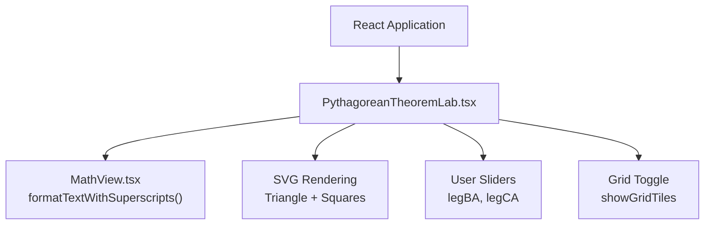
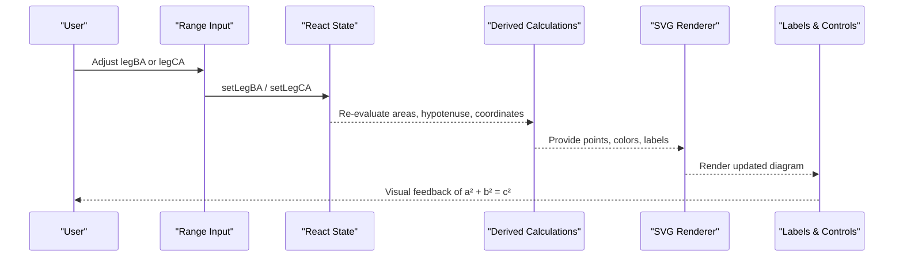
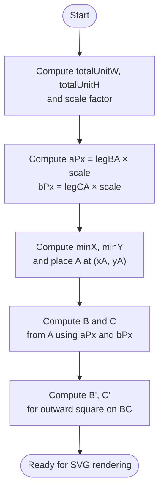
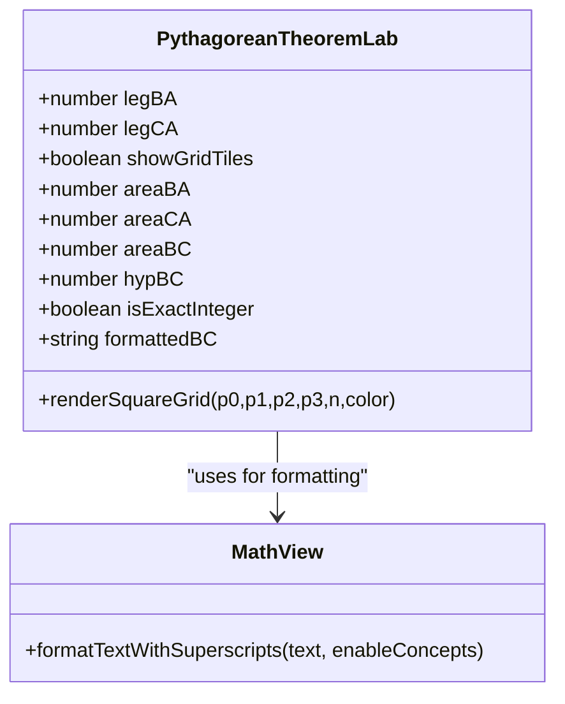
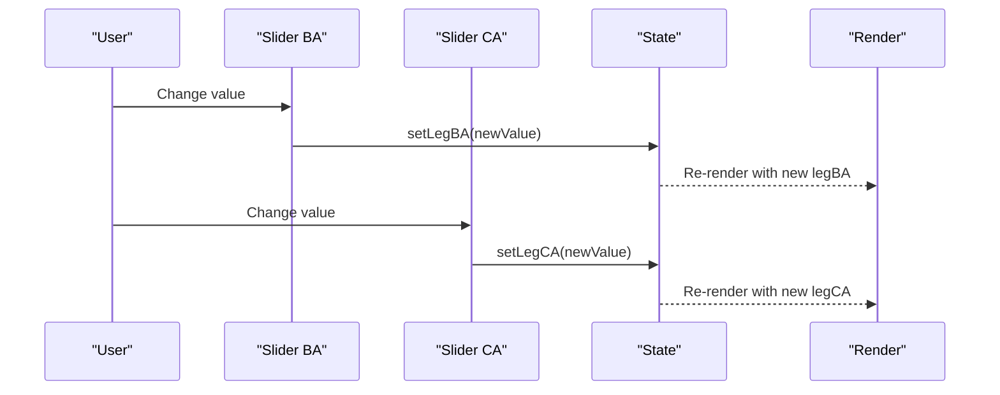
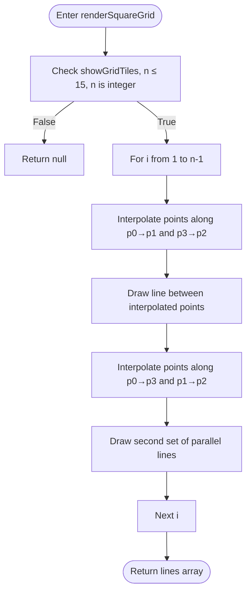
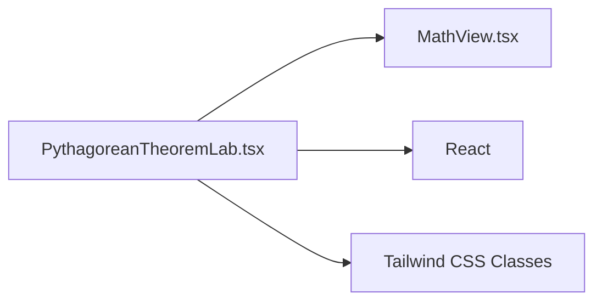

# Pythagorean Theorem Interactive Lab

<cite>
**Referenced Files in This Document**
- [PythagoreanTheoremLab.tsx](file://src/components/PythagoreanTheoremLab.tsx)
- [MathView.tsx](file://src/components/MathView.tsx)
</cite>

## Table of Contents
1. [Introduction](#introduction)
2. [Project Structure](#project-structure)
3. [Core Components](#core-components)
4. [Architecture Overview](#architecture-overview)
5. [Detailed Component Analysis](#detailed-component-analysis)
6. [Dependency Analysis](#dependency-analysis)
7. [Performance Considerations](#performance-considerations)
8. [Troubleshooting Guide](#troubleshooting-guide)
9. [Conclusion](#conclusion)

## Introduction
This document explains the Pythagorean Theorem Interactive Lab component, an educational tool that visually demonstrates the relationship a² + b² = c² using a right triangle and squares built on its sides. The lab renders an SVG-based geometric diagram, computes areas and hypotenuse length in real time, and allows users to adjust leg lengths with sliders. It also includes bilingual Arabic/French instructional text, color-coded geometric elements, and responsive layout patterns suitable for classroom or self-study use.

## Project Structure
The interactive lab is implemented as a single React component that:
- Holds user-controlled state for the two legs of the right triangle.
- Computes derived values such as square areas, hypotenuse length, and whether the hypotenuse is an exact integer.
- Calculates coordinate transformations to render the triangle and three squares inside an SVG canvas.
- Renders grid lines inside each square to visualize unit squares when appropriate.
- Provides sliders to change leg lengths and toggle grid visibility.
- Displays bilingual explanatory text alongside the diagram.

**Diagram sources**
- [PythagoreanTheoremLab.tsx:12-362](file://src/components/PythagoreanTheoremLab.tsx#L12-L362)
- [MathView.tsx:129-195](file://src/components/MathView.tsx#L129-L195)

**Section sources**
- [PythagoreanTheoremLab.tsx:12-362](file://src/components/PythagoreanTheoremLab.tsx#L12-L362)
- [MathView.tsx:129-195](file://src/components/MathView.tsx#L129-L195)

## Core Components
- State variables:
  - legBA: length of vertical leg BA.
  - legCA: length of horizontal leg CA.
  - showGridTiles: toggles visualization of unit-square grid lines inside each square.
- Derived calculations:
  - areaBA = legBA²
  - areaCA = legCA²
  - areaBC = areaBA + areaCA
  - hypBC = √areaBC
  - isExactInteger: true if hypBC is an integer; formatted display value uses fixed decimals otherwise.
- Coordinate system:
  - Auto-scaling ensures the entire figure fits within a fixed SVG viewBox.
  - Vertices A, B, C are computed from scaled leg lengths.
  - Outward square vertices on hypotenuse BC are computed by rotating the vector AB by 90 degrees outward.
- Rendering:
  - Three colored polygons represent squares on BA, CA, and BC.
  - Grid lines are drawn only when showGridTiles is enabled and the side length is an integer up to a safe limit.
  - Labels display squared expressions and areas in cm².
  - Right-angle marker at vertex A highlights the right angle.
- Interaction:
  - Two range inputs update legBA and legCA, triggering re-rendering of geometry and labels.
  - A button toggles grid tiles visibility.

**Section sources**
- [PythagoreanTheoremLab.tsx:12-362](file://src/components/PythagoreanTheoremLab.tsx#L12-L362)

## Architecture Overview
The component follows a straightforward data-driven rendering pattern:
- User input updates state.
- State drives derived computations (areas, hypotenuse, coordinates).
- Computed values drive SVG element construction.
- Textual explanations use a helper to format superscripts and support mixed Arabic/LTR math content.

**Diagram sources**
- [PythagoreanTheoremLab.tsx:14-23](file://src/components/PythagoreanTheoremLab.tsx#L14-L23)
- [PythagoreanTheoremLab.tsx:25-53](file://src/components/PythagoreanTheoremLab.tsx#L25-L53)
- [PythagoreanTheoremLab.tsx:126-277](file://src/components/PythagoreanTheoremLab.tsx#L126-L277)
- [PythagoreanTheoremLab.tsx:280-312](file://src/components/PythagoreanTheoremLab.tsx#L280-L312)

## Detailed Component Analysis

### Geometric Model and Coordinate Transformations
The component models a right triangle BCA with the right angle at A:
- Vertex A is placed at a computed position based on auto-scaled dimensions.
- Vertex B is vertically above A by aPx (scaled BA).
- Vertex C is horizontally to the right of A by bPx (scaled CA).
- The outward square on hypotenuse BC is constructed by translating B and C along the perpendicular direction of AB, producing B' and C'.

Key relationships:
- aPx = legBA × scale
- bPx = legCA × scale
- xA, yA define the right-angle vertex.
- xB = xA, yB = yA − aPx
- xC = xA + bPx, yC = yA
- xBPrime = xB + aPx, yBPrime = yB − bPx
- xCPrime = xC + aPx, yCPrime = yC − bPx

These transformations ensure the squares remain aligned with their respective sides and fit within the SVG viewport.

**Diagram sources**
- [PythagoreanTheoremLab.tsx:25-53](file://src/components/PythagoreanTheoremLab.tsx#L25-L53)

**Section sources**
- [PythagoreanTheoremLab.tsx:25-53](file://src/components/PythagoreanTheoremLab.tsx#L25-L53)

### Area Calculation and Hypotenuse Length
- areaBA = legBA²
- areaCA = legCA²
- areaBC = areaBA + areaCA
- hypBC = √areaBC
- If hypBC is an integer, the component can draw grid tiles inside the hypotenuse square; otherwise, it displays a rounded decimal value.

This directly visualizes a² + b² = c² by comparing the sum of the two smaller square areas with the larger square’s area.

**Section sources**
- [PythagoreanTheoremLab.tsx:18-23](file://src/components/PythagoreanTheoremLab.tsx#L18-L23)

### SVG-Based Geometric Rendering System
The SVG contains:
- Three filled polygons representing squares on BA, CA, and BC, each with distinct fill opacity and stroke color.
- Grid lines generated by a helper function that draws parallel lines across the square to visualize unit squares.
- Labels showing squared expressions and computed areas in cm².
- A highlighted hypotenuse segment and a right-angle marker at A.
- Vertex markers and labels for A, B, and C.

Color coding:
- Square on BA: blue tones.
- Square on CA: purple tones.
- Square on BC: green tones.
- Right-angle marker: rose tones.

**Diagram sources**
- [PythagoreanTheoremLab.tsx:12-362](file://src/components/PythagoreanTheoremLab.tsx#L12-L362)
- [MathView.tsx:129-195](file://src/components/MathView.tsx#L129-L195)

**Section sources**
- [PythagoreanTheoremLab.tsx:103-277](file://src/components/PythagoreanTheoremLab.tsx#L103-L277)

### Real-Time Updates via Sliders
Two range inputs allow users to adjust legBA and legCA between 2 and 12 with step 1. Changing either slider updates state and triggers:
- Recomputation of areas and hypotenuse.
- Recalculation of coordinates and scaling.
- Re-rendering of the SVG diagram and labels.
- Conditional rendering of grid tiles based on integer side lengths and the showGridTiles flag.

**Diagram sources**
- [PythagoreanTheoremLab.tsx:280-312](file://src/components/PythagoreanTheoremLab.tsx#L280-L312)

**Section sources**
- [PythagoreanTheoremLab.tsx:280-312](file://src/components/PythagoreanTheoremLab.tsx#L280-L312)

### Grid Tiles Visualization
The renderSquareGrid function draws internal grid lines to visualize unit squares:
- It accepts four corner points defining a parallelogram/square, the number of divisions n, and a stroke color.
- It returns null if grid tiles are disabled, n exceeds a safe threshold, or n is not an integer.
- For each division i from 1 to n−1, it computes interpolated points along edges and draws two sets of parallel lines forming a grid.

This helps learners count unit squares to verify area relationships visually.

**Diagram sources**
- [PythagoreanTheoremLab.tsx:55-101](file://src/components/PythagoreanTheoremLab.tsx#L55-L101)

**Section sources**
- [PythagoreanTheoremLab.tsx:55-101](file://src/components/PythagoreanTheoremLab.tsx#L55-L101)

### Bilingual Interface and Text Formatting
The component includes Arabic instructional text and uses MathView.formatTextWithSuperscripts to render mathematical expressions with proper superscripts and mixed-language support:
- Superscript mapping supports Unicode superscripts and caret notation.
- Mixed Arabic and math segments are handled with appropriate directionality (RTL for Arabic, LTR for math).
- The helper also integrates concept highlighting for fundamental terms.

Examples used in the lab:
- Area units displayed as “cm²”.
- Explanatory text distinguishing area (cm²) from length (cm).

**Section sources**
- [PythagoreanTheoremLab.tsx:103-357](file://src/components/PythagoreanTheoremLab.tsx#L103-L357)
- [MathView.tsx:129-195](file://src/components/MathView.tsx#L129-L195)

### Responsive Design Patterns
The layout uses Tailwind CSS classes to adapt to different screen sizes:
- A grid container switches from single-column on small screens to a multi-column layout on large screens.
- The SVG scales responsively with width constraints and maximum height limits.
- Control panels wrap gracefully and maintain readability across devices.

**Section sources**
- [PythagoreanTheoremLab.tsx:104-126](file://src/components/PythagoreanTheoremLab.tsx#L104-L126)
- [PythagoreanTheoremLab.tsx:280-312](file://src/components/PythagoreanTheoremLab.tsx#L280-L312)

## Dependency Analysis
The component has minimal external dependencies beyond React and Tailwind CSS utilities:
- Internal dependency on MathView.formatTextWithSuperscripts for text formatting.
- No direct imports of other geometry components; all logic is self-contained.

**Diagram sources**
- [PythagoreanTheoremLab.tsx:1-2](file://src/components/PythagoreanTheoremLab.tsx#L1-L2)
- [MathView.tsx:129-195](file://src/components/MathView.tsx#L129-L195)

**Section sources**
- [PythagoreanTheoremLab.tsx:1-2](file://src/components/PythagoreanTheoremLab.tsx#L1-L2)
- [MathView.tsx:129-195](file://src/components/MathView.tsx#L129-L195)

## Performance Considerations
- Integer-only grid rendering: Grid tiles are only drawn when the side length is an integer and below a threshold, preventing excessive DOM nodes for non-integer or large sides.
- Minimal recomputation: Only state changes trigger recalculation; derived values are computed inline during render.
- Lightweight SVG: Uses simple polygon and line elements without complex filters or animations.

[No sources needed since this section provides general guidance]

## Troubleshooting Guide
Common issues and resolutions:
- Grid tiles not appearing:
  - Ensure showGridTiles is enabled.
  - Verify that the relevant side length is an integer and within the allowed range.
- Incorrect scaling or clipping:
  - Confirm that legBA and legCA are within the slider bounds (2–12).
  - Check that the SVG viewBox and computed scale produce a positive scale factor.
- Misaligned hypotenuse square:
  - Validate the transformation logic for B' and C'; they should be computed by translating B and C along the perpendicular direction of AB.
- Text formatting errors:
  - Use MathView.formatTextWithSuperscripts for expressions involving superscripts or mixed Arabic/math content.

**Section sources**
- [PythagoreanTheoremLab.tsx:55-101](file://src/components/PythagoreanTheoremLab.tsx#L55-L101)
- [PythagoreanTheoremLab.tsx:25-53](file://src/components/PythagoreanTheoremLab.tsx#L25-L53)
- [MathView.tsx:129-195](file://src/components/MathView.tsx#L129-L195)

## Conclusion
The Pythagorean Theorem Interactive Lab provides a clear, interactive demonstration of a² + b² = c² through SVG-based geometry, real-time calculations, and bilingual instructional text. Its design emphasizes clarity, accessibility, and responsiveness, making it suitable for teaching and learning the foundational relationship between the areas of squares on the sides of a right triangle.

[No sources needed since this section summarizes without analyzing specific files]