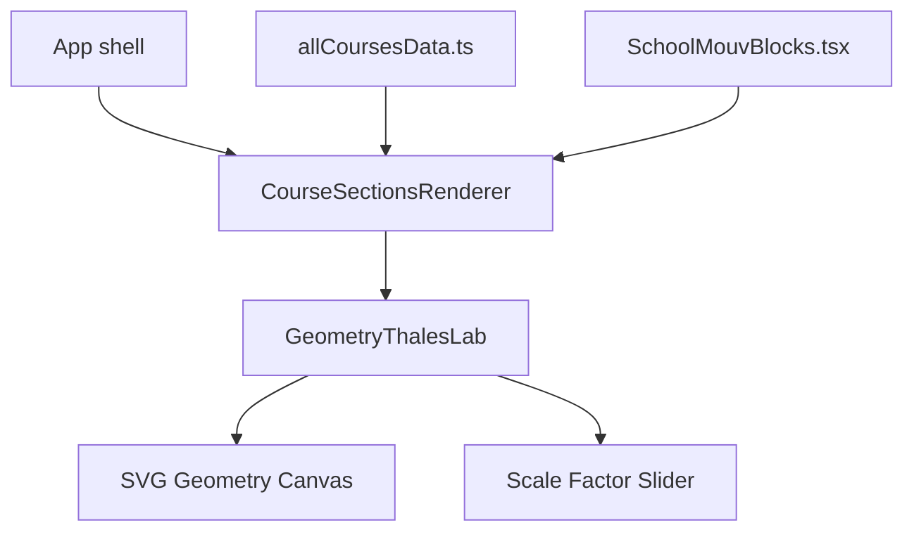
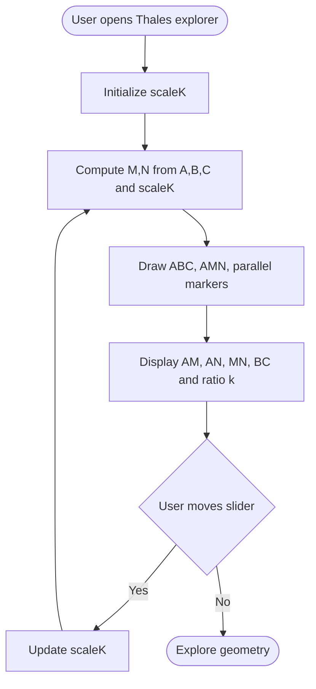
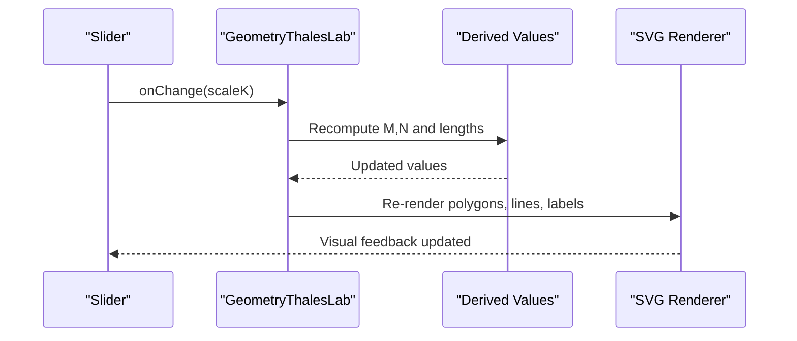
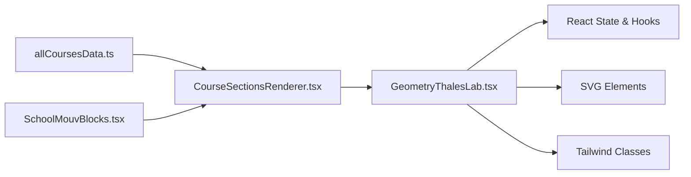

# Thales' Theorem Explorer

<cite>
**Referenced Files in This Document**
- [GeometryThalesLab.tsx](file://src/components/GeometryThalesLab.tsx)
- [CourseSectionsRenderer.tsx](file://src/components/CourseSectionsRenderer.tsx)
- [allCoursesData.ts](file://src/data/allCoursesData.ts)
- [SchoolMouvBlocks.tsx](file://src/components/SchoolMouvBlocks.tsx)
</cite>

## Table of Contents
1. [Introduction](#introduction)
2. [Project Structure](#project-structure)
3. [Core Components](#core-components)
4. [Architecture Overview](#architecture-overview)
5. [Detailed Component Analysis](#detailed-component-analysis)
6. [Dependency Analysis](#dependency-analysis)
7. [Performance Considerations](#performance-considerations)
8. [Troubleshooting Guide](#troubleshooting-guide)
9. [Conclusion](#conclusion)

## Introduction
This document explains the interactive Thales’ Theorem Explorer component that visualizes how parallel lines cutting transversals proportionally create similar triangles and constant ratios. It focuses on:
- How the tool renders a triangle ABC with an inner triangle AMN whose base MN is parallel to BC.
- How the scale factor controls the positions of M and N along AB and AC.
- How proportional segment ratios are computed and displayed in real time.
- How students can interact with the slider to explore constant ratios and geometric relationships.

The explorer uses a simple, declarative React component with SVG rendering and state-driven updates. It emphasizes clarity and mathematical correctness over complex interactivity, making abstract geometry tangible through dynamic visuals and live ratio feedback.

## Project Structure
The Thales’ Theorem Explorer is implemented as a single React component and integrated into the course renderer. Supporting data for the theorem’s statements, examples, and vocabulary lives in the course data module.

**Diagram sources**
- [CourseSectionsRenderer.tsx:1-20](file://src/components/CourseSectionsRenderer.tsx#L1-L20)
- [CourseSectionsRenderer.tsx:200-220](file://src/components/CourseSectionsRenderer.tsx#L200-L220)
- [GeometryThalesLab.tsx:1-20](file://src/components/GeometryThalesLab.tsx#L1-L20)
- [allCoursesData.ts:2090-2115](file://src/data/allCoursesData.ts#L2090-L2115)
- [SchoolMouvBlocks.tsx:510-530](file://src/components/SchoolMouvBlocks.tsx#L510-L530)

**Section sources**
- [CourseSectionsRenderer.tsx:1-20](file://src/components/CourseSectionsRenderer.tsx#L1-L20)
- [CourseSectionsRenderer.tsx:200-220](file://src/components/CourseSectionsRenderer.tsx#L200-L220)
- [GeometryThalesLab.tsx:1-20](file://src/components/GeometryThalesLab.tsx#L1-L20)
- [allCoursesData.ts:2090-2115](file://src/data/allCoursesData.ts#L2090-L2115)
- [SchoolMouvBlocks.tsx:510-530](file://src/components/SchoolMouvBlocks.tsx#L510-L530)

## Core Components
- GeometryThalesLab: Renders the interactive figure, computes M and N from a scale factor, draws triangle ABC and inner triangle AMN, highlights parallel segments (MN) and (BC), and displays dynamic measurements and ratios.
- CourseSectionsRenderer: Integrates GeometryThalesLab into the lesson flow when the relevant section is active.
- allCoursesData.ts: Contains the formal statement of Thales’ theorem, its converse, guided examples, common mistakes, and vocabulary used across lessons.
- SchoolMouvBlocks.tsx: References Thales’ theorem context within broader course blocks.

Key responsibilities:
- GeometryThalesLab handles all math and visualization logic for the explorer.
- CourseSectionsRenderer orchestrates which components render based on the current section.
- allCoursesData.ts provides authoritative mathematical content and learning scaffolding.

**Section sources**
- [GeometryThalesLab.tsx:1-208](file://src/components/GeometryThalesLab.tsx#L1-L208)
- [CourseSectionsRenderer.tsx:1-20](file://src/components/CourseSectionsRenderer.tsx#L1-L20)
- [CourseSectionsRenderer.tsx:200-220](file://src/components/CourseSectionsRenderer.tsx#L200-L220)
- [allCoursesData.ts:2090-2115](file://src/data/allCoursesData.ts#L2090-L2115)
- [SchoolMouvBlocks.tsx:510-530](file://src/components/SchoolMouvBlocks.tsx#L510-L530)

## Architecture Overview
The explorer follows a straightforward reactive architecture:
- State holds the scale factor k controlling the position of M and N.
- Derived values compute coordinates of M and N using linear interpolation along AB and AC.
- SVG elements draw the outer triangle ABC, inner triangle AMN, and highlight parallelism between MN and BC.
- Text labels show dynamic lengths and the constant ratio k = AM/AB = AN/AC = MN/BC.
- A slider updates k, triggering re-rendering and immediate visual feedback.

**Diagram sources**
- [GeometryThalesLab.tsx:9-35](file://src/components/GeometryThalesLab.tsx#L9-L35)
- [GeometryThalesLab.tsx:154-170](file://src/components/GeometryThalesLab.tsx#L154-L170)

## Detailed Component Analysis

### GeometryThalesLab: Interactive Figure and Math
GeometryThalesLab implements the core exploration experience:
- Triangle vertices A, B, C are fixed in screen coordinates.
- Points M and N lie on AB and AC respectively, determined by a scale factor k such that AM/AB = AN/AC = k.
- Segment MN is drawn parallel to BC; both are highlighted to emphasize the parallel relationship.
- Dynamic text shows computed lengths AM, AN, MN, and BC, plus the constant ratio k.
- A slider allows users to vary k within a constrained range to keep the figure readable.

Mathematical calculations:
- Coordinates:
  - M.x = A.x + k × (B.x − A.x)
  - M.y = A.y + k × (B.y − A.y)
  - N.x = A.x + k × (C.x − A.x)
  - N.y = A.y + k × (C.y − A.y)
- Lengths:
  - AM = k × AB
  - AN = k × AC
  - MN = k × BC
- Ratios:
  - AM/AB = AN/AC = MN/BC = k

Visual feedback:
- Parallelism is indicated via dashed line styling for MN and solid line for BC.
- Labels display measured lengths and the ratio k in real time.
- Colors distinguish the smaller triangle AMN from the larger ABC.

Coordinate system and transformations:
- The SVG viewBox defines a local coordinate space for drawing.
- All points are expressed in this coordinate space; no explicit transformation matrix is used.
- The layout is responsive via CSS classes applied to the SVG container.

Interactions:
- The slider updates k, recalculating M and N and redrawing the figure instantly.
- The interface avoids dragging individual points; instead, it uses a slider to control the proportional scaling, ensuring stable and predictable behavior.

**Diagram sources**
- [GeometryThalesLab.tsx:9-35](file://src/components/GeometryThalesLab.tsx#L9-L35)
- [GeometryThalesLab.tsx:154-170](file://src/components/GeometryThalesLab.tsx#L154-L170)

**Section sources**
- [GeometryThalesLab.tsx:9-35](file://src/components/GeometryThalesLab.tsx#L9-L35)
- [GeometryThalesLab.tsx:43-152](file://src/components/GeometryThalesLab.tsx#L43-L152)
- [GeometryThalesLab.tsx:154-170](file://src/components/GeometryThalesLab.tsx#L154-L170)

### Integration with Course Sections
The explorer is rendered when the relevant section is active:
- CourseSectionsRenderer imports GeometryThalesLab and returns it for the corresponding section.
- This ensures the interactive figure appears alongside explanatory content and exercises.

**Section sources**
- [CourseSectionsRenderer.tsx:1-20](file://src/components/CourseSectionsRenderer.tsx#L1-L20)
- [CourseSectionsRenderer.tsx:200-220](file://src/components/CourseSectionsRenderer.tsx#L200-L220)

### Mathematical Content and Learning Scaffolding
The course data module provides:
- Formal statement of Thales’ theorem: parallelism implies equality of three ratios.
- Converse statement: equality of two ratios implies parallelism.
- Guided examples demonstrating direct application and proof of parallelism.
- Common mistakes and vocabulary to reinforce understanding.

These materials complement the interactive explorer by providing theoretical grounding and practice opportunities.

**Section sources**
- [allCoursesData.ts:2090-2115](file://src/data/allCoursesData.ts#L2090-L2115)
- [allCoursesData.ts:2112-2153](file://src/data/allCoursesData.ts#L2112-L2153)
- [allCoursesData.ts:2154-2169](file://src/data/allCoursesData.ts#L2154-L2169)
- [allCoursesData.ts:2170-2239](file://src/data/allCoursesData.ts#L2170-L2239)
- [allCoursesData.ts:2240-2269](file://src/data/allCoursesData.ts#L2240-L2269)

### Contextual References in Broader Blocks
SchoolMouvBlocks references Thales’ theorem context within broader course blocks, aligning the explorer with other geometry topics.

**Section sources**
- [SchoolMouvBlocks.tsx:510-530](file://src/components/SchoolMouvBlocks.tsx#L510-L530)

## Dependency Analysis
The explorer has minimal external dependencies:
- React state drives updates.
- SVG is used for rendering.
- Tailwind utility classes style the layout.
- No heavy libraries or complex math utilities are required.

**Diagram sources**
- [GeometryThalesLab.tsx:1-208](file://src/components/GeometryThalesLab.tsx#L1-L208)
- [CourseSectionsRenderer.tsx:1-20](file://src/components/CourseSectionsRenderer.tsx#L1-L20)
- [CourseSectionsRenderer.tsx:200-220](file://src/components/CourseSectionsRenderer.tsx#L200-L220)
- [allCoursesData.ts:2090-2115](file://src/data/allCoursesData.ts#L2090-L2115)
- [SchoolMouvBlocks.tsx:510-530](file://src/components/SchoolMouvBlocks.tsx#L510-L530)

**Section sources**
- [GeometryThalesLab.tsx:1-208](file://src/components/GeometryThalesLab.tsx#L1-L208)
- [CourseSectionsRenderer.tsx:1-20](file://src/components/CourseSectionsRenderer.tsx#L1-L20)
- [CourseSectionsRenderer.tsx:200-220](file://src/components/CourseSectionsRenderer.tsx#L200-L220)
- [allCoursesData.ts:2090-2115](file://src/data/allCoursesData.ts#L2090-L2115)
- [SchoolMouvBlocks.tsx:510-530](file://src/components/SchoolMouvBlocks.tsx#L510-L530)

## Performance Considerations
- The component performs lightweight arithmetic per render; no expensive computations occur.
- SVG redraws are minimal and confined to the explorer’s viewport.
- Using a slider rather than drag-and-drop reduces event handling overhead and keeps interactions smooth.
- For large-scale integration, consider memoizing derived values if additional heavy computations were introduced.

[No sources needed since this section provides general guidance]

## Troubleshooting Guide
Common issues and resolutions:
- Ratio not updating: Ensure the slider’s onChange handler updates scaleK and that derived values recalculate M, N, and lengths.
- Misaligned labels: Verify SVG text anchors and offsets relative to point coordinates.
- Parallelism not visible: Confirm that MN and BC are styled distinctly and that M and N are correctly interpolated along AB and AC.
- Layout overflow: Adjust SVG viewBox or container CSS to fit the figure within the page width.

**Section sources**
- [GeometryThalesLab.tsx:154-170](file://src/components/GeometryThalesLab.tsx#L154-L170)
- [GeometryThalesLab.tsx:43-152](file://src/components/GeometryThalesLab.tsx#L43-L152)

## Conclusion
The Thales’ Theorem Explorer offers a clear, interactive way to visualize proportional segments created by parallel lines in a triangle. By adjusting a single scale factor, students observe constant ratios and understand the geometric relationships underpinning Thales’ theorem. The component’s simplicity, precise math, and immediate visual feedback make abstract concepts concrete and accessible.

[No sources needed since this section summarizes without analyzing specific files]