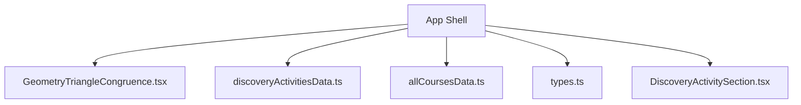
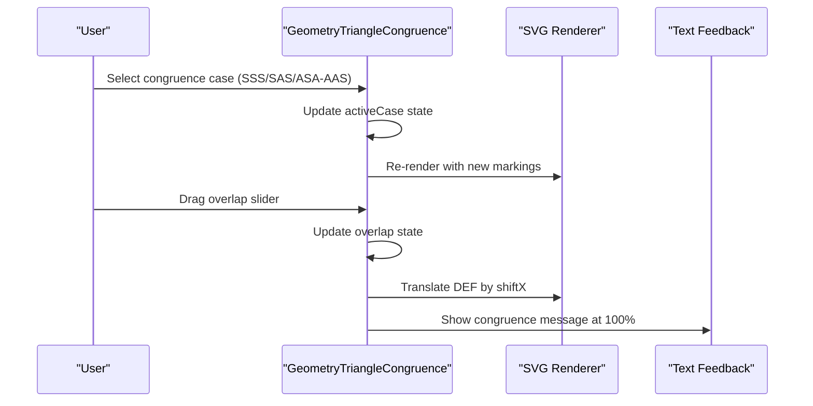
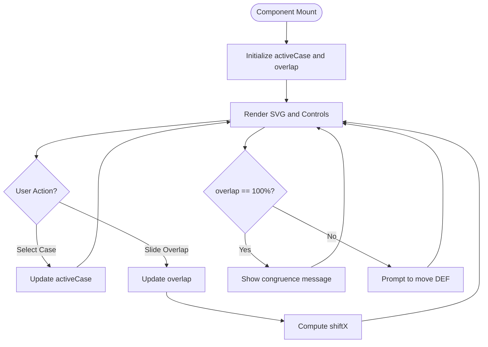
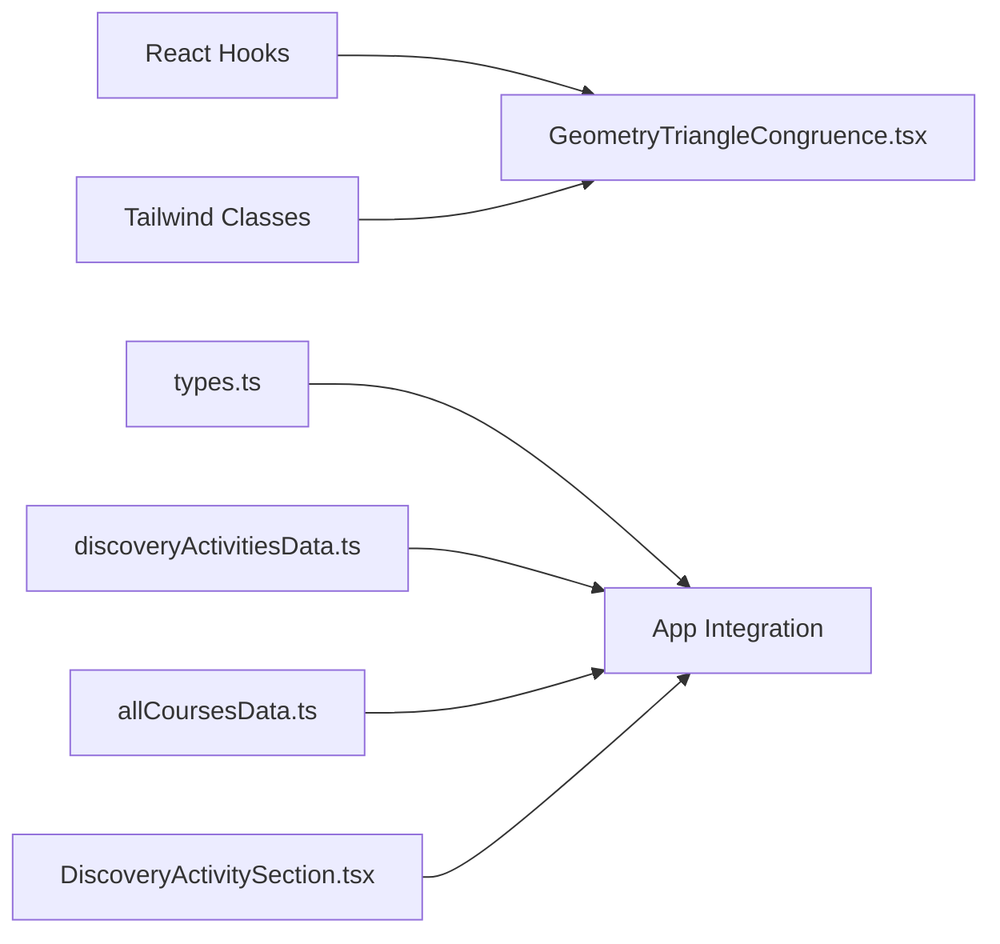

# Triangle Congruence Investigation Tool

<cite>
**Referenced Files in This Document**
- [GeometryTriangleCongruence.tsx](file://src/components/GeometryTriangleCongruence.tsx)
- [discoveryActivitiesData.ts](file://src/data/discoveryActivitiesData.ts)
- [allCoursesData.ts](file://src/data/allCoursesData.ts)
- [types.ts](file://src/types.ts)
- [DiscoveryActivitySection.tsx](file://src/components/DiscoveryActivitySection.tsx)
</cite>

## Table of Contents
1. [Introduction](#introduction)
2. [Project Structure](#project-structure)
3. [Core Components](#core-components)
4. [Architecture Overview](#architecture-overview)
5. [Detailed Component Analysis](#detailed-component-analysis)
6. [Dependency Analysis](#dependency-analysis)
7. [Performance Considerations](#performance-considerations)
8. [Troubleshooting Guide](#troubleshooting-guide)
9. [Conclusion](#conclusion)
10. [Appendices](#appendices)

## Introduction
The Triangle Congruence Investigation Tool is an interactive learning component that helps students explore triangle congruence criteria through hands-on manipulation and visual feedback. It presents two triangles side by side and allows learners to slide one triangle over the other to observe when corresponding vertices, sides, and angles align. The tool highlights which congruence case is active (SSS, SAS, or ASA/AAS variants), shows geometric markings for equal elements, and provides immediate textual feedback when full overlap is achieved.

This documentation explains:
- How the component renders and animates two triangles
- How it indicates congruent elements visually
- How the real-time overlap slider drives the user experience
- How pedagogical data structures guide discovery-based learning
- How this component fits into the broader geometry curriculum

## Project Structure
The tool is implemented as a single React component with supporting data and type definitions across the codebase:
- Interactive UI and SVG rendering are contained in a dedicated component file
- Discovery activities and course content provide structured guidance and examples
- Type definitions declare supported diagram types used throughout the app

**Diagram sources**
- [GeometryTriangleCongruence.tsx:1-162](file://src/components/GeometryTriangleCongruence.tsx#L1-L162)
- [discoveryActivitiesData.ts:350-390](file://src/data/discoveryActivitiesData.ts#L350-L390)
- [allCoursesData.ts:1753-1855](file://src/data/allCoursesData.ts#L1753-L1855)
- [types.ts:53-93](file://src/types.ts#L53-L93)
- [DiscoveryActivitySection.tsx:308-328](file://src/components/DiscoveryActivitySection.tsx#L308-L328)

**Section sources**
- [GeometryTriangleCongruence.tsx:1-162](file://src/components/GeometryTriangleCongruence.tsx#L1-L162)
- [discoveryActivitiesData.ts:350-390](file://src/data/discoveryActivitiesData.ts#L350-L390)
- [allCoursesData.ts:1753-1855](file://src/data/allCoursesData.ts#L1753-L1855)
- [types.ts:53-93](file://src/types.ts#L53-L93)
- [DiscoveryActivitySection.tsx:308-328](file://src/components/DiscoveryActivitySection.tsx#L308-L328)

## Core Components
The core component implements:
- State for the active congruence case and the overlap percentage
- A fixed triangle ABC on the left and a movable triangle DEF on the right
- Geometric markings that change based on the selected case
- A slider that translates DEF toward ABC and updates visual feedback

Key behaviors:
- Case selection toggles between SSS, SAS, and ASA/AAS-like configurations
- Overlap percentage controls horizontal translation of DEF
- At 100% overlap, the component displays a congruence confirmation message
- Tick marks and angle arcs indicate equal sides and angles according to the active case

**Section sources**
- [GeometryTriangleCongruence.tsx:3-8](file://src/components/GeometryTriangleCongruence.tsx#L3-L8)
- [GeometryTriangleCongruence.tsx:10-145](file://src/components/GeometryTriangleCongruence.tsx#L10-L145)
- [GeometryTriangleCongruence.tsx:147-162](file://src/components/GeometryTriangleCongruence.tsx#L147-L162)

## Architecture Overview
At a high level, the component follows a simple state-driven rendering pattern:
- User interaction updates state (active case, overlap)
- Computed values derive from state (horizontal shift)
- SVG elements render conditionally based on state
- Textual feedback reflects current state (e.g., congruence at full overlap)

**Diagram sources**
- [GeometryTriangleCongruence.tsx:3-8](file://src/components/GeometryTriangleCongruence.tsx#L3-L8)
- [GeometryTriangleCongruence.tsx:123-145](file://src/components/GeometryTriangleCongruence.tsx#L123-L145)

## Detailed Component Analysis

### GeometryTriangleCongruence Component
This component encapsulates the entire interactive experience:
- State variables:
  - activeCase: selects the congruence scenario
  - overlap: percentage controlling DEF’s position
- Derived value:
  - shiftX: computed horizontal translation for DEF
- Rendering:
  - Fixed triangle ABC with labeled vertices
  - Conditional tick marks and angle arcs based on activeCase
  - Movable triangle DEF with matching markings
  - Slider control bound to overlap
  - Text feedback indicating congruence status

**Diagram sources**
- [GeometryTriangleCongruence.tsx:3-8](file://src/components/GeometryTriangleCongruence.tsx#L3-L8)
- [GeometryTriangleCongruence.tsx:123-145](file://src/components/GeometryTriangleCongruence.tsx#L123-L145)

**Section sources**
- [GeometryTriangleCongruence.tsx:3-8](file://src/components/GeometryTriangleCongruence.tsx#L3-L8)
- [GeometryTriangleCongruence.tsx:10-145](file://src/components/GeometryTriangleCongruence.tsx#L10-L145)
- [GeometryTriangleCongruence.tsx:147-162](file://src/components/GeometryTriangleCongruence.tsx#L147-L162)

### Pedagogical Data Structures
The application includes structured discovery activities and course data that frame how students should explore congruence:
- Discovery activity for Lesson 10 outlines experiments with three measurements per trial and contrasts cases where congruence holds versus those where it does not
- Course data documents congruence criteria (SSS, SAS, ASA) and common misconceptions (e.g., AAA is insufficient)
- Type definitions include a diagram type for congruent triangles, enabling consistent integration across the app

These materials support a discovery-based approach:
- Students manipulate the tool to see when triangles fully overlap
- They compare given measurements and outcomes
- They reflect on why certain combinations guarantee congruence while others do not

**Section sources**
- [discoveryActivitiesData.ts:350-390](file://src/data/discoveryActivitiesData.ts#L350-L390)
- [allCoursesData.ts:1753-1855](file://src/data/allCoursesData.ts#L1753-L1855)
- [types.ts:53-93](file://src/types.ts#L53-L93)

### Visual Indicators and Real-Time Feedback
Visual indicators communicate congruent elements:
- Tick marks denote equal sides
- Angle arcs denote equal angles
- Dashed outlines indicate the moving triangle before full overlap
- Full overlap triggers a congruence confirmation message

Real-time feedback:
- The slider shows the current overlap percentage
- Text below the SVG changes from a prompt to move DEF to a congruence confirmation at 100%

**Section sources**
- [GeometryTriangleCongruence.tsx:55-81](file://src/components/GeometryTriangleCongruence.tsx#L55-L81)
- [GeometryTriangleCongruence.tsx:98-120](file://src/components/GeometryTriangleCongruence.tsx#L98-L120)
- [GeometryTriangleCongruence.tsx:123-145](file://src/components/GeometryTriangleCongruence.tsx#L123-L145)

### Handling Different Congruence Cases
The component supports multiple congruence scenarios:
- SSS: All three sides marked equal
- SAS: Two sides and the included angle marked equal
- ASA/AAS-like: Two angles and a side marked equal

Each case updates the markings on both triangles consistently so students can visually verify correspondence.

**Section sources**
- [GeometryTriangleCongruence.tsx:20-37](file://src/components/GeometryTriangleCongruence.tsx#L20-L37)
- [GeometryTriangleCongruence.tsx:55-81](file://src/components/GeometryTriangleCongruence.tsx#L55-L81)
- [GeometryTriangleCongruence.tsx:98-120](file://src/components/GeometryTriangleCongruence.tsx#L98-L120)

## Dependency Analysis
The component has minimal external dependencies:
- React hooks for state management
- Inline SVG for rendering
- Tailwind utility classes for styling
- Shared type definitions for diagram types
- Supporting data files for pedagogical context

**Diagram sources**
- [GeometryTriangleCongruence.tsx:1-2](file://src/components/GeometryTriangleCongruence.tsx#L1-L2)
- [types.ts:53-93](file://src/types.ts#L53-L93)
- [discoveryActivitiesData.ts:350-390](file://src/data/discoveryActivitiesData.ts#L350-L390)
- [allCoursesData.ts:1753-1855](file://src/data/allCoursesData.ts#L1753-L1855)
- [DiscoveryActivitySection.tsx:308-328](file://src/components/DiscoveryActivitySection.tsx#L308-L328)

**Section sources**
- [GeometryTriangleCongruence.tsx:1-2](file://src/components/GeometryTriangleCongruence.tsx#L1-L2)
- [types.ts:53-93](file://src/types.ts#L53-L93)
- [discoveryActivitiesData.ts:350-390](file://src/data/discoveryActivitiesData.ts#L350-L390)
- [allCoursesData.ts:1753-1855](file://src/data/allCoursesData.ts#L1753-L1855)
- [DiscoveryActivitySection.tsx:308-328](file://src/components/DiscoveryActivitySection.tsx#L308-L328)

## Performance Considerations
- The component uses lightweight state and derived calculations; no heavy computations occur during interaction
- SVG rendering is straightforward and re-renders only on state changes
- No external libraries are required beyond React and CSS utilities
- For scalability, consider extracting marking logic into small helper functions if more cases are added

[No sources needed since this section provides general guidance]

## Troubleshooting Guide
Common issues and resolutions:
- Slider does not update overlap: Ensure the onChange handler is bound to the slider and updates the overlap state
- Markings do not match selected case: Verify activeCase is correctly set and conditional rendering paths are present
- Congruence message does not appear at 100%: Confirm the overlap state reaches exactly 100 and the conditional text branch is rendered

**Section sources**
- [GeometryTriangleCongruence.tsx:135-145](file://src/components/GeometryTriangleCongruence.tsx#L135-L145)
- [GeometryTriangleCongruence.tsx:123-127](file://src/components/GeometryTriangleCongruence.tsx#L123-L127)

## Conclusion
The Triangle Congruence Investigation Tool offers a focused, interactive environment for exploring triangle congruence criteria. By combining direct manipulation (sliding DEF over ABC), clear visual markers (ticks and arcs), and immediate feedback (congruence confirmation), it encourages discovery-based learning. Supporting data structures reinforce key concepts such as SSS, SAS, and ASA/AAS while addressing common misconceptions like relying solely on angles. The component’s simplicity ensures performance and accessibility, making it suitable for classroom exploration and self-paced study.

[No sources needed since this section summarizes without analyzing specific files]

## Appendices

### Appendix A: Congruence Criteria Coverage
- Supported cases in the component:
  - SSS (three sides)
  - SAS (two sides and included angle)
  - ASA/AAS-like (two angles and a side)
- Additional criteria (HL) are part of the broader curriculum but are not explicitly implemented in this component’s current state

**Section sources**
- [GeometryTriangleCongruence.tsx:20-37](file://src/components/GeometryTriangleCongruence.tsx#L20-L37)
- [allCoursesData.ts:1836-1855](file://src/data/allCoursesData.ts#L1836-L1855)

### Appendix B: Integration Points
- Diagram type registration:
  - The app recognizes a “congruent-triangles” diagram type for consistent handling
- Discovery activity linkage:
  - Lesson 10 discovery activity references the congruent triangles diagram type and provides guided questions and summaries

**Section sources**
- [types.ts:53-93](file://src/types.ts#L53-L93)
- [discoveryActivitiesData.ts:350-390](file://src/data/discoveryActivitiesData.ts#L350-L390)