# Mathematics Module

<cite>
**Referenced Files in This Document**
- [MathView.tsx](file://src/components/MathView.tsx)
- [AlgebraVisualDiscoveryLab.tsx](file://src/components/AlgebraVisualDiscoveryLab.tsx)
- [PythagoreanTheoremLab.tsx](file://src/components/PythagoreanTheoremLab.tsx)
- [ConversePythagoreanLab.tsx](file://src/components/ConversePythagoreanLab.tsx)
- [CircumcircleRightTriangleLab.tsx](file://src/components/CircumcircleRightTriangleLab.tsx)
- [MedianHypotenuseLab.tsx](file://src/components/MedianHypotenuseLab.tsx)
- [GeometryThalesLab.tsx](file://src/components/GeometryThalesLab.tsx)
- [NumberLineModel.tsx](file://src/components/NumberLineModel.tsx)
- [VisualFractionModel.tsx](file://src/components/VisualFractionModel.tsx)
- [CourseSectionsRenderer.tsx](file://src/components/CourseSectionsRenderer.tsx)
- [courseData.ts](file://src/data/courseData.ts)
- [types.ts](file://src/types.ts)
- [fundamentalConceptsData.ts](file://src/data/fundamentalConceptsData.ts)
</cite>

## Table of Contents
1. [Introduction](#introduction)
2. [Project Structure](#project-structure)
3. [Core Components](#core-components)
4. [Architecture Overview](#architecture-overview)
5. [Detailed Component Analysis](#detailed-component-analysis)
6. [Dependency Analysis](#dependency-analysis)
7. [Performance Considerations](#performance-considerations)
8. [Troubleshooting Guide](#troubleshooting-guide)
9. [Conclusion](#conclusion)
10. [Appendices](#appendices)

## Introduction
This document explains the Mathematics module that powers interactive math learning for a middle-school curriculum. It covers:
- Interactive algebra visual discovery labs, including number-line addition, division as inverse multiplication, reciprocal versus opposite, fraction comparison, and fraction addition with common denominators.
- Geometry theorem explorations such as Pythagoras’ theorem, its converse, Thales’ theorem, median to the hypotenuse, and circumcircle of a right triangle.
- Number line models and fraction operation visualizations.
- Course structure, navigation, section rendering patterns, and progress tracking.
- Concrete code-level examples showing how mathematical concepts become interactive SVG-based visualizations.
- Common implementation patterns for creating new mathematical visualizations and problem-solving exercises.

## Project Structure
The Mathematics module is organized around reusable components and data-driven course content:
- Rendering engine: `MathView` handles LaTeX rendering, Arabic/French mixed text, superscripts, and concept highlighting.
- Discovery labs: Algebra and geometry components render interactive SVG diagrams with sliders or preset buttons.
- Course renderer: `CourseSectionsRenderer` composes sections, unlocks tabs after discovery activities, and maps courses to specific visual labs.
- Data layer: `courseData.ts`, `types.ts`, and `fundamentalConceptsData.ts` define course structure, exercises, and clickable concept definitions.

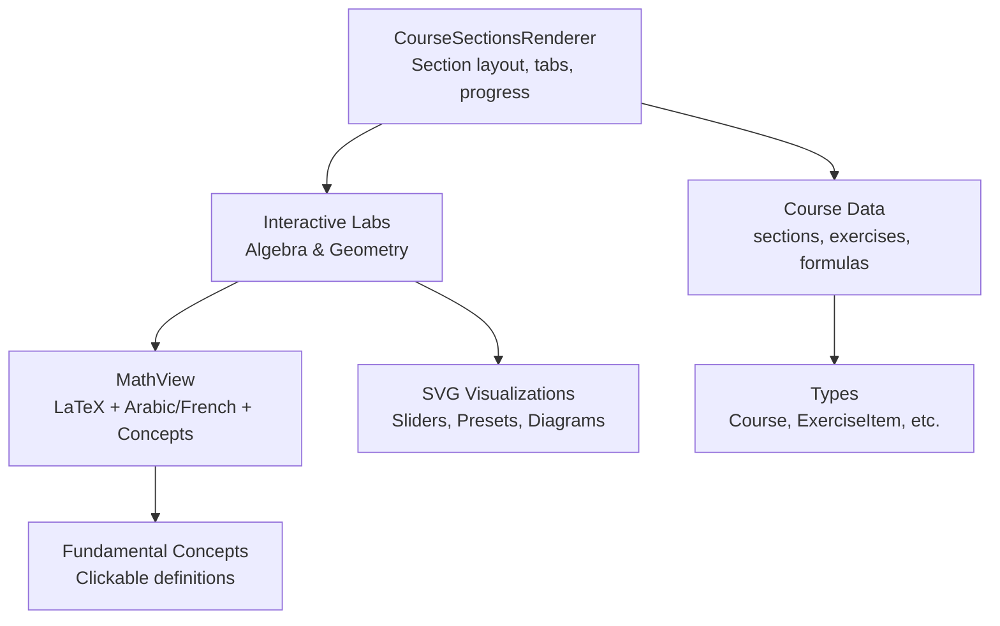

**Diagram sources**
- [CourseSectionsRenderer.tsx:135-233](file://src/components/CourseSectionsRenderer.tsx#L135-L233)
- [MathView.tsx:350-579](file://src/components/MathView.tsx#L350-L579)
- [types.ts:70-146](file://src/types.ts#L70-L146)
- [fundamentalConceptsData.ts:1-22](file://src/data/fundamentalConceptsData.ts#L1-L22)

**Section sources**
- [CourseSectionsRenderer.tsx:135-233](file://src/components/CourseSectionsRenderer.tsx#L135-L233)
- [types.ts:70-146](file://src/types.ts#L70-L146)

## Core Components
- MathView: Renders pure math, Arabic-only text, and mixed Arabic/math content. It splits long equality chains, normalizes Unicode superscripts, and highlights fundamental concepts via keyword matching.
- AlgebraVisualDiscoveryLab: Centralized lab for lessons 01–09, routing by courseId to specific interactive scenarios (number line addition, division inverse check, reciprocal vs opposite, fraction operations, comparison).
- Geometry labs: PythagoreanTheoremLab, ConversePythagoreanLab, CircumcircleRightTriangleLab, MedianHypotenuseLab, GeometryThalesLab provide geometric SVG figures with interactive controls.
- NumberLineModel and VisualFractionModel: Lightweight standalone visualizations for arithmetic concepts.
- CourseSectionsRenderer: Orchestrates sections, prerequisite links, discovery activity completion, tab unlocking, and property rendering.

**Section sources**
- [MathView.tsx:14-579](file://src/components/MathView.tsx#L14-L579)
- [AlgebraVisualDiscoveryLab.tsx:8-872](file://src/components/AlgebraVisualDiscoveryLab.tsx#L8-L872)
- [PythagoreanTheoremLab.tsx:12-362](file://src/components/PythagoreanTheoremLab.tsx#L12-L362)
- [ConversePythagoreanLab.tsx:67-395](file://src/components/ConversePythagoreanLab.tsx#L67-L395)
- [CircumcircleRightTriangleLab.tsx:4-262](file://src/components/CircumcircleRightTriangleLab.tsx#L4-L262)
- [MedianHypotenuseLab.tsx:12-276](file://src/components/MedianHypotenuseLab.tsx#L12-L276)
- [GeometryThalesLab.tsx:9-208](file://src/components/GeometryThalesLab.tsx#L9-L208)
- [NumberLineModel.tsx:5-130](file://src/components/NumberLineModel.tsx#L5-L130)
- [VisualFractionModel.tsx:4-86](file://src/components/VisualFractionModel.tsx#L4-L86)
- [CourseSectionsRenderer.tsx:135-740](file://src/components/CourseSectionsRenderer.tsx#L135-L740)

## Architecture Overview
The system follows a layered architecture:
- Data Layer: Course metadata, exercises, and fundamental concepts.
- Rendering Layer: Section renderer composes UI; MathView renders math and concepts.
- Visualization Layer: Lab components render SVG diagrams and handle user interactions.
- Progress Tracking: LocalStorage persists completed discovery activities and unlocks tabs.

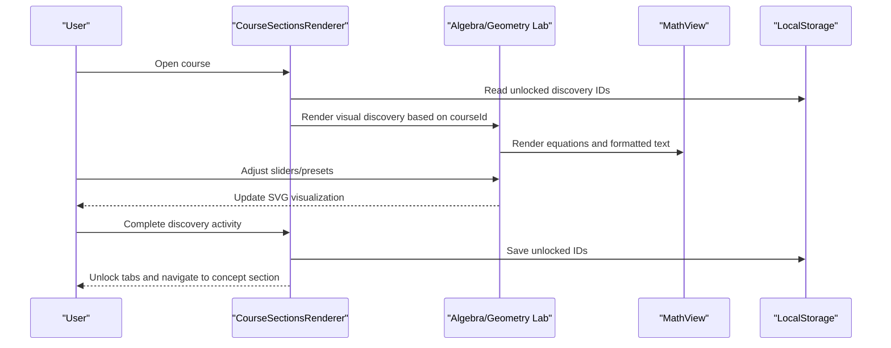

**Diagram sources**
- [CourseSectionsRenderer.tsx:144-174](file://src/components/CourseSectionsRenderer.tsx#L144-L174)
- [CourseSectionsRenderer.tsx:194-233](file://src/components/CourseSectionsRenderer.tsx#L194-L233)
- [MathView.tsx:350-579](file://src/components/MathView.tsx#L350-L579)

## Detailed Component Analysis

### MathView: Math and Concept Rendering Engine
MathView provides:
- Superscript formatting for plain text expressions.
- KaTeX integration with error suppression and RTL/LTR handling.
- Splitting of long equality chains and top-level separators for better wrapping.
- Clickable concept terms mapped from fundamental concepts keywords.

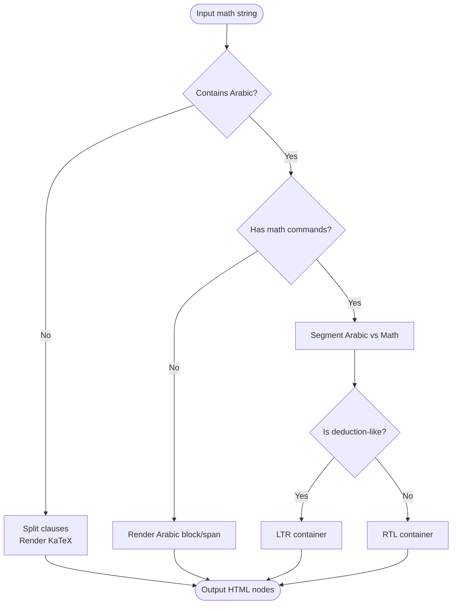

**Diagram sources**
- [MathView.tsx:129-195](file://src/components/MathView.tsx#L129-L195)
- [MathView.tsx:197-348](file://src/components/MathView.tsx#L197-L348)
- [MathView.tsx:350-579](file://src/components/MathView.tsx#L350-L579)

**Section sources**
- [MathView.tsx:14-579](file://src/components/MathView.tsx#L14-L579)
- [fundamentalConceptsData.ts:1-22](file://src/data/fundamentalConceptsData.ts#L1-L22)

### AlgebraVisualDiscoveryLab: Algebra Scenarios Router
Routes lesson-specific interactive scenarios:
- Lesson 01: Number-line addition with start and step values.
- Lesson 02: Division as inverse multiplication with sign rules.
- Lesson 03: Reciprocal vs Opposite comparison.
- Lessons 04/09: Fraction division/multiplication transformation.
- Lesson 05: Fraction comparison modes (same denominator, same numerator, different denominators).
- Lessons 06/08: Fraction addition/subtraction with common denominators.
- Lesson 07: Rational number sign positioning and reduction.

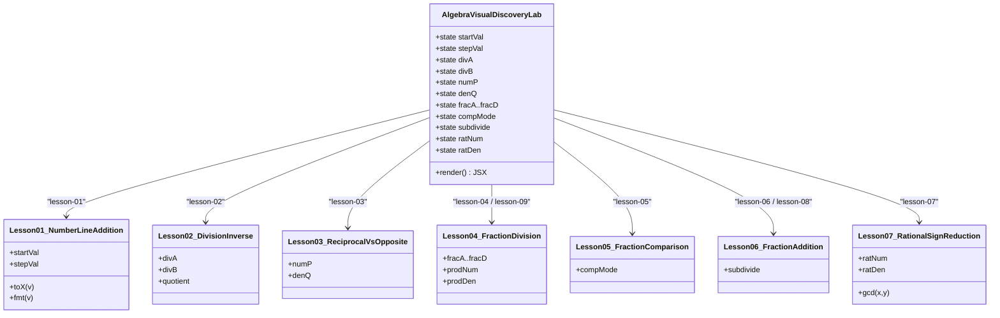

**Diagram sources**
- [AlgebraVisualDiscoveryLab.tsx:8-872](file://src/components/AlgebraVisualDiscoveryLab.tsx#L8-L872)

**Section sources**
- [AlgebraVisualDiscoveryLab.tsx:8-872](file://src/components/AlgebraVisualDiscoveryLab.tsx#L8-L872)

### Geometry Theorem Explorations

#### PythagoreanTheoremLab
Interactive visualization of squares on legs and hypotenuse:
- Sliders adjust leg lengths BA and CA.
- Computes areas and hypotenuse length; optional grid tiles visualize area units.
- Highlights right angle and vertices.

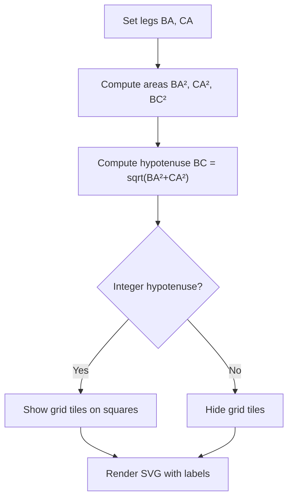

**Diagram sources**
- [PythagoreanTheoremLab.tsx:12-362](file://src/components/PythagoreanTheoremLab.tsx#L12-L362)

**Section sources**
- [PythagoreanTheoremLab.tsx:12-362](file://src/components/PythagoreanTheoremLab.tsx#L12-L362)

#### ConversePythagoreanLab
Verification of whether a triangle is right-angled using side lengths:
- Preset triangles with known sides.
- Step-by-step method: identify longest side, compute squares separately, compare, conclude.
- SVG shows triangle with highlighted longest side and angle marker when applicable.

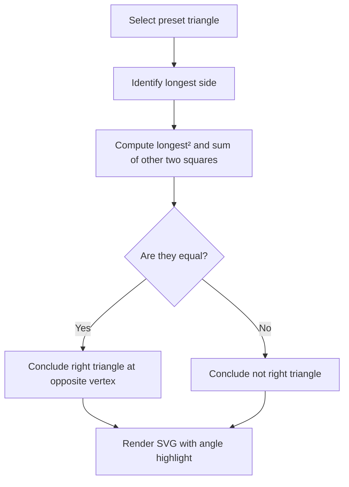

**Diagram sources**
- [ConversePythagoreanLab.tsx:67-395](file://src/components/ConversePythagoreanLab.tsx#L67-L395)

**Section sources**
- [ConversePythagoreanLab.tsx:67-395](file://src/components/ConversePythagoreanLab.tsx#L67-L395)

#### CircumcircleRightTriangleLab
Demonstrates that the hypotenuse is the diameter of the circumcircle:
- Controls for hypotenuse length and position of right-angle vertex A.
- Shows circle, radius markers, and right-angle square at A.

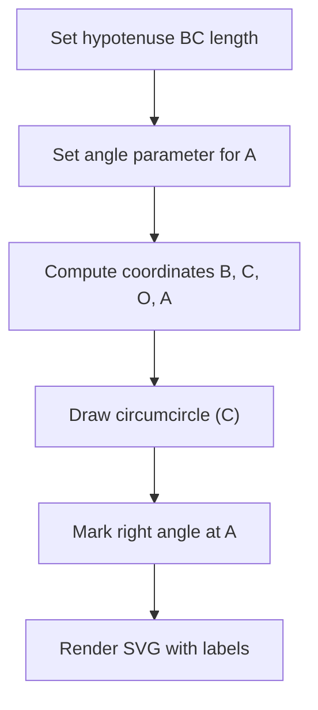

**Diagram sources**
- [CircumcircleRightTriangleLab.tsx:4-262](file://src/components/CircumcircleRightTriangleLab.tsx#L4-L262)

**Section sources**
- [CircumcircleRightTriangleLab.tsx:4-262](file://src/components/CircumcircleRightTriangleLab.tsx#L4-L262)

#### MedianHypotenuseLab
Shows median to the hypotenuse equals half the hypotenuse:
- Controls for hypotenuse length and vertex A position.
- Optional ghost rectangle construction to illustrate central symmetry.

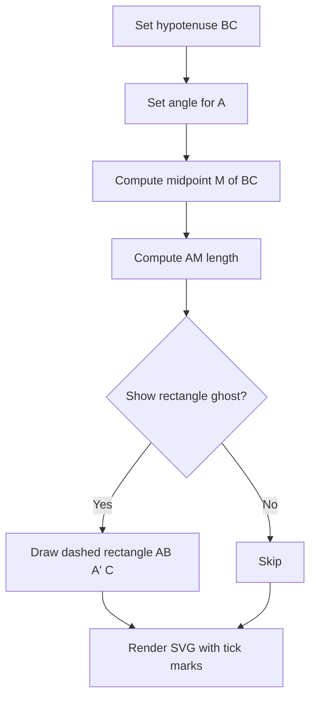

**Diagram sources**
- [MedianHypotenuseLab.tsx:12-276](file://src/components/MedianHypotenuseLab.tsx#L12-L276)

**Section sources**
- [MedianHypotenuseLab.tsx:12-276](file://src/components/MedianHypotenuseLab.tsx#L12-L276)

#### GeometryThalesLab
Interactive figure for Thales’ theorem:
- Slider adjusts scale factor k = AM/AB = AN/AC = MN/BC.
- Displays nested similar triangles and parallel lines.

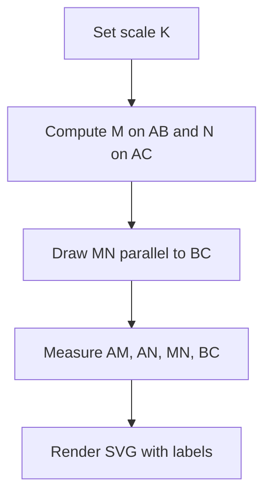

**Diagram sources**
- [GeometryThalesLab.tsx:9-208](file://src/components/GeometryThalesLab.tsx#L9-L208)

**Section sources**
- [GeometryThalesLab.tsx:9-208](file://src/components/GeometryThalesLab.tsx#L9-L208)

### Number Line Model and Fraction Operations Visualization
- NumberLineModel: Interactive number line illustrating addition as movement; displays equation result using MathView.
- VisualFractionModel: Static bar model demonstrating addition of fractions with same denominator.

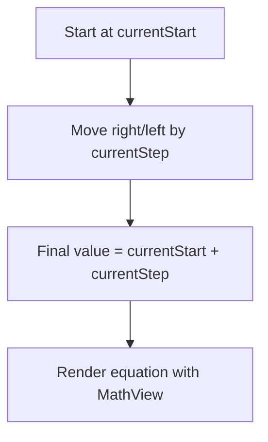

**Diagram sources**
- [NumberLineModel.tsx:5-130](file://src/components/NumberLineModel.tsx#L5-L130)

**Section sources**
- [NumberLineModel.tsx:5-130](file://src/components/NumberLineModel.tsx#L5-L130)
- [VisualFractionModel.tsx:4-86](file://src/components/VisualFractionModel.tsx#L4-L86)

## Dependency Analysis
Key dependencies:
- CourseSectionsRenderer depends on all lab components and MathView for rendering.
- Labs depend on MathView for formatted math and concept text.
- Fundamental concepts data drives clickable term highlighting in MathView.
- Types define shared structures for courses and exercises.

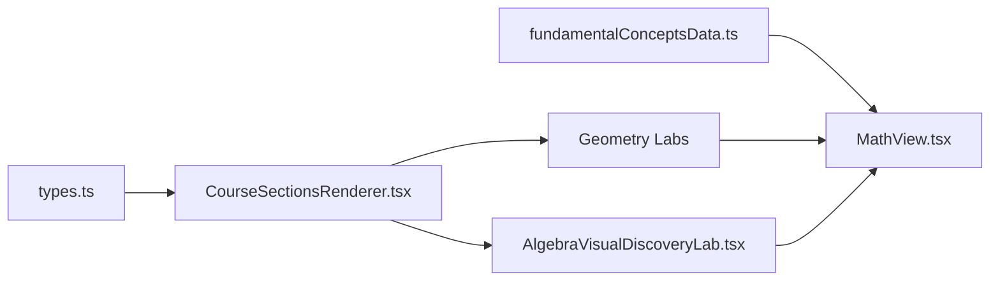

**Diagram sources**
- [types.ts:70-146](file://src/types.ts#L70-L146)
- [CourseSectionsRenderer.tsx:135-233](file://src/components/CourseSectionsRenderer.tsx#L135-L233)
- [MathView.tsx:350-579](file://src/components/MathView.tsx#L350-L579)
- [AlgebraVisualDiscoveryLab.tsx:8-872](file://src/components/AlgebraVisualDiscoveryLab.tsx#L8-L872)

**Section sources**
- [types.ts:70-146](file://src/types.ts#L70-L146)
- [CourseSectionsRenderer.tsx:135-233](file://src/components/CourseSectionsRenderer.tsx#L135-L233)
- [MathView.tsx:350-579](file://src/components/MathView.tsx#L350-L579)

## Performance Considerations
- KaTeX rendering: MathView uses try/catch and suppresses error spans; normalize Unicode superscripts before rendering to avoid parse errors.
- SVG performance: Avoid excessive grid tiles; limit tile rendering for large integer hypotenuses.
- State updates: Use controlled inputs with minimal re-renders; batch slider changes where possible.
- Text splitting: splitTopLevelMathClauses avoids heavy regex loops by processing brace depth and logical arrows efficiently.

[No sources needed since this section provides general guidance]

## Troubleshooting Guide
Common issues and resolutions:
- KaTeX parse errors in mixed Arabic/math strings: Ensure \text wrappers are normalized and spaces are handled; MathView already strips trailing backslashes and converts Unicode superscripts.
- RTL/LTR direction mismatches: Deduction-like sequences force LTR containers; verify segment detection logic.
- Concept highlighting not appearing: Confirm keywords exist in fundamental concepts and match exactly; first occurrence per paragraph is highlighted.
- SVG clipping or scaling issues: Ensure viewBox matches computed dimensions; use auto-scaling for geometry labs.

**Section sources**
- [MathView.tsx:197-348](file://src/components/MathView.tsx#L197-L348)
- [MathView.tsx:350-579](file://src/components/MathView.tsx#L350-L579)

## Conclusion
The Mathematics module combines robust math rendering, interactive SVG-based visualizations, and structured course delivery. Labs translate abstract concepts into manipulable visuals, while the renderer ensures consistent section layouts, prerequisite linking, and progress tracking. Following the documented patterns enables developers to add new mathematical visualizations seamlessly.

[No sources needed since this section summarizes without analyzing specific files]

## Appendices

### Course Structure and Navigation System
- Sections: Defined in courseData.ts with identifiers, numbers, titles, and short labels.
- Tabs: Cours, Vidéo/Lab, Quiz, Exercices, Défis; unlocked after completing discovery activity.
- Prerequisites: Linked courses displayed with clickable references.

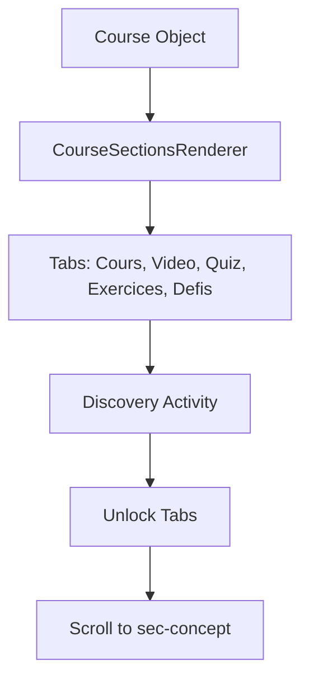

**Diagram sources**
- [courseData.ts:3-15](file://src/data/courseData.ts#L3-L15)
- [CourseSectionsRenderer.tsx:144-174](file://src/components/CourseSectionsRenderer.tsx#L144-L174)
- [CourseSectionsRenderer.tsx:355-441](file://src/components/CourseSectionsRenderer.tsx#L355-L441)

**Section sources**
- [courseData.ts:3-15](file://src/data/courseData.ts#L3-L15)
- [CourseSectionsRenderer.tsx:144-174](file://src/components/CourseSectionsRenderer.tsx#L144-L174)
- [CourseSectionsRenderer.tsx:355-441](file://src/components/CourseSectionsRenderer.tsx#L355-L441)

### Section Rendering Patterns
- Section 0: Discovery activity rendered first, followed by prerequisites and core concept.
- Section 1: Definition, vocabulary, visual model, primary property.
- Section 2: Justification and reciprocal/secondary properties.
- Section 3: Guided examples.
- Section 4: Common mistakes.
- Section 5: Exercises and challenges.
- Section 6: Summary decision tree.

**Section sources**
- [CourseSectionsRenderer.tsx:483-715](file://src/components/CourseSectionsRenderer.tsx#L483-L715)

### Progress Tracking Implementation
- Uses localStorage key `math_3am_discovery_unlocked_v1`.
- On completion, saves course ID and dispatches custom event.
- Unlocks tabs and scrolls to concept section.

**Section sources**
- [CourseSectionsRenderer.tsx:144-174](file://src/components/CourseSectionsRenderer.tsx#L144-L174)

### Examples of Mathematical Concepts Transformed into Visualizations
- Number-line addition: AlgebraVisualDiscoveryLab lesson-01 renders vectors and unit jumps.
- Division inverse: AlgebraVisualDiscoveryLab lesson-02 shows boxes for dividend, divisor, quotient with verification arrow.
- Reciprocal vs Opposite: AlgebraVisualDiscoveryLab lesson-03 compares product=1 vs sum=0.
- Fraction division: AlgebraVisualDiscoveryLab lesson-04 transforms ÷ to × with inverted second fraction.
- Fraction comparison: AlgebraVisualDiscoveryLab lesson-05 uses segmented bars.
- Fraction addition: AlgebraVisualDiscoveryLab lesson-06 toggles between pre-unified and unified denominators.
- Pythagoras: PythagoreanTheoremLab draws squares on legs and hypotenuse with optional grid tiles.
- Converse Pythagoras: ConversePythagoreanLab computes squares and compares.
- Circumcircle: CircumcircleRightTriangleLab draws circle with diameter as hypotenuse.
- Median: MedianHypotenuseLab shows median equals half hypotenuse with optional rectangle construction.
- Thales: GeometryThalesLab scales nested triangles and parallel lines.

**Section sources**
- [AlgebraVisualDiscoveryLab.tsx:40-872](file://src/components/AlgebraVisualDiscoveryLab.tsx#L40-L872)
- [PythagoreanTheoremLab.tsx:12-362](file://src/components/PythagoreanTheoremLab.tsx#L12-L362)
- [ConversePythagoreanLab.tsx:67-395](file://src/components/ConversePythagoreanLab.tsx#L67-L395)
- [CircumcircleRightTriangleLab.tsx:4-262](file://src/components/CircumcircleRightTriangleLab.tsx#L4-L262)
- [MedianHypotenuseLab.tsx:12-276](file://src/components/MedianHypotenuseLab.tsx#L12-L276)
- [GeometryThalesLab.tsx:9-208](file://src/components/GeometryThalesLab.tsx#L9-L208)

### Common Implementation Patterns for New Visualizations
- Use controlled state for sliders/presets.
- Compute derived values reactively (areas, coordinates, ratios).
- Render SVG with clear labels and color-coded elements.
- Provide reading panels explaining symbols and steps.
- Integrate MathView for any inline math or formatted text.
- Map course IDs to specific labs in CourseSectionsRenderer.renderVisualDiscoveryLab.

**Section sources**
- [CourseSectionsRenderer.tsx:194-233](file://src/components/CourseSectionsRenderer.tsx#L194-L233)
- [MathView.tsx:350-579](file://src/components/MathView.tsx#L350-L579)