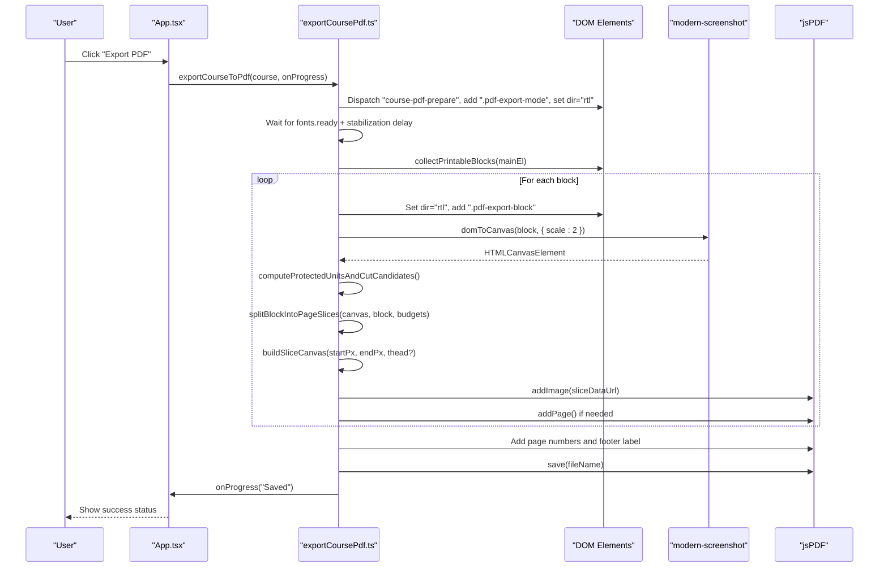
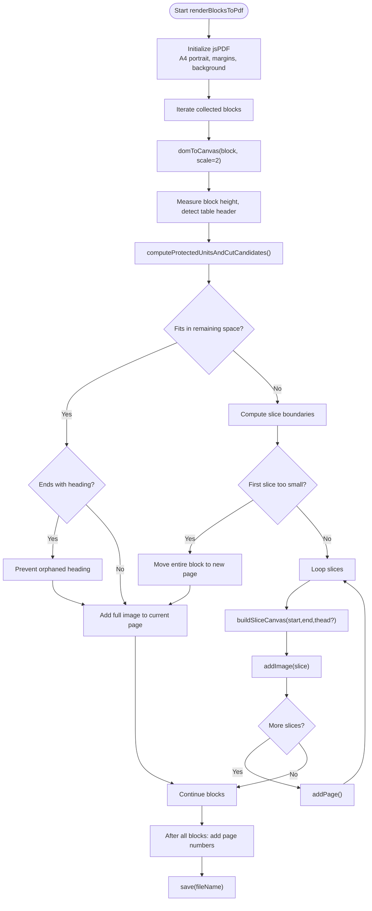
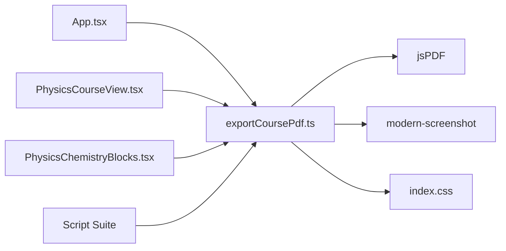

# PDF Export System

<cite>
**Referenced Files in This Document**
- [exportCoursePdf.ts](file://src/utils/exportCoursePdf.ts)
- [index.css](file://src/index.css)
- [App.tsx](file://src/App.tsx)
- [types.ts](file://src/types.ts)
- [PhysicsCourseView.tsx](file://src/components/physics/PhysicsCourseView.tsx)
- [PhysicsChemistryBlocks.tsx](file://src/components/physics/PhysicsChemistryBlocks.tsx)
- [export-pdf-test.mjs](file://scripts/export-pdf-test.mjs)
- [export-pdf-test2.mjs](file://scripts/export-pdf-test2.mjs)
- [export-pdf-test3.mjs](file://scripts/export-pdf-test3.mjs)
- [dump-block-tree.mjs](file://scripts/dump-block-tree.mjs)
- [inspect-correction.mjs](file://scripts/inspect-correction.mjs)
- [pdf-pages-to-png.mjs](file://scripts/pdf-pages-to-png.mjs)
- [analyze-pdf-pages.py](file://scripts/analyze-pdf-pages.py)
- [render-pdf-pages.py](file://scripts/render-pdf-pages.py)
- [crop-final-checks.py](file://scripts/crop-final-checks.py)
- [extract-pdf-text.py](file://scripts/extract-pdf-text.py)
- [render-pdf-region.py](file://scripts/render-pdf-region.py)
- [search-pdf-ions.py](file://scripts/search-pdf-ions.py)
</cite>

## Update Summary
**Changes Made**
- Updated core pagination algorithm with advanced block-based splitting and intelligent content protection
- Enhanced styling preservation with improved RTL support and table header repetition
- Added comprehensive script development suite for PDF processing workflows
- Expanded diagnostic capabilities with detailed break reporting and page analysis tools
- Improved error handling and progress tracking throughout the export pipeline

## Table of Contents
1. [Introduction](#introduction)
2. [Project Structure](#project-structure)
3. [Core Components](#core-components)
4. [Architecture Overview](#architecture-overview)
5. [Detailed Component Analysis](#detailed-component-analysis)
6. [Advanced Pagination Algorithm](#advanced-pagination-algorithm)
7. [Script Development Suite](#script-development-suite)
8. [Dependency Analysis](#dependency-analysis)
9. [Performance Considerations](#performance-considerations)
10. [Troubleshooting Guide](#troubleshooting-guide)
11. [Conclusion](#conclusion)
12. [Appendices](#appendices)

## Introduction
This document explains the enhanced PDF export system used to generate printable course materials from the application's DOM. The system now features a sophisticated block-based pagination algorithm that intelligently splits content while preserving semantic units, repeats table headers on continuation pages, and prevents orphaned micro-slices or nearly empty final pages.

The workflow supports:
- Two content sources: Math courses and Physics-Chemistry courses
- Advanced block-based pagination with protected unit detection
- Intelligent content splitting based on background analysis and element boundaries
- Automatic page breaks with orphan prevention
- Enhanced styling preservation including RTL text support
- Comprehensive script development suite for PDF processing workflows
- Progress callbacks for user feedback
- Error handling around missing DOM nodes and canvas rendering failures
- CSS-driven visibility control for interactive controls during export

## Project Structure
The PDF export functionality is centered in an enhanced utility module with extensive integration points across the main app, physics views, and a comprehensive script development suite. Styles are defined in the global stylesheet, while testing and analysis scripts provide robust debugging capabilities.

```mermaid
graph TB
App["App.tsx<br/>User triggers export"] --> ExportUtil["exportCoursePdf.ts<br/>Enhanced Export API + Advanced Pagination"]
ExportUtil --> jsPDF["jsPDF<br/>PDF creation"]
ExportUtil --> Screenshot["modern-screenshot<br/>DOM to Canvas"]
ExportUtil --> Styles["index.css<br/>.pdf-export-mode styles"]
PhysicsView["PhysicsCourseView.tsx<br/>Expands collapsibles for PDF"] --> ExportUtil
PhysicsBlocks["PhysicsChemistryBlocks.tsx<br/>Listens to PDF events"] --> ExportUtil
subgraph "Script Development Suite"
Test1["export-pdf-test.mjs<br/>Full automation & reporting"]
Test2["export-pdf-test2.mjs<br/>Progress monitoring"]
Test3["export-pdf-test3.mjs<br/>DOM text capture"]
DumpTree["dump-block-tree.mjs<br/>Block structure analysis"]
Inspect["inspect-correction.mjs<br/>Content state inspection"]
PageToPNG["pdf-pages-to-png.mjs<br/>PDF to PNG conversion"]
AnalyzePages["analyze-pdf-pages.py<br/>Page fill analysis"]
RenderPages["render-pdf-pages.py<br/>PDF page rendering"]
CropChecks["crop-final-checks.py<br/>Boundary validation"]
ExtractText["extract-pdf-text.py<br/>Text extraction"]
RenderRegion["render-pdf-region.py<br/>Region rendering"]
SearchIons["search-pdf-ions.py<br/>Content validation"]
end
Test1 --> ExportUtil
Test2 --> ExportUtil
Test3 --> ExportUtil
DumpTree --> ExportUtil
Inspect --> ExportUtil
```

**Diagram sources**
- [App.tsx:118-149](file://src/App.tsx#L118-L149)
- [exportCoursePdf.ts:1030-1114](file://src/utils/exportCoursePdf.ts#L1030-L1114)
- [index.css:108-121](file://src/index.css#L108-L121)
- [PhysicsCourseView.tsx:158-176](file://src/components/physics/PhysicsCourseView.tsx#L158-L176)
- [PhysicsChemistryBlocks.tsx:894-909](file://src/components/physics/PhysicsChemistryBlocks.tsx#L894-L909)
- [export-pdf-test.mjs:1-145](file://scripts/export-pdf-test.mjs#L1-L145)
- [export-pdf-test2.mjs:1-96](file://scripts/export-pdf-test2.mjs#L1-L96)
- [export-pdf-test3.mjs:1-140](file://scripts/export-pdf-test3.mjs#L1-L140)

**Section sources**
- [exportCoursePdf.ts:1-1114](file://src/utils/exportCoursePdf.ts#L1-L1114)
- [index.css:108-121](file://src/index.css#L108-L121)
- [App.tsx:118-149](file://src/App.tsx#L118-L149)

## Core Components
- **Enhanced Export Utilities**:
  - `exportCourseToPdf`: Exports Math course content with advanced pagination
  - `exportPhysicsCourseToPdf`: Exports Physics-Chemistry course content with double event dispatching
  - `renderBlocksToPdf`: Shared renderer with sophisticated block-based pagination algorithm
- **Advanced Block Collection**:
  - `collectPrintableBlocks`: Collects logical blocks for Math courses with intelligent size handling
  - `collectPhysicsPrintableBlocks`: Collects logical blocks for Physics-Chemistry courses with enhanced container handling
- **Sophisticated Pagination Engine**:
  - `splitBlockIntoPageSlices`: Computes safe slice boundaries using protected unit detection and background analysis
  - `buildSliceCanvas`: Builds per-page canvases with automatic table header repetition
  - `computeProtectedUnitsAndCutCandidates`: Identifies protected elements and optimal cut positions
- **Styling Preservation**:
  - `.pdf-export-mode` and `.pdf-export-block` enforce RTL direction and hide interactive controls during capture

Key responsibilities:
- Prepare DOM for export with enhanced event handling and class management
- Wait for fonts and stabilize DOM before capture with improved timing
- Convert DOM blocks to high-resolution canvases with error handling
- Paginate content while respecting protected units, table headers, and semantic boundaries
- Render slices into A4 pages with consistent margins, page numbers, and footer labels
- Provide comprehensive progress updates and save the final PDF with detailed diagnostics

**Section sources**
- [exportCoursePdf.ts:77-197](file://src/utils/exportCoursePdf.ts#L77-L197)
- [exportCoursePdf.ts:203-232](file://src/utils/exportCoursePdf.ts#L203-L232)
- [exportCoursePdf.ts:270-449](file://src/utils/exportCoursePdf.ts#L270-L449)
- [exportCoursePdf.ts:456-500](file://src/utils/exportCoursePdf.ts#L456-L500)
- [exportCoursePdf.ts:511-810](file://src/utils/exportCoursePdf.ts#L511-L810)
- [exportCoursePdf.ts:1030-1114](file://src/utils/exportCoursePdf.ts#L1030-L1114)
- [index.css:108-121](file://src/index.css#L108-L121)

## Architecture Overview
The enhanced export flow coordinates UI state, DOM preparation, intelligent block collection, advanced canvas rendering, and sophisticated PDF generation with comprehensive error handling and progress tracking.

**Diagram sources**
- [App.tsx:118-149](file://src/App.tsx#L118-L149)
- [exportCoursePdf.ts:1030-1114](file://src/utils/exportCoursePdf.ts#L1030-L1114)
- [exportCoursePdf.ts:648-1028](file://src/utils/exportCoursePdf.ts#L648-L1028)

## Detailed Component Analysis

### Enhanced Export Entry Points
- `exportCourseToPdf`:
  - Validates presence of `#course-main-content`
  - Dispatches `course-pdf-prepare`, adds `.pdf-export-mode`, sets `dir="rtl"`
  - Waits for fonts and stabilizes DOM with improved timing (350ms)
  - Collects blocks and calls shared renderer with Math-specific footer label and filename
- `exportPhysicsCourseToPdf`:
  - Similar flow for `#physics-course-main-content`
  - Emits two `course-pdf-prepare` signals with 200ms delay between them to ensure nested collapsible cards open before block collection
  - Uses Physics-Chemistry-specific footer label and filename
  - Enhanced stabilization timing (400ms initial, 200ms secondary)

Error handling:
- Throws when required DOM containers are missing
- Catches canvas rendering errors and skips problematic blocks
- Comprehensive try-catch-finally blocks for DOM cleanup

Progress tracking:
- Calls `onProgress` at key stages: preparing, capturing sections, saving file
- Arabic progress messages for better localization

**Section sources**
- [exportCoursePdf.ts:1030-1067](file://src/utils/exportCoursePdf.ts#L1030-L1067)
- [exportCoursePdf.ts:1069-1114](file://src/utils/exportCoursePdf.ts#L1069-L1114)

### Enhanced Block Collection System
- `collectPrintableBlocks`:
  - Targets `#course-card-inner` or first direct child of main container
  - Skips hidden elements, `#sec-continuity`, and elements with class `no-pdf`
  - Flattens large sections into children unless they are grid layouts
  - Ensures treatise links section is included if visible
  - Enhanced size threshold handling (MAX_SINGLE_BLOCK_PX = 980px)
- `collectPhysicsPrintableBlocks`:
  - Iterates top-level children of the physics main container
  - Applies similar visibility and exclusion rules
  - Handles large containers by descending into children, excluding grids and specific lead groups
  - Enhanced container detection with section-lead-group exclusion

Complexity:
- Linear traversal over top-level children and their immediate descendants; O(N) where N is number of relevant DOM nodes
- Improved performance with early exits and optimized DOM queries

**Section sources**
- [exportCoursePdf.ts:77-139](file://src/utils/exportCoursePdf.ts#L77-L139)
- [exportCoursePdf.ts:144-197](file://src/utils/exportCoursePdf.ts#L144-L197)

### Rendering Pipeline and DOM-to-PDF Mapping
- DOM elements are converted to canvases via modern-screenshot's `domToCanvas`
- Each block is rendered at 2x scale to preserve detail
- Canvases are sliced according to advanced pagination logic and added to PDF as JPEG images
- Page backgrounds are filled with a light color (#FBFBFA) to match the app theme
- Footer labels and page numbers are added after all content is placed

RTL support:
- During capture, blocks temporarily get `dir="rtl"` and a `.pdf-export-block` class
- Global CSS ensures consistent RTL styling and hides interactive controls under `.pdf-export-mode`

Math formulas:
- KaTeX elements are forced LTR to maintain correct math layout even on RTL pages

**Section sources**
- [exportCoursePdf.ts:648-1028](file://src/utils/exportCoursePdf.ts#L648-L1028)
- [index.css:35-101](file://src/index.css#L35-L101)
- [index.css:108-121](file://src/index.css#L108-L121)

### Integration with UI and Events
- `App.tsx` orchestrates export: navigates to course view, invokes export utility, updates status, and handles errors
- Physics components listen to `course-pdf-prepare` and `course-pdf-done` to expand collapsible content before capture and collapse afterward
- Break report is exposed via `window.__pdfBreakReport` for diagnostics with detailed pagination decisions

**Section sources**
- [App.tsx:118-149](file://src/App.tsx#L118-L149)
- [PhysicsCourseView.tsx:158-176](file://src/components/physics/PhysicsCourseView.tsx#L158-L176)
- [PhysicsChemistryBlocks.tsx:894-909](file://src/components/physics/PhysicsChemistryBlocks.tsx#L894-L909)
- [exportCoursePdf.ts:1019-1028](file://src/utils/exportCoursePdf.ts#L1019-L1028)

## Advanced Pagination Algorithm
The enhanced pagination engine enforces strict rules with sophisticated algorithms:
- Never cut protected units (paragraphs, headings, table rows, SVGs, images, videos, iframes, blockquotes, preformatted text, figures, definitions, buttons, inputs, selects, rounded cards up to height limits)
- Repeat table headers on continuation pages with precise positioning
- Move entire blocks to next page if they do not fit but can fit on a fresh page
- Avoid micro-slices and near-empty last pages with intelligent thresholds
- Protect rounded card borders from fragmentation between pages

Key functions:
- `findTableInBlock` / `measureTheadHeightPx`: Detect tables with headers and measure header height precisely
- `computeProtectedUnitsAndCutCandidates`:
  - Gathers protected unit rectangles with enhanced detection
  - Merges overlapping intervals intelligently
  - Produces candidate cut positions at unit boundaries and midpoints between adjacent units
  - Adds guard zones around rounded cards to prevent border fragmentation
- `splitBlockIntoPageSlices`:
  - Analyzes background pixel rows to find "free" cut zones outside protected units
  - Picks best cuts within budget constraints using multiple priority strategies
  - Prevents orphaned tiny tail slices with anti-orphan algorithms
  - Handles heading isolation to prevent titles ending alone at page bottoms
- `buildSliceCanvas`:
  - Creates per-slice canvases with proper spacing
  - Automatically draws repeated table headers above slice content
  - Maintains visual consistency across page breaks

Algorithm highlights:
- Uses a 2x scaled canvas for higher fidelity rendering
- Converts mm-based page budgets to px for precise slicing calculations
- Tracks break decisions for comprehensive debugging and reporting
- Implements multiple fallback strategies for optimal cut placement
- Provides detailed diagnostics through break reports

**Diagram sources**
- [exportCoursePdf.ts:648-1028](file://src/utils/exportCoursePdf.ts#L648-L1028)
- [exportCoursePdf.ts:270-449](file://src/utils/exportCoursePdf.ts#L270-L449)
- [exportCoursePdf.ts:456-500](file://src/utils/exportCoursePdf.ts#L456-L500)

**Section sources**
- [exportCoursePdf.ts:203-232](file://src/utils/exportCoursePdf.ts#L203-L232)
- [exportCoursePdf.ts:270-449](file://src/utils/exportCoursePdf.ts#L270-L449)
- [exportCoursePdf.ts:456-500](file://src/utils/exportCoursePdf.ts#L456-L500)
- [exportCoursePdf.ts:511-810](file://src/utils/exportCoursePdf.ts#L511-L810)
- [exportCoursePdf.ts:648-1028](file://src/utils/exportCoursePdf.ts#L648-L1028)

## Script Development Suite
The comprehensive script development suite provides robust tools for PDF processing workflows, debugging, and quality assurance.

### Automation and Testing Scripts
- **export-pdf-test.mjs**: Full automation script with comprehensive console logging, download monitoring, and error tracking
- **export-pdf-test2.mjs**: Progress monitoring script with detailed breakpoint reporting and status polling
- **export-pdf-test3.mjs**: DOM text capture script that records exact content rasterized during export

### Analysis and Debugging Tools
- **dump-block-tree.mjs**: Fidelity dump of block tree structure matching the PDF engine's enumeration
- **inspect-correction.mjs**: Content state inspection tool for analyzing collapsible content during export
- **analyze-pdf-pages.py**: Page fill analysis using PyMuPDF to examine content distribution
- **render-pdf-pages.py**: PDF page rendering to PNG for OCR processing
- **crop-final-checks.py**: Boundary validation tool for checking page edge integrity

### Processing and Validation Scripts
- **pdf-pages-to-png.mjs**: PDF to PNG conversion using Chrome's native PDF viewer
- **extract-pdf-text.py**: Text extraction from PDF layers for content verification
- **render-pdf-region.py**: High-resolution region rendering for detailed inspection
- **search-pdf-ions.py**: Automated search for forbidden terms with normalized text comparison

These scripts work together to provide end-to-end testing, debugging, and quality assurance for the PDF export system, ensuring reliable output across different content types and configurations.

**Section sources**
- [export-pdf-test.mjs:1-145](file://scripts/export-pdf-test.mjs#L1-L145)
- [export-pdf-test2.mjs:1-96](file://scripts/export-pdf-test2.mjs#L1-L96)
- [export-pdf-test3.mjs:1-140](file://scripts/export-pdf-test3.mjs#L1-L140)
- [dump-block-tree.mjs:1-211](file://scripts/dump-block-tree.mjs#L1-L211)
- [inspect-correction.mjs:1-92](file://scripts/inspect-correction.mjs#L1-L92)
- [analyze-pdf-pages.py:1-30](file://scripts/analyze-pdf-pages.py#L1-L30)
- [render-pdf-pages.py:1-19](file://scripts/render-pdf-pages.py#L1-L19)
- [crop-final-checks.py:1-49](file://scripts/crop-final-checks.py#L1-L49)
- [extract-pdf-text.py:1-18](file://scripts/extract-pdf-text.py#L1-L18)
- [pdf-pages-to-png.mjs:1-36](file://scripts/pdf-pages-to-png.mjs#L1-L36)
- [render-pdf-region.py:1-22](file://scripts/render-pdf-region.py#L1-L22)
- [search-pdf-ions.py:1-102](file://scripts/search-pdf-ions.py#L1-L102)

## Dependency Analysis
External libraries:
- jsPDF: PDF creation, page management, image insertion, text/footer rendering
- modern-screenshot: DOM-to-canvas conversion with configurable scale and background

Internal dependencies:
- Types: Course data structures inform filename generation and footer labeling
- CSS: `.pdf-export-mode` and `.pdf-export-block` control visual behavior during capture

Coupling:
- Export utilities depend on specific DOM IDs (`#course-main-content`, `#physics-course-main-content`)
- UI components rely on custom events for expanding/collapsing content during export

Potential circular dependencies:
- None detected; event-driven communication decouples UI components from export logic

**Diagram sources**
- [App.tsx:118-149](file://src/App.tsx#L118-L149)
- [exportCoursePdf.ts:1-5](file://src/utils/exportCoursePdf.ts#L1-L5)
- [index.css:108-121](file://src/index.css#L108-L121)
- [PhysicsCourseView.tsx:158-176](file://src/components/physics/PhysicsCourseView.tsx#L158-L176)
- [PhysicsChemistryBlocks.tsx:894-909](file://src/components/physics/PhysicsChemistryBlocks.tsx#L894-L909)

**Section sources**
- [exportCoursePdf.ts:1-5](file://src/utils/exportCoursePdf.ts#L1-L5)
- [types.ts:70-146](file://src/types.ts#L70-L146)
- [index.css:108-121](file://src/index.css#L108-L121)

## Performance Considerations
- High-resolution canvases: Using 2x scale improves clarity but increases memory usage. Ensure sufficient device memory for long courses.
- Image compression: JPEG quality is set to 0.94; adjust if file size becomes excessive.
- Background analysis: Pixel scanning for free cut zones is O(W×H) per block; consider limiting very tall blocks or optimizing background detection if performance issues arise.
- Batch operations: The renderer processes blocks sequentially; parallelizing canvas generation could improve throughput but may increase memory pressure.
- Font loading: Waiting for `document.fonts.ready` plus stabilization delays ensures stable layout but adds latency; tune delays based on content complexity.
- Enhanced algorithms: The new pagination algorithm includes multiple optimization strategies to minimize unnecessary reflows and DOM queries.

## Troubleshooting Guide
Common issues and resolutions:
- Missing DOM container:
  - Symptom: Error thrown indicating course content element not found
  - Resolution: Ensure `#course-main-content` or `#physics-course-main-content` exists before export
- Blank or truncated pages:
  - Cause: Blocks with zero width/height or failed canvas capture
  - Resolution: Verify visibility and layout; check for `no-pdf` exclusions or hidden elements
- Orphaned table headers:
  - Cause: Slice starting after table body ends
  - Resolution: The renderer guards against this; verify table structure includes `<thead>` and `<tbody>`
- Micro-slices or nearly empty final pages:
  - Cause: Insufficient space for meaningful slices
  - Resolution: Adjust thresholds like `MIN_FIRST_SLICE_MM` or `MIN_SLICE_TAIL_PX` if necessary
- RTL formatting problems:
  - Cause: Direction not applied during capture
  - Resolution: Confirm `.pdf-export-mode` and `.pdf-export-block` styles are active; ensure KaTeX LTR overrides are present
- Progress not updating:
  - Cause: No `onProgress` callback provided
  - Resolution: Pass a callback to update UI status during export
- Rounded card border fragmentation:
  - Cause: Cut falling inside rounded card boundaries
  - Resolution: Enhanced guard zones prevent this; verify card classes are properly applied

Diagnostics:
- Use `window.__pdfBreakReport` to inspect pagination decisions with detailed breakdown
- Automation scripts demonstrate polling for progress and break reports
- Block tree dumping helps understand content structure during export
- Page analysis tools identify content distribution and potential issues

**Section sources**
- [exportCoursePdf.ts:1030-1037](file://src/utils/exportCoursePdf.ts#L1030-L1037)
- [exportCoursePdf.ts:1069-1076](file://src/utils/exportCoursePdf.ts#L1069-L1076)
- [exportCoursePdf.ts:1019-1028](file://src/utils/exportCoursePdf.ts#L1019-L1028)
- [export-pdf-test2.mjs:64-95](file://scripts/export-pdf-test2.mjs#L64-L95)

## Conclusion
The enhanced PDF export system provides a robust, configurable pipeline for converting course content into well-formatted A4 PDFs. With its advanced block-based pagination algorithm, intelligent content protection, and comprehensive script development suite, it prioritizes readable pagination by protecting semantic units, repeating table headers, and avoiding awkward page breaks. Integration with the UI through events and CSS ensures interactive controls are hidden and collapsible content is expanded during capture. With clear error handling, progress callbacks, diagnostic reporting, and extensive testing tools, the system is both developer-friendly and user-resilient.

## Appendices

### Practical Examples

- Export a Math course:
  - Call `exportCourseToPdf(course, onProgress)` from your UI handler
  - Ensure `#course-main-content` is present and populated
  - Observe progress updates and final save notification

- Export a Physics-Chemistry course:
  - Call `exportPhysicsCourseToPdf(course, onProgress)`
  - Ensure `#physics-course-main-content` is present
  - Collapsible sections will be expanded automatically before capture with enhanced timing

- Handle RTL text:
  - The exporter sets `dir="rtl"` on blocks and applies `.pdf-export-block` styles
  - KaTeX formulas remain LTR due to explicit CSS overrides

- Customize PDF formatting:
  - Adjust page margins, block gap, and JPEG quality in `renderBlocksToPdf`
  - Modify footer label and filename generation in entry-point functions
  - Tune pagination thresholds like `MIN_FIRST_SLICE_MM` and `MIN_SLICE_TAIL_PX`

- Extend for new content types:
  - Implement a new block collector function mirroring `collectPrintableBlocks` or `collectPhysicsPrintableBlocks`
  - Integrate it into a new export entry point that dispatches appropriate events and waits for DOM stabilization

- Use the script development suite:
  - Run `export-pdf-test.mjs` for full automation with comprehensive logging
  - Use `dump-block-tree.mjs` to analyze block structure during export
  - Leverage `analyze-pdf-pages.py` to examine page content distribution
  - Employ `search-pdf-ions.py` for content validation and quality assurance

**Section sources**
- [exportCoursePdf.ts:1030-1114](file://src/utils/exportCoursePdf.ts#L1030-L1114)
- [export-pdf-test.mjs:1-145](file://scripts/export-pdf-test.mjs#L1-L145)
- [dump-block-tree.mjs:1-211](file://scripts/dump-block-tree.mjs#L1-L211)
- [analyze-pdf-pages.py:1-30](file://scripts/analyze-pdf-pages.py#L1-L30)
- [search-pdf-ions.py:1-102](file://scripts/search-pdf-ions.py#L1-L102)