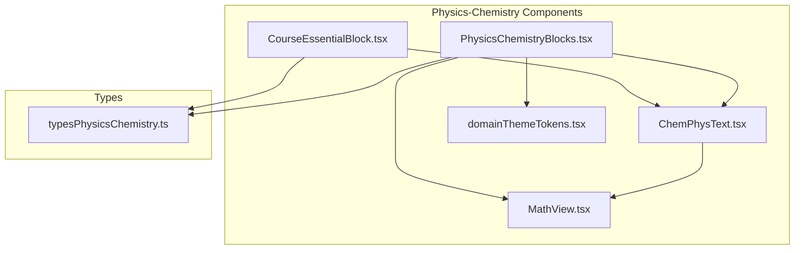
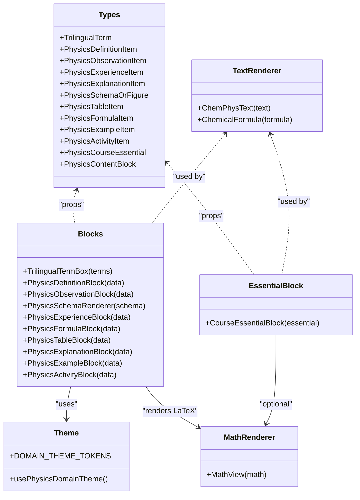
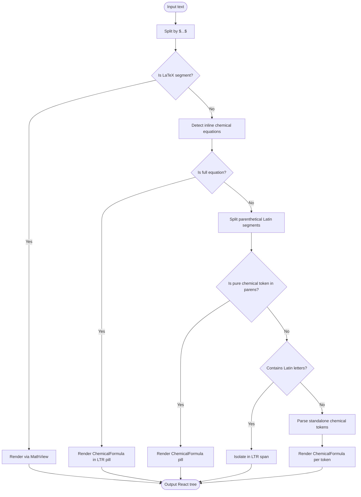
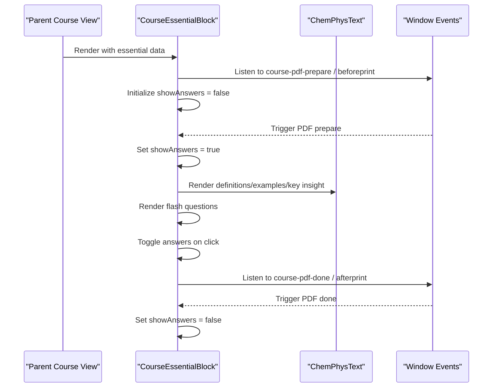
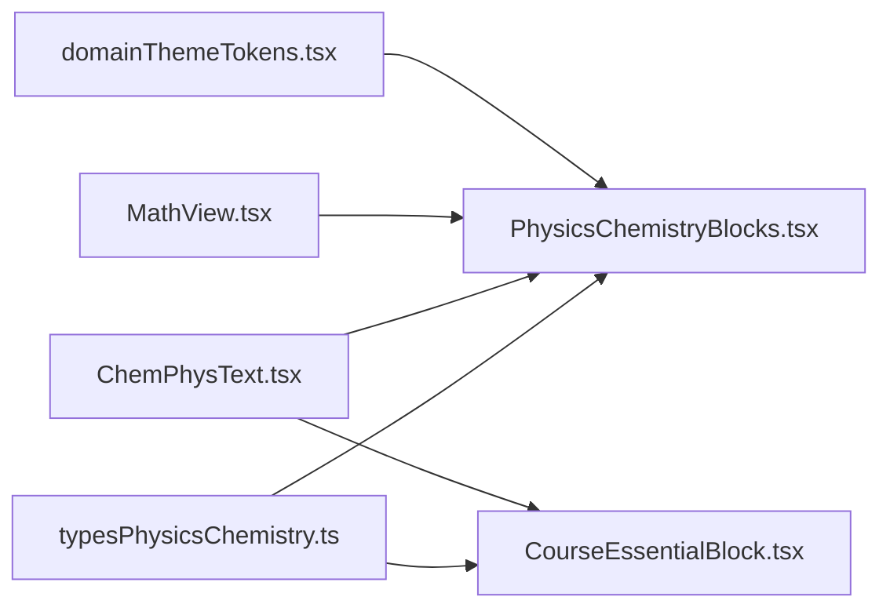

# Domain-Specific Components

<cite>
**Referenced Files in This Document**
- [CourseEssentialBlock.tsx](file://src/components/physics/CourseEssentialBlock.tsx)
- [ChemPhysText.tsx](file://src/components/physics/ChemPhysText.tsx)
- [PhysicsChemistryBlocks.tsx](file://src/components/physics/PhysicsChemistryBlocks.tsx)
- [typesPhysicsChemistry.ts](file://src/typesPhysicsChemistry.ts)
- [domainThemeTokens.tsx](file://src/components/physics/domainThemeTokens.tsx)
- [MathView.tsx](file://src/components/MathView.tsx)
</cite>

## Table of Contents
1. [Introduction](#introduction)
2. [Project Structure](#project-structure)
3. [Core Components](#core-components)
4. [Architecture Overview](#architecture-overview)
5. [Detailed Component Analysis](#detailed-component-analysis)
6. [Dependency Analysis](#dependency-analysis)
7. [Performance Considerations](#performance-considerations)
8. [Troubleshooting Guide](#troubleshooting-guide)
9. [Conclusion](#conclusion)

## Introduction
This document explains the domain-specific physics-chemistry components used to render trilingual educational content (Arabic, French, and English), display chemical formulas and mathematical expressions, and provide interactive learning blocks tailored for a 3AM physics-chemistry curriculum. The focus is on:

- Trilingual text rendering with correct Arabic RTL layout and isolated LTR scientific tokens.
- Chemical formula parsing and formatting, including Unicode subscripts/superscripts, charges, states, coefficients, and reaction arrows.
- LaTeX math rendering inside scientific text.
- Pedagogical blocks such as definitions, observations, experiments, explanations, examples, tables, schemas, activities, and essential summaries.

These components are designed to be reusable across courses while preserving exact pedagogical structure and terminology.

## Project Structure
The relevant code lives under `src/components/physics` and shared types under `src/typesPhysicsChemistry.ts`. Key files:

- `ChemPhysText.tsx`: Trilingual text renderer with chemical formula and LaTeX support.
- `CourseEssentialBlock.tsx`: Essential summary block with flash questions and toggleable answers.
- `PhysicsChemistryBlocks.tsx`: Comprehensive library of physics-chemistry UI blocks.
- `typesPhysicsChemistry.ts`: Shared data models for all blocks.
- `domainThemeTokens.tsx`: Domain-based theme tokens and icons.
- `MathView.tsx`: LaTeX math renderer with concept highlighting.

**Diagram sources**
- [ChemPhysText.tsx:1-417](file://src/components/physics/ChemPhysText.tsx#L1-L417)
- [CourseEssentialBlock.tsx:1-328](file://src/components/physics/CourseEssentialBlock.tsx#L1-L328)
- [PhysicsChemistryBlocks.tsx:1-800](file://src/components/physics/PhysicsChemistryBlocks.tsx#L1-L800)
- [typesPhysicsChemistry.ts:1-397](file://src/typesPhysicsChemistry.ts#L1-L397)
- [domainThemeTokens.tsx:1-423](file://src/components/physics/domainThemeTokens.tsx#L1-L423)
- [MathView.tsx:1-200](file://src/components/MathView.tsx#L1-L200)

**Section sources**
- [ChemPhysText.tsx:1-417](file://src/components/physics/ChemPhysText.tsx#L1-L417)
- [CourseEssentialBlock.tsx:1-328](file://src/components/physics/CourseEssentialBlock.tsx#L1-L328)
- [PhysicsChemistryBlocks.tsx:1-800](file://src/components/physics/PhysicsChemistryBlocks.tsx#L1-L800)
- [typesPhysicsChemistry.ts:1-397](file://src/typesPhysicsChemistry.ts#L1-L397)
- [domainThemeTokens.tsx:1-423](file://src/components/physics/domainThemeTokens.tsx#L1-L423)
- [MathView.tsx:1-200](file://src/components/MathView.tsx#L1-L200)

## Core Components
This section summarizes the core building blocks that power trilingual scientific content and domain-specific pedagogy.

- ChemPhysText: Renders mixed Arabic/French/Latin text, isolates LTR segments, parses chemical formulas and equations, highlights energy units and variables, and embeds LaTeX math via MathView.
- CourseEssentialBlock: Presents “L’essentiel” summaries with icon-labeled items, key insights, system descriptions, common mistakes, and flash questions with toggleable answers.
- PhysicsChemistryBlocks: Provides a comprehensive set of blocks:
  - TrilingualTermBox
  - PhysicsDefinitionBlock
  - PhysicsObservationBlock
  - PhysicsSchemaRenderer
  - PhysicsExperienceBlock
  - PhysicsFormulaBlock
  - PhysicsTableBlock
  - PhysicsExplanationBlock
  - PhysicsExampleBlock
  - PhysicsActivityBlock

These components share consistent styling, use domain theme tokens, and rely on shared types for data contracts.

**Section sources**
- [ChemPhysText.tsx:1-417](file://src/components/physics/ChemPhysText.tsx#L1-L417)
- [CourseEssentialBlock.tsx:1-328](file://src/components/physics/CourseEssentialBlock.tsx#L1-L328)
- [PhysicsChemistryBlocks.tsx:1-800](file://src/components/physics/PhysicsChemistryBlocks.tsx#L1-L800)
- [typesPhysicsChemistry.ts:1-397](file://src/typesPhysicsChemistry.ts#L1-L397)

## Architecture Overview
The architecture centers around three layers:

1. Data layer: Typed interfaces define the shape of content blocks and course structures.
2. Rendering layer: Components parse and format text, formulas, and diagrams.
3. Theming layer: Domain tokens supply colors, icons, and labels consistently across blocks.

**Diagram sources**
- [typesPhysicsChemistry.ts:12-397](file://src/typesPhysicsChemistry.ts#L12-L397)
- [ChemPhysText.tsx:36-417](file://src/components/physics/ChemPhysText.tsx#L36-L417)
- [PhysicsChemistryBlocks.tsx:39-800](file://src/components/physics/PhysicsChemistryBlocks.tsx#L39-L800)
- [CourseEssentialBlock.tsx:22-328](file://src/components/physics/CourseEssentialBlock.tsx#L22-L328)
- [domainThemeTokens.tsx:17-423](file://src/components/physics/domainThemeTokens.tsx#L17-L423)
- [MathView.tsx:1-200](file://src/components/MathView.tsx#L1-L200)

## Detailed Component Analysis

### Trilingual Text Rendering: ChemPhysText
ChemPhysText is the central text formatter for physics-chemistry content. It handles:

- Splitting LaTeX math segments `$...$` and delegating them to MathView.
- Detecting full chemical equations and isolating them in LTR direction.
- Parsing standalone chemical tokens and parenthetical Latin/French terms.
- Rendering chemical formulas with proper subscripts/superscripts, charges, states, and stoichiometric coefficients.
- Highlighting energy variables like `E_...` and units like J, kJ, W, kW, Wh, %.

Key behaviors:

- Unicode subscript/superscript maps convert characters like ₀, ₁, ⁰, ¹ into HTML `` and ``.
- Chemical equation parsing supports arrows `→`, `⟶`, and `=`; plus signs `+`; and physical states `(s)`, `(l)`, `(g)`, `(aq)`.
- Parenthetical Latin segments are isolated in LTR to preserve readability within Arabic RTL text.
- Energy variables and units are visually emphasized.

**Diagram sources**
- [ChemPhysText.tsx:252-417](file://src/components/physics/ChemPhysText.tsx#L252-L417)
- [ChemPhysText.tsx:36-227](file://src/components/physics/ChemPhysText.tsx#L36-L227)

Usage patterns:

- Wrap any Arabic/French/Latin scientific paragraph with `<ChemPhysText text={...} />`.
- Use it inside definition, observation, explanation, example, table cells, and activity prompts.
- Embed LaTeX math using `$...$` delimiters; it will be rendered by MathView.

Props interface:

- `text: string` — Mixed content with optional LaTeX math and chemical formulas.
- `className?: string` — Optional Tailwind class for container styling.

**Section sources**
- [ChemPhysText.tsx:1-417](file://src/components/physics/ChemPhysText.tsx#L1-L417)

### Essential Summary Block: CourseEssentialBlock
CourseEssentialBlock renders the “أحتفظ بالأهم” (L’essentiel) section. It includes:

- Header with title, subtitle, and badge.
- Grid of essential items with icons, titles, definitions, and examples.
- Key insight highlight.
- System description or standard conditions.
- Common mistakes and flash questions with toggleable answers.
- PDF/print-aware answer visibility.

Interactive behavior:

- Toggle answers for flash questions via button state.
- Auto-show answers during PDF preparation and print events.

Props interface:

- `essential: PhysicsCourseEssential` — Structured essential content.
- `primaryColor?: string` — Accent color for borders, badges, and highlights.

Data model usage:

- Uses `PhysicsCourseEssential` and `PhysicsCourseEssentialItem` from types.
- Icons are mapped from a small enum-like set.

**Diagram sources**
- [CourseEssentialBlock.tsx:57-328](file://src/components/physics/CourseEssentialBlock.tsx#L57-L328)
- [ChemPhysText.tsx:252-417](file://src/components/physics/ChemPhysText.tsx#L252-L417)

**Section sources**
- [CourseEssentialBlock.tsx:1-328](file://src/components/physics/CourseEssentialBlock.tsx#L1-L328)
- [typesPhysicsChemistry.ts:264-291](file://src/typesPhysicsChemistry.ts#L264-L291)

### Comprehensive Library: PhysicsChemistryBlocks
This module provides a rich set of domain-specific blocks. Each block accepts typed data and renders trilingual content with consistent styling.

#### TrilingualTermBox
Displays a grid of scientific terms with Arabic primary label, optional symbol/formula, and French/English translations.

Props interface:

- `terms: TrilingualTerm[]`
- `title?: string`

Data model:

- `TrilingualTerm` includes `arabic`, `french`, optional `english`, `explanation`, and `symbolOrFormula`.

Rendering details:

- Uses `ChemicalFormula` for symbols/formulas.
- Uses `ChemPhysText` for explanations.

**Section sources**
- [PhysicsChemistryBlocks.tsx:39-94](file://src/components/physics/PhysicsChemistryBlocks.tsx#L39-L94)
- [typesPhysicsChemistry.ts:12-18](file://src/typesPhysicsChemistry.ts#L12-L18)

#### PhysicsDefinitionBlock
Renders a definition card with Arabic title/content, optional French translation, examples, and notes.

Props interface:

- `data: PhysicsDefinitionItem`

Data model:

- `PhysicsDefinitionItem` includes `titleArabic`, optional `titleFrench`, `contentArabic`, optional `contentFrench`, `examples`, and `note`.

Rendering details:

- Uses `ChemPhysText` for titles and content.
- Highlights examples as chips.

**Section sources**
- [PhysicsChemistryBlocks.tsx:99-165](file://src/components/physics/PhysicsChemistryBlocks.tsx#L99-L165)
- [typesPhysicsChemistry.ts:20-29](file://src/typesPhysicsChemistry.ts#L20-L29)

#### PhysicsObservationBlock
Renders an observation note with title, description, and optional scientific highlight.

Props interface:

- `data: PhysicsObservationItem`

Data model:

- `PhysicsObservationItem` includes `title`, `description`, and optional `scientificHighlight`.

Rendering details:

- Uses `ChemPhysText` for description and highlight.

**Section sources**
- [PhysicsChemistryBlocks.tsx:170-187](file://src/components/physics/PhysicsChemistryBlocks.tsx#L170-L187)
- [typesPhysicsChemistry.ts:31-36](file://src/typesPhysicsChemistry.ts#L31-L36)

#### PhysicsSchemaRenderer
Renders scientific diagrams and figures, including:

- Molecule CPK models.
- Water electrolysis setup.
- Energy chain diagrams.
- Course-specific schema types delegated to `Course01SchemaRenderer`.

Props interface:

- `schema: PhysicsSchemaOrFigure`

Data model:

- `PhysicsSchemaOrFigure` includes `id`, `titleArabic`, optional `titleFrench`, `type`, optional `caption`, `annotations`, and `chainNodes`.

Rendering details:

- Uses domain theme tokens for icons and colors.
- Supports annotations with formulas via `ChemicalFormula`.

**Section sources**
- [PhysicsChemistryBlocks.tsx:192-457](file://src/components/physics/PhysicsChemistryBlocks.tsx#L192-L457)
- [typesPhysicsChemistry.ts:71-166](file://src/typesPhysicsChemistry.ts#L71-L166)

#### PhysicsExperienceBlock
Renders a laboratory protocol with objective, materials, steps, observations, interpretation, conclusion, and optional chemical equation.

Props interface:

- `data: PhysicsExperienceItem`

Data model:

- `PhysicsExperienceItem` includes number, titles, objective, materials, protocolSteps, observations, interpretation, conclusion, chemicalEquation, and schemaType.

Rendering details:

- Integrates `PhysicsSchemaRenderer` for experimental setups.
- Uses `ChemicalFormula` for reactions.

**Section sources**
- [PhysicsChemistryBlocks.tsx:462-586](file://src/components/physics/PhysicsChemistryBlocks.tsx#L462-L586)
- [typesPhysicsChemistry.ts:38-61](file://src/typesPhysicsChemistry.ts#L38-L61)

#### PhysicsFormulaBlock
Renders physical laws (LaTeX) or chemical equations with variable/unit legends.

Props interface:

- `data: PhysicsFormulaItem`

Data model:

- `PhysicsFormulaItem` includes title, type (`chemical-equation`, `physical-law`, `chemical-symbol`), expression, optional latex, reactants/products, unitsAndVariables, and conditionOrNote.

Rendering details:

- Uses `MathView` for LaTeX laws.
- Uses `ChemicalFormula` for chemical expressions.

**Section sources**
- [PhysicsChemistryBlocks.tsx:591-654](file://src/components/physics/PhysicsChemistryBlocks.tsx#L591-L654)
- [typesPhysicsChemistry.ts:178-194](file://src/typesPhysicsChemistry.ts#L178-L194)

#### PhysicsTableBlock
Renders a bilingual table with headers, rows, and footer notes.

Props interface:

- `data: PhysicsTableItem`

Data model:

- `PhysicsTableItem` includes title, subtitle, headers, rows, and footerNote.

Rendering details:

- Uses `ChemPhysText` for all textual content.

**Section sources**
- [PhysicsChemistryBlocks.tsx:659-718](file://src/components/physics/PhysicsChemistryBlocks.tsx#L659-L718)
- [typesPhysicsChemistry.ts:168-176](file://src/typesPhysicsChemistry.ts#L168-L176)

#### PhysicsExplanationBlock
Renders explanatory paragraphs, bullet points, and notes.

Props interface:

- `data: PhysicsExplanationItem`

Data model:

- `PhysicsExplanationItem` includes title, paragraphs, optional bulletPoints, and note.

Rendering details:

- Uses `ChemPhysText` for all text.

**Section sources**
- [PhysicsChemistryBlocks.tsx:723-750](file://src/components/physics/PhysicsChemistryBlocks.tsx#L723-L750)
- [typesPhysicsChemistry.ts:63-69](file://src/typesPhysicsChemistry.ts#L63-L69)

#### PhysicsExampleBlock
Renders solved examples with context, step-by-step explanations, optional formulas, and conclusions.

Props interface:

- `data: PhysicsExampleItem`

Data model:

- `PhysicsExampleItem` includes title, context, steps (with stepTitle, explanation, optional formulaOrChem), and conclusion.

Rendering details:

- Uses `ChemicalFormula` for formulas.
- Uses `ChemPhysText` for explanations.

**Section sources**
- [PhysicsChemistryBlocks.tsx:752-788](file://src/components/physics/PhysicsChemistryBlocks.tsx#L752-L788)
- [typesPhysicsChemistry.ts:196-206](file://src/typesPhysicsChemistry.ts#L196-L206)

#### PhysicsActivityBlock
Renders activities with questions, optional documents/data, tables, schemas, and toggleable corrections.

Props interface:

- `data: PhysicsActivityItem`

Data model:

- `PhysicsActivityItem` includes number, titles, situation, documentsOrData, table, schema, questions, and correction.

Rendering details:

- Uses `ChemPhysText` for questions and correction.
- Integrates `PhysicsTableBlock` and `PhysicsSchemaRenderer` when present.
- Shows correction based on PDF preparation events.

**Section sources**
- [PhysicsChemistryBlocks.tsx:793-800](file://src/components/physics/PhysicsChemistryBlocks.tsx#L793-L800)
- [typesPhysicsChemistry.ts:208-222](file://src/typesPhysicsChemistry.ts#L208-L222)

## Dependency Analysis
Components depend on shared types and utilities:

- All blocks consume typed data from `typesPhysicsChemistry.ts`.
- Text-heavy blocks use `ChemPhysText` for consistent rendering.
- Formula blocks use `ChemicalFormula` and `MathView`.
- Visual blocks use domain theme tokens for consistent styling.

**Diagram sources**
- [typesPhysicsChemistry.ts:1-397](file://src/typesPhysicsChemistry.ts#L1-L397)
- [ChemPhysText.tsx:1-417](file://src/components/physics/ChemPhysText.tsx#L1-L417)
- [PhysicsChemistryBlocks.tsx:1-800](file://src/components/physics/PhysicsChemistryBlocks.tsx#L1-L800)
- [CourseEssentialBlock.tsx:1-328](file://src/components/physics/CourseEssentialBlock.tsx#L1-L328)
- [domainThemeTokens.tsx:1-423](file://src/components/physics/domainThemeTokens.tsx#L1-L423)
- [MathView.tsx:1-200](file://src/components/MathView.tsx#L1-L200)

**Section sources**
- [typesPhysicsChemistry.ts:1-397](file://src/typesPhysicsChemistry.ts#L1-L397)
- [ChemPhysText.tsx:1-417](file://src/components/physics/ChemPhysText.tsx#L1-L417)
- [PhysicsChemistryBlocks.tsx:1-800](file://src/components/physics/PhysicsChemistryBlocks.tsx#L1-L800)
- [CourseEssentialBlock.tsx:1-328](file://src/components/physics/CourseEssentialBlock.tsx#L1-L328)
- [domainThemeTokens.tsx:1-423](file://src/components/physics/domainThemeTokens.tsx#L1-L423)
- [MathView.tsx:1-200](file://src/components/MathView.tsx#L1-L200)

## Performance Considerations
- Avoid excessive nested regex splits in large texts; prefer chunked processing where possible.
- Memoize expensive computations in text rendering if reused frequently.
- Limit the number of simultaneous LaTeX renderings; batch or lazy-load when possible.
- Prefer static schema data for diagrams to avoid re-renders.
- Use CSS classes and Tailwind utilities efficiently to minimize style recalculations.

[No sources needed since this section provides general guidance]

## Troubleshooting Guide
Common issues and resolutions:

- Chemical formula not rendering correctly:
  - Ensure Unicode subscripts/superscripts are used or ASCII digits follow element symbols.
  - For charges, use caret syntax like `SO4^2-` or trailing ion notation like `Na+`.
  - Physical states must be at the end in parentheses: `(s)`, `(l)`, `(g)`, `(aq)`.

- LaTeX math not displayed:
  - Wrap expressions with `$...$` delimiters.
  - Verify LaTeX syntax compatibility with MathView.

- Arabic RTL layout issues:
  - Ensure Latin/French segments are isolated; ChemPhysText automatically isolates parenthetical Latin parts.
  - Use `dir="ltr"` explicitly for formulas and equations.

- Flash answers not visible:
  - Check PDF preparation events; answers auto-show during PDF export.
  - Ensure the toggle button is not hidden by print styles unintentionally.

**Section sources**
- [ChemPhysText.tsx:36-227](file://src/components/physics/ChemPhysText.tsx#L36-L227)
- [ChemPhysText.tsx:252-417](file://src/components/physics/ChemPhysText.tsx#L252-L417)
- [CourseEssentialBlock.tsx:63-78](file://src/components/physics/CourseEssentialBlock.tsx#L63-L78)
- [CourseEssentialBlock.tsx:282-319](file://src/components/physics/CourseEssentialBlock.tsx#L282-L319)

## Conclusion
The domain-specific physics-chemistry components provide a robust foundation for delivering trilingual educational content with precise chemical and mathematical rendering. By combining structured data models, consistent theming, and specialized text/formula parsers, these components ensure clarity, accessibility, and interactivity across the curriculum. Developers can extend the library by adding new block types or enhancing the text parser to support additional scientific notations.

[No sources needed since this section summarizes without analyzing specific files]