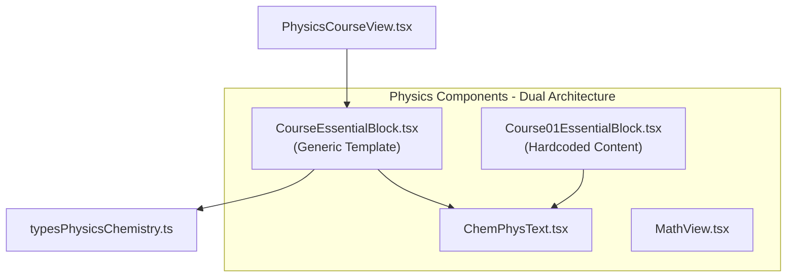
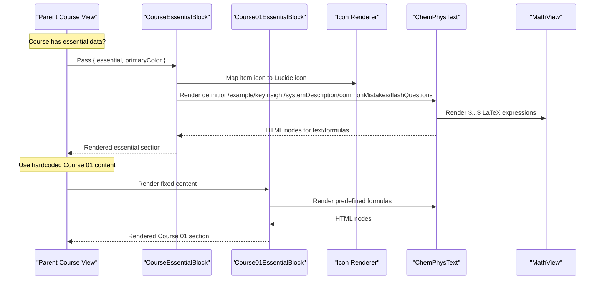
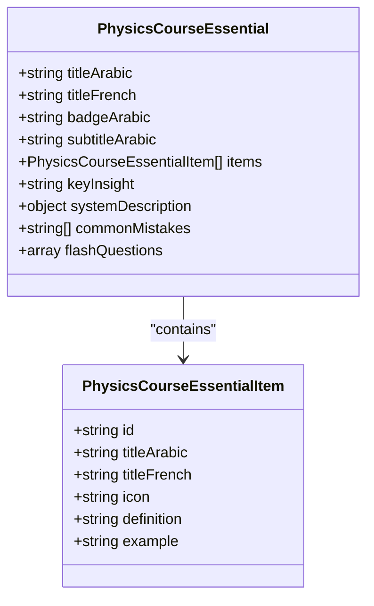
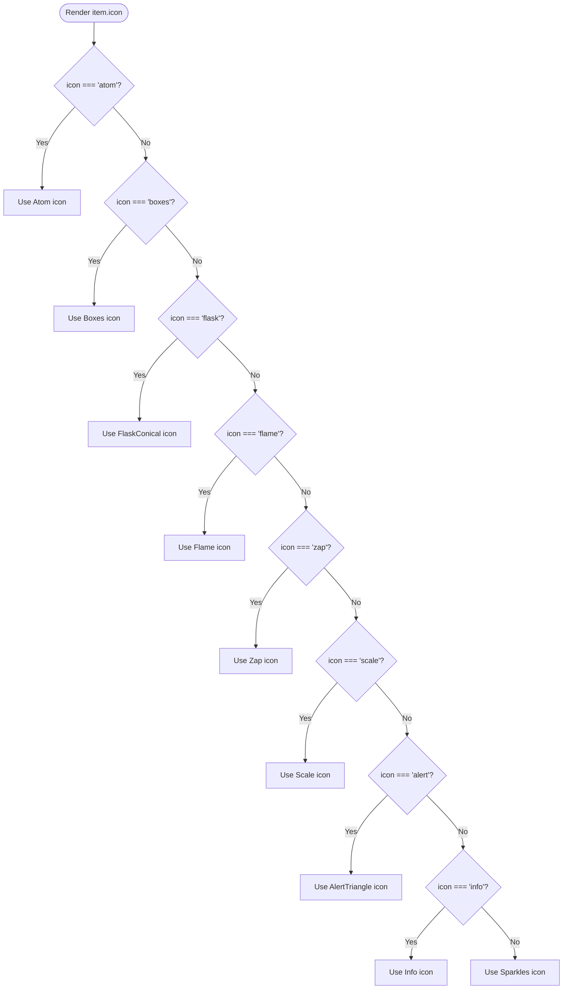
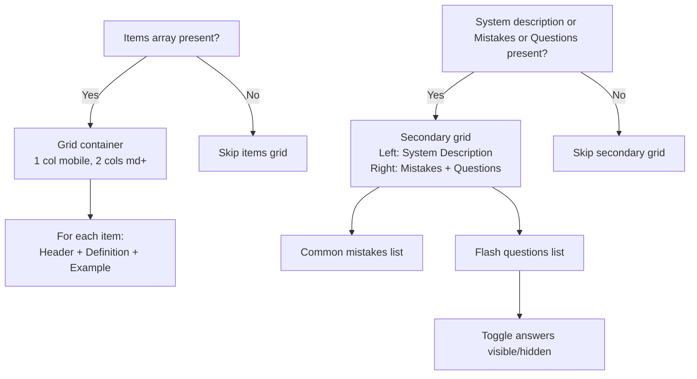
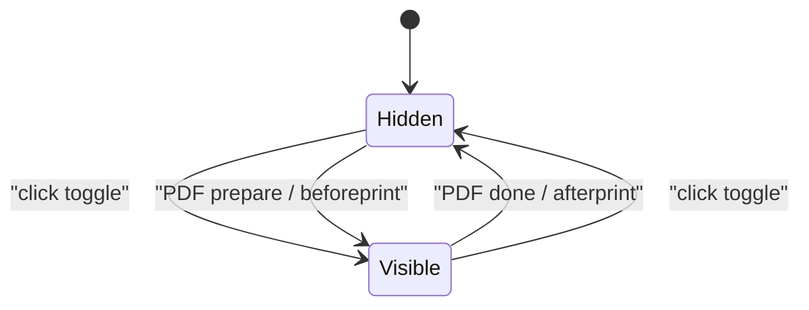
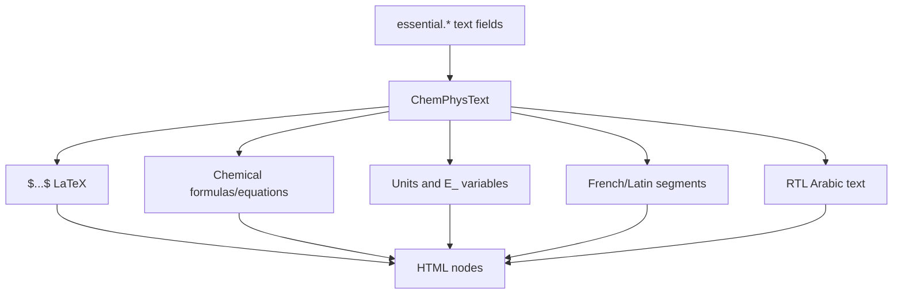
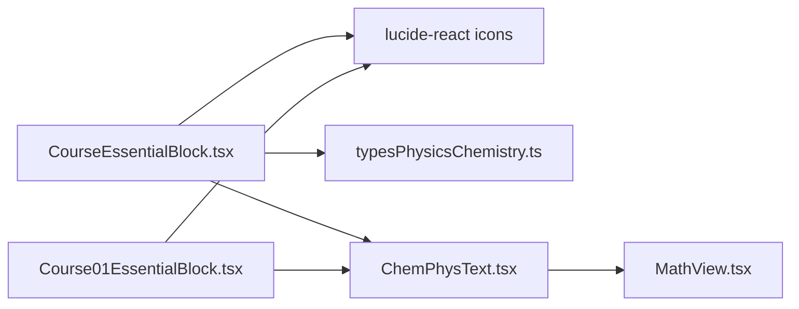

# Essential Concepts Blocks

<cite>
**Referenced Files in This Document**
- [CourseEssentialBlock.tsx](file://src/components/physics/CourseEssentialBlock.tsx)
- [Course01EssentialBlock.tsx](file://src/components/physics/Course01EssentialBlock.tsx)
- [ChemPhysText.tsx](file://src/components/physics/ChemPhysText.tsx)
- [typesPhysicsChemistry.ts](file://src/typesPhysicsChemistry.ts)
- [MathView.tsx](file://src/components/MathView.tsx)
</cite>

## Update Summary
**Changes Made**
- Added documentation for new Course01EssentialBlock component alongside existing CourseEssentialBlock
- Updated architecture overview to reflect dual architecture pattern
- Enhanced PDF preparation events documentation with sophisticated event handling
- Added RTL Arabic text support details through ChemPhysText integration
- Updated component comparison and usage patterns

## Table of Contents
1. [Introduction](#introduction)
2. [Project Structure](#project-structure)
3. [Core Components](#core-components)
4. [Architecture Overview](#architecture-overview)
5. [Detailed Component Analysis](#detailed-component-analysis)
6. [Dependency Analysis](#dependency-analysis)
7. [Performance Considerations](#performance-considerations)
8. [Troubleshooting Guide](#troubleshooting-guide)
9. [Conclusion](#conclusion)

## Introduction
This document explains the **Essential Concepts Blocks** system, which provides two complementary approaches for rendering "أحتفظ بالأهم" (L'essentiel du cours) sections in Physics-Chemistry courses. The system features a **dual architecture**:

1. **CourseEssentialBlock**: A generic, reusable template that renders essential concepts from structured data with full customization capabilities
2. **Course01EssentialBlock**: A hardcoded component containing exact textbook content for Course 01

Both components display essential course concepts with trilingual support (Arabic/French), interactive answer toggles for flash questions, and sophisticated PDF export optimization. They integrate with **ChemPhysText** for mathematical formula rendering and RTL Arabic text support.

## Project Structure
The essential blocks system lives under the physics components folder and follows a dual architecture pattern. The generic template consumes typed course data from shared types, while the Course 01 component contains hardcoded content. Text and formula rendering are delegated to specialized text components.

**Diagram sources**
- [CourseEssentialBlock.tsx:1-20](file://src/components/physics/CourseEssentialBlock.tsx#L1-L20)
- [Course01EssentialBlock.tsx:1-15](file://src/components/physics/Course01EssentialBlock.tsx#L1-L15)
- [ChemPhysText.tsx:1-5](file://src/components/physics/ChemPhysText.tsx#L1-L5)
- [PhysicsCourseView.tsx:1074-1080](file://src/components/physics/PhysicsCourseView.tsx#L1074-L1080)

**Section sources**
- [CourseEssentialBlock.tsx:1-20](file://src/components/physics/CourseEssentialBlock.tsx#L1-L20)
- [Course01EssentialBlock.tsx:1-15](file://src/components/physics/Course01EssentialBlock.tsx#L1-L15)
- [typesPhysicsChemistry.ts:264-291](file://src/typesPhysicsChemistry.ts#L264-L291)

## Core Components
The dual architecture consists of two main components with distinct purposes:

### Generic Template: CourseEssentialBlock
- Renders essential concepts from structured `PhysicsCourseEssential` data
- Supports dynamic icon mapping, customizable primary colors, and responsive layouts
- Handles complex PDF preparation events with sophisticated state management
- Integrates with ChemPhysText for rich text rendering

### Hardcoded Content: Course01EssentialBlock  
- Contains exact textbook formulations for Course 01
- Simplified implementation with basic PDF event handling
- Fixed styling with hardcoded theme colors
- Direct content without data abstraction layer

### Supporting Infrastructure
- **PhysicsCourseEssential / PhysicsCourseEssentialItem**: Typed data model for generic template
- **ChemPhysText**: Renders mixed Arabic/French/Latin text with inline LaTeX math, chemical formulas, units, and scientific terms
- **MathView**: Used by ChemPhysText to render LaTeX expressions

Key responsibilities:
- Display bilingual titles and badges
- Render concept cards with icons, definitions, and optional examples
- Show highlighted key insights
- Present system descriptions and bullet points
- List common mistakes and flash questions
- Toggle visibility of flash answers interactively and during PDF export
- Apply consistent styling with primaryColor customization

**Section sources**
- [CourseEssentialBlock.tsx:22-60](file://src/components/physics/CourseEssentialBlock.tsx#L22-L60)
- [Course01EssentialBlock.tsx:16-27](file://src/components/physics/Course01EssentialBlock.tsx#L16-L27)
- [typesPhysicsChemistry.ts:264-291](file://src/typesPhysicsChemistry.ts#L264-L291)
- [ChemPhysText.tsx:252-317](file://src/components/physics/ChemPhysText.tsx#L252-L317)

## Architecture Overview
The dual architecture provides flexibility between data-driven and hardcoded approaches:

**Diagram sources**
- [CourseEssentialBlock.tsx:27-48](file://src/components/physics/CourseEssentialBlock.tsx#L27-L48)
- [CourseEssentialBlock.tsx:138-173](file://src/components/physics/CourseEssentialBlock.tsx#L138-L173)
- [ChemPhysText.tsx:316-325](file://src/components/physics/ChemPhysText.tsx#L316-L325)
- [PhysicsCourseView.tsx:1074-1080](file://src/components/physics/PhysicsCourseView.tsx#L1074-L1080)

## Detailed Component Analysis

### Data Model: PhysicsCourseEssential and PhysicsCourseEssentialItem
- **PhysicsCourseEssentialItem**
  - `id`: Optional unique identifier for a card
  - `titleArabic`: Required Arabic title for the concept
  - `titleFrench`: Optional French translation shown alongside Arabic
  - `icon`: Concept type selector among atom, boxes, sparkles, flask, zap, flame, scale, alert, info
  - `definition`: Required definition text; supports LaTeX and chemical formulas via `ChemPhysText`
  - `example`: Optional example text rendered in a styled box

- **PhysicsCourseEssential**
  - `titleArabic`, `titleFrench`, `badgeArabic`, `subtitleArabic`: Header and badge labels
  - `items`: Array of concept cards
  - `keyInsight`: Highlighted takeaway sentence
  - `systemDescription`: Optional structured description with title(s), main description, and bullet points
  - `commonMistakes`: Array of common pitfalls
  - `flashQuestions`: Array of question-answer pairs for self-check

**Diagram sources**
- [typesPhysicsChemistry.ts:264-291](file://src/typesPhysicsChemistry.ts#L264-L291)

**Section sources**
- [typesPhysicsChemistry.ts:264-291](file://src/typesPhysicsChemistry.ts#L264-L291)

### Icon System
The generic template maps string-based icon names to Lucide React icons:
- `atom` → Atom
- `boxes` → Boxes
- `flask` → FlaskConical
- `flame` → Flame
- `zap` → Zap
- `scale` → Scale
- `alert` → AlertTriangle
- `info` → Info
- default → Sparkles

This mapping ensures consistent visual cues across concept cards in the generic template.

**Diagram sources**
- [CourseEssentialBlock.tsx:27-48](file://src/components/physics/CourseEssentialBlock.tsx#L27-L48)

**Section sources**
- [CourseEssentialBlock.tsx:27-48](file://src/components/physics/CourseEssentialBlock.tsx#L27-L48)

### Grid Layout System
Both components implement responsive grid layouts:

#### Items Grid (Generic Template)
- Single column on small screens
- Two columns when more than one item exists on medium+ screens
- Each card contains:
  - Bilingual header (Arabic title + optional French title)
  - Definition rendered via `ChemPhysText`
  - Optional example box with labeled "مثال"

#### Secondary Grid (Both Components)
- Left column: system description (optional), with title(s), description, and bullet points
- Right column:
  - Common mistakes list (styled red palette)
  - Flash questions list with interactive answer toggle

**Diagram sources**
- [CourseEssentialBlock.tsx:131-175](file://src/components/physics/CourseEssentialBlock.tsx#L131-L175)
- [CourseEssentialBlock.tsx:195-323](file://src/components/physics/CourseEssentialBlock.tsx#L195-L323)

**Section sources**
- [CourseEssentialBlock.tsx:131-175](file://src/components/physics/CourseEssentialBlock.tsx#L131-L175)
- [CourseEssentialBlock.tsx:195-323](file://src/components/physics/CourseEssentialBlock.tsx#L195-L323)

### Interactive Answer Toggles for Flash Questions
Enhanced with sophisticated PDF preparation events:

#### State Management
- `showAnswers`: Boolean controlling visibility of answers

#### Sophisticated Event Handling (Generic Template)
- Button toggles `showAnswers` on click
- During PDF preparation (`course-pdf-prepare`) and browser print (`beforeprint`), answers are forced visible
- After PDF generation (`course-pdf-done`) and after print (`afterprint`), answers revert to hidden
- Comprehensive event listener cleanup on component unmount

#### Simplified Event Handling (Course 01)
- Basic PDF preparation event only (`course-pdf-prepare`)
- No browser print event handling
- Simpler cleanup process

#### Rendering States
- When hidden: shows a button with eye icon and hint text
- When visible: shows a panel with numbered answers and green checkmark

**Diagram sources**
- [CourseEssentialBlock.tsx:61-78](file://src/components/physics/CourseEssentialBlock.tsx#L61-L78)
- [CourseEssentialBlock.tsx:281-319](file://src/components/physics/CourseEssentialBlock.tsx#L281-L319)
- [Course01EssentialBlock.tsx:23-27](file://src/components/physics/Course01EssentialBlock.tsx#L23-L27)

**Section sources**
- [CourseEssentialBlock.tsx:61-78](file://src/components/physics/CourseEssentialBlock.tsx#L61-L78)
- [CourseEssentialBlock.tsx:281-319](file://src/components/physics/CourseEssentialBlock.tsx#L281-L319)
- [Course01EssentialBlock.tsx:23-27](file://src/components/physics/Course01EssentialBlock.tsx#L23-L27)

### Trilingual Support and RTL Arabic Text Rendering
Advanced text processing with RTL support:

#### Titles and Subtitles
- Arabic titles are primary; French titles appear in monospace LTR label
- Badge and subtitle provide contextual Arabic copy

#### Advanced Text Processing (ChemPhysText)
- All user-facing text fields pass through `ChemPhysText`, enabling:
  - Inline LaTeX math between `$...$`
  - Chemical equations and standalone formulas
  - Units and energy variables
  - French/Latin parenthetical segments isolated in LTR direction
- RTL Arabic text support with proper direction handling
- Unicode subscript/superscript normalization for chemical formulas
- Energy variable formatting (E_...) and unit recognition

#### RTL Integration
- Both components use `dir="rtl"` for proper Arabic text flow
- ChemPhysText handles bidirectional text mixing seamlessly
- Chemical formulas and mathematical expressions maintain LTR direction within RTL context

**Diagram sources**
- [CourseEssentialBlock.tsx:159-170](file://src/components/physics/CourseEssentialBlock.tsx#L159-L170)
- [ChemPhysText.tsx:316-325](file://src/components/physics/ChemPhysText.tsx#L316-L325)
- [ChemPhysText.tsx:258-292](file://src/components/physics/ChemPhysText.tsx#L258-L292)

**Section sources**
- [CourseEssentialBlock.tsx:80-129](file://src/components/physics/CourseEssentialBlock.tsx#L80-L129)
- [ChemPhysText.tsx:252-317](file://src/components/physics/ChemPhysText.tsx#L252-L317)

### Styling Customization with primaryColor
#### Generic Template Features
- Primary color controls:
  - Border color of the section
  - Background of header icon square
  - Title and badge colors
  - Accent colors for examples, system description highlights, and interactive elements
- Defaults to teal shade (`#0F766E`) if not provided
- Usage pattern: Pass `primaryColor` prop to override theme per course or context

#### Hardcoded Course 01
- Fixed styling with hardcoded theme colors
- No customization options
- Consistent appearance matching Course 01 requirements

**Section sources**
- [CourseEssentialBlock.tsx:57-60](file://src/components/physics/CourseEssentialBlock.tsx#L57-L60)
- [CourseEssentialBlock.tsx:87-129](file://src/components/physics/CourseEssentialBlock.tsx#L87-L129)
- [Course01EssentialBlock.tsx:33-60](file://src/components/physics/Course01EssentialBlock.tsx#L33-L60)

### Integration with ChemPhysText for Mathematical Formula Rendering
Both components leverage advanced text processing:

#### Generic Template Integration
- Definitions, examples, key insights, system descriptions, common mistakes, and flash questions all use `ChemPhysText`
- Dynamic content rendering with full formula support

#### Course 01 Integration
- Predefined content uses `ChemPhysText` for formula rendering
- Fixed examples demonstrate proper formula syntax

#### ChemPhysText Capabilities
- Delegates LaTeX rendering to `MathView` for expressions wrapped in `$...$`
- Chemical formulas and equations are parsed and visually isolated for correct LTR rendering within RTL Arabic contexts
- Advanced regex-based parsing for chemical notation, units, and scientific terminology

**Section sources**
- [CourseEssentialBlock.tsx:159-170](file://src/components/physics/CourseEssentialBlock.tsx#L159-L170)
- [CourseEssentialBlock.tsx:178-193](file://src/components/physics/CourseEssentialBlock.tsx#L178-L193)
- [Course01EssentialBlock.tsx:82-85](file://src/components/physics/Course01EssentialBlock.tsx#L82-L85)
- [ChemPhysText.tsx:316-325](file://src/components/physics/ChemPhysText.tsx#L316-L325)

## Dependency Analysis
The dual architecture creates different dependency patterns:

### Generic Template Dependencies
- **CourseEssentialBlock** depends on:
  - `lucide-react` icons for visual indicators
  - `ChemPhysText` for rich text and formula rendering
  - `PhysicsCourseEssential` and `PhysicsCourseEssentialItem` types for data validation
  - Complex event handling infrastructure

### Hardcoded Component Dependencies  
- **Course01EssentialBlock** depends on:
  - `lucide-react` icons for visual indicators
  - `ChemPhysText` for formula rendering
  - Minimal external dependencies

### Shared Infrastructure
- **ChemPhysText** depends on:
  - `MathView` for LaTeX rendering
  - Internal regex logic for chemical formulas, units, and Latin segments

**Diagram sources**
- [CourseEssentialBlock.tsx:1-20](file://src/components/physics/CourseEssentialBlock.tsx#L1-L20)
- [Course01EssentialBlock.tsx:1-15](file://src/components/physics/Course01EssentialBlock.tsx#L1-L15)
- [ChemPhysText.tsx:1-5](file://src/components/physics/ChemPhysText.tsx#L1-L5)
- [typesPhysicsChemistry.ts:264-291](file://src/typesPhysicsChemistry.ts#L264-L291)

**Section sources**
- [CourseEssentialBlock.tsx:1-20](file://src/components/physics/CourseEssentialBlock.tsx#L1-L20)
- [Course01EssentialBlock.tsx:1-15](file://src/components/physics/Course01EssentialBlock.tsx#L1-L15)
- [ChemPhysText.tsx:1-5](file://src/components/physics/ChemPhysText.tsx#L1-L5)
- [typesPhysicsChemistry.ts:264-291](file://src/typesPhysicsChemistry.ts#L264-L291)

## Performance Considerations
Enhanced performance considerations for the dual architecture:

### Generic Template Optimizations
- Minimal re-renders: Only `showAnswers` state changes trigger updates for the flash answers section
- Sophisticated event listeners: PDF-related event listeners are attached once on mount and cleaned up on unmount
- Conditional rendering avoids unnecessary DOM for absent sections (e.g., no system description or mistakes)
- Efficient icon mapping with switch statements

### Hardcoded Component Efficiency
- Simplified event handling reduces memory overhead
- No data processing overhead since content is pre-rendered
- Smaller bundle size due to reduced dependencies

### Shared Text Processing
- `ChemPhysText` performs regex-based tokenization; keep input concise to avoid heavy parsing overhead
- Bidirectional text handling optimized for RTL Arabic content
- Lazy loading of LaTeX expressions through MathView

## Troubleshooting Guide
Enhanced troubleshooting for both components:

### Flash Answers Not Showing During PDF Export
- Ensure PDF preparation triggers `course-pdf-prepare` and that the component remains mounted
- Verify that `beforeprint` events are firing correctly in the environment (generic template only)
- Check event listener registration and cleanup in useEffect hooks

### Incorrect Formula Rendering
- Confirm LaTeX expressions are wrapped in `$...$`
- For chemical formulas, ensure proper syntax (e.g., H₂O, CO₂, Na⁺, SO₄²⁻, or ASCII variants like SO4^2-)
- Verify RTL Arabic text is properly handled by ChemPhysText

### Missing Icons (Generic Template Only)
- Validate `item.icon` values against the supported set: atom, boxes, sparkles, flask, zap, flame, scale, alert, info

### Styling Issues
- If `primaryColor` does not apply in generic template, check CSS specificity and ensure the prop is passed correctly
- For Course 01, styling is hardcoded and cannot be customized

### Component Selection
- Use `CourseEssentialBlock` for courses with structured data and customization needs
- Use `Course01EssentialBlock` for exact textbook content matching Course 01 requirements

**Section sources**
- [CourseEssentialBlock.tsx:61-78](file://src/components/physics/CourseEssentialBlock.tsx#L61-L78)
- [CourseEssentialBlock.tsx:281-319](file://src/components/physics/CourseEssentialBlock.tsx#L281-L319)
- [Course01EssentialBlock.tsx:23-27](file://src/components/physics/Course01EssentialBlock.tsx#L23-L27)
- [ChemPhysText.tsx:258-292](file://src/components/physics/ChemPhysText.tsx#L258-L292)

## Conclusion
The **Essential Concepts Blocks** system provides a robust, flexible, and accessible way to present essential course concepts through a dual architecture approach. The **CourseEssentialBlock** offers a generic, data-driven template with full customization capabilities, while **Course01EssentialBlock** provides exact textbook content for Course 01. 

Both components combine structured data (where applicable), clear icon systems, responsive grids, and advanced text rendering to deliver trilingual educational content optimized for both screen and PDF output. By leveraging `ChemPhysText` with sophisticated RTL Arabic text support and typed interfaces, the system ensures consistency, readability, and maintainability across Physics-Chemistry courses.

The enhanced PDF preparation events and bidirectional text handling make these components particularly well-suited for educational content that requires precise mathematical and chemical notation rendering in multilingual environments.