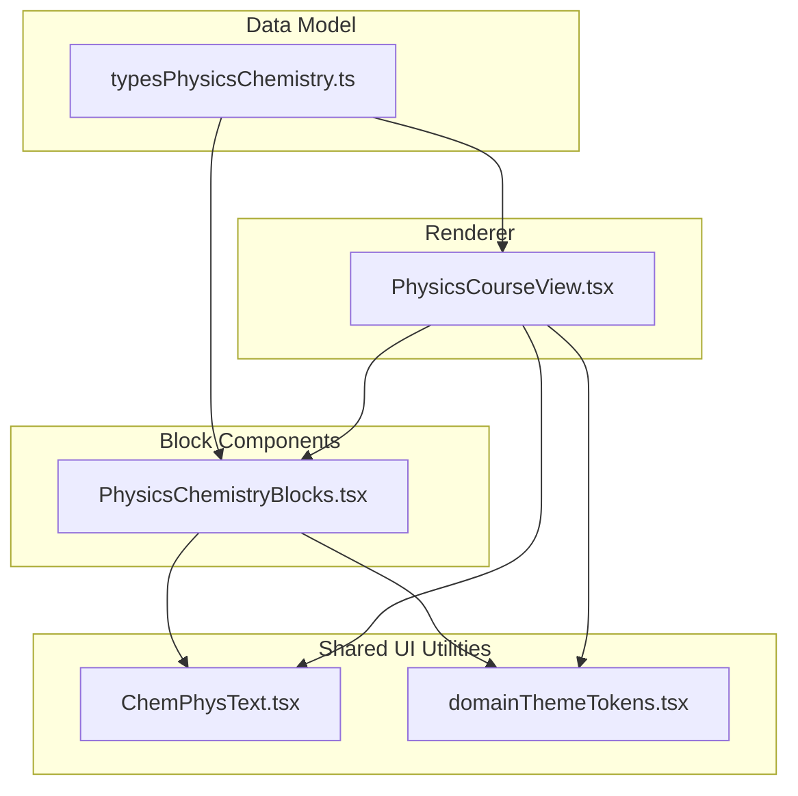
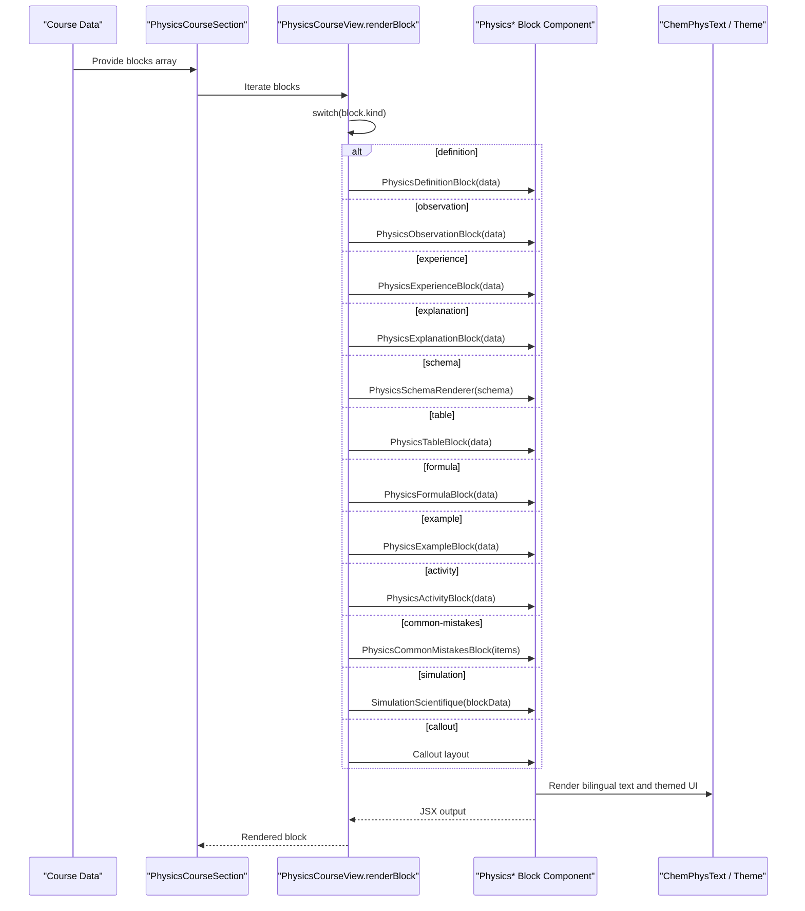
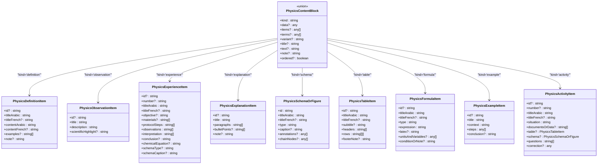
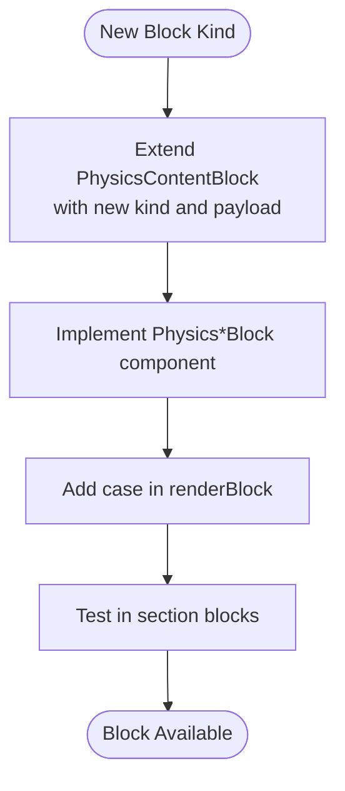
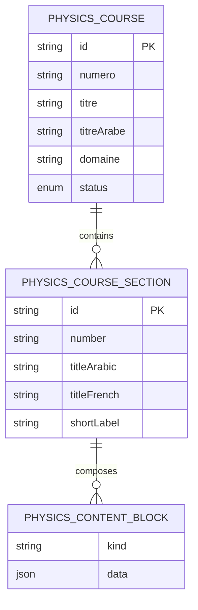
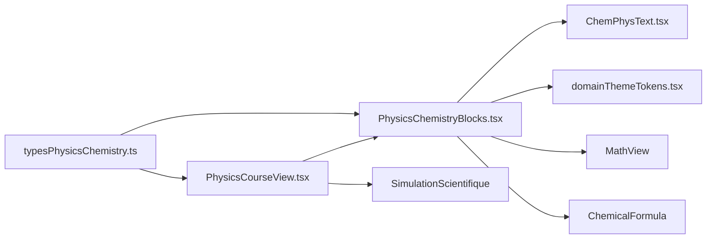

# Physics-Chemistry Blocks Library

<cite>
**Referenced Files in This Document**
- [PhysicsChemistryBlocks.tsx](file://src/components/physics/PhysicsChemistryBlocks.tsx)
- [typesPhysicsChemistry.ts](file://src/typesPhysicsChemistry.ts)
- [PhysicsCourseView.tsx](file://src/components/physics/PhysicsCourseView.tsx)
- [ChemPhysText.tsx](file://src/components/physics/ChemPhysText.tsx)
- [domainThemeTokens.tsx](file://src/components/physics/domainThemeTokens.tsx)
</cite>

## Table of Contents
1. [Introduction](#introduction)
2. [Project Structure](#project-structure)
3. [Core Components](#core-components)
4. [Architecture Overview](#architecture-overview)
5. [Detailed Component Analysis](#detailed-component-analysis)
6. [Dependency Analysis](#dependency-analysis)
7. [Performance Considerations](#performance-considerations)
8. [Troubleshooting Guide](#troubleshooting-guide)
9. [Conclusion](#conclusion)
10. [Appendices](#appendices)

## Introduction
The Physics-Chemistry Blocks library provides reusable, visually consistent React components for physics and chemistry educational content. It implements a block composition system where course content is modeled as structured data and rendered by specialized UI blocks. The library standardizes layouts for observations, experiments, explanations, examples, activities, formulas, tables, schemas, and summaries, while integrating with the broader course structure through typed data models and a central renderer.

This documentation explains:
- How blocks are composed from standardized data types
- How the block registration mechanism works via a discriminated union and a switch-based renderer
- How styling consistency is maintained across block types
- How blocks integrate into the overall course structure
- How to create custom blocks and extend existing ones while preserving visual consistency

## Project Structure
The relevant implementation lives under the physics module and shared type definitions:

- `src/components/physics/PhysicsChemistryBlocks.tsx` defines the reusable block components and schema rendering logic.
- `src/typesPhysicsChemistry.ts` defines the data model for blocks, sections, and courses.
- `src/components/physics/PhysicsCourseView.tsx` contains the central block renderer that maps block kinds to UI components.
- `src/components/physics/ChemPhysText.tsx` handles bilingual/multilingual text rendering used by all blocks.
- `src/components/physics/domainThemeTokens.tsx` provides domain-specific theme tokens used by blocks for consistent styling.

**Diagram sources**
- [PhysicsChemistryBlocks.tsx:1-35](file://src/components/physics/PhysicsChemistryBlocks.tsx#L1-L35)
- [typesPhysicsChemistry.ts:5-10](file://src/typesPhysicsChemistry.ts#L5-L10)
- [PhysicsCourseView.tsx:260-400](file://src/components/physics/PhysicsCourseView.tsx#L260-L400)

**Section sources**
- [PhysicsChemistryBlocks.tsx:1-35](file://src/components/physics/PhysicsChemistryBlocks.tsx#L1-L35)
- [typesPhysicsChemistry.ts:5-10](file://src/typesPhysicsChemistry.ts#L5-L10)
- [PhysicsCourseView.tsx:260-400](file://src/components/physics/PhysicsCourseView.tsx#L260-L400)

## Core Components
The library exposes several block components designed for educational content:

- TrilingualTermBox: Displays trilingual scientific terms with optional symbols or formulas.
- PhysicsDefinitionBlock: Presents definitions with Arabic/French titles and content, plus examples and notes.
- PhysicsObservationBlock: Highlights scientific observations with optional highlights.
- PhysicsSchemaRenderer: Renders diagrams and figures including molecules, electrolysis setups, energy chains, and course-specific schemas.
- PhysicsExperienceBlock: Structures experiments with objectives, materials, protocol steps, observations, interpretation, conclusions, and chemical equations.
- PhysicsFormulaBlock: Displays physical laws (LaTeX) or chemical equations with units and variables.
- PhysicsTableBlock: Renders tabular data with headers, rows, and footnotes.
- PhysicsExplanationBlock: Provides explanatory paragraphs, bullet points, and notes.
- PhysicsExampleBlock: Shows solved examples with step-by-step explanations and formulas.
- PhysicsActivityBlock: Presents pedagogical activities with questions and toggleable corrections.
- PhysicsApplicationCard: Displays application questions with difficulty labels, hints, and detailed solutions.
- PhysicsDiscoveryBlock: Implements a three-phase discovery activity before formally naming concepts.
- PhysicsCommonMistakesBlock: Contrasts common misconceptions with correct scientific reasoning.
- PhysicsVocabularyTable: Summarizes core vocabulary in Arabic and French with optional symbols/explanations.
- PhysicsSummarySection: Consolidates key takeaways, essential points, summary schemas, and final notes.

These components share consistent styling patterns: rounded cards, soft borders, bilingual headings, and domain-themed accents.

**Section sources**
- [PhysicsChemistryBlocks.tsx:39-94](file://src/components/physics/PhysicsChemistryBlocks.tsx#L39-L94)
- [PhysicsChemistryBlocks.tsx:99-165](file://src/components/physics/PhysicsChemistryBlocks.tsx#L99-L165)
- [PhysicsChemistryBlocks.tsx:170-187](file://src/components/physics/PhysicsChemistryBlocks.tsx#L170-L187)
- [PhysicsChemistryBlocks.tsx:192-457](file://src/components/physics/PhysicsChemistryBlocks.tsx#L192-L457)
- [PhysicsChemistryBlocks.tsx:462-586](file://src/components/physics/PhysicsChemistryBlocks.tsx#L462-L586)
- [PhysicsChemistryBlocks.tsx:591-654](file://src/components/physics/PhysicsChemistryBlocks.tsx#L591-L654)
- [PhysicsChemistryBlocks.tsx:659-718](file://src/components/physics/PhysicsChemistryBlocks.tsx#L659-L718)
- [PhysicsChemistryBlocks.tsx:723-788](file://src/components/physics/PhysicsChemistryBlocks.tsx#L723-L788)
- [PhysicsChemistryBlocks.tsx:793-891](file://src/components/physics/PhysicsChemistryBlocks.tsx#L793-L891)
- [PhysicsChemistryBlocks.tsx:893-1000](file://src/components/physics/PhysicsChemistryBlocks.tsx#L893-L1000)
- [PhysicsChemistryBlocks.tsx:1005-1132](file://src/components/physics/PhysicsChemistryBlocks.tsx#L1005-L1132)
- [PhysicsChemistryBlocks.tsx:1204-1262](file://src/components/physics/PhysicsChemistryBlocks.tsx#L1204-L1262)
- [PhysicsChemistryBlocks.tsx:1267-1323](file://src/components/physics/PhysicsChemistryBlocks.tsx#L1267-L1323)
- [PhysicsChemistryBlocks.tsx:1325-1443](file://src/components/physics/PhysicsChemistryBlocks.tsx#L1325-L1443)

## Architecture Overview
The architecture follows a data-driven component pattern:

- Data model: `PhysicsContentBlock` is a discriminated union defining every supported block kind and its payload.
- Renderer: `PhysicsCourseView.renderBlock` switches on `block.kind` and renders the corresponding component.
- Block components: Each block receives strongly-typed data and renders a consistent UI card.
- Shared utilities: Bilingual text rendering and domain theme tokens ensure visual consistency.

**Diagram sources**
- [PhysicsCourseView.tsx:260-400](file://src/components/physics/PhysicsCourseView.tsx#L260-L400)
- [PhysicsChemistryBlocks.tsx:99-165](file://src/components/physics/PhysicsChemistryBlocks.tsx#L99-L165)
- [PhysicsChemistryBlocks.tsx:170-187](file://src/components/physics/PhysicsChemistryBlocks.tsx#L170-L187)
- [PhysicsChemistryBlocks.tsx:462-586](file://src/components/physics/PhysicsChemistryBlocks.tsx#L462-L586)
- [PhysicsChemistryBlocks.tsx:723-788](file://src/components/physics/PhysicsChemistryBlocks.tsx#L723-L788)
- [PhysicsChemistryBlocks.tsx:793-891](file://src/components/physics/PhysicsChemistryBlocks.tsx#L793-L891)

## Detailed Component Analysis

### Block Composition System
The block composition system centers around `PhysicsContentBlock`, which uses a discriminated union to enforce type safety per block kind. Each kind carries a specific payload interface:

- `paragraph`: title, text, note
- `bullets`: title, items, ordered flag
- `quote`: text
- `discovery`: `PhysicsDiscoveryActivity`
- `definition`: `PhysicsDefinitionItem`
- `bilingual-box`: `TrilingualTerm[]`
- `observation`: `PhysicsObservationItem`
- `experience`: `PhysicsExperienceItem`
- `explanation`: `PhysicsExplanationItem`
- `schema`: `PhysicsSchemaOrFigure`
- `table`: `PhysicsTableItem`
- `formula`: `PhysicsFormulaItem`
- `example`: `PhysicsExampleItem`
- `activity`: `PhysicsActivityItem`
- `common-mistakes`: `PhysicsCommonMistakeItem[]`
- `simulation`: `PhysicsSimulationBlockData`
- `callout`: variant, title, content

This design ensures that each block’s props are validated at compile time and that the renderer can safely map kinds to components.

**Diagram sources**
- [typesPhysicsChemistry.ts:20-29](file://src/typesPhysicsChemistry.ts#L20-L29)
- [typesPhysicsChemistry.ts:31-36](file://src/typesPhysicsChemistry.ts#L31-L36)
- [typesPhysicsChemistry.ts:38-61](file://src/typesPhysicsChemistry.ts#L38-L61)
- [typesPhysicsChemistry.ts:63-69](file://src/typesPhysicsChemistry.ts#L63-L69)
- [typesPhysicsChemistry.ts:71-166](file://src/typesPhysicsChemistry.ts#L71-L166)
- [typesPhysicsChemistry.ts:168-176](file://src/typesPhysicsChemistry.ts#L168-L176)
- [typesPhysicsChemistry.ts:178-194](file://src/typesPhysicsChemistry.ts#L178-L194)
- [typesPhysicsChemistry.ts:196-206](file://src/typesPhysicsChemistry.ts#L196-L206)
- [typesPhysicsChemistry.ts:208-222](file://src/typesPhysicsChemistry.ts#L208-L222)
- [typesPhysicsChemistry.ts:306-323](file://src/typesPhysicsChemistry.ts#L306-L323)

**Section sources**
- [typesPhysicsChemistry.ts:306-323](file://src/typesPhysicsChemistry.ts#L306-L323)

### Standardized Layouts
Each block enforces a consistent layout:

- Header area with bilingual titles and icons
- Content area using `ChemPhysText` for Arabic/French/Latin script handling
- Optional highlighted boxes for notes, formulas, or conclusions
- Consistent spacing, borders, and rounded corners
- Domain theme integration for accent colors and icons

Examples:
- Definition block uses a right border accent and bilingual header.
- Observation block emphasizes scientific highlights.
- Experience block structures protocol, observations, interpretation, and conclusion.
- Formula block displays LaTeX or chemical formulas with variable legends.
- Table block provides responsive scrolling and hover states.
- Activity and application cards support toggleable corrections.

**Section sources**
- [PhysicsChemistryBlocks.tsx:99-165](file://src/components/physics/PhysicsChemistryBlocks.tsx#L99-L165)
- [PhysicsChemistryBlocks.tsx:170-187](file://src/components/physics/PhysicsChemistryBlocks.tsx#L170-L187)
- [PhysicsChemistryBlocks.tsx:462-586](file://src/components/physics/PhysicsChemistryBlocks.tsx#L462-L586)
- [PhysicsChemistryBlocks.tsx:591-654](file://src/components/physics/PhysicsChemistryBlocks.tsx#L591-L654)
- [PhysicsChemistryBlocks.tsx:659-718](file://src/components/physics/PhysicsChemistryBlocks.tsx#L659-L718)
- [PhysicsChemistryBlocks.tsx:793-891](file://src/components/physics/PhysicsChemistryBlocks.tsx#L793-L891)
- [PhysicsChemistryBlocks.tsx:893-1000](file://src/components/physics/PhysicsChemistryBlocks.tsx#L893-L1000)

### Block Registration Mechanism
There is no runtime registry object; instead, the library uses a static mapping approach:

- `PhysicsContentBlock` enumerates all supported kinds.
- `PhysicsCourseView.renderBlock` switches on `block.kind` and returns the appropriate component.
- Adding a new block requires:
  - Extending `PhysicsContentBlock` with a new kind and payload
  - Implementing a new block component
  - Adding a case in `renderBlock`

**Diagram sources**
- [typesPhysicsChemistry.ts:306-323](file://src/typesPhysicsChemistry.ts#L306-L323)
- [PhysicsCourseView.tsx:260-400](file://src/components/physics/PhysicsCourseView.tsx#L260-L400)

**Section sources**
- [typesPhysicsChemistry.ts:306-323](file://src/typesPhysicsChemistry.ts#L306-L323)
- [PhysicsCourseView.tsx:260-400](file://src/components/physics/PhysicsCourseView.tsx#L260-L400)

### Styling Consistency
Styling is achieved through:

- Tailwind utility classes for spacing, borders, and typography
- Domain theme tokens (`usePhysicsDomainTheme`) for primary/accent colors and icons
- Consistent card containers with rounded corners and soft borders
- Bilingual label treatment with LTR direction and monospace fonts where appropriate
- Highlighted boxes for formulas, notes, and conclusions

Components consistently use:
- `ChemPhysText` for mixed-language content
- `ChemicalFormula` for chemical expressions
- `MathView` for LaTeX formulas
- Theme-aware colors and icons

**Section sources**
- [PhysicsChemistryBlocks.tsx:100-104](file://src/components/physics/PhysicsChemistryBlocks.tsx#L100-L104)
- [PhysicsChemistryBlocks.tsx:399-406](file://src/components/physics/PhysicsChemistryBlocks.tsx#L399-L406)
- [PhysicsChemistryBlocks.tsx:612-621](file://src/components/physics/PhysicsChemistryBlocks.tsx#L612-L621)

### Integration with Course Structure
Courses are modeled as `PhysicsChemistryCourse`, containing:

- Metadata (titles, domains, duration, status)
- Pedagogical sections (`PhysicsCourseSection`)
- Collections of definitions, observations, experiences, explanations, schemas, tables, formulas, examples, activities, applications, and simulations
- Vocabulary, summaries, and essential points

Sections contain arrays of `PhysicsContentBlock`, which are rendered by `PhysicsCourseView`. This allows authors to compose lessons using a predictable sequence of blocks while maintaining structural integrity.

**Diagram sources**
- [typesPhysicsChemistry.ts:325-332](file://src/typesPhysicsChemistry.ts#L325-L332)
- [typesPhysicsChemistry.ts:338-395](file://src/typesPhysicsChemistry.ts#L338-L395)

**Section sources**
- [typesPhysicsChemistry.ts:325-332](file://src/typesPhysicsChemistry.ts#L325-L332)
- [typesPhysicsChemistry.ts:338-395](file://src/typesPhysicsChemistry.ts#L338-L395)
- [PhysicsCourseView.tsx:260-400](file://src/components/physics/PhysicsCourseView.tsx#L260-L400)

### Creating Custom Blocks
To add a new block type:

1. Define the payload interface in `typesPhysicsChemistry.ts`.
2. Extend `PhysicsContentBlock` with a new `kind` and payload.
3. Create a new React component in `PhysicsChemistryBlocks.tsx` following existing patterns:
   - Accept typed data prop
   - Use `ChemPhysText` for content
   - Apply consistent card styling and theme tokens
4. Add a case in `PhysicsCourseView.renderBlock` to render the new component.
5. Compose the block in course data sections.

Example pattern reference:
- Payload definition: [typesPhysicsChemistry.ts:20-29](file://src/typesPhysicsChemistry.ts#L20-L29)
- Block component: [PhysicsChemistryBlocks.tsx:99-165](file://src/components/physics/PhysicsChemistryBlocks.tsx#L99-L165)
- Renderer mapping: [PhysicsCourseView.tsx:329-330](file://src/components/physics/PhysicsCourseView.tsx#L329-L330)

**Section sources**
- [typesPhysicsChemistry.ts:20-29](file://src/typesPhysicsChemistry.ts#L20-L29)
- [PhysicsChemistryBlocks.tsx:99-165](file://src/components/physics/PhysicsChemistryBlocks.tsx#L99-L165)
- [PhysicsCourseView.tsx:329-330](file://src/components/physics/PhysicsCourseView.tsx#L329-L330)

### Extending Existing Block Types
Existing blocks can be extended by:

- Adding optional fields to their payload interfaces (e.g., adding a new highlight field).
- Updating the component to render the new fields conditionally.
- Ensuring bilingual support remains intact.
- Maintaining visual consistency with existing cards and theme tokens.

For example, extending `PhysicsObservationItem` would involve:
- Adding a new optional property in [typesPhysicsChemistry.ts:31-36](file://src/typesPhysicsChemistry.ts#L31-L36)
- Rendering it in [PhysicsChemistryBlocks.tsx:170-187](file://src/components/physics/PhysicsChemistryBlocks.tsx#L170-L187)

**Section sources**
- [typesPhysicsChemistry.ts:31-36](file://src/typesPhysicsChemistry.ts#L31-L36)
- [PhysicsChemistryBlocks.tsx:170-187](file://src/components/physics/PhysicsChemistryBlocks.tsx#L170-L187)

### Maintaining Visual Consistency
Guidelines:
- Always wrap content in a card container with consistent padding and borders.
- Use `ChemPhysText` for all user-facing text to handle Arabic/French/Latin scripts.
- Apply theme tokens for accent colors and icons.
- Keep bilingual labels aligned and styled consistently.
- Use `ChemicalFormula` for chemical expressions and `MathView` for LaTeX.

**Section sources**
- [PhysicsChemistryBlocks.tsx:100-104](file://src/components/physics/PhysicsChemistryBlocks.tsx#L100-L104)
- [PhysicsChemistryBlocks.tsx:399-406](file://src/components/physics/PhysicsChemistryBlocks.tsx#L399-L406)
- [PhysicsChemistryBlocks.tsx:612-621](file://src/components/physics/PhysicsChemistryBlocks.tsx#L612-L621)

## Dependency Analysis
Key dependencies:

- `PhysicsChemistryBlocks.tsx` depends on:
  - `typesPhysicsChemistry.ts` for data models
  - `ChemPhysText.tsx` for bilingual text rendering
  - `domainThemeTokens.tsx` for theme access
  - `MathView` for LaTeX rendering
  - `ChemicalFormula` for chemical expressions
  - Lucide icons for visual cues

- `PhysicsCourseView.tsx` depends on:
  - `PhysicsContentBlock` type
  - All block components exported from `PhysicsChemistryBlocks.tsx`
  - `SimulationScientifique` for simulation blocks
  - Theme tokens for styling

**Diagram sources**
- [PhysicsChemistryBlocks.tsx:1-35](file://src/components/physics/PhysicsChemistryBlocks.tsx#L1-L35)
- [PhysicsCourseView.tsx:260-400](file://src/components/physics/PhysicsCourseView.tsx#L260-L400)

**Section sources**
- [PhysicsChemistryBlocks.tsx:1-35](file://src/components/physics/PhysicsChemistryBlocks.tsx#L1-L35)
- [PhysicsCourseView.tsx:260-400](file://src/components/physics/PhysicsCourseView.tsx#L260-L400)

## Performance Considerations
- Block components are lightweight and stateless except for interactive elements like toggles.
- Toggleable corrections in activity and application cards manage local state efficiently.
- PDF export modes hide interactive controls and reveal corrections when needed.
- Schema rendering uses conditional branches to avoid unnecessary computations.
- Bilingual text rendering is centralized to reduce duplication.

Recommendations:
- Avoid heavy computations inside block components; prefer preprocessed data.
- Memoize expensive schema renderers if reused frequently.
- Keep payload data minimal and well-structured to reduce re-renders.

[No sources needed since this section provides general guidance]

## Troubleshooting Guide
Common issues and resolutions:

- Missing block kind in renderer:
  - Symptom: New block kind does not render.
  - Resolution: Ensure `PhysicsContentBlock` includes the new kind and `renderBlock` has a matching case.

- Incorrect payload shape:
  - Symptom: TypeScript errors or missing fields in UI.
  - Resolution: Validate payload against the corresponding interface in `typesPhysicsChemistry.ts`.

- Bilingual text not displaying correctly:
  - Symptom: Mixed Arabic/French/Latin text misaligned.
  - Resolution: Wrap text with `ChemPhysText` and ensure proper direction attributes.

- Theme colors not applied:
  - Symptom: Inconsistent styling across blocks.
  - Resolution: Use `usePhysicsDomainTheme` and apply theme tokens consistently.

- PDF export shows hidden content unexpectedly:
  - Symptom: Corrections appear in printed PDF.
  - Resolution: Check event listeners for `course-pdf-prepare` and `beforeprint`; ensure toggle states align with print mode.

**Section sources**
- [PhysicsCourseView.tsx:260-400](file://src/components/physics/PhysicsCourseView.tsx#L260-L400)
- [PhysicsChemistryBlocks.tsx:793-891](file://src/components/physics/PhysicsChemistryBlocks.tsx#L793-L891)
- [PhysicsChemistryBlocks.tsx:893-1000](file://src/components/physics/PhysicsChemistryBlocks.tsx#L893-L1000)

## Conclusion
The Physics-Chemistry Blocks library offers a robust, type-safe system for composing educational content. By standardizing block payloads, enforcing consistent UI patterns, and integrating seamlessly with the course structure, it enables authors to build rich, multilingual lessons with predictable visuals and behavior. The discriminated union approach and switch-based renderer provide a clear extension path for new block types while maintaining code quality and visual coherence.

[No sources needed since this section summarizes without analyzing specific files]

## Appendices

### API Reference Summary
- Block kinds: paragraph, bullets, quote, discovery, definition, bilingual-box, observation, experience, explanation, schema, table, formula, example, activity, common-mistakes, simulation, callout
- Key interfaces: PhysicsDefinitionItem, PhysicsObservationItem, PhysicsExperienceItem, PhysicsExplanationItem, PhysicsSchemaOrFigure, PhysicsTableItem, PhysicsFormulaItem, PhysicsExampleItem, PhysicsActivityItem, PhysicsCommonMistakeItem, PhysicsDiscoveryActivity, PhysicsContentBlock, PhysicsCourseSection, PhysicsChemistryCourse

**Section sources**
- [typesPhysicsChemistry.ts:20-29](file://src/typesPhysicsChemistry.ts#L20-L29)
- [typesPhysicsChemistry.ts:31-36](file://src/typesPhysicsChemistry.ts#L31-L36)
- [typesPhysicsChemistry.ts:38-61](file://src/typesPhysicsChemistry.ts#L38-L61)
- [typesPhysicsChemistry.ts:63-69](file://src/typesPhysicsChemistry.ts#L63-L69)
- [typesPhysicsChemistry.ts:71-166](file://src/typesPhysicsChemistry.ts#L71-L166)
- [typesPhysicsChemistry.ts:168-176](file://src/typesPhysicsChemistry.ts#L168-L176)
- [typesPhysicsChemistry.ts:178-194](file://src/typesPhysicsChemistry.ts#L178-L194)
- [typesPhysicsChemistry.ts:196-206](file://src/typesPhysicsChemistry.ts#L196-L206)
- [typesPhysicsChemistry.ts:208-222](file://src/typesPhysicsChemistry.ts#L208-L222)
- [typesPhysicsChemistry.ts:242-262](file://src/typesPhysicsChemistry.ts#L242-L262)
- [typesPhysicsChemistry.ts:293-300](file://src/typesPhysicsChemistry.ts#L293-L300)
- [typesPhysicsChemistry.ts:306-323](file://src/typesPhysicsChemistry.ts#L306-L323)
- [typesPhysicsChemistry.ts:325-332](file://src/typesPhysicsChemistry.ts#L325-L332)
- [typesPhysicsChemistry.ts:338-395](file://src/typesPhysicsChemistry.ts#L338-L395)