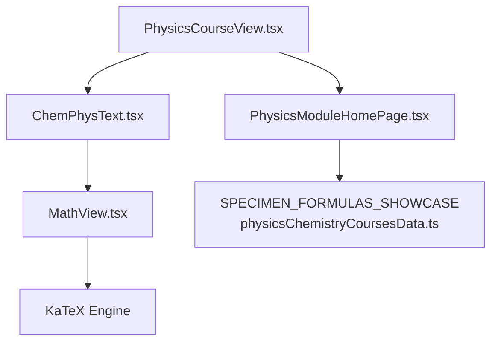
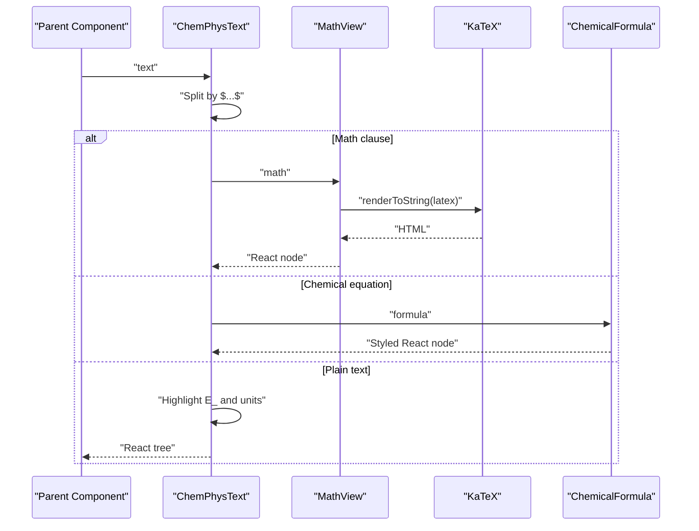
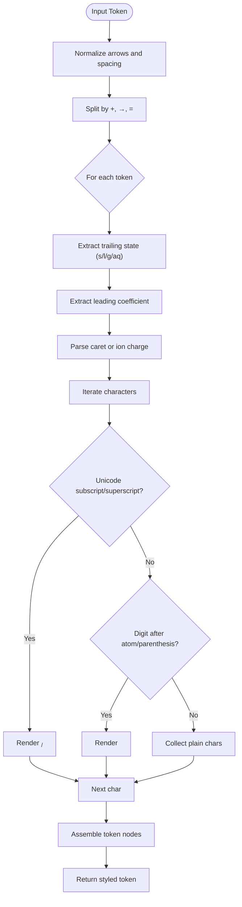
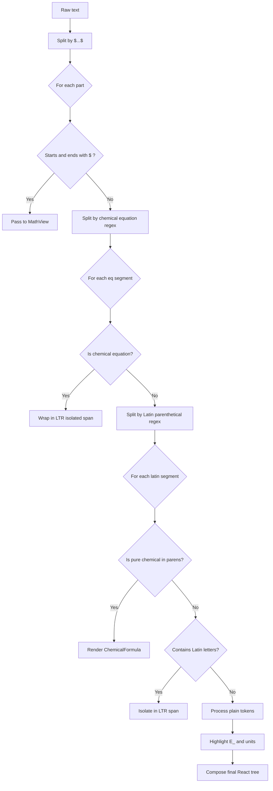
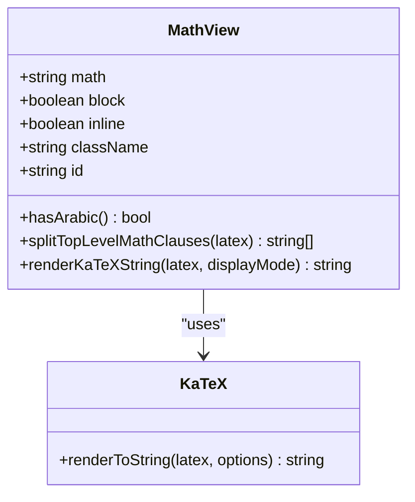
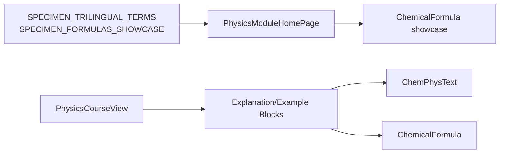
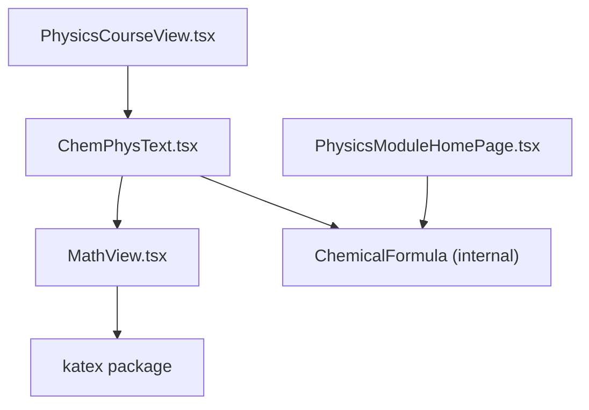

# Trilingual Text Rendering

<cite>
**Referenced Files in This Document**
- [ChemPhysText.tsx](file://src/components/physics/ChemPhysText.tsx)
- [MathView.tsx](file://src/components/MathView.tsx)
- [PhysicsCourseView.tsx](file://src/components/physics/PhysicsCourseView.tsx)
- [PhysicsModuleHomePage.tsx](file://src/components/physics/PhysicsModuleHomePage.tsx)
- [physicsChemistryCoursesData.ts](file://src/data/physicsChemistryCoursesData.ts)
- [main.tsx](file://src/main.tsx)
</cite>

## Table of Contents
1. [Introduction](#introduction)
2. [Project Structure](#project-structure)
3. [Core Components](#core-components)
4. [Architecture Overview](#architecture-overview)
5. [Detailed Component Analysis](#detailed-component-analysis)
6. [Dependency Analysis](#dependency-analysis)
7. [Performance Considerations](#performance-considerations)
8. [Troubleshooting Guide](#troubleshooting-guide)
9. [Conclusion](#conclusion)
10. [Appendices](#appendices)

## Introduction
This document explains the trilingual text rendering system centered on the `ChemPhysText` component. It renders Arabic, French, and English scientific content with mathematical formulas, chemical equations, units, and terminology. The pipeline supports:
- Mixed-language paragraphs where Arabic is right-to-left (RTL) and Latin/French/English segments are left-to-right (LTR).
- Inline LaTeX math delimited by `$...$`, rendered through KaTeX via `MathView`.
- Chemical formula parsing for both Unicode subscripts/superscripts and ASCII variants, including charges, states, stoichiometric coefficients, and reaction arrows.
- Responsive typography and consistent visual styling across languages and scripts.

The goal is to make physics and chemistry course content readable and visually correct regardless of language direction or mixed script content.

## Project Structure
The trilingual rendering logic lives primarily in two components:
- `ChemPhysText`: high-level text processor that detects math, chemical equations, parenthetical Latin/French terms, energy symbols, and units.
- `MathView`: KaTeX integration that handles pure math, Arabic-only text, and mixed Arabic/math expressions.

These components are consumed by higher-level physics/chemistry UI blocks such as explanations, examples, tables, and the course view.

**Diagram sources**
- [PhysicsCourseView.tsx:1-200](file://src/components/physics/PhysicsCourseView.tsx#L1-L200)
- [ChemPhysText.tsx:252-416](file://src/components/physics/ChemPhysText.tsx#L252-L416)
- [MathView.tsx:350-579](file://src/components/MathView.tsx#L350-L579)
- [physicsChemistryCoursesData.ts:6188-6197](file://src/data/physicsChemistryCoursesData.ts#L6188-L6197)

**Section sources**
- [ChemPhysText.tsx:1-417](file://src/components/physics/ChemPhysText.tsx#L1-L417)
- [MathView.tsx:1-580](file://src/components/MathView.tsx#L1-L580)
- [PhysicsCourseView.tsx:1-200](file://src/components/physics/PhysicsCourseView.tsx#L1-L200)
- [PhysicsModuleHomePage.tsx:1-56](file://src/components/physics/PhysicsModuleHomePage.tsx#L1-L56)
- [physicsChemistryCoursesData.ts:6163-6197](file://src/data/physicsChemistryCoursesData.ts#L6163-L6197)

## Core Components
- `ChemicalFormula`: parses and renders chemical tokens with Unicode/ASCII subscripts/superscripts, charges, physical states, stoichiometric coefficients, and reaction operators.
- `ChemPhysText`: orchestrates the full text processing pipeline:
  - Splits inline LaTeX math `$...$` and delegates to `MathView`.
  - Detects full chemical equations and wraps them in LTR isolated spans.
  - Isolates parenthetical Latin/French terms and ensures proper directionality.
  - Highlights energy symbols (`E_...`) and SI units.
- `MathView`: integrates KaTeX, detects Arabic presence, and decides between:
  - Pure math rendering (LTR),
  - Pure Arabic text (RTL),
  - Mixed Arabic + math (segmented rendering with appropriate direction per segment).

**Section sources**
- [ChemPhysText.tsx:36-227](file://src/components/physics/ChemPhysText.tsx#L36-L227)
- [ChemPhysText.tsx:252-416](file://src/components/physics/ChemPhysText.tsx#L252-L416)
- [MathView.tsx:350-579](file://src/components/MathView.tsx#L350-L579)

## Architecture Overview
The rendering architecture follows a layered approach:
1. Parent components pass rich scientific text to `ChemPhysText`.
2. `ChemPhysText` splits the input into:
   - Math clauses (delimited by `$...$`),
   - Chemical equations,
   - Parenthetical Latin/French terms,
   - Plain text with optional energy symbols and units.
3. Math clauses are passed to `MathView`, which uses KaTeX to render LaTeX safely and responsively.
4. Chemical formulas are parsed by `ChemicalFormula` and styled consistently.
5. Directionality is enforced at each span level using `dir="ltr"` and `unicodeBidi: 'isolate'` to prevent RTL interference from Arabic text.

**Diagram sources**
- [ChemPhysText.tsx:316-416](file://src/components/physics/ChemPhysText.tsx#L316-L416)
- [MathView.tsx:197-233](file://src/components/MathView.tsx#L197-L233)
- [ChemPhysText.tsx:36-227](file://src/components/physics/ChemPhysText.tsx#L36-L227)

## Detailed Component Analysis

### Chemical Formula Parser
`ChemicalFormula` normalizes and renders chemical tokens:
- Normalizes arrow operators (`->`, `⟶`) to a consistent arrow token.
- Extracts trailing physical state `(s|l|g|aq)` and leading stoichiometric coefficient.
- Parses explicit caret charge syntax like `SO4^2-` and known polyatomic ions.
- Iterates characters to handle Unicode subscripts/superscripts and ASCII digits after element symbols or parentheses.
- Renders coefficients, charges, and states with distinct styling.

**Diagram sources**
- [ChemPhysText.tsx:41-227](file://src/components/physics/ChemPhysText.tsx#L41-L227)

**Section sources**
- [ChemPhysText.tsx:36-227](file://src/components/physics/ChemPhysText.tsx#L36-L227)

### Text Processing Pipeline
`ChemPhysText` implements a multi-stage pipeline:
1. **Math split**: Splits by `$...$` and delegates to `MathView`.
2. **Equation detection**: Uses regex to identify full chemical reactions and isolates them in LTR spans.
3. **Parenthetical Latin/French isolation**: Ensures Latin/French terms inside parentheses are isolated and styled appropriately.
4. **Standalone chemical tokens**: Applies `ChemicalFormula` to recognized chemical patterns.
5. **Energy and unit highlighting**: Recognizes `E_...` symbols and SI units, wrapping them in styled spans.

**Diagram sources**
- [ChemPhysText.tsx:252-416](file://src/components/physics/ChemPhysText.tsx#L252-L416)

**Section sources**
- [ChemPhysText.tsx:252-416](file://src/components/physics/ChemPhysText.tsx#L252-L416)

### KaTeX Integration and Arabic Handling
`MathView` integrates KaTeX and adapts rendering based on content:
- Detects Arabic characters using Unicode ranges.
- For pure math without Arabic, renders via KaTeX in LTR spans.
- For pure Arabic text without math commands, renders directly in RTL spans.
- For mixed Arabic and math, segments the content and renders each segment with appropriate direction.
- Normalizes KaTeX output to suppress error styles and fix composite symbols like `≠`.

**Diagram sources**
- [MathView.tsx:350-579](file://src/components/MathView.tsx#L350-L579)
- [MathView.tsx:197-233](file://src/components/MathView.tsx#L197-L233)

**Section sources**
- [MathView.tsx:197-233](file://src/components/MathView.tsx#L197-L233)
- [MathView.tsx:350-579](file://src/components/MathView.tsx#L350-L579)

### Usage Examples and Integration Patterns
- `PhysicsCourseView` consumes `ChemPhysText` and `ChemicalFormula` to render course content, including titles, paragraphs, bullet points, notes, and example steps.
- `PhysicsModuleHomePage` showcases specimen formulas and trilingual terms, demonstrating how `ChemicalFormula` integrates with data-driven UI.
- Data files provide specimen trilingual terms and formula examples used throughout the app.

**Diagram sources**
- [PhysicsCourseView.tsx:1-200](file://src/components/physics/PhysicsCourseView.tsx#L1-L200)
- [PhysicsModuleHomePage.tsx:1-56](file://src/components/physics/PhysicsModuleHomePage.tsx#L1-L56)
- [physicsChemistryCoursesData.ts:6163-6197](file://src/data/physicsChemistryCoursesData.ts#L6163-L6197)

**Section sources**
- [PhysicsCourseView.tsx:1-200](file://src/components/physics/PhysicsCourseView.tsx#L1-L200)
- [PhysicsModuleHomePage.tsx:1-56](file://src/components/physics/PhysicsModuleHomePage.tsx#L1-L56)
- [physicsChemistryCoursesData.ts:6163-6197](file://src/data/physicsChemistryCoursesData.ts#L6163-L6197)

## Dependency Analysis
- `ChemPhysText` depends on `MathView` for LaTeX rendering and on its own `ChemicalFormula` for chemical parsing.
- `MathView` depends on KaTeX for math rendering and on fundamental concepts data for interactive concept highlighting.
- Higher-level components depend on `ChemPhysText` and `ChemicalFormula` for consistent rendering of scientific content.

**Diagram sources**
- [ChemPhysText.tsx:1-417](file://src/components/physics/ChemPhysText.tsx#L1-L417)
- [MathView.tsx:1-580](file://src/components/MathView.tsx#L1-L580)
- [PhysicsCourseView.tsx:1-200](file://src/components/physics/PhysicsCourseView.tsx#L1-L200)
- [PhysicsModuleHomePage.tsx:1-56](file://src/components/physics/PhysicsModuleHomePage.tsx#L1-L56)

**Section sources**
- [ChemPhysText.tsx:1-417](file://src/components/physics/ChemPhysText.tsx#L1-L417)
- [MathView.tsx:1-580](file://src/components/MathView.tsx#L1-L580)
- [PhysicsCourseView.tsx:1-200](file://src/components/physics/PhysicsCourseView.tsx#L1-L200)
- [PhysicsModuleHomePage.tsx:1-56](file://src/components/physics/PhysicsModuleHomePage.tsx#L1-L56)

## Performance Considerations
- Regex-heavy splitting: `ChemPhysText` performs multiple regex passes for math, equations, Latin terms, and chemical tokens. Consider memoizing expensive computations if inputs are large or frequently re-rendered.
- KaTeX rendering: `MathView` calls KaTeX for each math clause; batching or caching rendered HTML can reduce re-renders.
- DOM isolation: Frequent use of `dir="ltr"` and `unicodeBidi: 'isolate'` ensures correctness but may increase layout complexity; keep spans minimal and avoid unnecessary nesting.
- Styling performance: Tailwind classes are applied inline; ensure they are not recalculated unnecessarily during re-renders.

[No sources needed since this section provides general guidance]

## Troubleshooting Guide
- KaTeX parse errors: `MathView` suppresses red error styles and removes technical tooltips when KaTeX produces an error span. If formulas still fail, validate LaTeX syntax and ensure Unicode superscripts are normalized.
- Arabic direction issues: Ensure Arabic text is wrapped in RTL containers and math segments are explicitly LTR. Mixed content should be segmented before rendering.
- Chemical formula parsing: Verify that formulas use supported syntax (Unicode subscripts/superscripts or ASCII equivalents). Charges must follow recognized patterns (e.g., `Na+`, `Ca²⁺`, `SO4^2-`).
- Units and energy symbols: Energy symbols must start with `E_` followed by alphanumeric characters. Units must match recognized SI patterns (e.g., `kJ`, `W`, `%`).

**Section sources**
- [MathView.tsx:197-233](file://src/components/MathView.tsx#L197-L233)
- [ChemPhysText.tsx:258-292](file://src/components/physics/ChemPhysText.tsx#L258-L292)
- [ChemPhysText.tsx:230-246](file://src/components/physics/ChemPhysText.tsx#L230-L246)

## Conclusion
The trilingual text rendering system combines robust text processing, chemical formula parsing, and KaTeX integration to deliver accurate and visually consistent scientific content across Arabic, French, and English. By isolating directionality at the span level and segmenting mixed content, it ensures readability and correctness in complex educational materials.

[No sources needed since this section summarizes without analyzing specific files]

## Appendices

### API Reference

#### ChemicalFormula Props
- `formula`: string — chemical formula or equation to render.
- `className`: string — additional CSS classes.
- `size`: `'sm' | 'md' | 'lg'` — font size variant.

#### ChemPhysText Props
- `text`: string — mixed-language scientific text with optional LaTeX math.
- `className`: string — additional CSS classes.

#### MathView Props
- `math`: string — LaTeX math expression.
- `block`: boolean — render as block-level container.
- `inline`: boolean — render as inline element.
- `className`: string — additional CSS classes.
- `id`: string — DOM id attribute.

**Section sources**
- [ChemPhysText.tsx:36-40](file://src/components/physics/ChemPhysText.tsx#L36-L40)
- [ChemPhysText.tsx:252-255](file://src/components/physics/ChemPhysText.tsx#L252-L255)
- [MathView.tsx:6-12](file://src/components/MathView.tsx#L6-L12)

### Example Inputs and Expected Outputs
- Trilingual terms:
  - Arabic: الفرد الكيميائي
  - French: Entité chimique
  - English: Chemical entity
  - Symbol/formula: H₂O · O₂ · Fe
- Formula showcase:
  - Water molecule: H₂O
  - Carbon dioxide: CO₂
  - Oxygen gas: O₂
  - Sodium ion: Na⁺
  - Calcium ion: Ca²⁺
  - Sulfate ion: SO₄²⁻
  - Electrolysis of water: 2 H₂O(l) → 2 H₂(g) + O₂(g)
  - Complete combustion of methane: CH₄(g) + 2 O₂(g) → CO₂(g) + 2 H₂O(l)

**Section sources**
- [physicsChemistryCoursesData.ts:6163-6197](file://src/data/physicsChemistryCoursesData.ts#L6163-L6197)

### CSS and Theme Notes
- KaTeX CSS is imported globally in the application entry point.
- Custom colors and spacing are applied via Tailwind utility classes within components.
- Directionality is enforced using `dir="ltr"` and `unicodeBidi: 'isolate'` to isolate LTR content within RTL contexts.

**Section sources**
- [main.tsx:1-10](file://src/main.tsx#L1-L10)