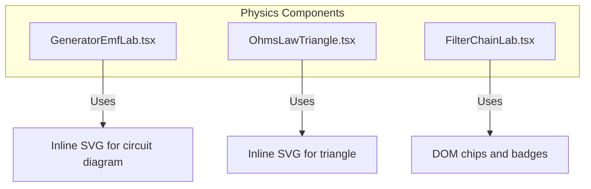
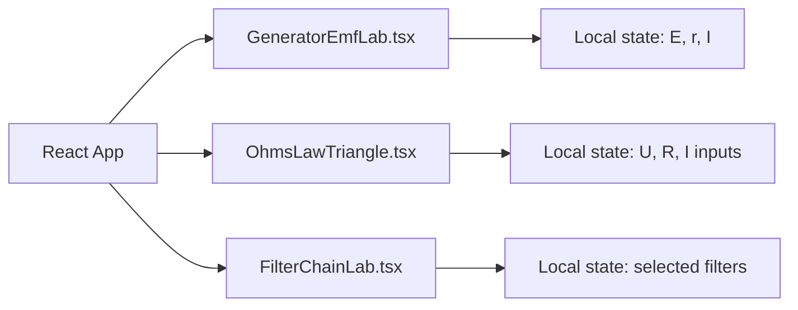
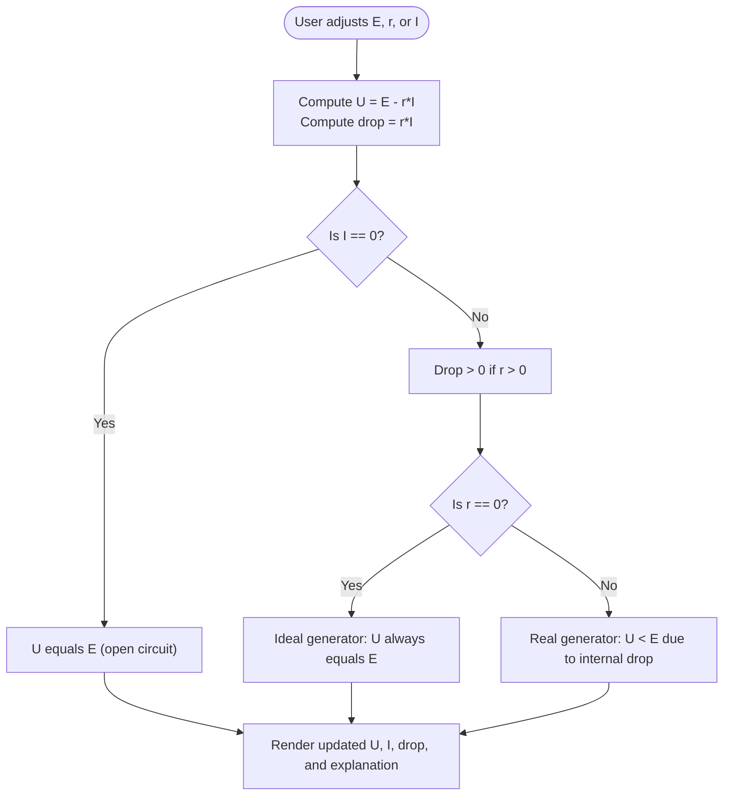
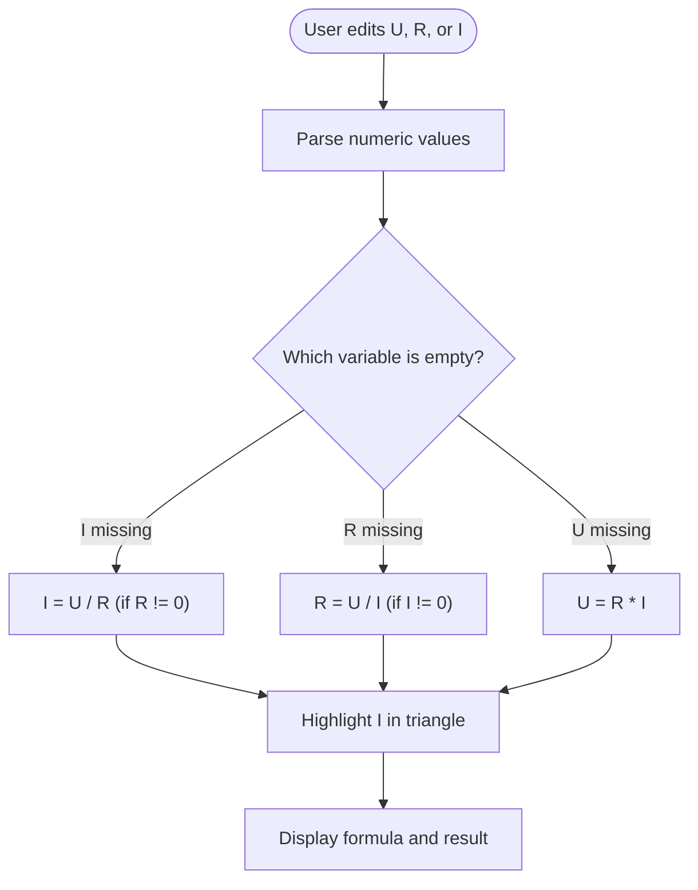
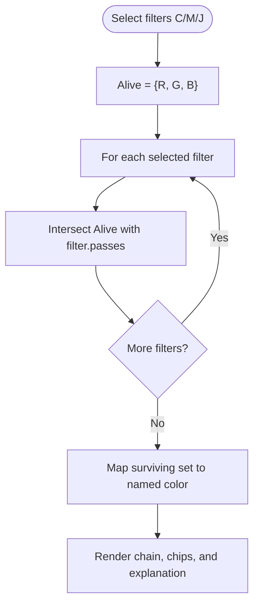
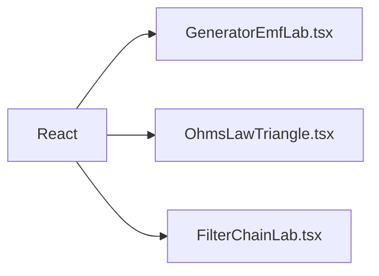

# Electrical Phenomena

<cite>
**Referenced Files in This Document**
- [GeneratorEmfLab.tsx](file://src/components/physics/GeneratorEmfLab.tsx)
- [OhmsLawTriangle.tsx](file://src/components/physics/OhmsLawTriangle.tsx)
- [FilterChainLab.tsx](file://src/components/physics/FilterChainLab.tsx)
</cite>

## Table of Contents
1. [Introduction](#introduction)
2. [Project Structure](#project-structure)
3. [Core Components](#core-components)
4. [Architecture Overview](#architecture-overview)
5. [Detailed Component Analysis](#detailed-component-analysis)
6. [Dependency Analysis](#dependency-analysis)
7. [Performance Considerations](#performance-considerations)
8. [Troubleshooting Guide](#troubleshooting-guide)
9. [Conclusion](#conclusion)

## Introduction
This document explains three interactive educational components that make core electrical concepts accessible to students:
- Generator EMF laboratory: explores electromotive force, internal resistance, and terminal voltage using a real generator model.
- Ohm’s law triangle visualization: helps learners discover the relationships among voltage, current, and resistance through an interactive triangle.
- Filter chain laboratory: demonstrates subtractive color mixing with cyan, magenta, and yellow filters to show how signal filtering works by removing specific spectral components.

Each component provides parameter controls, immediate visual feedback, and concise explanations that connect theory to practice.

## Project Structure
The relevant code lives under the physics components directory. Each component is a self-contained React functional component with inline SVG or simple DOM-based visuals.

**Diagram sources**
- [GeneratorEmfLab.tsx:22-86](file://src/components/physics/GeneratorEmfLab.tsx#L22-L86)
- [OhmsLawTriangle.tsx:52-115](file://src/components/physics/OhmsLawTriangle.tsx#L52-L115)
- [FilterChainLab.tsx:87-169](file://src/components/physics/FilterChainLab.tsx#L87-L169)

**Section sources**
- [GeneratorEmfLab.tsx:1-166](file://src/components/physics/GeneratorEmfLab.tsx#L1-L166)
- [OhmsLawTriangle.tsx:1-190](file://src/components/physics/OhmsLawTriangle.tsx#L1-L190)
- [FilterChainLab.tsx:1-184](file://src/components/physics/FilterChainLab.tsx#L1-L184)

## Core Components
- Generator EMF Laboratory: Students vary electromotive force (E), internal resistance (r), and current (I) to observe terminal voltage U = E − r·I. The interface shows a real generator symbol, an external load, and live annotations for U, I, and internal drop.
- Ohm’s Law Triangle: Students enter two values among U, R, I; the component computes the third, highlights the missing variable on the triangle, and displays the applicable formula and a conceptual message.
- Filter Chain Laboratory: Students toggle cyan (C), magenta (M), and yellow (J) filters in front of white light. The system tracks which RGB components survive each filter and shows the resulting color and explanation.

These components translate abstract laws into hands-on exploration: changing parameters updates visuals instantly, and textual feedback reinforces the underlying principles.

**Section sources**
- [GeneratorEmfLab.tsx:13-21](file://src/components/physics/GeneratorEmfLab.tsx#L13-L21)
- [OhmsLawTriangle.tsx:14-44](file://src/components/physics/OhmsLawTriangle.tsx#L14-L44)
- [FilterChainLab.tsx:60-85](file://src/components/physics/FilterChainLab.tsx#L60-L85)

## Architecture Overview
All three components are independent React UI modules. They do not share state or services; each manages its own local state and renders directly.

[No sources needed since this diagram shows conceptual architecture, not specific code structure]

## Detailed Component Analysis

### Generator EMF Laboratory
Purpose
- Model a real generator as an ideal source E in series with an internal resistance r.
- Show how terminal voltage U depends on current I and internal drop r·I.
- Provide sliders for E, r, I and display computed U and contextual messages.

Mathematical model
- Terminal voltage: U = E − r·I
- Internal drop: V_drop = r·I
- Open-circuit condition: when I = 0, U = E

Parameter controls
- E (electromotive force): slider range 0–12 V, step 0.5 V
- r (internal resistance): slider range 0–4 Ω, step 0.5 Ω
- I (current): slider range 0–8 A, step 0.5 A

Visuals and feedback
- Inline SVG shows the generator symbol, internal resistor, external lamp, polarity markers, and arrows indicating U and I.
- Live text annotations display U, I, and internal drop.
- Contextual explanation distinguishes open circuit, non-zero internal resistance, and ideal generator cases.

Complexity and performance
- Constant-time computations per render; minimal DOM/SVG updates.
- No heavy libraries; efficient for frequent slider changes.

**Diagram sources**
- [GeneratorEmfLab.tsx:13-21](file://src/components/physics/GeneratorEmfLab.tsx#L13-L21)
- [GeneratorEmfLab.tsx:145-160](file://src/components/physics/GeneratorEmfLab.tsx#L145-L160)

**Section sources**
- [GeneratorEmfLab.tsx:1-166](file://src/components/physics/GeneratorEmfLab.tsx#L1-L166)

### Ohm’s Law Triangle Visualization
Purpose
- Reinforce the relationship U = R × I through an interactive triangle where covering one variable reveals the corresponding formula.
- Allow students to input any two values and compute the third.

Mathematical model
- If I is missing: I = U / R
- If R is missing: R = U / I
- If U is missing: U = R × I

Input handling
- Text inputs for U, R, I accept decimal numbers.
- The component detects which value is empty and computes the missing one accordingly.

Visuals and feedback
- SVG triangle divides U over R and I.
- When a value is missing, a highlighted circle indicates the unknown.
- A result panel shows the formula and numerical result with units.
- A “Show result in triangle” button fills the missing field with the computed value.

Edge cases
- Division by zero is avoided by checking R ≠ 0 and I ≠ 0 before computing.
- Invalid or empty inputs are treated as missing variables.

**Diagram sources**
- [OhmsLawTriangle.tsx:19-44](file://src/components/physics/OhmsLawTriangle.tsx#L19-L44)
- [OhmsLawTriangle.tsx:101-109](file://src/components/physics/OhmsLawTriangle.tsx#L101-L109)
- [OhmsLawTriangle.tsx:146-185](file://src/components/physics/OhmsLawTriangle.tsx#L146-L185)

**Section sources**
- [OhmsLawTriangle.tsx:1-190](file://src/components/physics/OhmsLawTriangle.tsx#L1-L190)

### Filter Chain Laboratory
Purpose
- Demonstrate subtractive color mixing using cyan (C), magenta (M), and yellow (J) filters placed in front of white light.
- Track which RGB components pass through each filter and determine the final perceived color.

Mathematical model
- Filters remove one primary RGB component:
  - Cyan passes green and blue, absorbs red.
  - Magenta passes red and blue, absorbs green.
  - Yellow passes red and green, absorbs blue.
- The surviving set of components is the intersection across all selected filters.
- The resulting color maps from the surviving set to a named color and hex value.

State and computation
- Selected filters form a chain; for each filter, the component updates the alive RGB set by intersecting with the filter’s passed components.
- The final key is derived from the sorted surviving components to map to a predefined color.

Visuals and feedback
- Toggle buttons for C, M, J with their colors.
- Visual chain showing white light → filters → resulting color.
- Step-by-step chip view showing which RGB components remain after each filter.
- Explanation text describing the surviving components and final color.

**Diagram sources**
- [FilterChainLab.tsx:23-44](file://src/components/physics/FilterChainLab.tsx#L23-L44)
- [FilterChainLab.tsx:60-85](file://src/components/physics/FilterChainLab.tsx#L60-L85)
- [FilterChainLab.tsx:87-169](file://src/components/physics/FilterChainLab.tsx#L87-L169)

**Section sources**
- [FilterChainLab.tsx:1-184](file://src/components/physics/FilterChainLab.tsx#L1-L184)

## Dependency Analysis
- All three components are decoupled React modules with no shared state or external services.
- Dependencies are limited to React and Tailwind-like utility classes used for styling.
- There are no circular dependencies between these components.

[No sources needed since this diagram shows conceptual dependency, not specific code structure]

**Section sources**
- [GeneratorEmfLab.tsx:1-166](file://src/components/physics/GeneratorEmfLab.tsx#L1-L166)
- [OhmsLawTriangle.tsx:1-190](file://src/components/physics/OhmsLawTriangle.tsx#L1-L190)
- [FilterChainLab.tsx:1-184](file://src/components/physics/FilterChainLab.tsx#L1-L184)

## Performance Considerations
- Generator EMF Laboratory: Uses lightweight SVG and simple arithmetic; suitable for high-frequency updates from sliders.
- Ohm’s Law Triangle: Minimal parsing and conditional logic; negligible overhead.
- Filter Chain Laboratory: Small fixed-size arrays and string operations; very fast even with many toggles.

Recommendations
- Keep computations pure and localized within each component.
- Avoid unnecessary re-renders by memoizing stable objects if the app grows.
- Use debounced updates only if additional heavy calculations are added later.

[No sources needed since this section provides general guidance]

## Troubleshooting Guide
Common issues and resolutions
- Slider values not updating U: Ensure the state setters for E, r, and I are wired to the onChange handlers. Verify ranges and steps match expected physical values.
- Missing Ohm’s law result: Confirm exactly two fields are filled and the non-zero divisor check passes (R ≠ 0 for I calculation, I ≠ 0 for R calculation).
- Unexpected black output in filter chain: Occurs when all RGB components are absorbed (no survivors). This is correct behavior for subtractive mixing; explain it to students as “no light reaches the eye.”

Validation tips
- Test edge cases: I = 0 in generator lab (open circuit), r = 0 (ideal generator), and combinations of filters that eliminate all components.
- Validate number formatting: Ensure decimal separators and trailing zeros are handled consistently in displayed values.

**Section sources**
- [GeneratorEmfLab.tsx:145-160](file://src/components/physics/GeneratorEmfLab.tsx#L145-L160)
- [OhmsLawTriangle.tsx:32-44](file://src/components/physics/OhmsLawTriangle.tsx#L32-L44)
- [FilterChainLab.tsx:75-85](file://src/components/physics/FilterChainLab.tsx#L75-L85)

## Conclusion
These three components provide intuitive, interactive pathways to understand fundamental electrical phenomena:
- The Generator EMF laboratory connects electromotive force, internal resistance, and terminal voltage through direct manipulation and clear visual feedback.
- The Ohm’s law triangle turns algebraic relationships into a tactile learning tool, reinforcing proportional reasoning.
- The filter chain laboratory translates signal filtering into a concrete visual process, helping students grasp how selective removal of components shapes outcomes.

Together, they bridge theory and practice, enabling students to explore, predict, and verify electrical principles in a safe, engaging environment.

[No sources needed since this section summarizes without analyzing specific files]