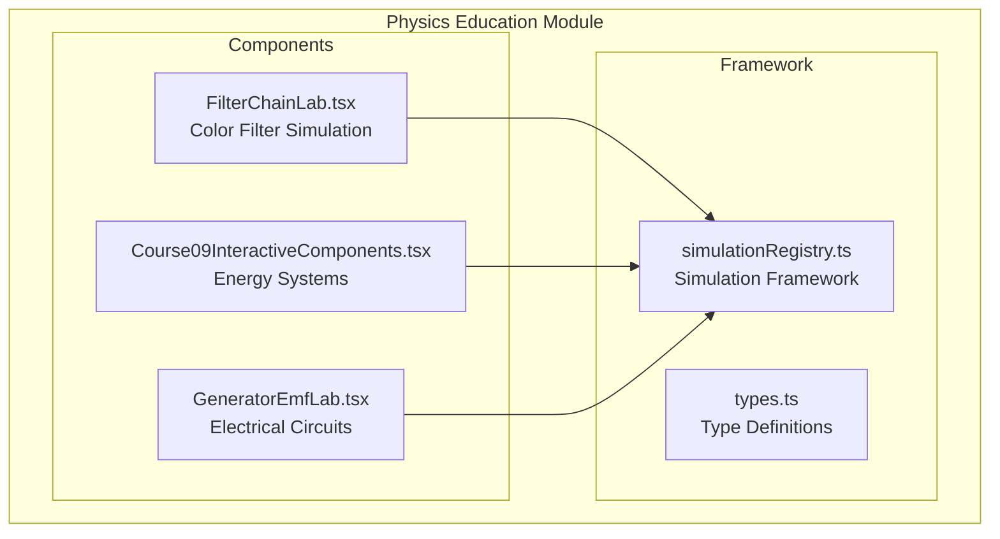
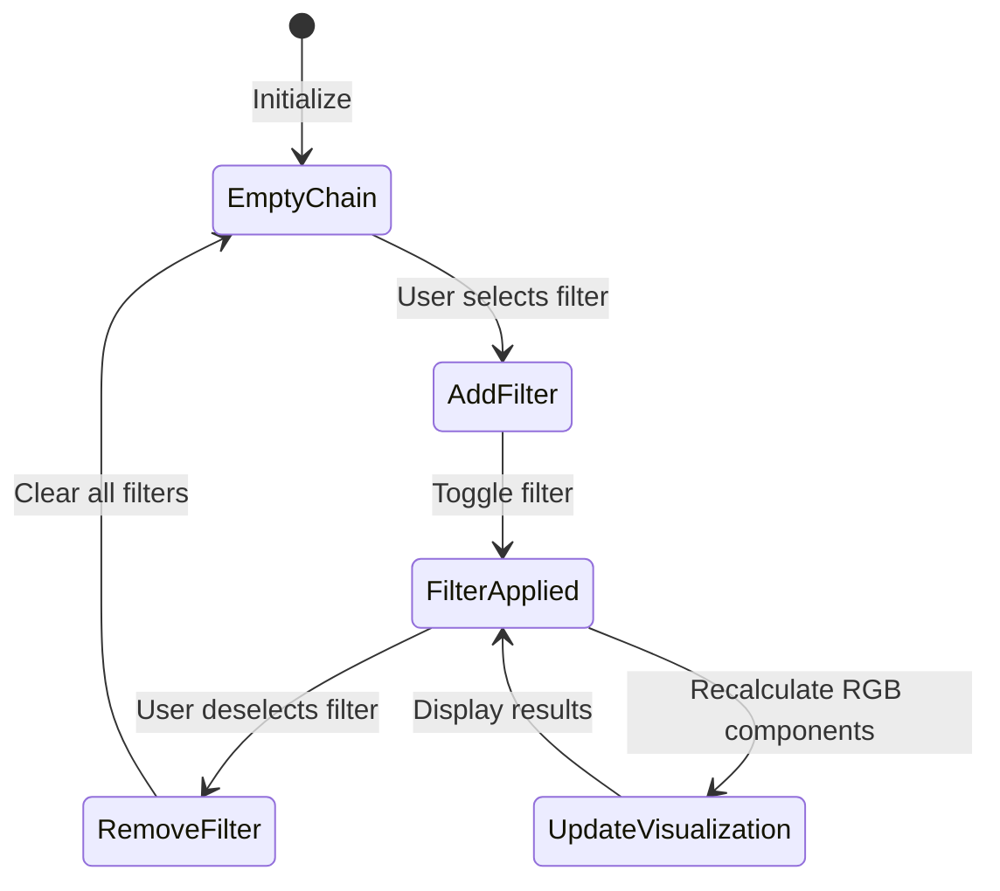
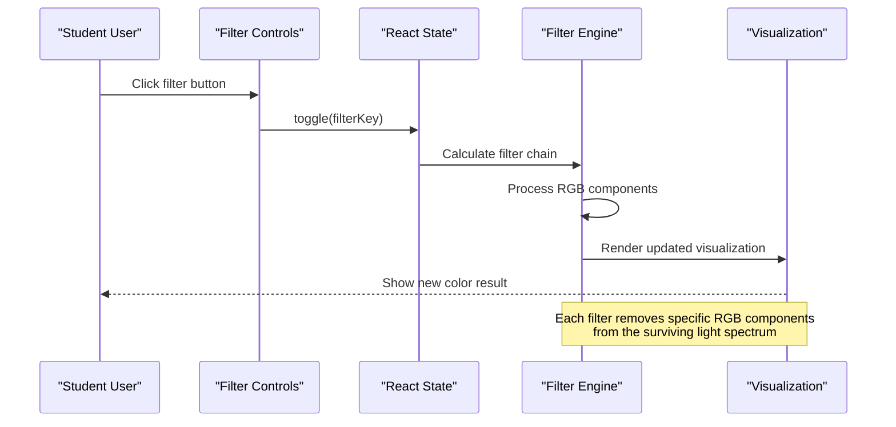
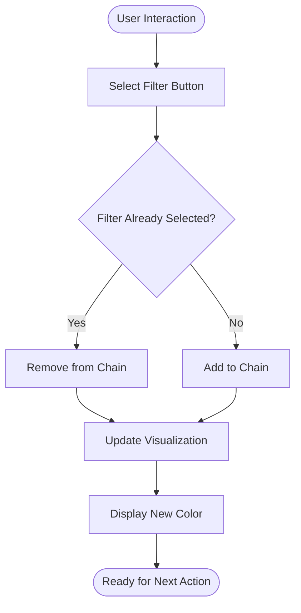
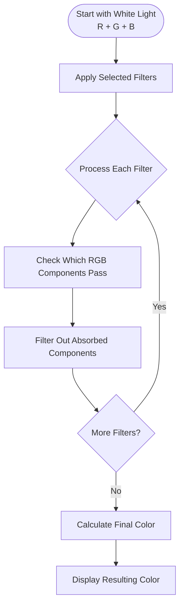
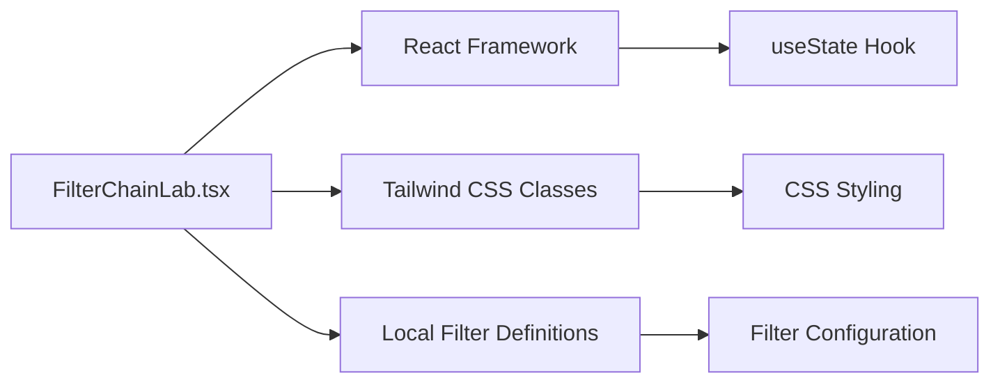

# Filter Chain Laboratory

<cite>
**Referenced Files in This Document**   
- [FilterChainLab.tsx](file://src/components/physics/FilterChainLab.tsx)
- [implementation_plan.md](file://.aistudio/artifacts/brain/64e3c46f-dfa1-4742-b438-11281d695944/implementation_plan.md)
</cite>

## Table of Contents
1. [Introduction](#introduction)
2. [Project Structure](#project-structure)
3. [Core Components](#core-components)
4. [Architecture Overview](#architecture-overview)
5. [Detailed Component Analysis](#detailed-component-analysis)
6. [Dependency Analysis](#dependency-analysis)
7. [Performance Considerations](#performance-considerations)
8. [Troubleshooting Guide](#troubleshooting-guide)
9. [Conclusion](#conclusion)

## Introduction

The Filter Chain Laboratory is an interactive educational simulation designed to demonstrate **subtractive color filtering principles** through a chain of colored optical filters. While the documentation objective mentions electrical signal filtering, the actual implementation focuses on **optical color theory**, specifically how white light passes through sequential Cyan (C), Magenta (M), and Yellow (J) filters to produce different colors through subtractive mixing.

This component serves as a visual learning tool where students can experiment with different filter combinations to understand how each filter selectively absorbs certain RGB color components while allowing others to pass through. The simulation provides immediate visual feedback showing which color components survive each filtering stage and what final color emerges from the chain.

## Project Structure

The Filter Chain Laboratory is implemented as a single React component within the physics education module structure:

**Diagram sources**
- [FilterChainLab.tsx:1-184](file://src/components/physics/FilterChainLab.tsx#L1-L184)
- [registry.ts:35-61](file://src/components/physics/simulations/registry.ts#L35-L61)

**Section sources**
- [FilterChainLab.tsx:1-184](file://src/components/physics/FilterChainLab.tsx#L1-L184)

## Core Components

### Filter Definition System

The component defines three primary filter types using a structured data model:

| Filter | Key | Passes | Absorbs | Color | Description |
|--------|-----|--------|---------|-------|-------------|
| Cyan | C | Green, Blue | Red | #06B6D4 | Allows green and blue light, absorbs red |
| Magenta | M | Red, Blue | Green | #D946EF | Allows red and blue light, absorbs green |
| Yellow | J | Red, Green | Blue | #EAB308 | Allows red and green light, absorbs blue |

### State Management Architecture

The component uses React's useState hook to manage the filter chain state:

**Diagram sources**
- [FilterChainLab.tsx:60-73](file://src/components/physics/FilterChainLab.tsx#L60-L73)

**Section sources**
- [FilterChainLab.tsx:8-27](file://src/components/physics/FilterChainLab.tsx#L8-L27)
- [FilterChainLab.tsx:60-73](file://src/components/physics/FilterChainLab.tsx#L60-L73)

## Architecture Overview

The Filter Chain Laboratory follows a unidirectional data flow pattern typical of React applications:

**Diagram sources**
- [FilterChainLab.tsx:63-73](file://src/components/physics/FilterChainLab.tsx#L63-L73)

The architecture consists of four main layers:

1. **Presentation Layer**: User interface elements including filter selection buttons and visualization displays
2. **State Management Layer**: React state hooks managing the current filter chain configuration
3. **Processing Layer**: Filter chain calculation engine that processes RGB component survival
4. **Visualization Layer**: Dynamic rendering of filter stages and resulting colors

**Section sources**
- [FilterChainLab.tsx:60-184](file://src/components/physics/FilterChainLab.tsx#L60-L184)

## Detailed Component Analysis

### Filter Selection Interface

The user interface provides intuitive controls for building filter chains:

#### Primary Features:
- **Toggle Buttons**: Each filter (C, M, J) has a dedicated button that toggles its inclusion in the chain
- **Visual Feedback**: Active filters are highlighted with their respective colors
- **Reset Functionality**: A clear button removes all filters when multiple are selected
- **RTL Support**: Full right-to-left language support for Arabic content

#### Interactive Elements:

**Diagram sources**
- [FilterChainLab.tsx:90-117](file://src/components/physics/FilterChainLab.tsx#L90-L117)

### Filter Processing Engine

The core processing logic implements subtractive color filtering:

#### Algorithm Flow:

**Diagram sources**
- [FilterChainLab.tsx:67-73](file://src/components/physics/FilterChainLab.tsx#L67-L73)

#### Mathematical Model:
The filter processing follows these rules:
- **Initial State**: All RGB components present (R + G + B = White)
- **Filter Application**: Each filter removes its absorbed component(s)
- **Survival Rule**: Only components listed in the filter's "passes" array survive
- **Final Calculation**: Remaining components determine the output color

### Visualization System

The component provides multiple visualization modes:

#### Chain Visualization:
- **Sequential Display**: Shows the order of filters applied
- **Component Tracking**: Displays which RGB components survive at each stage
- **Color Preview**: Shows the final resulting color with appropriate styling

#### Stage-by-Stage Analysis:
Each filter application shows:
- **Before State**: RGB components entering the filter
- **After State**: RGB components exiting the filter
- **Visual Indicators**: Crossed-out components that were filtered out

**Section sources**
- [FilterChainLab.tsx:119-168](file://src/components/physics/FilterChainLab.tsx#L119-L168)

## Dependency Analysis

The Filter Chain Laboratory has minimal external dependencies:

**Diagram sources**
- [FilterChainLab.tsx:1-2](file://src/components/physics/FilterChainLab.tsx#L1-L2)

### Internal Dependencies:
- **React Hooks**: Uses `useState` for state management
- **CSS Framework**: Leverages Tailwind CSS for responsive styling
- **Local Data Structures**: Self-contained filter definitions and color mappings

### External Integration Points:
- **Educational Framework**: Designed to integrate with the broader physics education system
- **PDF Generation**: Compatible with the course PDF export functionality
- **Responsive Design**: Adapts to various screen sizes and devices

**Section sources**
- [FilterChainLab.tsx:1-2](file://src/components/physics/FilterChainLab.tsx#L1-L2)

## Performance Considerations

### Computational Efficiency:
- **O(n) Complexity**: Filter chain processing scales linearly with the number of filters
- **Minimal State Updates**: React state updates only occur on user interactions
- **Efficient Rendering**: Component re-renders only when filter chain changes

### Memory Usage:
- **Static Data**: Filter definitions are immutable constants
- **Limited State**: Only maintains current chain configuration
- **No External Dependencies**: Eliminates memory overhead from third-party libraries

### Optimization Opportunities:
1. **Memoization**: Could benefit from `useMemo` for expensive calculations
2. **Component Splitting**: Separate visualization components for better performance
3. **Event Debouncing**: Prevent excessive state updates during rapid interactions

## Troubleshooting Guide

### Common Issues and Solutions:

#### Filter Not Applying Correctly:
- **Symptom**: Wrong color appears after applying filters
- **Cause**: Incorrect filter definition or state corruption
- **Solution**: Verify filter definitions and reset component state

#### Visualization Not Updating:
- **Symptom**: Visual display doesn't reflect filter changes
- **Cause**: React state not properly updating
- **Solution**: Check state update logic and component re-rendering

#### Layout Issues on Mobile:
- **Symptom**: Poor display on small screens
- **Cause**: Responsive design limitations
- **Solution**: Adjust Tailwind classes for mobile breakpoints

### Debugging Tips:
1. **Console Logging**: Add logs to track filter chain state changes
2. **State Inspection**: Use React DevTools to inspect component state
3. **Visual Testing**: Test with known filter combinations (e.g., C+M should produce blue)

**Section sources**
- [FilterChainLab.tsx:60-184](file://src/components/physics/FilterChainLab.tsx#L60-L184)

## Conclusion

The Filter Chain Laboratory successfully demonstrates **subtractive color filtering principles** through an intuitive interactive interface. While the original documentation objective focused on electrical signal filtering, this implementation provides valuable educational value for understanding **optical filtering concepts** that share fundamental mathematical principles with electronic filters.

### Key Educational Benefits:
- **Visual Learning**: Immediate feedback helps students understand abstract filtering concepts
- **Hands-on Experimentation**: Students can explore complex filter combinations safely
- **Conceptual Transfer**: Understanding optical filters aids comprehension of electronic filters
- **Mathematical Foundation**: Subtractive filtering mirrors transfer function concepts

### Future Enhancement Opportunities:
1. **Electrical Filter Extension**: Add parallel functionality for RC/RL circuits
2. **Frequency Response Graphs**: Implement Bode plot visualization
3. **Real-time Oscilloscope**: Show time-domain waveforms alongside frequency responses
4. **Advanced Filter Types**: Include band-pass, high-pass, and notch filters

The current implementation serves as an excellent foundation for expanding into full electrical circuit simulation capabilities while maintaining its strength as a conceptual bridge between optical and electronic filtering principles.