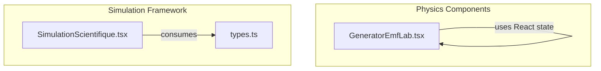
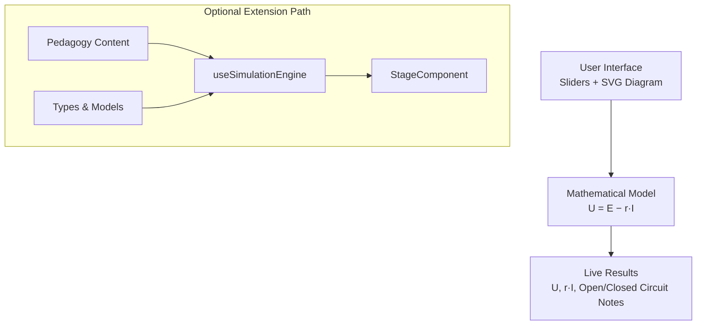
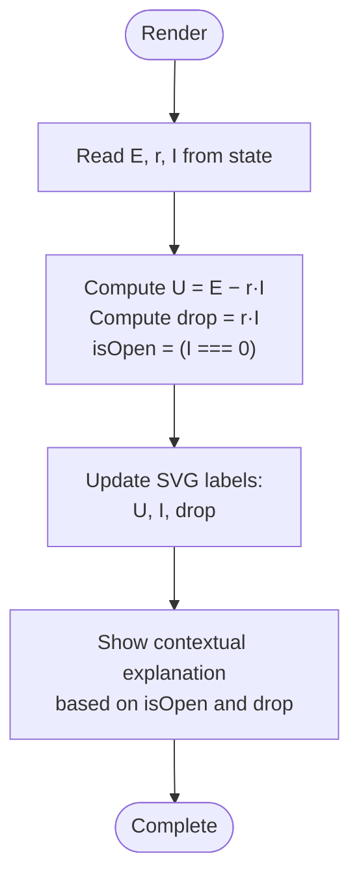
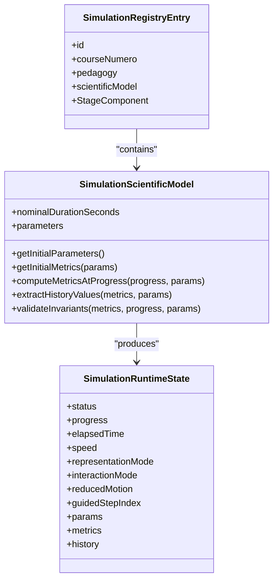

# Generator EMF Laboratory

<cite>
**Referenced Files in This Document**
- [GeneratorEmfLab.tsx](file://src/components/physics/GeneratorEmfLab.tsx)
- [SimulationScientifique.tsx](file://src/components/physics/simulations/SimulationScientifique.tsx)
- [types.ts](file://src/components/physics/simulations/types.ts)
</cite>

## Table of Contents
1. [Introduction](#introduction)
2. [Project Structure](#project-structure)
3. [Core Components](#core-components)
4. [Architecture Overview](#architecture-overview)
5. [Detailed Component Analysis](#detailed-component-analysis)
6. [Dependency Analysis](#dependency-analysis)
7. [Performance Considerations](#performance-considerations)
8. [Troubleshooting Guide](#troubleshooting-guide)
9. [Conclusion](#conclusion)
10. [Appendices](#appendices)

## Introduction
This document explains the Generator EMF Laboratory component and how it supports interactive learning about electrical generators. In this repository, the component named Generator EMF Laboratory is implemented as a real generator laboratory that demonstrates terminal voltage behavior of a practical source: U = E − r·I. It provides parameter controls for electromotive force (E), internal resistance (r), and current (I), and shows the resulting terminal voltage (U) and internal voltage drop in real time.

The broader simulation framework used elsewhere in the project separates declarative pedagogy, deterministic scientific models, runtime state, and rendering stages. While the current Generator EMF Laboratory is a focused static calculator with sliders, it can be extended to follow the same pattern if future electromagnetic induction simulations are added.

## Project Structure
The relevant code for this documentation lives under the physics components directory. The primary file is the Generator EMF Laboratory component itself. The generic scientific simulation framework is defined in the simulations folder and can be used by other modules.

**Diagram sources**
- [GeneratorEmfLab.tsx:13-166](file://src/components/physics/GeneratorEmfLab.tsx#L13-L166)
- [SimulationScientifique.tsx:1-12](file://src/components/physics/simulations/SimulationScientifique.tsx#L1-L12)
- [types.ts:1-20](file://src/components/physics/simulations/types.ts#L1-L20)

**Section sources**
- [GeneratorEmfLab.tsx:1-166](file://src/components/physics/GeneratorEmfLab.tsx#L1-L166)
- [SimulationScientifique.tsx:1-12](file://src/components/physics/simulations/SimulationScientifique.tsx#L1-L12)
- [types.ts:1-20](file://src/components/physics/simulations/types.ts#L1-L20)

## Core Components
- Generator EMF Laboratory (GeneratorEmfLab): A self-contained React component that renders an SVG circuit diagram of a real generator (ideal EMF source E in series with internal resistance r) connected to an external load represented by a lamp symbol. It exposes three sliders for E, r, and I, computes U = E − r·I, and displays the result along with contextual explanations.
- Simulation Framework (optional extension path): The generic simulation engine and types define how more complex simulations can be structured with parameters, metrics, history, guided steps, and multiple representation modes.

Key responsibilities:
- Parameter input: Sliders for E (volts), r (ohms), I (amperes).
- Real-time computation: Terminal voltage U and internal drop r·I.
- Visualization: SVG schematic with labeled terminals, current direction, and live values.
- Feedback: Contextual messages explaining open-circuit behavior, ideal vs real generator behavior, and internal voltage drop.

**Section sources**
- [GeneratorEmfLab.tsx:13-21](file://src/components/physics/GeneratorEmfLab.tsx#L13-L21)
- [GeneratorEmfLab.tsx:22-86](file://src/components/physics/GeneratorEmfLab.tsx#L22-L86)
- [GeneratorEmfLab.tsx:89-143](file://src/components/physics/GeneratorEmfLab.tsx#L89-L143)
- [GeneratorEmfLab.tsx:145-161](file://src/components/physics/GeneratorEmfLab.tsx#L145-L161)

## Architecture Overview
At present, the Generator EMF Laboratory is a single-component application using local React state. It does not depend on the generic simulation engine. However, the repository’s simulation framework provides a reusable architecture for richer simulations.

**Diagram sources**
- [GeneratorEmfLab.tsx:13-21](file://src/components/physics/GeneratorEmfLab.tsx#L13-L21)
- [SimulationScientifique.tsx:138-170](file://src/components/physics/simulations/SimulationScientifique.tsx#L138-L170)
- [types.ts:242-289](file://src/components/physics/simulations/types.ts#L242-L289)

## Detailed Component Analysis

### Mathematical Model
The component implements the standard relationship for a real generator:
- Terminal voltage: U = E − r·I
- Internal voltage drop: V_drop = r·I
- Open-circuit condition: When I = 0, U = E

Behavioral notes:
- If r = 0, the generator behaves ideally and U always equals E.
- If I > 0 and r > 0, U < E due to the internal drop.

Complexity:
- Time complexity: O(1) per render.
- Space complexity: O(1) additional memory beyond React state.

**Section sources**
- [GeneratorEmfLab.tsx:18-20](file://src/components/physics/GeneratorEmfLab.tsx#L18-L20)
- [GeneratorEmfLab.tsx:151-160](file://src/components/physics/GeneratorEmfLab.tsx#L151-L160)

### User Interface Elements
- Parameter Controls:
  - Electromotive force E (volts): slider range 0–12 V, step 0.5 V.
  - Internal resistance r (ohms): slider range 0–4 Ω, step 0.5 Ω.
  - Current I (amperes): slider range 0–8 A, step 0.5 A.
- Live Readouts:
  - Terminal voltage U displayed inline with the formula breakdown.
  - Current I shown near the circuit diagram.
  - Internal drop r·I shown when positive.
- Visual Schematic:
  - SVG drawing of a real generator (E in series with r) connected to an external load (lamp).
  - Polarity markers (+/−) and current direction arrow.
  - Dynamic labels for U and I.

Accessibility and layout:
- Right-to-left layout for Arabic content.
- aria-labels and role attributes for the SVG.
- Responsive grid for sliders across screen sizes.

**Section sources**
- [GeneratorEmfLab.tsx:22-86](file://src/components/physics/GeneratorEmfLab.tsx#L22-L86)
- [GeneratorEmfLab.tsx:89-143](file://src/components/physics/GeneratorEmfLab.tsx#L89-L143)

### Data Flow and Rendering Logic

**Diagram sources**
- [GeneratorEmfLab.tsx:13-21](file://src/components/physics/GeneratorEmfLab.tsx#L13-L21)
- [GeneratorEmfLab.tsx:145-161](file://src/components/physics/GeneratorEmfLab.tsx#L145-L161)

**Section sources**
- [GeneratorEmfLab.tsx:13-21](file://src/components/physics/GeneratorEmfLab.tsx#L13-L21)
- [GeneratorEmfLab.tsx:145-161](file://src/components/physics/GeneratorEmfLab.tsx#L145-L161)

### Example Experiments
Students can explore relationships by adjusting sliders and observing changes:
- Relationship between rotation speed and generated voltage:
  - Not directly modeled here; however, students can conceptually map higher angular velocity to higher E and observe U increasing accordingly.
- Effect of magnetic field strength on EMF output:
  - Conceptually mapped to changing E; increasing E increases both U and the internal drop proportionally to I.
- Investigating internal resistance effects:
  - Increase r while keeping I constant to see U decrease due to larger internal drop.
- Open-circuit behavior:
  - Set I = 0 to observe U = E and understand why terminal voltage equals EMF when no current flows.

Note: These experiments are conceptual extensions based on the current model. A dedicated electromagnetic induction simulation would explicitly include magnetic field strength, coil turns, and angular velocity as parameters.

[No sources needed since this section provides general guidance]

### Optional Integration With the Simulation Framework
If extending to a full electromagnetic induction simulator, the repository’s framework provides:
- Declarative pedagogy and guided questions.
- Deterministic scientific models with getInitialMetrics and computeMetricsAtProgress.
- Runtime state management via useSimulationEngine.
- Multiple representation modes (macroscopic/microscopic/both).
- History tracking for dynamic graphs.

**Diagram sources**
- [types.ts:242-289](file://src/components/physics/simulations/types.ts#L242-L289)
- [SimulationScientifique.tsx:138-170](file://src/components/physics/simulations/SimulationScientifique.tsx#L138-L170)

**Section sources**
- [types.ts:242-289](file://src/components/physics/simulations/types.ts#L242-L289)
- [SimulationScientifique.tsx:138-170](file://src/components/physics/simulations/SimulationScientifique.tsx#L138-L170)

## Dependency Analysis
Current dependencies:
- Generator EMF Laboratory depends only on React state and Tailwind-like utility classes for styling.
- No direct dependency on the simulation framework.

Potential future dependencies:
- If extended into the simulation framework, it would consume types and engine hooks from the simulations module.

**Diagram sources**
- [GeneratorEmfLab.tsx:1-2](file://src/components/physics/GeneratorEmfLab.tsx#L1-L2)
- [SimulationScientifique.tsx:1-12](file://src/components/physics/simulations/SimulationScientifique.tsx#L1-L12)
- [types.ts:1-20](file://src/components/physics/simulations/types.ts#L1-L20)

**Section sources**
- [GeneratorEmfLab.tsx:1-2](file://src/components/physics/GeneratorEmfLab.tsx#L1-L2)
- [SimulationScientifique.tsx:1-12](file://src/components/physics/simulations/SimulationScientifique.tsx#L1-L12)
- [types.ts:1-20](file://src/components/physics/simulations/types.ts#L1-L20)

## Performance Considerations
- Rendering cost is minimal: one SVG and a few text updates per state change.
- Slider interactions trigger immediate re-renders; consider debouncing if many sliders were added.
- For future animations or history graphs, prefer requestAnimationFrame and incremental updates to avoid jank.

[No sources needed since this section provides general guidance]

## Troubleshooting Guide
Common issues and resolutions:
- Unexpected negative terminal voltage:
  - Occurs if r·I > E. Verify slider ranges and ensure realistic combinations of E, r, and I.
- No internal drop displayed:
  - The internal drop label appears only when r·I > 0. Ensure both r and I are non-zero.
- Open-circuit message not showing:
  - The open-circuit explanation appears when I = 0. Confirm the current slider is set to zero.
- Accessibility concerns:
  - Ensure screen readers can interpret the SVG; the component includes aria-label and role attributes.

**Section sources**
- [GeneratorEmfLab.tsx:18-20](file://src/components/physics/GeneratorEmfLab.tsx#L18-L20)
- [GeneratorEmfLab.tsx:151-160](file://src/components/physics/GeneratorEmfLab.tsx#L151-L160)

## Conclusion
The Generator EMF Laboratory component provides a clear, interactive demonstration of terminal voltage behavior in a real generator using U = E − r·I. It offers intuitive sliders for E, r, and I, and visual feedback through an SVG schematic and live readouts. While it does not yet simulate electromagnetic induction with explicit magnetic field strength, coil turns, and angular velocity, its design is straightforward and can be extended or integrated into the broader simulation framework to support richer experiments.

[No sources needed since this section summarizes without analyzing specific files]

## Appendices

### API Summary: Parameter Controls
- E (EMF): volts, default 6 V, range 0–12 V, step 0.5 V.
- r (internal resistance): ohms, default 1 Ω, range 0–4 Ω, step 0.5 Ω.
- I (current): amperes, default 2 A, range 0–8 A, step 0.5 A.

Computed outputs:
- U (terminal voltage): E − r·I.
- Internal drop: r·I.
- Open-circuit flag: true when I = 0.

**Section sources**
- [GeneratorEmfLab.tsx:13-21](file://src/components/physics/GeneratorEmfLab.tsx#L13-L21)
- [GeneratorEmfLab.tsx:89-143](file://src/components/physics/GeneratorEmfLab.tsx#L89-L143)