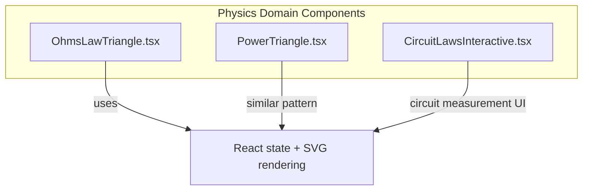
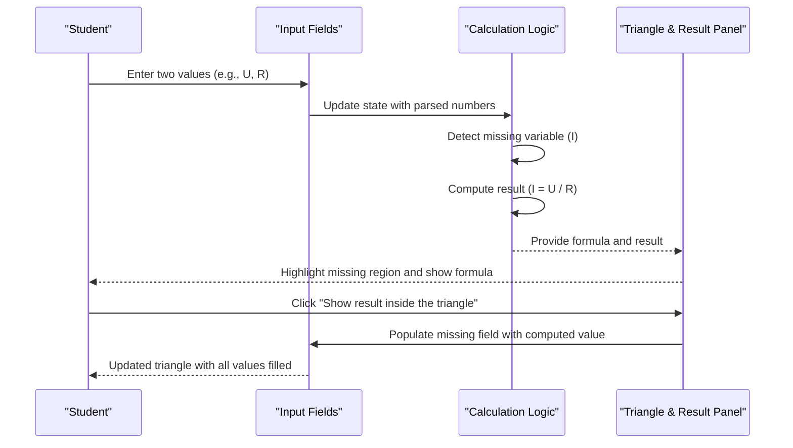
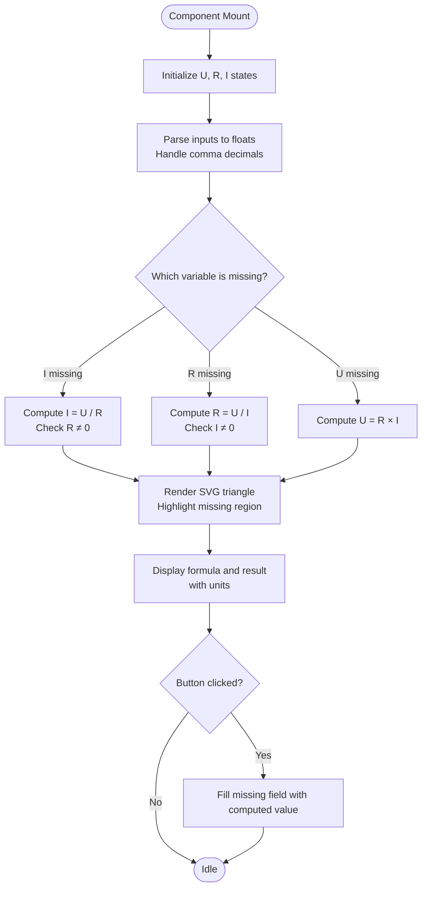
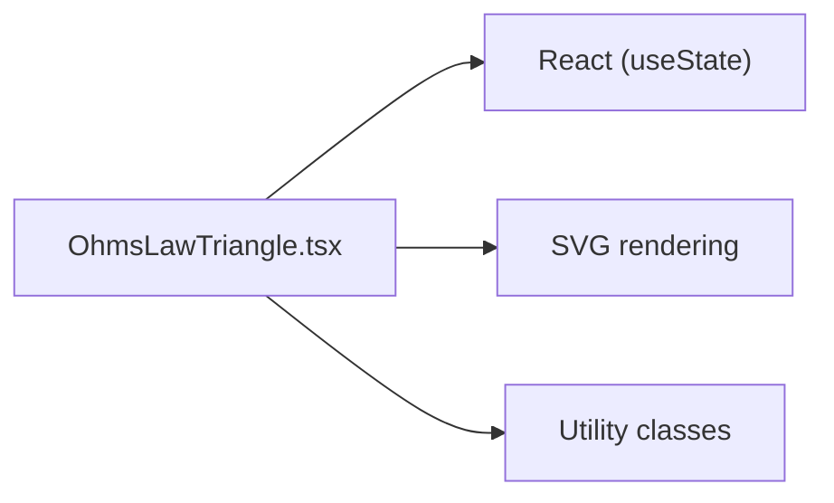

# Ohm's Law Triangle Visualization

<cite>
**Referenced Files in This Document**
- [OhmsLawTriangle.tsx](file://src/components/physics/OhmsLawTriangle.tsx)
- [PowerTriangle.tsx](file://src/components/physics/PowerTriangle.tsx)
- [CircuitLawsInteractive.tsx](file://src/components/physics/CircuitLawsInteractive.tsx)
</cite>

## Table of Contents
1. [Introduction](#introduction)
2. [Project Structure](#project-structure)
3. [Core Components](#core-components)
4. [Architecture Overview](#architecture-overview)
5. [Detailed Component Analysis](#detailed-component-analysis)
6. [Dependency Analysis](#dependency-analysis)
7. [Performance Considerations](#performance-considerations)
8. [Troubleshooting Guide](#troubleshooting-guide)
9. [Conclusion](#conclusion)
10. [Appendices](#appendices)

## Introduction
This document explains the Ohm’s Law Triangle interactive visualization component, an educational tool that helps students understand the fundamental relationship between voltage (U), current (I), and resistance (R). The component presents a triangle diagram where two known values allow the system to compute the third, showing the relevant formula and providing immediate feedback. It supports real-time calculation for:
- V = I × R (implemented as U = R × I)
- I = V / R (implemented as I = U / R)
- R = V / I (implemented as R = U / I)

The interface is designed for right-to-left languages and uses clear visual cues to indicate which variable is missing and how it relates to the others.

## Project Structure
The Ohm’s Law Triangle is implemented as a self-contained React component within the physics domain components. It renders an SVG triangle with labeled regions for U, R, and I, input fields for each quantity, a result display area, and a button to populate the missing value into the triangle.

**Diagram sources**
- [OhmsLawTriangle.tsx:1-190](file://src/components/physics/OhmsLawTriangle.tsx#L1-L190)
- [PowerTriangle.tsx:1-60](file://src/components/physics/PowerTriangle.tsx#L1-L60)
- [CircuitLawsInteractive.tsx:1-50](file://src/components/physics/CircuitLawsInteractive.tsx#L1-L50)

**Section sources**
- [OhmsLawTriangle.tsx:1-190](file://src/components/physics/OhmsLawTriangle.tsx#L1-L190)

## Core Components
- OhmsLawTriangle: Interactive triangle for Ohm’s law calculations with inputs for U, R, I; automatic detection of the missing variable; formula display; and a “Show result inside the triangle” action.
- PowerTriangle: A similar triangle-based calculator for power relationships (P = U × I, etc.), demonstrating consistent design patterns across physics components.
- CircuitLawsInteractive: A complementary circuit analysis tool illustrating Kirchhoff’s laws through interactive measurements, useful for contextualizing Ohm’s law in series and parallel circuits.

Key responsibilities:
- State management for user inputs
- Parsing and validation of numeric inputs
- Determining the missing variable and computing results
- Rendering the triangle and highlighting the unknown
- Displaying formulas and pedagogical messages

**Section sources**
- [OhmsLawTriangle.tsx:14-190](file://src/components/physics/OhmsLawTriangle.tsx#L14-L190)
- [PowerTriangle.tsx:1-60](file://src/components/physics/PowerTriangle.tsx#L1-L60)
- [CircuitLawsInteractive.tsx:1-50](file://src/components/physics/CircuitLawsInteractive.tsx#L1-L50)

## Architecture Overview
The component follows a simple, declarative architecture:
- Inputs: Three text fields for U, R, I with localized units.
- Logic: Parse inputs, detect missing variable, compute result, select formula.
- Presentation: SVG triangle with colored highlights for the missing variable; result panel shows formula and unit; instructional message updates based on the computed variable.

**Diagram sources**
- [OhmsLawTriangle.tsx:14-190](file://src/components/physics/OhmsLawTriangle.tsx#L14-L190)

## Detailed Component Analysis

### OhmsLawTriangle Component
Responsibilities:
- Manage three string states for U, R, I
- Parse strings to floats, handling comma decimal separators
- Determine which variable is missing and compute the corresponding result
- Render an SVG triangle with dividers and labels for U, R, I
- Highlight the missing variable with a colored circle
- Show the formula and result with appropriate units
- Provide a button to fill the missing field with the computed value

Mathematical relationships implemented:
- I = U / R when U and R are provided and R ≠ 0
- R = U / I when U and I are provided and I ≠ 0
- U = R × I when R and I are provided

User interaction flow:
- Students enter any two values; the third remains empty.
- The component detects the missing variable and computes the result.
- The triangle highlights the missing region.
- The result panel displays the formula and numerical result with units.
- Clicking the action button populates the missing field, completing the triangle.

Pedagogical messaging:
- Contextual Arabic messages explain relationships such as inverse proportionality between current and resistance at constant voltage, and direct proportionality between voltage and current at constant resistance.

Accessibility and localization:
- Right-to-left layout support via direction attributes.
- Units displayed next to inputs and results.

Error handling and edge cases:
- Division by zero is guarded for I = U / R and R = U / I scenarios.
- Invalid or non-numeric inputs are handled by parsing logic that treats NaN as missing.

**Diagram sources**
- [OhmsLawTriangle.tsx:14-190](file://src/components/physics/OhmsLawTriangle.tsx#L14-L190)

**Section sources**
- [OhmsLawTriangle.tsx:14-190](file://src/components/physics/OhmsLawTriangle.tsx#L14-L190)

### Related Components

#### PowerTriangle
Similar triangle-based calculator for electrical power:
- Relationships: P = U × I, U = P / I, I = P / U
- Same pattern: parse inputs, detect missing variable, compute result, render triangle, highlight unknown, show formula and unit.

Educational value:
- Reinforces proportional relationships among power, voltage, and current.
- Demonstrates consistent UI patterns across physics topics.

**Section sources**
- [PowerTriangle.tsx:1-60](file://src/components/physics/PowerTriangle.tsx#L1-L60)

#### CircuitLawsInteractive
Interactive circuit measurement tool:
- Supports series and parallel configurations.
- Allows selecting measurement points for ammeter and voltmeter.
- Displays readings and conclusions about current and voltage distribution.

Integration with Ohm’s law:
- Helps students connect Ohm’s law with Kirchhoff’s laws in practical circuit contexts.
- Provides a bridge from abstract formulas to measurable quantities.

**Section sources**
- [CircuitLawsInteractive.tsx:1-50](file://src/components/physics/CircuitLawsInteractive.tsx#L1-L50)
- [CircuitLawsInteractive.tsx:237-274](file://src/components/physics/CircuitLawsInteractive.tsx#L237-L274)

## Dependency Analysis
Internal dependencies:
- React hooks for state management (useState)
- SVG for rendering the triangle and highlighting the missing variable
- Tailwind-like utility classes for styling (used throughout the component)

External dependencies:
- None beyond standard React ecosystem; no additional libraries imported.

Coupling and cohesion:
- High cohesion within the component: all logic and presentation for Ohm’s law triangle are contained in one file.
- Low coupling to other modules: the component is self-contained and can be embedded anywhere in the app.

Potential circular dependencies:
- None observed; the component does not import other physics components.

**Diagram sources**
- [OhmsLawTriangle.tsx:1-190](file://src/components/physics/OhmsLawTriangle.tsx#L1-L190)

**Section sources**
- [OhmsLawTriangle.tsx:1-190](file://src/components/physics/OhmsLawTriangle.tsx#L1-L190)

## Performance Considerations
- Lightweight computation: Only basic arithmetic operations are performed on each render cycle.
- Minimal re-renders: State changes are limited to input fields and computed result.
- SVG rendering: Simple shapes and text; negligible performance impact.
- Input parsing: Efficient conversion with locale-aware decimal handling.

Optimization opportunities:
- Memoize parsed values if inputs become more complex.
- Debounce input handling if integrating with external data sources.

[No sources needed since this section provides general guidance]

## Troubleshooting Guide
Common issues and resolutions:
- Non-numeric input: The parser treats invalid entries as missing variables; ensure inputs are valid numbers.
- Division by zero: Guarded by checks for R ≠ 0 and I ≠ 0; avoid entering zero for denominators.
- Missing both or all three values: The component requires exactly two known values; prompt users to provide two inputs.
- Localization confusion: Ensure decimal separators match expected format (comma vs period); the parser handles commas.

Debugging tips:
- Inspect the computed missing variable and result in the result panel.
- Verify that the triangle highlights the correct missing region.
- Use the action button to confirm that the computed value fills the missing field correctly.

**Section sources**
- [OhmsLawTriangle.tsx:19-44](file://src/components/physics/OhmsLawTriangle.tsx#L19-L44)
- [OhmsLawTriangle.tsx:146-185](file://src/components/physics/OhmsLawTriangle.tsx#L146-L185)

## Conclusion
The Ohm’s Law Triangle component offers a focused, interactive learning experience for understanding the relationships among voltage, current, and resistance. By visually representing formulas and providing immediate feedback, it supports active exploration and reinforces core concepts in circuit analysis. Its clean architecture and consistent patterns make it easy to extend and integrate with other educational tools like the Power Triangle and Circuit Laws Interactive.

[No sources needed since this section summarizes without analyzing specific files]

## Appendices

### Pedagogical Approaches
- Guided discovery: Ask students to predict outcomes before filling the missing field.
- Comparative experiments: Change one variable while keeping another constant to observe proportional effects.
- Real-world context: Relate calculations to everyday devices (e.g., lamps, resistors) and link to Kirchhoff’s laws using the CircuitLawsInteractive tool.
- Reflection prompts: Encourage students to explain why increasing resistance decreases current at constant voltage.

[No sources needed since this section provides general guidance]