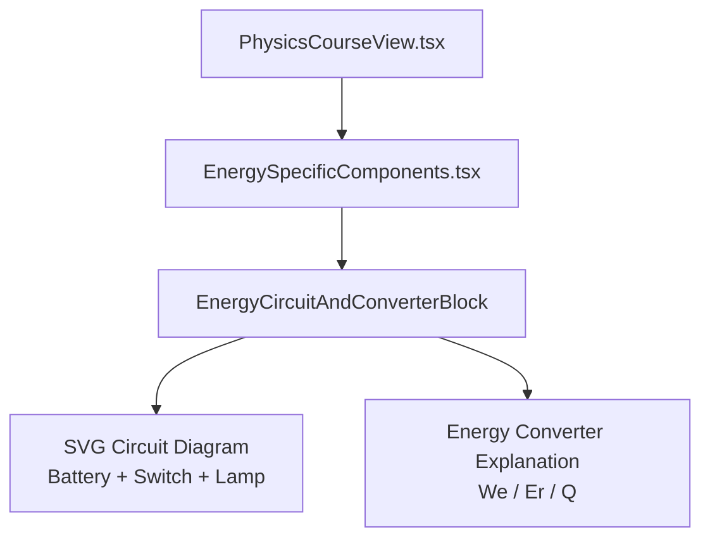
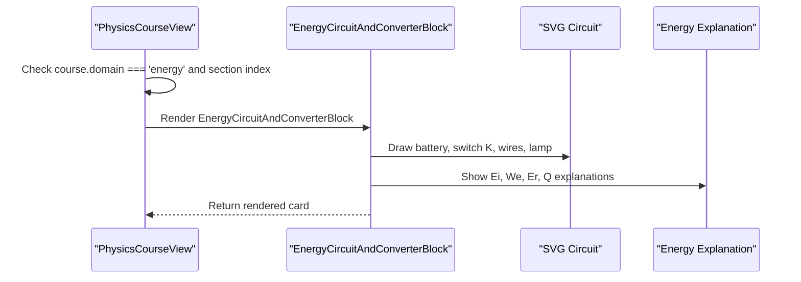
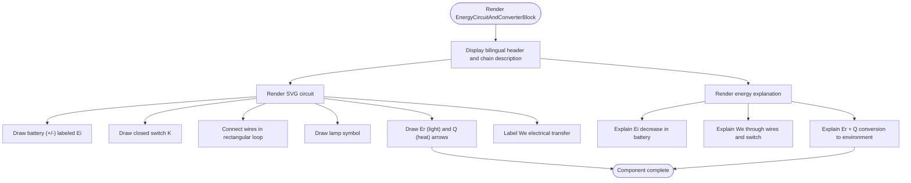
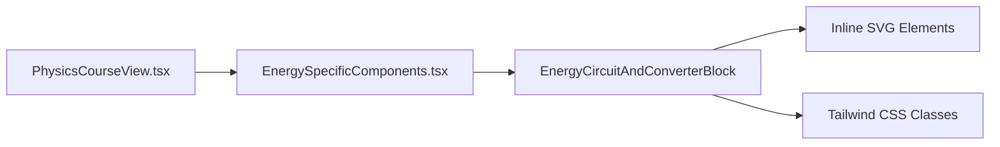

# Circuit Diagram & Energy Converter Block

<cite>
**Referenced Files in This Document**
- [EnergySpecificComponents.tsx](file://src/components/physics/EnergySpecificComponents.tsx)
- [PhysicsCourseView.tsx](file://src/components/physics/PhysicsCourseView.tsx)
- [implementation_plan.md](file://.aistudio/artifacts/brain/64e3c46f-dfa1-4742-b438-11281d695944/implementation_plan.md)
</cite>

## Table of Contents
1. [Introduction](#introduction)
2. [Project Structure](#project-structure)
3. [Core Components](#core-components)
4. [Architecture Overview](#architecture-overview)
5. [Detailed Component Analysis](#detailed-component-analysis)
6. [Dependency Analysis](#dependency-analysis)
7. [Performance Considerations](#performance-considerations)
8. [Troubleshooting Guide](#troubleshooting-guide)
9. [Conclusion](#conclusion)

## Introduction
This document explains the EnergyCircuitAndConverterBlock component that presents a standardized electrical circuit diagram alongside an energy converter explanation. It visualizes a battery, switch, and lamp using SVG symbols, and it illustrates the energy flow We (electrical transfer), Er (useful light energy), and Q (dissipated heat). The block also provides bilingual annotations and responsive layout suitable for physics curriculum integration at the 3AM level.

## Project Structure
The component is part of the physics domain educational blocks and is integrated into the course view for specific energy lessons.

**Diagram sources**
- [PhysicsCourseView.tsx:1258-1261](file://src/components/physics/PhysicsCourseView.tsx#L1258-L1261)
- [EnergySpecificComponents.tsx:580-711](file://src/components/physics/EnergySpecificComponents.tsx#L580-L711)

**Section sources**
- [PhysicsCourseView.tsx:1258-1261](file://src/components/physics/PhysicsCourseView.tsx#L1258-L1261)
- [EnergySpecificComponents.tsx:580-711](file://src/components/physics/EnergySpecificComponents.tsx#L580-L711)

## Core Components
- EnergyCircuitAndConverterBlock: Renders a two-panel card with a normalized electrical circuit SVG on the left and an energy balance explanation on the right.
- SVG circuit: Shows a battery (generator), a closed switch K, wires, and a lamp, plus arrows indicating useful light Er and dissipated heat Q leaving the lamp, and a label for electrical transfer We along the conductors.
- Energy explanation panel: Describes Ei (internal chemical energy in the battery), We (electrical transfer through wires and switch), and Er + Q (light and heat delivered to the environment).

Key responsibilities:
- Display standardized electrical symbols consistent with French/Arabic physics curriculum conventions.
- Communicate energy conservation principles: received energy equals useful energy plus dissipated energy.
- Provide bilingual labels and descriptions in Arabic and French where applicable.
- Use responsive grid layout to adapt from single-column mobile to two-column desktop views.

**Section sources**
- [EnergySpecificComponents.tsx:580-711](file://src/components/physics/EnergySpecificComponents.tsx#L580-L711)

## Architecture Overview
The component is conditionally rendered within PhysicsCourseView when the active course belongs to the energy domain and matches the intended lesson context.

**Diagram sources**
- [PhysicsCourseView.tsx:1258-1261](file://src/components/physics/PhysicsCourseView.tsx#L1258-L1261)
- [EnergySpecificComponents.tsx:580-711](file://src/components/physics/EnergySpecificComponents.tsx#L580-L711)

## Detailed Component Analysis

### EnergyCircuitAndConverterBlock
- Layout: A rounded card with warm accent borders and background, containing a header row and a two-column grid. On small screens, the grid stacks vertically; on large screens, it splits into two columns.
- Header: Includes a battery icon, a bilingual title “من الدارة الكهربائية إلى محول الطاقة (Schéma de circuit & Convertisseur d’énergie)”, and a short chain description “Pile (Générateur) ⟶ Fil & Interrupteur ⟶ Lampe / Moteur”.
- Left panel (SVG):
  - Battery symbol with positive and negative terminals labeled in Arabic and annotated as “بطارية (Ei)”.
  - Closed switch K labeled “قاطع K (تحكم)” with orange accents indicating the closed state.
  - Wires forming a rectangular loop connecting battery, switch, and lamp.
  - Lamp symbol with a circle and cross inside, labeled “مصباح”.
  - Output arrows from the lamp:
    - Yellow arrow labeled “Er (ضوء)” representing useful radiant energy.
    - Red arrow labeled “Q (حرارة)” representing dissipated thermal energy.
  - Blue box below the top wire labeled “تحويل كهربائي We” indicating electrical transfer between source and load.
- Right panel (Energy explanation):
  - Title: “قراءة الحصيلة الطاقوية للدارة الكهربائية :”
  - Bullet points:
    - Ei: Chemical/internal energy stored in the battery, decreasing during operation.
    - We: Electrical transfer through conductors and switch from battery to lamp.
    - Er + Q: Conversion of electrical transfer into useful light Er and non-useful heat Q, increasing the internal energy of the external environment.

Accessibility and semantics:
- The SVG includes role="img" and an aria-label describing the circuit and energy flow.
- Directionality uses dir="rtl" for the card container while forcing LTR direction inside the SVG for correct rendering of electrical symbols and math labels.

Bilingual support:
- Titles and labels mix Arabic and French terms aligned with the curriculum (e.g., “Schéma de circuit & Convertisseur d’énergie”, “Pile (Générateur)”).
- Explanations are primarily in Arabic with technical symbols kept in Latin script for clarity.

Responsive behavior:
- Uses Tailwind utility classes to create a responsive grid: single column on mobile, two columns on lg screens.
- SVG scales via viewBox and width/height utilities to fit available space.

Educational alignment:
- Matches the energy domain concepts for 3AM physics: storage modes (Ei), transfer modes (We, Er, Q), and conservation principle (received = useful + dissipated).
- Complements related blocks such as EnergyKeyFormulaBlock and EnergyAttentionUnitsBox used in the same lesson context.

**Diagram sources**
- [EnergySpecificComponents.tsx:580-711](file://src/components/physics/EnergySpecificComponents.tsx#L580-L711)

**Section sources**
- [EnergySpecificComponents.tsx:580-711](file://src/components/physics/EnergySpecificComponents.tsx#L580-L711)

### Integration with Physics Curriculum
- Domain placement: The block is inserted only for energy-domain courses, specifically in section 1 of pc-course-10, aligning with the planned curriculum slot for power and energy relationships.
- Conceptual linkage:
  - Storage mode Ei corresponds to chemical/internal energy in the battery.
  - Transfer mode We represents electrical work transferred to the lamp.
  - Useful output Er and dissipated output Q reflect the lamp’s conversion of electrical energy into light and heat.
  - Conservation principle: Received energy equals useful energy plus dissipated energy, reinforcing the broader energy balance taught in the energy domain.

Curriculum references:
- Implementation plan identifies the energy domain structure and the intended coverage of energy chains, balances, and efficiency, which this block supports visually and conceptually.

**Section sources**
- [PhysicsCourseView.tsx:1258-1261](file://src/components/physics/PhysicsCourseView.tsx#L1258-L1261)
- [implementation_plan.md:91-100](file://.aistudio/artifacts/brain/64e3c46f-dfa1-4742-b438-11281d695944/implementation_plan.md#L91-L100)

## Dependency Analysis
- Rendering dependency: PhysicsCourseView imports and renders EnergyCircuitAndConverterBlock under specific conditions.
- Visual dependencies: The component uses inline SVG elements and Tailwind CSS classes for styling and responsiveness.
- Iconography: Imports Lucide icons for decorative headers (e.g., BatteryCharging), though the main circuit is drawn with SVG primitives.

**Diagram sources**
- [PhysicsCourseView.tsx:1258-1261](file://src/components/physics/PhysicsCourseView.tsx#L1258-L1261)
- [EnergySpecificComponents.tsx:580-711](file://src/components/physics/EnergySpecificComponents.tsx#L580-L711)

**Section sources**
- [PhysicsCourseView.tsx:1258-1261](file://src/components/physics/PhysicsCourseView.tsx#L1258-L1261)
- [EnergySpecificComponents.tsx:580-711](file://src/components/physics/EnergySpecificComponents.tsx#L580-L711)

## Performance Considerations
- Lightweight SVG: The circuit diagram is composed of simple line, circle, and text elements, minimizing DOM complexity and ensuring fast rendering across devices.
- No runtime interactivity: The component is static, avoiding unnecessary re-renders or event handling overhead.
- Responsive scaling: Using viewBox allows the SVG to scale without recalculating geometry, improving performance on different screen sizes.

[No sources needed since this section provides general guidance]

## Troubleshooting Guide
- SVG direction issues: If electrical symbols or labels appear reversed, ensure the SVG has style={{ direction: 'ltr' }} while the parent container remains dir="rtl".
- Accessibility: Verify that the SVG retains role="img" and an informative aria-label so screen readers can describe the circuit and energy flow.
- Responsive layout: If panels overlap on narrow screens, confirm that the grid uses responsive breakpoints (e.g., lg:grid-cols-2) and that the SVG scales via width/height utilities.
- Bilingual text alignment: Ensure Arabic text is wrapped in appropriate containers with dir="rtl" and that Latin symbols remain LTR for readability.

**Section sources**
- [EnergySpecificComponents.tsx:607-667](file://src/components/physics/EnergySpecificComponents.tsx#L607-L667)

## Conclusion
EnergyCircuitAndConverterBlock effectively bridges standardized electrical circuit diagrams and energy converter explanations. It uses clear SVG symbols for battery, switch, and lamp, and communicates the energy flow We, Er, and Q in alignment with the 3AM physics curriculum. Its bilingual annotations, accessible markup, and responsive design make it a robust educational tool for teaching energy conservation and transformation in simple circuits.

[No sources needed since this section summarizes without analyzing specific files]