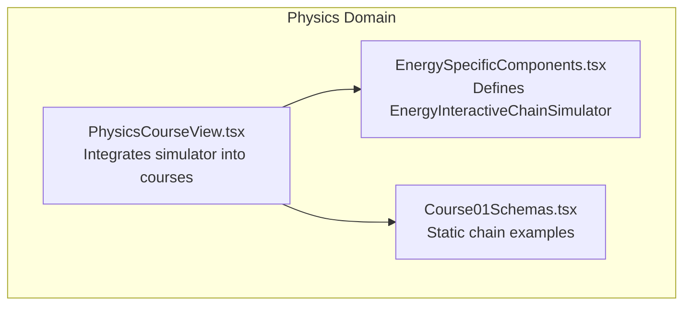
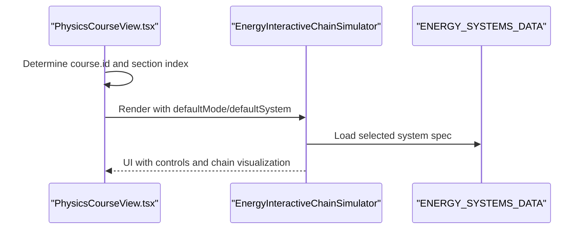
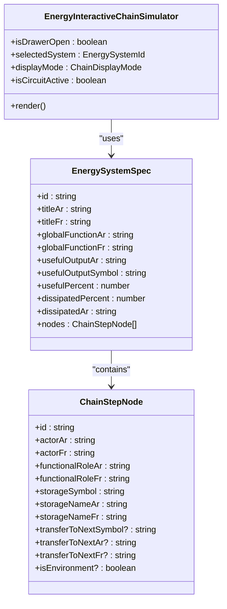
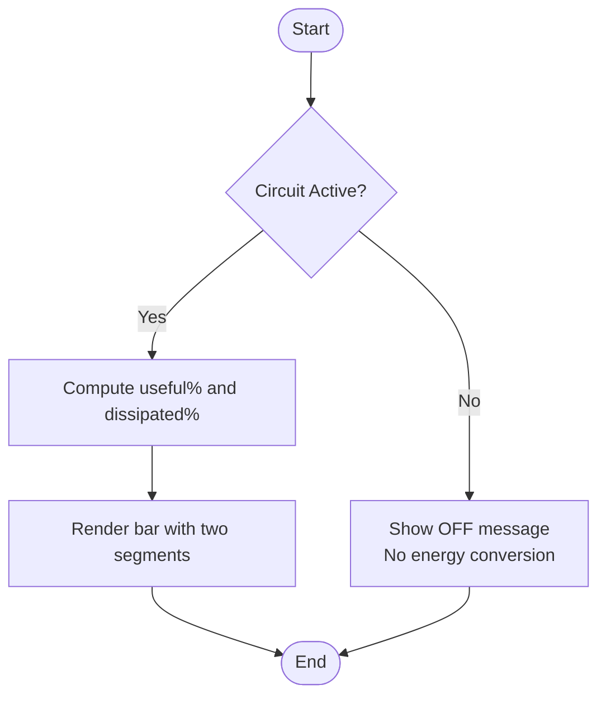
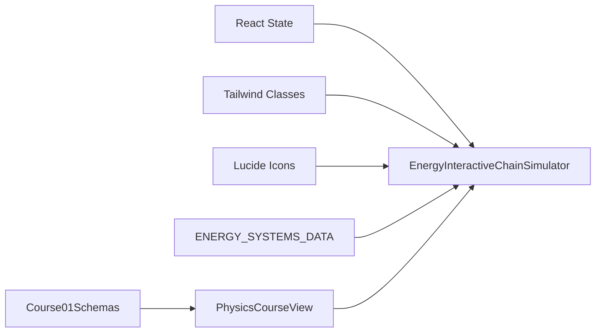

# Energy Interactive Chain Simulator

<cite>
**Referenced Files in This Document**   
- [EnergySpecificComponents.tsx](file://src/components/physics/EnergySpecificComponents.tsx)
- [PhysicsCourseView.tsx](file://src/components/physics/PhysicsCourseView.tsx)
- [Course01Schemas.tsx](file://src/components/physics/Course01Schemas.tsx)
</cite>

## Table of Contents
1. [Introduction](#introduction)
2. [Project Structure](#project-structure)
3. [Core Components](#core-components)
4. [Architecture Overview](#architecture-overview)
5. [Detailed Component Analysis](#detailed-component-analysis)
6. [Dependency Analysis](#dependency-analysis)
7. [Performance Considerations](#performance-considerations)
8. [Troubleshooting Guide](#troubleshooting-guide)
9. [Conclusion](#conclusion)

## Introduction
The Energy Interactive Chain Simulator is an interactive educational component that helps students explore functional chains (Cours 07) and energy chains (Cours 08) for three real-world systems: a pocket lamp, an electric fan, and a hydroelectric system. It supports bilingual content in Arabic and French, offers responsive design, and uses visual bubbles to represent actors, functional roles, storage modes, and transfer symbols. The simulator also shows the energy balance between useful energy and dissipated thermal energy, reinforcing the pedagogical goal of understanding energy transformations through exploration.

## Project Structure
The simulator is implemented as a React component within the physics domain and is integrated into the course view for energy-related lessons. Supporting static examples of functional and energy chains are provided in the schemas module.

**Diagram sources**
- [EnergySpecificComponents.tsx:237-578](file://src/components/physics/EnergySpecificComponents.tsx#L237-L578)
- [PhysicsCourseView.tsx:1140-1280](file://src/components/physics/PhysicsCourseView.tsx#L1140-L1280)
- [Course01Schemas.tsx:3230-3450](file://src/components/physics/Course01Schemas.tsx#L3230-L3450)

**Section sources**
- [EnergySpecificComponents.tsx:237-578](file://src/components/physics/EnergySpecificComponents.tsx#L237-L578)
- [PhysicsCourseView.tsx:1140-1280](file://src/components/physics/PhysicsCourseView.tsx#L1140-L1280)
- [Course01Schemas.tsx:3230-3450](file://src/components/physics/Course01Schemas.tsx#L3230-L3450)

## Core Components
The core component is EnergyInteractiveChainSimulator. It provides:
- System selection among three devices: pocket lamp, electric fan, hydroelectric system.
- Display mode switching between functional chain (Cours 07), energy chain (Cours 08), and both views.
- Circuit on/off control to simulate active or inactive states.
- Visual chain with bubbles showing actors, functional roles, storage modes, and transfer symbols.
- Energy balance visualization showing useful vs dissipated energy percentages.
- Bilingual support (Arabic/French).
- Responsive layout suitable for different screen sizes.

Data structures define each system’s nodes, transfers, global function, and energy balance parameters.

**Section sources**
- [EnergySpecificComponents.tsx:18-48](file://src/components/physics/EnergySpecificComponents.tsx#L18-L48)
- [EnergySpecificComponents.tsx:50-230](file://src/components/physics/EnergySpecificComponents.tsx#L50-L230)
- [EnergySpecificComponents.tsx:237-578](file://src/components/physics/EnergySpecificComponents.tsx#L237-L578)

## Architecture Overview
The simulator is embedded in the PhysicsCourseView for energy courses. When rendering sections for Cours 07 and Cours 08, it injects the simulator with appropriate default modes and systems. Static chain diagrams in Course01Schemas complement the interactive experience by illustrating the same concepts in a non-interactive format.

**Diagram sources**
- [PhysicsCourseView.tsx:1140-1280](file://src/components/physics/PhysicsCourseView.tsx#L1140-L1280)
- [EnergySpecificComponents.tsx:237-578](file://src/components/physics/EnergySpecificComponents.tsx#L237-L578)

**Section sources**
- [PhysicsCourseView.tsx:1140-1280](file://src/components/physics/PhysicsCourseView.tsx#L1140-L1280)
- [EnergySpecificComponents.tsx:237-578](file://src/components/physics/EnergySpecificComponents.tsx#L237-L578)

## Detailed Component Analysis

### EnergyInteractiveChainSimulator
This component manages state for:
- Drawer open/close
- Selected system (lamp, fan, hydro)
- Display mode (functional, energy, both)
- Circuit active/inactive

It renders:
- Header with bilingual title and toggle button
- Controls for circuit state, system selection, and display mode
- Global function banner
- Chain visualization with bubbles and arrows
- Energy balance gauge

**Diagram sources**
- [EnergySpecificComponents.tsx:18-48](file://src/components/physics/EnergySpecificComponents.tsx#L18-L48)
- [EnergySpecificComponents.tsx:237-578](file://src/components/physics/EnergySpecificComponents.tsx#L237-L578)

#### Functional Chain Visualization (Cours 07)
In functional mode, each bubble displays:
- Actor name in Arabic and French
- Functional role describing what the actor does
- Arrow labels indicating functional transitions

When the circuit is off, functional roles show “stopped” or “no current,” emphasizing that no action occurs without power.

**Section sources**
- [EnergySpecificComponents.tsx:456-466](file://src/components/physics/EnergySpecificComponents.tsx#L456-L466)
- [EnergySpecificComponents.tsx:512-516](file://src/components/physics/EnergySpecificComponents.tsx#L512-L516)

#### Energy Chain Visualization (Cours 08)
In energy mode, each bubble additionally shows:
- Storage symbol (e.g., Ei, Ec, Epp) and its name in Arabic/French
- Transfer symbols above arrows (e.g., We, W, Er, Q)
- Environment node highlighting increased internal energy

When the circuit is off, transfers show zero values, reinforcing the concept that no energy flow occurs without a closed circuit.

**Section sources**
- [EnergySpecificComponents.tsx:468-481](file://src/components/physics/EnergySpecificComponents.tsx#L468-L481)
- [EnergySpecificComponents.tsx:487-502](file://src/components/physics/EnergySpecificComponents.tsx#L487-L502)

#### Both Views Mode
In both mode, the interface overlays functional roles and energy storage/transfer information side-by-side, enabling direct comparison between functional analysis and energy accounting.

**Section sources**
- [EnergySpecificComponents.tsx:456-502](file://src/components/physics/EnergySpecificComponents.tsx#L456-L502)

#### Energy Balance Visualization
The component includes a horizontal gauge representing:
- Useful energy percentage (green)
- Dissipated thermal energy percentage (orange)
- Equation reminder: E_reçue = E_utile + Q_thermique

When the circuit is off, the gauge indicates no conversion currently occurring.

**Diagram sources**
- [EnergySpecificComponents.tsx:524-572](file://src/components/physics/EnergySpecificComponents.tsx#L524-L572)

**Section sources**
- [EnergySpecificComponents.tsx:524-572](file://src/components/physics/EnergySpecificComponents.tsx#L524-L572)

### Systems Data Model
Three systems are defined with distinct nodes and energy balances:

- Pocket Lamp: Battery → Switch/Lamp → Environment; useful output is light (Er); dissipated heat (Q).
- Electric Fan: Source → Motor → Blades → Air; useful mechanical work (W); dissipated heat (Q).
- Hydroelectric System: Falling water → Turbine → Alternator → Lamp/Environment; useful electrical then light (Er); dissipated heat (Q).

Each node includes bilingual actor names, functional roles, storage symbols, and transfer descriptions.

**Section sources**
- [EnergySpecificComponents.tsx:50-230](file://src/components/physics/EnergySpecificComponents.tsx#L50-L230)

### Integration with Course View
The simulator is rendered in energy courses:
- For Cours 07, default mode is functional.
- For Cours 08, default mode is both.
- Default system is lamp.

This ensures pedagogical alignment: functional analysis first, then energy accounting with comparison.

**Section sources**
- [PhysicsCourseView.tsx:1140-1280](file://src/components/physics/PhysicsCourseView.tsx#L1140-L1280)

### Static Chain Examples
Course01Schemas provides static illustrations comparing functional and energy chains for the pocket lamp, plus examples for the electric fan and hydroelectric system. These reinforce the same concepts shown interactively.

**Section sources**
- [Course01Schemas.tsx:3230-3450](file://src/components/physics/Course01Schemas.tsx#L3230-L3450)

## Dependency Analysis
The simulator depends on:
- React state management for interactivity
- Tailwind CSS classes for responsive styling
- Lucide icons for visual cues
- ENERGY_SYSTEMS_DATA for content and behavior

Integration points:
- PhysicsCourseView imports and renders the simulator within energy course sections.
- Course01Schemas complements the simulator with static diagrams.

**Diagram sources**
- [EnergySpecificComponents.tsx:1-16](file://src/components/physics/EnergySpecificComponents.tsx#L1-L16)
- [EnergySpecificComponents.tsx:237-578](file://src/components/physics/EnergySpecificComponents.tsx#L237-L578)
- [PhysicsCourseView.tsx:1140-1280](file://src/components/physics/PhysicsCourseView.tsx#L1140-L1280)
- [Course01Schemas.tsx:3230-3450](file://src/components/physics/Course01Schemas.tsx#L3230-L3450)

**Section sources**
- [EnergySpecificComponents.tsx:1-16](file://src/components/physics/EnergySpecificComponents.tsx#L1-L16)
- [EnergySpecificComponents.tsx:237-578](file://src/components/physics/EnergySpecificComponents.tsx#L237-L578)
- [PhysicsCourseView.tsx:1140-1280](file://src/components/physics/PhysicsCourseView.tsx#L1140-L1280)
- [Course01Schemas.tsx:3230-3450](file://src/components/physics/Course01Schemas.tsx#L3230-L3450)

## Performance Considerations
- The component uses lightweight React state and conditional rendering, minimizing re-renders.
- No heavy computations; percentages are pre-defined per system.
- Responsive layout relies on Tailwind utility classes, avoiding custom stylesheets.
- SVG usage is limited to supporting blocks; the main chain visualization uses DOM elements for better performance.

[No sources needed since this section provides general guidance]

## Troubleshooting Guide
Common issues and resolutions:
- Chain not updating when switching systems: Ensure selectedSystem state is correctly bound to buttons and that ENERGY_SYSTEMS_DATA contains the requested id.
- Energy balance not showing: Verify isCircuitActive is true; otherwise, the gauge displays an OFF message.
- Bilingual text misaligned: Confirm dir="rtl" is applied to container elements and dir="ltr" is used for monospace symbols where necessary.
- Display mode not reflecting: Check that displayMode state is updated via setDisplayMode and that conditional rendering branches cover all modes.

**Section sources**
- [EnergySpecificComponents.tsx:300-415](file://src/components/physics/EnergySpecificComponents.tsx#L300-L415)
- [EnergySpecificComponents.tsx:432-572](file://src/components/physics/EnergySpecificComponents.tsx#L432-L572)

## Conclusion
The Energy Interactive Chain Simulator effectively bridges functional analysis and energy accounting for three practical systems. Its interactive features—circuit control, system selection, display mode switching, and energy balance visualization—support a pedagogical approach that encourages exploration and deeper understanding of energy transformations. Bilingual support and responsive design make it accessible to diverse learners, while integration with course views ensures contextual relevance.

[No sources needed since this section summarizes without analyzing specific files]