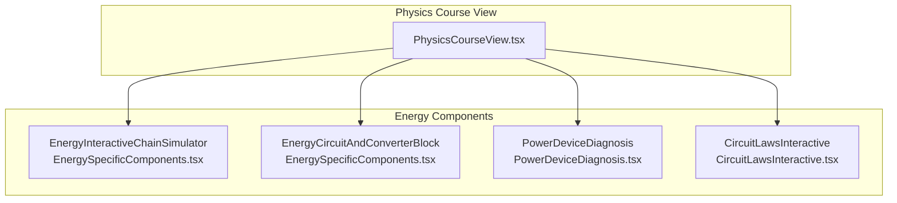
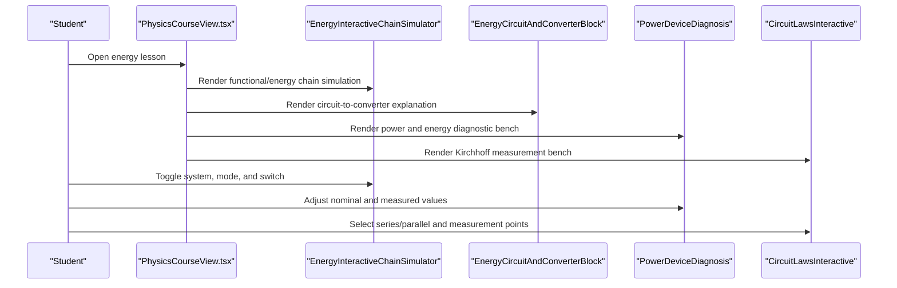
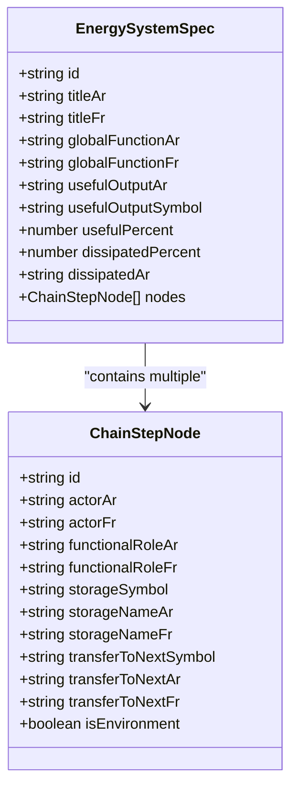
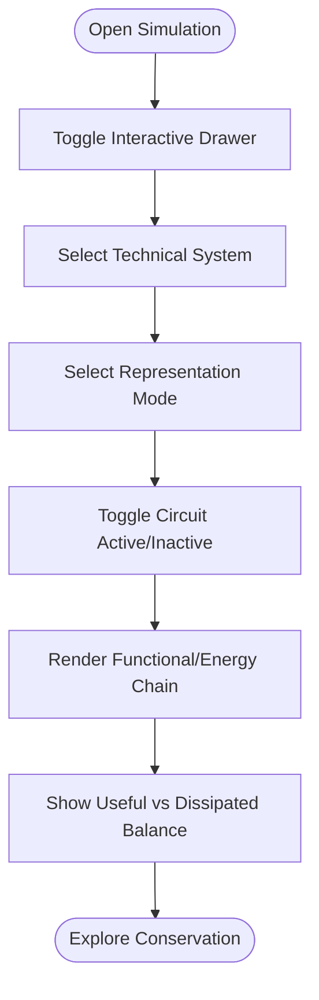
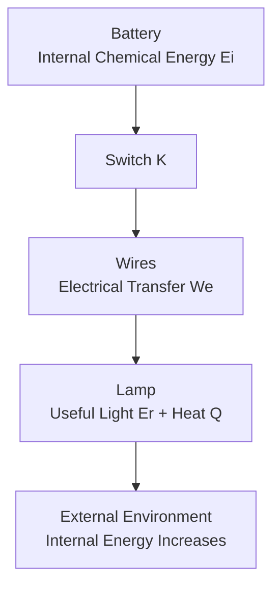
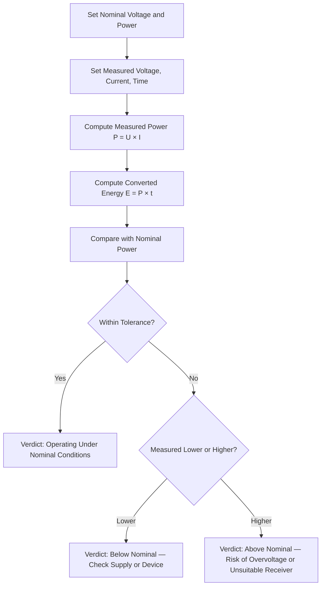
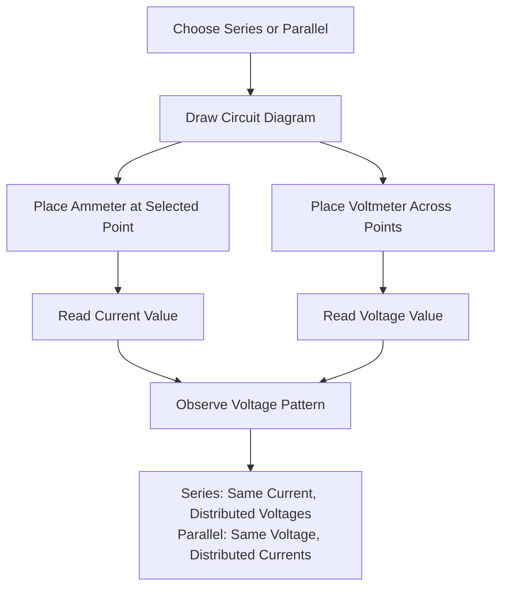
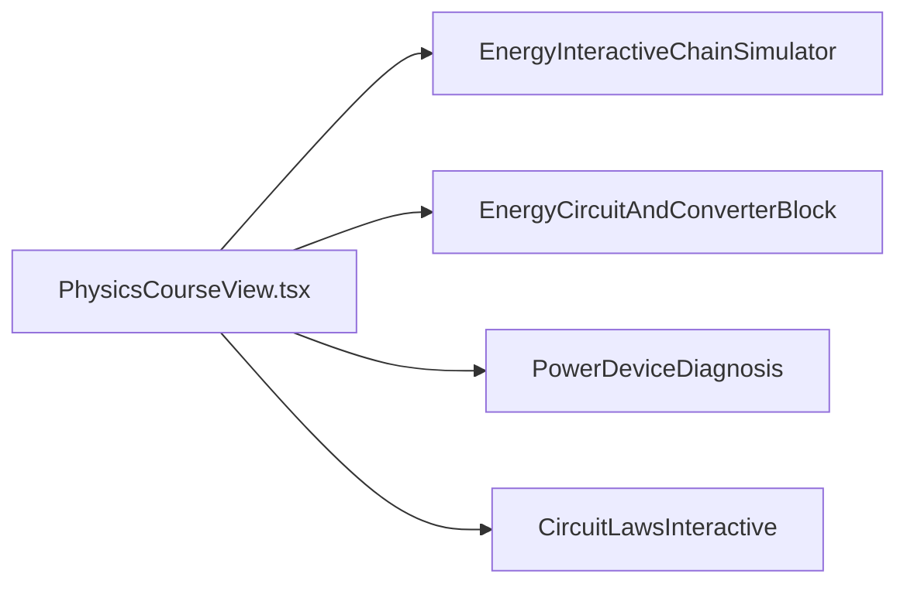

# Energy Systems

<cite>
**Referenced Files in This Document**
- [EnergySpecificComponents.tsx](file://src/components/physics/EnergySpecificComponents.tsx)
- [PowerDeviceDiagnosis.tsx](file://src/components/physics/PowerDeviceDiagnosis.tsx)
- [CircuitLawsInteractive.tsx](file://src/components/physics/CircuitLawsInteractive.tsx)
- [PhysicsCourseView.tsx](file://src/components/physics/PhysicsCourseView.tsx)
</cite>

## Table of Contents
1. [Introduction](#introduction)
2. [Project Structure](#project-structure)
3. [Core Components](#core-components)
4. [Architecture Overview](#architecture-overview)
5. [Detailed Component Analysis](#detailed-component-analysis)
6. [Dependency Analysis](#dependency-analysis)
7. [Performance Considerations](#performance-considerations)
8. [Troubleshooting Guide](#troubleshooting-guide)
9. [Conclusion](#conclusion)
10. [Appendices](#appendices)

## Introduction
This document explains the energy systems educational components that help students visualize energy transformations, explore circuit laws interactively, and practice power calculations and device diagnosis. The main tools are:

- **EnergyInteractiveChainSimulator**: an interactive simulator for functional chains and energy chains across three real devices (pocket lamp, electric fan, water flow plus dynamo). It shows actors, functions, storage modes, transfers, and a useful-versus-dissipated energy balance.
- **EnergyCircuitAndConverterBlock**: a visual block that connects a normalized electrical circuit diagram to an energy converter interpretation, showing internal chemical energy, electrical transfer, light output, and thermal dissipation.
- **PowerDeviceDiagnosis**: a diagnostic bench where students set nominal voltage and power, adjust measured voltage and current, compute measured power and converted energy, and receive a verdict about whether the device operates within its rated conditions.
- **CircuitLawsInteractive**: an interactive Kirchhoff measurement bench for series and parallel circuits, allowing students to place an ammeter and voltmeter at different points and observe current distribution and voltage distribution.

The pedagogical approach is hands-on: students toggle switches, select devices, choose representation modes, move measurement probes, and immediately see how energy conservation and circuit laws manifest visually and numerically.

## Project Structure
The energy-related educational features live under the physics components directory. The key files are:

- `src/components/physics/EnergySpecificComponents.tsx`: defines the energy chain simulator, the circuit-and-converter block, and related energy formulas and units boxes.
- `src/components/physics/PowerDeviceDiagnosis.tsx`: implements the power and energy diagnostic tool.
- `src/components/physics/CircuitLawsInteractive.tsx`: implements the interactive Kirchhoff law measurement bench.
- `src/components/physics/PhysicsCourseView.tsx`: integrates these components into the broader physics course view.

**Diagram sources**
- [PhysicsCourseView.tsx:1140-1270](file://src/components/physics/PhysicsCourseView.tsx#L1140-L1270)
- [EnergySpecificComponents.tsx:237-711](file://src/components/physics/EnergySpecificComponents.tsx#L237-L711)
- [PowerDeviceDiagnosis.tsx:43-177](file://src/components/physics/PowerDeviceDiagnosis.tsx#L43-L177)
- [CircuitLawsInteractive.tsx:24-272](file://src/components/physics/CircuitLawsInteractive.tsx#L24-L272)

**Section sources**
- [EnergySpecificComponents.tsx:237-820](file://src/components/physics/EnergySpecificComponents.tsx#L237-L820)
- [PowerDeviceDiagnosis.tsx:1-179](file://src/components/physics/PowerDeviceDiagnosis.tsx#L1-L179)
- [CircuitLawsInteractive.tsx:1-274](file://src/components/physics/CircuitLawsInteractive.tsx#L1-L274)
- [PhysicsCourseView.tsx:1140-1270](file://src/components/physics/PhysicsCourseView.tsx#L1140-L1270)

## Core Components
This section summarizes the responsibilities and user interactions of each core component.

### EnergyInteractiveChainSimulator
- Models three technical systems: pocket lamp, electric fan, and water-flow plus dynamo lighting system.
- Supports three display modes: functional chain only, energy chain only, or both side by side.
- Provides a global function banner, actor bubbles, functional roles, storage modes, transfer arrows, and a useful-versus-dissipated energy gauge.
- Includes a switch-like control to simulate ON/OFF circuit state, affecting displayed transfers and roles.

Key data model:
- System identifiers: lamp, fan, hydro.
- Chain step nodes include actor names, functional roles, storage symbols, storage names, and optional environment flags.
- Each system includes useful output symbol, useful percentage, and dissipated percentage.

Pedagogical value:
- Students compare functional descriptions with energy accounting.
- They see how stored energy changes through transfers like electrical, mechanical, radiative, and thermal.
- The energy balance bar reinforces conservation: received energy equals useful energy plus dissipated heat.

**Section sources**
- [EnergySpecificComponents.tsx:21-48](file://src/components/physics/EnergySpecificComponents.tsx#L21-L48)
- [EnergySpecificComponents.tsx:50-230](file://src/components/physics/EnergySpecificComponents.tsx#L50-L230)
- [EnergySpecificComponents.tsx:237-578](file://src/components/physics/EnergySpecificComponents.tsx#L237-L578)

### EnergyCircuitAndConverterBlock
- Shows a normalized electrical circuit diagram with a battery, switch, wires, and lamp.
- Labels energy flows: internal chemical energy in the battery, electrical transfer between components, useful light output, and thermal dissipation.
- Explains the converter energy balance in text form.

Pedagogical value:
- Connects schematic circuit knowledge to energy transformation language.
- Reinforces notation such as Ei, We, Er, Q.
- Bridges abstract circuit diagrams with concrete energy concepts.

**Section sources**
- [EnergySpecificComponents.tsx:583-711](file://src/components/physics/EnergySpecificComponents.tsx#L583-L711)

### PowerDeviceDiagnosis
- Lets students set nominal voltage and power from a device nameplate.
- Allows adjusting measured voltage, measured current, and operating time.
- Computes measured power, converted energy, ratio to nominal power, and a diagnostic verdict.
- Verdict categories:
  - OK: measured values match nominal conditions within tolerance.
  - Low: measured power below nominal; suggests checking supply voltage or device condition.
  - High: measured power above nominal; warns about unsuitable receiver or overvoltage.

Pedagogical value:
- Practices P = U × I and E = P × t.
- Introduces nominal versus measured values.
- Encourages troubleshooting reasoning based on numerical evidence.

**Section sources**
- [PowerDeviceDiagnosis.tsx:8-12](file://src/components/physics/PowerDeviceDiagnosis.tsx#L8-L12)
- [PowerDeviceDiagnosis.tsx:43-79](file://src/components/physics/PowerDeviceDiagnosis.tsx#L43-L79)
- [PowerDeviceDiagnosis.tsx:81-177](file://src/components/physics/PowerDeviceDiagnosis.tsx#L81-L177)

### CircuitLawsInteractive
- Supports two circuit modes: series and parallel.
- Displays SVG circuit diagrams with selectable measurement points.
- Ammeters can be placed at predefined points to read current.
- Voltmeters can be placed across generator or bulbs/branches to read voltage.
- Summarizes observed behavior:
  - Series: same current along one path; voltages distribute and sum to generator voltage.
  - Parallel: same voltage between branches; currents distribute among branches.

Pedagogical value:
- Makes Kirchhoff’s current and voltage laws observable through interactive placement.
- Helps students distinguish between current distribution and voltage distribution.
- Builds intuition before formal algebraic statements.

**Section sources**
- [CircuitLawsInteractive.tsx:8-22](file://src/components/physics/CircuitLawsInteractive.tsx#L8-L22)
- [CircuitLawsInteractive.tsx:24-50](file://src/components/physics/CircuitLawsInteractive.tsx#L24-L50)
- [CircuitLawsInteractive.tsx:89-210](file://src/components/physics/CircuitLawsInteractive.tsx#L89-L210)
- [CircuitLawsInteractive.tsx:213-272](file://src/components/physics/CircuitLawsInteractive.tsx#L213-L272)

## Architecture Overview
At the application level, the physics course view composes these educational components. The energy-specific components are reusable React components that encapsulate their own state and UI logic.

**Diagram sources**
- [PhysicsCourseView.tsx:1140-1270](file://src/components/physics/PhysicsCourseView.tsx#L1140-L1270)
- [EnergySpecificComponents.tsx:237-711](file://src/components/physics/EnergySpecificComponents.tsx#L237-L711)
- [PowerDeviceDiagnosis.tsx:43-177](file://src/components/physics/PowerDeviceDiagnosis.tsx#L43-L177)
- [CircuitLawsInteractive.tsx:24-272](file://src/components/physics/CircuitLawsInteractive.tsx#L24-L272)

## Detailed Component Analysis

### EnergyInteractiveChainSimulator Analysis
This component models energy chains through structured data and interactive rendering.

#### Data Model and Complexity
- System selection uses a small fixed set of identifiers, so lookup is O(1).
- Rendering iterates over nodes per system; typical systems have 3–4 nodes, making rendering linear in node count.
- State variables include drawer open/close, selected system, display mode, and circuit active state.

**Diagram sources**
- [EnergySpecificComponents.tsx:21-48](file://src/components/physics/EnergySpecificComponents.tsx#L21-L48)
- [EnergySpecificComponents.tsx:50-230](file://src/components/physics/EnergySpecificComponents.tsx#L50-L230)

#### User Interaction Flow

**Diagram sources**
- [EnergySpecificComponents.tsx:237-578](file://src/components/physics/EnergySpecificComponents.tsx#L237-L578)

#### Pedagogical Notes
- Functional mode emphasizes what each actor does.
- Energy mode emphasizes storage and transfer notations.
- Both mode helps students connect function to energy accounting.
- The OFF state demonstrates zero transfer when the circuit is open.

**Section sources**
- [EnergySpecificComponents.tsx:237-578](file://src/components/physics/EnergySpecificComponents.tsx#L237-L578)

### EnergyCircuitAndConverterBlock Analysis
This block bridges circuit schematics and energy conversion terminology.

**Diagram sources**
- [EnergySpecificComponents.tsx:607-667](file://src/components/physics/EnergySpecificComponents.tsx#L607-L667)
- [EnergySpecificComponents.tsx:671-706](file://src/components/physics/EnergySpecificComponents.tsx#L671-L706)

**Section sources**
- [EnergySpecificComponents.tsx:583-711](file://src/components/physics/EnergySpecificComponents.tsx#L583-L711)

### PowerDeviceDiagnosis Analysis
This component computes and diagnoses power and energy based on nominal and measured values.

**Diagram sources**
- [PowerDeviceDiagnosis.tsx:43-79](file://src/components/physics/PowerDeviceDiagnosis.tsx#L43-L79)
- [PowerDeviceDiagnosis.tsx:81-177](file://src/components/physics/PowerDeviceDiagnosis.tsx#L81-L177)

**Section sources**
- [PowerDeviceDiagnosis.tsx:43-177](file://src/components/physics/PowerDeviceDiagnosis.tsx#L43-L177)

### CircuitLawsInteractive Analysis
This component supports interactive exploration of Kirchhoff’s laws.

**Diagram sources**
- [CircuitLawsInteractive.tsx:24-50](file://src/components/physics/CircuitLawsInteractive.tsx#L24-L50)
- [CircuitLawsInteractive.tsx:89-210](file://src/components/physics/CircuitLawsInteractive.tsx#L89-L210)
- [CircuitLawsInteractive.tsx:213-272](file://src/components/physics/CircuitLawsInteractive.tsx#L213-L272)

**Section sources**
- [CircuitLawsInteractive.tsx:24-272](file://src/components/physics/CircuitLawsInteractive.tsx#L24-L272)

## Dependency Analysis
The components are mostly self-contained React components. Their relationships are primarily compositional rather than deeply coupled:

- `PhysicsCourseView.tsx` imports and renders `EnergyInteractiveChainSimulator`, `EnergyCircuitAndConverterBlock`, and likely other physics components.
- `EnergyInteractiveChainSimulator` and `EnergyCircuitAndConverterBlock` share conceptual domain vocabulary but do not import each other directly.
- `PowerDeviceDiagnosis` and `CircuitLawsInteractive` are independent tools focused on power diagnostics and circuit laws respectively.

**Diagram sources**
- [PhysicsCourseView.tsx:1140-1270](file://src/components/physics/PhysicsCourseView.tsx#L1140-L1270)
- [EnergySpecificComponents.tsx:237-711](file://src/components/physics/EnergySpecificComponents.tsx#L237-L711)
- [PowerDeviceDiagnosis.tsx:43-177](file://src/components/physics/PowerDeviceDiagnosis.tsx#L43-L177)
- [CircuitLawsInteractive.tsx:24-272](file://src/components/physics/CircuitLawsInteractive.tsx#L24-L272)

**Section sources**
- [PhysicsCourseView.tsx:1140-1270](file://src/components/physics/PhysicsCourseView.tsx#L1140-L1270)

## Performance Considerations
- All components use lightweight React state and simple computations. There are no heavy animations or large datasets.
- SVG diagrams are static and responsive; they scale without significant performance cost.
- The energy chain simulator renders a small number of nodes and bars, keeping re-renders fast.
- The diagnostic tool performs basic arithmetic operations on slider updates.
- The circuit laws component updates selected point labels and values without complex recalculations.

[No sources needed since this section provides general guidance]

## Troubleshooting Guide
Common issues and resolutions:

- **Simulation drawer does not open**: Ensure the toggle button is clicked and the component is rendered inside the course view. The drawer state is local to the component.
- **No energy transfer shown**: Check that the circuit switch is set to active. When inactive, transfers show zero or disabled states.
- **Diagnostic verdict seems incorrect**: Verify nominal values match the intended device and that measured voltage and current are realistic. The tolerance check compares measured power and voltage against nominal values.
- **Circuit law readings seem inconsistent**: Confirm the correct mode (series or parallel) is selected and that ammeters/voltmeters are placed at valid points defined by the component.

**Section sources**
- [EnergySpecificComponents.tsx:300-321](file://src/components/physics/EnergySpecificComponents.tsx#L300-L321)
- [EnergySpecificComponents.tsx:484-518](file://src/components/physics/EnergySpecificComponents.tsx#L484-L518)
- [PowerDeviceDiagnosis.tsx:50-72](file://src/components/physics/PowerDeviceDiagnosis.tsx#L50-L72)
- [CircuitLawsInteractive.tsx:24-50](file://src/components/physics/CircuitLawsInteractive.tsx#L24-L50)

## Conclusion
These energy systems components provide a cohesive, interactive learning pathway:

- Students begin with functional and energy chains to understand what devices do and how energy moves.
- They then connect circuit diagrams to energy conversions, reinforcing standard notation and conservation principles.
- They practice power and energy calculations through a diagnostic bench that ties nominal ratings to real measurements.
- Finally, they explore Kirchhoff’s laws interactively, observing current and voltage patterns in series and parallel circuits.

Together, these tools support a constructivist approach: learners manipulate parameters, observe immediate feedback, and build mental models grounded in both visualization and calculation.

[No sources needed since this section summarizes without analyzing specific files]

## Appendices

### Concrete Examples for Classroom Use

#### Example 1: Pocket Lamp Energy Chain
- Select the pocket lamp system.
- Choose both functional and energy modes.
- Turn the circuit ON to see electrical transfer and energy outputs.
- Observe the useful light percentage versus dissipated heat.

**Section sources**
- [EnergySpecificComponents.tsx:50-101](file://src/components/physics/EnergySpecificComponents.tsx#L50-L101)
- [EnergySpecificComponents.tsx:330-369](file://src/components/physics/EnergySpecificComponents.tsx#L330-L369)
- [EnergySpecificComponents.tsx:524-572](file://src/components/physics/EnergySpecificComponents.tsx#L524-L572)

#### Example 2: Electric Fan Efficiency
- Select the electric fan system.
- Compare mechanical useful output with thermal dissipation.
- Discuss why motors are more efficient than incandescent lamps in terms of useful work.

**Section sources**
- [EnergySpecificComponents.tsx:102-165](file://src/components/physics/EnergySpecificComponents.tsx#L102-L165)
- [EnergySpecificComponents.tsx:535-556](file://src/components/physics/EnergySpecificComponents.tsx#L535-L556)

#### Example 3: Water Flow Plus Dynamo Lighting
- Select the hydro system.
- Trace potential and kinetic energy through turbine and alternator to electrical energy and light.
- Discuss losses in mechanical and electrical stages.

**Section sources**
- [EnergySpecificComponents.tsx:166-229](file://src/components/physics/EnergySpecificComponents.tsx#L166-L229)
- [EnergySpecificComponents.tsx:432-522](file://src/components/physics/EnergySpecificComponents.tsx#L432-L522)

#### Example 4: Power Calculation and Energy Conversion
- Set nominal voltage and power on the diagnostic bench.
- Adjust measured voltage and current to match or deviate from nominal conditions.
- Compute measured power and converted energy for a given operating time.
- Interpret the verdict and discuss possible causes.

**Section sources**
- [PowerDeviceDiagnosis.tsx:43-79](file://src/components/physics/PowerDeviceDiagnosis.tsx#L43-L79)
- [PowerDeviceDiagnosis.tsx:151-174](file://src/components/physics/PowerDeviceDiagnosis.tsx#L151-L174)

#### Example 5: Kirchhoff Law Exploration
- Choose series mode and place ammeters at different points to confirm equal current.
- Measure voltages across bulbs and generator to verify voltage distribution.
- Repeat in parallel mode to observe equal branch voltage and distributed currents.

**Section sources**
- [CircuitLawsInteractive.tsx:24-50](file://src/components/physics/CircuitLawsInteractive.tsx#L24-L50)
- [CircuitLawsInteractive.tsx:213-272](file://src/components/physics/CircuitLawsInteractive.tsx#L213-L272)