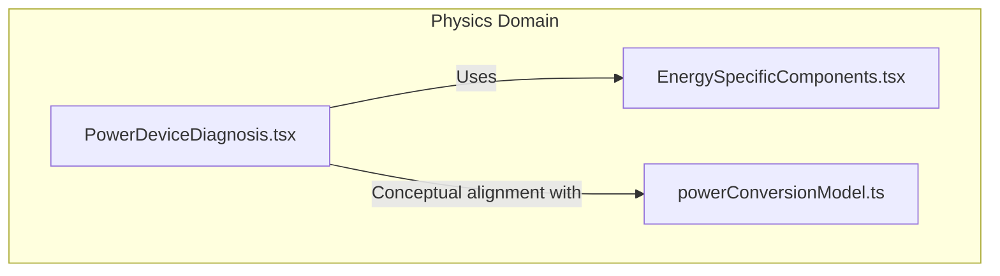
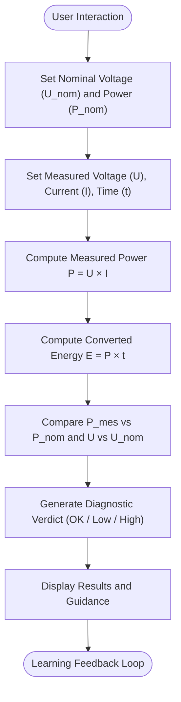
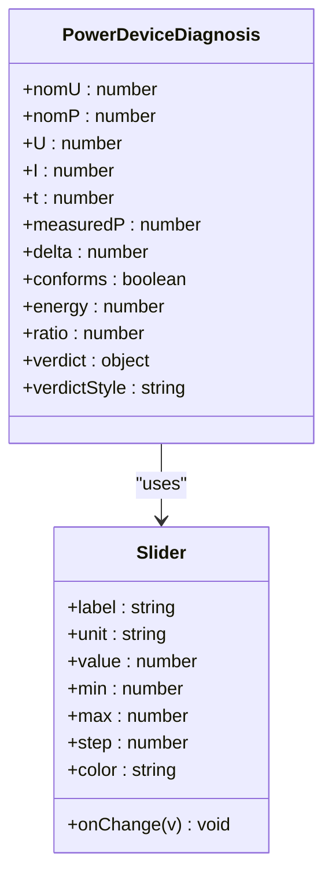
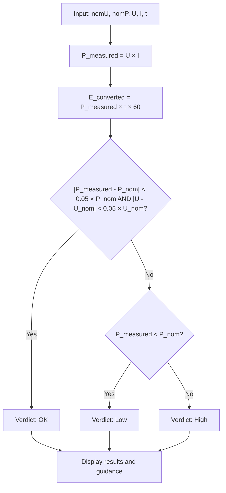
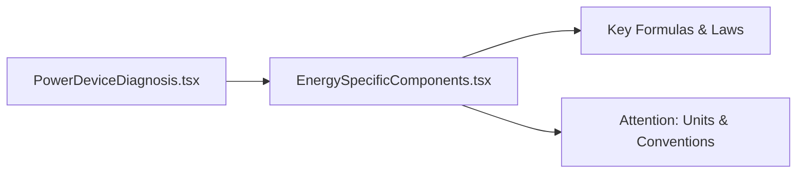
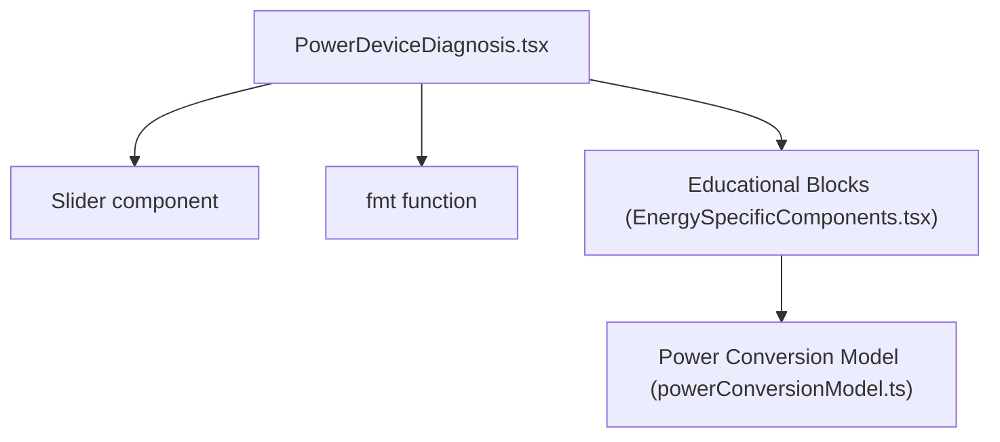

# Power Device Diagnosis Tool

<cite>
**Referenced Files in This Document**
- [PowerDeviceDiagnosis.tsx](file://src/components/physics/PowerDeviceDiagnosis.tsx)
- [powerConversionModel.ts](file://src/components/physics/simulations/pilots/powerConversionModel.ts)
- [EnergySpecificComponents.tsx](file://src/components/physics/EnergySpecificComponents.tsx)
</cite>

## Table of Contents
1. [Introduction](#introduction)
2. [Project Structure](#project-structure)
3. [Core Components](#core-components)
4. [Architecture Overview](#architecture-overview)
5. [Detailed Component Analysis](#detailed-component-analysis)
6. [Dependency Analysis](#dependency-analysis)
7. [Performance Considerations](#performance-considerations)
8. [Troubleshooting Guide](#troubleshooting-guide)
9. [Conclusion](#conclusion)
10. [Appendices](#appendices)

## Introduction
The Power Device Diagnosis tool is an interactive educational component designed to help students analyze electrical devices and identify energy conversion issues. It simulates a diagnostic bench where learners set the device’s nominal specifications (voltage and power), input measured values (voltage, current, operating time), and instantly receive computed results for measured power and converted energy, along with contextual diagnostic feedback. The tool emphasizes hands-on learning: students explore how deviations from nominal conditions affect performance, calculate efficiency ratios, and learn to troubleshoot common power-related problems through guided feedback.

This documentation explains the device analysis interface, measurement inputs, calculation workflows, and diagnostic feedback system. It also provides examples of typical scenarios, troubleshooting methodology, error detection patterns, and a progressive learning path from basic to advanced diagnosis skills.

## Project Structure
The Power Device Diagnosis tool is implemented as a single React component that encapsulates all user interactions, calculations, and feedback rendering. Related educational content about energy chains, conversions, and formulas is provided by other components in the same physics domain.

**Diagram sources**
- [PowerDeviceDiagnosis.tsx:1-179](file://src/components/physics/PowerDeviceDiagnosis.tsx#L1-L179)
- [EnergySpecificComponents.tsx:1-800](file://src/components/physics/EnergySpecificComponents.tsx#L1-L800)
- [powerConversionModel.ts:1-446](file://src/components/physics/simulations/pilots/powerConversionModel.ts#L1-L446)

**Section sources**
- [PowerDeviceDiagnosis.tsx:1-179](file://src/components/physics/PowerDeviceDiagnosis.tsx#L1-L179)
- [EnergySpecificComponents.tsx:1-800](file://src/components/physics/EnergySpecificComponents.tsx#L1-L800)
- [powerConversionModel.ts:1-446](file://src/components/physics/simulations/pilots/powerConversionModel.ts#L1-L446)

## Core Components
- PowerDeviceDiagnosis component: Provides sliders for nominal voltage and power, measured voltage and current, and operating time; computes measured power, converted energy, and diagnostic verdicts; displays results and guidance.
- Energy-specific educational blocks: Provide conceptual context on functional and energy chains, key formulas, and units, reinforcing the diagnostic workflow.
- Power conversion model: Defines scientific relationships between energy, power, and time, supporting consistent pedagogy across simulations.

Key responsibilities:
- Input handling via sliders for realistic ranges.
- Real-time computation of derived quantities.
- Diagnostic logic comparing measured vs nominal values.
- Educational feedback aligned with curriculum concepts.

**Section sources**
- [PowerDeviceDiagnosis.tsx:43-177](file://src/components/physics/PowerDeviceDiagnosis.tsx#L43-L177)
- [EnergySpecificComponents.tsx:716-772](file://src/components/physics/EnergySpecificComponents.tsx#L716-L772)
- [powerConversionModel.ts:145-222](file://src/components/physics/simulations/pilots/powerConversionModel.ts#L145-L222)

## Architecture Overview
The tool follows a simple reactive architecture:
- State variables hold nominal and measured parameters.
- Derived state computes measured power, energy, ratio, and conformity.
- UI renders sliders, results, and diagnostic feedback dynamically.

**Diagram sources**
- [PowerDeviceDiagnosis.tsx:43-177](file://src/components/physics/PowerDeviceDiagnosis.tsx#L43-L177)

## Detailed Component Analysis

### PowerDeviceDiagnosis Component
The component implements:
- A formatting helper for localized number display.
- A reusable slider component for controlled inputs.
- State management for nominal and measured values.
- Computation of measured power, energy, and ratio.
- Conformity check using tolerance thresholds.
- Verdict generation with tone-based styling.
- Result panels showing measured power and converted energy.
- Diagnostic panel with title, text, and ratio details.

**Diagram sources**
- [PowerDeviceDiagnosis.tsx:14-41](file://src/components/physics/PowerDeviceDiagnosis.tsx#L14-L41)
- [PowerDeviceDiagnosis.tsx:43-177](file://src/components/physics/PowerDeviceDiagnosis.tsx#L43-L177)

#### Calculation Workflow
The diagnostic workflow proceeds as follows:
1. User sets nominal voltage and power.
2. User sets measured voltage, current, and operating time.
3. System calculates measured power and converted energy.
4. System compares measured power and voltage against nominal values within tolerances.
5. System generates a verdict and styles it accordingly.
6. System displays results and diagnostic guidance.

**Diagram sources**
- [PowerDeviceDiagnosis.tsx:50-79](file://src/components/physics/PowerDeviceDiagnosis.tsx#L50-L79)

**Section sources**
- [PowerDeviceDiagnosis.tsx:8-12](file://src/components/physics/PowerDeviceDiagnosis.tsx#L8-L12)
- [PowerDeviceDiagnosis.tsx:14-41](file://src/components/physics/PowerDeviceDiagnosis.tsx#L14-L41)
- [PowerDeviceDiagnosis.tsx:43-177](file://src/components/physics/PowerDeviceDiagnosis.tsx#L43-L177)

### Educational Context and Alignment
The diagnostic tool aligns with broader energy education materials:
- Functional and energy chain representations reinforce understanding of useful vs dissipated energy.
- Key formulas emphasize conservation of energy and the relationship between energy, power, and time.
- Units and conventions ensure correct interpretation of measurements and calculations.

**Diagram sources**
- [EnergySpecificComponents.tsx:716-772](file://src/components/physics/EnergySpecificComponents.tsx#L716-L772)
- [EnergySpecificComponents.tsx:777-800](file://src/components/physics/EnergySpecificComponents.tsx#L777-L800)

**Section sources**
- [EnergySpecificComponents.tsx:716-772](file://src/components/physics/EnergySpecificComponents.tsx#L716-L772)
- [EnergySpecificComponents.tsx:777-800](file://src/components/physics/EnergySpecificComponents.tsx#L777-L800)

### Typical Scenarios and Learning Progression
- Basic scenario: Set nominal values equal to measured values to observe “OK” verdict and confirm understanding of nominal conditions.
- Intermediate scenario: Introduce slight deviations in voltage or current to see “Low” or “High” verdicts and interpret guidance.
- Advanced scenario: Explore combinations of low/high power and voltage to diagnose mismatches between device ratings and supply conditions.

Examples:
- Lamp rated at 12 V, 24 W; measured 12 V, 1 A → P_measured = 12 W, energy over time computed, verdict indicates lower-than-nominal operation.
- Motor rated at 24 V, 48 W; measured 24 V, 2.5 A → P_measured = 60 W, energy computed, verdict indicates higher-than-nominal operation.

These scenarios help students connect theory (P = U × I, E = P × t) with practical diagnostics.

[No sources needed since this section provides general guidance]

## Dependency Analysis
The PowerDeviceDiagnosis component is self-contained but conceptually linked to educational modules:
- Internal dependencies: React state, local formatting function, and a custom slider component.
- External conceptual dependencies: Energy chain visualizations and formula blocks that reinforce learning objectives.

**Diagram sources**
- [PowerDeviceDiagnosis.tsx:8-41](file://src/components/physics/PowerDeviceDiagnosis.tsx#L8-L41)
- [EnergySpecificComponents.tsx:1-800](file://src/components/physics/EnergySpecificComponents.tsx#L1-L800)
- [powerConversionModel.ts:1-446](file://src/components/physics/simulations/pilots/powerConversionModel.ts#L1-L446)

**Section sources**
- [PowerDeviceDiagnosis.tsx:8-41](file://src/components/physics/PowerDeviceDiagnosis.tsx#L8-L41)
- [EnergySpecificComponents.tsx:1-800](file://src/components/physics/EnergySpecificComponents.tsx#L1-L800)
- [powerConversionModel.ts:1-446](file://src/components/physics/simulations/pilots/powerConversionModel.ts#L1-L446)

## Performance Considerations
- Lightweight state updates: Sliders trigger minimal re-renders due to small state objects.
- Efficient computations: Derived values are recalculated on each render without heavy operations.
- Responsive layout: Grid-based UI adapts to different screen sizes for better usability.
- No external libraries beyond React and icons: Keeps bundle size small and improves load times.

[No sources needed since this section provides general guidance]

## Troubleshooting Guide
Common issues and resolutions:
- Incorrect readings: If the verdict shows “Low,” verify the supply voltage and device condition (e.g., bulb health). If “High,” check whether the receiver matches its rated conditions or if the supply voltage exceeds the nameplate value.
- Unit confusion: Ensure time is entered in minutes as intended; the tool converts to seconds internally for energy calculation.
- Tolerance expectations: The conformity check uses a 5% threshold for both power and voltage; minor deviations may still be considered acceptable depending on context.

Diagnostic tips:
- Use the displayed ratio (P_nom vs P_mes) to quantify deviation.
- Cross-check with energy formulas to understand total energy converted over time.
- Refer to educational blocks for conceptual reinforcement on energy balance and unit conventions.

**Section sources**
- [PowerDeviceDiagnosis.tsx:56-79](file://src/components/physics/PowerDeviceDiagnosis.tsx#L56-L79)
- [EnergySpecificComponents.tsx:777-800](file://src/components/physics/EnergySpecificComponents.tsx#L777-L800)

## Conclusion
The Power Device Diagnosis tool offers a focused, interactive environment for students to practice diagnosing electrical devices based on nominal and measured values. By combining real-time calculations, clear feedback, and aligned educational content, it supports a progressive learning journey from basic recognition of nominal conditions to advanced troubleshooting of power-related issues. Students gain confidence in applying fundamental formulas, interpreting diagnostic signals, and connecting theoretical concepts to practical scenarios.

[No sources needed since this section summarizes without analyzing specific files]

## Appendices

### API-like Definition of Inputs and Outputs
- Inputs:
  - Nominal voltage (V): Range 1.5–48 V, step 0.5
  - Nominal power (W): Range 3–200 W, step 1
  - Measured voltage (V): Range 0–48 V, step 0.5
  - Measured current (A): Range 0–8 A, step 0.1
  - Operating time (min): Range 1–60 min, step 1
- Outputs:
  - Measured power (W): P = U × I
  - Converted energy (J): E = P × t × 60
  - Ratio: P_mes / P_nom
  - Verdict: OK / Low / High with explanatory text

**Section sources**
- [PowerDeviceDiagnosis.tsx:94-149](file://src/components/physics/PowerDeviceDiagnosis.tsx#L94-L149)
- [PowerDeviceDiagnosis.tsx:151-174](file://src/components/physics/PowerDeviceDiagnosis.tsx#L151-L174)