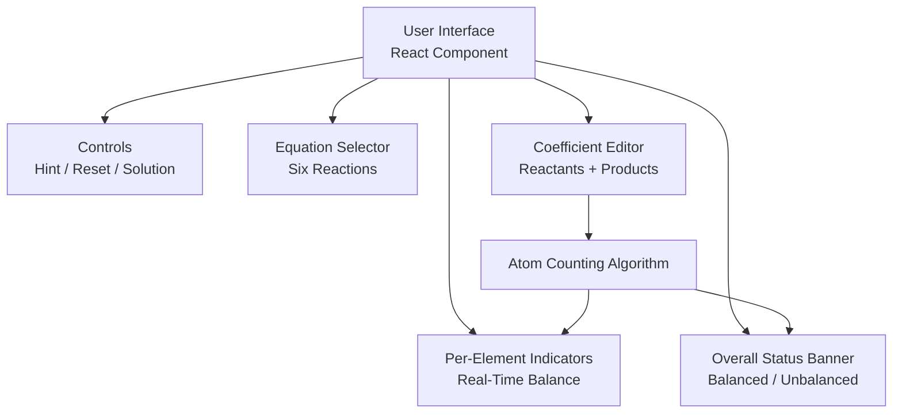
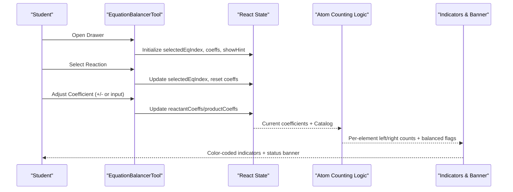
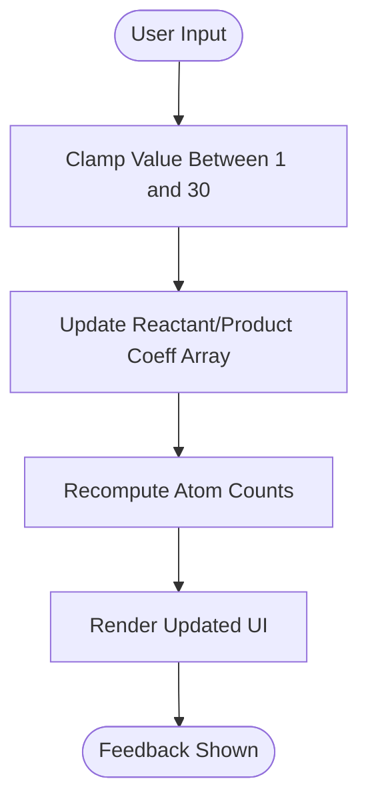
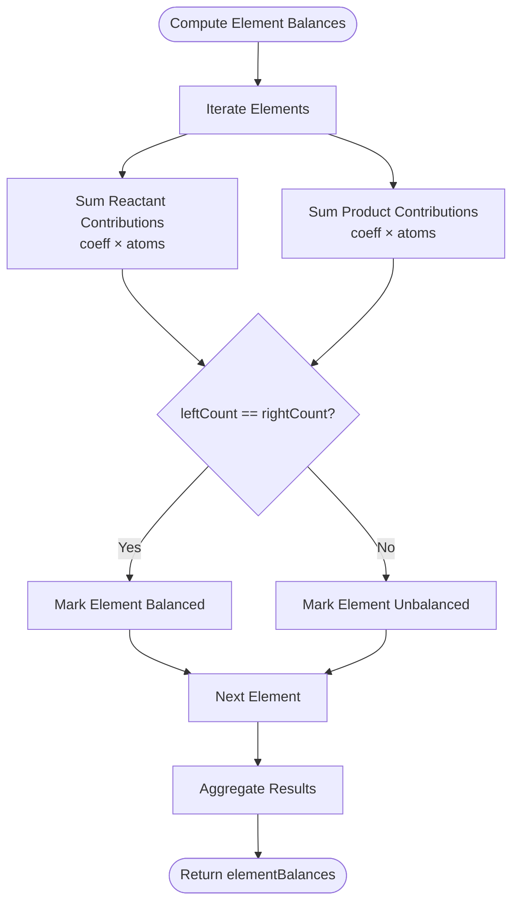
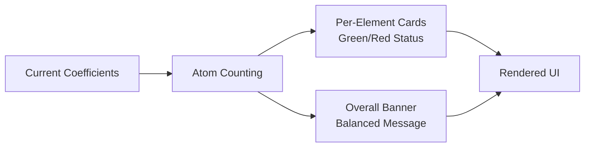
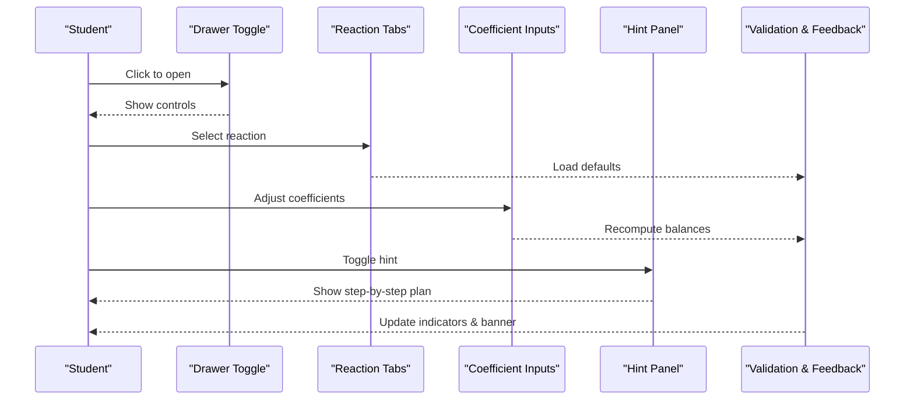
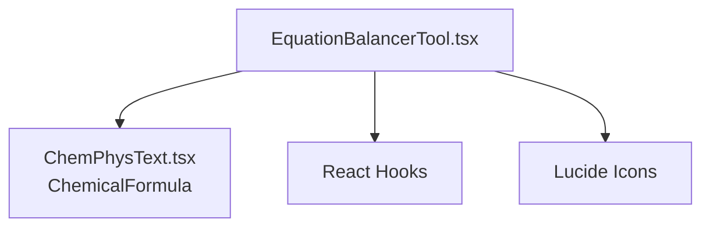

# Chemical Equation Balancer Tool

<cite>
**Referenced Files in This Document**
- [EquationBalancerTool.tsx](file://src/components/physics/EquationBalancerTool.tsx)
- [ChemPhysText.tsx](file://src/components/physics/ChemPhysText.tsx)
</cite>

## Table of Contents
1. [Introduction](#introduction)
2. [Project Structure](#project-structure)
3. [Core Components](#core-components)
4. [Architecture Overview](#architecture-overview)
5. [Detailed Component Analysis](#detailed-component-analysis)
6. [Dependency Analysis](#dependency-analysis)
7. [Performance Considerations](#performance-considerations)
8. [Troubleshooting Guide](#troubleshooting-guide)
9. [Conclusion](#conclusion)
10. [Appendices](#appendices)

## Introduction
This document explains the interactive chemical equation balancer tool implemented as a React component. It focuses on:
- The stoichiometric coefficient adjustment system for reactants and products
- The real-time atom counting algorithm that computes per-element balances
- Visual feedback mechanisms using color-coded indicators and status banners
- The six pre-defined reactions: water synthesis, hydrogen chloride formation, methane combustion, iron combustion, propane combustion, and butane combustion
- User interaction patterns for adjusting coefficients, hint guidance, and validation logic
- Educational scaffolding through difficulty levels and multilingual support for Arabic and French terminology

The tool is designed to help students learn balancing principles by manipulating coefficients and observing immediate feedback.

## Project Structure
The balancer is implemented as a single self-contained React component with an embedded catalog of predefined equations. It renders a collapsible drawer containing:
- Controls for hints, reset, and solution reveal
- An equation selector for switching between the six reactions
- Interactive coefficient inputs for each compound
- Real-time per-element balance indicators
- An overall equation status banner

**Diagram sources**
- [EquationBalancerTool.tsx:291-762](file://src/components/physics/EquationBalancerTool.tsx#L291-L762)

**Section sources**
- [EquationBalancerTool.tsx:291-762](file://src/components/physics/EquationBalancerTool.tsx#L291-L762)

## Core Components
- Equation data model:
  - CompoundSpec defines formula, names, atoms per element, default coefficient, and target coefficient
  - ElementMeta defines symbol and bilingual names (Arabic/French)
  - InteractiveEquation aggregates elements, reactants, products, titles, difficulty badge, and hint text
- Predefined reaction catalog:
  - Six reactions are defined with their formulas, atom counts, default/target coefficients, hints, and difficulty badges
- React state:
  - Selected equation index
  - Reactant and product coefficient arrays
  - Hint visibility toggle
- Interaction handlers:
  - Select equation, update coefficients, reset, show solution
- Real-time computation:
  - Per-element left/right atom counts and balanced flag
  - Overall balanced check and exact target ratio detection

**Section sources**
- [EquationBalancerTool.tsx:17-40](file://src/components/physics/EquationBalancerTool.tsx#L17-L40)
- [EquationBalancerTool.tsx:42-289](file://src/components/physics/EquationBalancerTool.tsx#L42-L289)
- [EquationBalancerTool.tsx:291-370](file://src/components/physics/EquationBalancerTool.tsx#L291-L370)

## Architecture Overview
The component follows a straightforward reactive architecture:
- Data layer: EQUATIONS_CATALOG provides all metadata for reactions
- State layer: React state holds current coefficients and UI flags
- Computation layer: elementBalances computed from current coefficients and compound atom maps
- Presentation layer: UI renders controls, editor, indicators, and banner based on state and computations

**Diagram sources**
- [EquationBalancerTool.tsx:291-370](file://src/components/physics/EquationBalancerTool.tsx#L291-L370)
- [EquationBalancerTool.tsx:332-370](file://src/components/physics/EquationBalancerTool.tsx#L332-L370)

## Detailed Component Analysis

### Stoichiometric Coefficient Adjustment System
- Reactant coefficients:
  - Each reactant has a numeric input clamped between 1 and 30
  - Minus/Plus buttons adjust by ±1 with disabled states at boundaries
- Product coefficients:
  - Same constraints and UX as reactants
- Validation:
  - Invalid or NaN values are normalized to 1
  - Coefficients cannot go below 1 or exceed 30

**Diagram sources**
- [EquationBalancerTool.tsx:312-320](file://src/components/physics/EquationBalancerTool.tsx#L312-L320)
- [EquationBalancerTool.tsx:508-537](file://src/components/physics/EquationBalancerTool.tsx#L508-L537)
- [EquationBalancerTool.tsx:570-599](file://src/components/physics/EquationBalancerTool.tsx#L570-L599)

**Section sources**
- [EquationBalancerTool.tsx:312-320](file://src/components/physics/EquationBalancerTool.tsx#L312-L320)
- [EquationBalancerTool.tsx:508-537](file://src/components/physics/EquationBalancerTool.tsx#L508-L537)
- [EquationBalancerTool.tsx:570-599](file://src/components/physics/EquationBalancerTool.tsx#L570-L599)

### Real-Time Atom Counting Algorithm
For each element present in the current reaction:
- Left side (reactants):
  - Sum over reactants: coefficient × atoms per element
  - Build breakdown string showing contributions
- Right side (products):
  - Sum over products: coefficient × atoms per element
  - Build breakdown string showing contributions
- Balanced flag:
  - True if leftCount equals rightCount and leftCount > 0
- Overall checks:
  - All elements balanced
  - Exact target ratio match (coefficients equal to targetCoeff)

**Diagram sources**
- [EquationBalancerTool.tsx:332-365](file://src/components/physics/EquationBalancerTool.tsx#L332-L365)

**Section sources**
- [EquationBalancerTool.tsx:332-370](file://src/components/physics/EquationBalancerTool.tsx#L332-L370)

### Visual Feedback Mechanisms
- Per-element indicator cards:
  - Symbol, Arabic name, French name
  - Green/red status pill indicating balanced/unbalanced
  - Side-by-side atom count comparison with breakdown strings
- Overall equation banner:
  - Green when all elements balanced; red otherwise
  - Distinguishes exact minimal integer solution vs. proportional solutions
  - Displays the current equation string with applied coefficients

**Diagram sources**
- [EquationBalancerTool.tsx:615-757](file://src/components/physics/EquationBalancerTool.tsx#L615-L757)

**Section sources**
- [EquationBalancerTool.tsx:615-757](file://src/components/physics/EquationBalancerTool.tsx#L615-L757)

### Pre-Defined Chemical Reactions
The tool includes six reactions with increasing difficulty:
- Water synthesis: H₂ + O₂ ⟶ H₂O
- Hydrogen chloride formation: H₂ + Cl₂ ⟶ HCl
- Methane combustion: CH₄ + O₂ ⟶ CO₂ + H₂O
- Iron combustion: Fe + O₂ ⟶ Fe₂O₃
- Propane combustion: C₃H₈ + O₂ ⟶ CO₂ + H₂O
- Butane combustion: C₄H₁₀ + O₂ ⟶ CO₂ + H₂O

Each entry includes:
- Bilingual titles (Arabic/French)
- Difficulty badge
- Step-by-step hint in Arabic
- Element list with bilingual names
- Reactants/products with atom maps and default/target coefficients

**Section sources**
- [EquationBalancerTool.tsx:42-289](file://src/components/physics/EquationBalancerTool.tsx#L42-L289)

### User Interaction Patterns
- Opening/closing the simulation drawer
- Selecting a reaction via pill buttons
- Adjusting coefficients:
  - Clicking minus/plus buttons
  - Typing directly into number inputs (clamped 1–30)
- Showing/hiding hints
- Resetting coefficients to defaults
- Revealing the balanced solution

**Diagram sources**
- [EquationBalancerTool.tsx:378-415](file://src/components/physics/EquationBalancerTool.tsx#L378-L415)
- [EquationBalancerTool.tsx:426-480](file://src/components/physics/EquationBalancerTool.tsx#L426-L480)
- [EquationBalancerTool.tsx:498-612](file://src/components/physics/EquationBalancerTool.tsx#L498-L612)

**Section sources**
- [EquationBalancerTool.tsx:378-415](file://src/components/physics/EquationBalancerTool.tsx#L378-L415)
- [EquationBalancerTool.tsx:426-480](file://src/components/physics/EquationBalancerTool.tsx#L426-L480)
- [EquationBalancerTool.tsx:498-612](file://src/components/physics/EquationBalancerTool.tsx#L498-L612)

### Hint System and Educational Scaffolding
- Hint panel:
  - Provides a suggested balancing plan in Arabic
  - Toggled via a dedicated button
- Difficulty levels:
  - Level 1 (basic): water synthesis, hydrogen chloride formation
  - Level 2 (intermediate): methane combustion, iron combustion, propane combustion
  - Level 3 (advanced): butane combustion
- Multilingual support:
  - Titles and hints in Arabic
  - French titles and element names alongside symbols
  - Encourages bilingual learning of chemical terminology

**Section sources**
- [EquationBalancerTool.tsx:42-289](file://src/components/physics/EquationBalancerTool.tsx#L42-L289)
- [EquationBalancerTool.tsx:426-480](file://src/components/physics/EquationBalancerTool.tsx#L426-L480)

### Validation Logic
- Per-element validation:
  - Compares leftCount and rightCount
  - Marks balanced only if both sides equal and non-zero
- Overall validation:
  - allElementsBalanced indicates full atomic balance
  - isExactTargetRatio detects whether coefficients exactly match the predefined targetCoeff values
- Banner messaging:
  - Celebrates exact minimal integer solutions
  - Acknowledges proportional solutions that can be simplified

**Section sources**
- [EquationBalancerTool.tsx:332-370](file://src/components/physics/EquationBalancerTool.tsx#L332-L370)
- [EquationBalancerTool.tsx:722-757](file://src/components/physics/EquationBalancerTool.tsx#L722-L757)

## Dependency Analysis
- Internal dependencies:
  - Uses ChemicalFormula from ChemPhysText to render compound formulas
- External dependencies:
  - React hooks for state management
  - Lucide icons for UI affordances

**Diagram sources**
- [EquationBalancerTool.tsx:1-15](file://src/components/physics/EquationBalancerTool.tsx#L1-L15)
- [EquationBalancerTool.tsx:541-603](file://src/components/physics/EquationBalancerTool.tsx#L541-L603)

**Section sources**
- [EquationBalancerTool.tsx:1-15](file://src/components/physics/EquationBalancerTool.tsx#L1-L15)
- [EquationBalancerTool.tsx:541-603](file://src/components/physics/EquationBalancerTool.tsx#L541-L603)

## Performance Considerations
- Computation complexity:
  - For each render, the algorithm iterates over elements and compounds once per side
  - Complexity is O(E × (R + P)), where E is number of elements, R is number of reactants, P is number of products
- Optimization opportunities:
  - Memoize elementBalances computation to avoid recomputation when coefficients do not change
  - Use useMemo for heavy computations if the number of elements/compounds grows
- Input constraints:
  - Coefficient clamping prevents excessive calculations and invalid states

[No sources needed since this section provides general guidance]

## Troubleshooting Guide
- Coefficients stuck at boundary:
  - Ensure inputs are within 1–30; out-of-range values are normalized to 1
- Indicator shows unbalanced despite correct numbers:
  - Verify that leftCount and rightCount are computed correctly for each element
  - Check that the element exists in the current reaction’s elements list
- Exact solution not recognized:
  - The tool distinguishes between exact target ratios and proportional solutions; simplify coefficients if necessary

**Section sources**
- [EquationBalancerTool.tsx:312-320](file://src/components/physics/EquationBalancerTool.tsx#L312-L320)
- [EquationBalancerTool.tsx:332-370](file://src/components/physics/EquationBalancerTool.tsx#L332-L370)
- [EquationBalancerTool.tsx:722-757](file://src/components/physics/EquationBalancerTool.tsx#L722-L757)

## Conclusion
The interactive chemical equation balancer provides a clear, scaffolded environment for students to learn balancing principles. Through adjustable coefficients, real-time atom counting, and visual feedback, learners can experiment safely and receive immediate guidance. The inclusion of six reactions across three difficulty levels, along with bilingual terminology, supports diverse educational contexts and promotes deeper understanding of conservation of mass in chemical reactions.

[No sources needed since this section summarizes without analyzing specific files]

## Appendices

### Learning Workflow Examples
- Beginner pathway:
  - Start with water synthesis and hydrogen chloride formation
  - Use hints to understand step-by-step balancing
  - Observe green indicators as elements become balanced
- Intermediate pathway:
  - Move to methane, iron, and propane combustion
  - Practice balancing multiple elements and managing oxygen last
- Advanced pathway:
  - Tackle butane combustion, including handling odd oxygen totals and scaling coefficients

[No sources needed since this section provides general guidance]