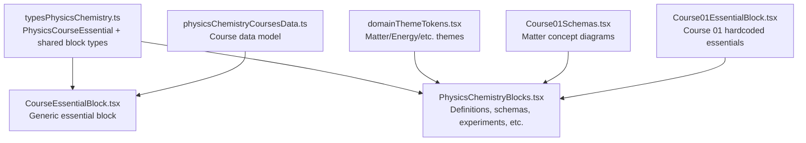
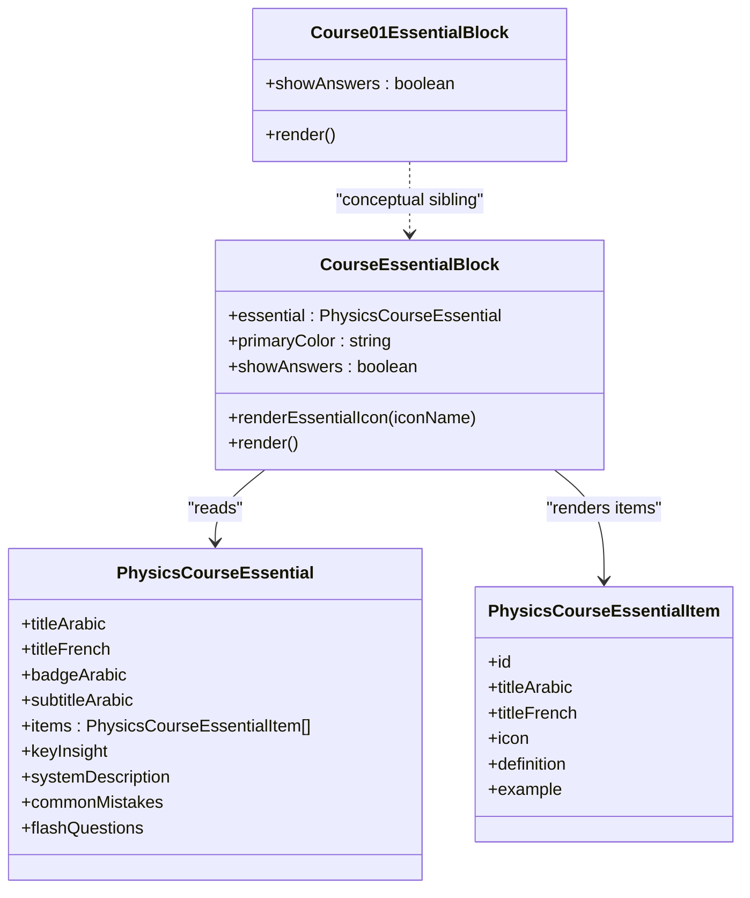
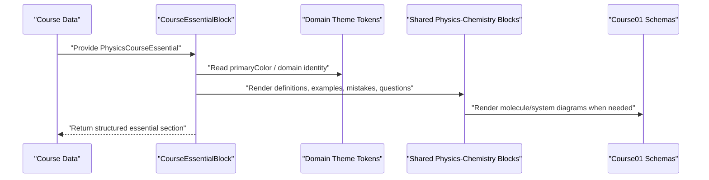
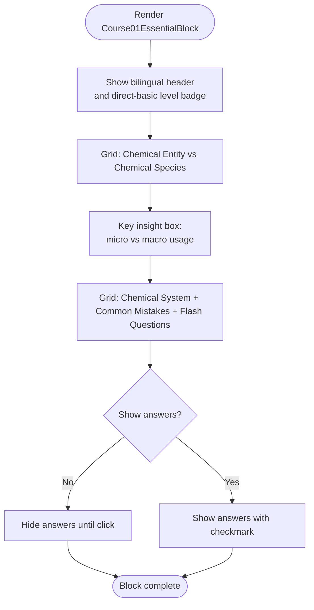
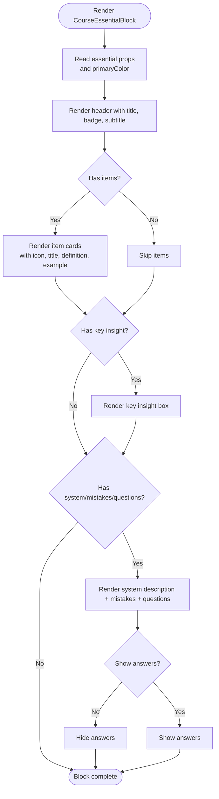
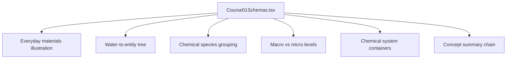
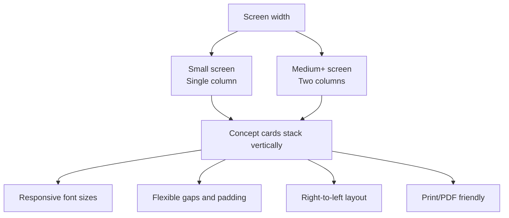
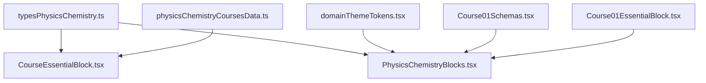

# Essential Concepts Blocks

<cite>
**Referenced Files in This Document**
- [Course01EssentialBlock.tsx](file://src/components/physics/Course01EssentialBlock.tsx)
- [CourseEssentialBlock.tsx](file://src/components/physics/CourseEssentialBlock.tsx)
- [PhysicsChemistryBlocks.tsx](file://src/components/physics/PhysicsChemistryBlocks.tsx)
- [Course01Schemas.tsx](file://src/components/physics/Course01Schemas.tsx)
- [domainThemeTokens.tsx](file://src/components/physics/domainThemeTokens.tsx)
- [typesPhysicsChemistry.ts](file://src/typesPhysicsChemistry.ts)
- [physicsChemistryCoursesData.ts](file://src/data/physicsChemistryCoursesData.ts)
</cite>

## Table of Contents
1. [Introduction](#introduction)
2. [Project Structure](#project-structure)
3. [Core Components](#core-components)
4. [Architecture Overview](#architecture-overview)
5. [Detailed Component Analysis](#detailed-component-analysis)
6. [Dependency Analysis](#dependency-analysis)
7. [Performance Considerations](#performance-considerations)
8. [Troubleshooting Guide](#troubleshooting-guide)
9. [Conclusion](#conclusion)

## Introduction
This document explains the essential concepts blocks used for matter and transformations topics in the Physics-Chemistry 3AM course framework. These blocks present fundamental chemistry ideas — such as atomic structure, chemical species, chemical systems, bonding-related molecular models, and reaction types — as structured, digestible learning units. The design supports progressive learning by separating micro-level entities (atoms and molecules) from macro-level descriptions (chemical species and systems), reinforcing definitions with examples, common mistakes, and quick questions with hidden answers.

The implementation provides:
- A fixed, curriculum-aligned block for Course 01 that directly mirrors the textbook phrasing.
- A generic, data-driven essential block that can be reused across courses.
- Supporting visual schema components for molecules, electrolysis, energy chains, and concept trees.
- A domain theme system that keeps colors, icons, and tone consistent across physics and chemistry topics.

## Project Structure
The essential concepts blocks live under the physics component layer and are driven by typed data structures. The most relevant files are:

| File | Responsibility |
|---|---|
| `Course01EssentialBlock.tsx` | Hardcoded “L’essentiel” block for Course 01, aligned to the official syllabus wording. |
| `CourseEssentialBlock.tsx` | Generic essential block that renders a `PhysicsCourseEssential` data object. |
| `PhysicsChemistryBlocks.tsx` | Shared physics-chemistry UI blocks: trilingual terms, definitions, observations, experiments, formulas, tables, explanations, examples, activities, and schema rendering. |
| `Course01Schemas.tsx` | Course-specific SVG diagrams and interactive concept visuals for matter topics. |
| `domainThemeTokens.tsx` | Domain-wide color, icon, and presentation tokens for Matter, Energy, Electricity, Optics, and General. |
| `typesPhysicsChemistry.ts` | TypeScript interfaces defining all physics-chemistry content shapes, including `PhysicsCourseEssential`. |
| `physicsChemistryCoursesData.ts` | Course data model and sample content, including how the essential section is attached to a course. |

**Diagram sources**
- [typesPhysicsChemistry.ts:264-291](file://src/typesPhysicsPhysicsChemistry.ts#L264-L291)
- [CourseEssentialBlock.tsx:22-25](file://src/components/physics/CourseEssentialBlock.tsx#L22-L25)
- [PhysicsChemistryBlocks.tsx:1-34](file://src/components/physics/PhysicsChemistryBlocks.tsx#L1-L34)
- [Course01Schemas.tsx:1-15](file://src/components/physics/Course01Schemas.tsx#L1-L15)
- [domainThemeTokens.tsx:59-109](file://src/components/physics/domainThemeTokens.tsx#L59-L109)
- [Course01EssentialBlock.tsx:16-20](file://src/components/physics/Course01EssentialBlock.tsx#L16-L20)

**Section sources**
- [Course01EssentialBlock.tsx:16-20](file://src/components/physics/Course01EssentialBlock.tsx#L16-L20)
- [CourseEssentialBlock.tsx:50-56](file://src/components/physics/CourseEssentialBlock.tsx#L50-L56)
- [PhysicsChemistryBlocks.tsx:36-34](file://src/components/physics/PhysicsChemistryBlocks.tsx#L36-L34)
- [domainThemeTokens.tsx:59-109](file://src/components/physics/domainThemeTokens.tsx#L59-L109)
- [typesPhysicsChemistry.ts:264-291](file://src/typesPhysicsChemistry.ts#L264-L291)

## Core Components
The essential concepts system has two main entry points:

1. **Course 01 Fixed Essential Block**
   - Purpose: Provide the exact “L’essentiel du cours” for Course 01, matching the official textbook wording.
   - Content: Chemical entity vs chemical species, key insight about micro vs macro levels, chemical system description, common mistakes, and flash questions with toggleable answers.
   - Behavior: Shows answers when preparing PDF output; otherwise hides them until clicked.

2. **Generic Essential Block**
   - Purpose: Render any course’s essential section from a structured data object.
   - Content: Title, badge, subtitle, definition items with icons, optional key insight, optional system description, common mistakes, and flash questions with answers.
   - Theming: Uses a primary color prop to match the current domain theme.

Both blocks use:
- Right-to-left layout for Arabic content.
- Bilingual labels where appropriate.
- A consistent card grid layout.
- Hidden-answer flash questions that reveal answers on click or during PDF export.

**Diagram sources**
- [Course01EssentialBlock.tsx:20-27](file://src/components/physics/Course01EssentialBlock.tsx#L20-L27)
- [CourseEssentialBlock.tsx:22-25](file://src/components/physics/CourseEssentialBlock.tsx#L22-L25)
- [typesPhysicsChemistry.ts:264-291](file://src/typesPhysicsChemistry.ts#L264-L291)

**Section sources**
- [Course01EssentialBlock.tsx:29-232](file://src/components/physics/Course01EssentialBlock.tsx#L29-L232)
- [CourseEssentialBlock.tsx:86-324](file://src/components/physics/CourseEssentialBlock.tsx#L86-L324)
- [typesPhysicsChemistry.ts:264-291](file://src/typesPhysicsChemistry.ts#L264-L291)

## Architecture Overview
The essential concepts blocks integrate into the broader physics-chemistry course framework through typed data and shared UI primitives.

**Diagram sources**
- [CourseEssentialBlock.tsx:57-78](file://src/components/physics/CourseEssentialBlock.tsx#L57-L78)
- [domainThemeTokens.tsx:297-322](file://src/components/physics/domainThemeTokens.tsx#L297-L322)
- [PhysicsChemistryBlocks.tsx:192-457](file://src/components/physics/PhysicsChemistryBlocks.tsx#L192-L457)
- [Course01Schemas.tsx:61-159](file://src/components/physics/Course01Schemas.tsx#L61-L159)

## Detailed Component Analysis

### Course 01 Essential Block
This component implements the exact essential summary for Course 01. It presents:
- Chemical entity (`Entité chimique`)
- Chemical species (`Espèce chimique`)
- Key insight linking micro and macro levels
- Chemical system (`Système chimique`)
- Common mistakes
- Flash questions with hidden answers

It also listens for PDF preparation events so answers appear automatically when exporting.

**Diagram sources**
- [Course01EssentialBlock.tsx:29-60](file://src/components/physics/Course01EssentialBlock.tsx#L29-L60)
- [Course01EssentialBlock.tsx:62-118](file://src/components/physics/Course01EssentialBlock.tsx#L62-L118)
- [Course01EssentialBlock.tsx:120-232](file://src/components/physics/Course01EssentialBlock.tsx#L120-L232)

**Section sources**
- [Course01EssentialBlock.tsx:29-232](file://src/components/physics/Course01EssentialBlock.tsx#L29-L232)

### Generic Essential Block
The generic essential block reads a `PhysicsCourseEssential` object and renders:
- Customizable title, French label, badge, and subtitle.
- Definition items with icons, titles, definitions, and examples.
- Optional key insight box.
- Optional system description with bullet points.
- Common mistakes list.
- Flash questions with toggleable answers.

It uses a primary color prop to adapt to the current domain theme.

**Diagram sources**
- [CourseEssentialBlock.tsx:86-129](file://src/components/physics/CourseEssentialBlock.tsx#L86-L129)
- [CourseEssentialBlock.tsx:131-175](file://src/components/physics/CourseEssentialBlock.tsx#L131-L175)
- [CourseEssentialBlock.tsx:177-193](file://src/components/physics/CourseEssentialBlock.tsx#L177-L193)
- [CourseEssentialBlock.tsx:195-324](file://src/components/physics/CourseEssentialBlock.tsx#L195-L324)

**Section sources**
- [CourseEssentialBlock.tsx:57-324](file://src/components/physics/CourseEssentialBlock.tsx#L57-L324)
- [typesPhysicsChemistry.ts:264-291](file://src/typesPhysicsChemistry.ts#L264-L291)

### Shared Physics-Chemistry Blocks
These blocks provide reusable building blocks for physics and chemistry lessons:
- Trilingual term cards
- Definition blocks
- Observation boxes
- Scientific schema renderer
- Experiment protocol blocks
- Formula and equation blocks
- Tables
- Explanations and examples
- Activities with corrections

They support:
- Bilingual Arabic/French content.
- Chemical formula rendering.
- SVG-based scientific diagrams.
- Toggleable corrections for activities.

```mermaid
classDiagram
class PhysicsDefinitionBlock {
+data : PhysicsDefinitionItem
+render()
}
class PhysicsObservationBlock {
+data : PhysicsObservationItem
+render()
}
class PhysicsSchemaRenderer {
+schema : PhysicsSchemaOrFigure
+renderDiagramSvg()
+render()
}
class PhysicsExperienceBlock {
+data : PhysicsExperienceItem
+render()
}
class PhysicsFormulaBlock {
+data : PhysicsFormulaItem
+render()
}
class PhysicsTableBlock {
+data : PhysicsTableItem
+render()
}
class PhysicsExplanationBlock {
+data : PhysicsExplanationItem
+render()
}
class PhysicsExampleBlock {
+data : PhysicsExampleItem
+render()
}
class PhysicsActivityBlock {
+data : PhysicsActivityItem
+showCorrection : boolean
+render()
}
```

**Diagram sources**
- [PhysicsChemistryBlocks.tsx:39-94](file://src/components/physics/PhysicsChemistryBlocks.tsx#L39-L94)
- [PhysicsChemistryBlocks.tsx:99-165](file://src/components/physics/PhysicsChemistryBlocks.tsx#L99-L165)
- [PhysicsChemistryBlocks.tsx:170-187](file://src/components/physics/PhysicsChemistryBlocks.tsx#L170-L187)
- [PhysicsChemistryBlocks.tsx:192-457](file://src/components/physics/PhysicsChemistryBlocks.tsx#L192-L457)
- [PhysicsChemistryBlocks.tsx:462-586](file://src/components/physics/PhysicsChemistryBlocks.tsx#L462-L586)
- [PhysicsChemistryBlocks.tsx:591-654](file://src/components/physics/PhysicsChemistryBlocks.tsx#L591-L654)
- [PhysicsChemistryBlocks.tsx:659-718](file://src/components/physics/PhysicsChemistryBlocks.tsx#L659-L718)
- [PhysicsChemistryBlocks.tsx:723-788](file://src/components/physics/PhysicsChemistryBlocks.tsx#L723-L788)
- [PhysicsChemistryBlocks.tsx:793-800](file://src/components/physics/PhysicsChemistryBlocks.tsx#L793-L800)

**Section sources**
- [PhysicsChemistryBlocks.tsx:39-94](file://src/components/physics/PhysicsChemistryBlocks.tsx#L39-L94)
- [PhysicsChemistryBlocks.tsx:99-165](file://src/components/physics/PhysicsChemistryBlocks.tsx#L99-L165)
- [PhysicsChemistryBlocks.tsx:170-187](file://src/components/physics/PhysicsChemistryBlocks.tsx#L170-L187)
- [PhysicsChemistryBlocks.tsx:192-457](file://src/components/physics/PhysicsChemistryBlocks.tsx#L192-L457)
- [PhysicsChemistryBlocks.tsx:462-586](file://src/components/physics/PhysicsChemistryBlocks.tsx#L462-L586)
- [PhysicsChemistryBlocks.tsx:591-654](file://src/components/physics/PhysicsChemistryBlocks.tsx#L591-L654)
- [PhysicsChemistryBlocks.tsx:659-718](file://src/components/physics/PhysicsChemistryBlocks.tsx#L659-L718)
- [PhysicsChemistryBlocks.tsx:723-788](file://src/components/physics/PhysicsChemistryBlocks.tsx#L723-L788)
- [PhysicsChemistryBlocks.tsx:793-800](file://src/components/physics/PhysicsChemistryBlocks.tsx#L793-L800)

### Course-Specific Schemas for Matter Topics
Course 01 includes rich SVG diagrams that visualize:
- Everyday materials and samples
- Water-to-entity tree
- Chemical species grouping
- Macro vs micro levels
- Chemical system comparison across containers
- Concept summary chain

These diagrams reinforce the essential concepts by showing atoms, molecules, species, and systems visually.

**Diagram sources**
- [Course01Schemas.tsx:66-159](file://src/components/physics/Course01Schemas.tsx#L66-L159)
- [Course01Schemas.tsx:164-287](file://src/components/physics/Course01Schemas.tsx#L164-L287)
- [Course01Schemas.tsx:292-347](file://src/components/physics/Course01Schemas.tsx#L292-L347)
- [Course01Schemas.tsx:352-408](file://src/components/physics/Course01Schemas.tsx#L352-L408)
- [Course01Schemas.tsx:413-473](file://src/components/physics/Course01Schemas.tsx#L413-L473)
- [Course01Schemas.tsx:478-536](file://src/components/physics/Course01Schemas.tsx#L478-L536)

**Section sources**
- [Course01Schemas.tsx:66-159](file://src/components/physics/Course01Schemas.tsx#L66-L159)
- [Course01Schemas.tsx:164-287](file://src/components/physics/Course01Schemas.tsx#L164-L287)
- [Course01Schemas.tsx:292-347](file://src/components/physics/Course01Schemas.tsx#L292-L347)
- [Course01Schemas.tsx:352-408](file://src/components/physics/Course01Schemas.tsx#L352-L408)
- [Course01Schemas.tsx:413-473](file://src/components/physics/Course01Schemas.tsx#L413-L473)
- [Course01Schemas.tsx:478-536](file://src/components/physics/Course01Schemas.tsx#L478-L536)

### Visual Design Principles
The essential concepts blocks follow clear visual principles suitable for middle school learners:
- **Bilingual clarity**: Arabic is primary, with French labels for scientific terms.
- **Consistent card layout**: Rounded corners, soft borders, and subtle backgrounds separate concepts without overwhelming students.
- **Color-coded domains**: Matter uses teal tones, while other domains have distinct palettes.
- **Progressive disclosure**: Flash questions hide answers until clicked or printed, encouraging active recall.
- **Micro-macro separation**: Definitions clearly distinguish between microscopic entities and macroscopic species/systems.
- **Examples and mistakes**: Each concept includes examples and common pitfalls to prevent misconceptions.

**Section sources**
- [Course01EssentialBlock.tsx:30-60](file://src/components/physics/Course01EssentialBlock.tsx#L30-L60)
- [CourseEssentialBlock.tsx:86-129](file://src/components/physics/CourseEssentialBlock.tsx#L86-L129)
- [domainThemeTokens.tsx:59-109](file://src/components/physics/domainThemeTokens.tsx#L59-L109)

### Responsive Layout System
The blocks use responsive grids:
- Single-column layout on small screens.
- Two-column grid on medium and larger screens.
- Flexible spacing and typography scaling.
- Right-to-left text direction for Arabic content.
- Print-friendly behavior for PDF export.

**Diagram sources**
- [Course01EssentialBlock.tsx:62-111](file://src/components/physics/Course01EssentialBlock.tsx#L62-L111)
- [CourseEssentialBlock.tsx:131-175](file://src/components/physics/CourseEssentialBlock.tsx#L131-L175)

**Section sources**
- [Course01EssentialBlock.tsx:62-111](file://src/components/physics/Course01EssentialBlock.tsx#L62-L111)
- [CourseEssentialBlock.tsx:131-175](file://src/components/physics/CourseEssentialBlock.tsx#L131-L175)

### Pedagogical Approach
The essential concepts blocks break down complex subjects into manageable units:
- **Atomic structure**: Represented through molecules, atoms, and chemical entities.
- **Chemical bonding**: Illustrated via molecular models like H₂O and O₂.
- **Reaction types**: Supported by experiments, equations, and observation cards.
- **Progressive learning**: Starts with concrete examples, moves to definitions, then abstract systems.
- **Misconception prevention**: Common mistakes are explicitly highlighted.
- **Active engagement**: Flash questions encourage self-testing.

**Section sources**
- [Course01EssentialBlock.tsx:62-232](file://src/components/physics/Course01EssentialBlock.tsx#L62-L232)
- [CourseEssentialBlock.tsx:131-324](file://src/components/physics/CourseEssentialBlock.tsx#L131-L324)
- [Course01Schemas.tsx:66-536](file://src/components/physics/Course01Schemas.tsx#L66-L536)

## Dependency Analysis
The essential concepts blocks depend on:
- Typed data structures for consistency.
- Shared physics-chemistry UI components.
- Domain theme tokens for visual consistency.
- Course-specific schema renderers for visual aids.

**Diagram sources**
- [typesPhysicsChemistry.ts:264-291](file://src/typesPhysicsChemistry.ts#L264-L291)
- [CourseEssentialBlock.tsx:22-25](file://src/components/physics/CourseEssentialBlock.tsx#L22-L25)
- [PhysicsChemistryBlocks.tsx:1-34](file://src/components/physics/PhysicsChemistryBlocks.tsx#L1-L34)
- [domainThemeTokens.tsx:59-109](file://src/components/physics/domainThemeTokens.tsx#L59-L109)
- [Course01Schemas.tsx:1-15](file://src/components/physics/Course01Schemas.tsx#L1-L15)
- [Course01EssentialBlock.tsx:16-20](file://src/components/physics/Course01EssentialBlock.tsx#L16-L20)
- [physicsChemistryCoursesData.ts:154-157](file://src/data/physicsChemistryCoursesData.ts#L154-L157)

**Section sources**
- [typesPhysicsChemistry.ts:264-291](file://src/typesPhysicsChemistry.ts#L264-L291)
- [CourseEssentialBlock.tsx:22-25](file://src/components/physics/CourseEssentialBlock.tsx#L22-L25)
- [PhysicsChemistryBlocks.tsx:1-34](file://src/components/physics/PhysicsChemistryBlocks.tsx#L1-L34)
- [domainThemeTokens.tsx:59-109](file://src/components/physics/domainThemeTokens.tsx#L59-L109)
- [Course01Schemas.tsx:1-15](file://src/components/physics/Course01Schemas.tsx#L1-L15)
- [Course01EssentialBlock.tsx:16-20](file://src/components/physics/Course01EssentialBlock.tsx#L16-L20)
- [physicsChemistryCoursesData.ts:154-157](file://src/data/physicsChemistryCoursesData.ts#L154-L157)

## Performance Considerations
- **Minimal re-renders**: State is limited to answer visibility and PDF mode.
- **SVG efficiency**: Static diagrams avoid heavy runtime computation.
- **Conditional rendering**: Optional sections only render when data exists.
- **Print optimization**: Answers show during PDF export without extra state management.

[No sources needed since this section provides general guidance]

## Troubleshooting Guide
Common issues and resolutions:
- **Answers not showing**: Check if PDF preparation event is triggered or if the toggle button is clicked.
- **Wrong colors**: Ensure the primary color prop matches the domain theme.
- **Missing content**: Verify that the `PhysicsCourseEssential` data object contains required fields.
- **RTL layout issues**: Confirm that `dir="rtl"` is applied to container elements.

**Section sources**
- [Course01EssentialBlock.tsx:23-27](file://src/components/physics/Course01EssentialBlock.tsx#L23-L27)
- [CourseEssentialBlock.tsx:63-78](file://src/components/physics/CourseEssentialBlock.tsx#L63-L78)
- [CourseEssentialBlock.tsx:86-92](file://src/components/physics/CourseEssentialBlock.tsx#L86-L92)

## Conclusion
The essential concepts blocks provide a robust, pedagogically sound way to present fundamental chemistry ideas in the Physics-Chemistry 3AM course. By combining structured definitions, visual schemas, common mistakes, and interactive questions, they make complex topics accessible to middle school students. The modular design ensures consistency across courses while allowing flexibility for different content needs.

[No sources needed since this section summarizes without analyzing specific files]