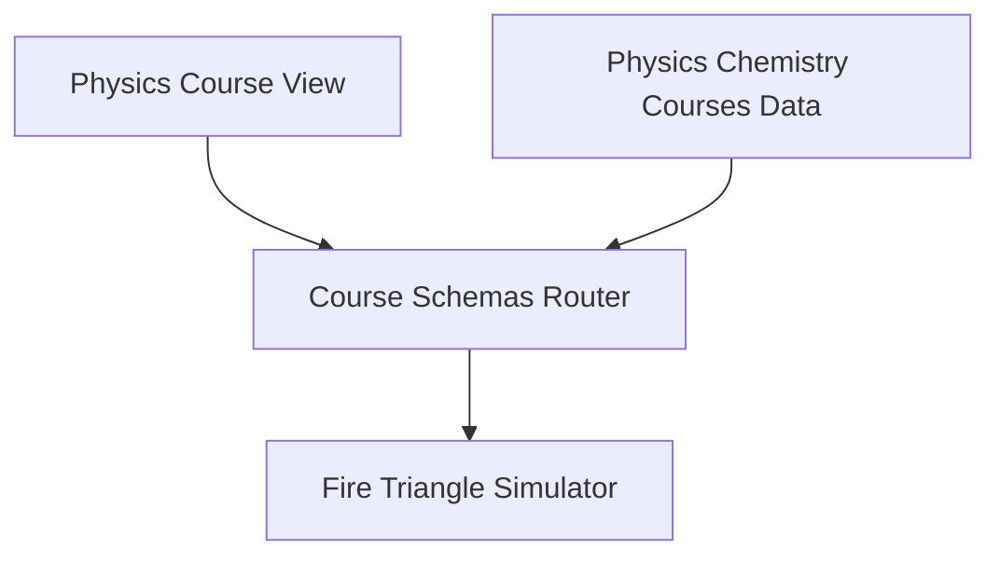
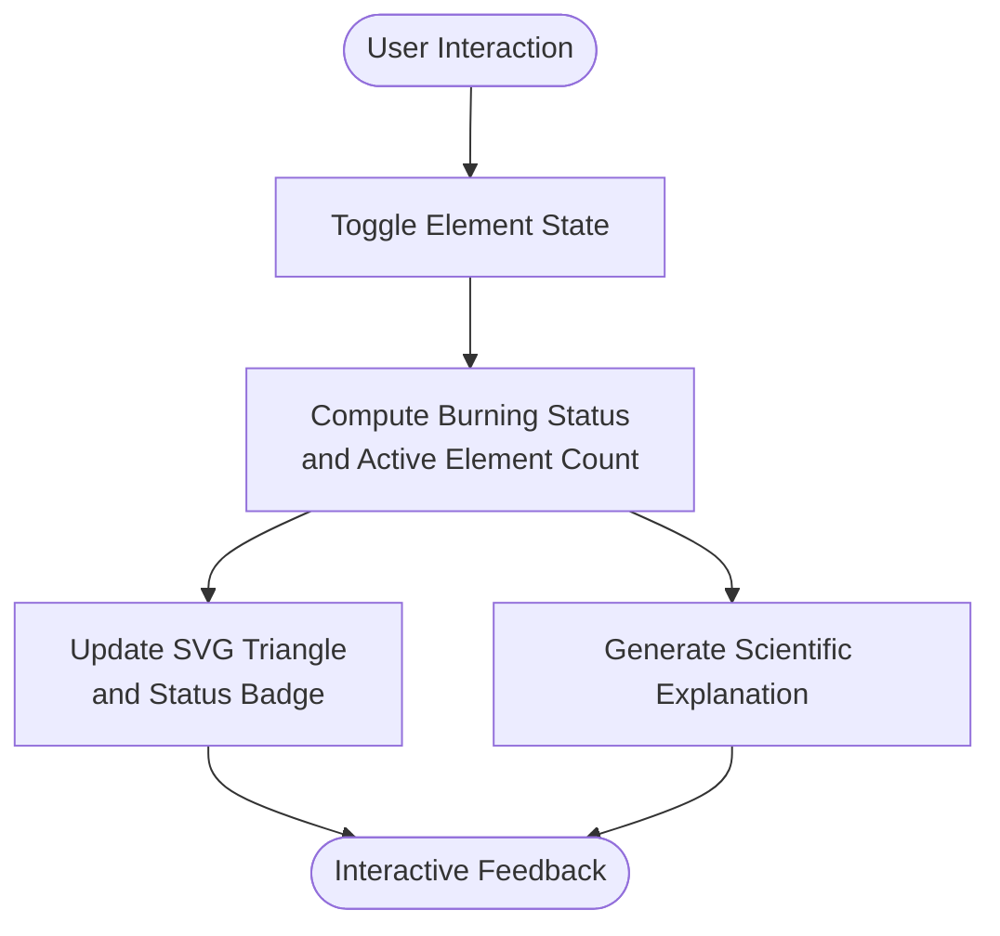
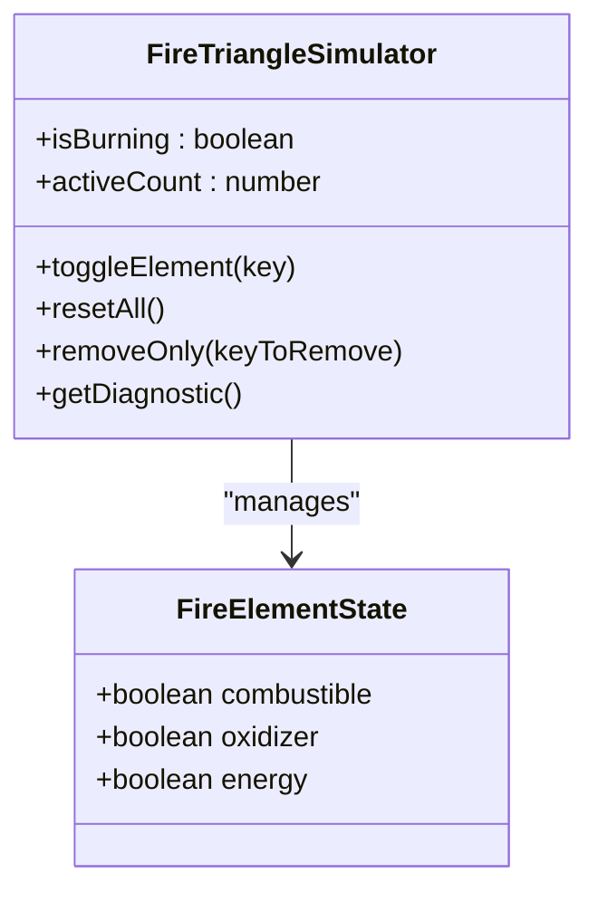
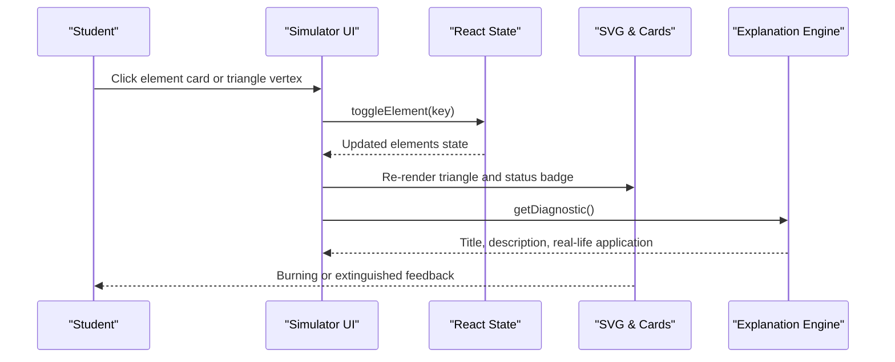
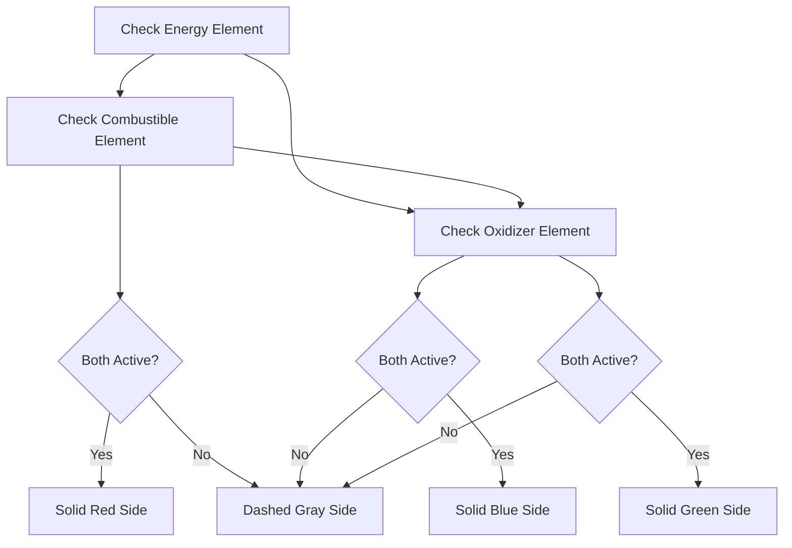
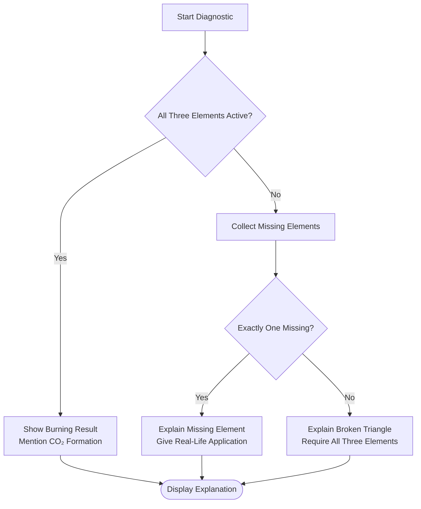
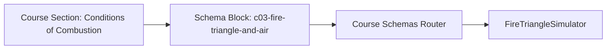
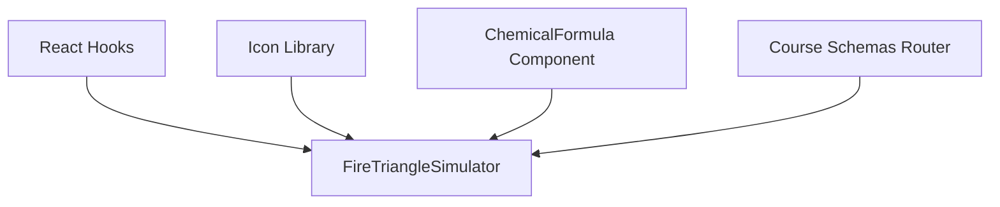

# Fire Triangle Simulator

<cite>
**Referenced Files in This Document**
- [FireTriangleSimulator.tsx](file://src/components/physics/FireTriangleSimulator.tsx)
- [Course01Schemas.tsx](file://src/components/physics/Course01Schemas.tsx)
- [PhysicsCourseView.tsx](file://src/components/physics/PhysicsCourseView.tsx)
- [physicsChemistryCoursesData.ts](file://src/data/physicsChemistryCoursesData.ts)
</cite>

## Table of Contents
1. [Introduction](#introduction)
2. [Project Structure](#project-structure)
3. [Core Components](#core-components)
4. [Architecture Overview](#architecture-overview)
5. [Detailed Component Analysis](#detailed-component-analysis)
6. [Dependency Analysis](#dependency-analysis)
7. [Performance Considerations](#performance-considerations)
8. [Troubleshooting Guide](#troubleshooting-guide)
9. [Conclusion](#conclusion)

## Introduction
The Fire Triangle Simulator is an interactive educational component that models the three essential elements of combustion: fuel, oxygen, and heat. It helps students visualize how removing any one element extinguishes a fire and reinforces the principle that all three elements must be present simultaneously for combustion to occur. The simulator uses React state to track whether each element is available, updates visual feedback through SVG graphics and UI cards, and provides diagnostic explanations tied to real-life applications.

At a conceptual level, the component represents:
- Fuel as carbon (C).
- Oxygen as dioxygen gas (O₂).
- Heat as activation energy required to start the reaction.

When all three are active, the simulation shows a burning state and indicates that carbon reacts with oxygen to produce carbon dioxide (CO₂). When one or more elements are removed, the simulation clearly demonstrates that combustion stops.

## Project Structure
The Fire Triangle Simulator lives inside the physics components section of the application and is integrated into the broader chemistry course structure.

**Diagram sources**
- [PhysicsCourseView.tsx:1179-1187](file://src/components/physics/PhysicsCourseView.tsx#L1179-L1187)
- [Course01Schemas.tsx:1280-1284](file://src/components/physics/Course01Schemas.tsx#L1280-L1284)
- [physicsChemistryCoursesData.ts:1689-1721](file://src/data/physicsChemistryCoursesData.ts#L1689-L1721)

**Section sources**
- [FireTriangleSimulator.tsx:1-18](file://src/components/physics/FireTriangleSimulator.tsx#L1-L18)
- [Course01Schemas.tsx:1280-1284](file://src/components/physics/Course01Schemas.tsx#L1280-L1284)
- [physicsChemistryCoursesData.ts:1689-1721](file://src/data/physicsChemistryCoursesData.ts#L1689-L1721)

## Core Components
The core logic of the simulator is implemented in a single React functional component. It manages:
- State for the three elements: combustible (fuel), oxidizer (oxygen), and energy (heat).
- Derived values such as whether the fire is currently burning and how many elements are active.
- Interactive controls to toggle individual elements, reset all elements, or remove only one element at a time.
- A diagnostic system that explains what happens when elements are missing and connects the scenario to real-life applications.

Key responsibilities:
- Toggle element availability via clickable triangle vertices and control cards.
- Update visual feedback based on the current combination of elements.
- Provide scientific explanations aligned with middle school chemistry concepts about combustion.

**Section sources**
- [FireTriangleSimulator.tsx:5-46](file://src/components/physics/FireTriangleSimulator.tsx#L5-L46)
- [FireTriangleSimulator.tsx:48-114](file://src/components/physics/FireTriangleSimulator.tsx#L48-L114)

## Architecture Overview
The simulator follows a simple state-driven architecture:
- User interactions update React state.
- Derived state determines whether combustion occurs.
- Visual components reflect the current state using SVG lines, colors, and status badges.
- Diagnostic text adapts to explain the scientific meaning of the current configuration.

[No sources needed since this diagram shows conceptual workflow, not actual code structure]

## Detailed Component Analysis

### Simulation Logic and State Model
The simulator defines a state interface representing the three elements of the fire triangle:
- Combustible: whether fuel (carbon) is present.
- Oxidizer: whether oxygen (dioxygen) is present.
- Energy: whether activation energy (heat) is present.

From this state, the component computes:
- Whether the fire is burning (all three elements active).
- How many elements are currently active.

This design ensures that the simulation remains deterministic and easy to reason about: changing any single element immediately affects the burning status and the displayed explanation.

**Diagram sources**
- [FireTriangleSimulator.tsx:5-17](file://src/components/physics/FireTriangleSimulator.tsx#L5-L17)
- [FireTriangleSimulator.tsx:19-46](file://src/components/physics/FireTriangleSimulator.tsx#L19-L46)

**Section sources**
- [FireTriangleSimulator.tsx:5-46](file://src/components/physics/FireTriangleSimulator.tsx#L5-L46)

### Interactive Controls and User Flow
Users can interact with the simulator in multiple ways:
- Clicking triangle vertices toggles the corresponding element.
- Control cards provide labeled buttons for fuel, oxygen, and heat.
- Quick scenario buttons allow users to reset all elements or remove only one element at a time.

The user flow is straightforward:
1. Open the simulator drawer.
2. Toggle one or more elements.
3. Observe changes in the triangle visualization and status banner.
4. Read the diagnostic explanation describing why combustion starts or stops.

**Diagram sources**
- [FireTriangleSimulator.tsx:25-46](file://src/components/physics/FireTriangleSimulator.tsx#L25-L46)
- [FireTriangleSimulator.tsx:48-114](file://src/components/physics/FireTriangleSimulator.tsx#L48-L114)
- [FireTriangleSimulator.tsx:163-204](file://src/components/physics/FireTriangleSimulator.tsx#L163-L204)
- [FireTriangleSimulator.tsx:305-380](file://src/components/physics/FireTriangleSimulator.tsx#L305-L380)
- [FireTriangleSimulator.tsx:391-513](file://src/components/physics/FireTriangleSimulator.tsx#L391-L513)

**Section sources**
- [FireTriangleSimulator.tsx:163-204](file://src/components/physics/FireTriangleSimulator.tsx#L163-L204)
- [FireTriangleSimulator.tsx:305-380](file://src/components/physics/FireTriangleSimulator.tsx#L305-L380)
- [FireTriangleSimulator.tsx:391-513](file://src/components/physics/FireTriangleSimulator.tsx#L391-L513)

### Visual Representation of the Fire Triangle
The simulator renders an SVG triangle whose sides connect the three elements:
- Top vertex: activation energy (heat).
- Bottom-right vertex: combustible material (carbon).
- Bottom-left vertex: oxidizer (dioxygen).

Visual behavior:
- When both connected elements are active, the side becomes solid and colored.
- When either connected element is missing, the side becomes dashed and neutral-colored.
- The center area reflects the overall burning state with a glowing appearance when all three elements are present.

**Diagram sources**
- [FireTriangleSimulator.tsx:234-275](file://src/components/physics/FireTriangleSimulator.tsx#L234-L275)

**Section sources**
- [FireTriangleSimulator.tsx:231-302](file://src/components/physics/FireTriangleSimulator.tsx#L231-L302)

### Educational Scenarios and Scientific Explanations
The diagnostic engine generates tailored explanations depending on which element(s) are missing:
- If all three elements are present, it confirms that combustion continues and mentions the formation of CO₂.
- If only one element is missing, it explains why combustion stops and gives a real-life safety or laboratory application.
- If two or more elements are missing, it emphasizes that all three sides of the fire triangle must be present simultaneously.

This aligns with the course content that introduces the fire triangle, the necessity of dioxygen, and the role of air in combustion.

**Diagram sources**
- [FireTriangleSimulator.tsx:48-114](file://src/components/physics/FireTriangleSimulator.tsx#L48-L114)

**Section sources**
- [FireTriangleSimulator.tsx:48-114](file://src/components/physics/FireTriangleSimulator.tsx#L48-L114)
- [physicsChemistryCoursesData.ts:1689-1721](file://src/data/physicsChemistryCoursesData.ts#L1689-L1721)

### Integration with the Physics Course Curriculum
The simulator is registered as a schema block within the physics and chemistry course data. The course router recognizes the schema type and renders the Fire Triangle Simulator component. This integration places the interactive tool directly alongside definitions, examples, and exercises about combustion conditions.

**Diagram sources**
- [physicsChemistryCoursesData.ts:1689-1721](file://src/data/physicsChemistryCoursesData.ts#L1689-L1721)
- [Course01Schemas.tsx:1280-1284](file://src/components/physics/Course01Schemas.tsx#L1280-L1284)

**Section sources**
- [physicsChemistryCoursesData.ts:1689-1721](file://src/data/physicsChemistryCoursesData.ts#L1689-L1721)
- [Course01Schemas.tsx:1280-1284](file://src/components/physics/Course01Schemas.tsx#L1280-L1284)
- [PhysicsCourseView.tsx:1179-1187](file://src/components/physics/PhysicsCourseView.tsx#L1179-L1187)

## Dependency Analysis
The Fire Triangle Simulator has minimal external dependencies beyond React and shared UI primitives:
- React state hooks manage simulation state.
- Icon components from a shared icon library are used for visual cues.
- A chemical formula component is reused to display formulas like C and O₂.
- The component is consumed by the course schemas router.

**Diagram sources**
- [FireTriangleSimulator.tsx:1-3](file://src/components/physics/FireTriangleSimulator.tsx#L1-L3)
- [Course01Schemas.tsx:1280-1284](file://src/components/physics/Course01Schemas.tsx#L1280-L1284)

**Section sources**
- [FireTriangleSimulator.tsx:1-3](file://src/components/physics/FireTriangleSimulator.tsx#L1-L3)
- [Course01Schemas.tsx:1280-1284](file://src/components/physics/Course01Schemas.tsx#L1280-L1284)

## Performance Considerations
The simulator is lightweight and state-driven:
- State updates are simple boolean toggles.
- Rendering depends on computed flags and conditional styling.
- No heavy animations or external animation libraries are used; transitions rely on CSS classes and SVG attribute changes.

Potential optimization opportunities include:
- Memoizing derived values if additional expensive computations were added later.
- Avoiding unnecessary re-renders by separating interactive controls from static explanatory sections if the component grows larger.
- Keeping diagnostic text localized and reusable if multilingual support expands.

[No sources needed since this section provides general guidance]

## Troubleshooting Guide
Common issues and their likely causes:
- The fire does not ignite even though elements appear present: verify that all three elements are toggled on and that no quick-scenario button has removed one element.
- Removing an element does not change the visualization: ensure the click handler is attached to the correct element key and that the state update function is called.
- The explanation text does not match expectations: check the diagnostic logic path for the specific combination of missing elements.

Practical checks:
- Use the reset-all button to return to the default burning state.
- Use the “try removing” buttons to isolate each element and observe its effect.
- Confirm that the status badge reflects the current active element count.

**Section sources**
- [FireTriangleSimulator.tsx:32-46](file://src/components/physics/FireTriangleSimulator.tsx#L32-L46)
- [FireTriangleSimulator.tsx:163-204](file://src/components/physics/FireTriangleSimulator.tsx#L163-L204)
- [FireTriangleSimulator.tsx:48-114](file://src/components/physics/FireTriangleSimulator.tsx#L48-L114)

## Conclusion
The Fire Triangle Simulator provides a clear, interactive model of combustion for middle school chemistry education. It accurately represents the necessity of fuel, oxygen, and heat, and visually demonstrates how removing any one element prevents combustion. The component integrates seamlessly into the physics and chemistry course structure, offering students hands-on exploration of fire chemistry principles while reinforcing scientifically accurate explanations and real-life applications.

[No sources needed since this section summarizes without analyzing specific files]