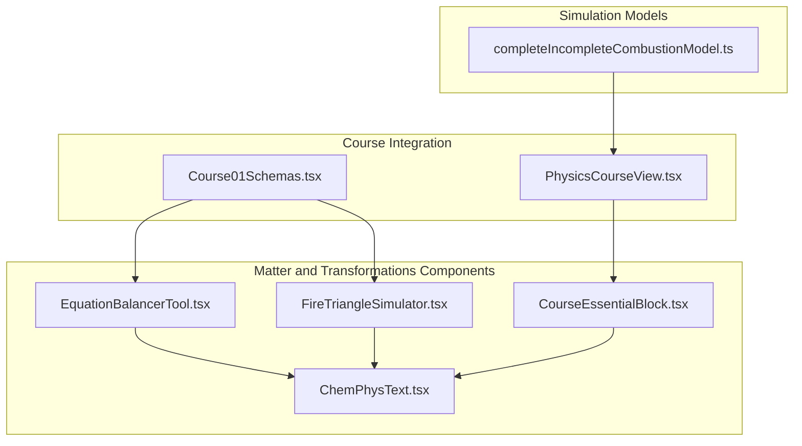
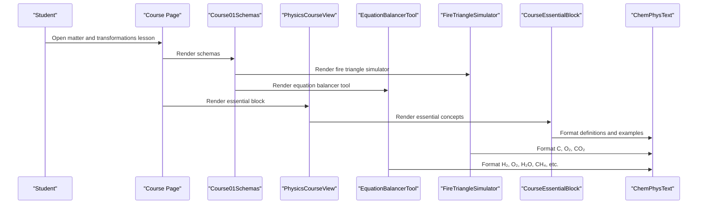
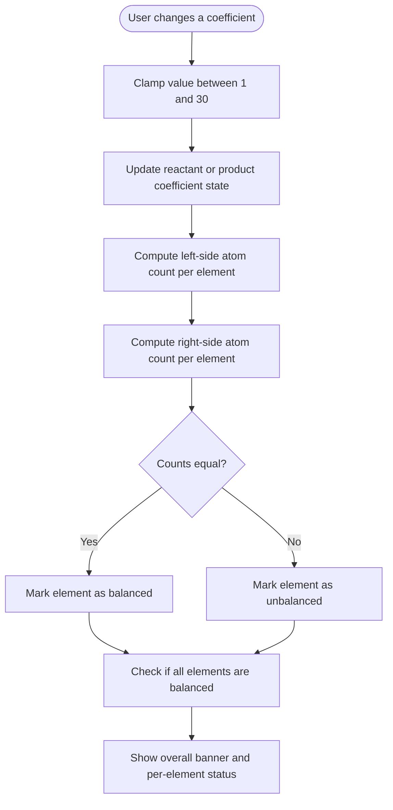
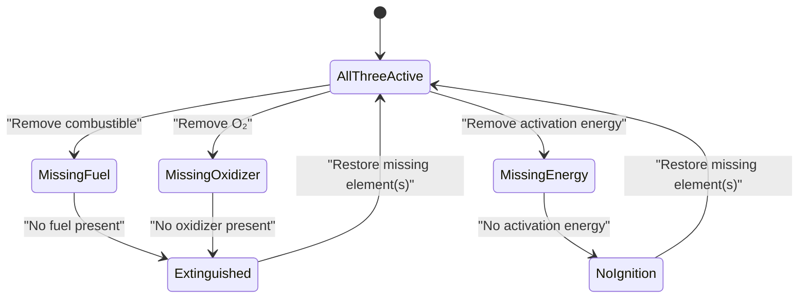
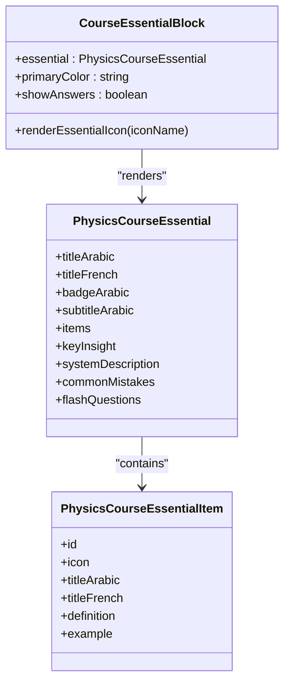
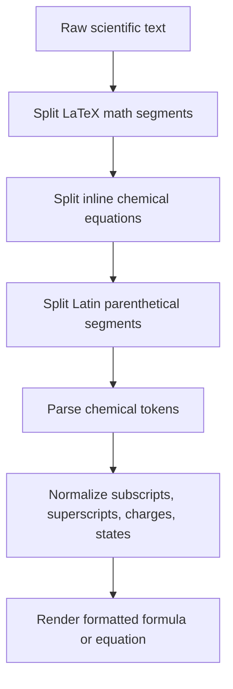
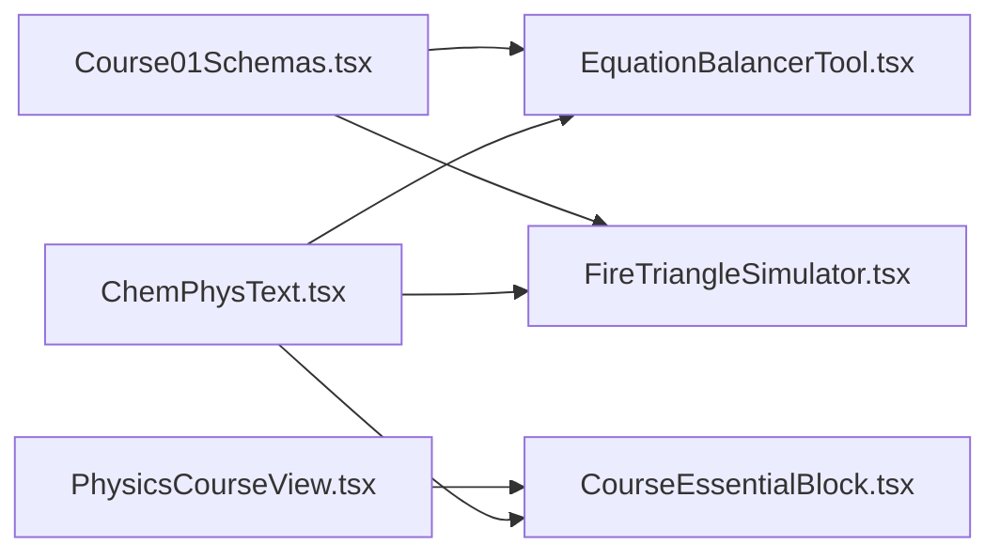

# Matter and Transformations

<cite>
**Referenced Files in This Document**
- [EquationBalancerTool.tsx](file://src/components/physics/EquationBalancerTool.tsx)
- [FireTriangleSimulator.tsx](file://src/components/physics/FireTriangleSimulator.tsx)
- [CourseEssentialBlock.tsx](file://src/components/physics/CourseEssentialBlock.tsx)
- [ChemPhysText.tsx](file://src/components/physics/ChemPhysText.tsx)
- [Course01Schemas.tsx](file://src/components/physics/Course01Schemas.tsx)
- [PhysicsCourseView.tsx](file://src/components/physics/PhysicsCourseView.tsx)
- [completeIncompleteCombustionModel.ts](file://src/components/physics/simulations/pilots/completeIncompleteCombustionModel.ts)
</cite>

## Table of Contents
1. [Introduction](#introduction)
2. [Project Structure](#project-structure)
3. [Core Components](#core-components)
4. [Architecture Overview](#architecture-overview)
5. [Detailed Component Analysis](#detailed-component-analysis)
6. [Dependency Analysis](#dependency-analysis)
7. [Performance Considerations](#performance-considerations)
8. [Troubleshooting Guide](#troubleshooting-guide)
9. [Conclusion](#conclusion)
10. [Appendices](#appendices)

## Introduction
This document explains the matter and transformations educational components built for a 3AM physics-chemistry course. It focuses on three main pieces:

- **Chemical Equation Balancer Tool**: an interactive stoichiometry lab where students adjust coefficients, see per-element balance indicators, and learn balancing strategies through hints and solutions.
- **Fire Triangle Simulator**: a visual simulation of combustion that lets students toggle fuel, oxidizer, and activation energy to understand why all three sides are required for fire.
- **Essential Concepts Blocks**: a reusable presentation component that displays definitions, examples, common mistakes, flash questions, and key insights from the curriculum.

The components share a chemical text rendering system that correctly formats formulas, charges, states, and equations inside bilingual Arabic-French scientific content. The simulations emphasize scientific accuracy, clear user interaction patterns, and strong educational scaffolding.

## Project Structure
The relevant code lives under `src/components/physics`. The three core components are standalone React components that can be embedded into course pages. They are composed by higher-level course views and schemas.

**Diagram sources**
- [EquationBalancerTool.tsx:291-763](file://src/components/physics/EquationBalancerTool.tsx#L291-L763)
- [FireTriangleSimulator.tsx:11-549](file://src/components/physics/FireTriangleSimulator.tsx#L11-L549)
- [CourseEssentialBlock.tsx:57-328](file://src/components/physics/CourseEssentialBlock.tsx#L57-L328)
- [ChemPhysText.tsx:36-227](file://src/components/physics/ChemPhysText.tsx#L36-L227)
- [Course01Schemas.tsx:1284-2173](file://src/components/physics/Course01Schemas.tsx#L1284-L2173)
- [PhysicsCourseView.tsx:1076-1076](file://src/components/physics/PhysicsCourseView.tsx#L1076-L1076)
- [completeIncompleteCombustionModel.ts:1-31](file://src/components/physics/simulations/pilots/completeIncompleteCombustionModel.ts#L1-L31)

**Section sources**
- [Course01Schemas.tsx:1284-2173](file://src/components/physics/Course01Schemas.tsx#L1284-L2173)
- [PhysicsCourseView.tsx:1076-1076](file://src/components/physics/PhysicsCourseView.tsx#L1076-L1076)

## Core Components
The matter-and-transformations learning experience is built around three primary components:

| Component | Purpose | User Interaction | Scientific Focus |
|---|---|---|---|
| Equation Balancer Tool | Interactive stoichiometry practice | Select equation, adjust coefficients with steppers or direct input, show hint, reset, show solution | Conservation of atoms, stoichiometric coefficients, balanced vs unbalanced equations |
| Fire Triangle Simulator | Combustion conditions visualization | Toggle combustible, oxidizer, and activation energy; quick scenario buttons; observe triangle state | Fuel + oxidizer + activation energy; CO₂ production; fire safety principles |
| Essential Concepts Block | Curriculum-aligned concept summaries | Toggle answers for flash questions; view definitions, examples, common mistakes, key insight | Matter organization, chemical species, reaction sentences, typical misconceptions |

All three components use shared chemical formatting utilities so formulas like H₂O, O₂, CH₄, Fe₂O₃, and full reactions render consistently.

**Section sources**
- [EquationBalancerTool.tsx:42-289](file://src/components/physics/EquationBalancerTool.tsx#L42-L289)
- [FireTriangleSimulator.tsx:5-114](file://src/components/physics/FireTriangleSimulator.tsx#L5-L114)
- [CourseEssentialBlock.tsx:22-56](file://src/components/physics/CourseEssentialBlock.tsx#L22-L56)
- [ChemPhysText.tsx:36-227](file://src/components/physics/ChemPhysText.tsx#L36-L227)

## Architecture Overview
At runtime, the course page renders these components as part of a larger physics-chemistry interface. The balancer and fire simulator are embedded directly by the course schema, while essential blocks are rendered by the course view.

**Diagram sources**
- [Course01Schemas.tsx:1284-2173](file://src/components/physics/Course01Schemas.tsx#L1284-L2173)
- [PhysicsCourseView.tsx:1076-1076](file://src/components/physics/PhysicsCourseView.tsx#L1076-L1076)
- [FireTriangleSimulator.tsx:1-10](file://src/components/physics/FireTriangleSimulator.tsx#L1-L10)
- [EquationBalancerTool.tsx:1-15](file://src/components/physics/EquationBalancerTool.tsx#L1-L15)
- [CourseEssentialBlock.tsx:1-20](file://src/components/physics/CourseEssentialBlock.tsx#L1-L20)
- [ChemPhysText.tsx:252-417](file://src/components/physics/ChemPhysText.tsx#L252-L417)

## Detailed Component Analysis

### Chemical Equation Balancer Tool
The balancer provides a curated set of six chemical equations ranging from basic synthesis to complete combustion of alkanes. Each equation defines:

- Elements involved with Arabic and French names.
- Reactants and products with atom counts, default coefficients, and target coefficients.
- A difficulty badge and a step-by-step balancing hint in Arabic.

Students interact by:

1. Opening the drawer.
2. Selecting an equation.
3. Adjusting coefficients using plus/minus buttons or direct numeric input.
4. Reading per-element balance indicators showing left and right atom counts.
5. Using hints, resetting coefficients, or revealing the balanced solution.

#### Data Model and Validation
The component stores current reactant and product coefficients and computes per-element balances by multiplying each compound’s coefficient by its internal atom count. Coefficients are clamped between 1 and 30 to keep the interface usable and avoid unrealistic values.

**Diagram sources**
- [EquationBalancerTool.tsx:312-330](file://src/components/physics/EquationBalancerTool.tsx#L312-L330)
- [EquationBalancerTool.tsx:332-370](file://src/components/physics/EquationBalancerTool.tsx#L332-L370)
- [EquationBalancerTool.tsx:722-757](file://src/components/physics/EquationBalancerTool.tsx#L722-L757)

#### Example Reactions
The catalog includes representative reactions such as:

- Water synthesis: hydrogen and oxygen forming water.
- Hydrogen chloride synthesis: hydrogen and chlorine forming HCl.
- Complete methane combustion: methane reacting with oxygen to form carbon dioxide and water.
- Iron combustion: iron reacting with oxygen to form iron oxide.
- Propane combustion: propane reacting with oxygen to form carbon dioxide and water.
- Butane combustion: butane reacting with oxygen to form carbon dioxide and water, including a fractional-coefficient step that is converted to integer coefficients.

These examples cover synthesis, oxidation, and hydrocarbon combustion, which aligns with standard middle-school chemistry topics.

#### Educational Features
- **Hints**: Each equation includes a suggested balancing strategy.
- **Instant feedback**: Green/red indicators show whether each element is balanced.
- **Solution reveal**: Students can see the target coefficients after attempting the problem.
- **Reset**: Students can return to default coefficients without reloading.
- **Bilingual labels**: Arabic and French names help reinforce terminology.

**Section sources**
- [EquationBalancerTool.tsx:42-289](file://src/components/physics/EquationBalancerTool.tsx#L42-L289)
- [EquationBalancerTool.tsx:291-370](file://src/components/physics/EquationBalancerTool.tsx#L291-L370)
- [EquationBalancerTool.tsx:417-757](file://src/components/physics/EquationBalancerTool.tsx#L417-L757)

### Fire Triangle Simulator
The fire triangle simulator models the three necessary conditions for combustion:

1. **Fuel**: represented as carbon (C).
2. **Oxidizer**: represented as dioxygen (O₂).
3. **Activation energy**: represented as heat or flame.

The component maintains a boolean state for each side. If all three are true, the simulation shows burning; otherwise, it explains which condition is missing and what happens experimentally.

#### State Logic

**Diagram sources**
- [FireTriangleSimulator.tsx:11-46](file://src/components/physics/FireTriangleSimulator.tsx#L11-L46)
- [FireTriangleSimulator.tsx:48-114](file://src/components/physics/FireTriangleSimulator.tsx#L48-L114)

#### Visual Representation
The simulator draws an SVG triangle whose sides become solid when both connected elements are active and dashed when one is missing. The center represents the reaction core: glowing when burning, dimmed when extinguished. Buttons at the vertices and cards on the side let students toggle each element.

#### Scientific Accuracy
The simulation simplifies combustion to carbon plus oxygen producing carbon dioxide. This is appropriate for introductory chemistry because it isolates the conceptual requirement of the fire triangle without introducing complex kinetics or partial combustion products. For more advanced modeling, the repository also contains a combustion model that tracks regimes such as complete, transition, and incomplete combustion, along with metrics like CO₂, H₂O, CO, soot, and safety-related measurements.

**Section sources**
- [FireTriangleSimulator.tsx:5-114](file://src/components/physics/FireTriangleSimulator.tsx#L5-L114)
- [FireTriangleSimulator.tsx:206-381](file://src/components/physics/FireTriangleSimulator.tsx#L206-L381)
- [FireTriangleSimulator.tsx:384-543](file://src/components/physics/FireTriangleSimulator.tsx#L384-L543)
- [completeIncompleteCombustionModel.ts:8-31](file://src/components/physics/simulations/pilots/completeIncompleteCombustionModel.ts#L8-L31)

### Essential Concepts Blocks
The essential concepts block is a generic presentation component used to display curriculum-aligned summaries. It supports:

- Title and badge in Arabic and French.
- Concept items with icons, definitions, and examples.
- Key insight highlighting.
- System description with bullet points.
- Common mistakes section.
- Flash questions with toggleable answers.

It listens to PDF-related events to automatically show or hide answers during print/export workflows.

**Diagram sources**
- [CourseEssentialBlock.tsx:22-56](file://src/components/physics/CourseEssentialBlock.tsx#L22-L56)
- [CourseEssentialBlock.tsx:86-328](file://src/components/physics/CourseEssentialBlock.tsx#L86-L328)

#### Educational Value
This component ensures that core curriculum statements are presented consistently across lessons. It separates definitions from examples and common mistakes, helping students distinguish correct concepts from frequent misunderstandings. The flash-question feature encourages active recall, while the answer toggle supports self-assessment and printable study sheets.

**Section sources**
- [CourseEssentialBlock.tsx:57-328](file://src/components/physics/CourseEssentialBlock.tsx#L57-L328)

### Shared Chemical Text Rendering
Both the balancer and fire simulator rely on `ChemPhysText` and `ChemicalFormula` to render scientific notation correctly. The renderer:

- Normalizes Unicode subscripts and superscripts.
- Parses ASCII digits after element symbols or parentheses as subscripts.
- Handles charges like Na⁺, Ca²⁺, SO₄²⁻.
- Extracts physical states like `(s)`, `(l)`, `(g)`, `(aq)`.
- Renders full inline chemical equations in LTR direction even within RTL Arabic text.
- Supports LaTeX math segments wrapped in dollar signs.

**Diagram sources**
- [ChemPhysText.tsx:36-227](file://src/components/physics/ChemPhysText.tsx#L36-L227)
- [ChemPhysText.tsx:252-417](file://src/components/physics/ChemPhysText.tsx#L252-L417)

**Section sources**
- [ChemPhysText.tsx:36-227](file://src/components/physics/ChemPhysText.tsx#L36-L227)
- [ChemPhysText.tsx:252-417](file://src/components/physics/ChemPhysText.tsx#L252-L417)

## Dependency Analysis
The components have clear separation of concerns:

- `EquationBalancerTool` depends on `ChemicalFormula` for rendering compounds and uses local state for coefficients and balance checks.
- `FireTriangleSimulator` depends on `ChemicalFormula` for displaying C, O₂, and CO₂ and uses local state for the three triangle sides.
- `CourseEssentialBlock` depends on `ChemPhysText` for rendering definitions, examples, and questions.
- Higher-level components embed these tools into course pages.

**Diagram sources**
- [ChemPhysText.tsx:36-227](file://src/components/physics/ChemPhysText.tsx#L36-L227)
- [EquationBalancerTool.tsx:1-15](file://src/components/physics/EquationBalancerTool.tsx#L1-L15)
- [FireTriangleSimulator.tsx:1-3](file://src/components/physics/FireTriangleSimulator.tsx#L1-L3)
- [CourseEssentialBlock.tsx:1-20](file://src/components/physics/CourseEssentialBlock.tsx#L1-L20)
- [Course01Schemas.tsx:1284-2173](file://src/components/physics/Course01Schemas.tsx#L1284-L2173)
- [PhysicsCourseView.tsx:1076-1076](file://src/components/physics/PhysicsCourseView.tsx#L1076-L1076)

**Section sources**
- [Course01Schemas.tsx:1284-2173](file://src/components/physics/Course01Schemas.tsx#L1284-L2173)
- [PhysicsCourseView.tsx:1076-1076](file://src/components/physics/PhysicsCourseView.tsx#L1076-L1076)

## Performance Considerations
- **Local state updates**: Both the balancer and fire simulator use small, localized React state objects. Updates are lightweight and do not trigger expensive re-renders beyond the component itself.
- **Coefficient clamping**: The balancer limits coefficients to a reasonable range, preventing excessive computation or confusing large-number displays.
- **SVG triangle rendering**: The fire triangle uses simple SVG lines and polygons; performance is dominated by CSS transitions rather than heavy animation loops.
- **Text parsing**: Chemical text parsing runs only when content changes. For static course content, this cost is negligible.

[No sources needed since this section provides general guidance]

## Troubleshooting Guide
Common issues and how to address them:

| Issue | Likely Cause | Resolution |
|---|---|---|
| Coefficients appear too large or unrealistic | User entered a very large number | Use the minus button or reset to defaults; the component clamps values between 1 and 30. |
| Element indicator remains red | Coefficients do not satisfy conservation of atoms | Follow the hint, adjust coefficients systematically, or reveal the solution. |
| Formula looks incorrect in RTL text | Mixed Arabic and chemical notation | The shared renderer isolates chemical formulas in LTR direction; ensure formulas use supported syntax. |
| Fire does not start | One or more triangle sides are missing | Toggle combustible, oxidizer, or activation energy until all three are active. |
| Answers hidden in printed PDF | Answer visibility toggled off | The essential block listens to print-related events and can show answers during PDF export. |

**Section sources**
- [EquationBalancerTool.tsx:312-330](file://src/components/physics/EquationBalancerTool.tsx#L312-L330)
- [EquationBalancerTool.tsx:426-480](file://src/components/physics/EquationBalancerTool.tsx#L426-L480)
- [FireTriangleSimulator.tsx:25-46](file://src/components/physics/FireTriangleSimulator.tsx#L25-L46)
- [CourseEssentialBlock.tsx:63-78](file://src/components/physics/CourseEssentialBlock.tsx#L63-L78)

## Conclusion
The matter and transformations components provide a cohesive, scientifically grounded learning experience:

- The **equation balancer** teaches stoichiometry through guided practice, immediate feedback, and realistic chemical examples.
- The **fire triangle simulator** makes combustion conditions tangible by letting students remove and restore fuel, oxidizer, and activation energy.
- The **essential concepts block** delivers curriculum-aligned definitions, examples, misconceptions, and self-check questions in a consistent layout.
- The shared **chemical text renderer** ensures accurate, readable scientific notation across Arabic, French, and English contexts.

Together, these components support students in moving from macroscopic observations to microscopic reasoning about matter and chemical transformations.

[No sources needed since this section summarizes without analyzing specific files]

## Appendices

### Appendix A: Representative Reactions Covered
- Water synthesis from hydrogen and oxygen.
- Hydrogen chloride synthesis from hydrogen and chlorine.
- Complete combustion of methane.
- Combustion of iron in oxygen.
- Complete combustion of propane.
- Complete combustion of butane, including conversion from fractional to integer coefficients.

**Section sources**
- [EquationBalancerTool.tsx:42-289](file://src/components/physics/EquationBalancerTool.tsx#L42-L289)

### Appendix B: Simulation Extensions
For advanced lessons, the repository includes a combustion model that distinguishes complete, transition, and incomplete combustion regimes and tracks measurable outputs such as CO₂, H₂O, CO, soot, limewater turbidity, and CO ppm. This model can complement the fire triangle simulator when teaching partial combustion, pollution, and safety.

**Section sources**
- [completeIncompleteCombustionModel.ts:8-31](file://src/components/physics/simulations/pilots/completeIncompleteCombustionModel.ts#L8-L31)