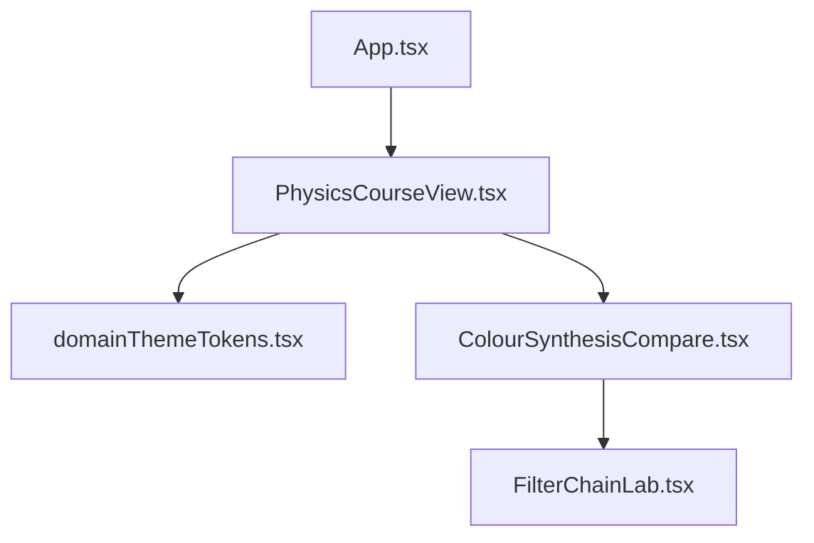
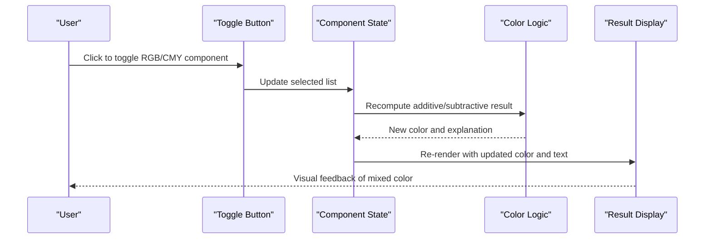
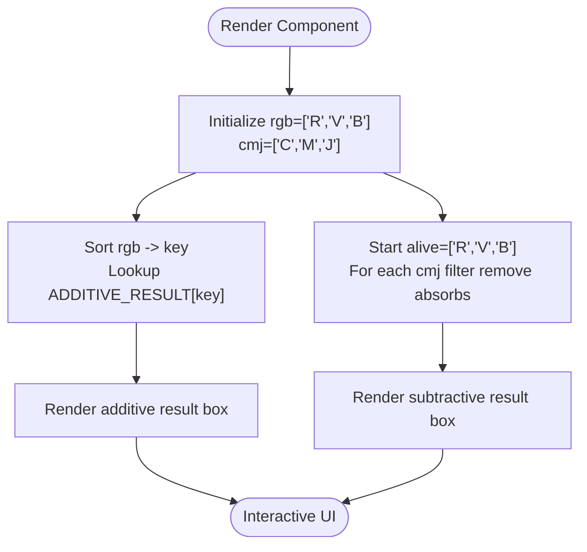
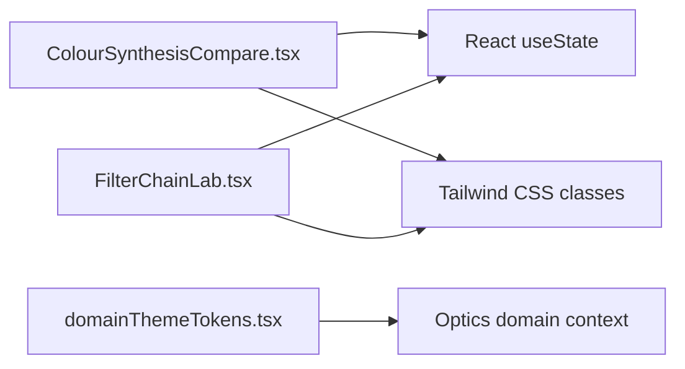

# Color Synthesis Comparison Tool

<cite>
**Referenced Files in This Document**
- [ColourSynthesisCompare.tsx](file://src/components/physics/ColourSynthesisCompare.tsx)
- [FilterChainLab.tsx](file://src/components/physics/FilterChainLab.tsx)
- [domainThemeTokens.tsx](file://src/components/physics/domainThemeTokens.tsx)
- [PhysicsCourseView.tsx](file://src/components/physics/PhysicsCourseView.tsx)
- [App.tsx](file://src/App.tsx)
</cite>

## Table of Contents
1. [Introduction](#introduction)
2. [Project Structure](#project-structure)
3. [Core Components](#core-components)
4. [Architecture Overview](#architecture-overview)
5. [Detailed Component Analysis](#detailed-component-analysis)
6. [Dependency Analysis](#dependency-analysis)
7. [Performance Considerations](#performance-considerations)
8. [Troubleshooting Guide](#troubleshooting-guide)
9. [Conclusion](#conclusion)
10. [Appendices](#appendices)

## Introduction
The Color Synthesis Comparison Tool is an interactive educational component that demonstrates the difference between additive and subtractive color mixing. It helps learners visualize how light sources combine (additive synthesis, RGB) versus how colored filters or pigments combine (subtractive synthesis, CMY). The tool provides real-time visual feedback as users toggle primary components, showing resulting colors for both models side by side.

This documentation explains:
- How the component implements RGB and CMY color models
- How user interactions update the visualization in real time
- Examples of primary, secondary, and tertiary combinations
- The physics behind light vs pigment mixing
- Guidance on extending the tool with additional color models or scenarios

## Project Structure
The Color Synthesis Comparison Tool lives within the Physics module of a larger educational application. It is implemented as a self-contained React component and integrates into the broader physics course view system.



**Diagram sources**
- [App.tsx:12-14](file://src/App.tsx#L12-L14)
- [PhysicsCourseView.tsx:1-35](file://src/components/physics/PhysicsCourseView.tsx#L1-L35)
- [domainThemeTokens.tsx:211-262](file://src/components/physics/domainThemeTokens.tsx#L211-L262)
- [ColourSynthesisCompare.tsx:1-6](file://src/components/physics/ColourSynthesisCompare.tsx#L1-L6)
- [FilterChainLab.tsx:1-6](file://src/components/physics/FilterChainLab.tsx#L1-L6)

**Section sources**
- [App.tsx:12-14](file://src/App.tsx#L12-L14)
- [PhysicsCourseView.tsx:1-35](file://src/components/physics/PhysicsCourseView.tsx#L1-L35)
- [domainThemeTokens.tsx:211-262](file://src/components/physics/domainThemeTokens.tsx#L211-L262)

## Core Components
- ColourSynthesisCompare: Main interactive component comparing additive (RGB) and subtractive (CMY) color synthesis.
- FilterChainLab: Related filter simulation demonstrating subtractive mixing through stacked optical filters.
- domainThemeTokens: Provides thematic tokens for the optics domain, including color model references.
- PhysicsCourseView: Renders physics courses and can host interactive blocks like this tool.
- App: Top-level application routing to the physics module and course views.

Key responsibilities:
- Manage state for selected RGB and CMY components
- Compute resulting colors based on additive union and subtractive intersection
- Render toggles and live result previews
- Provide bilingual labels and educational context

**Section sources**
- [ColourSynthesisCompare.tsx:1-174](file://src/components/physics/ColourSynthesisCompare.tsx#L1-L174)
- [FilterChainLab.tsx:1-38](file://src/components/physics/FilterChainLab.tsx#L1-L38)
- [domainThemeTokens.tsx:211-262](file://src/components/physics/domainThemeTokens.tsx#L211-L262)
- [PhysicsCourseView.tsx:1-35](file://src/components/physics/PhysicsCourseView.tsx#L1-L35)
- [App.tsx:12-14](file://src/App.tsx#L12-L14)

## Architecture Overview
The tool uses a simple state-driven architecture:
- User toggles RGB or CMY components
- State updates trigger recomputation of results
- UI re-renders with updated colors and explanatory text



**Diagram sources**
- [ColourSynthesisCompare.tsx:68-86](file://src/components/physics/ColourSynthesisCompare.tsx#L68-L86)
- [ColourSynthesisCompare.tsx:97-106](file://src/components/physics/ColourSynthesisCompare.tsx#L97-L106)
- [ColourSynthesisCompare.tsx:135-145](file://src/components/physics/ColourSynthesisCompare.tsx#L135-L145)

## Detailed Component Analysis

### ColourSynthesisCompare Component
This component renders two panels:
- Additive synthesis panel (RGB): Users toggle Red, Green, Blue lights; the result is computed by union of active components.
- Subtractive synthesis panel (CMY): Users toggle Cyan, Magenta, Yellow filters; the result is computed by intersection of passed components.

Data structures:
- RGB_META: Maps RGB keys to Arabic labels and hex colors.
- CMJ_META: Maps CMY keys to Arabic/French labels, hex colors, and which RGB component each filter absorbs.
- ADDITIVE_RESULT: Lookup table mapping sorted RGB combinations to resulting color name and hex.
- SUBTRACTIVE_RESULT: Lookup table mapping sorted CMY combinations to resulting color name and hex.

Interaction logic:
- Toggle function adds/removes components from arrays
- Additive result computed by sorting and joining selected RGB keys to lookup
- Subtractive result computed by filtering out absorbed RGB components per selected CMY filters



**Diagram sources**
- [ColourSynthesisCompare.tsx:68-86](file://src/components/physics/ColourSynthesisCompare.tsx#L68-L86)
- [ColourSynthesisCompare.tsx:88-126](file://src/components/physics/ColourSynthesisCompare.tsx#L88-L126)
- [ColourSynthesisCompare.tsx:128-169](file://src/components/physics/ColourSynthesisCompare.tsx#L128-L169)

#### Class-like structure
Although not using classes, the component organizes data and behavior similarly to a class-based design:

```mermaid
classDiagram
class ColourSynthesisCompare {
+rgb : string[]
+cmj : string[]
+toggle(list, set, key) void
+render() JSX
}
class RGB_META {
+R : { ar, hex }
+V : { ar, hex }
+B : { ar, hex }
}
class CMJ_META {
+C : { ar, fr, hex, absorbs }
+M : { ar, fr, hex, absorbs }
+J : { ar, fr, hex, absorbs }
}
class ADDITIVE_RESULT {
+RVB : { ar, hex }
+RV : { ar, hex }
+RB : { ar, hex }
+VB : { ar, hex }
+R : { ar, hex }
+V : { ar, hex }
+B : { ar, hex }
}
class SUBTRACTIVE_RESULT {
+"" : { ar, hex }
+CM : { ar, hex }
+CJ : { ar, hex }
+MJ : { ar, hex }
+C : { ar, hex }
+M : { ar, hex }
+J : { ar, hex }
}
ColourSynthesisCompare --> RGB_META : "uses"
ColourSynthesisCompare --> CMJ_META : "uses"
ColourSynthesisCompare --> ADDITIVE_RESULT : "lookup"
ColourSynthesisCompare --> SUBTRACTIVE_RESULT : "lookup"
```

**Diagram sources**
- [ColourSynthesisCompare.tsx:11-44](file://src/components/physics/ColourSynthesisCompare.tsx#L11-L44)
- [ColourSynthesisCompare.tsx:68-86](file://src/components/physics/ColourSynthesisCompare.tsx#L68-L86)

**Section sources**
- [ColourSynthesisCompare.tsx:11-44](file://src/components/physics/ColourSynthesisCompare.tsx#L11-L44)
- [ColourSynthesisCompare.tsx:68-86](file://src/components/physics/ColourSynthesisCompare.tsx#L68-L86)
- [ColourSynthesisCompare.tsx:88-169](file://src/components/physics/ColourSynthesisCompare.tsx#L88-L169)

### FilterChainLab Component
This related component simulates subtractive mixing using a stack of optical filters. It defines:
- Filter definitions with passes and absorbs properties
- RGB metadata for display
- Result color mappings for surviving RGB combinations

It complements the main comparison tool by providing a more granular filter stacking scenario.

**Section sources**
- [FilterChainLab.tsx:1-38](file://src/components/physics/FilterChainLab.tsx#L1-L38)

### Domain Theme Tokens
The optics domain theme includes references to RGB and CMY color models and their educational context. This ensures consistent terminology and symbols across the physics module.

**Section sources**
- [domainThemeTokens.tsx:211-262](file://src/components/physics/domainThemeTokens.tsx#L211-L262)

### Integration Points
- PhysicsCourseView hosts interactive blocks and can render the Color Synthesis Comparison Tool within a course section.
- App routes to the physics module and manages course selection and view modes.

**Section sources**
- [PhysicsCourseView.tsx:1-35](file://src/components/physics/PhysicsCourseView.tsx#L1-L35)
- [App.tsx:12-14](file://src/App.tsx#L12-L14)

## Dependency Analysis
The Color Synthesis Comparison Tool has minimal external dependencies:
- React hooks for state management
- Tailwind CSS classes for styling
- No direct imports from other modules within the component itself

Related components:
- FilterChainLab shares similar concepts but is independent
- Domain theme tokens provide contextual information but are not imported by the tool



**Diagram sources**
- [ColourSynthesisCompare.tsx:1-2](file://src/components/physics/ColourSynthesisCompare.tsx#L1-L2)
- [FilterChainLab.tsx:1-2](file://src/components/physics/FilterChainLab.tsx#L1-L2)
- [domainThemeTokens.tsx:211-262](file://src/components/physics/domainThemeTokens.tsx#L211-L262)

**Section sources**
- [ColourSynthesisCompare.tsx:1-2](file://src/components/physics/ColourSynthesisCompare.tsx#L1-L2)
- [FilterChainLab.tsx:1-2](file://src/components/physics/FilterChainLab.tsx#L1-L2)
- [domainThemeTokens.tsx:211-262](file://src/components/physics/domainThemeTokens.tsx#L211-L262)

## Performance Considerations
- State updates are lightweight: toggling components only modifies small arrays
- Computation is O(n) where n is number of selected filters (typically up to 3)
- Rendering is efficient due to small DOM tree and conditional styles
- No heavy computations or external API calls

Recommendations:
- Keep component state local to avoid unnecessary re-renders
- Memoize expensive computations if expanding to many color combinations
- Use CSS transitions for smoother UI feedback

[No sources needed since this section provides general guidance]

## Troubleshooting Guide
Common issues and resolutions:
- Unexpected black result in subtractive mode: Ensure all three RGB components are being filtered out; verify filter absorption mappings
- Incorrect additive result: Check that RGB selections are correctly sorted and matched to lookup table
- Bilingual label mismatches: Verify RGB_META and CMJ_META entries for correct Arabic/French labels

Debugging steps:
- Inspect component state arrays (rgb, cmj) during interaction
- Log intermediate values for alive components in subtractive computation
- Validate lookup keys against ADDITIVE_RESULT and SUBTRACTIVE_RESULT tables

**Section sources**
- [ColourSynthesisCompare.tsx:76-86](file://src/components/physics/ColourSynthesisCompare.tsx#L76-L86)
- [ColourSynthesisCompare.tsx:11-21](file://src/components/physics/ColourSynthesisCompare.tsx#L11-L21)

## Conclusion
The Color Synthesis Comparison Tool effectively demonstrates additive and subtractive color mixing through an intuitive interface. By combining clear state management, straightforward computation logic, and immediate visual feedback, it serves as an excellent educational resource for understanding RGB and CMY color models. The component’s modular design allows for easy extension to additional color models or educational scenarios.

[No sources needed since this section summarizes without analyzing specific files]

## Appendices

### Physics Behind Light vs Pigment Mixing
- Additive synthesis (light): Combining red, green, and blue light sources increases brightness; all three produce white light.
- Subtractive synthesis (pigment/filters): Each filter absorbs one RGB component; combining filters removes more components, approaching black.

Educational examples:
- Primary colors: R, G, B (light); C, M, Y (pigment)
- Secondary colors: Yellow (R+G), Magenta (R+B), Cyan (G+B) in additive; Blue (C+M), Green (C+Y), Red (M+Y) in subtractive
- Tertiary combinations: All three primaries yield white (additive) or black (subtractive ideal case)

[No sources needed since this section provides conceptual content]

### Extending the Tool
To add new color models or scenarios:
- Extend RGB_META and CMJ_META with new entries
- Add corresponding entries in ADDITIVE_RESULT and SUBTRACTIVE_RESULT
- Implement new toggle logic if necessary
- Update domain theme tokens for consistent terminology

Example extension points:
- Add RGBA or HSL support for advanced color manipulation
- Introduce real-world scenarios like printer ink mixing or stage lighting design
- Add quizzes or guided activities within the component

[No sources needed since this section provides conceptual guidance]