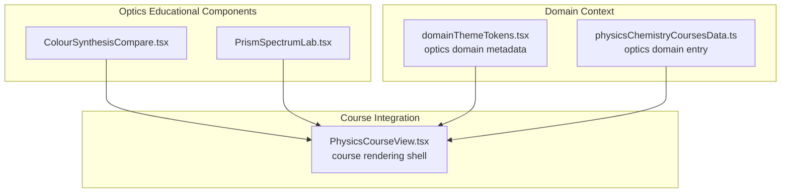
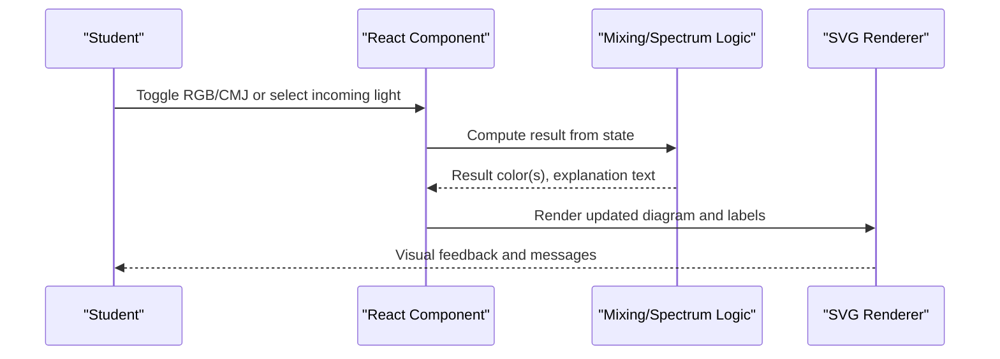
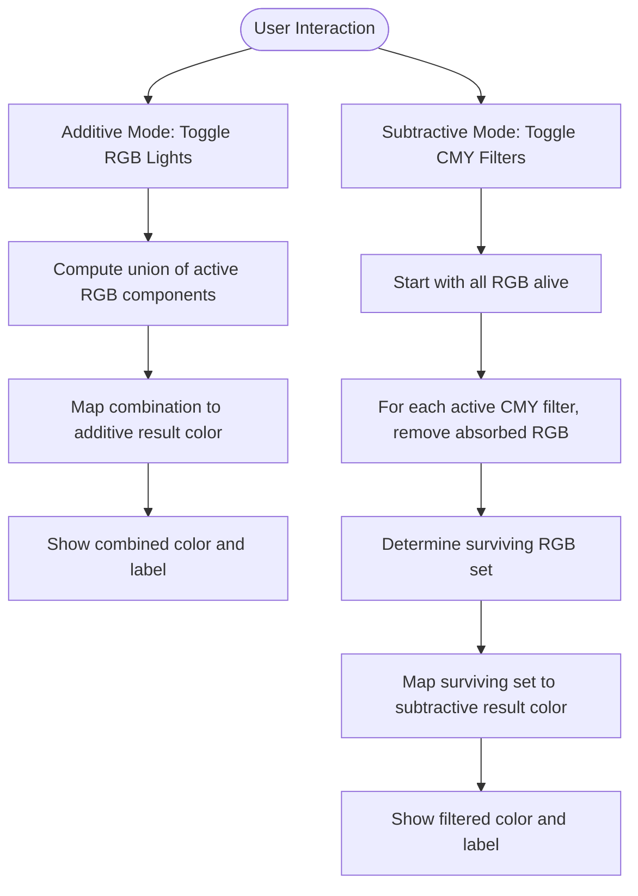
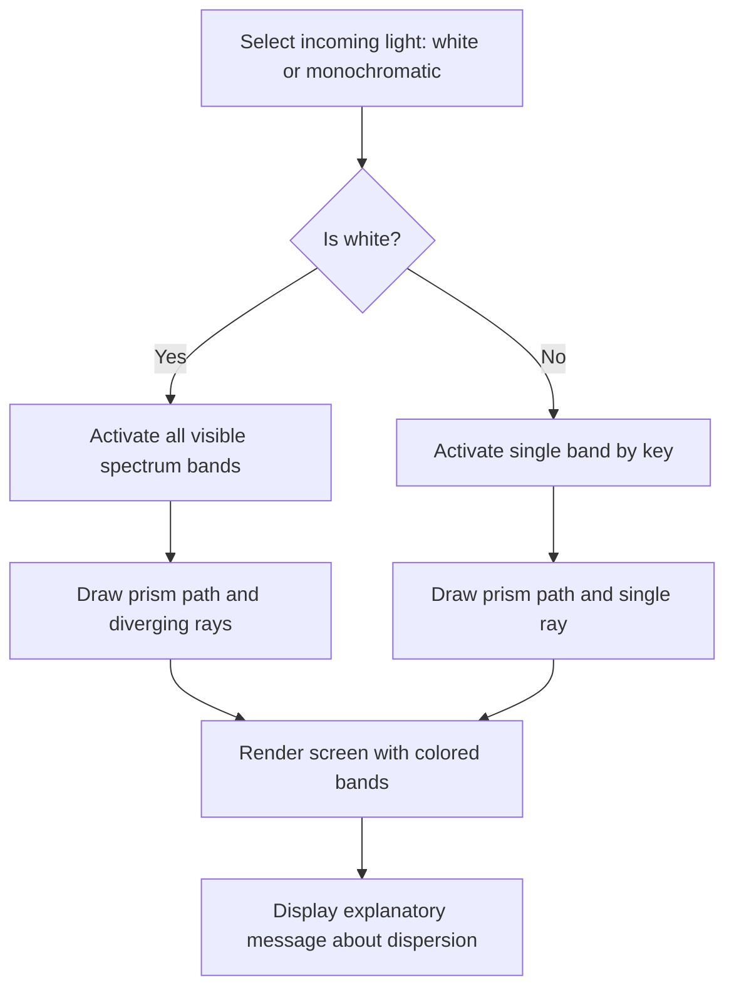
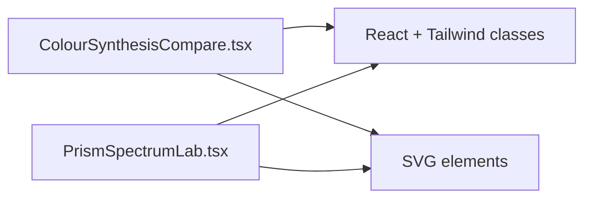

# Optical Phenomena

<cite>
**Referenced Files in This Document**
- [ColourSynthesisCompare.tsx](file://src/components/physics/ColourSynthesisCompare.tsx)
- [PrismSpectrumLab.tsx](file://src/components/physics/PrismSpectrumLab.tsx)
- [domainThemeTokens.tsx](file://src/components/physics/domainThemeTokens.tsx)
- [PhysicsCourseView.tsx](file://src/components/physics/PhysicsCourseView.tsx)
- [physicsChemistryCoursesData.ts](file://src/data/physicsChemistryCoursesData.ts)
</cite>

## Table of Contents
1. [Introduction](#introduction)
2. [Project Structure](#project-structure)
3. [Core Components](#core-components)
4. [Architecture Overview](#architecture-overview)
5. [Detailed Component Analysis](#detailed-component-analysis)
6. [Dependency Analysis](#dependency-analysis)
7. [Performance Considerations](#performance-considerations)
8. [Troubleshooting Guide](#troubleshooting-guide)
9. [Conclusion](#conclusion)

## Introduction
This document explains the optical phenomena educational components implemented for the physics curriculum, focusing on two interactive tools:
- Color synthesis comparison tool: additive (RGB) versus subtractive (CMY) mixing.
- Prism spectrum laboratory: decomposition of white light and behavior of monochromatic light through a prism.

These components visualize how light behaves, how colors mix, and how spectral analysis works. They are designed to be scientifically accurate at an introductory level while remaining accessible to students. The documentation covers implementation patterns, data flows, visual representations, and educational effectiveness.

## Project Structure
The optical components live under the physics module and are integrated into the broader course view system. The relevant files include:
- Two interactive React components for optics: color synthesis and prism spectrum.
- Domain theme tokens that define the optics domain metadata and presentation bullets.
- Physics course view and course data that provide context and navigation.

**Diagram sources**
- [ColourSynthesisCompare.tsx:1-174](file://src/components/physics/ColourSynthesisCompare.tsx#L1-L174)
- [PrismSpectrumLab.tsx:1-175](file://src/components/physics/PrismSpectrumLab.tsx#L1-L175)
- [domainThemeTokens.tsx:211-267](file://src/components/physics/domainThemeTokens.tsx#L211-L267)
- [physicsChemistryCoursesData.ts:14-43](file://src/data/physicsChemistryCoursesData.ts#L14-L43)
- [PhysicsCourseView.tsx:100-200](file://src/components/physics/PhysicsCourseView.tsx#L100-L200)

**Section sources**
- [domainThemeTokens.tsx:211-267](file://src/components/physics/domainThemeTokens.tsx#L211-L267)
- [physicsChemistryCoursesData.ts:14-43](file://src/data/physicsChemistryCoursesData.ts#L14-L43)
- [PhysicsCourseView.tsx:100-200](file://src/components/physics/PhysicsCourseView.tsx#L100-L200)

## Core Components
Two primary interactive components implement the optical concepts:

- ColourSynthesisCompare: Demonstrates additive (RGB) and subtractive (CMY) color mixing with toggles and immediate visual feedback. It models RGB as light sources and CMY as filters absorbing specific RGB components.
- PrismSpectrumLab: Simulates white light entering a prism and splitting into visible spectrum bands, or a single monochromatic beam passing through without dispersion.

Both components use React state to manage user interactions and render SVG-based visuals for clarity.

**Section sources**
- [ColourSynthesisCompare.tsx:1-174](file://src/components/physics/ColourSynthesisCompare.tsx#L1-L174)
- [PrismSpectrumLab.tsx:1-175](file://src/components/physics/PrismSpectrumLab.tsx#L1-L175)

## Architecture Overview
The components follow a simple, cohesive architecture:
- State-driven UI: User toggles update component state.
- Deterministic computation: Mixing results are computed from current state using predefined mappings and rules.
- Visual rendering: SVG diagrams illustrate light paths, prisms, screens, and resulting colors.
- Educational messaging: Textual explanations accompany visuals to reinforce scientific concepts.

[No sources needed since this diagram shows conceptual workflow, not actual code structure]

## Detailed Component Analysis

### Color Synthesis Comparison Tool
This tool compares additive and subtractive color mixing:
- Additive mixing starts from darkness and combines RGB light sources.
- Subtractive mixing starts from white light and applies CMY filters that absorb specific RGB components.

Key behaviors:
- RGB toggles enable or disable red, green, blue light sources.
- CMY toggles enable or disable cyan, magenta, yellow filters; each filter absorbs one RGB component.
- Results are mapped to predefined color outputs for common combinations.

**Diagram sources**
- [ColourSynthesisCompare.tsx:68-86](file://src/components/physics/ColourSynthesisCompare.tsx#L68-L86)
- [ColourSynthesisCompare.tsx:97-126](file://src/components/physics/ColourSynthesisCompare.tsx#L97-L126)
- [ColourSynthesisCompare.tsx:135-169](file://src/components/physics/ColourSynthesisCompare.tsx#L135-L169)

Educational notes:
- Additive model aligns with emissive displays and light sources.
- Subtractive model aligns with pigments/filters and printed media.
- The interface explicitly states absorption relationships for CMY filters, aiding understanding of why certain colors disappear.

**Section sources**
- [ColourSynthesisCompare.tsx:11-24](file://src/components/physics/ColourSynthesisCompare.tsx#L11-L24)
- [ColourSynthesisCompare.tsx:26-44](file://src/components/physics/ColourSynthesisCompare.tsx#L26-L44)
- [ColourSynthesisCompare.tsx:68-86](file://src/components/physics/ColourSynthesisCompare.tsx#L68-L86)
- [ColourSynthesisCompare.tsx:97-169](file://src/components/physics/ColourSynthesisCompare.tsx#L97-L169)

### Prism Spectrum Laboratory
This lab demonstrates:
- White light decomposes into a continuous spectrum due to wavelength-dependent refraction.
- Monochromatic light passes through the prism and remains a single color, only deviated.

Key behaviors:
- Incoming light can be white or a selected monochromatic color.
- For white light, multiple bands are drawn with increasing vertical offset representing greater deviation for shorter wavelengths.
- For monochromatic light, a single band is shown with no dispersion.

**Diagram sources**
- [PrismSpectrumLab.tsx:29-38](file://src/components/physics/PrismSpectrumLab.tsx#L29-L38)
- [PrismSpectrumLab.tsx:44-77](file://src/components/physics/PrismSpectrumLab.tsx#L44-L77)
- [PrismSpectrumLab.tsx:79-145](file://src/components/physics/PrismSpectrumLab.tsx#L79-L145)
- [PrismSpectrumLab.tsx:147-170](file://src/components/physics/PrismSpectrumLab.tsx#L147-L170)

Educational notes:
- The offsets simulate increasing deviation for shorter wavelengths (violet more than red).
- The screen visualization helps students connect theory (dispersion) with observable outcomes.
- Explanatory text clarifies why white light splits and monochromatic light does not.

**Section sources**
- [PrismSpectrumLab.tsx:8-27](file://src/components/physics/PrismSpectrumLab.tsx#L8-L27)
- [PrismSpectrumLab.tsx:29-38](file://src/components/physics/PrismSpectrumLab.tsx#L29-L38)
- [PrismSpectrumLab.tsx:79-145](file://src/components/physics/PrismSpectrumLab.tsx#L79-L145)
- [PrismSpectrumLab.tsx:147-170](file://src/components/physics/PrismSpectrumLab.tsx#L147-L170)

### Scientific Accuracy and Educational Effectiveness
- Light propagation model: Both components use simplified but conceptually sound models appropriate for middle school optics. Additive/subtractive mixing follows standard RGB/CMY conventions; prism dispersion uses relative offsets to represent wavelength dependence.
- Visual approach: Immediate visual feedback supports intuitive understanding. Labels and messages reinforce terminology and reasoning.
- Experimentation: Students can toggle RGB/CMY and observe outcomes, or switch between white and monochromatic light to explore dispersion vs. non-dispersion.

[No sources needed since this section provides general guidance]

## Dependency Analysis
The components are self-contained React modules with minimal external dependencies beyond UI styling. They do not import shared physics engines; instead, they implement logic directly within the component.

[No sources needed since this diagram shows conceptual relationships, not actual imports]

**Section sources**
- [ColourSynthesisCompare.tsx:1-174](file://src/components/physics/ColourSynthesisCompare.tsx#L1-L174)
- [PrismSpectrumLab.tsx:1-175](file://src/components/physics/PrismSpectrumLab.tsx#L1-L175)

## Performance Considerations
- Lightweight state updates: Toggling inputs triggers small computations and re-renders.
- SVG rendering: Static geometry with dynamic attributes ensures efficient redraws.
- No heavy libraries: Avoids runtime overhead associated with complex simulation engines.

[No sources needed since this section provides general guidance]

## Troubleshooting Guide
Common issues and resolutions:
- Incorrect color output in additive mode: Ensure the correct RGB combination is selected; verify mapping keys match expected combinations.
- Unexpected black in subtractive mode: All RGB components may have been absorbed by CMY filters; deselect some filters to allow residual colors.
- No dispersion observed: Confirm incoming light is set to white; monochromatic selection will show a single band.

**Section sources**
- [ColourSynthesisCompare.tsx:68-86](file://src/components/physics/ColourSynthesisCompare.tsx#L68-L86)
- [ColourSynthesisCompare.tsx:135-169](file://src/components/physics/ColourSynthesisCompare.tsx#L135-L169)
- [PrismSpectrumLab.tsx:29-38](file://src/components/physics/PrismSpectrumLab.tsx#L29-L38)

## Conclusion
The optical phenomena components provide clear, interactive demonstrations of color synthesis and spectral dispersion. They balance scientific accuracy with pedagogical clarity, enabling students to experiment with light behavior and deepen their understanding of optics through visual feedback and concise explanations.

[No sources needed since this section summarizes without analyzing specific files]