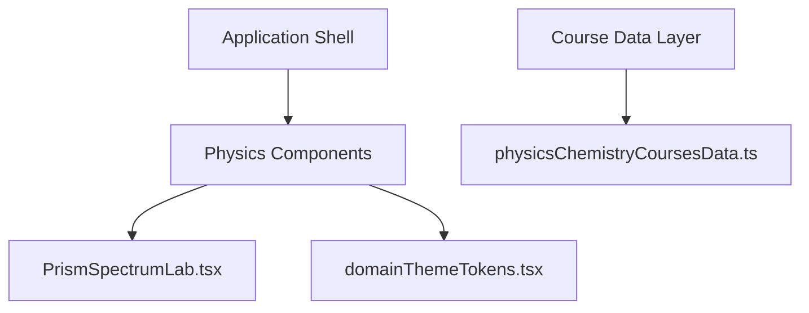
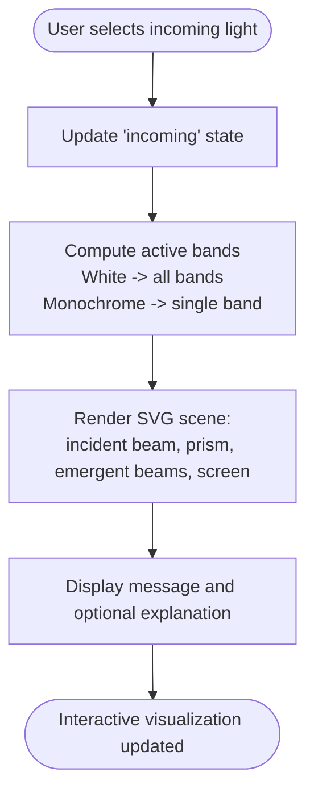
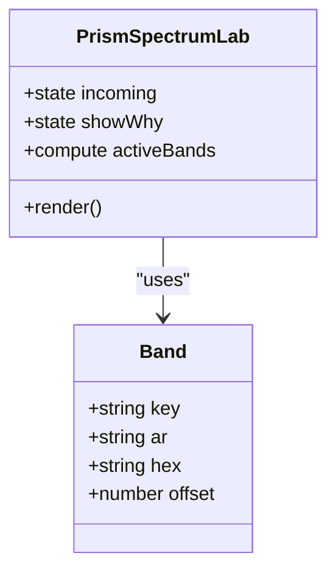
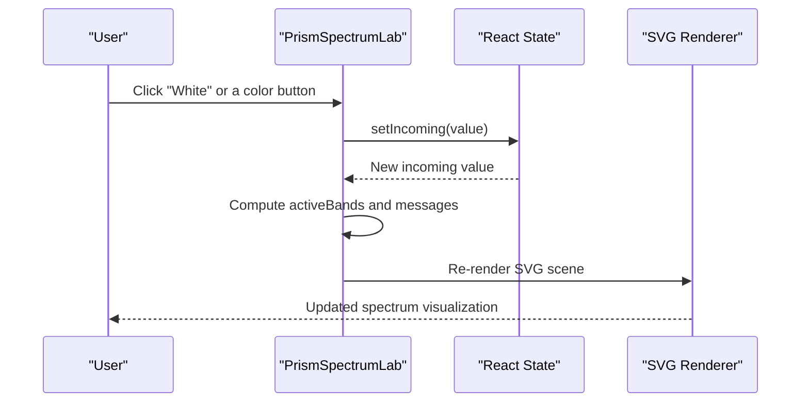
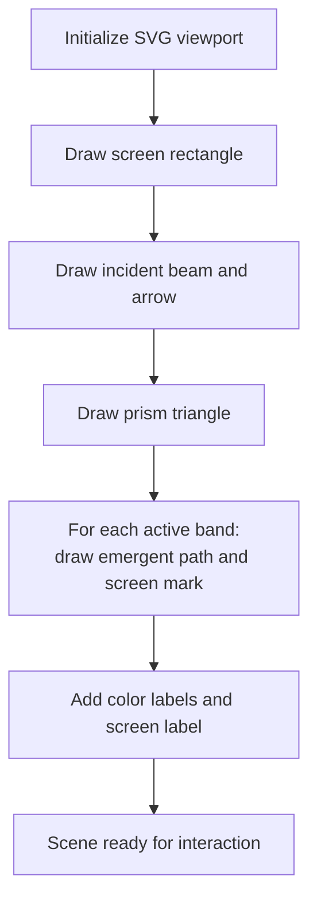
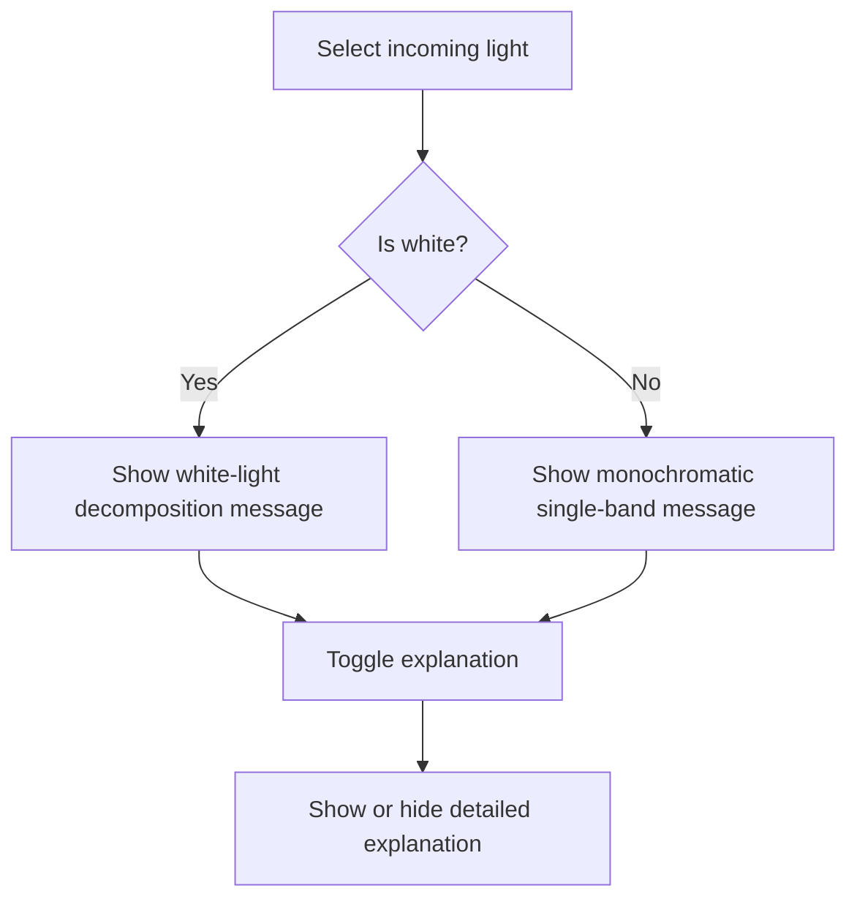
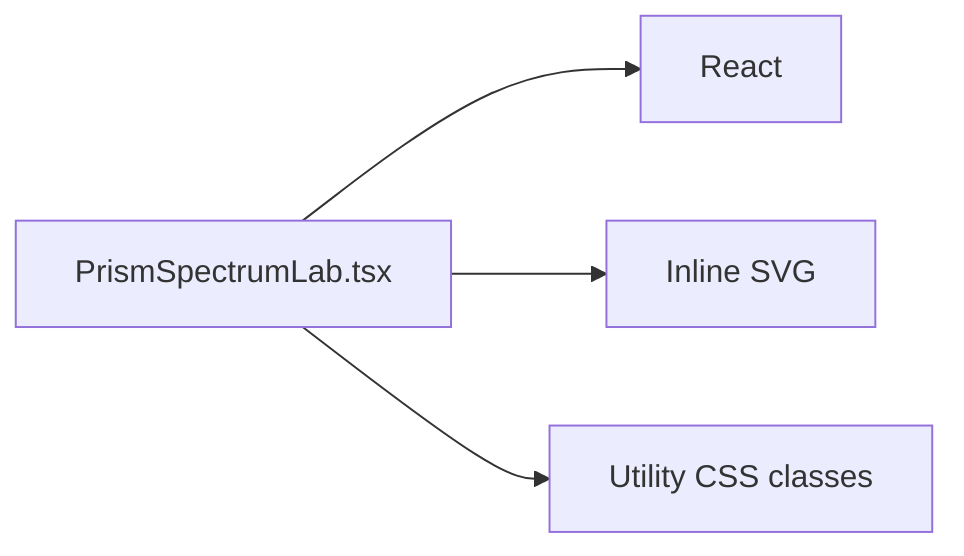

# Prism Spectrum Laboratory

<cite>
**Referenced Files in This Document**
- [PrismSpectrumLab.tsx](file://src/components/physics/PrismSpectrumLab.tsx)
- [domainThemeTokens.tsx](file://src/components/physics/domainThemeTokens.tsx)
- [physicsChemistryCoursesData.ts](file://src/data/physicsChemistryCoursesData.ts)
</cite>

## Table of Contents
1. [Introduction](#introduction)
2. [Project Structure](#project-structure)
3. [Core Components](#core-components)
4. [Architecture Overview](#architecture-overview)
5. [Detailed Component Analysis](#detailed-component-analysis)
6. [Dependency Analysis](#dependency-analysis)
7. [Performance Considerations](#performance-considerations)
8. [Troubleshooting Guide](#troubleshooting-guide)
9. [Conclusion](#conclusion)
10. [Appendices](#appendices)

## Introduction
The Prism Spectrum Laboratory is an interactive educational visualization that demonstrates how white light can be decomposed into a visible spectrum by a prism, and how monochromatic light remains a single band after refraction. It is designed for middle-school physics learning around optical phenomena, specifically the decomposition of white light and spectral analysis.

At its core, the component renders:
- An incident beam (white or monochromatic).
- A triangular prism shape.
- Emergent beams on a screen, with color-coded bands representing different wavelengths.
- Arabic labels and explanations to support bilingual pedagogy.

This document explains the component’s structure, data model, rendering logic, user interactions, scientific accuracy, and opportunities for extension toward more realistic dispersion modeling.

## Project Structure
The Prism Spectrum Laboratory lives inside the physics components folder as a self-contained React component. It does not depend on other simulation engines; it uses inline SVG for drawing and React state for interactivity.

**Diagram sources**
- [PrismSpectrumLab.tsx:1-175](file://src/components/physics/PrismSpectrumLab.tsx#L1-L175)
- [domainThemeTokens.tsx:240-245](file://src/components/physics/domainThemeTokens.tsx#L240-L245)
- [physicsChemistryCoursesData.ts:37-43](file://src/data/physicsChemistryCoursesData.ts#L37-L43)

**Section sources**
- [PrismSpectrumLab.tsx:1-175](file://src/components/physics/PrismSpectrumLab.tsx#L1-L175)
- [domainThemeTokens.tsx:240-245](file://src/components/physics/domainThemeTokens.tsx#L240-L245)
- [physicsChemistryCoursesData.ts:37-43](file://src/data/physicsChemistryCoursesData.ts#L37-L43)

## Core Components
The main component is `PrismSpectrumLab`. It provides:
- A selector for incoming light: white or one of six visible colors.
- A visual scene rendered with SVG elements.
- Explanatory text in Arabic describing the phenomenon.
- A toggleable explanation panel.

Key responsibilities:
- State management for selected input light.
- Computation of which bands to render.
- Rendering of incident beam, prism, emergent beams, and screen marks.
- Displaying contextual messages and explanations.

**Section sources**
- [PrismSpectrumLab.tsx:8-27](file://src/components/physics/PrismSpectrumLab.tsx#L8-L27)
- [PrismSpectrumLab.tsx:29-43](file://src/components/physics/PrismSpectrumLab.tsx#L29-L43)
- [PrismSpectrumLab.tsx:44-171](file://src/components/physics/PrismSpectrumLab.tsx#L44-L171)

## Architecture Overview
The component follows a simple React functional architecture:
- Input selection updates React state.
- Derived values compute active bands and explanatory messages.
- The JSX tree renders SVG geometry and labels.
- No external physics engine is used; dispersion is represented by fixed offsets per color.

[No sources needed since this diagram shows conceptual workflow, not actual code structure]

## Detailed Component Analysis

### Data Model: Color Bands
The component defines a small data model for visible color bands:
- Each band has a key, Arabic label, hex color, and a vertical offset on the screen.
- White light activates all bands; monochromatic light activates only the selected band.

**Diagram sources**
- [PrismSpectrumLab.tsx:8-27](file://src/components/physics/PrismSpectrumLab.tsx#L8-L27)
- [PrismSpectrumLab.tsx:29-43](file://src/components/physics/PrismSpectrumLab.tsx#L29-L43)

**Section sources**
- [PrismSpectrumLab.tsx:8-27](file://src/components/physics/PrismSpectrumLab.tsx#L8-L27)

### User Interaction Flow
Users interact through buttons to select the incoming light type. The component responds by updating state and re-rendering the scene accordingly.

**Diagram sources**
- [PrismSpectrumLab.tsx:44-77](file://src/components/physics/PrismSpectrumLab.tsx#L44-L77)
- [PrismSpectrumLab.tsx:79-145](file://src/components/physics/PrismSpectrumLab.tsx#L79-L145)

**Section sources**
- [PrismSpectrumLab.tsx:44-77](file://src/components/physics/PrismSpectrumLab.tsx#L44-L77)
- [PrismSpectrumLab.tsx:79-145](file://src/components/physics/PrismSpectrumLab.tsx#L79-L145)

### Rendering Logic: Incident Beam, Prism, and Screen
The SVG scene includes:
- A screen rectangle on the right side.
- An incident beam line and arrow pointing toward the prism.
- A triangular prism shape.
- Emergent beams for each active band, ending at colored rectangles on the screen.
- Labels identifying colors and the screen.

**Diagram sources**
- [PrismSpectrumLab.tsx:79-145](file://src/components/physics/PrismSpectrumLab.tsx#L79-L145)

**Section sources**
- [PrismSpectrumLab.tsx:79-145](file://src/components/physics/PrismSpectrumLab.tsx#L79-L145)

### Educational Messaging
The component displays:
- A contextual message explaining whether white light decomposes or monochromatic light remains single.
- A toggleable explanation panel showing why dispersion occurs for white light and why monochromatic light does not split.

**Diagram sources**
- [PrismSpectrumLab.tsx:36-43](file://src/components/physics/PrismSpectrumLab.tsx#L36-L43)
- [PrismSpectrumLab.tsx:147-171](file://src/components/physics/PrismSpectrumLab.tsx#L147-L171)

**Section sources**
- [PrismSpectrumLab.tsx:36-43](file://src/components/physics/PrismSpectrumLab.tsx#L36-L43)
- [PrismSpectrumLab.tsx:147-171](file://src/components/physics/PrismSpectrumLab.tsx#L147-L171)

## Dependency Analysis
The component has minimal dependencies:
- React hooks for state.
- Inline SVG for rendering.
- Tailwind-like utility classes for styling.

It does not import physics libraries or external simulation engines. Its coupling is low, making it easy to extend or embed within larger course pages.

**Diagram sources**
- [PrismSpectrumLab.tsx:1-2](file://src/components/physics/PrismSpectrumLab.tsx#L1-L2)
- [PrismSpectrumLab.tsx:44-171](file://src/components/physics/PrismSpectrumLab.tsx#L44-L171)

**Section sources**
- [PrismSpectrumLab.tsx:1-2](file://src/components/physics/PrismSpectrumLab.tsx#L1-L2)
- [PrismSpectrumLab.tsx:44-171](file://src/components/physics/PrismSpectrumLab.tsx#L44-L171)

## Performance Considerations
- Rendering is lightweight: a small number of SVG elements and simple state updates.
- No heavy computations or external libraries are involved.
- For large-scale integration, consider memoizing derived values if many instances are rendered simultaneously.

[No sources needed since this section provides general guidance]

## Troubleshooting Guide
Common issues and resolutions:
- Colors do not appear on the screen: verify that the selected band’s offset produces a visible position within the SVG viewport.
- Labels overlap: adjust label positions or reduce the number of simultaneous bands.
- Arabic text alignment: ensure the container direction is set correctly for RTL content.

**Section sources**
- [PrismSpectrumLab.tsx:44-46](file://src/components/physics/PrismSpectrumLab.tsx#L44-L46)
- [PrismSpectrumLab.tsx:125-145](file://src/components/physics/PrismSpectrumLab.tsx#L125-L145)

## Conclusion
The Prism Spectrum Laboratory offers a clear, interactive demonstration of white light decomposition and monochromatic behavior through a prism. While it uses simplified visual offsets rather than a full Snell’s law solver, it effectively supports classroom exploration of spectral concepts. Extensions could introduce adjustable angles, refractive indices, and continuous spectra to deepen scientific accuracy and hands-on experimentation.

[No sources needed since this section summarizes without analyzing specific files]

## Appendices

### Scientific Accuracy and Educational Value
- Current implementation represents dispersion qualitatively using fixed offsets per color.
- It does not implement Snell’s law calculations, wavelength-dependent refractive indices, or UV/IR extensions.
- Educational value lies in observable outcomes: white light splits into visible colors; monochromatic light remains a single band.

To increase scientific accuracy:
- Implement Snell’s law: n1 sin(θ1) = n2 sin(θ2), with angle-of-incidence controls.
- Add a dispersion model where refractive index varies with wavelength (e.g., Cauchy or Sellmeier equations).
- Extend the spectrum beyond visible range to include UV and IR bands with appropriate labeling.
- Provide real-time calculation of deviation angles and refractive indices for student exploration.

[No sources needed since this section provides general guidance]

### Integration Context
The optics domain description references white light decomposition and visible spectrum analysis, aligning with the component’s purpose.

**Section sources**
- [physicsChemistryCoursesData.ts:37-43](file://src/data/physicsChemistryCoursesData.ts#L37-L43)
- [domainThemeTokens.tsx:240-245](file://src/components/physics/domainThemeTokens.tsx#L240-L245)