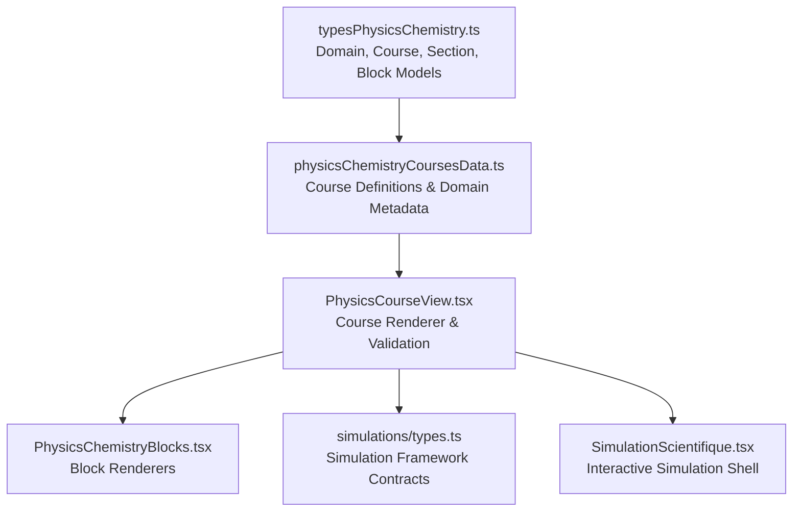
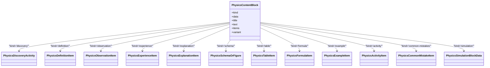
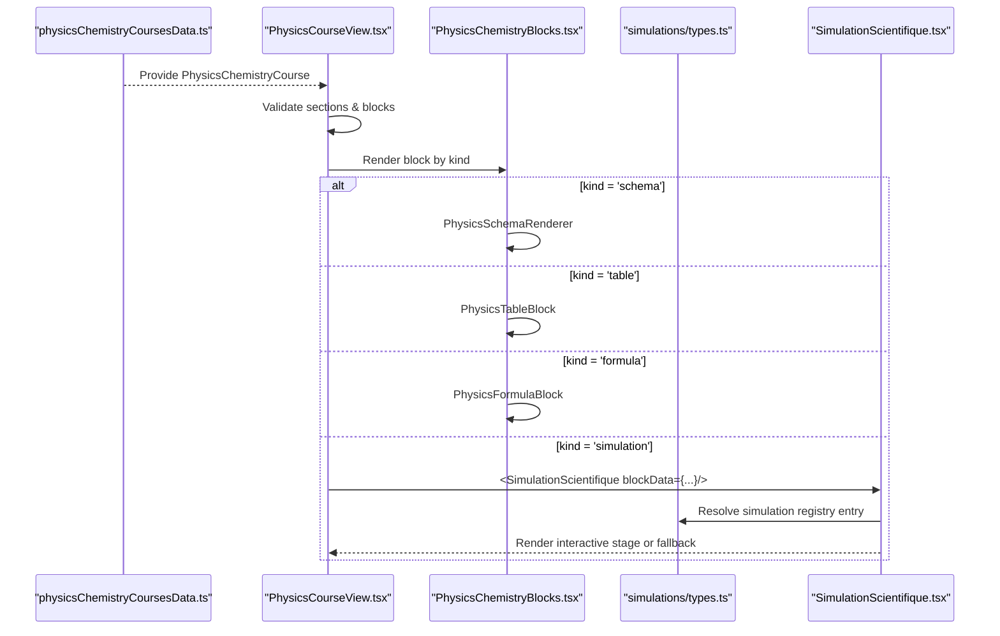
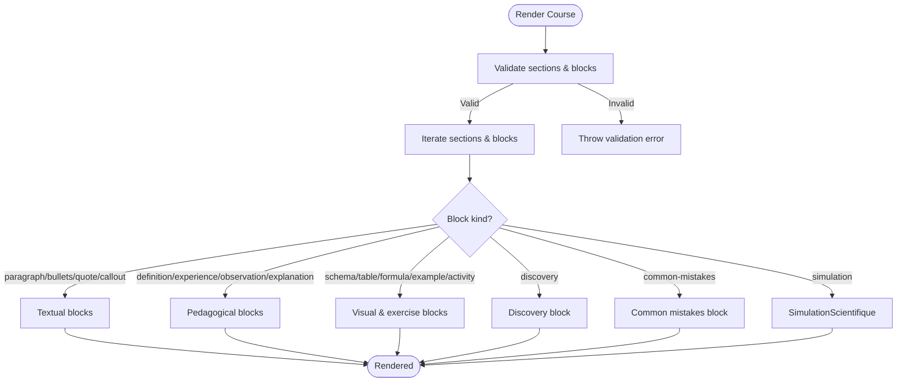
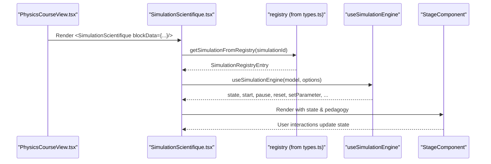
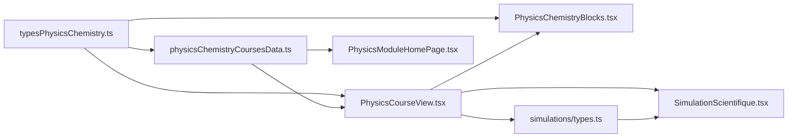

# Course Structure Management

<cite>
**Referenced Files in This Document**
- [typesPhysicsChemistry.ts](file://src/typesPhysicsChemistry.ts)
- [physicsChemistryCoursesData.ts](file://src/data/physicsChemistryCoursesData.ts)
- [PhysicsCourseView.tsx](file://src/components/physics/PhysicsCourseView.tsx)
- [PhysicsModuleHomePage.tsx](file://src/components/physics/PhysicsModuleHomePage.tsx)
- [PhysicsChemistryBlocks.tsx](file://src/components/physics/PhysicsChemistryBlocks.tsx)
- [types.ts](file://src/components/physics/simulations/types.ts)
- [SimulationScientifique.tsx](file://src/components/physics/simulations/SimulationScientifique.tsx)
</cite>

## Table of Contents
1. [Introduction](#introduction)
2. [Project Structure](#project-structure)
3. [Core Components](#core-components)
4. [Architecture Overview](#architecture-overview)
5. [Detailed Component Analysis](#detailed-component-analysis)
6. [Dependency Analysis](#dependency-analysis)
7. [Performance Considerations](#performance-considerations)
8. [Troubleshooting Guide](#troubleshooting-guide)
9. [Conclusion](#conclusion)

## Introduction
This document explains the course structure management system for the Physics-Chemistry module. It focuses on how educational content is modeled, validated, and rendered, with special attention to:
- The data models defined in `typesPhysicsChemistry.ts`, including `PhysicsContentBlock`, `PhysicsCourseSection`, and related interfaces.
- How course data is organized and populated in `physicsChemistryCoursesData.ts`.
- How the UI renders structured sections and blocks through `PhysicsCourseView.tsx` and `PhysicsChemistryBlocks.tsx`.
- How interactive simulations are integrated via the simulation framework types and runtime components.

The goal is to make the system understandable for both technical contributors and educators who define course content.

## Project Structure
At a high level, the system separates concerns into three layers:
- Data model layer: TypeScript interfaces describing courses, sections, and content blocks.
- Data layer: Course definitions and domain metadata.
- Presentation layer: React components that render sections, blocks, schemas, tables, formulas, activities, and simulations.



**Diagram sources**
- [typesPhysicsChemistry.ts:5-395](file://src/typesPhysicsChemistry.ts#L5-L395)
- [physicsChemistryCoursesData.ts:1-92](file://src/data/physicsChemistryCoursesData.ts#L1-L92)
- [PhysicsCourseView.tsx:100-401](file://src/components/physics/PhysicsCourseView.tsx#L100-L401)
- [PhysicsChemistryBlocks.tsx:192-457](file://src/components/physics/PhysicsChemistryBlocks.tsx#L192-L457)
- [types.ts:98-107](file://src/components/physics/simulations/types.ts#L98-L107)
- [SimulationScientifique.tsx:138-170](file://src/components/physics/simulations/SimulationScientifique.tsx#L138-L170)

**Section sources**
- [typesPhysicsChemistry.ts:5-395](file://src/typesPhysicsChemistry.ts#L5-L395)
- [physicsChemistryCoursesData.ts:1-92](file://src/data/physicsChemistryCoursesData.ts#L1-L92)
- [PhysicsCourseView.tsx:100-401](file://src/components/physics/PhysicsCourseView.tsx#L100-L401)
- [PhysicsChemistryBlocks.tsx:192-457](file://src/components/physics/PhysicsChemistryBlocks.tsx#L192-L457)
- [types.ts:98-107](file://src/components/physics/simulations/types.ts#L98-L107)
- [SimulationScientifique.tsx:138-170](file://src/components/physics/simulations/SimulationScientifique.tsx#L138-L170)

## Core Components
This section documents the core data models and their relationships.

### Domain and Trilingual Terminology
- `PhysicsDomainId`: A small set of domains (matter, energy, electricity, optics, general).
- `TrilingualTerm`: Supports Arabic, French, optional English, plus symbol/formula and explanation fields.

These enable multilingual labeling and consistent terminology across the app.

**Section sources**
- [typesPhysicsChemistry.ts:5-18](file://src/typesPhysicsChemistry.ts#L5-L18)

### Content Building Blocks
`PhysicsContentBlock` is a discriminated union representing every possible pedagogical block type inside a section. Supported kinds include:
- Textual: `paragraph`, `bullets`, `quote`, `callout`
- Pedagogical structures: `discovery`, `definition`, `observation`, `experience`, `explanation`, `common-mistakes`
- Visuals and data: `schema`, `table`, `formula`, `example`, `activity`
- Interactive: `simulation`

Each kind carries a strongly typed payload (e.g., `PhysicsDefinitionItem`, `PhysicsSchemaOrFigure`, `PhysicsFormulaItem`).



**Diagram sources**
- [typesPhysicsChemistry.ts:306-323](file://src/typesPhysicsChemistry.ts#L306-L323)
- [typesPhysicsChemistry.ts:242-300](file://src/typesPhysicsChemistry.ts#L242-L300)
- [types.ts:98-107](file://src/components/physics/simulations/types.ts#L98-L107)

**Section sources**
- [typesPhysicsChemistry.ts:306-323](file://src/typesPhysicsChemistry.ts#L306-L323)
- [typesPhysicsChemistry.ts:242-300](file://src/typesPhysicsChemistry.ts#L242-L300)
- [types.ts:98-107](file://src/components/physics/simulations/types.ts#L98-L107)

### Sections and Courses
- `PhysicsCourseSection`: Represents a numbered section within a course, containing an ordered array of `PhysicsContentBlock`s.
- `PhysicsChemistryCourse`: The top-level course object with metadata, objectives, prerequisites, discovery activity, sections, and optional collections such as definitions, observations, experiences, explanations, schemas, figures, tables, formulas, examples, activities, applications, questions, corrections, vocabulary, summary, key ideas, final notes, and essential points.

```mermaid
classDiagram
class PhysicsCourseSection {
+string id
+string number
+string titleArabic
+string? titleFrench
+string? shortLabel
+PhysicsContentBlock[] blocks
}
class PhysicsChemistryCourse {
+string id
+string numero
+string titre
+string titreArabe
+string? titreNeutreArabe
+string? sousTitreNeutre
+string? titreFrancais
+string? titreAnglais
+{arabe : string; francais : string}[] sousTitresBilingues
+string matiere
+string niveau
+PhysicsDomainId domaine
+string domaineNomArabe
+string domaineNomFrancais
+string? duree
+string status
+string[] objectifs
+string[]? prerequis
+string? introduction
+PhysicsCourseEssential? essential
+PhysicsDiscoveryActivity? discoveryActivity
+PhysicsCourseSection[] sections
+PhysicsCommonMistakeItem[]? commonMistakes
+PhysicsSimulationBlockData[]? simulations
+PhysicsDefinitionItem[]? definitions
+PhysicsObservationItem[]? observations
+PhysicsExperienceItem[]? experiences
+PhysicsExplanationItem[]? explications
+PhysicsSchemaOrFigure[]? schemas
+PhysicsSchemaOrFigure[]? figures
+PhysicsTableItem[]? tableaux
+PhysicsFormulaItem[]? formules
+PhysicsExampleItem[]? exemples
+PhysicsActivityItem[]? activites
+PhysicsApplicationQuestion[]? applications
+string[]? questions
+string[]? correction
+TrilingualTerm[] vocabulaire
+string[]? resume
+string? ideeCle
+string? noteFinale
+{number : number; string title; string description; string? formulaOrSymbol}[] pointsEssentiels
}
PhysicsChemistryCourse --> PhysicsCourseSection : "has many"
PhysicsCourseSection --> PhysicsContentBlock : "contains"
```

**Diagram sources**
- [typesPhysicsChemistry.ts:325-395](file://src/typesPhysicsChemistry.ts#L325-L395)

**Section sources**
- [typesPhysicsChemistry.ts:325-395](file://src/typesPhysicsChemistry.ts#L325-L395)

## Architecture Overview
The rendering pipeline connects data models to UI components:
1. Course data is defined in `physicsChemistryCoursesData.ts`.
2. `PhysicsCourseView.tsx` validates and renders a single course.
3. For each section, it iterates over `blocks` and delegates to specialized block renderers in `PhysicsChemistryBlocks.tsx`.
4. Schemas, tables, formulas, and other visuals are rendered by dedicated components.
5. Simulations are embedded via `SimulationScientifique.tsx`, which uses the simulation framework contracts from `types.ts`.



**Diagram sources**
- [physicsChemistryCoursesData.ts:154-495](file://src/data/physicsChemistryCoursesData.ts#L154-L495)
- [PhysicsCourseView.tsx:260-401](file://src/components/physics/PhysicsCourseView.tsx#L260-L401)
- [PhysicsChemistryBlocks.tsx:192-457](file://src/components/physics/PhysicsChemistryBlocks.tsx#L192-L457)
- [types.ts:98-107](file://src/components/physics/simulations/types.ts#L98-L107)
- [SimulationScientifique.tsx:138-170](file://src/components/physics/simulations/SimulationScientifique.tsx#L138-L170)

**Section sources**
- [PhysicsCourseView.tsx:260-401](file://src/components/physics/PhysicsCourseView.tsx#L260-L401)
- [PhysicsChemistryBlocks.tsx:192-457](file://src/components/physics/PhysicsChemistryBlocks.tsx#L192-L457)
- [SimulationScientifique.tsx:138-170](file://src/components/physics/simulations/SimulationScientifique.tsx#L138-L170)

## Detailed Component Analysis

### Data Model: PhysicsContentBlock and Related Interfaces
- `PhysicsContentBlock` is the central polymorphic type for all content units.
- Payload interfaces provide rich semantics:
  - `PhysicsDiscoveryActivity`: Structured discovery with concrete situation, observation table, guided questions, hints, and correction.
  - `PhysicsDefinitionItem`: Title and content in multiple languages, examples, and notes.
  - `PhysicsSchemaOrFigure`: Strongly typed diagram identifiers, captions, annotations, and chain nodes for energy chains.
  - `PhysicsFormulaItem`: Chemical equations, physical laws, symbols, LaTeX support, units, variables, and conditions.
  - `PhysicsExampleItem`: Step-by-step worked examples with optional formulas.
  - `PhysicsActivityItem`: Situations, optional tables/schemas, questions, and correction.
  - `PhysicsCommonMistakeItem`: Incorrect vs correct statements with explanations and rules.
  - `PhysicsSimulationBlockData`: Lightweight declaration linking a course block to a registered simulation.

Validation and rendering rely on these shapes to ensure consistency between authoring and display.

**Section sources**
- [typesPhysicsChemistry.ts:242-323](file://src/typesPhysicsChemistry.ts#L242-L323)
- [types.ts:98-107](file://src/components/physics/simulations/types.ts#L98-L107)

### Course Data Organization: physicsChemistryCoursesData.ts
- Defines domain metadata (`PHYSICS_DOMAINS`) and helper functions to create course slots.
- Provides fully populated example courses (e.g., Course 01 and Course 02), demonstrating:
  - Discovery activities with real-world situations, observation tables, guided questions, and conclusions.
  - Sectioned content using `PhysicsContentBlock` kinds like `paragraph`, `definition`, `schema`, `table`, `bullets`, and `common-mistakes`.
  - Applications and essential summaries aligned with curriculum goals.

This file is the primary source of truth for course content and structure.

**Section sources**
- [physicsChemistryCoursesData.ts:1-92](file://src/data/physicsChemistryCoursesData.ts#L1-L92)
- [physicsChemistryCoursesData.ts:98-152](file://src/data/physicsChemistryCoursesData.ts#L98-L152)
- [physicsChemistryCoursesData.ts:154-495](file://src/data/physicsChemistryCoursesData.ts#L154-L495)
- [physicsChemistryCoursesData.ts:700-800](file://src/data/physicsChemistryCoursesData.ts#L700-L800)

### Rendering Pipeline: PhysicsCourseView.tsx
Key responsibilities:
- Validates populated courses and sections to prevent empty or invalid content.
- Manages active tab navigation, section selection, and discovery unlocking behavior.
- Renders each `PhysicsContentBlock` via a switch-based dispatcher to specific block components.
- Integrates simulations by rendering `<SimulationScientifique>` when encountering `kind='simulation'`.



**Diagram sources**
- [PhysicsCourseView.tsx:65-83](file://src/components/physics/PhysicsCourseView.tsx#L65-L83)
- [PhysicsCourseView.tsx:178-186](file://src/components/physics/PhysicsCourseView.tsx#L178-L186)
- [PhysicsCourseView.tsx:260-401](file://src/components/physics/PhysicsCourseView.tsx#L260-L401)

**Section sources**
- [PhysicsCourseView.tsx:65-83](file://src/components/physics/PhysicsCourseView.tsx#L65-L83)
- [PhysicsCourseView.tsx:178-186](file://src/components/physics/PhysicsCourseView.tsx#L178-L186)
- [PhysicsCourseView.tsx:260-401](file://src/components/physics/PhysicsCourseView.tsx#L260-L401)

### Block Renderers: PhysicsChemistryBlocks.tsx
Provides specialized renderers for:
- Trilingual terms and bilingual boxes.
- Definitions, observations, experiences, explanations.
- Schemas (including CPK molecules, water electrolysis, energy chains, and course-specific diagrams).
- Tables, formulas (with LaTeX support), examples, activities, and application cards.

The schema renderer maps `type` values to SVG diagrams or delegated course-specific renderers.

**Section sources**
- [PhysicsChemistryBlocks.tsx:39-94](file://src/components/physics/PhysicsChemistryBlocks.tsx#L39-L94)
- [PhysicsChemistryBlocks.tsx:99-165](file://src/components/physics/PhysicsChemistryBlocks.tsx#L99-L165)
- [PhysicsChemistryBlocks.tsx:192-457](file://src/components/physics/PhysicsChemistryBlocks.tsx#L192-L457)
- [PhysicsChemistryBlocks.tsx:591-653](file://src/components/physics/PhysicsChemistryBlocks.tsx#L591-L653)
- [PhysicsChemistryBlocks.tsx:659-718](file://src/components/physics/PhysicsChemistryBlocks.tsx#L659-L718)
- [PhysicsChemistryBlocks.tsx:723-788](file://src/components/physics/PhysicsChemistryBlocks.tsx#L723-L788)

### Simulation Integration: types.ts and SimulationScientifique.tsx
The simulation framework defines:
- Registration IDs, categories, representation modes, interaction modes, parameters, runtime state, history points, dynamic observations, guided questions, scientific steps, fallback data, pedagogical content, pure scientific models, stage props, and registry entries.
- `PhysicsSimulationBlockData` allows authors to declare a simulation within a course without embedding logic.

`SimulationScientifique.tsx` provides:
- An interactive shell with controls (play/pause/reset, speed, reduced motion).
- Parameter panels, guided exploration, and dynamic observations.
- Fallback static view if initialization fails.



**Diagram sources**
- [types.ts:98-107](file://src/components/physics/simulations/types.ts#L98-L107)
- [types.ts:121-146](file://src/components/physics/simulations/types.ts#L121-L146)
- [types.ts:242-289](file://src/components/physics/simulations/types.ts#L242-L289)
- [SimulationScientifique.tsx:138-170](file://src/components/physics/simulations/SimulationScientifique.tsx#L138-L170)

**Section sources**
- [types.ts:98-107](file://src/components/physics/simulations/types.ts#L98-L107)
- [types.ts:121-146](file://src/components/physics/simulations/types.ts#L121-L146)
- [types.ts:242-289](file://src/components/physics/simulations/types.ts#L242-L289)
- [SimulationScientifique.tsx:138-170](file://src/components/physics/simulations/SimulationScientifique.tsx#L138-L170)

### Example Course Structure Definition
A typical course definition includes:
- Header metadata (titles, domain, duration, status).
- Optional discovery activity.
- Ordered sections composed of content blocks.
- Collections for exercises, essential points, vocabulary, and summaries.

For example, Course 01 demonstrates:
- A discovery activity with real-world samples and guided questions.
- Sections covering entities, species, systems, macro/micro scales, and common mistakes.
- Applications and essential points aligned with curriculum outcomes.

**Section sources**
- [physicsChemistryCoursesData.ts:98-152](file://src/data/physicsChemistryCoursesData.ts#L98-L152)
- [physicsChemistryCoursesData.ts:154-495](file://src/data/physicsChemistryCoursesData.ts#L154-L495)

## Dependency Analysis
The following diagram shows how modules depend on each other:



**Diagram sources**
- [typesPhysicsChemistry.ts:1-3](file://src/typesPhysicsChemistry.ts#L1-L3)
- [physicsChemistryCoursesData.ts:1-5](file://src/data/physicsChemistryCoursesData.ts#L1-L5)
- [PhysicsCourseView.tsx:1-35](file://src/components/physics/PhysicsCourseView.tsx#L1-L35)
- [PhysicsModuleHomePage.tsx:1-20](file://src/components/physics/PhysicsModuleHomePage.tsx#L1-L20)
- [types.ts:1-15](file://src/components/physics/simulations/types.ts#L1-L15)
- [SimulationScientifique.tsx:1-14](file://src/components/physics/simulations/SimulationScientifique.tsx#L1-L14)

**Section sources**
- [typesPhysicsChemistry.ts:1-3](file://src/typesPhysicsChemistry.ts#L1-L3)
- [physicsChemistryCoursesData.ts:1-5](file://src/data/physicsChemistryCoursesData.ts#L1-L5)
- [PhysicsCourseView.tsx:1-35](file://src/components/physics/PhysicsCourseView.tsx#L1-L35)
- [PhysicsModuleHomePage.tsx:1-20](file://src/components/physics/PhysicsModuleHomePage.tsx#L1-L20)
- [types.ts:1-15](file://src/components/physics/simulations/types.ts#L1-L15)
- [SimulationScientifique.tsx:1-14](file://src/components/physics/simulations/SimulationScientifique.tsx#L1-L14)

## Performance Considerations
- Rendering large courses benefits from lazy evaluation of heavy components (e.g., simulations) until opened.
- Schema rendering uses lightweight SVGs for common cases and delegates complex diagrams to course-specific renderers.
- Avoid unnecessary re-renders by keeping block data immutable and minimizing state updates in block components.
- Use PDF preparation events to expand collapsible sections only during export/print workflows.

[No sources needed since this section provides general guidance]

## Troubleshooting Guide
Common issues and resolutions:
- Empty sections in published courses: The view throws explicit errors if any section has no blocks or only empty textual blocks. Ensure each section contains at least one valid block.
- Missing simulation registration: If a simulation ID is not registered, the component falls back to a static fallback view. Verify the simulation registry and IDs.
- Invalid schema types: Unknown schema types render a placeholder. Confirm that the schema `type` matches supported values or add a corresponding renderer.
- Multilingual text rendering: Always pass text through the appropriate text formatter to handle RTL/LTR correctly.

**Section sources**
- [PhysicsCourseView.tsx:65-83](file://src/components/physics/PhysicsCourseView.tsx#L65-L83)
- [PhysicsCourseView.tsx:178-186](file://src/components/physics/PhysicsCourseView.tsx#L178-L186)
- [PhysicsChemistryBlocks.tsx:376-395](file://src/components/physics/PhysicsChemistryBlocks.tsx#L376-L395)
- [SimulationScientifique.tsx:50-108](file://src/components/physics/simulations/SimulationScientifique.tsx#L50-L108)

## Conclusion
The Physics-Chemistry course structure management system provides a robust, extensible foundation for organizing and delivering educational content. By separating data models, data definitions, and presentation logic, it supports:
- Rich, structured content through `PhysicsContentBlock` and related interfaces.
- Clear validation and rendering pipelines in `PhysicsCourseView.tsx`.
- Flexible visualization via `PhysicsChemistryBlocks.tsx`.
- Seamless integration of interactive simulations through the simulation framework contracts.

This architecture enables educators to author precise, multilingual, and visually engaging lessons while maintaining strong type safety and predictable rendering behavior.