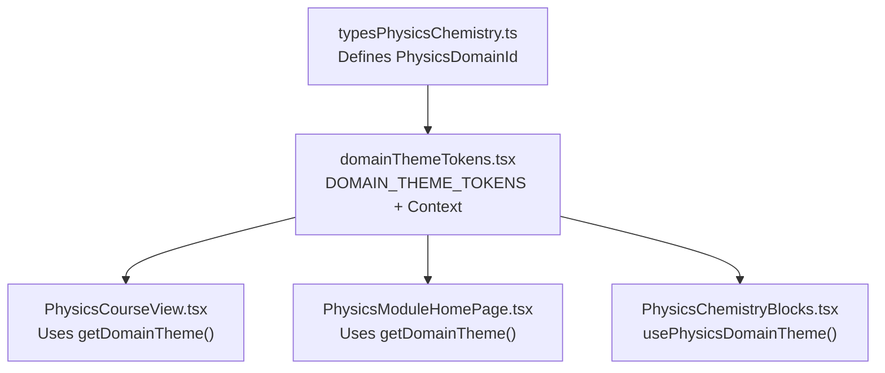
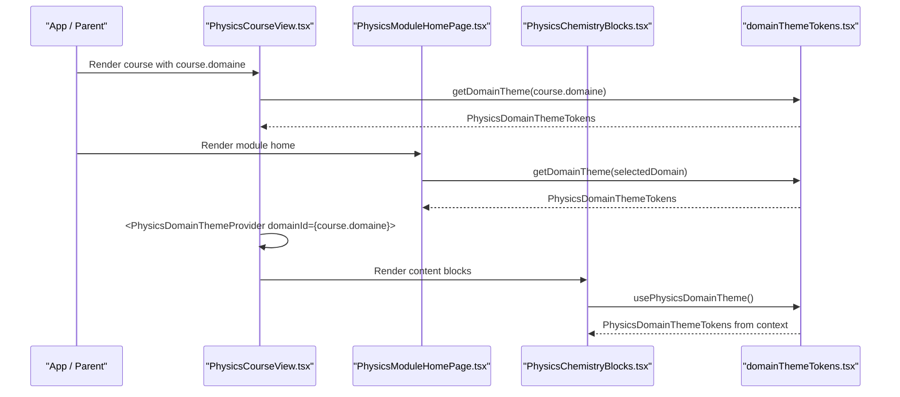
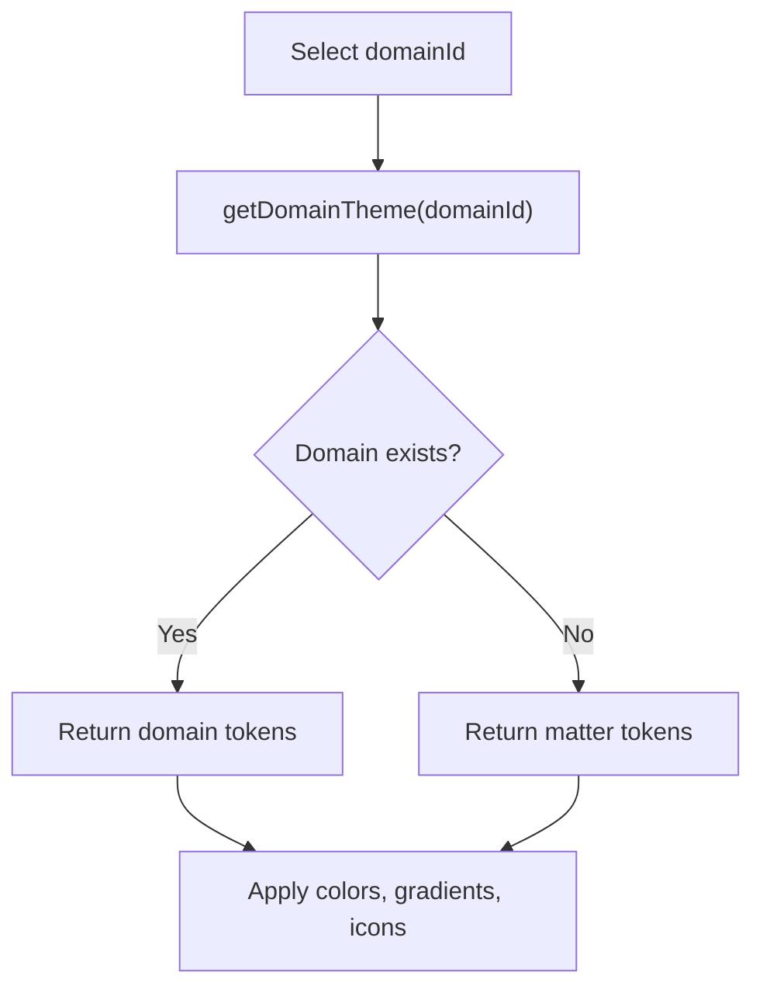
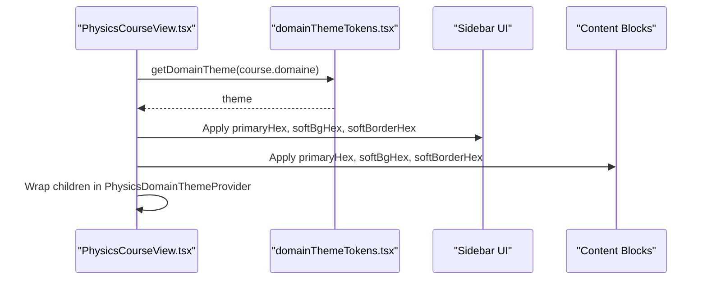
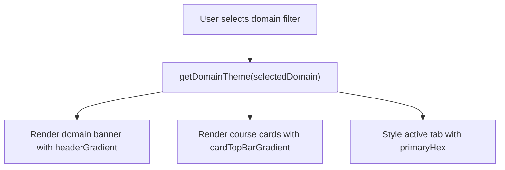
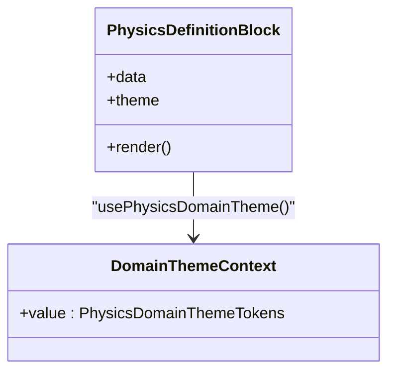
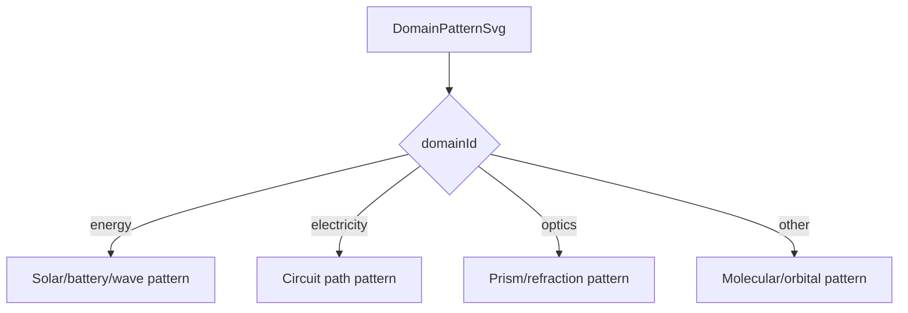
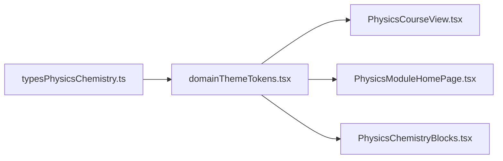

# Domain Theming System

<cite>
**Referenced Files in This Document**
- [domainThemeTokens.tsx](file://src/components/physics/domainThemeTokens.tsx)
- [PhysicsCourseView.tsx](file://src/components/physics/PhysicsCourseView.tsx)
- [PhysicsModuleHomePage.tsx](file://src/components/physics/PhysicsModuleHomePage.tsx)
- [PhysicsChemistryBlocks.tsx](file://src/components/physics/PhysicsChemistryBlocks.tsx)
- [typesPhysicsChemistry.ts](file://src/typesPhysicsChemistry.ts)
</cite>

## Table of Contents
1. [Introduction](#introduction)
2. [Project Structure](#project-structure)
3. [Core Components](#core-components)
4. [Architecture Overview](#architecture-overview)
5. [Detailed Component Analysis](#detailed-component-analysis)
6. [Dependency Analysis](#dependency-analysis)
7. [Performance Considerations](#performance-considerations)
8. [Troubleshooting Guide](#troubleshooting-guide)
9. [Conclusion](#conclusion)
10. [Appendices](#appendices)

## Introduction
This document explains the domain-specific theming system used across physics-chemistry components. It focuses on how `domainThemeTokens` provides visual distinction between different physics domains: matter transformations, energy systems, electrical phenomena, and optical phenomena. It documents the color palette structure, token naming conventions, theme application patterns, and how to add or customize domain themes. It also clarifies the relationship between theme tokens and component styling patterns.

## Project Structure
The domain theming system is centered around a single token definition file and consumed by several UI components:

- Token definitions and React context provider live in the physics components directory.
- Course view, module home page, and content blocks consume the theme through direct lookup or React context.
- The domain identifier type is defined in the shared physics-chemistry types file.

**Diagram sources**
- [typesPhysicsChemistry.ts:5-10](file://src/typesPhysicsChemistry.ts#L5-L10)
- [domainThemeTokens.tsx:17-57](file://src/components/physics/domainThemeTokens.tsx#L17-L57)
- [PhysicsCourseView.tsx:31-35](file://src/components/physics/PhysicsCourseView.tsx#L31-L35)
- [PhysicsModuleHomePage.tsx:16-20](file://src/components/physics/PhysicsModuleHomePage.tsx#L16-L20)
- [PhysicsChemistryBlocks.tsx:17-20](file://src/components/physics/PhysicsChemistryBlocks.tsx#L17-L20)

**Section sources**
- [typesPhysicsChemistry.ts:5-10](file://src/typesPhysicsChemistry.ts#L5-L10)
- [domainThemeTokens.tsx:17-57](file://src/components/physics/domainThemeTokens.tsx#L17-L57)
- [PhysicsCourseView.tsx:31-35](file://src/components/physics/PhysicsCourseView.tsx#L31-L35)
- [PhysicsModuleHomePage.tsx:16-20](file://src/components/physics/PhysicsModuleHomePage.tsx#L16-L20)
- [PhysicsChemistryBlocks.tsx:17-20](file://src/components/physics/PhysicsChemistryBlocks.tsx#L17-L20)

## Core Components
The core of the theming system is the `PhysicsDomainThemeTokens` interface and the `DOMAIN_THEME_TOKENS` registry. Each domain has a complete set of visual and metadata tokens:

- Identifier and labels: `id`, `domainNumber`, `arabicName`, `frenchName`, full titles, course range, and total courses count.
- Color palette: `primaryHex`, `secondaryHex`, `highlightHex`, `softBgHex`, `softBorderHex`, `darkTextHex`.
- Gradients for UI surfaces: `headerGradient`, `cardSubtleGradient`, `cardTopBarGradient`.
- Icons and labels: `PrimaryIcon`, `SecondaryIcon`, `TertiaryIcon`, plus `iconLabels` for domain pictograms.
- Pedagogical metadata: `presentationBullets`, `keyUnitsAndSymbols`, and bilingual banner descriptions.

The available domain identifiers are:
- Matter transformations
- Energy systems
- Electrical phenomena
- Optical phenomena
- General overview

Each domain’s tokens define a consistent visual identity that flows into headers, cards, progress bars, badges, borders, backgrounds, and icons.

**Section sources**
- [domainThemeTokens.tsx:17-57](file://src/components/physics/domainThemeTokens.tsx#L17-L57)
- [domainThemeTokens.tsx:59-295](file://src/components/physics/domainThemeTokens.tsx#L59-L295)
- [typesPhysicsChemistry.ts:5-10](file://src/typesPhysicsChemistry.ts#L5-L10)

## Architecture Overview
The theming architecture combines three mechanisms:

1. **Token Registry**: A static record mapping each domain identifier to its theme tokens.
2. **Lookup Function**: A helper returns the correct theme for a given domain identifier, with a safe fallback.
3. **React Context Provider**: A provider wraps child components so they can access the active domain theme without prop drilling.

**Diagram sources**
- [PhysicsCourseView.tsx:127-131](file://src/components/physics/PhysicsCourseView.tsx#L127-L131)
- [PhysicsCourseView.tsx:464-464](file://src/components/physics/PhysicsCourseView.tsx#L464-L464)
- [PhysicsModuleHomePage.tsx:96-99](file://src/components/physics/PhysicsModuleHomePage.tsx#L96-L99)
- [PhysicsChemistryBlocks.tsx:99-101](file://src/components/physics/PhysicsChemistryBlocks.tsx#L99-L101)
- [domainThemeTokens.tsx:297-299](file://src/components/physics/domainThemeTokens.tsx#L297-L299)
- [domainThemeTokens.tsx:410-422](file://src/components/physics/domainThemeTokens.tsx#L410-L422)

## Detailed Component Analysis

### Token Model and Naming Conventions
The token model groups related values under clear names:

| Category | Token Name | Purpose | Example Meaning |
|---|---|---|---|
| Identity | `id`, `domainNumber`, `arabicName`, `frenchName` | Identify and label the domain | Matter is `matter`, number `01` |
| Titles | `arabicFullTitle`, `frenchFullTitle` | Full bilingual domain title | Used in banners and headings |
| Navigation | `courseRange`, `totalCoursesCount` | Show course ranges and counts | `01 → 06`, `6` |
| Colors | `primaryHex`, `secondaryHex`, `highlightHex` | Main brand colors | Matter uses teal; energy uses orange/gold |
| Surfaces | `softBgHex`, `softBorderHex`, `darkTextHex` | Soft backgrounds, borders, readable text | Used in callouts, badges, sidebar panels |
| Gradients | `headerGradient`, `cardSubtleGradient`, `cardTopBarGradient` | Gradient surfaces | Header banners and card accents |
| Icons | `PrimaryIcon`, `SecondaryIcon`, `TertiaryIcon` | Domain pictograms | Flask, atom, flame for matter |
| Labels | `iconLabels` | Bilingual icon labels | Experiments, atoms, reactions |
| Pedagogy | `presentationBullets`, `keyUnitsAndSymbols` | Competencies and reference symbols | Units, formulas, key concepts |
| Descriptions | `bannerDescriptionAr`, `bannerDescriptionFr` | Bilingual domain description | Shown in domain hero banners |

The naming convention follows English kebab-style identifiers for domain keys and camelCase property names for tokens. Hex color values are explicit, making it easy to audit contrast and consistency.

**Section sources**
- [domainThemeTokens.tsx:17-57](file://src/components/physics/domainThemeTokens.tsx#L17-L57)
- [domainThemeTokens.tsx:59-295](file://src/components/physics/domainThemeTokens.tsx#L59-L295)

### Domain Themes and Visual Distinction
The four main domains have distinct palettes and icon sets:

- **Matter transformations**: Teal-based palette, laboratory and atomic imagery.
- **Energy systems**: Orange-to-gold palette, electrical and solar imagery.
- **Electrical phenomena**: Blue palette, circuit and activity imagery.
- **Optical phenomena**: Purple palette, light, vision, and sparkle imagery.
- **General**: Aggregated overview using matter-like tones as a base.

These differences appear in:
- Domain header gradients
- Card top accent bars
- Sidebar progress bars
- Badge and button colors
- Icon selection
- Backgrounds and borders for soft UI elements

**Diagram sources**
- [domainThemeTokens.tsx:297-299](file://src/components/physics/domainThemeTokens.tsx#L297-L299)

**Section sources**
- [domainThemeTokens.tsx:59-295](file://src/components/physics/domainThemeTokens.tsx#L59-L295)

### Theme Application in Course View
The course view retrieves the active domain theme directly from the current course’s domain identifier. It then applies theme tokens to:

- Section titles and callout headers
- Quote backgrounds and right-border accents
- Callout backgrounds and borders
- Sidebar domain badge, progress bar, and navigation buttons
- Active section indicators
- Action buttons and status highlights

**Diagram sources**
- [PhysicsCourseView.tsx:127-131](file://src/components/physics/PhysicsCourseView.tsx#L127-L131)
- [PhysicsCourseView.tsx:267-291](file://src/components/physics/PhysicsCourseView.tsx#L267-L291)
- [PhysicsCourseView.tsx:373-395](file://src/components/physics/PhysicsCourseView.tsx#L373-L395)
- [PhysicsCourseView.tsx:464-464](file://src/components/physics/PhysicsCourseView.tsx#L464-L464)

**Section sources**
- [PhysicsCourseView.tsx:127-131](file://src/components/physics/PhysicsCourseView.tsx#L127-L131)
- [PhysicsCourseView.tsx:267-291](file://src/components/physics/PhysicsCourseView.tsx#L267-L291)
- [PhysicsCourseView.tsx:373-395](file://src/components/physics/PhysicsCourseView.tsx#L373-L395)
- [PhysicsCourseView.tsx:464-464](file://src/components/physics/PhysicsCourseView.tsx#L464-L464)

### Theme Application in Module Home Page
The module home page uses domain themes for:

- Domain filter tabs
- Domain hero banners
- Domain presentation cards
- Course cards’ top accent bars, badges, and action buttons
- Progress indicators and completed-state highlights

**Diagram sources**
- [PhysicsModuleHomePage.tsx:96-99](file://src/components/physics/PhysicsModuleHomePage.tsx#L96-L99)
- [PhysicsModuleHomePage.tsx:302-310](file://src/components/physics/PhysicsModuleHomePage.tsx#L302-L310)
- [PhysicsModuleHomePage.tsx:632-665](file://src/components/physics/PhysicsModuleHomePage.tsx#L632-L665)

**Section sources**
- [PhysicsModuleHomePage.tsx:96-99](file://src/components/physics/PhysicsModuleHomePage.tsx#L96-L99)
- [PhysicsModuleHomePage.tsx:302-310](file://src/components/physics/PhysicsModuleHomePage.tsx#L302-L310)
- [PhysicsModuleHomePage.tsx:632-665](file://src/components/physics/PhysicsModuleHomePage.tsx#L632-L665)

### Theme Consumption in Content Blocks
Content blocks use the React context hook to read the active domain theme. For example, definition blocks apply:

- Right border color from `primaryHex`
- French label background from `softBgHex`
- French label border from `softBorderHex`
- Icon color from `primaryHex`

This pattern ensures that even reusable content blocks adapt automatically when wrapped by the domain provider.

**Diagram sources**
- [PhysicsChemistryBlocks.tsx:99-127](file://src/components/physics/PhysicsChemistryBlocks.tsx#L99-L127)
- [domainThemeTokens.tsx:410-422](file://src/components/physics/domainThemeTokens.tsx#L410-L422)

**Section sources**
- [PhysicsChemistryBlocks.tsx:99-127](file://src/components/physics/PhysicsChemistryBlocks.tsx#L99-L127)
- [domainThemeTokens.tsx:410-422](file://src/components/physics/domainThemeTokens.tsx#L410-L422)

### Domain Pattern SVGs
Each domain can have a subtle background pattern rendered by `DomainPatternSvg`:

- Energy: sun rays, stylized lightning, battery cells, and flow waves.
- Electricity: circuit paths and connection nodes.
- Optics: prism and refracted light lines.
- Matter (default): molecular network and atomic orbitals.

These patterns reinforce domain identity without overwhelming content.

**Diagram sources**
- [domainThemeTokens.tsx:304-408](file://src/components/physics/domainThemeTokens.tsx#L304-L408)

**Section sources**
- [domainThemeTokens.tsx:304-408](file://src/components/physics/domainThemeTokens.tsx#L304-L408)

## Dependency Analysis
The theming system has clear, low-coupling dependencies:

- `typesPhysicsChemistry.ts` defines `PhysicsDomainId`, which constrains valid domain keys.
- `domainThemeTokens.tsx` depends on that type and exports:
  - `DOMAIN_THEME_TOKENS`
  - `getDomainTheme`
  - `DomainPatternSvg`
  - `PhysicsDomainThemeProvider`
  - `usePhysicsDomainTheme`
- `PhysicsCourseView.tsx` imports theme utilities and wraps its tree with the provider.
- `PhysicsModuleHomePage.tsx` imports theme utilities and uses them for filtering and rendering.
- `PhysicsChemistryBlocks.tsx` consumes the theme via context.

**Diagram sources**
- [typesPhysicsChemistry.ts:5-10](file://src/typesPhysicsChemistry.ts#L5-L10)
- [domainThemeTokens.tsx:1-15](file://src/components/physics/domainThemeTokens.tsx#L1-L15)
- [PhysicsCourseView.tsx:31-35](file://src/components/physics/PhysicsCourseView.tsx#L31-L35)
- [PhysicsModuleHomePage.tsx:16-20](file://src/components/physics/PhysicsModuleHomePage.tsx#L16-L20)
- [PhysicsChemistryBlocks.tsx:17-20](file://src/components/physics/PhysicsChemistryBlocks.tsx#L17-L20)

**Section sources**
- [typesPhysicsChemistry.ts:5-10](file://src/typesPhysicsChemistry.ts#L5-L10)
- [domainThemeTokens.tsx:1-15](file://src/components/physics/domainThemeTokens.tsx#L1-L15)
- [PhysicsCourseView.tsx:31-35](file://src/components/physics/PhysicsCourseView.tsx#L31-L35)
- [PhysicsModuleHomePage.tsx:16-20](file://src/components/physics/PhysicsModuleHomePage.tsx#L16-L20)
- [PhysicsChemistryBlocks.tsx:17-20](file://src/components/physics/PhysicsChemistryBlocks.tsx#L17-L20)

## Performance Considerations
- Token lookup is constant-time object access.
- React context avoids prop drilling and reduces re-renders caused by passing theme objects down manually.
- Domain pattern SVGs are lightweight and only rendered where needed.
- Gradients and hex colors are applied inline; there is no heavy CSS-in-JS runtime.

[No sources needed since this section provides general guidance]

## Troubleshooting Guide
Common issues and resolutions:

- **Wrong domain colors**: Ensure the course data uses a valid `PhysicsDomainId`. Invalid identifiers fall back to the matter theme.
- **Missing icons**: Verify that the selected domain’s `PrimaryIcon`, `SecondaryIcon`, and `TertiaryIcon` are imported from the icon library.
- **Low contrast**: Check `darkTextHex` against `softBgHex` and ensure `primaryHex` is not used for small text on white backgrounds.
- **Broken gradient display**: Confirm that `headerGradient`, `cardSubtleGradient`, and `cardTopBarGradient` are valid CSS linear-gradient strings.
- **Context not applied**: Make sure the component tree is wrapped with `PhysicsDomainThemeProvider` when using `usePhysicsDomainTheme`.

**Section sources**
- [domainThemeTokens.tsx:297-299](file://src/components/physics/domainThemeTokens.tsx#L297-L299)
- [domainThemeTokens.tsx:410-422](file://src/components/physics/domainThemeTokens.tsx#L410-L422)

## Conclusion
The domain theming system provides a clean, extensible way to visually distinguish physics domains while keeping styling logic centralized. By combining typed domain identifiers, a token registry, a lookup function, and a React context provider, the application achieves consistent visuals across course views, module pages, and reusable content blocks. Adding new domains or customizing existing ones requires updating the token registry and optionally extending the domain pattern SVG.

[No sources needed since this section summarizes without analyzing specific files]

## Appendices

### How to Add a New Domain Theme
Steps:

1. Extend the domain identifier if necessary in the shared types.
2. Add a new entry to `DOMAIN_THEME_TOKENS` with all required fields.
3. Choose appropriate hex colors for `primaryHex`, `secondaryHex`, `highlightHex`, `softBgHex`, `softBorderHex`, and `darkTextHex`.
4. Define gradients for `headerGradient`, `cardSubtleGradient`, and `cardTopBarGradient`.
5. Select representative icons and provide bilingual `iconLabels`.
6. Fill pedagogical metadata: `presentationBullets`, `keyUnitsAndSymbols`, and bilingual banner descriptions.
7. Optionally add a domain-specific pattern in `DomainPatternSvg`.

**Section sources**
- [typesPhysicsChemistry.ts:5-10](file://src/typesPhysicsChemistry.ts#L5-L10)
- [domainThemeTokens.tsx:17-57](file://src/components/physics/domainThemeTokens.tsx#L17-L57)
- [domainThemeTokens.tsx:59-295](file://src/components/physics/domainThemeTokens.tsx#L59-L295)
- [domainThemeTokens.tsx:304-408](file://src/components/physics/domainThemeTokens.tsx#L304-L408)

### How to Customize an Existing Domain Theme
To customize an existing domain:

- Update the relevant hex values in the domain’s token entry.
- Adjust gradients to match new branding.
- Replace icons if the domain’s visual metaphor changes.
- Update bilingual labels and pedagogical bullets to reflect curriculum changes.
- If the domain needs a unique background pattern, extend `DomainPatternSvg`.

**Section sources**
- [domainThemeTokens.tsx:59-295](file://src/components/physics/domainThemeTokens.tsx#L59-L295)
- [domainThemeTokens.tsx:304-408](file://src/components/physics/domainThemeTokens.tsx#L304-L408)

### Relationship Between Theme Tokens and Component Styling Patterns
Components follow consistent styling patterns:

- Use `primaryHex` for strong accents such as headings, badges, and active states.
- Use `softBgHex` and `softBorderHex` for gentle backgrounds and borders.
- Use `darkTextHex` for readable secondary text on tinted backgrounds.
- Use gradients for banners and card accents.
- Use domain icons to reinforce subject identity.

Examples of these patterns appear in:

- Course view sections and callouts
- Module home page domain banners and course cards
- Definition and schema blocks consuming context

**Section sources**
- [PhysicsCourseView.tsx:267-291](file://src/components/physics/PhysicsCourseView.tsx#L267-L291)
- [PhysicsCourseView.tsx:373-395](file://src/components/physics/PhysicsCourseView.tsx#L373-L395)
- [PhysicsModuleHomePage.tsx:103-115](file://src/components/physics/PhysicsModuleHomePage.tsx#L103-L115)
- [PhysicsModuleHomePage.tsx:302-310](file://src/components/physics/PhysicsModuleHomePage.tsx#L302-L310)
- [PhysicsChemistryBlocks.tsx:99-127](file://src/components/physics/PhysicsChemistryBlocks.tsx#L99-L127)