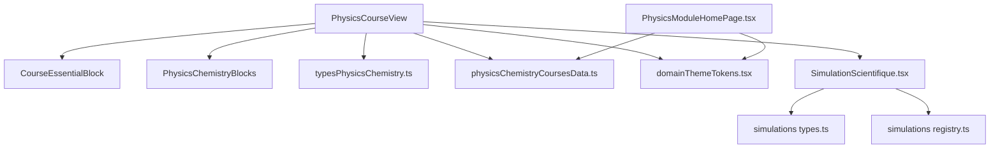
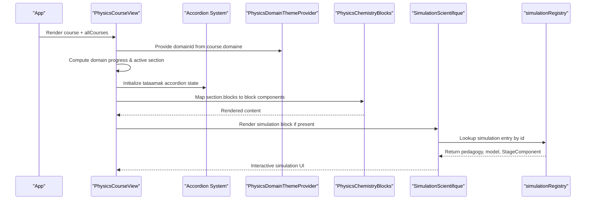
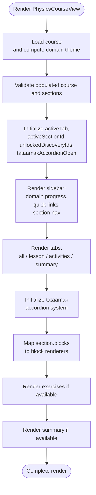
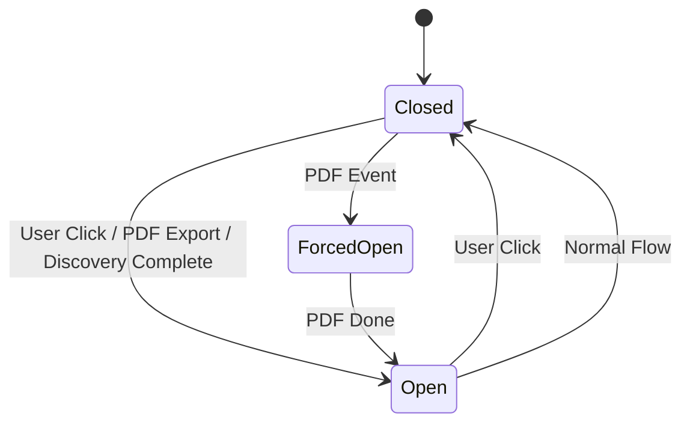
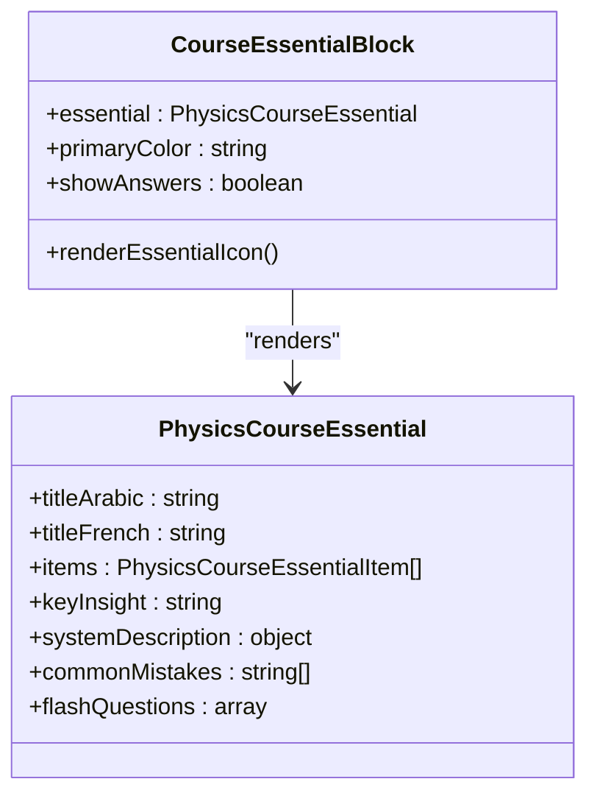
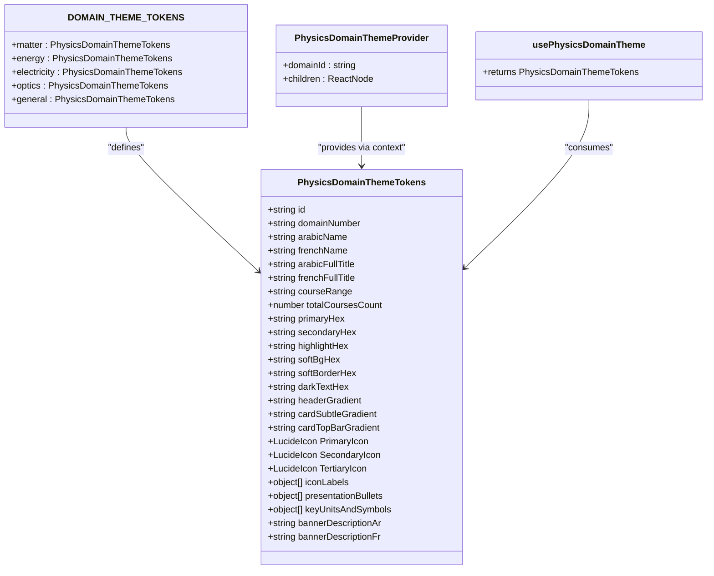
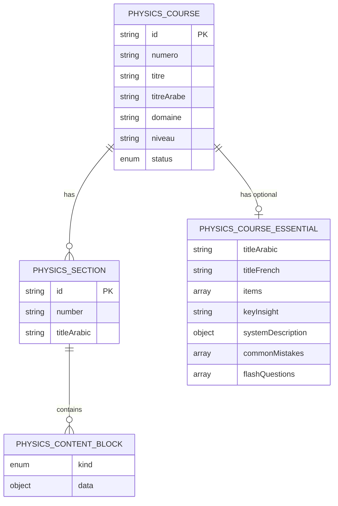
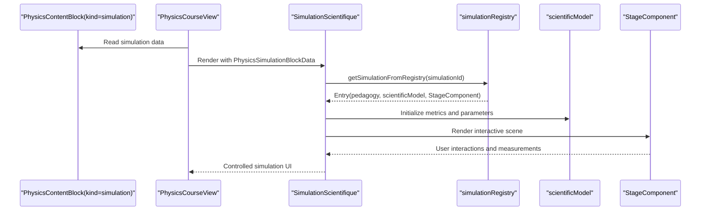
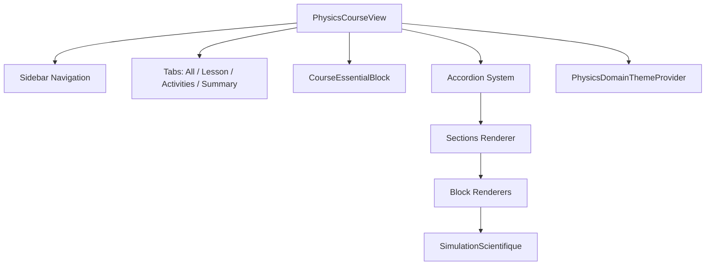
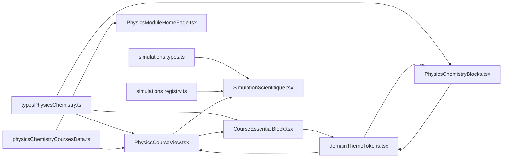

# Physics Module Architecture

<cite>
**Referenced Files in This Document**
- [PhysicsCourseView.tsx](file://src/components/physics/PhysicsCourseView.tsx)
- [CourseEssentialBlock.tsx](file://src/components/physics/CourseEssentialBlock.tsx)
- [domainThemeTokens.tsx](file://src/components/physics/domainThemeTokens.tsx)
- [PhysicsChemistryBlocks.tsx](file://src/components/physics/PhysicsChemistryBlocks.tsx)
- [typesPhysicsChemistry.ts](file://src/typesPhysicsChemistry.ts)
- [physicsChemistryCoursesData.ts](file://src/data/physicsChemistryCoursesData.ts)
- [SimulationScientifique.tsx](file://src/components/physics/simulations/SimulationScientifique.tsx)
- [simulations_types.ts](file://src/components/physics/simulations/types.ts)
- [simulations_registry.ts](file://src/components/physics/simulations/registry.ts)
- [PhysicsModuleHomePage.tsx](file://src/components/physics/PhysicsModuleHomePage.tsx)
</cite>

## Update Summary
**Changes Made**
- Enhanced PhysicsCourseView component with accordion functionality for collapsible sections
- Added CourseEssentialBlock component for structured essential content display
- Implemented smooth transitions between different content sections
- Integrated state management across course modules with collapsible accordion system
- Added PDF export support with automatic accordion expansion

## Table of Contents
1. [Introduction](#introduction)
2. [Project Structure](#project-structure)
3. [Core Components](#core-components)
4. [Architecture Overview](#architecture-overview)
5. [Detailed Component Analysis](#detailed-component-analysis)
6. [Dependency Analysis](#dependency-analysis)
7. [Performance Considerations](#performance-considerations)
8. [Troubleshooting Guide](#troubleshooting-guide)
9. [Conclusion](#conclusion)

## Introduction
This document explains the architecture of the Physics-Chemistry module with a focus on:
- The high-level design of `PhysicsCourseView` as the orchestrator for course navigation, section rendering, and domain theming.
- The domain-specific theming system that visually distinguishes physics domains such as matter, energy, electricity, and optics.
- The course structure model based on sections and content blocks.
- The integration between course content and the simulation framework.
- **New**: Enhanced accordion functionality providing smooth transitions between content sections and collapsible learning experiences.

The goal is to make the system understandable for both technical readers and users who need to extend or maintain the module without deep prior knowledge.

## Project Structure
The Physics-Chemistry module is organized around:
- A central course view component that renders sections, blocks, exercises, summaries, and simulations.
- A domain theme provider that supplies colors, icons, gradients, and labels per domain.
- Typed data models describing courses, sections, and content blocks.
- A simulation framework with registry-driven scientific simulations.
- **New**: Essential block system for structured key concept presentation.

**Diagram sources**
- [PhysicsCourseView.tsx:100-130](file://src/components/physics/PhysicsCourseView.tsx#L100-L130)
- [CourseEssentialBlock.tsx:57-328](file://src/components/physics/CourseEssentialBlock.tsx#L57-L328)
- [PhysicsChemistryBlocks.tsx:1-35](file://src/components/physics/PhysicsChemistryBlocks.tsx#L1-L35)
- [typesPhysicsChemistry.ts:306-332](file://src/typesPhysicsChemistry.ts#L306-L332)
- [physicsChemistryCoursesData.ts:14-43](file://src/data/physicsChemistryCoursesData.ts#L14-L43)
- [domainThemeTokens.tsx:17-57](file://src/components/physics/domainThemeTokens.tsx#L17-L57)
- [SimulationScientifique.tsx:1-14](file://src/components/physics/simulations/SimulationScientifique.tsx#L1-L14)
- [simulations_types.ts:1-15](file://src/components/physics/simulations/types.ts#L1-L15)
- [simulations_registry.ts:1-10](file://src/components/physics/simulations/registry.ts#L1-L10)
- [PhysicsModuleHomePage.tsx:1-20](file://src/components/physics/PhysicsModuleHomePage.tsx#L1-L20)

**Section sources**
- [PhysicsCourseView.tsx:100-130](file://src/components/physics/PhysicsCourseView.tsx#L100-L130)
- [typesPhysicsChemistry.ts:306-332](file://src/typesPhysicsChemistry.ts#L306-L332)
- [physicsChemistryCoursesData.ts:14-43](file://src/data/physicsChemistryCoursesData.ts#L14-L43)
- [domainThemeTokens.tsx:17-57](file://src/components/physics/domainThemeTokens.tsx#L17-L57)
- [SimulationScientifique.tsx:1-14](file://src/components/physics/simulations/SimulationScientifique.tsx#L1-L14)
- [simulations_types.ts:1-15](file://src/components/physics/simulations/types.ts#L1-L15)
- [simulations_registry.ts:1-10](file://src/components/physics/simulations/registry.ts#L1-L10)
- [PhysicsModuleHomePage.tsx:1-20](file://src/components/physics/PhysicsModuleHomePage.tsx#L1-L20)

## Core Components
- `PhysicsCourseView`: Main container for a single course. It manages active tabs, active section, discovery unlock state, PDF export behavior, sidebar navigation, and block rendering. It also applies domain theme tokens and computes domain progress. **Enhanced** with accordion functionality for collapsible content sections.
- `CourseEssentialBlock`: New component that provides structured presentation of essential course concepts with interactive elements including flash questions with hidden answers.
- Domain theme system: Provides per-domain color tokens, icons, gradients, and labels through a React context provider and helper functions.
- Content block system: Renders typed content blocks such as paragraphs, definitions, observations, experiments, schemas, tables, formulas, examples, activities, common mistakes, callouts, and simulations.
- Simulation framework: Registry-driven interactive simulations with pedagogical content, scientific models, runtime state, and stage components.

Key responsibilities:
- Course orchestration and navigation: `PhysicsCourseView`.
- Essential content presentation: `CourseEssentialBlock`.
- Visual identity and accessibility via domain themes: `domainThemeTokens.tsx`.
- Declarative content rendering: `PhysicsChemistryBlocks.tsx`.
- Strongly typed course and block model: `typesPhysicsChemistry.ts`.
- Simulation lifecycle and UI: `SimulationScientifique.tsx`, `simulations_types.ts`, `simulations_registry.ts`.

**Section sources**
- [PhysicsCourseView.tsx:100-130](file://src/components/physics/PhysicsCourseView.tsx#L100-L130)
- [CourseEssentialBlock.tsx:57-328](file://src/components/physics/CourseEssentialBlock.tsx#L57-L328)
- [domainThemeTokens.tsx:297-322](file://src/components/physics/domainThemeTokens.tsx#L297-L322)
- [PhysicsChemistryBlocks.tsx:1-35](file://src/components/physics/PhysicsChemistryBlocks.tsx#L1-L35)
- [typesPhysicsChemistry.ts:306-332](file://src/typesPhysicsChemistry.ts#L306-L332)
- [SimulationScientifique.tsx:138-170](file://src/components/physics/simulations/SimulationScientifique.tsx#L138-L170)
- [simulations_types.ts:242-289](file://src/components/physics/simulations/types.ts#L242-L289)
- [simulations_registry.ts:42-81](file://src/components/physics/simulations/registry.ts#L42-L81)

## Architecture Overview
At runtime, `PhysicsCourseView` wraps the entire learning experience in a domain theme provider. It reads the current course's domain, selects theme tokens, and renders:
- A sticky sidebar with domain progress, quick links to other courses in the same domain, and section navigation.
- Section content rendered by mapping typed blocks to specialized block components.
- Optional exercises and summary sections.
- Embedded simulations when a block declares a simulation.
- **New**: Collapsible accordion sections with smooth animations for progressive content disclosure.

**Diagram sources**
- [PhysicsCourseView.tsx:127-145](file://src/components/physics/PhysicsCourseView.tsx#L127-L145)
- [PhysicsCourseView.tsx:155-176](file://src/components/physics/PhysicsCourseView.tsx#L155-L176)
- [PhysicsCourseView.tsx:463-468](file://src/components/physics/PhysicsCourseView.tsx#L463-L468)
- [PhysicsCourseView.tsx:260-401](file://src/components/physics/PhysicsCourseView.tsx#L260-L401)
- [PhysicsCourseView.tsx:1085-1113](file://src/components/physics/PhysicsCourseView.tsx#L1085-L1113)
- [SimulationScientifique.tsx:138-170](file://src/components/physics/simulations/SimulationScientifique.tsx#L138-L170)
- [simulations_registry.ts:42-81](file://src/components/physics/simulations/registry.ts#L42-L81)

## Detailed Component Analysis

### PhysicsCourseView Orchestration with Enhanced Accordion System
`PhysicsCourseView` is the top-level controller for a single course. It:
- Selects the active tab (`all`, `lesson`, `activities`, `summary`).
- Tracks the active section and scrolls into it.
- Manages discovery unlock state persisted in local storage.
- **New**: Implements accordion functionality with smooth transitions for collapsible content sections.
- **New**: Handles PDF preparation events to expand accordion sections and reveal corrections automatically.
- Validates populated courses and non-empty sections.
- Computes domain-level completion and displays domain progress in the sidebar.
- Renders a rich sidebar with domain visual reference, quick course navigation, and section links.
- Maps each content block to a specific renderer.

**Updated** Enhanced with accordion functionality that provides smooth transitions between content sections and maintains state across different course modules.

**Diagram sources**
- [PhysicsCourseView.tsx:114-153](file://src/components/physics/PhysicsCourseView.tsx#L114-L153)
- [PhysicsCourseView.tsx:155-176](file://src/components/physics/PhysicsCourseView.tsx#L155-L176)
- [PhysicsCourseView.tsx:178-186](file://src/components/physics/PhysicsCourseView.tsx#L178-L186)
- [PhysicsCourseView.tsx:463-468](file://src/components/physics/PhysicsCourseView.tsx#L463-L468)
- [PhysicsCourseView.tsx:260-401](file://src/components/physics/PhysicsCourseView.tsx#L260-L401)
- [PhysicsCourseView.tsx:403-461](file://src/components/physics/PhysicsCourseView.tsx#L403-L461)
- [PhysicsCourseView.tsx:1085-1113](file://src/components/physics/PhysicsCourseView.tsx#L1085-L1113)

**Section sources**
- [PhysicsCourseView.tsx:114-153](file://src/components/physics/PhysicsCourseView.tsx#L114-L153)
- [PhysicsCourseView.tsx:155-176](file://src/components/physics/PhysicsCourseView.tsx#L155-L176)
- [PhysicsCourseView.tsx:178-186](file://src/components/physics/PhysicsCourseView.tsx#L178-L186)
- [PhysicsCourseView.tsx:260-401](file://src/components/physics/PhysicsCourseView.tsx#L260-L401)
- [PhysicsCourseView.tsx:403-461](file://src/components/physics/PhysicsCourseView.tsx#L403-L461)
- [PhysicsCourseView.tsx:1085-1113](file://src/components/physics/PhysicsCourseView.tsx#L1085-L1113)

### Enhanced Accordion Functionality
**New** The accordion system provides collapsible content sections with smooth animations:

- **State Management**: Uses `tataamakAccordionOpen` state to control accordion visibility
- **Smooth Transitions**: CSS transitions provide smooth opening/closing animations
- **PDF Integration**: Automatically expands during PDF export for complete content visibility
- **Progressive Disclosure**: Supports step-by-step learning progression
- **Accessibility**: Includes proper ARIA attributes for screen reader support

Key features:
- Collapsible "للتعمق" (For Deepening) section containing full course content
- Smooth chevron rotation animation on toggle
- Automatic expansion during PDF export and print operations
- Maintains user preference state across course navigation
- Integrates with discovery activity completion flow

**Diagram sources**
- [PhysicsCourseView.tsx:155-176](file://src/components/physics/PhysicsCourseView.tsx#L155-L176)
- [PhysicsCourseView.tsx:1085-1113](file://src/components/physics/PhysicsCourseView.tsx#L1085-L1113)
- [PhysicsCourseView.tsx:1115-1304](file://src/components/physics/PhysicsCourseView.tsx#L1115-L1304)

**Section sources**
- [PhysicsCourseView.tsx:155-176](file://src/components/physics/PhysicsCourseView.tsx#L155-L176)
- [PhysicsCourseView.tsx:1085-1113](file://src/components/physics/PhysicsCourseView.tsx#L1085-L1113)
- [PhysicsCourseView.tsx:1115-1304](file://src/components/physics/PhysicsCourseView.tsx#L1115-L1304)

### CourseEssentialBlock Component
**New** The `CourseEssentialBlock` component provides structured presentation of essential course concepts:

- **Structured Layout**: Grid-based layout for presenting key concepts and definitions
- **Interactive Elements**: Flash questions with toggleable answer visibility
- **Icon System**: Contextual icons for different types of essential content
- **Responsive Design**: Adapts to different screen sizes with grid layouts
- **PDF Support**: Automatically reveals answers during PDF export
- **Multilingual Support**: Arabic and French titles and descriptions

Key features:
- Essential items with definitions, examples, and contextual information
- Key insight highlighting for important concepts
- Common mistakes prevention section
- System description with bullet points
- Interactive flash questions with hidden answers
- Responsive grid layout for optimal content presentation

**Diagram sources**
- [CourseEssentialBlock.tsx:57-328](file://src/components/physics/CourseEssentialBlock.tsx#L57-L328)
- [typesPhysicsChemistry.ts:273-291](file://src/typesPhysicsChemistry.ts#L273-L291)

**Section sources**
- [CourseEssentialBlock.tsx:57-328](file://src/components/physics/CourseEssentialBlock.tsx#L57-L328)
- [typesPhysicsChemistry.ts:273-291](file://src/typesPhysicsChemistry.ts#L273-L291)

### Domain-Based Theming System
The domain theme system defines:
- Color tokens: primary, secondary, highlight, soft background, soft border, dark text.
- Gradients: header gradient, card subtle gradient, card top bar gradient.
- Icons: three representative icons per domain.
- Labels and descriptions: Arabic and French names, full titles, presentation bullets, key units and symbols.
- SVG patterns: domain-specific background patterns.

It exposes:
- `getDomainTheme(domainId)` to retrieve tokens.
- `PhysicsDomainThemeProvider` to provide tokens via React context.
- `usePhysicsDomainTheme()` hook for consuming tokens in components.

Domains defined:
- Matter: green palette, chemistry-focused icons.
- Energy: orange/yellow palette, energy conversion icons.
- Electricity: blue palette, circuit and measurement icons.
- Optics: purple palette, light and vision icons.
- General: fallback theme covering the whole program.

**Diagram sources**
- [domainThemeTokens.tsx:17-57](file://src/components/physics/domainThemeTokens.tsx#L17-L57)
- [domainThemeTokens.tsx:59-295](file://src/components/physics/domainThemeTokens.tsx#L59-L295)
- [domainThemeTokens.tsx:297-322](file://src/components/physics/domainThemeTokens.tsx#L297-L322)
- [domainThemeTokens.tsx:410-422](file://src/components/physics/domainThemeTokens.tsx#L410-L422)

**Section sources**
- [domainThemeTokens.tsx:17-57](file://src/components/physics/domainThemeTokens.tsx#L17-L57)
- [domainThemeTokens.tsx:59-295](file://src/components/physics/domainThemeTokens.tsx#L59-L295)
- [domainThemeTokens.tsx:297-322](file://src/components/physics/domainThemeTokens.tsx#L297-L322)
- [domainThemeTokens.tsx:410-422](file://src/components/physics/domainThemeTokens.tsx#L410-L422)

### Course Structure Management
The course model separates:
- Course metadata (id, numero, titles, domaine, niveau, status).
- Pedagogical collections (definitions, observations, experiences, explanations, schemas, figures, tables, formulas, examples, activities, applications, vocabulary, pointsEssentiels).
- Sections containing ordered content blocks.
- Discovery activity and essential highlights.
- **New**: Essential block structure for structured key concept presentation.

Content blocks are strongly typed and include:
- Paragraphs, bullets, quotes.
- Discovery, definition, bilingual box.
- Observation, experience, explanation.
- Schema, table, formula, example.
- Activity, common mistakes.
- Simulation and callout variants.

**Diagram sources**
- [typesPhysicsChemistry.ts:338-395](file://src/typesPhysicsChemistry.ts#L338-L395)
- [typesPhysicsChemistry.ts:325-332](file://src/typesPhysicsChemistry.ts#L325-L332)
- [typesPhysicsChemistry.ts:306-323](file://src/typesPhysicsChemistry.ts#L306-L323)
- [typesPhysicsChemistry.ts:273-291](file://src/typesPhysicsChemistry.ts#L273-L291)

**Section sources**
- [typesPhysicsChemistry.ts:306-323](file://src/typesPhysicsChemistry.ts#L306-L323)
- [typesPhysicsChemistry.ts:325-332](file://src/typesPhysicsChemistry.ts#L325-L332)
- [typesPhysicsChemistry.ts:338-395](file://src/typesPhysicsChemistry.ts#L338-L395)
- [typesPhysicsChemistry.ts:273-291](file://src/typesPhysicsChemistry.ts#L273-L291)

### Simulation Framework Integration
The simulation framework integrates into course content through:
- `PhysicsSimulationBlockData` declared inside a content block of kind `simulation`.
- `SimulationScientifique` which looks up a registered simulation by id.
- A registry mapping simulation ids to pedagogy, scientific model, and stage component.
- Runtime state managed by `useSimulationEngine`, exposing controls, parameters, representation modes, and guided observation.

**Diagram sources**
- [typesPhysicsChemistry.ts:306-323](file://src/typesPhysicsChemistry.ts#L306-L323)
- [SimulationScientifique.tsx:138-170](file://src/components/physics/simulations/SimulationScientifique.tsx#L138-L170)
- [simulations_types.ts:98-107](file://src/components/physics/simulations/types.ts#L98-L107)
- [simulations_registry.ts:42-81](file://src/components/physics/simulations/registry.ts#L42-L81)

**Section sources**
- [typesPhysicsChemistry.ts:306-323](file://src/typesPhysicsChemistry.ts#L306-L323)
- [SimulationScientifique.tsx:138-170](file://src/components/physics/simulations/SimulationScientifique.tsx#L138-L170)
- [simulations_types.ts:98-107](file://src/components/physics/simulations/types.ts#L98-L107)
- [simulations_registry.ts:42-81](file://src/components/physics/simulations/registry.ts#L42-L81)

### Component Hierarchy Diagram
This diagram shows how `PhysicsCourseView` orchestrates the learning experience from navigation to content rendering and simulation integration, including the new essential block and accordion systems.

**Diagram sources**
- [PhysicsCourseView.tsx:463-468](file://src/components/physics/PhysicsCourseView.tsx#L463-L468)
- [PhysicsCourseView.tsx:477-767](file://src/components/physics/PhysicsCourseView.tsx#L477-L767)
- [PhysicsCourseView.tsx:260-401](file://src/components/physics/PhysicsCourseView.tsx#L260-L401)
- [PhysicsCourseView.tsx:1075-1080](file://src/components/physics/PhysicsCourseView.tsx#L1075-L1080)
- [PhysicsCourseView.tsx:1085-1113](file://src/components/physics/PhysicsCourseView.tsx#L1085-L1113)
- [SimulationScientifique.tsx:138-170](file://src/components/physics/simulations/SimulationScientifique.tsx#L138-L170)

## Dependency Analysis
High-level dependencies:
- `PhysicsCourseView` depends on:
  - Types for course, section, and block structures.
  - Domain theme helpers and provider.
  - Block renderers for content.
  - Simulation component for interactive labs.
  - **New**: CourseEssentialBlock for structured essential content.
- `CourseEssentialBlock` depends on:
  - Types for essential content structure.
  - Icon system for contextual visualization.
  - PDF event handling for answer revelation.
- `PhysicsChemistryBlocks` depends on:
  - Domain theme hook for consistent styling.
  - Math and chemical formula renderers.
  - Course-specific schema renderer for diagrams.
- Simulation subsystem depends on:
  - Central registry for simulation entries.
  - Types defining runtime state, pedagogy, and scientific models.
- Domain home page uses domain theme tokens and course data for filtering and cards.

**Diagram sources**
- [typesPhysicsChemistry.ts:306-332](file://src/typesPhysicsChemistry.ts#L306-L332)
- [domainThemeTokens.tsx:297-322](file://src/components/physics/domainThemeTokens.tsx#L297-L322)
- [physicsChemistryCoursesData.ts:14-43](file://src/data/physicsChemistryCoursesData.ts#L14-L43)
- [simulations_types.ts:1-15](file://src/components/physics/simulations/types.ts#L1-L15)
- [simulations_registry.ts:1-10](file://src/components/physics/simulations/registry.ts#L1-L10)
- [PhysicsCourseView.tsx:100-130](file://src/components/physics/PhysicsCourseView.tsx#L100-L130)
- [CourseEssentialBlock.tsx:57-328](file://src/components/physics/CourseEssentialBlock.tsx#L57-L328)
- [PhysicsModuleHomePage.tsx:1-20](file://src/components/physics/PhysicsModuleHomePage.tsx#L1-L20)

**Section sources**
- [typesPhysicsChemistry.ts:306-332](file://src/typesPhysicsChemistry.ts#L306-L332)
- [domainThemeTokens.tsx:297-322](file://src/components/physics/domainThemeTokens.tsx#L297-L322)
- [physicsChemistryCoursesData.ts:14-43](file://src/data/physicsChemistryCoursesData.ts#L14-L43)
- [simulations_types.ts:1-15](file://src/components/physics/simulations/types.ts#L1-L15)
- [simulations_registry.ts:1-10](file://src/components/physics/simulations/registry.ts#L1-L10)
- [PhysicsCourseView.tsx:100-130](file://src/components/physics/PhysicsCourseView.tsx#L100-L130)
- [CourseEssentialBlock.tsx:57-328](file://src/components/physics/CourseEssentialBlock.tsx#L57-L328)
- [PhysicsModuleHomePage.tsx:1-20](file://src/components/physics/PhysicsModuleHomePage.tsx#L1-L20)

## Performance Considerations
- Rendering large numbers of content blocks can be optimized by lazy loading sections or virtualizing long lists if needed.
- Simulation components should avoid heavy computations on every frame; prefer deterministic models and throttled updates.
- Domain theme tokens are computed once per course and reused across components to minimize repeated lookups.
- PDF export triggers state changes (expanding accordions, revealing corrections); ensure these transitions do not cause unnecessary re-renders outside the affected areas.
- **New**: Accordion state management uses efficient React state updates with minimal re-renders.
- **New**: Essential block component optimizes grid layouts for responsive design performance.

## Troubleshooting Guide
Common issues and resolutions:
- Empty sections in populated courses: The view throws explicit errors to prevent publishing incomplete sections. Ensure each section contains at least one valid block type with meaningful content.
- Missing simulation implementation: If a simulation id is not yet registered, the fallback view renders static information instead of crashing.
- Theme mismatch: Verify that the course's `domaine` field matches a known domain id; otherwise, the default matter theme is used.
- Sidebar navigation not scrolling: Check that section ids match the target elements and that scroll timing is applied after state updates.
- **New**: Accordion not expanding: Verify that the `tataamakAccordionOpen` state is properly managed and that PDF events are correctly handled.
- **New**: Essential block not displaying: Ensure the course has the `essential` field properly configured with required data structure.

**Section sources**
- [PhysicsCourseView.tsx:65-83](file://src/components/physics/PhysicsCourseView.tsx#L65-L83)
- [PhysicsCourseView.tsx:178-186](file://src/components/physics/PhysicsCourseView.tsx#L178-L186)
- [PhysicsCourseView.tsx:155-176](file://src/components/physics/PhysicsCourseView.tsx#L155-L176)
- [SimulationScientifique.tsx:114-133](file://src/components/physics/simulations/SimulationScientifique.tsx#L114-L133)
- [domainThemeTokens.tsx:297-299](file://src/components/physics/domainThemeTokens.tsx#L297-L299)
- [CourseEssentialBlock.tsx:63-78](file://src/components/physics/CourseEssentialBlock.tsx#L63-L78)

## Conclusion
The Physics-Chemistry module centers on a robust `PhysicsCourseView` orchestrator that combines structured course data, domain-based theming, and an extensible simulation framework. The domain theme system ensures consistent visual identity across matter, energy, electricity, and optics. The typed content block model enables precise, maintainable course authoring, while the simulation registry allows adding new interactive labs without changing core rendering logic. 

**Enhanced** with the new accordion functionality and essential block system, the module now provides a more engaging and structured learning experience. The collapsible accordion system offers smooth transitions between content sections, while the essential block component delivers structured presentation of key concepts with interactive elements. Together, these components deliver a cohesive, accessible, scalable, and progressively revealing learning experience that adapts to different learning styles and preferences.