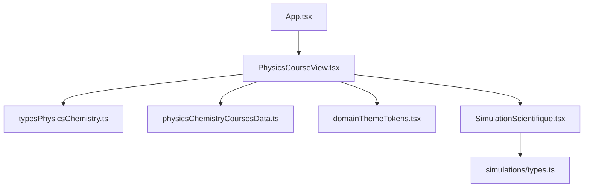
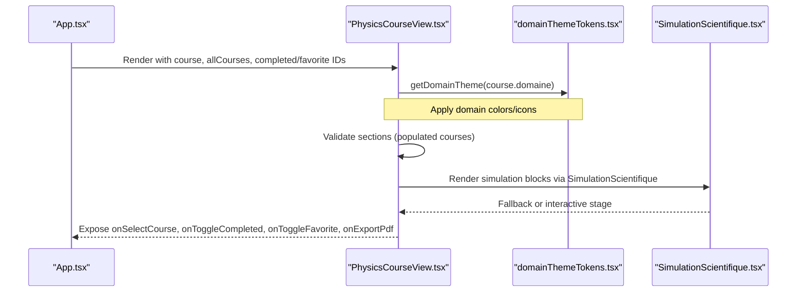
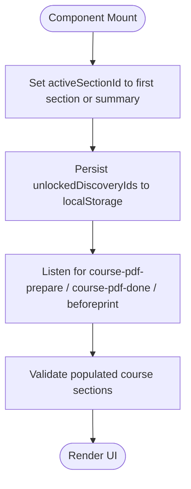
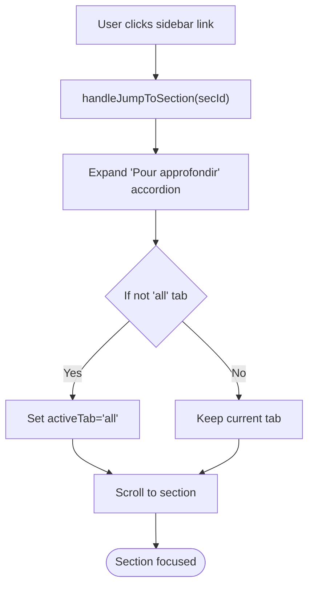
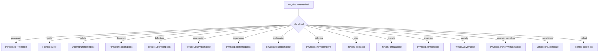
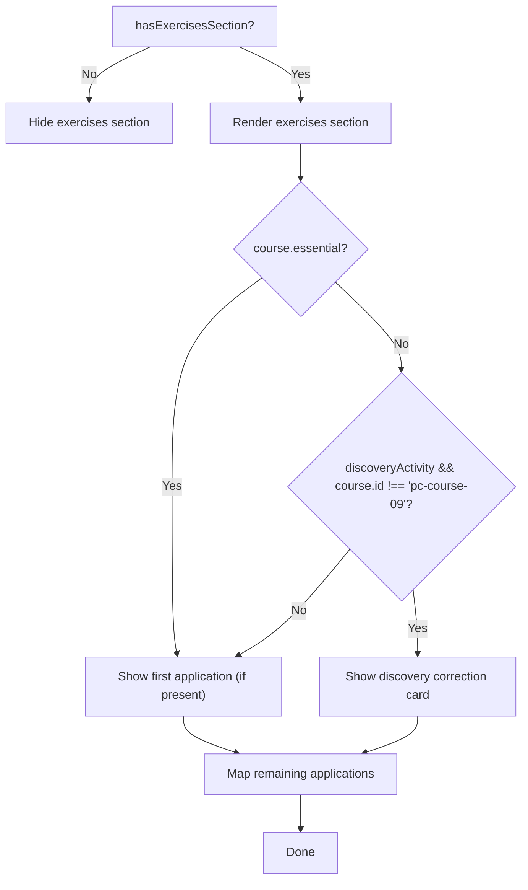
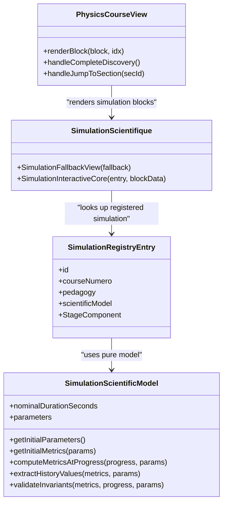
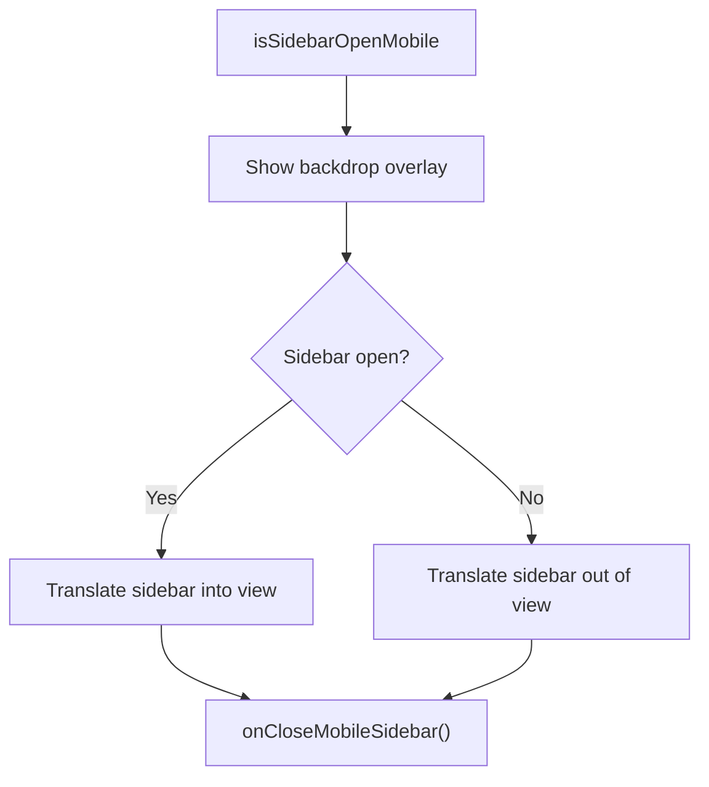
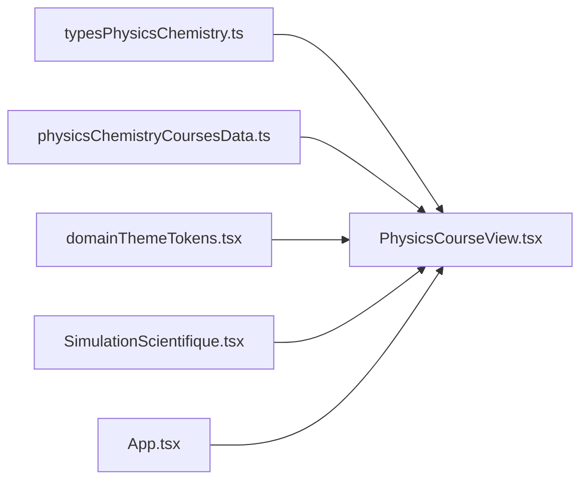

# PhysicsCourseView Component

<cite>
**Referenced Files in This Document**
- [PhysicsCourseView.tsx](file://src/components/physics/PhysicsCourseView.tsx)
- [typesPhysicsChemistry.ts](file://src/typesPhysicsChemistry.ts)
- [physicsChemistryCoursesData.ts](file://src/data/physicsChemistryCoursesData.ts)
- [domainThemeTokens.tsx](file://src/components/physics/domainThemeTokens.tsx)
- [SimulationScientifique.tsx](file://src/components/physics/simulations/SimulationScientifique.tsx)
- [types.ts](file://src/components/physics/simulations/types.ts)
- [App.tsx](file://src/App.tsx)
</cite>

## Table of Contents
1. [Introduction](#introduction)
2. [Project Structure](#project-structure)
3. [Core Components](#core-components)
4. [Architecture Overview](#architecture-overview)
5. [Detailed Component Analysis](#detailed-component-analysis)
6. [Dependency Analysis](#dependency-analysis)
7. [Performance Considerations](#performance-considerations)
8. [Troubleshooting Guide](#troubleshooting-guide)
9. [Conclusion](#conclusion)
10. [Appendices](#appendices)

## Introduction
PhysicsCourseView is the main orchestrator for the physics-chemistry learning experience. It renders a structured course layout, manages navigation between sections and courses, controls user progress, and integrates with the simulation framework. It also applies domain-specific theming, handles responsive mobile behavior, and exposes accessibility-friendly interactions such as PDF export preparation and collapsible content.

The component focuses on:
- Course navigation through a sticky sidebar and previous/next navigation.
- Content rendering via a block-based system that supports paragraphs, definitions, tables, formulas, activities, simulations, and more.
- State management for active tabs, active sections, discovery unlock state, and accordion visibility.
- Integration with the simulation framework through a dedicated simulation renderer.
- Domain-aware theming and visual identity across Matter, Energy, Electricity, and Optics domains.

## Project Structure
PhysicsCourseView lives under the physics components directory and consumes typed course data, domain theme tokens, and simulation infrastructure. The surrounding application wires it into the app shell and passes completion/favorite/export state from the parent.

**Diagram sources**
- [App.tsx:321-337](file://src/App.tsx#L321-L337)
- [PhysicsCourseView.tsx:1-35](file://src/components/physics/PhysicsCourseView.tsx#L1-L35)
- [SimulationScientifique.tsx:1-15](file://src/components/physics/simulations/SimulationScientifique.tsx#L1-L15)
- [types.ts:1-50](file://src/components/physics/simulations/types.ts#L1-L50)

**Section sources**
- [App.tsx:321-337](file://src/App.tsx#L321-L337)
- [PhysicsCourseView.tsx:1-35](file://src/components/physics/PhysicsCourseView.tsx#L1-L35)

## Core Components
- PhysicsCourseView: Main container for a single physics-chemistry course.
- PhysicsContentBlock: Discriminated union describing each content block (paragraph, definition, table, formula, activity, simulation, etc.).
- PhysicsCourseSection: A section containing ordered blocks.
- PhysicsChemistryCourse: Top-level course model including metadata, sections, exercises, vocabulary, and summary.
- SimulationScientifique: Renderer for interactive scientific simulations.
- Domain theme tokens: Visual identity per domain (colors, icons, gradients).

Key responsibilities:
- Validate populated courses and sections.
- Compute domain progress and current/previous/next courses.
- Manage local discovery unlock state persisted to localStorage.
- Render lesson sections, essential highlights, exercises, and summaries.
- Coordinate simulation integration and PDF export preparation.

**Section sources**
- [PhysicsCourseView.tsx:85-113](file://src/components/physics/PhysicsCourseView.tsx#L85-L113)
- [typesPhysicsChemistry.ts:306-395](file://src/typesPhysicsChemistry.ts#L306-L395)
- [domainThemeTokens.tsx:297-323](file://src/components/physics/domainThemeTokens.tsx#L297-L323)

## Architecture Overview
PhysicsCourseView composes multiple subcomponents and services:
- Theming: Uses getDomainTheme and PhysicsDomainThemeProvider to apply domain-specific colors and icons.
- Navigation: Sidebar lists sections and domain courses; previous/next buttons navigate by index.
- Content Rendering: renderBlock dispatches on block kind to specialized blocks or generic containers.
- Exercises: Renders contextualized applications and activities when available.
- Summary: Displays key points, summary schema, and vocabulary.
- Simulations: Delegates to SimulationScientifique for interactive models.

**Diagram sources**
- [App.tsx:321-337](file://src/App.tsx#L321-L337)
- [PhysicsCourseView.tsx:178-186](file://src/components/physics/PhysicsCourseView.tsx#L178-L186)
- [PhysicsCourseView.tsx:362-367](file://src/components/physics/PhysicsCourseView.tsx#L362-L367)
- [SimulationScientifique.tsx:110-133](file://src/components/physics/simulations/SimulationScientifique.tsx#L110-L133)

## Detailed Component Analysis

### Props Interface
PhysicsCourseView accepts props for course data, navigation callbacks, progress tracking, favorites, PDF export, and mobile sidebar control.

| Prop | Type | Description |
| --- | --- | --- |
| course | PhysicsChemistryCourse | Current course being rendered |
| allCourses | PhysicsChemistryCourse[] | Full list of physics-chemistry courses |
| completedCourseIds | string[] | IDs of completed courses |
| favoriteCourseIds | string[] | IDs of favorite courses |
| onSelectCourse | (courseId: string) => void | Navigate to another course |
| onBackToModuleHome | () => void | Return to physics module home |
| onToggleCompleted | (courseId: string) => void | Toggle completion status |
| onToggleFavorite | (courseId: string) => void | Toggle favorite status |
| onExportPdf | (() => void) | Export current course as PDF |
| isExportingPdf | boolean | Export loading indicator |
| isSidebarOpenMobile | boolean | Mobile sidebar open state |
| onCloseMobileSidebar | () => void | Close mobile sidebar |

**Section sources**
- [PhysicsCourseView.tsx:85-113](file://src/components/physics/PhysicsCourseView.tsx#L85-L113)

### Lifecycle Methods and Side Effects
- Section initialization: Sets active section to first section or summary fallback when course changes.
- Local storage persistence: Saves unlocked discovery IDs to localStorage.
- PDF event handling: Listens for custom window events to prepare print/PDF view and expand accordion.
- Validation: Throws explicit errors if a populated course has no sections or empty blocks.

**Diagram sources**
- [PhysicsCourseView.tsx:143-176](file://src/components/physics/PhysicsCourseView.tsx#L143-L176)
- [PhysicsCourseView.tsx:178-186](file://src/components/physics/PhysicsCourseView.tsx#L178-L186)

**Section sources**
- [PhysicsCourseView.tsx:143-186](file://src/components/physics/PhysicsCourseView.tsx#L143-L186)

### Course Navigation and Progress Management
- Sidebar displays domain progress bar and quick links to other courses within the same domain.
- Previous/Next navigation uses array indices to compute adjacent courses and their themes.
- Discovery gating: Only the first section is visible until the discovery activity is completed; completing it reveals subsequent sections and summary.
- Tabs: After discovery completion, tabs allow switching between full view, lesson, activities, and summary.

**Diagram sources**
- [PhysicsCourseView.tsx:242-258](file://src/components/physics/PhysicsCourseView.tsx#L242-L258)
- [PhysicsCourseView.tsx:1085-1113](file://src/components/physics/PhysicsCourseView.tsx#L1085-L1113)

**Section sources**
- [PhysicsCourseView.tsx:188-201](file://src/components/physics/PhysicsCourseView.tsx#L188-L201)
- [PhysicsCourseView.tsx:242-258](file://src/components/physics/PhysicsCourseView.tsx#L242-L258)
- [PhysicsCourseView.tsx:1036-1070](file://src/components/physics/PhysicsCourseView.tsx#L1036-L1070)

### Content Rendering and Block Dispatch
renderBlock maps each PhysicsContentBlock kind to a specific rendering component or container:
- paragraph, quote, bullets: Textual content with optional titles and notes.
- discovery, definition, observation, experience, explanation: Pedagogical blocks.
- schema, table, formula, example, activity: Structured educational elements.
- common-mistakes: Highlighted pitfalls and corrections.
- simulation: Delegates to SimulationScientifique.
- callout: Themed alert boxes with variants.

**Diagram sources**
- [PhysicsCourseView.tsx:260-401](file://src/components/physics/PhysicsCourseView.tsx#L260-L401)

**Section sources**
- [PhysicsCourseView.tsx:260-401](file://src/components/physics/PhysicsCourseView.tsx#L260-L401)

### Exercises and Activities Handling
- Determines whether an exercises section exists based on applications, activites, or discovery activity presence.
- For non-essential courses, shows discovery correction card or first application.
- Renders additional activities and applications, slicing depending on essential mode and discovery presence.

**Diagram sources**
- [PhysicsCourseView.tsx:403-461](file://src/components/physics/PhysicsCourseView.tsx#L403-L461)

**Section sources**
- [PhysicsCourseView.tsx:234-240](file://src/components/physics/PhysicsCourseView.tsx#L234-L240)
- [PhysicsCourseView.tsx:403-461](file://src/components/physics/PhysicsCourseView.tsx#L403-L461)

### Summary and Vocabulary
- Renders summary section with key points, optional summary schema, idea, and final note.
- Displays trilingual vocabulary table.

**Section sources**
- [PhysicsCourseView.tsx:1287-1299](file://src/components/physics/PhysicsCourseView.tsx#L1287-L1299)

### Simulation Framework Integration
PhysicsCourseView delegates simulation rendering to SimulationScientifique when encountering a simulation block. The simulation framework separates pedagogical content, scientific model, runtime state, and stage rendering.

**Diagram sources**
- [PhysicsCourseView.tsx:362-367](file://src/components/physics/PhysicsCourseView.tsx#L362-L367)
- [SimulationScientifique.tsx:138-170](file://src/components/physics/simulations/SimulationScientifique.tsx#L138-L170)
- [types.ts:237-290](file://src/components/physics/simulations/types.ts#L237-L290)

**Section sources**
- [SimulationScientifique.tsx:110-133](file://src/components/physics/simulations/SimulationScientifique.tsx#L110-L133)
- [SimulationScientifique.tsx:138-170](file://src/components/physics/simulations/SimulationScientifique.tsx#L138-L170)
- [types.ts:98-107](file://src/components/physics/simulations/types.ts#L98-L107)
- [types.ts:237-290](file://src/components/physics/simulations/types.ts#L237-L290)

### Responsive Design Patterns
- Mobile sidebar: Fixed aside slides in/out with backdrop overlay on small screens.
- Sticky desktop sidebar: Becomes sticky at larger breakpoints.
- RTL layout: Entire course view uses right-to-left direction.
- Print/PDF preparation: Custom window events force accordion expansion and tab reset for printable output.

**Diagram sources**
- [PhysicsCourseView.tsx:469-484](file://src/components/physics/PhysicsCourseView.tsx#L469-L484)
- [PhysicsCourseView.tsx:158-176](file://src/components/physics/PhysicsCourseView.tsx#L158-L176)

**Section sources**
- [PhysicsCourseView.tsx:469-484](file://src/components/physics/PhysicsCourseView.tsx#L469-L484)
- [PhysicsCourseView.tsx:158-176](file://src/components/physics/PhysicsCourseView.tsx#L158-L176)

### Accessibility Features
- Collapsible accordion with aria-expanded attribute.
- Simulation controls include aria-labels and aria-pressed for toggles.
- Reduced motion toggle for simulations.
- Semantic headings and landmarks for sections.
- Focusable navigation buttons with clear labels.

**Section sources**
- [PhysicsCourseView.tsx:1087-1113](file://src/components/physics/PhysicsCourseView.tsx#L1087-L1113)
- [SimulationScientifique.tsx:675-689](file://src/components/physics/simulations/SimulationScientifique.tsx#L675-L689)

## Dependency Analysis
PhysicsCourseView depends on:
- typesPhysicsChemistry.ts for course and block type definitions.
- physicsChemistryCoursesData.ts for sample/training course data and domain metadata.
- domainThemeTokens.tsx for domain-specific visual tokens and provider.
- SimulationScientifique.tsx for simulation rendering.
- App.tsx for wiring props and global state.

**Diagram sources**
- [PhysicsCourseView.tsx:1-35](file://src/components/physics/PhysicsCourseView.tsx#L1-L35)
- [App.tsx:321-337](file://src/App.tsx#L321-L337)

**Section sources**
- [typesPhysicsChemistry.ts:306-395](file://src/typesPhysicsChemistry.ts#L306-L395)
- [physicsChemistryCoursesData.ts:14-43](file://src/data/physicsChemistryCoursesData.ts#L14-L43)
- [domainThemeTokens.tsx:297-323](file://src/components/physics/domainThemeTokens.tsx#L297-L323)
- [App.tsx:321-337](file://src/App.tsx#L321-L337)

## Performance Considerations
- Avoid unnecessary re-renders by keeping state minimal: activeTab, activeSectionId, unlockedDiscoveryIds, tataamakAccordionOpen.
- Use computed values for domain progress and previous/next courses to avoid repeated filtering.
- Defer DOM scrolling with short timeouts after state updates to ensure stable rendering.
- Simulation rendering is isolated; fallback view prevents crashes and reduces overhead when interactive stages are unavailable.

[No sources needed since this section provides general guidance]

## Troubleshooting Guide
- Empty sections error: Populated courses must have non-empty sections; otherwise, an explicit error is thrown during render.
- Missing simulation implementation: SimulationScientifique falls back to a static fallback view if the simulation cannot be initialized.
- PDF export issues: Ensure window events course-pdf-prepare and course-pdf-done are handled to expand accordion and reset tabs.

**Section sources**
- [PhysicsCourseView.tsx:65-83](file://src/components/physics/PhysicsCourseView.tsx#L65-L83)
- [PhysicsCourseView.tsx:178-186](file://src/components/physics/PhysicsCourseView.tsx#L178-L186)
- [SimulationScientifique.tsx:110-133](file://src/components/physics/simulations/SimulationScientifique.tsx#L110-L133)
- [PhysicsCourseView.tsx:158-176](file://src/components/physics/PhysicsCourseView.tsx#L158-L176)

## Conclusion
PhysicsCourseView serves as the central orchestrator for physics-chemistry courses, combining robust navigation, structured content rendering, domain theming, and simulation integration. It enforces data integrity, supports responsive layouts, and provides accessible interactions. Its design cleanly separates concerns through typed data models, modular block rendering, and a pluggable simulation framework.

[No sources needed since this section summarizes without analyzing specific files]

## Appendices

### Example: Handling Different Course Types
- Essential courses: Display essential highlights and exercises above the accordion.
- Non-essential courses: Show discovery correction card or first application in the exercises section.
- Domain-specific components: Energy domain injects energy-related blocks at specific sections.

**Section sources**
- [PhysicsCourseView.tsx:1074-1083](file://src/components/physics/PhysicsCourseView.tsx#L1074-L1083)
- [PhysicsCourseView.tsx:1258-1278](file://src/components/physics/PhysicsCourseView.tsx#L1258-L1278)

### Example: Managing User Progress
- Completed courses: Toggled via onToggleCompleted and reflected in domain progress.
- Favorites: Toggled via onToggleFavorite and visually indicated.
- Discovery unlock: Persisted to localStorage and gates access to later sections.

**Section sources**
- [PhysicsCourseView.tsx:198-216](file://src/components/physics/PhysicsCourseView.tsx#L198-L216)
- [PhysicsCourseView.tsx:850-883](file://src/components/physics/PhysicsCourseView.tsx#L850-L883)

### Example: Coordinating Between Physics Domains
- Domain theme selection: getDomainTheme applies consistent colors and icons per domain.
- Domain progress: Computed from allCourses filtered by domaine.
- Visual identity: Header banner and sidebar reflect domain branding.

**Section sources**
- [domainThemeTokens.tsx:297-323](file://src/components/physics/domainThemeTokens.tsx#L297-L323)
- [PhysicsCourseView.tsx:127-141](file://src/components/physics/PhysicsCourseView.tsx#L127-L141)
- [PhysicsCourseView.tsx:894-937](file://src/components/physics/PhysicsCourseView.tsx#L894-L937)